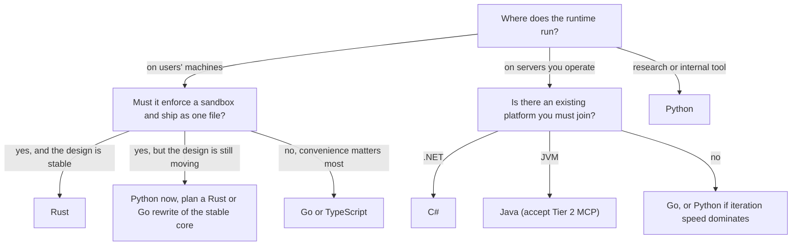

# Implementation languages for an agentic runtime layer

A treatise comparing **Python, Rust, C#, Go and Java** for building the runtime that sits between users, tools and a large language model (LLM): the loop, the tool dispatcher, the permission gate, the context manager and the extension surface.

Status: written 2026-11-19. Facts about SDKs and frameworks move quickly; each one below says where it comes from and how well it was verified. **Nothing here is a benchmark.** No code was compiled or timed for this document (only Python and Node were available when it was written). [Section 9](#9-how-to-turn-this-into-measurements) defines the experiment that would produce real numbers.

## 1. The answer first

**The language matters less than the deployment shape, and the loop is small enough that the choice is reversible.** The evidence in this repository says the core loop of a production coding assistant is small and I/O-bound, and the weight is in the systems around it ([Dive into Claude Code](../../llm-learning-repository/tutorials/06-agent-systems/28-dive-into-claude-code.md), [Harness Engineering](../../llm-learning-repository/tutorials/06-agent-systems/29-harness-engineering.md)). A model call takes seconds; the language's own overhead is microseconds to milliseconds. So raw speed almost never decides this. What decides it is: how safely you handle concurrent streams and cancellation, how well the language handles untyped JSON at the model boundary, whether you need to ship a single binary to users' machines, how you sandbox untrusted commands, how the runtime is extended, and who will maintain it.

| If you are building... | Pick | Why, in one line |
|---|---|---|
| A local agent installed on users' machines that runs commands and edits files | **Rust** (or Go if you can accept a weaker sandbox story) | Single static binary, no runtime to install, memory safety, native OS sandbox calls. The one Rust system in the eleven-system study is the one that ships a native three-OS sandbox. |
| A server-side agent gateway or orchestrator serving many sessions | **Go** | Cheap concurrency, built-in cancellation, single binary, simple operations, official MCP SDK at Tier 1. |
| An agent inside an existing enterprise product | **C#** if the product is .NET, **Java** if it is on the JVM | Reuse the platform, identity, observability and deployment you already run. Framework support is real in both. |
| A runtime you are still discovering, with evals, open-model work, or local-model tuning | **Python** | Fastest iteration, the richest model and evaluation ecosystem, and half of the studied systems. Move the stable parts later. |

Two things the question did not ask but you should weigh:

1. **TypeScript is missing from your list and is the other half of the evidence.** Of the eleven systems in the Harness Engineering study, five are Python, five are TypeScript, one is Rust, and none is Go, Java or C#. If you want the language most real agent runtimes actually use, TypeScript belongs in the comparison (shared types with a web or IDE front end, native JSON, one runtime for CLI and UI). It is outside the five requested, so this treatise names it where it changes a conclusion and does not score it.
2. **Go, Java and C# are absent from that sample, but not because they are unsuitable.** The study picked open-source coding agents, a community that skews to Python and TypeScript. Absence of Go, Java and C# from eleven open-source coding agents is not evidence that they are bad choices for a server-side runtime. It is evidence that nobody should treat them as the default for a coding agent without a reason.

## 2. What a runtime layer actually does

A runtime layer is more than "call the model in a loop". Twelve duties, and how much the language matters to each:

| # | Duty | Language-sensitive? |
|---|---|---|
| 1 | Stream tokens from the model API (HTTP with server-sent events) and assemble partial tool calls | Medium: needs good async I/O and incremental JSON handling |
| 2 | Run the loop as an explicit state machine: model call, tool request, permission check, tool run, append result, repeat or stop | Medium: sum types and exhaustive matching make illegal states harder to write |
| 3 | Validate tool arguments against a JSON Schema and generate that schema from code | High: this is the model boundary, where typed languages and untyped JSON meet |
| 4 | Run tools concurrently (read-only in parallel, writers serialised), with cancellation, timeouts and backpressure | High: this is where concurrency models differ most |
| 5 | Execute untrusted commands in a sandbox: child processes, OS sandbox APIs, containers | High: needs process control and OS integration |
| 6 | Assemble and compact context: string-heavy, CPU-light | Low |
| 7 | Persist sessions (append-only logs, resume, fork) | Low |
| 8 | Enforce permissions: rules, modes, hooks, approval prompts | Medium: a safety-critical policy engine rewards strong typing and testability |
| 9 | Extend through MCP (Model Context Protocol), plugins, skills, hooks | High: dynamic loading is easy in Python and hard in Rust and Go |
| 10 | Observe: traces, token and cost accounting | Low to medium |
| 11 | Package and distribute: installers, startup time, footprint | High |
| 12 | Integrate local or open models: in-process inference or a local server | Medium to high |

Why speed does not top the list: the paper-based evidence is that a loop of roughly a hundred lines (Mini-SWE-Agent) stays close to systems hundreds of times larger on the authors' collected benchmark claims, and that loop sophistication did not predict those claims ([Harness Engineering, Observation 1](../../llm-learning-repository/tutorials/06-agent-systems/29-harness-engineering.md)). Those are self-reported numbers from third-party code reading, so treat the direction as informative and the magnitude as soft.

## 3. What the real systems chose

From the Harness Engineering study (arXiv:2609.00006, Table 4 as summarised in our [guide](../../llm-learning-repository/tutorials/06-agent-systems/29-harness-engineering.md)); a 2026 preprint, not peer reviewed, whose analysis was largely performed by an AI assistant with the authors verifying.

| Language | Systems (tools by default) |
|---|---|
| Python (5) | OpenHands (25+), Aider (13 edit formats), Mistral Vibe (12+), Mini-SWE-Agent (1), Hermes (69) |
| TypeScript (5) | Claude Code (43), Gemini CLI (35+), Pi (4 default), OpenCode (17), OpenClaw (109+) |
| Rust (1) | Codex (25 to 30; 1.1 million lines) |
| Go, Java, C# (0) | none in the sample |

Three observations:

- **Python systems cover the whole size range**, from the 5,000-line Mini-SWE-Agent to the "very large" Hermes. The language does not cap how big a runtime can get.
- **The one Rust system is the largest and the one with a native sandbox on all three desktop operating systems** (Table 4, as summarised in the guide). That coincides with what the language is good at; the study does not claim it caused it.
- **Codex was rewritten from TypeScript to Rust.** Secondary reports from 2025 give the reasons as performance, security, and avoiding a Node.js installation. The sandbox motive is thinly sourced. We did not read OpenAI's own statement, so treat the reasons as reported, not confirmed. The point that matters for you: a production runtime was rewritten in another language and survived, which is evidence that the loop is portable.

## 4. The five languages, one at a time

Each profile covers what the language is good at in this job, where it costs you, the ecosystem facts we verified, and when to pick or avoid it. "Verified" means read from an official page on 2026-11-19; "secondary" means reported by blogs or news and not confirmed against a primary source; "general" means long-standing engineering knowledge not rechecked here.

### 4.1 Python

**Strengths**
- *Speed of change.* Dynamic typing, a REPL, and trivial dynamic loading mean a plugin or tool can be added at runtime. If the shape of your runtime is still moving, nothing is cheaper to change. (general)
- *Ecosystem.* The Anthropic client SDK has sync and async clients with Pydantic models (verified); the MCP SDK for Python is Tier 1 (verified); Python is one of two languages for the Claude Agent SDK and for the OpenAI Agents SDK (secondary); Microsoft Agent Framework reached 1.0 general availability for .NET and Python on 2026-04-03 per Microsoft's devblog (see its [profile](../frameworks/profiles/microsoft-agent-framework.md)); Google's Agent Development Kit (ADK) has a Python version.
- *Model-side work.* Training, evaluation and tuning libraries live here, as does Apple's MLX for local fine-tuning and inference on Apple Silicon (general). If you tune open models, your pipeline is probably already Python.
- *Schemas from types.* Pydantic turns a typed function into a JSON Schema, which is the tool-definition problem solved in a few lines. (general)

**Costs**
- *Concurrency.* `asyncio` handles many concurrent streams well, but one blocked coroutine stalls the loop, and CPU-heavy work (large diffs, indexing) competes with I/O work for one thread. The free-threaded build (no Global Interpreter Lock) became officially supported in Python 3.14 but remains optional and separate from the default build (verified from PEP 779 discussion; secondary on details). Do not design around it yet.
- *Distribution.* Shipping to users who do not have Python means bundling an interpreter or requiring one. This is the main reason a local CLI tends to leave Python as it matures. (general)
- *Type safety at runtime.* Type hints are not enforced. A wrong tool-result shape is a runtime error in production unless you validate everywhere. (general)
- *Plugins are also an attack surface.* Easy dynamic import means a plugin has the runtime's full power unless you isolate it.

**Pick Python when** the runtime is a research artefact or an internal service, you work with open or local models, you need the evaluation ecosystem, or the team's strength is machine learning. **Avoid it for** a locally installed binary where installation friction and sandbox enforcement matter most.

### 4.2 Rust

**Strengths**
- *Safety without a runtime.* Ownership and borrowing rule out data races at compile time, which matters when parallel tool calls share session state. Exhaustive `enum` matching suits an agent state machine: adding a new tool outcome is a compile error until every `match` handles it. (general)
- *Distribution.* A single native binary with no interpreter, small memory footprint, fast start. This is the stated reason for Codex's move away from Node.js (secondary).
- *OS-level sandboxing.* Direct access to platform sandbox APIs without a managed runtime in the way. (general; the Codex sandbox claim is secondary)
- *MCP.* The Rust SDK is Tier 1 (verified).
- *In-process local inference.* `candle` (Hugging Face's Rust ML framework) and `mistral.rs` (quantised models on Apple Silicon, CPU and CUDA, with an OpenAI-compatible HTTP server) mean a Rust runtime can embed a model without a second process (secondary). `rig` is the most visible Rust LLM framework: version 0.46.0 on 2026-10-31, 16 minor versions since February 2026, and a README that says releases break APIs (see its [profile](../frameworks/profiles/rig-rust.md); not compiled or run).

**Costs**
- *No official Anthropic SDK.* Anthropic's official client SDKs cover Python, TypeScript, C#, Go, Java, PHP and Ruby; Rust is not on the list (verified). You use a community crate or write a thin HTTP client. For a runtime this is a modest cost (the API is small and you want control over streaming anyway), but it is a cost.
- *Iteration speed and hiring.* Compile times, the borrow checker, and a smaller talent pool. If the design is still changing weekly, Rust slows you down. (general)
- *Dynamic extension is hard.* Loading user plugins at runtime means a subprocess, WebAssembly, or an embedded scripting language. Codex runs tool calls as V8-executed code, which is one answer (per the study). (general)
- *JSON at the boundary.* `serde` is excellent, but `serde_json::Value` handling of arbitrary tool arguments is more verbose than in a dynamic language.

**Pick Rust when** you distribute a binary to user machines, the runtime enforces a sandbox, and the design is stable enough to pay for it. **Avoid it** when you are still learning what the runtime should do.

### 4.3 Go

**Strengths**
- *Concurrency that fits the problem.* Goroutines and channels with `context.Context` cancellation line up with the loop's needs: one goroutine per session, parallel tool calls, cancellation propagated from the user's interrupt to the in-flight HTTP stream and subprocess. The official Anthropic Go SDK advertises "context-based cancellation" (verified). (general for the rest)
- *Operations.* A single static binary, trivial cross-compilation, fast start, small footprint, and an operations culture that rewards boring services. (general)
- *MCP.* The Go SDK is Tier 1 (verified). Google's ADK for Go went 1.0 on 2026-03-20 and is v2.8.0 as of 2026-11-19 (module proxy). Eino from CloudWeGo is still 0.x (v0.9.23, 159 tags since v0.3.0) and LangChainGo's last two releases are a year apart (v0.1.14 on 2025-10-20, v0.1.15 on 2026-10-05). The Go profiles ([Eino](../frameworks/profiles/eino-go.md)) recommend writing the loop on the official Anthropic and MCP SDKs.

**Costs**
- *No sum types.* Go has no enums with payloads, so modelling "the model returned text, or a tool call, or a refusal, or a stop" uses interfaces and type switches, and the compiler does not tell you when you forgot a case. For a state machine this is the most real weakness. (general)
- *Schema generation is manual-ish.* Struct tags and reflection or code generation produce JSON Schema; it works but is clunkier than Pydantic. (general)
- *Plugins.* Go's native plugin support is limited, so extension goes through subprocesses (including MCP servers) or scripting. (general)
- *Verbose error handling* is a style cost more than a technical one.

**Pick Go when** you are building a server-side runtime or gateway with many concurrent sessions, want simple operations, and are comfortable pushing extensibility to MCP and subprocess boundaries. **Avoid it** if the heart of your runtime is a complex state machine that you want the compiler to police.

### 4.4 C\#

**Strengths**
- *A good fit for the modelling.* Records, sealed hierarchies and pattern matching give you most of what Rust's enums give you for state machines, with a managed runtime. `async`/`await`, `IAsyncEnumerable` and `Channel<T>` suit streaming and parallel tools. (general)
- *First-class vendor support.* The official Anthropic C# SDK targets .NET Standard 2.0+ and integrates with `IChatClient`, Microsoft's provider-neutral chat abstraction (verified). The MCP C# SDK is Tier 1 (verified). Microsoft Agent Framework reached 1.0 general availability on 2026-04-03 with graph workflows, checkpointing, middleware and OpenTelemetry. AutoGen is archived (its README says no fixes or support); Semantic Kernel is not archived and still ships, with migration guides for both. Many satellite packages (Anthropic, Ollama, Claude connector) are still date-stamped betas ([profile](../frameworks/profiles/microsoft-agent-framework.md)).
- *Enterprise fit.* If the surrounding platform is .NET (identity, hosting, observability, deployment), the agent runtime joins it without a second stack.
- *Distribution.* Self-contained and ahead-of-time (NativeAOT) builds exist, with trade-offs around reflection-heavy libraries. (general; not rechecked)

**Costs**
- *Smaller agent and local-model open-source community* than Python or TypeScript. You will write more glue yourself, and on Apple Silicon you will not use MLX. (general)
- *Reflection and AOT tension.* Schema generation by reflection and ahead-of-time compilation do not always mix; source generators solve it. (general)
- *Cross-platform sandboxing* needs per-OS code you write yourself.

**Pick C# when** you are a .NET shop, or you want a managed, strongly typed runtime with vendor-backed frameworks. **Avoid it** if your team has no .NET experience and no .NET platform to join.

### 4.5 Java

**Strengths**
- *Mature concurrency for I/O-bound work.* Virtual threads are final since Java 21, so blocking code (including blocking calls to an LLM API) can scale to very many concurrent sessions without callback style (secondary on details; the feature itself is long-standing). The official Anthropic Java SDK offers builders and `CompletableFuture` async (verified).
- *Frameworks.* Spring AI is at 2.0.2 (2026-10-23), which requires Spring Boot 4 and a Java 17 baseline; the 1.1.x line stays on Boot 3.5. LangChain4j is at 1.24.0 (2026-11-18) with beta tracks for its agentic and MCP modules. Google's ADK for Java is 1.15.0 (Maven metadata, 2026-11-18). None of these was compiled or run (no JDK); see the [Spring AI](../frameworks/profiles/spring-ai.md) and [LangChain4j](../frameworks/profiles/langchain4j.md) profiles. A GitHub Copilot SDK for Java was reported in August 2026 (secondary).
- *Enterprise reality.* Where the organisation already runs the JVM with its security, monitoring and deployment practices, a Java runtime inherits them.
- *Types.* Records and sealed interfaces (modern Java) give workable sum types. (general)

**Costs**
- *MCP SDK is Tier 2, not Tier 1* (verified): actively maintained and working toward full specification support, but behind the five Tier 1 SDKs on protocol features. This is the one place in the five-language comparison where the official protocol support is visibly weaker, and it matters if you want the newest MCP capabilities (sampling, elicitation) as soon as the specification adds them.
- *Startup and footprint.* The JVM's start time and memory are poor for a locally installed CLI; GraalVM native image mitigates it with constraints. (general)
- *Ceremony.* More code per behaviour than the other four, which slows iteration while the design moves.

**Pick Java when** the runtime lives inside an existing JVM service and you accept Tier 2 MCP. **Avoid it** for a local CLI or a fast-moving prototype.

## 5. Head-to-head

Verified cells come from official pages read on 2026-11-19. Cells marked (g) are general engineering knowledge, not rechecked.

| Dimension | Python | Rust | C# | Go | Java |
|---|---|---|---|---|---|
| Official Anthropic client SDK | Yes | **No** (community or raw HTTP) | Yes | Yes | Yes |
| Official MCP SDK tier | Tier 1 | Tier 1 | Tier 1 | Tier 1 | **Tier 2** |
| Concurrency for many streams | asyncio; one thread unless free-threaded (optional from 3.14) | tokio, compile-time data-race freedom (g) | async/await, channels (g) | goroutines, `context` cancellation (g) | virtual threads (g) |
| Cancellation | Cooperative (g) | Cooperative via drop and cancellation tokens (g) | `CancellationToken` (g) | `context.Context`, idiomatic | Interrupt and structured concurrency (g) |
| Sum types for the state machine | Weak (typing only, unenforced) | Strong (`enum`) | Good (records, patterns) | **Weak** (interfaces) | Good (sealed, records) |
| Schema from code | Pydantic, excellent (g) | serde plus schema crates (g) | Reflection or source generators (g) | Struct tags (g) | Annotations or reflection (g) |
| Single-file distribution | Weak (bundle interpreter) | **Strong** | Good (self-contained, AOT) | **Strong** | Weak to fair (JVM; native image) |
| Startup and footprint | Fair | **Strong** | Good (AOT: strong) | **Strong** | Weak (native image: fair) |
| OS sandbox integration | Via subprocess or bindings | **Direct** | P/Invoke per OS | Direct via syscalls and subprocess | JNI or subprocess |
| Dynamic plugins in-process | **Trivial** | Hard (WASM, subprocess) | Possible (assemblies) | Limited (subprocess) | Possible (class loading) |
| In-process local models | Rich (MLX, llama.cpp bindings, PyTorch) | candle, mistral.rs (secondary) | ONNX-based options (g) | Bindings (g) | Bindings (g) |
| Agent frameworks | Many (LangGraph, OpenAI Agents SDK, Claude Agent SDK, ADK, PydanticAI, Agent Framework) | `rig` 0.46 (API churn) | Microsoft Agent Framework 1.x | ADK Go, Eino 0.x | Spring AI 2.x, LangChain4j 1.x, ADK Java |
| Iteration speed | **Highest** | Lowest | Medium | Medium-high | Medium |
| Systems in the eleven-system study | 5 | 1 | 0 | 0 | 0 |

How to read it: no column wins. Rust leads on distribution and sandboxing and pays in iteration speed. Python leads on iteration and ecosystem and pays in distribution. Go sits in the middle, strongest on server operations, weakest on state-machine modelling. C# and Java win when the surrounding platform is theirs. **Java's Tier 2 MCP and Rust's missing official Anthropic SDK are the two concrete, verifiable gaps** among the five.

## 6. The decision depends on five questions



1. **Where does it run?** User machines push you to a single binary (Rust, Go). Servers you operate push you to concurrency and operations (Go, C#, Java). Notebooks and internal tools push you to Python.
2. **Do you need to enforce a sandbox yourself?** If yes, you want direct OS access and strong typing around the permission engine: Rust first, then Go.
3. **How stable is the design?** If you are still changing the loop weekly, pay the iteration tax last. Prototype in Python or TypeScript; port the stable parts.
4. **What platform must you join?** Existing .NET or JVM investment is a better reason than any language property.
5. **Do you tune or run open models in-process?** Python (and MLX on Apple Silicon) if you tune; any language if you serve models over HTTP. Serving the model from a local server (Ollama, vLLM, llama.cpp, mistral.rs) decouples the model from the runtime's language.

## 7. Make the language a reversible decision

The cheap way to win this comparison is not to pick the best language. It is to make picking wrong cheap.

- **Keep the loop small and specified.** It is a hundred-ish lines of state machine. Write the loop as a language-neutral specification (Section 8) with golden transcripts, and any rewrite is a conformance exercise, not a research project. Codex's move from TypeScript to Rust is the existence proof (reported, secondary).
- **Put tools behind MCP.** The MCP SDK is Tier 1 in five of these languages, so a tool server can be written in any of them and used from any runtime. Tools are where most of the code lives; MCP makes that code language-independent.
- **Put the model behind HTTP.** A local or hosted model reached over an OpenAI-compatible or provider API removes the model from the language decision.
- **Spend your care on the parts that are expensive to change:** the persistence format (an append-only, versioned log), the permission policy language, the extension API, and the sandbox boundary. These outlive the language.
- **Keep dangerous execution in a small helper.** A sandbox launcher written in Rust or Go, called by a Python or TypeScript runtime, is a legitimate architecture. The paper-based finding that the loop is thin and the surroundings are heavy argues for isolating the heavy, risky part.

## 8. A language-neutral reference specification

The loop, in the form the studied systems share (the shape is from the Dive into Claude Code and Harness Engineering guides; the exact steps below are this treatise's own simplification):

```
state    = { messages, session_id, permission_mode }
turn(state, user_input):
    state.messages.append(user)
    loop:
        context  = assemble(state.messages)              # compaction, instructions, tool list
        reply    = stream_model(context, tools)          # SSE; may be cancelled
        state.messages.append(reply)
        calls    = reply.tool_calls
        if calls is empty: return reply.text             # stop condition: no tool use
        for call in calls:                               # reads parallel, writes serial
            decision = permissions.check(call, state)    # allow | deny(reason) | ask
            if decision == deny: result = Denied(reason)
            elif decision == ask and not approved(call): result = Denied("user declined")
            else: result = run_tool(call, timeout, cancel_token)
            state.messages.append(tool_result(call.id, result))
        persist(state)                                   # append-only log
        if budget_exhausted(state): return stop("budget")
```

Eight invariants any implementation must pass, expressed as tests against a deterministic stub model:

1. A tool result is appended for every tool call, including denied and cancelled ones, in call order.
2. Cancelling during a model stream stops the stream and leaves the log consistent.
3. Cancelling during a tool run terminates its subprocess tree.
4. A malformed tool-call argument returns an error result to the model and does not crash the loop.
5. Two read-only calls run concurrently; a write call waits for in-flight reads.
6. A denied call never executes.
7. Replaying the log reproduces the same state.
8. The loop stops on "no tool calls", on budget exhaustion, and on user interrupt, and on nothing else.

## 9. How to turn this into measurements

Nothing above is measured. To get numbers instead of opinions, implement the Section 8 specification in each of the five languages (plus TypeScript if you want the sixth data point) against a **local stub server** that speaks the provider's streaming protocol with scripted replies (fixed token pacing, scripted tool calls, injected 429s, timeouts and malformed JSON). Then record:

| Metric | How |
|---|---|
| Lines of code and time to a passing conformance suite | Count; time a developer new to each language, or use the same developer with notes |
| Startup time and binary or install size | Cold start of the CLI; size of the artefact a user would download |
| Resident memory per idle session and per active stream | 1, 100, 1,000 concurrent sessions |
| Tail latency added by the runtime | p50/p99 time from "stub sends last token" to "runtime sends next request" |
| Cancellation latency | Time from interrupt to the stub seeing the connection close, and to a child process exiting |
| Behaviour under injected faults | Count of invariant violations in the conformance suite across fault schedules |
| Cost to add a new tool type | Diff size and compile or test time |

The stub makes the model's latency a controlled variable, so what remains is the runtime's own cost, which is exactly the question the language choice affects. Expect the headline result to be that the runtime adds negligible latency in all five languages, and that the differences are in memory per session, startup, packaging and the cost of the defects the conformance suite catches. That expectation is this treatise's hypothesis, not a result.

## 10. Caveats and how to check this

- **Official pages read on 2026-11-19:** the [MCP SDK list](https://modelcontextprotocol.io/docs/sdk.md) and [tier definitions](https://modelcontextprotocol.io/community/sdk-tiers.md), and the [Anthropic SDK overview](https://platform.claude.com/docs/en/api/client-sdks.md). Tiers and SDK lists change; re-check before deciding.
- **Framework facts** (versions, dates, status) were re-read from package registries and official pages on 2026-11-19 for the [framework profiles](../frameworks/README.md); the Java, Go and Rust frameworks were not compiled or run. **Still secondary:** Codex's rewrite reasons; Python 3.14 free-threading details beyond the PEP 779 status. Verify before you cite them.
- **General engineering knowledge** (cells marked "g") reflects widely held practice and was not rechecked in this session.
- **Selection bias in the evidence:** eleven open-source coding agents are a sample of one community. Closed products and non-coding agents are underrepresented.
- **No measurements.** See Section 9.
- **Not covered:** TypeScript (the other half of the evidence), Kotlin, Swift, Ruby and PHP; web-assembly sandboxes; browser-based agents; the language of the model-serving layer.

## Related reading in this repository

- [Agent frameworks compared for implementers](../frameworks/README.md) and the [selection method](../../architecture-evolution/language-and-framework-selection.md)
- [Stage brief: agent systems](../../llm-learning-repository/tutorials/06-agent-systems/README.md): the five separately-evidenced claims about thin runtimes and tool counts
- [Dive into Claude Code](../../llm-learning-repository/tutorials/06-agent-systems/28-dive-into-claude-code.md) and [Harness Engineering](../../llm-learning-repository/tutorials/06-agent-systems/29-harness-engineering.md): the evidence about what a runtime contains
- [CodeAct](../../llm-learning-repository/tutorials/06-agent-systems/25-codeact.md): code as the action format, which also shapes the sandbox decision
- [Agent interoperability protocols](../../llm-learning-repository/tutorials/04-agents-and-protocols/21-interoperability.md) and the [protocols and channels reference](../../llm-learning-repository/references/protocols-and-channels.md): MCP and A2A
