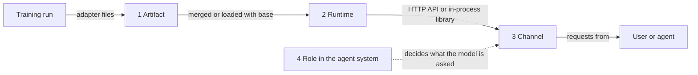
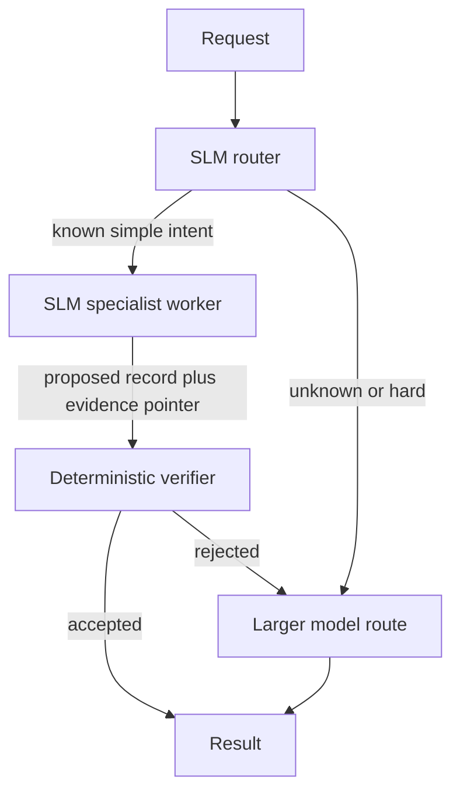

# 03. Vehicles: what carries an SLM to a user

"Vehicle" has four layers. Teams that name only one of them (usually "we'll use Ollama") hit surprises in the others.

Read it left to right: training produces an *artifact*; a *runtime* loads it; a *channel* exposes the runtime to people or agents; and the *role* the model plays in the agent system decides what is ever sent to it. Each layer has its own failure modes and its own owner.

## 1. Artifact: what you ship

| Artifact | What it is | Size (order of magnitude) | Pros | Cons |
|---|---|---|---|---|
| **Adapter only** (LoRA safetensors) | The small trained matrices; needs the exact base model | Megabytes | Tiny; many adapters per base; swap per tenant or task; easy to version | Runtime must support adapters; base revision must match exactly; Ollama documents the adapter-base match requirement and lists Llama, Mistral and Gemma families for safetensors adapters |
| **Merged weights** (safetensors) | Adapter folded into the base | Same as the base: 4B at 16-bit is about 8 GB | Works in any runtime; no adapter plumbing | One full copy per task; licence and provenance of the whole file is now yours |
| **Quantized merged weights** (GGUF, AWQ, GPTQ, FP8, NVFP4, MXFP4) | Merged weights stored at lower precision | 4B at about 4.85 bits per weight is about 2.4 GB | Fits laptops and small GPUs; faster | Quality must be re-measured **on the exact quantized file**; formats are runtime-specific |
| **Container image** | Runtime plus weights plus config | Gigabytes | Reproducible; fits Kubernetes and air-gapped sites | Big images; each base update rebuilds |
| **OCI artifact or registry entry** | Weights stored and versioned like images | Same as weights | Reuses your artifact registry, signing and promotion flow | Tooling is less standard than for images; registry choice was unverified |
| **Bundled in a desktop or mobile app** | Weights ship inside or download beside the app | 1 to 3 GB for small models | No server; works offline; strongest privacy story | You now distribute weights to devices: licence, update, and tamper questions; hardware variance |

**Arithmetic you can reuse.** Weights memory is parameters times bits per weight divided by 8. A 4B model: 16-bit is 4,000,000,000 x 16 / 8 = 8.0 GB; at 4.85 bits per weight (GGUF Q4_K_M is about 4.8 to 4.9 bits) it is about 2.4 GB. This excludes the key-value cache for the context, which grows with sequence length and concurrent users, and runtime overhead; plan 20 to 50 percent headroom (a planning rule of thumb, not a measured figure).

Rule for adapters: **record the base repository, revision hash, tokenizer, chat template, adapter rank and target modules next to every adapter**, or you cannot reproduce or safely swap it.

## 2. Runtime: what loads and runs it

| Runtime | Best fit | Adapters and quantization | Structured output | Status and caution |
|---|---|---|---|---|
| **vLLM** | Server-side throughput on NVIDIA and other GPUs | Multi-LoRA: `--enable-lora`, `--lora-modules name=path`, `--max-loras` (adapters active per batch, default 1), `--max-lora-rank` (at least your adapter rank), `--max-cpu-loras`; runtime load and unload needs `VLLM_ALLOW_RUNTIME_LORA_UPDATING=True`. Quantization: AWQ, GPTQ, FP8, MXFP4, NVFP4, GGUF; LLM Compressor recommended | Supported (not verified in this pass; check the docs) | The common default for enterprise self-hosting |
| **SGLang** | Server-side serving with strong structured output | LoRA serving config exists (`max_loras_per_batch`) | XGrammar (default), Outlines or Llguidance; JSON schema, regex, EBNF (older docs had Outlines as default) | Quantization support unverified |
| **llama.cpp / GGUF** | CPU, Mac and edge; smallest dependency footprint | GGUF quantization; LoRA via GGUF adapters | GBNF grammars and JSON-schema constrained decoding | Lower throughput than GPU servers under heavy concurrency (general expectation, not measured here) |
| **Ollama** | Developer and desktop serving, evaluation | Modelfile: `FROM <base>` plus `ADAPTER <safetensors dir>`; non-QLoRA adapters recommended | API `format` parameter takes a JSON schema (mechanism not confirmed in docs) | Convenient; a shared service, so run a separate instance for experiments rather than restarting it. Our import: safetensors via the MLX engine, no structured output on that path |
| **MLX / MLX Swift** | Apple silicon, including shipped macOS apps | LoRA, QLoRA, fused export | Details unverified | Memory is one shared pool |
| **LoRAX / S-LoRA** | Many adapters on one base for many tenants | Designed for it: LoRA Land served 25 tuned Mistral-7B models on one 80 GB A100 | n/a | Current maintenance of LoRAX is **unverified**; vLLM multi-LoRA now covers the common case |
| **NVIDIA NIM, TensorRT-LLM, Triton** | NVIDIA-standardised production | NIM release notes list TensorRT-LLM LoRA profiles, some needing `NIM_MAX_GPU_LORAS=1`; guided decoding defaults to XGrammar | Supported | Release notes flag NVFP4 profiles that failed conformance checks that BF16 and FP8 passed, and throughput regressions versus open-source vLLM on B200/GB200 in some releases. Triton details unverified |
| **LiteRT-LM (Google)** | On-device phones and browsers | Export defaults to per-channel INT8 weights with FP32 activations; exporters for Gemma 3, 3n and 4, Llama, Mistral, Qwen | Function calling supported | Gemma 4 E2B (about 2.58 GB) runs in roughly 607 MB resident on Apple mobile CPUs (Google blog, May 2026; vendor figure) |
| **ExecuTorch, MLC, ONNX Runtime GenAI** | On-device alternatives | | | **Unverified**; no current sources were found |
| **Text Generation Inference (TGI)** | Avoid for new work | | | Hugging Face docs: maintenance mode (minor fixes only), recommending vLLM or SGLang. A third party says the repository was archived in March 2026; verify |

**Choosing a runtime in one line each:** a server with a GPU, many users, several adapters: vLLM. Mac or desktop product: MLX or llama.cpp. Phone or browser: LiteRT-LM. Quick evaluation on a developer machine: Ollama. Need NVIDIA-supported production with a support contract: NIM.

### Kubernetes layer

llm-d is a CNCF Sandbox project (accepted 12 March 2026) built on vLLM and the Gateway API Inference Extension; KServe is described as the control plane that consumes it (one source secondary). KubeAI is unverified. For a first enterprise deployment, a single vLLM Deployment behind your existing gateway is enough; adopt these when you have several models and need routing and autoscaling.

## 3. Quantization formats

| Format | Where it runs | Quality note | Use when |
|---|---|---|---|
| GGUF Q8_0 | llama.cpp, Ollama | Matched 16-bit perplexity within noise on one 7B in older llama.cpp tables (5.9070 vs 5.9066); varies by model and version | You have memory and want near-lossless |
| GGUF Q4_K_M | llama.cpp, Ollama | About 4.8 to 4.9 bits per weight; the usual size/quality compromise | Laptops, edge, small GPUs |
| AWQ, GPTQ (with Marlin kernels) | vLLM and others | Comparative quality and speed was **not verified** in this pass | GPU servers; test both on your task |
| FP8 | vLLM, NIM, newer NVIDIA GPUs | Common production default on supporting hardware | Throughput on H100-class GPUs |
| MXFP4 (about 4.25 bits per parameter), NVFP4 (about 4.5) | vLLM; NVFP4 needs Blackwell-class hardware (inferred, unverified) | NVIDIA reports 1% or less accuracy loss versus FP8 on one large model via post-training quantization (vendor figure); Marlin MXFP4 is not supported on Turing GPUs | You own the newest GPUs |

Two rules. **Re-run your evaluation on the exact quantized artifact** that will be served; a good 16-bit score does not carry over automatically. **Merge in 16-bit before quantizing**: Bedrock Custom Model Import accepts only FP32, FP16 or BF16 safetensors, and merging an adapter into an already-quantized base is untested here. Quantization-aware training recovers more quality at 2 to 4 bits than post-training quantization, at the price of more engineering; a like-for-like comparison on one model was not found.

## 4. Channel: how users and agents reach it

| Channel | Where the model runs | Pros | Cons | Typical enterprise use |
|---|---|---|---|---|
| **Private API in your cloud account or VPC** (virtual private cloud) | Your GPUs | Data stays in your boundary; shared by many apps; central ops | You run GPUs, scaling and on-call | The default for server-side agents and batch jobs |
| **Hosted endpoint from a vendor** | Vendor GPUs | Least operations | Data leaves your boundary; check weight export and region | Prototypes; low-sensitivity workloads |
| **On-premises or air-gapped server** | Your hardware | Strictest control | Capital cost, patching, slow hardware refresh | Regulated or classified data |
| **Desktop application** | The user's computer | No server; offline; strongest privacy claim | Weights on endpoints; hardware varies; updates are your job | Document tools, personal assistants |
| **Mobile or browser** | The user's device | Offline; zero server cost per call | Tightest size and memory limits (1 to 3 GB); hardest to update and test | Light classification, extraction, assistive features |
| **Sidecar next to an application** | Same host or pod as the app | Low latency; app-specific model | Duplicates memory per replica | Latency-critical single-purpose calls |

## 5. Role: what the SLM does in the agent system

A tuned SLM rarely replaces the whole agent. It takes specific roles, and the role decides the channel and the risk.

| Role | What it does | Why a small model suits it | Risk control |
|---|---|---|---|
| **Router or classifier** | Picks the intent, the tool family, or which larger model to call | Narrow, high-volume, scorable | Always allow "unknown" and fall back to a larger model |
| **Extractor or parser** | Turns documents into structured records | Format and schema behaviour tunes well | Deterministic verifiers accept or reject each record |
| **Specialist worker** | Does one repeated sub-task inside an agent loop (tag, summarise, draft a query) | Cheap enough to call many times | Typed inputs and outputs; output checked before use |
| **Guard or filter** | Screens inputs and outputs (sensitive data, policy) | Always-on, so cost matters | Treat as one layer, not the only one |
| **Local first pass** | Handles requests on-device; escalates what it cannot | Privacy and latency | Explicit escalation rule and logging of what leaves the device |
| **The whole assistant** | Reasons across steps and tools | Only for narrow domains | Hardest to evaluate; the evidence base here is thinnest |

Notice three things: the SLM never writes a result directly (the verifier gates it), "unknown" has a defined destination, and the larger model is an escalation path, not the default. This is the shape the NVIDIA position paper argues for (SLMs for most narrow invocations, a larger model when needed); note that sending traffic to a hosted larger model may conflict with a goal of keeping everything on open or local models, so choose the escalation target to match your privacy rule.
