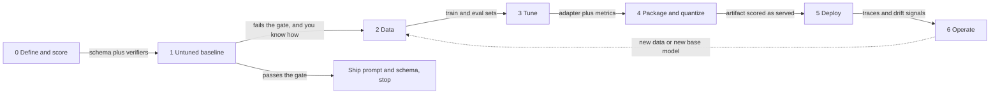

# 04. Build and deploy playbook

How to take one narrow task from idea to a monitored production SLM, with the gates that stop you wasting money. Written for an enterprise team that already runs services but has not tuned a model before.

## 1. The phases

The two exits matter: if the untuned model already passes, stop before spending on data; and every base-model or data change loops back through evaluation. Notice that "tune" is one box of seven.

| Phase | Work | Exit gate | Typical effort (assumption: one narrow task, a team of one to three) |
|---|---|---|---|
| 0 Define and score | Write the output schema; write deterministic checks; state the pass threshold | A scorer that runs in minutes with no human | 1 to 2 weeks |
| 1 Untuned baseline | Run two or three base models with a good prompt, schema and constrained decoding on the eval set | Written pass/fail against the threshold, plus an error breakdown (wrong class, invented value, never abstains) | 2 to 5 days |
| 2 Data | Collect, label, split, and generate synthetic cases | Train, validation and held-out sets with provenance and rights recorded | 2 to 6 weeks; the long pole |
| 3 Tune | LoRA SFT; a checkpoint chosen by a rule fixed beforehand | Beats the untuned baseline on the held-out set by a margin you set in advance | 1 to 2 weeks including reruns |
| 4 Package | Merge, quantize, convert; re-score the exact artifact | Quantized score within your tolerance of the 16-bit score | 2 to 5 days |
| 5 Deploy | Runtime, gateway, auth, logging, rollback | Canary traffic with a measured error rate | 1 to 3 weeks (shorter if a platform exists) |
| 6 Operate | Monitor, sample for human review, re-evaluate on change | Named owner; review cadence; retire or retrain triggers | Continuous |

Effort figures are planning assumptions, not measurements.

## 2. Data

Data decides the outcome more than the model or the trainer.

| Question | Guidance |
|---|---|
| How much? | For a narrow task, hundreds to low thousands of examples is the usual starting range. **This is a practitioner rule of thumb; no source was verified in the research pass.** Measure instead: train on 25, 50, 100 percent of your data and plot the held-out score. If it is still rising, get more data; if flat, the problem is data quality or task definition |
| Where from? | Real production examples (best, but check rights), carefully generated synthetic examples, and your own deterministic systems as teachers (a rule-based parser that labels documents is a free labeller) |
| Use a frontier model to write training targets? | Read the model provider's terms first for any limit on using its outputs to train other models (we have not verified any specific provider's clause). Distilling from an open-weight teacher with a permissive licence avoids the question |
| Labelling effort | Illustrative: 1,000 examples at 3 minutes of expert review each is 50 hours; budget this, it is usually the biggest line |
| Include negatives | Examples where the right answer is "unknown", "unsupported", or "ask". Without them the model never abstains (our measured baseline abstained on none of the unsupported layouts) |
| Train and serve identically | Same preprocessing, same extractor, same system prompt and chat template at training and inference. If the upstream extractor changes, rebuild the dataset |
| Sensitive data | **Judgment (our own privacy rule, not a measured risk):** treat weights trained on real personal or customer data as able to carry it. Tag such weights local-only and do not distribute them, or train only on synthetic data for anything that ships |
| Splitting | Hold out whole sources (an institution, a customer, a format, a generator), never random rows. Random splits of data that share a generator report fantasy numbers |

## 3. What it costs

**Training, worked example.** Assumptions (illustrative; replace with your own): 3,000 examples at 1,500 tokens each, 3 epochs, an 8B model with LoRA on one H100-class GPU at an assumed 3,000 training tokens per second.

- Tokens processed: 3,000 x 1,500 x 3 = 13,500,000.
- Time: 13,500,000 / 3,000 = 4,500 seconds, about 1.25 hours.
- Cost at $2.49 per hour (a median H100 on-demand price as of August 2026 from a [third-party index](https://alpha-one-index.github.io/ai-infra-index/specs/cloud-gpu-pricing.html)) is about $3.10; at $4.50 per hour (one provider's listed H100 price, [Crusoe via OMR](https://omr.com/en/reviews/product/crusoe-cloud/pricing)) about $5.60.
- Twenty experimental runs: about $60 to $115.

The throughput figure is an assumption and varies several-fold with sequence length, batching and library. The conclusion that survives any plausible change is that **training compute is a rounding error next to labour.** Indicative GPU hourly bands from our research pass (secondary sources, none dated November 2026): L40S $1 to 1.5, A100 $1.2 to 2.3, H100 $2 to 4.5, H200 $2.3 to 5.4, drawn from [Runpod](https://www.runpod.io/gpu-cloud/pricing), [Crusoe via OMR](https://omr.com/en/reviews/product/crusoe-cloud/pricing) and [Gcore](https://gcore.com/pricing/ai) price pages.

**Serving, worked example.** **Assumption:** one L40S at $1.50 per hour (the price [Crusoe lists via OMR](https://omr.com/en/reviews/product/crusoe-cloud/pricing)), always on: 730 hours x $1.50 = about $1,100 per month; one H100 at the $2.49 median above: about $1,820 per month. Against a hosted small model at an assumed $0.30 per million tokens (illustrative), the L40S pays back above $1,100 / $0.30 = about 3.7 billion tokens per month, an average of about 1,400 tokens per second around the clock. Below that volume the hosted option is cheaper on cost alone; you choose self-hosting for privacy, control or latency, not for savings, unless volume is high. Sharing one GPU across many adapters (multi-LoRA) improves the sums for many small tasks.

**People (Judgment).** Plan for a data owner (labels and rights), an ML engineer (training and eval), a platform engineer (serving and rollback), and a reviewer for samples in production. For one task these can be a few people part-time; for ten tasks they become a team and a platform.

## 4. Evaluation

Evaluation is the hard part and the main source of false confidence.

1. **Deterministic scoring.** Exact match per field, a confusion matrix, abstention rate, **wrong-but-confident rate**, and seconds per item. Do not let an LLM judge decide pass or fail: in our own pipeline (an internal observation, not a published result) a single judge sample scored the same sound artifact anywhere from 0 to 100.
2. **Pre-register decisions.** Before each experiment, write the threshold for "improved", "kill" and "inconclusive", and the rule for choosing a checkpoint. Then run it once. This is what stopped us over-reading small differences (below).
3. **Small eval sets are noisy.** With 28 real documents, a gain of two or three documents is inconclusive (we computed p about 0.125 for +3). Report counts, not just percentages, and say "inconclusive" when it is.
4. **Evaluate on the artifact you serve**, through the production runtime, quantized, with the production prompt.
5. **Keep a regression set** for behaviours you must not lose (general instruction following, languages you support, safety refusals).
6. **Always include a baseline**: the untuned model with the best prompt, plus (as a ceiling only) a larger model.
7. **Report masked figures.** An evaluation report that prints raw customer text is a leak.

## 5. Governance

| Item | What to record or do | Basis |
|---|---|---|
| Model provenance | Publisher, repository, **commit hash**, licence file text at that revision, declared training data, tokenizer and chat template | Pin the revision; read the LICENSE file at that revision, not the model card |
| Derivative licensing | Apache 2.0 base: no flow-down. Community licences (Llama-style): attribution and use restrictions travel with your tuned weights | Licence texts; see [01 §6](01-options-and-trade-offs.md#6-choosing-a-base-model) |
| Load-time code | Prefer safetensors (data-only). `trust_remote_code` can still execute code at load; a 2026 study ([arXiv 2601.14163](https://arxiv.org/abs/2601.14163)) calls it critical. Record every exception and review the code | Hugging Face security docs; the study |
| Scanning | Scan downloaded model files and container images (for example JFrog and Hugging Face's cooperation on malicious-model scanning); run evaluation without production credentials | Verified existence; vendor-specific |
| Training-data rights | Record consent, source and purpose for every real example | Internal policy |
| EU AI Act (not legal advice) | The Commission's July 2025 guidelines treat modifying a model with more than about one-third of its original training compute as an indicative sign that you become its provider. LoRA tuning is almost certainly far below that, but "significant change" is a separate test, so ask counsel | [Commission FAQ](https://digital-strategy.ec.europa.eu/en/faqs/guidelines-obligations-gpai-providers) |
| India DPDP (not legal advice) | The Digital Personal Data Protection Rules were notified in November 2025 with a phased rollout; core obligations apply about 18 months later (around May 2027). Nothing specific to model training was found | [PIB notification](https://static.pib.gov.in/WriteReadData/specificdocs/documents/2025/nov/doc20251117695301.pdf) |
| Model registry | One system of record: base revision, data version, config, metrics, who approved | Registry choice unverified; pick one |

## 6. Operating it

| Concern | Practice |
|---|---|
| Versioning and rollback | Every adapter has a version; the gateway can route to the previous one in minutes; keep the last two artifacts hot |
| Drift | Sample production inputs; track the unknown/abstain rate, the verifier-rejection rate and the escalation rate. A rising rejection rate is the earliest signal that real inputs moved |
| Human review | A fixed percentage of accepted outputs reviewed weekly, with errors added to the training set |
| Base-model upgrades | Treat a new base as a new project: re-tune, re-evaluate on the same held-out set; do not assume the adapter transfers |
| Capacity | Watch key-value cache memory, not just weights; concurrent long contexts are what exhaust a GPU |
| Security | Authenticate the endpoint; log prompts and outputs under your retention policy; keep the model's tools read-only unless a gate approves writes |
| Retirement | Define in advance when you stop (the hosted alternative gets cheap enough, or accuracy decays) |

## 7. A measured case from our own experiments

A narrow task in one of our products: identify a financial document (its kind, institution and parser format) from the text an extractor produces, abstaining when the layout is unsupported. The constraint was privacy (on-device), a budget of 4B parameters or fewer (about 3 GB quantized), and the rule that a model proposes and deterministic verifiers decide. Training ran on a 48 GB Apple-silicon Mac with MLX-LM, then conversion to GGUF and serving through Ollama. Figures below come from our dated reports of 12 to 19 November 2026 and are aggregate counts only. The corpus is private and not published here.

| Step | Result | What it taught |
|---|---|---|
| Untuned baseline (27 real PDFs plus 6 invented negatives) | Qwen3-4B-Instruct-2507: 74% exact format; Phi-4-mini 44%; Qwen3-1.7B 4%; no model abstained on unsupported layouts | Run the baseline before training. Our earlier guess that the untuned model might pass the gate was wrong, and the failure shape (never abstains) told us what to teach |
| LoRA on synthetic data only (rank 8, scale 20, learning rate 1e-4, 16 layers, batch 1 with accumulation 2, 800 iterations, about 1.2 epochs of 1,338 examples, loss on the answer only) | Tied the untuned model on exact format (75.0% each on 28 real documents); better on kind (82.1% versus 71.4%), wrong-confident (17.9% versus 25.0%) and unsupported-bank abstention (3 of 3 versus 1 of 3). Synthetic validation was 98.6% | Tuning taught abstention and calibration, not accuracy. Synthetic validation was a fantasy number: training-data realism was the constraint |
| Longer training | A later checkpoint scored 52% on held-out formats versus 73% for the earlier one | More steps hurt unseen formats; choose the checkpoint by a pre-fixed rule |
| Add masked real documents (local-only weights) | 21 to 24 of 28 on kind plus institution; 3 fixed, 0 broken; p about 0.125 | Inconclusive by our own rule; real data is a modest, unproven lever |
| Add synthetic layouts built from public test fixtures | 21 to 23 of 28 | Inconclusive (+2) |
| Match the *shape* of real extractor text (digits were 27% of characters in synthetic text versus 9% in real; blank lines 3% versus 32%) | First run killed by our pre-registered rule, but it was an under-training confound (the model scored 74.7% on its own synthetic test versus 94.7% for the easier data). A rerun at 1,100 iterations, with the checkpoint chosen on synthetic validation only, gave +2, inconclusive | Pre-registration let us discard a bad run honestly; synthetic realism work was at diminishing returns around 23 of 28 |
| Remaining errors | 5 formats with no fixture or a differing real layout | The next lever is real specimens or deterministic cues, not more synthetic data |

**Operational lessons that no benchmark would have told us:**

- Two runs crashed with a Metal out-of-memory error on the longest examples (up to 8,384 tokens) even at batch 1; the output logits alone were about 10 GB per 8.7k-token sequence. We trained on a version that dropped (never truncated) the 24 examples over 4,096 tokens, and kept the long ones in validation and test. Peak MLX memory on the longest examples was 17.1 GB against a 37.4 GB limit; earlier crashes were probably other memory users, but that cause is unconfirmed.
- Serving a fused safetensors model through Ollama used its MLX engine with no structured-output support on that path; we ran a second instance on another port and never restarted the shared service.
- Detection logic that was supposed to be content-first had drifted to depend on file names (1 of 27 worked from content alone), which the model evaluation exposed.

**The generalisable points:** a tuned SLM was better at knowing what it did not know than at being right; the number that decided everything was the held-out real-document score, not the validation score; and pre-registered thresholds kept a small team from fooling itself.
