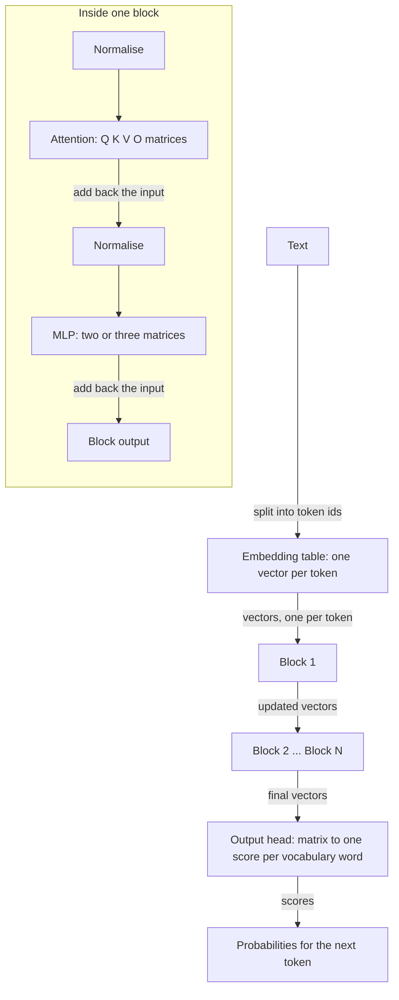
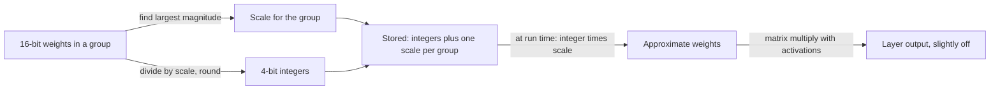

# 05. How a neural network is built, what you can tune, and what quantization actually does

Written 2026-11-26. A foundation page: read it before the [quantization explainer](techniques/09-quantization-ptq-and-qat.md) if "weights", "layers" or "bits per weight" are fuzzy. Every number below was computed (the arithmetic is shown) on a **constructed** model, not taken from a named product; the code in section 7 was run.

## 1. The answer first

**Sources.** Sections 2 and 3 use standard textbook definitions (the transformer is from [Attention Is All You Need](https://arxiv.org/abs/1706.03762)); the five-way split of "tunables" in section 5 is this guide's organisation (**Judgment**). Specific figures and claims carry links where they appear, and example numbers are labelled constructed or **Assumption**.

A language model is a very large pile of numbers (the **weights**) arranged so that one operation, multiplying a vector by a matrix, is repeated billions of times. Training changes the numbers. Running the model reads the numbers. **Quantization is storing those numbers with fewer bits**, accepting a small rounding error in exchange for a much smaller, faster model. Everything else in this page is detail on three questions: what the numbers are, which ones you can change, and what rounding them does.

## 2. The building block: a neuron, then a layer

A **neuron** takes some input numbers, multiplies each by its own weight, adds them up, adds a bias, and passes the result through a simple non-linear function `f`:

`y = f(w1*x1 + w2*x2 + w3*x3 + b)`

Worked example (constructed). Inputs `x = [0.5, -1.0, 2.0]`, weights `w = [0.2, 0.4, -0.1]`, bias 0, and ignore `f` for now:

`0.5*0.2 + (-1.0)*0.4 + 2.0*(-0.1) = 0.10 - 0.40 - 0.20 = -0.50`

A **layer** is many neurons side by side reading the same inputs. Write the weights of all neurons as a table (a **matrix**), one row per neuron; the layer's output is the matrix multiplied by the input vector. Stack layers and you have a neural network. **The weights are the learned part; the arrangement (how many layers, how wide, how connected) is chosen by people before training.** That split between what training learns and what people choose is the key to the tunables in section 5.

## 3. How a language model is assembled from that block

A **transformer** language model (introduced in [Attention Is All You Need](https://arxiv.org/abs/1706.03762); see the lab's [Transformer guide](../../llm-learning-repository/tutorials/01-foundations/01-transformer.md)) is an input table, a stack of identical **blocks**, and an output table.



Notice that almost everything is a matrix multiply: the embedding lookup, the four attention matrices (Q, K, V and O: **query**, **key**, **value** and **output**), the MLP matrices (**multi-layer perceptron**, the feed-forward part) and the output head. The normalisation steps have few numbers and are not where size comes from. Attention is the one place where tokens look at each other; the MLP then processes each token on its own.

Two facts about running it matter for deployment. The model produces **one token at a time**; each new token reads *all* the weights again. And to avoid recomputing the past, it stores a **KV cache** (the keys and values of every earlier token), which grows with the length of the conversation. Both come back in section 6.

## 4. Where the parameters live: a constructed example

Take the simplest form of the design. The parameter formula follows the scaling-laws paper, which gives non-embedding parameters as about 12 x blocks x width squared when the MLP width is four times the attention width ([Kaplan et al., Eq. 2.1 and Table 1](https://arxiv.org/abs/2001.08361)); real models vary, for example by sharing key/value heads or using a three-matrix gated MLP, so treat this as a teaching model. Choose: width `d = 2,048`, `N = 24` blocks, MLP inner width `4d = 8,192`, vocabulary `V = 32,000` tokens.

| Part | Formula | Count |
|---|---|---|
| Attention per block (Q, K, V, O, each d x d) | 4 x 2,048 x 2,048 | 16,777,216 |
| MLP per block (two matrices, d x 4d and 4d x d) | 2 x 2,048 x 8,192 | 33,554,432 |
| Two normalisation layers per block | 2 x 2,048 | 4,096 |
| **One block** | | **50,335,744** |
| 24 blocks | 24 x 50,335,744 | 1,208,057,856 |
| Embedding table (shared with the output head) | 32,000 x 2,048 | 65,536,000 |
| Final normalisation | 2,048 | 2,048 |
| **Total** | | **1,273,593,856** (about 1.27 billion) |

Notice: **the MLP holds about two thirds of the weights in every block**, attention about one third, and the embedding table about 5 percent of the total. This is why quantizing "the model" is mostly quantizing big matrices, and why LoRA's original paper adapted only attention matrices while many current recipes include the MLP matrices as well. At 16 bits each (2 bytes) this model is 2.55 GB; at about 4.9 bits per weight (Q4_K_M's 4.8944 on Llama-3.1-8B per the [llama.cpp README](https://github.com/ggml-org/llama.cpp/blob/master/tools/quantize/README.md)), 0.78 GB.

## 5. What you can tune: five families

"Tunable" means different things to different people. Keep the five families apart.

| Family | Examples | Who sets it, and when | What it changes |
|---|---|---|---|
| **Architecture choices** (fixed at design time) | Number of blocks, width `d`, MLP width, number of attention heads and key/value heads, vocabulary size, maximum context length | The model's authors, before training. You cannot change them by fine-tuning | Size, memory, speed, ceiling on capability. A base model's family and size is this choice made for you |
| **Learned weights** (changed by training) | Every matrix in section 4 | Training. Full fine-tuning changes all of them; LoRA freezes them and learns two thin matrices beside each chosen one (see [LoRA](techniques/02-lora.md)) | What the model knows and how it behaves |
| **Training settings** (how learning is run) | Learning rate, batch size, epochs, LoRA rank and scale, which matrices to adapt, loss masking, checkpoint choice | You, per run (see [01 §3](01-options-and-trade-offs.md#3-fine-tuning-methods) and [04](04-build-and-deploy-playbook.md)) | Whether training works, and how much it forgets |
| **Deployment settings** (how it is run) | Quantization bits and group size, which tensors are quantized, KV-cache precision, context length served, batch size, runtime and format | You, per deployment | Memory, speed, and a quality loss you must measure |
| **Decoding settings** (how the next token is picked) | Temperature, top-p, maximum new tokens, grammar constraints (see [constrained decoding](techniques/14-constrained-decoding.md)) | You, per request | Variety, determinism, format |

The common mistake is to treat these as one list. Architecture is not yours to change; weights are what tuning moves; training settings steer that tuning; quantization and decoding are the two knobs you turn at deployment.

## 6. What memory is actually spent on

Four consumers, each with a different formula.

1. **Weights:** parameters x bits / 8. The 1.27B model above: 2.55 GB at 16 bits.
2. **KV cache:** per token, `2 x blocks x kv_heads x head_dim x bytes`. The vLLM paper gives the same formula in the form 2 (key and value) x hidden size x layers x bytes per value, and works out 800 KB per token for a 13B model with 40 layers and hidden size 5,120 at 16 bits ([PagedAttention, §3](https://arxiv.org/abs/2309.06180)). If the model has 16 key/value heads of size 128 at 16 bits: `2 x 24 x 16 x 128 x 2 = 196,608` bytes, about 0.2 MB per token. An 8,192-token context is 1.61 GB; 32,768 tokens is 6.44 GB. Sharing key/value heads (a common design called grouped-query attention) with 4 instead of 16 divides that by four: 0.40 GB at 8,192 tokens. This is why a long context or many simultaneous users, not the weights, is often what fills the GPU.
3. **Activations:** temporary values during a forward pass; small at inference, large in training.
4. **Training-only state:** gradients plus optimiser memory. With mixed-precision Adam the total is 16 bytes per parameter against 2 for the 16-bit weights ([ZeRO, §3.1](https://arxiv.org/abs/1910.02054)), which is why full fine-tuning needs several times the model size; LoRA cut GPT-3 175B training VRAM from 1.2 TB to 350 GB in its paper ([§4.2](https://arxiv.org/abs/2106.09685)) and does not ([01 §3](01-options-and-trade-offs.md#3-fine-tuning-methods)).

**Speed ceiling.** At small batch sizes the time to load the weights dominates producing a token, and at large batches or long contexts loading the KV cache dominates ([Pope et al., §2 and §4.4](https://arxiv.org/abs/2211.05102)). So for a single user, time per token is at least the model's bytes divided by memory bandwidth. This is an upper bound on speed (**Assumption:** the bandwidths below; it ignores compute and the KV cache): a 4B model is 8.0 GB at 16 bits and about 2.45 GB at 4.9 bits per weight. At an assumed 100 GB/s of memory bandwidth, the ceilings are `100 / 8.0 = 12.5` tokens per second versus `100 / 2.45 = 40.8`; at an assumed 800 GB/s, 100 versus 326.5. **Judgment, from the low-batch result above:** quantization speeds up single-user generation mainly because fewer bytes have to be moved, not because integer arithmetic is faster. The figures are this guide's arithmetic, not benchmarks; the source supports the low-batch case only.

## 7. Quantization on this structure

### 7.1 What can be quantized

| Target | What it is | Typical choice | Why |
|---|---|---|---|
| **Weights** | The matrices of section 4 | 8, 4 or even 2 bits (a 2-bit weight example: [Apple's on-device model uses 2-bit QAT](https://arxiv.org/abs/2507.13575), self-reported) | Biggest saving: they are most of the memory and are read every token. They are fixed after training, so you can study them offline and round them carefully |
| **Activations** | The values flowing between layers at run time | Often left at 16 bits; 8 bits in some methods | They change with every input and have occasional very large values (outliers), so they are harder to round without damage: [LLM.int8()](https://arxiv.org/abs/2208.07339) describes the outliers as "highly systematic emergent features" and keeps those dimensions in 16 bits while over 99.9% of values are multiplied in 8-bit; [SmoothQuant](https://arxiv.org/abs/2211.10438) states that weights are easy to quantize while activations are not |
| **KV cache** | Stored keys and values of earlier tokens | 16 bits by default; some engines offer lower precision (we did not verify specific ones, so check your engine's documentation) | Would cut the long-context cost in section 6; quality impact depends on the model and engine |

**Judgment:** "weight-only 4-bit" is the common SLM deployment, as in the 4.8944-bit Q4_K_M files above: weights stored at 4 bits, converted back to higher precision on the fly inside each matrix multiply.

### 7.2 The mechanism: scale and rounding

Pick a **scale** `s`. Store each weight as a small integer `q = round(w / s)`; recover an approximation `w' = q x s`. With 4-bit signed integers `q` can only be -8 to 7 (16 levels), so the scale is chosen so the largest weight lands near the end of that range: `s = max|w| / 7`.

Worked example on the same constructed numbers. Revisit the neuron from section 2: `w = [0.2, 0.4, -0.1]`. The largest weight is 0.4, so `s = 0.4 / 7 = 0.0571`. Then `q = [round(3.5), round(7), round(-1.75)] = [4, 7, -2]` (3.5 rounds to 4 here), and `w' = [0.2286, 0.4, -0.1143]`. The dot product with `x = [0.5, -1.0, 2.0]` becomes `0.1143 - 0.4 - 0.2286 = -0.5143` instead of `-0.5`: an error of 0.0143, or 2.9 percent, from rounding three numbers to 4 bits.

Now a longer row, `w = [0.12, -0.40, 0.05, 0.31, -0.08, 0.90, -0.22, 0.17]`, run through the code in 7.5:

| Setting | Scale(s) | Quantized integers | Root-mean-square error |
|---|---|---|---|
| One scale for all 8 (group size 8) | 0.1286 | 1, -3, 0, 2, -1, 7, -2, 1 | 0.0371 |
| One scale per 4 weights (group size 4) | 0.0571 and 0.1286 | 2, -7, 1, 5 and -1, 7, -2, 1 | 0.0277 |
| Same row with the outlier 0.90 replaced by 0.14 | 0.0571 | (not shown) | 0.0155 |

Three lessons in three rows (the numbers are this guide's computation; the lessons match the grouping argument in [GPTQ §5](https://arxiv.org/abs/2210.17323), which reports that grouping "significantly reduces the accuracy losses for medium sized models at 4-bit"). **Rounding error is real but small relative to the weights.** **One large outlier stretches the scale and costs precision for every other weight sharing it** (error 0.0371 with the outlier versus 0.0155 without). **Giving each small group its own scale limits the damage** (error falls from 0.0371 to 0.0277). That is why practical formats do not use one scale per matrix.



Notice that the scale is stored too, so 4-bit weights cost slightly more than 4 bits each.

### 7.3 Granularity and the real cost in bits

| Scheme | Group size and scale | Bits per weight (computed: 4 + scale bits / group size) |
|---|---|---|
| 4-bit integers, 32 per group, 16-bit scale | 32, 16 bits | 4 + 16/32 = **4.50** |
| 4-bit integers, 128 per group, 16-bit scale | 128, 16 bits | 4 + 16/128 = **4.125** |
| MXFP4 (micro-scaling floating point): 32 per group, 8-bit scale | 32, 8 bits | 4 + 8/32 = **4.25** |
| NVFP4: 16 per group, 8-bit scale | 16, 8 bits | 4 + 8/16 = **4.50** |

The last two rows are this guide's arithmetic (4 plus the scale bits divided by the group size). The block sizes and scale types come from the [MX paper's Table 1](https://arxiv.org/abs/2310.10537) (MXFP4: block of 32, 8-bit E8M0 scale, 4-bit elements) and the [NVIDIA NVFP4 blog](https://developer.nvidia.com/blog/introducing-nvfp4-for-efficient-and-accurate-low-precision-inference/) (block of 16, FP8 E4M3 scale, "4.5 bits per value", excluding a second-level per-tensor scale), and the results match the 4.25 and 4.5 figures in [vLLM's format table](https://docs.vllm.ai/en/latest/features/quantization/formats/) ([03 §3](03-vehicles.md#3-quantization-formats)). Smaller groups cost more bits and, per GPTQ and AWQ, group size 128 is a common default ([GPTQ §5](https://arxiv.org/abs/2210.17323), [AWQ §5.1](https://arxiv.org/abs/2306.00978)). Mixed schemes such as llama.cpp's Q4_K_M land at about 4.9 bits because they give a higher-bit type to half of the attention.wv and feed_forward.w2 tensors ([PR #1684](https://github.com/ggml-org/llama.cpp/pull/1684)).

### 7.4 What tends to be quantized less, and the tunables

Reference implementations leave some tensors at higher precision: GPTQ's 3-bit OPT-175B footprint "includes the embeddings and the output layer, which are kept in full FP16 precision" ([GPTQ §5](https://arxiv.org/abs/2210.17323)); the Hugging Face bitsandbytes guide shows skipping `lm_head` through `llm_int8_skip_modules` as a per-model option ([docs](https://huggingface.co/docs/transformers/main/en/quantization/bitsandbytes)); and the [llm-compressor README](https://github.com/vllm-project/llm-compressor/blob/main/README.md) example passes `ignore=["lm_head", ...]`. This varies by tool and model, so check what yours keeps at full precision. The **quantization tunables**, in the order you would meet them:

| Tunable | Choices | Effect |
|---|---|---|
| Bits | 8, 6, 5, 4, 3, 2 | Fewer bits, smaller and faster, more error: llama.cpp's own list shows +0.0026 perplexity for Q8_0 and +0.1754 for Q4_K_M on Llama-3-8B ([quantize.cpp](https://github.com/ggml-org/llama.cpp/blob/master/tools/quantize/quantize.cpp)); LLM.int8() reports no degradation up to 175B parameters for its outlier-aware 8-bit method. **Judgment:** 4-bit is the common sweet spot, and below it quality needs care or quantization-aware training |
| Group size | 16, 32, 64, 128, per-channel, per-tensor | Smaller groups follow the weights more closely and cost more scale storage (table above) |
| Symmetric or asymmetric | Scale only, or scale plus a zero-point offset | Asymmetric fits skewed value ranges better at the cost of one more number per group |
| Which tensors | All matrices, or skip embeddings, output head, some blocks | Protects sensitive parts |
| Method | Plain rounding, or methods that choose roundings using sample data ([GPTQ](https://arxiv.org/abs/2210.17323), [AWQ](https://arxiv.org/abs/2306.00978); see the [explainer](techniques/09-quantization-ptq-and-qat.md)) | Better quality at the same bits; needs **calibration data** |
| Calibration data | A few hundred representative inputs | If it does not look like production, the chosen roundings fit the wrong inputs |
| KV-cache precision | 16 bits, 8 bits, lower | Long-context memory versus quality |
| Format and runtime | GGUF, AWQ, GPTQ, FP8, MXFP4, NVFP4 | Which engine and hardware can run it |
| When | After training (post-training quantization) or during training (quantization-aware training) | See section 8 |

### 7.5 The code (run on 2026-11-26)

```python
import math
def quantize(w, group, qmax=7):
    q, scales = [], []
    for i in range(0, len(w), group):
        g = w[i:i + group]
        s = max(abs(x) for x in g) / qmax
        scales.append(s)
        q += [max(-qmax - 1, min(qmax, round(x / s))) for x in g]
    return q, scales

def rms_error(w, group):
    q, scales = quantize(w, group)
    deq = [qi * scales[i // group] for i, qi in enumerate(q)]
    return math.sqrt(sum((a - b) ** 2 for a, b in zip(w, deq)) / len(w))

w = [0.12, -0.40, 0.05, 0.31, -0.08, 0.90, -0.22, 0.17]
print(quantize(w, 4))                      # integers and two scales
print(rms_error(w, 8), rms_error(w, 4))    # 0.0371 then 0.0277
```

## 8. Where quantization meets fine-tuning

- **Post-training quantization (PTQ):** train in 16 bits, round afterwards. Cheap; the perplexity deltas in the table above show small losses at 8 and 4 bits for one model (**Judgment:** riskier below, as the explainer discusses).
- **Quantization-aware training (QAT):** simulate the rounding during training so the weights settle where rounding hurts least. More engineering; recovers quality at very low bits.
- **QLoRA:** keep the frozen base at 4 bits and train the small LoRA matrices at higher precision beside it ([QLoRA paper](https://arxiv.org/abs/2305.14314), [explainer](techniques/03-qlora.md)): its abstract reports tuning a 65B model on a single 48 GB GPU. The saving is in training memory; the adapter was fitted against a quantized base, so check it on the exact base you serve.
- **Order of operations for serving:** merge a LoRA adapter into 16-bit weights first, then quantize, then **re-run your evaluation on the quantized file** ([03 §3](03-vehicles.md#3-quantization-formats)). Quantizing first and merging later is untested here.

## 9. Check your understanding

<details>
<summary>1. Which part of a transformer block holds most of the weights, and why does that matter for quantization?</summary>

The MLP, about two thirds of each block in the constructed model (33.55 million of 50.34 million). Quantization is mostly about shrinking big matrices, so MLP and attention matrices are where bits are saved, while small tensors like norms are not worth rounding.
</details>

<details>
<summary>2. A 4B-parameter model stored at 4.9 bits per weight: how many gigabytes, and what is the generation-speed ceiling at 200 GB/s of bandwidth?</summary>

4,000,000,000 x 4.9 / 8 = 2.45 GB. The ceiling is 200 / 2.45, about 82 tokens per second (at low batch, with the assumed bandwidth), before the KV cache and compute are considered. At 16 bits it would be 8 GB and 25 tokens per second.
</details>

<details>
<summary>3. Why do practical 4-bit formats store a scale for every small group rather than one per matrix?</summary>

One outlier weight forces a large scale, which wastes the 16 available levels on the many small weights. In the 8-weight example the error was 0.0371 with the outlier and 0.0155 without; per-group scales cut it to 0.0277.
</details>

<details>
<summary>4. Fine-tuning changes which of these: architecture, weights, or deployment settings? And what does quantization change?</summary>

Fine-tuning changes weights (the learned numbers). The architecture is fixed by the model's authors. Quantization is a deployment setting that changes how the same weights are stored, not what they were trained to do, and it introduces a rounding error you must measure.
</details>

<details>
<summary>5. A colleague says "the model is 4B so it needs 4 GB". Name two things that make that wrong.</summary>

Bits per weight (16-bit is 8 GB, not 4), and the KV cache, which grows with context length and with the number of simultaneous users. Runtime overhead adds to both.
</details>

## 10. Where next

- Quantization methods and evidence, three levels: [Quantization explainer](techniques/09-quantization-ptq-and-qat.md).
- Which engine runs which format: [03 Vehicles](03-vehicles.md).
- How fine-tuning changes the weights: [LoRA explainer](techniques/02-lora.md), [QLoRA explainer](techniques/03-qlora.md).
- Why a mixture-of-experts model has large total but small active parameters: [MoE explainer](techniques/10-mixture-of-experts.md).
- Whether an SLM should replace an algorithm at all: [06 Algorithm or model?](06-algorithm-or-model-use-cases.md).
