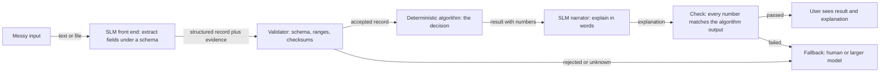

# 06. Algorithm or model? Four questions and two use cases

Written 2026-11-26. The question behind this page: **if I already have a deterministic algorithm (or a clear procedure), should a small language model (SLM) replace it, and where in an app does an SLM belong?** Two worked use cases follow: root-cause diagnosis for a network, and cash-flow analysis for personal finance.

**Evidence policy for this page.** Every factual statement links to its source. A statement that is this guide's recommendation or reasoning is labelled **Judgment:**, and an input we chose for the sake of an example is labelled **Assumption:**. Preprints, vendor blogs and vendor-reported results are named as such. Headline numbers were re-checked against the source pages on 2026-11-26; where we could only read an abstract, the text says so. We ran no experiment of our own on these two use cases.

## 1. The four questions, answered

### Q1. Is a model's behaviour the same as an algorithm's?

**No. They can map the same inputs to the same outputs on the cases the model has seen, but they differ in five ways that matter operationally.**

| Property | An algorithm | A language model | Evidence for the model column |
|---|---|---|---|
| **Same input, same output** | Yes, by construction | Not by default, even at temperature 0 | One study of Qwen3-235B-A22B-Instruct-2507 generated 1,000 completions at temperature 0 and got 80 unique outputs, the most common appearing 78 times ([Thinking Machines, Sept 2025, a vendor blog](https://thinkingmachines.ai/blog/defeating-nondeterminism-in-llm-inference/)). vLLM's documentation says it "does not guarantee the reproducibility of the results by default, for the sake of performance" ([vLLM docs](https://docs.vllm.ai/en/latest/usage/reproducibility.html)). A preprint across five models and eight tasks reports accuracy varying by up to 15% across runs of settings meant to be deterministic ([Atil et al., arXiv 2408.04667](https://arxiv.org/abs/2408.04667)) |
| **Exactness on arithmetic and long inputs** | Exact for any size | Degrades as the input grows | GPT-4 reached 59% and ChatGPT 55% on 3-digit by 3-digit multiplication ([Faith and Fate, arXiv 2305.18654, §1](https://arxiv.org/abs/2305.18654), preprint). A February 2026 preprint finds all frontier models it tested lose accuracy on addition as digits increase, with operand misalignment and carry failures explaining 87.9% of Claude Opus 4.1's errors ([arXiv 2602.10416](https://arxiv.org/abs/2602.10416)) |
| **Behaviour beyond the training distribution** | Defined for every valid input | Trained behaviour need not extend to longer or different inputs | In a study of 20,910 models on 15 tasks, trained on sequence lengths 1 to 40 and tested on 41 to 500, the transformer scored 52.0% on parity, 24.2% on simple modular arithmetic, 54.3% on binary addition and 52.2% on binary multiplication; the same paper reports architectures with structured memory reaching 100% on some tasks transformers failed ([Chomsky Hierarchy, arXiv 2207.02098, Table 2](https://arxiv.org/abs/2207.02098), preprint, models trained from scratch) |
| **Consistency across repeats** | Identical | Success on a task one time does not mean success every time | On the tau-bench agent benchmark, even gpt-4o function-calling agents succeeded on fewer than 50% of tasks, with `pass^8` (all eight repeats succeed) below 25% in the retail domain ([tau-bench, arXiv 2406.12045](https://arxiv.org/abs/2406.12045), abstract) |
| **Specification and audit** | The code *is* the specification; you can read why it answered | The behaviour is stored in weights; you can test it but not read the rule | **Judgment:** this follows from how the two are built (see [05 §2](05-neural-network-anatomy-and-quantization.md#2-the-building-block-a-neuron-then-a-layer)); we cite no source that measures it |

**What the model *can* match.** A small transformer trained from scratch can learn an algorithm very well *inside its training distribution*: on 3-digit addition a NanoGPT model reached 87.18% with plain formatting and 99.97% when the digits were written in reverse order ([Teaching Arithmetic to Small Transformers, arXiv 2307.03381](https://arxiv.org/abs/2307.03381), preprint). The same paper shows the *format* of the training data changes the result dramatically, which is a reminder that "the model learned the algorithm" is a statement about a specific data recipe.

**Can determinism be recovered?** Yes, at a cost. The Thinking Machines post traces the variation to a lack of "batch invariance" (numerics change with batch size, and server load changes batch size) and reports that with batch-invariant kernels all 1,000 completions were identical, at roughly 1.6 to 2.1 times the time in the post's test (Qwen3-8B on one GPU, 1,000 sequences of 90 to 110 output tokens: 26 s default, 42 s with an improved attention kernel, 55 s unoptimised; the authors say the kernel is not yet heavily optimised) ([source](https://thinkingmachines.ai/blog/defeating-nondeterminism-in-llm-inference/)). vLLM documents the controls: same hardware and software version, a seed, and batch invariance or deterministic scheduling ([docs](https://docs.vllm.ai/en/latest/usage/reproducibility.html)). Reproducible is not correct, and not stable under small changes to the input: a differently worded or reordered input can still change the answer. **Judgment:** a hosted API will usually give you none of these controls; check the provider's documentation.

### Q2. If I have a deterministic algorithm, is an SLM a good choice for it?

**Usually not for the computation itself. Often yes for the parts of the app that surround it.**

Reasons the algorithm should keep the decision:

1. The failure modes in Q1 (nondeterminism, arithmetic errors, no guarantee outside the training range) are the exact properties an algorithm was written to remove.
2. **Delegating the computation to code measurably beats asking the model to do it.** In Program-Aided Language models (PAL), the model writes a program and an interpreter runs it. On the harder GSM-HARD arithmetic set (same word problems with larger numbers), PAL solved 61.2% against 23.1% for chain-of-thought with the same Codex model; on the original GSM8K set PAL scored 72.0 against 65.6 ([PAL, arXiv 2211.10435, Table 1](https://arxiv.org/abs/2211.10435)). Program of Thoughts reports an average gain of about 12% over chain-of-thought across eight datasets including the financial sets FinQA, ConvFinQA and TAT-QA ([arXiv 2211.12588](https://arxiv.org/abs/2211.12588), preprint; the 12% is the abstract's figure, per-dataset numbers not checked here).
3. **A verifier next to the model helps.** On the TravelPlanner benchmark, putting external critics around GPT-4-Turbo raised the final pass rate from a 4.4% baseline to 20.6% ([LLM-Modulo, arXiv 2405.20625](https://arxiv.org/abs/2405.20625), workshop paper). The position paper behind it argues that autoregressive models "cannot, by themselves, do planning or self-verification" and should be paired with external model-based verifiers ([arXiv 2402.01817](https://arxiv.org/abs/2402.01817), ICML 2024, position paper with no experiments of its own). The same pairing is the pattern in [03 §5](03-vehicles.md#5-role-what-the-slm-does-in-the-agent-system): the model proposes, a deterministic check decides.

When an SLM *is* a good choice **for** the algorithm's job (**Judgment**, built on the evidence above, not itself measured):

- The algorithm needs inputs the world does not provide in clean form (messy text, varied layouts), and the model's job is to produce those inputs.
- The algorithm's output must become language (an explanation, a summary), and the numbers are supplied by the algorithm and checked.
- There is no complete algorithm, only judgment on fuzzy inputs (classification of free text), and the cost of an error is bounded.
- You have measured the model on a held-out set and it beats the current method on the metric that matters.

### Q3. If I have an app, can I use an SLM for it?

**Yes, in specific roles; not as a wholesale replacement for the app's logic.** Split the app into steps and ask of each: is the input messy, is the answer exact, is the cost of an error high?

| App step | Who should do it | Why, with evidence |
|---|---|---|
| Read messy input into fields (extract merchant, parse an alarm line, identify a document type) | **SLM, with a schema and constrained decoding** | A fine-tuned Qwen 3.5 4B reached 96.60% F1 on merchant extraction from bank transaction strings, against 96.95% for a production LLaMA 3.1-8B model, though strict record-level exact match was 91.67% ([arXiv 2606.08051](https://arxiv.org/abs/2606.08051), 2026 preprint, one task). Our own document-identification case is in [04 §7](04-build-and-deploy-playbook.md#7-a-measured-case-from-our-own-experiments) |
| Classify free text into categories | **SLM or a small classifier, then measure** | A fine-tuned small-business transaction classifier reported 73.49% (±5.09) accuracy, and 90.36% (±6.52) on its high-confidence predictions ([arXiv 2508.05425](https://arxiv.org/abs/2508.05425), preprint): useful with a confidence threshold, not an exact method |
| Arithmetic, sums, balances, date windows, thresholds | **Code** | See Q1 and Q2: [PAL](https://arxiv.org/abs/2211.10435), [Faith and Fate](https://arxiv.org/abs/2305.18654). A study of tabular reasoning reports "a significant deficit in tabular reasoning performance of LLMs" ([arXiv 2505.07453](https://arxiv.org/abs/2505.07453), preprint) |
| Decide among known cases by rules | **Code** | The rules are the specification |
| Explain a result in plain language | **SLM, with the numbers passed in from code and checked afterwards** | **Judgment:** this is the verifier pattern above; we cite no measurement of explanation quality |
| Choose a tool or route a request | **SLM router with an "unknown" exit** | Reliability is the risk: see the `pass^8` result in Q1; and leaderboard figures for small-model tool calling were not verifiable on 2026-11-26 (the Berkeley Function Calling Leaderboard table renders dynamically, and [Epoch AI's review](https://epoch.ai/benchmarks/berkeley-function-calling-leaderboard/review) rates the benchmark "Flawed"), so measure on your own tools |
| Act with side effects (pay, delete, send) | **A human or policy gate, never the SLM alone** | **Judgment:** a model's confident error is costly here, and the Q1 evidence says errors recur |

Notice that the decision sits in the middle box, the SLM appears twice at the edges (reading in, writing out), and both edges are checked. **Judgment:** this shape keeps the algorithm's guarantees and spends the model only where the algorithm cannot reach.

### Q4. Could I train an SLM to be the algorithm instead?

You can fit a model to an algorithm's input-output pairs, and it can become very accurate on inputs like the training data ([Teaching Arithmetic](https://arxiv.org/abs/2307.03381)). You then own a model that is an *approximation* of something you already have exactly, with the out-of-range behaviour shown in [Chomsky Hierarchy, Table 2](https://arxiv.org/abs/2207.02098), a training run, an evaluation set and a serving stack ([04](04-build-and-deploy-playbook.md)), and no guarantee on inputs unlike the training set. **Judgment:** do this only if the algorithm is too slow or too expensive to run and you accept a measured error rate; we found no source that studies that trade-off for enterprise diagnostics, so test it on your own data first.

## 2. Use case A: network diagnostics, root cause from network data

**Assumption:** your algorithm takes topology and telemetry (counters, alarms, logs, metrics) and returns the faulty component and a reason. We have not seen your algorithm; adjust the verdict if it is a fuzzy heuristic and not a defined procedure.

**What the evidence says about models doing the diagnosis themselves**

- OpenRCA, an ICLR 2025 benchmark from Microsoft and CUHK-Shenzhen, has 335 failures from three enterprise software systems with over 68 GB of telemetry (logs, metrics, traces). The authors report that even with a purpose-built RCA agent, the best model (Claude 3.5) "solved only 11.34% failure cases" ([ICLR page](https://iclr.cc/virtual/2025/poster/32093)). **Limits for you:** these are software failures, not network ones; the models are large general models, not tuned SLMs; and models have improved since 2025.
- RCACopilot, from Microsoft, reports RCA accuracy "up to 0.766" on a year of its own incidents, and the diagnostic-collection component has run in production for over four years ([arXiv 2305.15778](https://arxiv.org/abs/2305.15778), vendor authors). **Limit:** it predicts a root-cause *category* from incident information that an earlier stage collects, which is the pattern of a model reading prepared evidence, not raw telemetry.
- Network-specific work exists: "RCA Copilot: Transforming Network Data into Actionable Insights via Large Language Models" (IEEE ICC 2025) ([arXiv 2507.03224](https://arxiv.org/abs/2507.03224)). We read its abstract only, not its results.

**What the evidence says about the classical alternatives.** There is a survey of root-cause analysis methods in microservices ([Wang and Qi, arXiv 2408.00803](https://arxiv.org/abs/2408.00803)) and specific non-LLM methods such as BARO, which applies multivariate Bayesian online change-point detection to metrics ([arXiv 2405.09330](https://arxiv.org/abs/2405.09330), title and abstract read only). **We did not verify their accuracy numbers**, so no comparison is claimed here.

**Verdict (Judgment, from the evidence above):**

| Step | Keep as | Reason |
|---|---|---|
| Locate the fault from topology and counters | **The algorithm** | The only direct evidence for models doing this on raw telemetry is OpenRCA's 11.34% best case, and the failure modes in Q1 are the ones a diagnosis tool cannot have |
| Turn messy alarms and device logs into the algorithm's input schema | **SLM front end with schema and constrained decoding**, validated | Same shape as the extraction result in Q3 ([arXiv 2606.08051](https://arxiv.org/abs/2606.08051)); a wrong extraction must not silently change the diagnosis, hence the validator |
| Say why, in words an on-call engineer can act on, and link the runbook | **SLM narrator with the algorithm's findings as input** | Explanation is the one step the algorithm does not do; check every device name and number against the algorithm output |
| Cases the algorithm abstains on | **Escalate to a human, optionally with an SLM-drafted summary** | Do not let the SLM guess a root cause: that is the OpenRCA task |

**The cheapest test that could prove this wrong (Judgment):** take about 200 historical incidents with a confirmed root cause. Measure (1) the algorithm's top-1 accuracy, (2) a model given the same raw data and asked for the root cause, (3) the algorithm fed by hand-cleaned inputs versus fed by the SLM front end. If (2) approaches (1), reconsider; if (3) loses more than a point or two against hand-cleaned inputs, fix the front end before shipping. The sample size and thresholds are our suggestion, not a standard.

## 3. Use case B: personal-finance cash-flow analysis

**Assumption:** statements and transaction exports go in; monthly inflows and outflows, recurring bills, categories and runway come out.

| Step | Who | Evidence and reasoning |
|---|---|---|
| Identify the statement type and parse its rows | **Deterministic parsers where the layout is known; an SLM proposes where it is not, and verifiers decide** | In our own experiments a tuned 4B model tied the untuned one on exact format (75.0% each on 28 real documents) but abstained correctly on unsupported layouts far more often (3 of 3 versus 1 of 3): see [04 §7](04-build-and-deploy-playbook.md#7-a-measured-case-from-our-own-experiments) (our reports, aggregates only) |
| Extract the merchant from a transaction string | **SLM** | [arXiv 2606.08051](https://arxiv.org/abs/2606.08051): 96.60% F1 for a 4B model, 91.67% strict exact match; one deployer's task, preprint |
| Categorise transactions | **SLM or classifier with a confidence threshold, and user correction** | [arXiv 2508.05425](https://arxiv.org/abs/2508.05425): 73.49% accuracy overall, 90.36% on high-confidence predictions (small-business data, preprint). Personal data and categories will differ, so **Judgment:** treat the number as an order of magnitude and measure your own |
| Sum, net, balance, month windows, runway | **Code** | Models degrade on long arithmetic ([Faith and Fate](https://arxiv.org/abs/2305.18654), [arXiv 2602.10416](https://arxiv.org/abs/2602.10416)) and on tabular aggregation ([arXiv 2505.07453](https://arxiv.org/abs/2505.07453)); delegating to code lifted GSM-HARD from 23.1% to 61.2% ([PAL](https://arxiv.org/abs/2211.10435)). Also, a cash-flow figure that changes between runs is a trust problem ([determinism evidence in Q1](https://thinkingmachines.ai/blog/defeating-nondeterminism-in-llm-inference/)) |
| Detect recurring payments | **Code over the categorised, deduplicated rows** | **Judgment:** a rule over dates and amounts is exact and testable; we cite no study comparing it with a model |
| Explain "why was March tight?" | **SLM narrator, numbers injected from code and re-checked** | **Judgment:** the verifier pattern; see the diagram in Q3 |
| Recommend actions with financial consequences | **Human or policy gate** | **Judgment:** and see the regulatory note in [04 §5](04-build-and-deploy-playbook.md#5-governance) |

**Verdict:** the cash-flow *analysis* is an algorithm and should stay one. The SLM earns its place in the three fuzzy steps (identify and parse unfamiliar layouts, extract merchants, categorise) and in explanation. On-device is a legitimate reason here (the data is personal), which also fits the small size. **The cheapest falsifying test (Judgment):** run 300 of your own labelled transactions through the categoriser at several confidence thresholds and plot accuracy against coverage; if the accuracy at the coverage you need is below what a user will tolerate, keep a manual-correction loop and do not claim automation.

## 4. A short decision checklist

**Judgment:** each line is a consequence of the evidence cited above, not a measured rule.

| Question | If yes | If no |
|---|---|---|
| Is there a correct, complete, testable algorithm? | Keep it as the decider | An SLM may be the best available method; measure it |
| Does it need exact arithmetic or aggregation over many rows? | Code does it ([PAL](https://arxiv.org/abs/2211.10435)) | The SLM may be fine |
| Is the input messy or varied in layout? | Add an SLM front end with a schema and validator | No model needed at the input |
| Must the output be reproducible run to run? | Algorithm, or a model with the determinism controls ([vLLM docs](https://docs.vllm.ai/en/latest/usage/reproducibility.html)) | Sampling is acceptable |
| Do you need the answer in plain language? | SLM narrator with checked numbers | Skip it |
| Are errors costly or irreversible? | Gate with a verifier or human | A looser loop may do |
| Can you measure it on 100 to 300 of your own labelled cases before committing? | Do the test first | Do not ship a model you cannot score |

## 5. What this page does not establish

- **No source here measures a tuned SLM on network root-cause analysis.** OpenRCA used large general models on software failures. We found none that targets your case; absence of evidence is not evidence the model would fail, and a tuned model with a good front end might do better than the 11.34% figure.
- **Several sources are preprints, and some are vendor-authored** (RCACopilot, the Thinking Machines blog, our own experiment reports). The citations name them as such.
- **The arithmetic studies use older or from-scratch models in places** ([Teaching Arithmetic](https://arxiv.org/abs/2307.03381), [Chomsky Hierarchy](https://arxiv.org/abs/2207.02098)). They show *what can go wrong and under which conditions*, not that a current model with a verifier must fail.
- **We did not verify** accuracy figures for classical RCA methods, the per-dataset results of Program of Thoughts, small-model scores on the Berkeley Function Calling Leaderboard or tau-bench, or the contents of the network-specific RCA Copilot paper beyond its abstract.
- **The test sizes and thresholds in the two use cases are our suggestions**, not standards.

## 6. Where next

- The role an SLM plays and the verifier pattern: [03 §5](03-vehicles.md#5-role-what-the-slm-does-in-the-agent-system).
- How to build, evaluate and operate one: [04 Build and deploy playbook](04-build-and-deploy-playbook.md).
- Why a model is a pile of numbers and not a rule: [05 Neural network anatomy](05-neural-network-anatomy-and-quantization.md).
- Making output always parse: [constrained decoding explainer](techniques/14-constrained-decoding.md).
- When an SLM is and is not the right tool, in brief: [01 §2](01-options-and-trade-offs.md#2-when-to-consider-an-slm-and-when-not-to).
