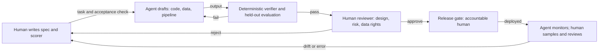

# 07. Team and agents: who you need to build, deploy and run an SLM, and how much agents can do

Written 2026-11-26. This page is for any organisation considering a small language model (SLM) project: a start-up with one product, an enterprise with several use cases, or a regulated institution. It is not about one company's setup. It answers two questions: **what team does an SLM project need**, and **how much of the work can AI agents do** (coding agents and research agents working under human direction).

**Evidence policy.** Factual statements link to a source I opened. Recommendations are labelled **Judgment**, chosen inputs **Assumption**. Preprints, vendor documents and consultancy surveys are named as such. Where a source was read only through a summary, the text says so. Regulatory notes are not legal advice.

## 1. The answers first

**Team.** An SLM project is mostly a software, data and governance project with a small model-training core. The evidence for that is old and consistent: in the 2015 NeurIPS paper on hidden technical debt, "only a small fraction of real-world ML systems is composed of the ML code" and "the required surrounding infrastructure is vast and complex" ([Sculley et al., Figure 1](https://papers.nips.cc/paper_files/paper/2015/file/86df7dcfd896fcaf2674f757a2463eba-Paper.pdf)); Microsoft's study of machine-learning teams found that data management, model customisation skills and module boundaries make ML work different from other software ([Amershi et al., ICSE-SEIP 2019](https://microsoft.com/research/uploads/prod/2019/03/amershi-icse-2019_Software_Engineering_for_Machine_Learning.pdf)). **Judgment:** staff for the surroundings (data, evaluation, serving, security, accountability), not only for the training run.

**Agents.** Agents can already do a lot of well-specified, automatically scorable engineering. On a set of seven open-ended ML research-engineering tasks, the best agents scored four times higher than human experts when both had a total budget of two hours per environment, while humans pulled ahead with more time (narrowly at eight hours, and at twice the agents' score at 32 total hours) ([RE-Bench, arXiv 2411.15114](https://arxiv.org/abs/2411.15114), preprint, late-2024 and early-2025 models). But they are unreliable across repeated runs, grade their own work poorly, make confident mistakes, and cannot hold accountability. **Judgment:** use agents as force multipliers for the engineers and reviewers you have, and never as a replacement for the accountable people.

**Minimum viable team (Judgment, no source gives headcounts).** Three accountable humans, who can be part-time and can hold several hats: a **domain and data owner**, an **ML engineer**, and a **platform and security owner**, plus a **named executive** who accepts the risk. Agents extend the ML engineer and the platform owner. If you buy managed fine-tuning, you remove the GPU roles and keep the other three.

## 2. The roles, and why each one exists

| Role | What the person decides or does | Why it cannot be dropped (source) | What agents can take |
|---|---|---|---|
| **Accountable executive / product owner** | Defines the outcome, the risk appetite and what "good enough" means; signs off release | NIST's AI Risk Management Framework: "Executive leadership of the organization takes responsibility for decisions about risks associated with AI system development and deployment" ([NIST AI 100-1, GOVERN 2.3](https://nvlpubs.nist.gov/nistpubs/ai/NIST.AI.100-1.pdf)). India's AI Governance Guidelines: accountability "should be clearly assigned based on the function performed, risk of harm, and due diligence conditions imposed" ([MeitY, Nov 2025](https://static.pib.gov.in/WriteReadData/specificdocs/documents/2025/nov/doc2025115685601.pdf)) | Drafting briefs and options only |
| **Domain and data owner** | Owns what the labels mean, the rights to use the data, and the acceptance criteria | Microsoft's study describes specialisation into "domain experts who deeply understand the business problems", "modelers" and "platform builders" as ML work scales ([Amershi et al.](https://microsoft.com/research/uploads/prod/2019/03/amershi-icse-2019_Software_Engineering_for_Machine_Learning.pdf)); data discovery, management and versioning was the first of its three differences from other software | Pre-labelling, deduplication and profiling, checked by the owner (section 5) |
| **ML engineer (modeller)** | Chooses method and base model, builds the training and evaluation harness, reads error analyses | Same source: the modeller role; model customisation and reuse "require very different skills than are typically found in software teams" | Writing and running scripts and experiments (section 4) |
| **Platform / MLOps engineer** | Serving, versioning, rollback, monitoring, cost | Google's MLOps guide notes that the data scientists on an ML project "might not be experienced software engineers who can build production-class services" ([Google Cloud MLOps](https://cloud.google.com/architecture/mlops-continuous-delivery-and-automation-pipelines-in-machine-learning)); Microsoft's maturity model names data scientists, data engineers and software engineers and describes level 0 ("No MLOps") as data scientists, data engineers and software engineers who "work in isolation without regular communication with the larger team" ([Azure MLOps maturity model](https://learn.microsoft.com/en-us/azure/architecture/ai-ml/guide/mlops-maturity-model)) | Pipelines, infrastructure as code, dashboards, with human approval of changes |
| **Security and supply-chain owner** | Decides which model files and code may enter: safetensors only, pinned revisions, review of any custom code | Hugging Face's docs warn of "dangerous arbitrary code execution attacks" when you load a pickle file ([Hugging Face docs](https://huggingface.co/docs/hub/security-pickle)); loading a custom model requires `trust_remote_code=True` and the docs say to "take extra precaution" and to pin a commit ([Transformers docs](https://huggingface.co/docs/transformers/en/models)); OWASP lists [Supply Chain](https://genai.owasp.org/llmrisk/llm032025-supply-chain/) (LLM03:2025) and [Data and Model Poisoning](https://genai.owasp.org/llmrisk/llm042025-data-and-model-poisoning/) (LLM04:2025). **Judgment:** security owns model intake and the ML lead owns data provenance | Scanning and checklists; the intake decision stays human |
| **Independent evaluator / reviewer** | Builds or audits the held-out evaluation set and reviews production samples | OpenAI's fine-tuning guide: "Only invest in fine-tuning after setting up evals" ([OpenAI guide](https://developers.openai.com/api/docs/guides/supervised-fine-tuning.md)). **Judgment:** someone other than the person who trained the model should own the pass/fail set | Running the evaluation; not setting the bar |
| **Governance, privacy and compliance** | Training-data rights, regulatory duties, records | EU AI Act Article 14 requires high-risk systems to be designed so they "can be effectively overseen by natural persons", and Article 26(2) says deployers "shall assign human oversight to natural persons who have the necessary competence, training and authority, as well as the necessary support" ([Art. 14](https://artificialintelligenceact.eu/article/14/), [Art. 26](https://artificialintelligenceact.eu/article/26/), text mirror; whether your system is "high-risk" is a legal question). NIST GOVERN 3.2: "Policies and procedures are in place to define and differentiate roles and responsibilities for human-AI configurations and oversight of AI systems" | Drafting records and registers |
| **Expert reviewers / labellers** | Label hard cases, adjudicate disagreements | LLM annotators are mixed (section 4) | Pre-labelling at volume |

**Small teams combine roles.** Microsoft's Team Data Science Process says "depending on the structure and size of an enterprise, a single person might have more than one role, or more than one person might fill a role" ([TDSP roles, archived copy](https://web.archive.org/web/2023/https://learn.microsoft.com/en-us/azure/architecture/data-science-process/roles-tasks); the live page now redirects elsewhere). **Judgment:** the rule of combination is to keep the *evaluator* and the *approver of release* separate from the person who trained the model, even when everything else is shared.

## 3. Team shapes by organisation

No published source gives headcounts for SLM projects, so the people counts below are **Assumptions** for planning (replace with your own). The structural ideas come from the cited sources.

| Situation | Shape | Assumed people | Structural support |
|---|---|---|---|
| **One product, one or two SLM tasks** | One cross-functional team; roles combined; keep evaluator separate if you can | 2 to 4, some part-time | TDSP: small units combine roles ([TDSP](https://web.archive.org/web/2023/https://learn.microsoft.com/en-us/azure/architecture/data-science-process/roles-tasks)) |
| **Several tasks across business units** | A small central team owns platform, serving and evaluation tooling; business teams own labels and acceptance | Core of 3 to 6, plus a domain owner per task | Team Topologies: a platform team provides "a compelling internal product to accelerate delivery by Stream-aligned teams", and an enabling team "helps a Stream-aligned team to overcome obstacles. Also detects missing capabilities" ([Team Topologies, key concepts](https://teamtopologies.com/key-concepts); a general software idea, not ML-specific) |
| **Large or regulated institution** | Central platform and governance, embedded domain teams, an executive-level council | Core of 6 or more, plus governance and security functions | Bain's analysis of about 20 financial-services firms found more than half "operate with a hybrid staffing model—a dedicated team plus cross-functional, decentralized teams", and some 60% had a governance council with C-level executives ([Bain](https://www.bain.com/insights/are-you-organized-to-reap-value-from-generative-ai/), consultancy analysis, small sample, about generative AI in general) |
| **Buying managed fine-tuning instead of self-hosting** | Drop the GPU and training-infrastructure work; keep data, evaluation, security intake and oversight | Fewer platform hours | OpenAI's guide describes the managed workflow as: upload a training dataset, create a fine-tuning job, evaluate your results; the team still supplies the data, the evals and the judgement of "good" ([OpenAI guide](https://developers.openai.com/api/docs/guides/supervised-fine-tuning.md)). **Inference, not stated by any source:** the roles that remain are the ones above. **Platform risk:** the same page says OpenAI "is winding down the fine-tuning platform", closed to new users, with existing customers able to create jobs until 15 December 2026, so a managed route can disappear |

**Maturity matters more than headcount.** Google's guide distinguishes "MLOps level 0: Manual process", "level 1: ML pipeline automation" and "level 2: CI/CD pipeline automation" ([Google Cloud MLOps](https://cloud.google.com/architecture/mlops-continuous-delivery-and-automation-pipelines-in-machine-learning)), and Microsoft defines five levels from "No MLOps" to "Full MLOps automated operations" ([Azure maturity model](https://learn.microsoft.com/en-us/azure/architecture/ai-ml/guide/mlops-maturity-model)). **Judgment:** a first SLM project can run at level 0 or 1 if it has one task and low volume; plan to move up when you have several adapters or several owners.

**People cost versus compute (Assumption-based).** Aggregator pages (crowd-sourced self-reports, not surveys) put India's average machine-learning-engineer salary at ₹12,51,552 a year as of April 2025 ([Salary.com](https://www.salary.com/research/in/machine-learning-engineer-salary)) and ₹1,022,861 in 2026 on 232 profiles ([PayScale](https://www.payscale.com/research/IN/Job=Machine_Learning_Engineer/Salary)). One always-on GPU at the L40S list price in [04 §3](04-build-and-deploy-playbook.md#3-what-it-costs) is 730 hours x 12 months x $1.50 = $13,140 a year; at an assumed ₹90 per dollar that is about ₹11.8 lakh. **Judgment:** one engineer's salary and one GPU-year are the same order of magnitude, so a team of three to five costs several times your compute, and the people plan decides the budget.

## 4. How much can agents do? The evidence

### 4.1 What the benchmarks say, with dates

| Evidence | Result | Type and caveats |
|---|---|---|
| **MLE-bench**: 75 Kaggle machine-learning competitions | The first paper's best setup, o1-preview with the AIDE scaffold, reached at least a bronze medal in 16.9% of competitions ([arXiv 2410.07095](https://arxiv.org/abs/2410.07095), 2024 models). The maintainers' leaderboard now lists 64.44% (any medal, 24-hour runs, Famou-Agent 2.0 with Gemini-3-Pro-Preview, 23 Feb 2026); the maintainers say they are "not taking any new submissions" while they develop a fairer process, and a separate table lists entries flagged "Test-set feedback", one of them scoring 77.78 ([GitHub README](https://github.com/openai/mle-bench)) | Preprint plus a frozen, partly self-reported leaderboard. Kaggle tasks are well-posed and scored; this is not enterprise fine-tuning |
| **RE-Bench** | See section 1: agents win on short budgets, humans on long ones ([arXiv 2411.15114](https://arxiv.org/abs/2411.15114)) | Preprint, 2024 to early-2025 models |
| **PaperBench**: replicate 20 ICML papers | The best tested agent, Claude 3.5 Sonnet (New), scored 21.0% on average; on a subset, ML PhDs outperformed models ([arXiv 2504.01848](https://arxiv.org/abs/2504.01848)) | Preprint, early-2025 models; no later update verified |
| **METR time horizons**: length of human-expert task an agent completes at a given success rate | "Frontier AI time horizon has been doubling approximately every seven months since 2019" ([arXiv 2503.14499](https://arxiv.org/abs/2503.14499)); METR's January 2026 update, on a larger suite, reports 50% doubling times of 196.5 days over the whole period, 130.8 days since 2023 and 88.6 days since 2024, and says the trend is "somewhat sensitive to task composition" ([Time Horizon 1.1](https://metr.org/blog/2026-01-29-time-horizon-1-1/)). From METR's published data file, Claude Opus 4.6 (released 5 Feb 2026) has a 50% horizon of about 719 minutes (95% interval roughly 317 to 3,634 minutes) but an **80% horizon of about 70 minutes** ([data file](https://metr.org/assets/benchmark_results_1_1.yaml)) | METR's own tasks are self-contained and automatically scorable; METR states its page is no longer actively updated and that measurements above 16 hours are unreliable. Read the 80% figure as the length of task you could delegate and mostly trust without review, **Judgment** |
| **Reliability across repeats** | On tau-bench, gpt-4o function-calling agents succeeded on under 50% of tasks and `pass^8` (all eight repeats succeed) was under 25% in retail ([arXiv 2406.12045](https://arxiv.org/abs/2406.12045), 2024 models) | Preprint; older models; newer tau-bench numbers were not verified |
| **Agent coding benchmarks** | OpenAI wrote on 23 Feb 2026 that "SWE-bench Verified is increasingly contaminated" and stopped reporting it ([OpenAI](https://openai.com/index/why-we-no-longer-evaluate-swe-bench-verified/), vendor) | Treat saturated coding benchmarks as weak evidence |
| **Real developers, real repositories** | A randomised trial of 16 experienced open-source developers found AI tools increased task completion time by 19% in early 2025 ([arXiv 2507.09089](https://arxiv.org/abs/2507.09089)). METR's February 2026 follow-up says its new data "gives us an unreliable signal" because many developers refused to work without AI ([METR](https://metr.org/blog/2026-02-24-uplift-update/)) | Small sample; dated tools; the follow-up is inconclusive, not a reversal |
| **Autonomy in practice** | Among the longest Claude Code sessions, time working before stopping "nearly doubled in three months, from under 25 minutes to over 45 minutes", and the authors say existing models "are capable of more autonomy than they exercise in practice" ([Anthropic, Feb 2026](https://www.anthropic.com/research/measuring-agent-autonomy)) | Vendor data about its own product |

**What the table adds up to (Judgment):** agents are strong on bounded tasks with a clear scorer and a short horizon, weak on long open-ended work, and much less reliable than a single run suggests. Capability is rising fast, and the evidence is dated, so re-check it before you plan a team around it.

### 4.2 Task by task for an SLM project

| Activity | What the evidence says | Agent role (Judgment) |
|---|---|---|
| **Writing training and evaluation scripts, running experiments** | Agents beat experts on short, scored optimisation tasks ([RE-Bench](https://arxiv.org/abs/2411.15114)) and win medals on a large share of well-posed competitions ([MLE-bench](https://github.com/openai/mle-bench)). An independent evaluation of an AI-scientist system found 42% of its experiments failed on coding errors and some produced "flawed or misleading results" ([Beel et al., arXiv 2502.14297](https://arxiv.org/abs/2502.14297)) | **Lead the keystrokes, human reviews the design and the result.** Always run the same scorer on the agent's output |
| **Data labelling** | The paper's current abstract reports that ChatGPT's zero-shot accuracy exceeded crowd-workers on four of five annotation tasks on 2,382 tweets, with agreement above crowd-workers and trained annotators, at under $0.003 per annotation ([Gilardi et al.](https://arxiv.org/abs/2303.15056), preprint). Against that: repeated and reworded inputs changed ChatGPT's labels, and the unsupervised use of ChatGPT for annotation "is not recommended" ([Reiss](https://arxiv.org/abs/2304.11085)); performance varied across tasks and a supervised DistilBERT classifier generally beat the chatbots ([Kristensen-McLachlan et al., PNAS Nexus](https://arxiv.org/abs/2311.05769)); across 37 tasks and 13 million labels, LLM annotation led to incorrect conclusions in about 31% of hypotheses for state-of-the-art models and about half for smaller ones ([Baumann et al.](https://arxiv.org/abs/2509.08825), preprint); for one legal task, instructions that worked for human annotators failed for generative models, and fine-tuning on expert labels did best ([arXiv 2310.18440](https://arxiv.org/abs/2310.18440)) | **Pre-label, humans validate a sample and own the hard cases.** Measure agreement against expert labels before scaling |
| **Synthetic training data** | Training recursively on model output causes "irreversible defects" where "tails of the original content distribution disappear" ([Shumailov et al., Nature 2024](https://www.nature.com/articles/s41586-024-07566-y); [preprint](https://arxiv.org/abs/2305.17493)); a follow-up reports that replacing real data with synthetic data collapses, while accumulating synthetic data alongside real data avoids it in their pretraining experiments ([Gerstgrasser et al.](https://arxiv.org/abs/2404.01413), preprint). In our own SLM experiment, synthetic validation reached 98.6% while real documents scored about 75% ([04 §7](04-build-and-deploy-playbook.md#7-a-measured-case-from-our-own-experiments), one internal case) | **Agents can generate; humans own realism and the real-data split.** Keep a real held-out set the generator never saw |
| **Evaluation and grading** | GPT-4 judges agreed with human preferences over 80% of the time, similar to human-human agreement, and the same paper documents position, verbosity and self-enhancement biases ([Zheng et al., NeurIPS 2023](https://arxiv.org/abs/2306.05685)); a later study reports "low intra-rater reliability" across repeated runs ([Haldar and Hockenmaier, accepted at EMNLP 2025](https://arxiv.org/abs/2510.27106)). PaperBench's own best judge reached F1 0.83 against human labels ([arXiv 2504.01848](https://arxiv.org/abs/2504.01848)) | **Deterministic verifiers decide; an LLM judge is advisory and re-run.** Do not let the agent that trained a model grade it |
| **Serving, pipelines, infrastructure code** | Within the capability limits above; agent coding benchmarks are partly contaminated, and the real-developer trials are mixed | **Agent drafts, platform owner reviews and approves every production change** |
| **Model intake and supply-chain checks** | The risks are documented ([Hugging Face](https://huggingface.co/docs/hub/security-pickle), [OWASP](https://genai.owasp.org/llmrisk/llm032025-supply-chain/)); no evidence that agents should make the call | **Agents run scans; the security owner decides** |
| **Release approval, risk acceptance, regulatory sign-off** | The oversight texts assign these to natural persons with competence and authority ([EU AI Act Art. 26](https://artificialintelligenceact.eu/article/26/), [NIST GOVERN 2.3](https://nvlpubs.nist.gov/nistpubs/ai/NIST.AI.100-1.pdf)) | **Human only** |
| **Post-deployment monitoring and sample review** | Agents can flag drift; the same oversight texts apply | **Agent monitors, human reviews a fixed sample and decides** |

**"How much" (Judgment, not measured):** no source measures the share of an SLM project that agents can do. A defensible reading of the evidence is that agents can take most of the *hands-on* work in the scorable middle of the project (scripts, experiments, pipelines, pre-labelling, synthetic data, scanning), while humans keep the *edges*: the problem definition, the data rights, the evaluation bar, the release decision and the accountability. In staffing terms, agents let a small team cover roles it would otherwise have to hire; they do not remove the roles.

### 4.3 A rule for what to delegate (Judgment)

Delegate a task to an agent when all of these hold:

1. **Specified:** the task has a written goal and inputs, not just an intention.
2. **Scorable:** a deterministic check can tell you whether it worked (tests, a verifier, a held-out metric).
3. **Reversible:** a wrong result costs a rerun, not an incident.
4. **Short enough to trust:** the task is within roughly an hour of expert work, the scale at which METR's 80% horizon sits for the strongest model it lists (about 70 minutes; wide uncertainty, and only for self-contained tasks).
5. **Not accountability-bearing:** nobody's regulatory or contractual responsibility rests on the result.

Notice that agents appear only between a human-written spec and a verifier, that every path to release passes a human reviewer and the accountable approver, and that monitoring feeds back to the spec. **Judgment:** this shape keeps the speed of agents without making an agent the last line of defence.

## 5. The human gates that should stay

**Judgment, consistent with the oversight texts cited in section 2:**

| Gate | Who decides | Why |
|---|---|---|
| Use of training data (rights, consent, privacy) | Domain and data owner with compliance | Rights are a legal and ethical question; no agent can grant them |
| The evaluation set and the pass threshold | Independent evaluator and the product owner | The threshold is the definition of success |
| Model and code intake | Security owner | Supply-chain risk ([OWASP LLM03](https://genai.owasp.org/llmrisk/llm032025-supply-chain/)) |
| Release to users | Accountable executive or delegate | Accountability ([NIST GOVERN 2.3](https://nvlpubs.nist.gov/nistpubs/ai/NIST.AI.100-1.pdf)) |
| Any action with side effects taken by the model in production | A human or a policy gate | See [06 Q3](06-algorithm-or-model-use-cases.md#q3-if-i-have-an-app-can-i-use-an-slm-for-it) |
| Retirement or retraining on drift | Product owner | Cost and risk trade-off |

The lab's [agentic engineering theme](../../themes/agentic-engineering/README.md) states the same boundary for coding agents ("Require human ownership for requirements, material design decisions, reviews, and production changes").

## 6. One small data point from our own work

One small case, not a model for your organisation. Our own SLM document-identification experiments (see [04 §7](04-build-and-deploy-playbook.md#7-a-measured-case-from-our-own-experiments)) were run by a single technical founder working with agents, at a stated time budget of about 24 founder hours a week (internal functional spec, not public). The agents built the evaluation harness, the synthetic-data generator and the training scripts and ran the experiments; the human decisions that the project could not proceed without were: which outcome to optimise (privacy, not cost), the model size budget, whether real documents could be used for training and where the resulting weights could live, which scope to defer, how to redefine a gate that the data showed was mis-specified, and whether to continue after an inconclusive result. That is consistent with the split in section 4.2, but it is one case with no comparison group, so it proves nothing about other teams.

## 7. What this page does not establish

- **No source gives staffing numbers for SLM projects.** The headcounts in section 3 are our assumptions. The only enterprise-organisation evidence is one Microsoft-internal study, one consultancy sample of about 20 financial-services firms, and general software team models.
- **Agent capability evidence is benchmark evidence on self-contained tasks, from model versions released between 2024 and early 2026.** It is moving quickly; METR's own time-horizon page says it is no longer actively updated. No benchmark covers a full SLM project with business acceptance criteria.
- **Several benchmarks are saturated, contaminated or frozen** (SWE-bench Verified, MLE-bench's leaderboard, METR measurements above 16 hours).
- **Not verified:** a US salary figure (the official page blocked our fetch), the ISO/IEC 42001 requirements (paywalled), any banking, healthcare or telecom staffing account, and McKinsey's operating-model figures (seen only as a search snippet).
- **Regulatory references are not legal advice.** Whether the EU AI Act's high-risk rules apply to your system is a legal determination.

## 8. Where next

- What each phase of a project needs and the gates between them: [04 Build and deploy playbook](04-build-and-deploy-playbook.md).
- Which parts of an application an SLM should and should not do: [06 Algorithm or model?](06-algorithm-or-model-use-cases.md).
- The governance and security duties in detail: [04 §5](04-build-and-deploy-playbook.md#5-governance).
- Evaluation without an LLM judge as the arbiter: [04 §4](04-build-and-deploy-playbook.md#4-evaluation).
