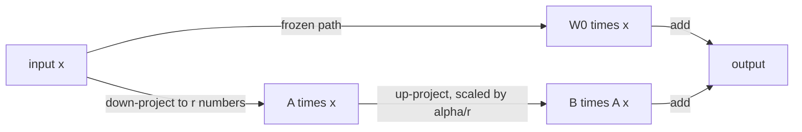
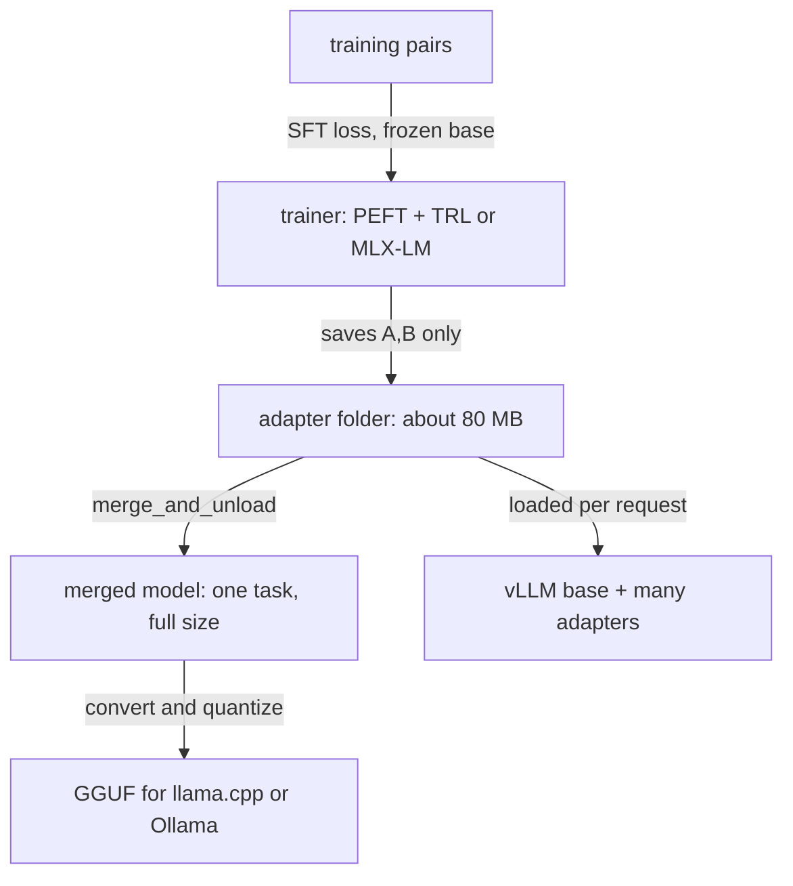

# LoRA for a small-model project

> **Key papers:** [Hu et al.](https://arxiv.org/html/2106.09685) (Microsoft), 2021, "LoRA: Low-Rank Adaptation of Large Language Models" - [arXiv 2106.09685](https://arxiv.org/abs/2106.09685). [Biderman et al.](https://arxiv.org/html/2405.09673), 2024, "LoRA Learns Less and Forgets Less" - [arXiv 2405.09673](https://arxiv.org/abs/2405.09673). Tool documentation: Hugging Face [PEFT](https://huggingface.co/docs/peft/package_reference/lora) (`LoraConfig`), [TRL](https://huggingface.co/docs/trl/sft_trainer), [MLX-LM](https://github.com/ml-explore/mlx-lm/blob/main/mlx_lm/LORA.md) and [vLLM](https://docs.vllm.ai/en/latest/features/lora.html).
>
> **Scope:** the small-model project view of LoRA: which settings to choose, how to merge or serve adapters, what it costs, and what the best independent evidence says. The paper's own walk-through, with GPT-3 shapes and the intrinsic-rank analysis, is in the lab's [LoRA guide](../../../llm-learning-repository/tutorials/02-building/09-lora.md) and is not repeated here.

Written 2026-11-26. Library defaults and flag names move; the PEFT, TRL, MLX-LM and vLLM pages were read on this date.

## Read this first

**The idea in one sentence.** Freeze the pretrained model and train, for each chosen weight matrix, a pair of thin matrices whose product is added to that weight; the thin pair is a few megabytes, can be swapped per task, and can be folded back into the weights.

**Who this is for.** Someone who will actually run a fine-tune of a 1B to 14B model, or buy one, and needs to choose rank, scaling, which layers, how to ship the result, and when LoRA is the wrong tool.

**Afterwards you will be able to** count adapter parameters for a real model shape; pick a starting rank, alpha, learning rate and target modules and defend them; merge an adapter or serve many adapters on one base; and state what LoRA Learns Less does and does not show.

**Reading time.** About 40 minutes; Tutorial 1 is about 12.

**Have read first (reading order, no claim):** [01 Full fine-tuning and SFT](./01-full-fine-tuning-and-sft.md) (the loss, masks and memory this builds on). Strongly recommended: the lab's [LoRA guide](../../../llm-learning-repository/tutorials/02-building/09-lora.md) for the paper itself.

**The one thing most people get wrong.** **Judgment:** they treat the rank as the main dial. The evidence says the choice of *which layers* and the *learning rate* matter at least as much: the [QLoRA paper](https://arxiv.org/html/2305.14314) found that adapting only the attention query and value matrices could not match full fine-tuning for large base models while adapting all linear layers could, and that rank was then unrelated to final performance (arXiv 2305.14314, Section 4 and Appendix A.1). [LoRA Learns Less](https://arxiv.org/html/2405.09673) adds that LoRA's best learning rates should be "one order of magnitude higher" than full fine-tuning's and that LoRA is more sensitive to the rate (Section 4.7), though it also says ranks 16 to 64 tend not to suffice for code tasks. **Judgment:** set the target modules to all linear layers first, sweep the learning rate second, and touch the rank last unless the task is code-like.

## The technique in one worked example

Part A is a tiny matrix you can compute by hand (constructed by this guide). Part B scales it to a real model shape. The model shape in Part B is Llama-2-7B's configuration (hidden size 4,096, MLP size 11,008, 32 layers, vocabulary 32,000), which the [Transformers `LlamaConfig` documentation](https://huggingface.co/docs/transformers/model_doc/llama2) gives as its defaults and says match meta-llama/Llama-2-7b-hf. The total of about 6.74 billion weights is this guide's arithmetic: 32 x (4 x 4,096^2 + 3 x 4,096 x 11,008) + 2 x 32,000 x 4,096 + 65 x 4,096 = 6,738,415,616 (attention, MLP, untied embedding and output matrices, and norm vectors).

**Part A - one 2 x 2 matrix, rank 1.** The frozen weight and the two thin matrices (output = W times input):

- W0 = [[1, 2], [3, 4]] (frozen).
- B = [[0.5], [1.0]] (2 x 1) and A = [[1, -1]] (1 x 2).
- B times A = [[0.5, -0.5], [1.0, -1.0]], a 2 x 2 matrix of rank 1.
- With the scale alpha/r taken as 1: merged W = W0 + BA = [[1.5, 1.5], [4, 3]].

Input x = [2, 1]. Unmerged path: W0 x = [1x2 + 2x1, 3x2 + 4x1] = [4, 10]. Adapter path: A x = 1x2 - 1x1 = 1, then B(Ax) = [0.5, 1.0]. Sum = [4.5, 11]. Merged path: [1.5x2 + 1.5x1, 4x2 + 3x1] = [4.5, 11]. The two paths give the same answer, which is the whole reason merging costs nothing at inference.

At the start of training B is all zeros ([PEFT documentation](https://huggingface.co/docs/peft/package_reference/lora): "the LoRA B weight being set to 0"), so the adapter starts as a no-op and the model begins exactly where the base was.

**Part B - counting trainable numbers for a real shape (this guide's arithmetic).** Rank r = 16 on all seven linear layers in each of 32 layers. A matrix mapping n inputs to m outputs gets r x (n + m) trainable numbers.

| Matrix | Shape (in x out) | Trainable at r = 16 |
|---|---|---|
| Query, key, value, output (4 of them) | 4,096 x 4,096 | 4 x 16 x 8,192 = 524,288 |
| Gate and up projections (2) | 4,096 x 11,008 | 2 x 16 x 15,104 = 483,328 |
| Down projection (1) | 11,008 x 4,096 | 16 x 15,104 = 241,664 |
| One layer | | 1,249,280 |
| 32 layers | | **39,976,960**, about 0.59 percent of 6.74 billion |

In float16 or bf16 that is about 80 MB on disk (this guide's arithmetic: 39,976,960 x 2 bytes). The base model in bf16 is about 13.5 GB (6.74e9 x 2 bytes, this guide's arithmetic).



The adapter path squeezes the input through r numbers (16 in Part B) and expands it again, so it can only change the output in at most r independent directions (rank at most r, [Hu et al. Section 4.1](https://arxiv.org/html/2106.09685)). Only A and B receive gradients; W0 never moves ([Hu et al. Section 4](https://arxiv.org/html/2106.09685)).



Notice the fork (this guide's reading; serving mechanics in Tutorial 2): the same adapter either becomes a full-size merged model (simple to serve, one task per copy) or stays small and is attached at serving time (many tasks on one base, with an extra per-request cost this guide did not measure). Later sections refer back to the 2 x 2 example, the 39,976,960 figure and this fork.

## Words you need

| Term | Plain definition | In the worked example |
|---|---|---|
| Adapter | The small set of extra trained numbers (all the A and B matrices) saved separately from the base | The 39,976,960 numbers, about 80 MB |
| Rank (r) | The inner width of the thin pair; the most independent directions the update can have | 1 in Part A, 16 in Part B |
| Alpha (lora_alpha) | A scaling constant; the update is multiplied by alpha/r in the usual setting | Scale taken as 1 in Part A |
| Target modules | Which weight matrices get an adapter | All seven linear layers in Part B |
| Merge | Add B times A (scaled) into W0 so no separate adapter remains | [[1.5, 1.5], [4, 3]] |
| Base model | The frozen pretrained model the adapter sits on | W0 |
| Multi-adapter serving | One copy of the base in memory, many adapters chosen per request | vLLM with `--enable-lora` |
| rsLoRA | A variant that scales by alpha divided by the square root of r | `use_rslora=True` in PEFT |
| Continued pretraining (CPT) | Training on raw text without prompts and answers | The regime where LoRA lags most |
| Forgetting | Loss of abilities outside the tuned domain | Measured as a drop on general benchmarks |

## Tutorial 1 - Intuitive understanding

### What was broken before

**Judgment:** teaching a large model a new job by changing all its weights is expensive in three ways. You need memory for the model, its gradients and optimiser state; you produce a full-size copy for every job; and the more freely you change the model, the more it can forget. The [original paper's](https://arxiv.org/html/2106.09685) headline for GPT-3 175B is a reduction of about 10,000 times in trainable parameters and about 3 times in GPU memory against fine-tuning with Adam (arXiv 2106.09685, abstract), with checkpoints of about 35 MB instead of about 350 GB (Section 4.2, which uses rank 4 on the query and value projections only).

### The idea

Most of what a task needs is a small correction to what the model already knows. So leave the model alone and learn only the correction, in compressed form: instead of a full table of changes for a large matrix, learn two thin tables whose product gives the change.

**Analogy.** A printed reference book (the base model) and a thin set of margin notes for one reader (the adapter). To teach the book a new specialty you do not reprint it; you write short notes in the margins. Different readers have different note sets, and you can bind a set into a new edition (merge).

**Where the analogy breaks (Judgment).** Margin notes can say anything; an adapter's notes are limited to the "shape" of a low-rank change, so some corrections cannot be expressed in a low-rank form. Real notes also do not interact with the page by arithmetic: the adapter's contribution is literally added to the numbers inside the layers. And a note on one page does not alter other pages, whereas one adapter shifts behaviour across the whole model, which is both why it forgets less than a rewrite and why it can still disturb things.

### How it works, step by step

1. **Choose where to attach.** Today the default advice is every linear layer in every transformer block (attention and the feed-forward block; [QLoRA Section 4](https://arxiv.org/html/2305.14314), [LoRA Learns Less Section 4.7](https://arxiv.org/html/2405.09673), [Unsloth](https://unsloth.ai/docs/get-started/fine-tuning-llms-guide/lora-hyperparameters-guide)).
2. **Freeze the base.** None of its weights get gradients, so its optimiser state disappears (this guide's reading of [Hu et al. Section 4](https://arxiv.org/html/2106.09685)).
3. **Add the thin pair to each chosen layer.** A is random (Gaussian in [Hu et al. Section 4.1](https://arxiv.org/html/2106.09685), Kaiming-uniform in [PEFT](https://huggingface.co/docs/peft/package_reference/lora)) and B is zeros, so training starts from the base model's exact behaviour.
4. **Train with the usual SFT loss**, as in [01](./01-full-fine-tuning-and-sft.md), but at a higher learning rate than full tuning ([LoRA Learns Less Section 4.7](https://arxiv.org/html/2405.09673)).
5. **Save only the adapter.** For the Part B shape that is about 40 to 320 MB at ranks 8 to 64 (cost table in Tutorial 2, this guide's arithmetic).
6. **Ship it** merged into the weights, or kept separate and attached at serving time.

### What the evidence says

- **The original paper.** On GPT-3 175B ([Hu et al., Table 4](https://arxiv.org/html/2106.09685)), LoRA with 4.7 million trainable parameters scored 73.4 on WikiSQL, 91.7 on MNLI and 53.8 ROUGE-1 on SAMSum, against 73.8, 89.5 and 52.0 for full fine-tuning of all 175 billion parameters. In plain terms (this guide's arithmetic, 175,255.8M / 4.7M = about 37,300): on three benchmarks a model that trained about 37,000 times fewer numbers beat full tuning on two and trailed by 0.4 on the third. Authors' own results; GPT-3 is a model very few teams will adapt.
- **The sharpest independent look.** [LoRA Learns Less and Forgets Less](https://arxiv.org/html/2405.09673) (TMLR) compares LoRA with full fine-tuning on Llama-2-7B in code and maths. It reports that LoRA "substantially underperforms" full fine-tuning in common settings, but preserves the base model's other abilities better (abstract). On code instruction tuning at epoch 4, rank 16 scored 0.358 on HumanEval, rank 64 scored 0.417 and rank 256 scored 0.498, against 0.470 for full fine-tuning (Table S5): out of every 100 problems, about 36, 42 and 50 solved versus 47 for full tuning (this guide's rounding).
- **Cost evidence from tools.** [Unsloth's documentation](https://unsloth.ai/docs/get-started/fine-tuning-llms-guide/lora-hyperparameters-guide) says its 4-bit route uses about four times less memory than 16-bit LoRA and that LoRA done correctly can match full fine-tuning (vendor documentation).

### What this does not show

- It does not show LoRA beats full tuning in general; the [independent study](https://arxiv.org/html/2405.09673) shows the opposite on code and maths at standard ranks (abstract, Section 4.1).
- **Judgment:** it does not show a rank that is right for your task. The studies use benchmark domains with checkable answers.
- **Judgment:** none of the cited studies measures private-document tasks, or what happens when the base changes and you must retrain.
- The "10,000 times fewer" figure is about trainable parameters and checkpoint size in one GPT-3 setting ([Hu et al. abstract and Section 4.2](https://arxiv.org/html/2106.09685)); **Judgment:** it is not a statement about training time or a promise for a 4B model.

### Teach-back

<details>
<summary>1. In Part A, why does the unmerged output equal the merged output?</summary>

Matrix multiplication distributes: (W0 + BA)x = W0x + B(Ax). Computing the two paths and adding gives the same result as adding BA into the weights first. Both come to [4.5, 11] for x = [2, 1] (this guide's arithmetic).
</details>

<details>
<summary>2. Why does the adapter start as a no-op?</summary>

B is initialised to zeros ([PEFT](https://huggingface.co/docs/peft/package_reference/lora): "without further training, the LoRA adapter will be a no-op"), so BA is a zero matrix at step 0 and the model's outputs equal the base model's. Training then moves B and A away from zero.
</details>

<details>
<summary>3. What is the main thing LoRA gives up versus full fine-tuning, according to LoRA Learns Less?</summary>

Learning capacity on hard domains, especially code and continued pretraining, at the usual ranks of 16 to 64 ([LoRA Learns Less, Sections 4.1 and 4.7](https://arxiv.org/html/2405.09673)). In exchange it forgets less of what the base could already do (abstract).
</details>

<details>
<summary>4. Name the two ways to ship an adapter and one reason to choose each.</summary>

**Judgment:** merged is the simplest serving and adds no extra latency ([Hu et al. abstract](https://arxiv.org/html/2106.09685)), but costs one full-size copy per task. Separate adapters let many tasks share one base and each adapter is tens of megabytes (cost table below), but the serving stack must support adapters ([vLLM](https://docs.vllm.ai/en/latest/features/lora.html)).
</details>

## Tutorial 2 - Practitioner understanding

### The design in concrete terms

**[PEFT `LoraConfig`](https://huggingface.co/docs/peft/package_reference/lora) (documentation read 2026-11-26).** Defaults: `r=8`, `lora_alpha=8`, `lora_dropout=0.0`, `bias="none"`, `use_rslora=False`, `use_dora=False`, `init_lora_weights=True` (B starts at zero). The scale is `lora_alpha / r` by default, or `lora_alpha / sqrt(r)` with `use_rslora=True`. `target_modules="all-linear"` selects every linear layer except the output layer for a pretrained model; a list of names matches exact names or suffixes; a string is a regular expression. With no `target_modules` set, PEFT picks by architecture and requires you to specify them if it does not know the architecture.

**Starting values, with sources.** **Judgment:** the starting values are this guide's synthesis of the sources in the last column, not a single source's recommendation.

| Setting | Starting value | Source |
|---|---|---|
| Target modules | All linear layers (q, k, v, o, gate, up, down) | [QLoRA paper Section 4](https://arxiv.org/html/2305.14314); [LoRA Learns Less Section 4.7](https://arxiv.org/html/2405.09673); [Unsloth guide](https://unsloth.ai/docs/get-started/fine-tuning-llms-guide/lora-hyperparameters-guide) |
| Rank | 16 to 32 for behaviour tasks; 64 to 256 if code or maths-like and memory allows | [Unsloth](https://unsloth.ai/docs/get-started/fine-tuning-llms-guide/lora-hyperparameters-guide) says "Choose 16 or 32"; [LoRA Learns Less Section 4.7](https://arxiv.org/html/2405.09673) says ranks 16-64 "tend not to suffice for code tasks" and recommends 256 with all modules if GPU memory allows |
| Alpha | alpha = r, or alpha = 2r | [LoRA Learns Less](https://arxiv.org/html/2405.09673) sets alpha = 2r and says it is "crucial for high ranks" (Section 4.7); [Unsloth](https://unsloth.ai/docs/get-started/fine-tuning-llms-guide/lora-hyperparameters-guide) says 2r or r |
| Learning rate | 1e-4 to 2e-4 for adapters; sweep 1e-5 to 5e-4 and take the highest stable value | [TRL docs](https://huggingface.co/docs/trl/sft_trainer#train-adapters-with-peft) (about 1e-4); [Unsloth](https://unsloth.ai/docs/get-started/fine-tuning-llms-guide/lora-hyperparameters-guide) (2e-4); [LoRA Learns Less Section 4.7](https://arxiv.org/html/2405.09673) |
| Epochs | 1 to 3 | [Unsloth](https://unsloth.ai/docs/get-started/fine-tuning-llms-guide/lora-hyperparameters-guide) (1-3 epochs); [LoRA Learns Less Table S5](https://arxiv.org/html/2405.09673) reports epochs 1 to 16 |
| Dropout | 0 to 0.05 | [Unsloth](https://unsloth.ai/docs/get-started/fine-tuning-llms-guide/lora-hyperparameters-guide) calls dropout "not that useful"; [QLoRA Appendix A.1](https://arxiv.org/html/2305.14314) found 0.05 useful for 7B and 13B but not 33B and 65B |
| Weight decay, warmup | 0.01; 5 to 10 percent of steps | [Unsloth](https://unsloth.ai/docs/get-started/fine-tuning-llms-guide/lora-hyperparameters-guide) (0.01; 5-10 percent) |
| Effective batch | 16 | [Unsloth](https://unsloth.ai/docs/get-started/fine-tuning-llms-guide/lora-hyperparameters-guide) (4 to 16 range) |

**The scaling trap.** Because the update is multiplied by alpha divided by r, doubling rank with alpha fixed halves the scale applied to the update (this guide's arithmetic). The [original paper](https://arxiv.org/html/2106.09685) sets alpha to the first rank tried and does not tune it (Section 4.1). The [QLoRA paper](https://arxiv.org/html/2305.14314) keeps alpha fixed and searches the learning rate instead (Appendix A.1). **Judgment:** pick one convention and change one thing at a time.

**Platform notes.** In [MLX-LM](https://github.com/ml-explore/mlx-lm/blob/main/mlx_lm/LORA.md), `--fine-tune-type lora` is the default, adapters save to `adapters/`, and `--num-layers` defaults to 16, meaning the adapter is applied to the last 16 layers unless you raise it (`LORA.md`; the meaning of the flag is this guide's reading of the page, so check `mlx_lm.lora --help`). If `--model` points at a quantized model the training is QLoRA ([03](./03-qlora.md); `LORA.md`). In [TRL](https://huggingface.co/docs/trl/sft_trainer#train-adapters-with-peft), pass `peft_config=LoraConfig(...)` to `SFTTrainer`.

**Shipping choices.**

- **Merge:** in PEFT, `merge_and_unload()` merges the adapter weights into the base model, is not in-place, and does not keep the adapter weights in memory ([PEFT, post-training section](https://huggingface.co/docs/peft/package_reference/lora)). In MLX-LM, `mlx_lm.fuse --model <path>` writes the merged model to `fused_model/`, with optional `--export-gguf`, limited to Mistral, Mixtral and Llama-style fp16 models ([`LORA.md`](https://github.com/ml-explore/mlx-lm/blob/main/mlx_lm/LORA.md)).
- **Serve many adapters:** [vLLM's](https://docs.vllm.ai/en/latest/features/lora.html) `--enable-lora`, `--lora-modules name=path`, `--max-loras`, `--max-lora-rank` and `--max-cpu-loras`; clients pick an adapter by putting its name in the `model` field. `--max-lora-rank` should be the highest rank among your adapters because much larger values waste memory. Runtime loading through `/v1/load_lora_adapter` needs `VLLM_ALLOW_RUNTIME_LORA_UPDATING=True`, and the documentation warns not to use dynamic loading in production unless the environment is isolated and trusted. Adapters work only with model classes that implement `SupportsLoRA`.
- **Ollama and llama.cpp:** the pinned [Ollama v0.9.0 Modelfile documentation](https://github.com/ollama/ollama/blob/v0.9.0/docs/modelfile.md) describes an `ADAPTER` instruction (Safetensors or GGUF) and says that if the base model in `FROM` is not the one the adapter was tuned from, "the behaviour will be erratic". The [current Modelfile documentation](https://docs.ollama.com/modelfile) lists no `ADAPTER` instruction, so check your Ollama version before relying on it; see [03 QLoRA](./03-qlora.md) for the quantization caveat.

### A minimal version

Unrun by this guide. Real PEFT and TRL arguments. Input: a `train.jsonl` of chat messages as in [01](./01-full-fine-tuning-and-sft.md). Output: an adapter directory of about 80 MB for a 7B-shaped model at rank 16 (Part B, this guide's arithmetic).

```python
# Unrun. pip install trl peft datasets
import torch
from datasets import load_dataset
from peft import LoraConfig
from trl import SFTConfig, SFTTrainer

ds = load_dataset("json", data_files={"train": "train.jsonl", "validation": "valid.jsonl"})

peft_cfg = LoraConfig(
    r=16,
    lora_alpha=32,                 # alpha = 2r
    lora_dropout=0.05,
    target_modules="all-linear",
    task_type="CAUSAL_LM",
)
args = SFTConfig(
    output_dir="out-lora",
    model_init_kwargs={"dtype": torch.bfloat16},
    learning_rate=2e-4,
    num_train_epochs=2,
    per_device_train_batch_size=4,
    gradient_accumulation_steps=4,
    max_length=2048,
    assistant_only_loss=True,
    eval_strategy="steps", eval_steps=50,
)
trainer = SFTTrainer(
    model="Qwen/Qwen3-4B-Base",    # example id; check licence and chat template
    args=args,
    train_dataset=ds["train"],
    eval_dataset=ds["validation"],
    peft_config=peft_cfg,
)
trainer.train()
trainer.save_model("out-lora/adapter")      # adapter_config.json + adapter weights

# Merge for single-task serving (PEFT API, unrun):
# from peft import AutoPeftModelForCausalLM
# m = AutoPeftModelForCausalLM.from_pretrained("out-lora/adapter", dtype=torch.bfloat16)
# m.merge_and_unload().save_pretrained("out-lora/merged")
```

Serving several adapters on one base with vLLM (unrun; flags from the [vLLM documentation](https://docs.vllm.ai/en/latest/features/lora.html)):

```bash
vllm serve Qwen/Qwen3-4B-Base --enable-lora --max-lora-rank 16 \
  --lora-modules extract=out-lora/adapter
# client request: {"model": "extract", "messages": [...]}
```

### What it costs

Assumptions: the Part B shape (6.74 billion weights, base in bf16), adapter trained in float32 with Adam, activations excluded. Arithmetic by this guide.

| Rank (all 7 linear layers, 32 layers) | Trainable numbers | Adapter file in bf16 |
|---|---|---|
| 8 | 19,988,480 | about 40 MB |
| 16 | 39,976,960 | about 80 MB |
| 64 | 159,907,840 | about 320 MB |
| 256 | 639,631,360 | about 1.28 GB |

**Training memory at rank 16 (this guide's arithmetic).** Base weights 6.74e9 x 2 bytes = 13.5 GB. Adapter weights, gradients and two Adam numbers in float32: 39,976,960 x 16 bytes = 0.64 GB. Total about 14.1 GB before activations, against about 108 GB for full tuning of the same model in float32 (6.74e9 x 16 bytes) or about 81 GB in the bf16-with-float32-Adam setting from [01](./01-full-fine-tuning-and-sft.md). Activations still scale with sequence length, as our own measurement showed ([01 Options §2](../01-options-and-trade-offs.md#memory-as-a-first-estimate)).

**Serving many adapters (this guide's arithmetic).** Twenty rank-16 adapters are about 1.6 GB on disk and in CPU memory, plus one 13.5 GB base. Twenty merged copies would be about 270 GB. The extra per-request cost of an unmerged adapter is two small matrix products per adapted matrix (A x, then B times the result); the actual throughput penalty was not measured here (unverified). **Judgment:** merge when one task owns the deployment.

### How it fails

**Judgment:** the causes and mitigations below are this guide's diagnoses unless a source is named.

| Symptom | Likely cause | Mitigation |
|---|---|---|
| Barely beats the base model | Learning rate too low for an adapter; only q and v targeted; rank too low for a code-like task | Try 2e-4; set `target_modules="all-linear"`; raise rank to 64 or 256 |
| Loss spikes or NaN | Learning rate too high; fp16 overflow | Halve LR; bf16; gradient clipping |
| Merged model differs from adapter model | Merge done on a quantized or different-dtype base; wrong base revision | Merge in bf16 on the exact base revision; evaluate the merged artifact |
| Adapter loads but outputs are junk | Adapter applied to a different base than trained on | Record base model name and revision beside every adapter |
| Rank doubled but results worse | Alpha fixed, so effective scale halved | Keep alpha/r constant or sweep the learning rate |
| General skills still degrade | Too many epochs; high rank at high LR | Fewer epochs; lower LR; add general data; evaluate a regression set |
| vLLM rejects the adapter | Rank above `--max-lora-rank`; unsupported architecture or module | Raise max rank; check `SupportsLoRA`; check target modules |
| Runtime-loaded adapter misbehaves in a shared cluster | Dynamic loading enabled in an untrusted environment | Follow the documentation's warning; load from audited storage only |

### Evaluating your version

**Metric (Judgment).** The same task metric as the full-tuning baseline from [01](./01-full-fine-tuning-and-sft.md), plus a general regression set.

**Test set (Judgment).** At least 200 held-out items split by the thing new in production; 400 or more if the claimed difference is under 5 points.

**Baseline (Judgment).** Three arms: the base model with its best prompt; LoRA at rank 16; LoRA at rank 64 with all-linear. If a full fine-tune is affordable, add it. Keep learning rate swept per arm, since a single shared rate can make one arm look worse.

**Stop rule (Judgment).** Evaluate every 50 steps and keep the best checkpoint by the primary metric. Increase rank only if the held-out metric is still rising with rank and training loss is not already near zero; stop raising rank at the first doubling that gains less than your noise margin.

### Adopt, adapt or skip

**Judgment: adopt** as the default way to teach a small model a narrow behaviour over private documents. It is cheap, reversible, forgets less on the best evidence ([LoRA Learns Less](https://arxiv.org/html/2405.09673)), and fits a multi-task platform through one base and many adapters. **Adapt** by targeting all linear layers, sweeping the learning rate, and measuring forgetting on a regression set. **Skip standard-rank LoRA** for tasks that are really continued pretraining on large new corpora or for hard code and maths domains, where LoRA Learns Less shows a real gap (Section 4.1; rank 256 nearly closes it for code instruction tuning, Table S5). Treat every base-model change as a retrain: an adapter belongs to exactly one base revision.

## Tutorial 3 - Researcher understanding

### Formal setup

**Notation** (follows [Hu et al. Section 4.1](https://arxiv.org/html/2106.09685)). A frozen weight W0 has shape d_out x d_in. LoRA learns B of shape d_out x r and A of shape r x d_in with r much smaller than both. The adapted layer computes

h = W0 x + (alpha / r) B A x.

Trainable count is r x (d_in + d_out) against d_in x d_out for the full matrix. The update Delta W = (alpha / r) B A has rank at most r. B = 0 at initialisation, so Delta W = 0.

**Numeric toy instance (this guide's arithmetic).** Part A: d_out = d_in = 2, r = 1, alpha/r = 1. Trainable numbers 1 x (2 + 2) = 4 against 4 for the full 2 x 2 matrix, so no saving at this size. For a 4,096 x 4,096 matrix at r = 16: 16 x 8,192 = 131,072 trainable against 16,777,216 full, a ratio of 128 times fewer. At 4,096 x 11,008 the full matrix has 45,088,768 numbers against 241,664 for the adapter, 186.6 times fewer (this guide's arithmetic).

**Rank of the update.** A matrix of rank at most r has at most r nonzero singular values. [LoRA Learns Less](https://arxiv.org/html/2405.09673) measured the spectrum of full fine-tuning's update and reports that it needs 10 to 100 times higher rank than typical LoRA configurations (Section 4.6); for one layer's query matrix the text says roughly 2,000 of 4,096 directions were needed to explain 90 percent of variance (the Figure S7 caption says a rank above 1,500). **Judgment:** that is a plausible mechanism for why low rank can lag; the authors present it as a possible explanation, not a proof.

### The claims, stated precisely

1. **[Hu et al.](https://arxiv.org/html/2106.09685)** A low-rank update to the attention matrices matches or beats full fine-tuning on GPT-3 175B benchmarks with orders of magnitude fewer trainable parameters and no added inference latency after merging (arXiv 2106.09685).
2. **Hu et al., rank.** A rank as small as 1 was enough when both query and value were adapted on the reported datasets (Section 7.2, Table 6: 73.4 WikiSQL and 91.3 MultiNLI at r = 1).
3. **[Biderman et al.](https://arxiv.org/html/2405.09673)** On Llama-2-7B in code and maths, LoRA at the usual ranks underperforms full fine-tuning, forgets less (abstract), and keeps generations more diverse (Section 4.5). In continued pretraining LoRA underperforms in all configurations; in instruction fine-tuning, especially code, high ranks are required to close the gap (Section 4.1).
4. **[Dettmers et al. (QLoRA)](https://arxiv.org/html/2305.14314).** To match full fine-tuning for large base models, LoRA is needed on all linear transformer-block layers (Section 4); with all layers adapted, "LoRA r is unrelated to final performance" (Appendix A.1).

Where they disagree: claim 2 and claim 3 differ in setting. Rank 1 sufficed for small-task benchmarks on a huge model; on a 7B model in a hard domain, rank 256 was needed. This guide infers the difference is task difficulty and data size, not an error in either.

### Evidence, table by table

**Hu et al. Table 4 (GPT-3 175B; figures checked against the [HTML](https://arxiv.org/html/2106.09685)).**

| Method | Trainable parameters | WikiSQL accuracy | MNLI-m accuracy | SAMSum R1/R2/RL |
|---|---|---|---|---|
| Fine-tune | 175,255.8M | 73.8 | 89.5 | 52.0/28.0/44.5 |
| LoRA | 4.7M | 73.4 | 91.7 | 53.8/29.8/45.9 |
| LoRA | 37.7M | 74.0 | 91.6 | 53.4/29.2/45.1 |

Associates, does not isolate, which tasks suit low rank: it is an authors' benchmark on one model; the paper reports only a typical standard deviation over seeds (Section 5.5) and the number of seeds per cell is not stated.

**Hu et al. Table 5 (18M parameter budget, Section 7.1).** The caption says adapting both query and value gives the best performance overall, but the table shows adapting all four attention matrices scoring higher on MultiNLI (91.7 against 91.3) with WikiSQL tied at 73.7, so the caption is only partly borne out. **Judgment:** this is the likely origin of the "q and v" default that the QLoRA paper later reported as insufficient for large base models.

**Biderman et al., instruction tuning, code (Table S5, Magicoder-Evol-Instruct-110K, HumanEval pass@1).** Epoch 4 HumanEval: r = 16 at 0.358, r = 64 at 0.417, r = 256 at 0.498, full at 0.470; full reaches 0.497 at epoch 8. **Judgment:** causal for rank within this setup because only rank varies, with learning-rate sweeps; one model.

**Continued pretraining, code (Table S1).** At 20B tokens rank 256 scores 0.224 against 0.263 for full ([paper](https://arxiv.org/html/2405.09673)). **Maths (Table S3):** 0.202 against 0.293 at 20B tokens. **Maths instruction tuning (Table S7):** rank 256 0.634 at 8 epochs against 0.641 for full at 2 epochs. **Judgment:** the gap in continued pretraining is the gap to take seriously.

**Forgetting (Tables S2, S6; [paper](https://arxiv.org/html/2405.09673)).** Code continued pretraining: full 0.545 against rank-256 LoRA 0.617. Code instruction tuning: full 0.414 against rank-64 LoRA 0.509 (text; Table S6 lists 0.510). The forgetting score is the average of HellaSwag, ARC-Challenge and Winogrande (Section 4.2, Figure 2 caption).

**Learning rates ([Appendix A, B, Section 4.7](https://arxiv.org/html/2405.09673)).** Best full rates in the instruction sweeps: 1e-5 (maths) and 5e-5 (code); best LoRA rates there: 2e-4 (maths) and 5e-4 (code) (Appendix B), a 20-fold and 10-fold ratio (this guide's arithmetic). Final LoRA settings were 2e-4 (code, r = 16 and 64), 1e-4 (code r = 256; maths r = 16 and 64) and 5e-5 (maths r = 256), lowered for instability (Appendix A). Associates a roughly tenfold gap, as Section 4.7 states.

### Ablations and what they isolate

- **Rank 16, 64, 256 with alpha = 2r ([Biderman, Appendix A](https://arxiv.org/html/2405.09673)):** isolates capacity (**Judgment**).
- **Target modules (QLoRA Section 4 and Appendix A.1; Hu et al. Table 5; LoRA Learns Less Section 4.7):** isolates which layers matter; "all" beats q and v for large base models ([QLoRA](https://arxiv.org/html/2305.14314)), and targeting only attention underperforms MLP and all ([LoRA Learns Less](https://arxiv.org/html/2405.09673)).
- **Regularisers ([Biderman Section 4.5](https://arxiv.org/html/2405.09673)):** the section reports that LoRA forgets less than attention dropout and weight decay, which separates forgetting from simply learning less (**Judgment**).
- **rsLoRA scaling (PEFT `use_rslora`):** the [PEFT documentation](https://huggingface.co/docs/peft/package_reference/lora) says the alpha/sqrt(r) scale "was proven to work better"; the [rsLoRA paper's abstract](https://arxiv.org/abs/2312.03732) says dividing by the rank causes "slowed learning and stunted performance" at higher ranks and that dividing by its square root allows larger ranks to help (only the abstract was read). **Judgment:** this interacts with the rank-256 recommendation above.

### Threats to validity

- **Narrow base models.** GPT-3 175B in the original; Llama-2-7B in the independent comparison ([Section 3](https://arxiv.org/html/2405.09673)). **Judgment:** current small models may differ in training length and architecture; this guide has no source on how.
- **Learning-rate tuning.** A 2026 preprint, [Lee et al., arXiv 2602.04998](https://arxiv.org/abs/2602.04998) (abstract read only), re-evaluates nine LoRA variants against vanilla LoRA with extensive hyperparameter searches and reports that all methods reach similar peak performance (within 1-2 percent) once learning rates are tuned.
- **No enterprise-document tasks.** None of the cited studies measures them (this guide's reading).

### Open problems and follow-ups

- **Judgment (open question):** predicting the needed rank from task and data size instead of sweeping.
- **Judgment (open question):** whether tool-call and structured-output tasks need higher rank than the paper's benchmark domains.
- Follow-ups in this folder: [03 QLoRA](./03-qlora.md) and [04 DoRA](./04-dora.md); background in [01](./01-full-fine-tuning-and-sft.md).

### What would change my mind

- **Judgment:** a multi-seed result that rank 16 on all linear layers matches full tuning on a held-out new-format split for a current 4B model would justify skipping the rank sweep.
- **Judgment:** measured serving penalties above 20 percent per request for unmerged adapters at your batch size would flip the default toward merging.
- **Judgment:** evidence that adapters trained on one base revision transfer to a minor revision without loss would soften the "retrain on every base change" rule; no source was found.

## Reading map for the key papers

| Paper section or figure | What it contains | Read / skim / skip | Answered in this guide |
|---|---|---|---|
| Hu et al. Abstract, Section 1 | Claims: 10,000x, 3x, no latency | Read | Tutorial 1 |
| Hu et al. Section 4.1 | The BA formula, alpha/r scaling, zero init | Read | Worked example, Tutorial 3 |
| Hu et al. Section 4.2 | Memory and checkpoint size | Skim | Tutorial 1 |
| Hu et al. Table 4 | GPT-3 175B results | Read | Tutorial 3 |
| Hu et al. Sections 7.1, 7.2, Tables 5 and 6 | Which weights, rank 1 | Skim | Tutorial 3, ablations |
| Hu et al. Section 7.3 onward | Subspace and amplification analysis | Skip here; read the [lab guide](../../../llm-learning-repository/tutorials/02-building/09-lora.md) | Linked |
| Biderman et al. Section 4.1, Tables S1, S3, S5, S7 | Learning gap | Read | Tutorial 3 |
| Biderman et al. Sections 4.2, 4.3, Tables S2, S6 | Forgetting | Read | Tutorial 3 |
| Biderman et al. Section 4.6 | Rank of full-tuning updates | Read | Tutorial 3, formal setup |
| Biderman et al. Section 4.7, Appendices A and B | Practical recommendations, learning rates | Read | Tutorial 2 |
| PEFT `LoraConfig` page | Parameters and defaults | Read | Tutorial 2 |
| [vLLM LoRA page](https://docs.vllm.ai/en/latest/features/lora.html) | Serving flags and warnings | Read | Tutorial 2 |

## Questions readers get stuck on

**What exactly is "rank" and why would a low one work?** Rank is the number of independent directions in a matrix's effect. A matrix of rank 16 can be written as a sum of 16 simple pieces. LoRA bets that the change a task needs is made of few such pieces. For a narrow behaviour, [Hu et al.](https://arxiv.org/html/2106.09685) (Table 6, rank 1 on the reported tasks) supports the bet; for hard domains, [Biderman et al. Section 4.6](https://arxiv.org/html/2405.09673) show full fine-tuning's update is far higher rank.

**What should alpha be?** The update is scaled by alpha divided by r ([PEFT](https://huggingface.co/docs/peft/package_reference/lora)). [LoRA Learns Less](https://arxiv.org/html/2405.09673) sets alpha = 2r and [Unsloth](https://unsloth.ai/docs/get-started/fine-tuning-llms-guide/lora-hyperparameters-guide) lists r or 2r. **Judgment:** the more important rule is to keep the ratio fixed while you change rank, or to fix alpha and sweep the learning rate, as [QLoRA's authors did](https://arxiv.org/html/2305.14314) (Appendix A.1).

**Is a higher rank always better?** No. Past a point you pay memory and file size for nothing (cost table in Tutorial 2), and in the [QLoRA paper's Appendix A.1](https://arxiv.org/html/2305.14314) rank was unrelated to final performance once all layers were adapted. [LoRA Learns Less](https://arxiv.org/html/2405.09673) shows rank matters for code (Section 4.7). **Judgment:** treat rank as a sweep variable, not a belief.

**Which layers should I adapt?** All linear layers in the transformer block. The [original paper](https://arxiv.org/html/2106.09685) limited its study to attention weights and froze the MLP modules (Section 4.2) and its ablation used an 18M budget (Section 7.1); the [QLoRA paper](https://arxiv.org/html/2305.14314) found q and v insufficient to match full tuning for large base models (Section 4). In PEFT use `target_modules="all-linear"`, which [selects all linear modules](https://huggingface.co/docs/peft/package_reference/lora) excluding the output layer.

**Does merging change the model's answers?** Mathematically merging is exact, as the 2 x 2 example shows. In practice rounding to bf16 can introduce small differences, and merging into a quantized base adds rounding of its own (this guide's inference, not verified). Evaluate the merged artifact, not the adapter.

**Why not serve everything merged?** One merged copy per task costs a full model's memory each (arithmetic in Tutorial 2). With many tasks, an unmerged adapter is tens of megabytes and shares the base. **Judgment:** the cost is a more complex serving stack and a per-request overhead whose size this guide did not measure.

**Why is my LoRA learning rate so much higher than my full-tuning rate?** **Judgment:** only a small part of the model is trained and the update starts at zero, so each step may have to travel further (an explanation, not from a source). [LoRA Learns Less](https://arxiv.org/html/2405.09673) says the best LoRA rate should be one order of magnitude above the full-tuning rate (Section 4.7).

**Is LoRA enough to teach the model my documents?** No, for the same reason as in [01](./01-full-fine-tuning-and-sft.md): adapters change behaviour more reliably than they store facts. Use retrieval for facts ([Ovadia et al.](https://arxiv.org/abs/2312.05934)). **Judgment:** the rank limit makes this even more pronounced.

**How do I know the adapter belongs to which base?** Record the exact base model name and revision in the adapter folder. The [PEFT `LoraConfig` reference](https://huggingface.co/docs/peft/package_reference/lora) lists a `base_model_name_or_path` field but does not say what `adapter_config.json` contains (unverified; check a saved adapter). The pinned [Ollama v0.9.0 documentation](https://github.com/ollama/ollama/blob/v0.9.0/docs/modelfile.md) says an adapter used with a different base than it was tuned from behaves erratically; current Ollama docs have no adapter section.

## Prerequisites you actually need

### Prerequisite 1 - Matrix multiplication and rank

**Plain explanation.** Multiplying a d x r matrix by an r x k matrix gives a d x k matrix, but whatever the sizes, the result has rank at most r (standard linear algebra). Rank counts independent rows or columns.

**Tiny example (this guide's arithmetic).** B = [[0.5], [1.0]] times A = [[1, -1]] gives [[0.5, -0.5], [1.0, -1.0]]; the second row is twice the first, so the rank is 1.

**Where used.** The core of the adapter and the formal setup.

**Pointer.** [Math bridge](../../../llm-learning-repository/references/math-bridge.md).

### Prerequisite 2 - Counting parameters

**Plain explanation.** A d x k matrix has d x k numbers; the thin pair has r x (d + k).

**Tiny example (this guide's arithmetic).** For 4,096 x 4,096 and r = 16: 16,777,216 versus 131,072, a ratio of 128.

**Where used.** The cost table in Tutorial 2.

**Pointer.** [LoRA guide, shapes and counts](../../../llm-learning-repository/tutorials/02-building/09-lora.md).

### Prerequisite 3 - The transformer's linear layers

**Plain explanation.** In Llama-style blocks, each has four attention matrices (query, key, value, output) and a feed-forward block with gate, up and down matrices; those seven are what [Unsloth](https://unsloth.ai/docs/get-started/fine-tuning-llms-guide/lora-hyperparameters-guide) lists as the major linear layers and what "all linear" covers in practice (this guide's reading of [PEFT's `all-linear`](https://huggingface.co/docs/peft/package_reference/lora)).

**Tiny example (this guide's arithmetic).** With hidden size 4,096 and feed-forward size 11,008, the three feed-forward matrices hold 3 x 45,088,768 numbers, more than twice the 4 x 16,777,216 in attention.

**Where used.** Target-module choice.

**Pointer.** [Transformer guide](../../../llm-learning-repository/tutorials/01-foundations/01-transformer.md).

### Prerequisite 4 - SFT and its memory budget

**Plain explanation.** SFT trains on prompt-answer pairs; memory comes from weights, gradients and optimiser state.

**Tiny example (this guide's arithmetic).** For 14.1 GB of LoRA training memory in Tutorial 2, 13.5 GB of it is the frozen base.

**Where used.** Tutorial 2 cost section.

**Pointer.** [01 Full fine-tuning and SFT](./01-full-fine-tuning-and-sft.md).

## Where this sits

**Before (reading order, no claim):** [01 Full fine-tuning and SFT](./01-full-fine-tuning-and-sft.md). Also the lab's [LoRA guide](../../../llm-learning-repository/tutorials/02-building/09-lora.md) for the paper itself.

**After (reading order, no claim):** [03 QLoRA](./03-qlora.md) (the same adapter on a 4-bit base for small GPUs), [04 DoRA](./04-dora.md) (a LoRA variant with a separate magnitude). Deployment choices are in [03 Vehicles](../03-vehicles.md).

**Nearest techniques.** *Full fine-tuning* moves every weight: higher ceiling on code and maths, more memory and forgetting ([LoRA Learns Less](https://arxiv.org/abs/2405.09673), [01](./01-full-fine-tuning-and-sft.md)). *QLoRA* is LoRA with the frozen base stored in 4 bits ([QLoRA](https://arxiv.org/abs/2305.14314), [03](./03-qlora.md)): the same adapter, a smaller memory floor.

**Read next:** [03 QLoRA](./03-qlora.md).

## Checkpoint

<details>
<summary>1. (Compute) Count trainable numbers for rank 8 on a 4,096 x 11,008 matrix, and the ratio to the full matrix.</summary>

(This guide's arithmetic.) 8 x (4,096 + 11,008) = 120,832. The full matrix has 45,088,768 numbers; the ratio is about 373 times fewer.
</details>

<details>
<summary>2. (Compute) With W0 = [[1, 2], [3, 4]], B = [[0.5], [1.0]], A = [[1, -1]], what is W0 + BA applied to x = [1, 3]?</summary>

(This guide's arithmetic.) W0 + BA = [[1.5, 1.5], [4, 3]]. Times [1, 3] is [1.5 + 4.5, 4 + 9] = [6, 13]. Check: W0 x = [7, 15]; Ax = 1 - 3 = -2; B(Ax) = [-1, -2]; sum = [6, 13].
</details>

<details>
<summary>3. (Explain) Why does merging add no inference latency, and when is not merging better?</summary>

After merging there is one matrix per layer, as in the base model ([Hu et al. abstract](https://arxiv.org/html/2106.09685): no additional inference latency). **Judgment:** not merging is better when many tasks share one base and a serving stack such as [vLLM](https://docs.vllm.ai/en/latest/features/lora.html) attaches adapters per request.
</details>

<details>
<summary>4. (Critique) A colleague sets rank 128 with alpha 16 and sees worse results than rank 16 with alpha 16. What is a likely cause?</summary>

The update is scaled by alpha/r, so at rank 128 the scale is 16/128 = 0.125 instead of 1 (this guide's arithmetic), which is likely too weak at the same learning rate. Keep alpha/r fixed or retune the learning rate.
</details>

<details>
<summary>5. (Critique) A vendor says "LoRA matches full fine-tuning". Using the tables above, how do you respond?</summary>

True in the [original paper's](https://arxiv.org/html/2106.09685) GPT-3 benchmarks and for high-rank adapters on instruction tuning in Llama-2-7B (code, rank 256, 0.498 against 0.470, [Table S5](https://arxiv.org/html/2405.09673)), but untrue for standard ranks on code and for continued pretraining (0.224 against 0.263 for code at 20B tokens, Table S1). It depends on rank, domain, and learning-rate tuning.
</details>

<details>
<summary>6. (Explain) What three facts must you record beside every adapter you ship?</summary>

**Judgment:** the exact base model and revision, the training hyper-parameters (rank, alpha, target modules, learning rate), and the chat template used. Without them an adapter can load and still behave wrongly.
</details>
