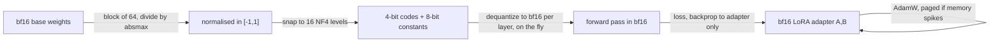
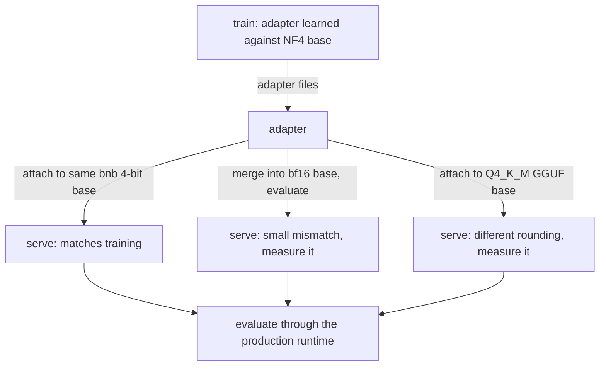

# QLoRA: LoRA on a 4-bit base model

> **Key paper:** Dettmers, Pagnoni, Holtzman and Zettlemoyer, 2023, "QLoRA: Efficient Finetuning of Quantized LLMs" - [arXiv 2305.14314](https://arxiv.org/abs/2305.14314) (preprint; this guide did not verify the venue). Tool documentation: bitsandbytes, TRL, Unsloth, Ollama and [MLX-LM](https://github.com/ml-explore/mlx-lm/blob/main/mlx_lm/LORA.md).
>
> **Scope:** how a 4-bit frozen base plus a 16-bit adapter lets a small GPU or laptop train a mid-size model, what the three tricks (NF4, double quantization, paged optimizers) do, and the trap of training on one quantization and serving on another. Adapter mechanics are in [02 LoRA](./02-lora.md); loss and masks are in [01](./01-full-fine-tuning-and-sft.md).

Written 2026-11-26. Tool facts decay; the Ollama adapter advice was read in a pinned older copy of its documentation (see the caveat section).

## Read this first

**The idea in one sentence.** Store the frozen base model in 4-bit numbers to shrink it about four times, keep the small LoRA adapter in 16-bit, and train the adapter by computing through the compressed base, so memory is dominated by 0.5 bytes per base weight.

**Who this is for.** A team with one 16 to 48 GB GPU, or an Apple-silicon laptop, that wants to tune a 7B to 14B model, and anyone who must decide which quantization to train on and which to ship.

**Afterwards you will be able to** work out the memory of a QLoRA run; explain NF4, double quantization and paged optimizers with numbers; write the real bitsandbytes and TRL configuration; and avoid shipping an adapter on a base it was not trained against.

**Reading time.** About 40 minutes; Tutorial 1 is about 12.

**Have read first:** [02 LoRA](./02-lora.md). Useful: [01](./01-full-fine-tuning-and-sft.md) for the memory table and the lab's [vehicles file](../03-vehicles.md) for serving formats.

**The one thing most people get wrong.** QLoRA is a training-time memory trick, not a deployment format. The adapter learns to correct the base *as it looked after 4-bit rounding*. The paper's claim is that this preserves 16-bit fine-tuning quality when the same quantized base is used throughout; it says nothing about attaching the adapter to a different quantization of the base afterwards. [Ollama's documentation](https://cdn.jsdelivr.net/gh/ollama/ollama@0.9.0/docs/import.md) advises preferring non-QLoRA adapters for exactly that reason (details below).

## The technique in one worked example

**Part A - quantize four weights (constructed by this guide).** Take a block of four weights from a layer: [0.03, -0.31, 0.12, 0.50].

1. **Scale by the block's largest absolute value.** That is 0.50, the quantization constant for this block. Divide each weight: [0.06, -0.62, 0.24, 1.00].
2. **Snap each to the nearest of 16 allowed levels.** NF4 (4-bit NormalFloat) has 16 levels placed so that each covers the same share of a normal distribution. The levels used here are the NF4 codebook as this guide remembers it from bitsandbytes (-1, -0.6962, -0.5251, -0.3949, -0.2844, -0.1848, -0.0911, 0, 0.0796, 0.1609, 0.2461, 0.3379, 0.4407, 0.5626, 0.7230, 1); it was **not re-fetched, so the exact values are unverified**. Nearest levels: 0.06 becomes 0.0796; -0.62 becomes -0.6962; 0.24 becomes 0.2461; 1.00 stays 1.00.
3. **Store 4-bit codes plus the constant.** Four codes (16 bits) and one 32-bit constant.
4. **Dequantize when the layer runs.** Multiply by 0.50: [0.0398, -0.3481, 0.1231, 0.5000]. Errors against the originals: 0.0098, 0.0381, 0.0031, 0. The base now differs slightly from the 16-bit original; the adapter will be trained against this slightly different base.

**Part B - what the constants cost.** Real blocks are 64 weights, not four. A 32-bit constant per 64 weights costs 32 / 64 = **0.5 bits per weight** ([Section 3 of the paper](https://arxiv.org/html/2305.14314), via extraction). Double quantization then stores the constants themselves as 8-bit floats in blocks of 256, with a 32-bit constant per block: 8/64 + 32/(64 x 256) = 0.125 + 0.00195 = **0.127 bits per weight**, a saving of **0.373 bits per weight**, which the paper puts at about 3 GB for a 65B model. Check: 65e9 x 0.373 / 8 = 3.03 GB.

**Part C - memory for a 6.74-billion-weight model (Llama-2-7B shape, unverified; see [02](./02-lora.md)).** 4 bits plus 0.127 bits is 4.127 bits per weight, so 6.74e9 x 4.127 / 8 = **3.48 GB** for the base, against 13.5 GB in bf16. The rank-16 adapter of 39,976,960 numbers adds 0.64 GB for weights, gradients and Adam state in float32. Total about **4.1 GB before activations**.



The base never gets gradients; it is read in 4-bit, expanded to 16-bit for each layer's arithmetic and discarded. Only the adapter changes.



The second diagram is the deployment decision. Each arrow into a "serve" box is a different base than the one the adapter was trained on, and only the evaluation at the end tells you whether the difference matters. Later sections refer back to the four-weight block, the 0.127-bit figure and the 4.1 GB total.

## Words you need

| Term | Plain definition | In the worked example |
|---|---|---|
| Quantization | Storing numbers with fewer bits by snapping to a small set of allowed values | 0.06 snapped to 0.0796 |
| NF4 (4-bit NormalFloat) | A 4-bit data type whose 16 levels are quantiles of a normal distribution | The 16 levels in step 2 |
| Block-wise quantization | Scaling each small group of weights by its own largest value | Block of 64 (four in the toy), constant 0.50 |
| Quantization constant | The per-block scale needed to undo the scaling | 0.50 in Part A |
| Double quantization | Quantizing the constants as well to save memory | 0.5 bits down to 0.127 bits per weight |
| Paged optimizer | An optimizer whose state moves between GPU and CPU memory on demand | Prevents out-of-memory on long sequences |
| Compute dtype | The 16-bit type used for arithmetic after dequantization | bf16 in the diagram |
| Quantized base | The frozen model stored in 4-bit | 3.48 GB in Part C |
| Adapter-base mismatch | Serving an adapter on a differently quantized base than it was trained on | Second diagram |
| MLX-LM auto-QLoRA | Apple's MLX-LM trains QLoRA automatically when the model is quantized | `--model` points at a quantized model |

## Tutorial 1 - Intuitive understanding

### What was broken before

LoRA ([02](./02-lora.md)) shrank the part you train but not the part you hold. The frozen 7B base in bf16 is 13.5 GB, and a 65B base is about 130 GB, before you do anything. The QLoRA paper's introduction says full 16-bit fine-tuning of a 65B model needs more than 780 GB, and that its method brings this under 48 GB (Section 1, via extraction). Most teams do not own that hardware, and so could not tune the models they would like to.

### The idea

Compress the frozen base. The base is read-only during LoRA training, so rounding its numbers to 4 bits saves memory and only costs accuracy in what the adapter must then compensate for. Three engineering details keep the compression from hurting: a data type matched to how weights are distributed (NF4), compression of the compression's own bookkeeping (double quantization), and a safety valve for memory spikes (paged optimizers).

**Analogy.** A photocopied textbook: the original pages are scanned at low resolution to save shelf space, and your handwritten margin notes (the adapter) are written on the photocopy. NF4 is choosing the photocopier's grey levels to match the actual darkness of the page; double quantization is also compressing the table of settings; paged optimizers are a spare desk for when your workbench overflows.

**Where the analogy breaks.** Margin notes on a photocopy stay readable on the original; an adapter may not transfer cleanly to a *different* low-resolution copy, because it learned to compensate for this particular rounding. Also, the photocopy is expanded back to full resolution on the fly for each calculation, so the arithmetic is still done in 16-bit; only storage is small.

### How it works, step by step

1. **Load the base in 4-bit.** The loader quantizes each weight matrix block by block to NF4 and keeps 8-bit constants (double quantization).
2. **Attach a bf16 LoRA adapter** to all linear layers ([02](./02-lora.md)).
3. **Forward pass.** For each layer, the 4-bit weights are expanded to bf16, multiplied, and discarded.
4. **Backward pass.** Gradients flow through the frozen layers to the adapter only.
5. **Optimizer step.** AdamW on the adapter. If a spike (long sequence with gradient checkpointing) would overflow GPU memory, the paged optimizer moves its state to CPU and back automatically.
6. **Save the adapter**, not the base.

### What the evidence says

- **Headline.** The abstract says a 65B model can be fine-tuned on a single 48 GB GPU "while preserving full 16-bit finetuning task performance", and that Guanaco, a model family trained with QLoRA, reaches 99.3 percent of ChatGPT's performance on the Vicuna benchmark after 24 hours on a single GPU. In Table 6 (as extracted) Guanaco 65B scores 99.3 percent in a 41 GB footprint and Guanaco 33B scores 97.8 percent in 21 GB. In plain terms: on that benchmark, scored by a GPT-4 judge, the 65B Guanaco gets 99.3 points for every 100 the reference chatbot gets. Authors' own benchmark and judge.
- **NF4 matters.** [Table 2](https://arxiv.org/html/2305.14314) (mean perplexity, lower is better, as extracted): Int4 34.34, Float4 (E2M1) 31.07, Float4 (E3M0) 29.48, NF4 with double quantization 27.41. Table 4 (5-shot MMLU, LLaMA 7B to 65B average): BFloat16 53.0, Float4 52.2, NF4 with double quantization 53.1: NF4 matched 16-bit within 0.1 point and FP4 trailed by 0.8.
- **Data beats volume.** A 9,209-example subset of one dataset beat a roughly 450,000-example subsample of another on chatbot tests (Section 1, Appendix B.1).

### What this does not show

- The 99.3 percent figure is a GPT-4-judged score on one benchmark of 80 questions (the size is this guide's recollection, unverified); the paper itself says strong MMLU did not imply strong chatbot performance.
- The paper does not test serving the adapter on a different quantization of the base.
- It does not claim the memory saving costs nothing in time; [Unsloth's documentation](https://unsloth.ai/docs/get-started/fine-tuning-llms-guide) says QLoRA training is slightly slower and marginally less accurate than 16-bit LoRA (vendor documentation).
- It is about open LLaMA-family models in 2023, not current small models, and not private-document tasks.

### Teach-back

<details>
<summary>1. In the four-weight example, why does the block's largest value matter?</summary>

It is the scale used to map the weights into [-1, 1] before snapping to levels; it must be stored (0.50) to undo the scaling. One extreme weight sets the scale for its whole block, which is why blocks are small (64).
</details>

<details>
<summary>2. What do double quantization numbers save per weight and for a 65B model?</summary>

0.373 bits per weight (0.5 down to 0.127), about 3 GB for a 65B model.
</details>

<details>
<summary>3. Does QLoRA train in 4-bit?</summary>

No. Storage is 4-bit; arithmetic is done in 16-bit after dequantization; the adapter and its optimizer state are in higher precision, and gradients flow only to the adapter.
</details>

<details>
<summary>4. Why is an adapter trained on an NF4 base not guaranteed to work on a different 4-bit base?</summary>

It was optimised against the exact rounding errors of that base. A different quantization has different errors, so the correction no longer lines up exactly. How much it matters must be measured.
</details>

## Tutorial 2 - Practitioner understanding

### The design in concrete terms

**bitsandbytes.** `Linear4bit` takes `quant_type` (default `'fp4'`; use `'nf4'`), `compress_statistics` (default `True`, this is double quantization), `compute_dtype` and `quant_storage` (default `torch.uint8`) ([bitsandbytes documentation](https://huggingface.co/docs/bitsandbytes/main/en/reference/nn/linear4bit)). The documentation says `LinearNF4` builds levels "where each bin has equal area under a standard normal distribution N(0, 1) that is normalized into the range [-1, 1]". Through Hugging Face Transformers the same options appear as `BitsAndBytesConfig(load_in_4bit=True, bnb_4bit_quant_type="nf4", bnb_4bit_use_double_quant=True, bnb_4bit_compute_dtype=torch.bfloat16)`; these names are from this guide's knowledge of the Transformers API and were not re-read here.

**Paged optimizers.** The paper (Section 3) describes them as using NVIDIA unified memory to page optimizer state between CPU and GPU so gradient-checkpointing spikes on long sequences do not crash the run, and reports no slowdown at batch size 16 for 65B on 48 GB GPUs (Section 4, no direct measurement of paging). In practice you select one by name, for example `optim="paged_adamw_8bit"` in the training arguments (this guide's knowledge; not re-read). The separate bitsandbytes [8-bit optimizer page](https://huggingface.co/docs/bitsandbytes/main/en/optimizers) says 8-bit optimizers cut optimizer memory by about 75 percent.

**TRL.** [`SFTTrainer`](https://huggingface.co/docs/trl/sft_trainer) accepts `quantization_config` (a `BitsAndBytesConfig`) and `peft_config` and the documentation says to combine them for QLoRA; `quantization_config` is ignored if you pass an already-instantiated model.

**Hyper-parameters.** Reuse the LoRA table in [02](./02-lora.md): all linear layers, rank 16 to 64, learning rate 1e-4 to 2e-4. QLoRA-specific facts from the paper (Appendix A.1, Section 5.1, via extraction): LoRA alpha was held fixed and the learning rate searched; dropout 0.05 helped 7B and 13B but not 33B and 65B; the learning rate was halved and batch size doubled for 33B and 65B; the T5 experiments used r = 16 or 64 with alpha = 64 (Appendix A.2). The chatbot recipe values (rank 64, alpha 16, learning rate about 2e-4, 1e-4 for the largest models) are this guide's recollection and **unverified** because that appendix was cut off in the fetched text. Unsloth's documentation gives `learning_rate = 2e-4`, 1 to 3 epochs, effective batch 16, and recommends training and serving in the same precision.

**Unsloth.** `load_in_4bit = True` gives QLoRA; with it off you train 16-bit LoRA; `load_in_8bit` and `load_in_16bit` also exist and only one may be set ([Unsloth documentation](https://unsloth.ai/docs/get-started/fine-tuning-llms-guide/lora-hyperparameters-guide)). Models whose names end in `unsloth-bnb-4bit` are Unsloth's "dynamic" 4-bit quants, which use slightly more memory than standard `bnb-4bit` for higher accuracy; the documentation says the QLoRA accuracy loss against LoRA is "now largely recovered" with them (vendor claim).

### A minimal version

Unrun. Real arguments; input is a chat-format `train.jsonl` as in [01](./01-full-fine-tuning-and-sft.md); output is an adapter of about 80 MB (7B, rank 16).

```python
# Unrun. pip install trl peft bitsandbytes datasets  (NVIDIA GPU required)
import torch
from datasets import load_dataset
from peft import LoraConfig
from transformers import BitsAndBytesConfig
from trl import SFTConfig, SFTTrainer

bnb = BitsAndBytesConfig(
    load_in_4bit=True,
    bnb_4bit_quant_type="nf4",
    bnb_4bit_use_double_quant=True,
    bnb_4bit_compute_dtype=torch.bfloat16,
)
ds = load_dataset("json", data_files={"train": "train.jsonl", "validation": "valid.jsonl"})
args = SFTConfig(
    output_dir="out-qlora",
    model_init_kwargs={"dtype": torch.bfloat16},   # dtype of non-quantized parts
    learning_rate=2e-4,
    num_train_epochs=2,
    per_device_train_batch_size=4,
    gradient_accumulation_steps=4,
    max_length=2048,
    assistant_only_loss=True,
    optim="paged_adamw_8bit",                      # paged, 8-bit optimizer state
    gradient_checkpointing=True,
    eval_strategy="steps", eval_steps=50,
)
trainer = SFTTrainer(
    model="Qwen/Qwen3-8B-Base",                    # example id
    args=args,
    train_dataset=ds["train"],
    eval_dataset=ds["validation"],
    quantization_config=bnb,
    peft_config=LoraConfig(r=16, lora_alpha=32, lora_dropout=0.05,
                           target_modules="all-linear", task_type="CAUSAL_LM"),
)
trainer.train()
trainer.save_model("out-qlora/adapter")
```

**Apple-silicon equivalent.**

On a Mac, bitsandbytes does not apply. MLX-LM does the equivalent without a flag: the `LORA.md` page says "If `--model` points to a quantized model, then the training will use QLoRA, otherwise it will use regular LoRA." To get a quantized model, convert with the `-q` flag (the page names `convert.py` with `-q`; the current command spelling is `mlx_lm.convert`, to be checked with `--help`).

```bash
# Unrun. pip install mlx-lm
mlx_lm.convert --hf-path Qwen/Qwen3-8B-Base -q --mlx-path ./qwen3-8b-4bit
mlx_lm.lora --model ./qwen3-8b-4bit --train --data ./data \
  --fine-tune-type lora --mask-prompt --batch-size 2 --iters 600 \
  --num-layers 16 --grad-checkpoint --adapter-path ./out-mlx
```

Two differences from the CUDA recipe, one verified and one inferred. Verified: the MLX-LM page recommends `--grad-checkpoint`, a lower `--batch-size`, fewer `--num-layers` (default 16) and shorter sequences to save memory. Inferred (unverified here): MLX's 4-bit format is a grouped affine quantization, not NF4, so you cannot assume the NF4 results of the paper carry over; test quality on your own set. [The package mlx-lm-lora](https://github.com/Goekdeniz-Guelmez/mlx-lm-lora) lists quantized training at 4, 6 or 8 bits (its page, a community project).

### What it costs

Assumptions: the Part C model (6.74e9 weights); activations excluded; arithmetic by this guide.

| Setup | Base | Adapter plus optimizer (rank 16, float32) | Total before activations |
|---|---|---|---|
| Full fine-tune, bf16 with float32 Adam | 13.5 GB | (all weights) | about 81 GB |
| LoRA, bf16 base | 13.5 GB | 0.64 GB | about 14.1 GB |
| QLoRA, NF4 plus double quantization | 3.48 GB | 0.64 GB | about 4.1 GB |

Unsloth's published minimum-VRAM table (vendor documentation, quoted in [01 Options](../01-options-and-trade-offs.md#memory-as-a-first-estimate)) gives about 6 GB for an 8B model and 8.5 GB for 14B with 4-bit QLoRA, against about 33 GB for 14B at 16-bit LoRA. Those minimums sit above the bare weights because of activations, the CUDA context and buffers. In our own run one long sequence added about 10 GB of logits, so cap sequence length. Time: QLoRA steps are slower than 16-bit LoRA steps according to Unsloth (by how much was not stated); measure. At this scale the dollar cost of a run is small ([04 §3](../04-build-and-deploy-playbook.md#3-what-it-costs)).

**The adapter-transfer caveat.**

*What the Ollama documentation says.* In the [pinned 0.9.0 copy](https://cdn.jsdelivr.net/gh/ollama/ollama@0.9.0/docs/import.md) of Ollama's import documentation, read through a CDN mirror on 2026-11-26: "Make sure that you use the same base model in the `FROM` command as you used to create the adapter", otherwise "you will get erratic results"; and "Most frameworks use different quantization methods, so it's best to use non-quantized (i.e. non-QLoRA) adapters." The currently published Ollama pages for importing and for the Modelfile did **not** contain an adapter section when fetched (2026-11-26), so the advice may have moved or changed; treat it as dated but consistent with the mechanism.

*The mechanism (this guide's inference).* During QLoRA training the adapter corrects a base whose weights were rounded to NF4. Serving it on a GGUF Q4_K_M base, an MLX 4-bit base, or the original bf16 base means different rounding errors under the same correction. The paper does not evaluate this; a follow-up literature on quantization-aware adapters exists but was not read here (unverified).

*What to do.*

1. **Same base, same quantization** wherever the runtime allows it. For a bitsandbytes-trained adapter that means serving with bitsandbytes 4-bit through a stack that supports it (support in vLLM was not checked here, unverified).
2. **If you must serve elsewhere,** either train on the format you will serve (for example, the MLX 4-bit base on a Mac when you will serve MLX), or train with plain LoRA on bf16 and quantize only the merged result, which is the path Ollama's guidance favours.
3. **Merge in bf16 on the exact base revision** when producing a GGUF, then quantize, then evaluate the final file through the production runtime on the held-out set before shipping ([03 Vehicles](../03-vehicles.md)).
4. **Record** the base name and revision, quantization type and library versions beside the adapter.

### How it fails

| Symptom | Likely cause | Mitigation |
|---|---|---|
| Out-of-memory early | Sequence too long; batch too big; logits dominate | Lower `max_length`; batch 1 with accumulation; gradient checkpointing; paged optimizer |
| Out-of-memory sporadically on long examples | Memory spike from checkpointing and optimizer | Paged optimizer; drop the longest examples |
| Quality below 16-bit LoRA by several points | 4-bit rounding; low rank; learning rate | Use NF4 with double quantization; adapt all layers; raise rank; try a dynamic 4-bit base; compare to a 16-bit run on a small subset |
| Adapter fine in training, junk in Ollama or llama.cpp | Different base or quantization; wrong base revision | Match the base exactly or merge and re-evaluate; see the caveat section |
| Slower than expected | Dequantization overhead; paging | Accept (documented as slightly slower); check batch and sequence length |
| NaN loss | Learning rate; compute dtype fp16 | bf16 compute; halve the rate |
| Mac run is not QLoRA | Model not quantized | Convert the model first; the page says quantized model gives QLoRA, otherwise LoRA |
| Merge produces a worse model than the adapter | Merging into a different or rounded base | Merge in bf16 and test; see [02](./02-lora.md) |

### Evaluating your version

**Metric and test set.** As in [02](./02-lora.md): the task metric on at least 200 held-out items split by what is new in production, plus a general regression set.

**Baseline.** Three arms: the best prompt on the base model; LoRA in bf16 (if it fits, or on a small subset); and QLoRA. The gap between the last two is the cost of 4-bit on your task.

**Serving check.** Evaluate the artifact that will be served, not the training-time model. Put a number on mismatch: score the adapter on the training base and on the serving base on the same held-out set.

**Stop rule.** Adopt QLoRA if its held-out metric is within your noise margin (about 5 points at 200 items) of 16-bit LoRA on the arms you could run, and the served artifact is within the same margin of the training-time model. Otherwise train in the format you serve or use bf16 LoRA with a bigger GPU.

### Adopt, adapt or skip

**Adopt for training on constrained hardware,** which is most small teams: a 24 GB GPU or a 32 GB-plus Mac tunes a 7B to 8B model comfortably. **Adapt** the deployment: decide the serving format first, then choose the training format so that adapter and base match, and always evaluate the shipped artifact. **Skip** QLoRA when a 16-bit LoRA fits in your hardware with room to spare and you will serve in 16-bit: it is slightly faster and marginally more accurate, per Unsloth, and removes the mismatch risk entirely. Never let "it trained in 6 GB" stand in for "it will serve correctly".

## Tutorial 3 - Researcher understanding

### Formal setup

**Notation.** A weight block w of 64 values has absolute maximum c = max |w_i|. Normalised values u_i = w_i / c lie in [-1, 1]. Let the NF4 codebook be Q = {q_0..q_15} in [-1, 1], quantiles of N(0, 1) rescaled so that 0 is a level and both -1 and 1 are levels. The stored code is j_i = argmin_k |u_i - q_k|, and the dequantized value is w_hat_i = c q_{j_i}. The adapted forward pass is h = (alpha / r) B A x + w_hat x with w_hat treated as constant. Gradients are taken only with respect to A and B.

**Numeric toy instance.** Part A: c = 0.50; u = [0.06, -0.62, 0.24, 1.00]; codes pick q = [0.0796, -0.6962, 0.2461, 1.0]; w_hat = [0.0398, -0.3481, 0.1231, 0.5000]. The squared error sum is 0.0098^2 + 0.0381^2 + 0.0031^2 = 0.000096 + 0.001452 + 0.0000093 = 0.00156 (this guide's arithmetic). The adapter objective is min over A, B of L(w_hat + (alpha/r)BA), so it is trained to correct w_hat, not w.

**Why quantiles.** If u is roughly normal then equal-area bins give each code the same expected usage, which minimises information loss for a fixed number of levels; the paper says weights are roughly normally distributed after zero-centring (Appendix F, via extraction). Uniformly spaced levels waste codes in the tails.

### The claims, stated precisely

1. **Memory.** A 65B model fine-tuned on one 48 GB GPU, from more than 780 GB for 16-bit full fine-tuning (Section 1).
2. **Quality.** QLoRA with NF4 and double quantization matches 16-bit full and LoRA fine-tuning on the tested tasks (Section 4, Tables 3 and 4).
3. **Data type.** NF4 beats Int4 and FP4 on perplexity (Table 2) and on average 5-shot MMLU (Table 4); on T5-3B Super-NaturalInstructions FP4 and NF4 are close (Table 3: 55.6 against 55.3, with BF16 at 54.3).
4. **Layers.** Adapting all linear layers is required to match full fine-tuning; rank is then unrelated to final performance (Appendix A.1).
5. **Data.** Quality and suitability matter more than size for chatbot tuning (Section 1, Appendix B.1).

Not claimed: any transfer of adapters across quantizations; any statement about current model families; the Guanaco score as a general measure of quality.

### Evidence, table by table

**Table 2 (as extracted).** Mean perplexity on a Pile Common Crawl sample: Int4 34.34; Float4 (E2M1) 31.07; Float4 (E3M0) 29.48; NFloat4 + DQ 27.41. Identifies the data type's effect on reconstruction fidelity for one model family; perplexity is not task accuracy.

**Table 3 (T5-3B, Super-NaturalInstructions, RougeL).** BF16 54.3; QLoRA FP4 55.6; QLoRA NF4 + DQ 55.3. Shows 4-bit adapters are not worse than 16-bit in this setting, and that NF4 versus FP4 is within noise here (the paper gives no per-cell variance in what was extracted, unverified).

**Table 4 (mean 5-shot MMLU, LLaMA 7B to 65B).** BFloat16 53.0; Float4 52.2; NFloat4 + DQ 53.1; for 65B, NF4 + DQ scores 61.8 (Alpaca) and 63.9 (FLAN v2) against 61.8 and 62.5 for BFloat16. Identifies equal-or-better downstream accuracy for the tested sets; averaged across sizes.

**Table 6 (Vicuna benchmark, GPT-4 judged, % of ChatGPT).** Guanaco 65B 99.3 percent (41 GB); Guanaco 33B 97.8 percent (21 GB). Associates the pipeline with a chatbot score; the judge and prompts are the authors'.

**Figure 2 / Appendix A.1 (LoRA placement).** Associates "all linear layers" with matching full fine-tuning; q and v only did not match at large scale.

### Ablations and what they isolate

- **NF4 vs FP4 vs Int4 (Tables 2 to 4):** isolates the data type.
- **Double quantization:** the memory effect is arithmetic (0.373 bits per weight); the paper reports no accuracy penalty from it in the NF4 + DQ rows (confounded with NF4 in the tables as extracted, so the DQ-only effect is not isolated here).
- **Paged optimizers:** no isolated quality effect; the paper reports speed parity at batch 16 for 65B, no direct paging measurement.
- **Dataset size versus quality (Appendix B.1):** isolates data quality from size for chatbot benchmarks.
- **Learning-rate and batch adjustments for 33B and 65B (Section 5.1):** methodological, not an ablation.

### Threats to validity

- **Judge dependence.** GPT-4 as judge and the Vicuna benchmark's small question set carry position and verbosity biases; the paper discusses some of them (not re-read here).
- **Model families and date.** LLaMA, T5 and 2023-era models.
- **No transfer test.** Nothing about serving formats other than the training format.
- **Self-reported.** Authors' own comparisons; the preprint's headline numbers have been widely reused, but this guide did not locate an independent replication (unverified).
- **Confounded NF4 and DQ rows.** Two interventions appear together in the headline rows.

### Open problems and follow-ups

- Quantization-aware adapter methods that train for the serving format (follow-up literature not read here).
- How much 2-, 3- and 6-bit bases cost; mlx-lm-lora lists 4, 6 and 8-bit training modes.
- Whether dynamic mixed-precision bases (Unsloth's dynamic 4-bit) close the quality gap; the evidence is vendor documentation.
- Companion explainers: [02 LoRA](./02-lora.md), [04 DoRA](./04-dora.md) (a variant that also works on quantized bases through the community QDoRA).

### What would change my mind

- A measurement showing adapters trained on NF4 lose under 1 point when served on Q4_K_M and on bf16 across several tasks would relax the matching rule.
- A study showing 16-bit LoRA beats QLoRA by more than 5 points on structured-output tasks for current 4B to 8B models would shift the default to 16-bit when memory allows.
- A replication of Table 4 on current model families showing a NF4 gap would weaken the headline claim.

## Reading map for the key papers

| Paper section or figure | What it contains | Read / skim / skip | Answered in this guide |
|---|---|---|---|
| Abstract, Section 1 | Claims, 780 GB to 48 GB, data finding | Read | Tutorial 1 |
| Section 3: NF4, double quantization, paged optimizers | The three techniques | Read | Worked example, Tutorial 3 |
| Section 4, Tables 2 to 4 | Data type comparisons | Read | Tutorial 3 |
| Section 4, Figure 2, Appendix A.1 | Where to put LoRA, alpha and rank, dropout | Read | Tutorial 2 |
| Section 5, Table 6 | Guanaco evaluation | Skim | Tutorial 1 |
| Sections 6 and 7 | Qualitative analysis, limitations | Skim | Threats |
| Appendix B | Datasets and chatbot hyper-parameters | Skim (partly unread here) | Unverified list |
| Appendix F | NF4 and normality | Skim | Formal setup |
| bitsandbytes `Linear4bit` page | Argument names | Read | Tutorial 2 |
| MLX-LM `LORA.md` | Auto-QLoRA statement | Read | Apple-silicon section |

## Questions readers get stuck on

**What does the "Q" buy me in one number?** About a fourfold smaller base. For a 6.74-billion-weight model, 13.5 GB becomes 3.48 GB in the worked example. Total training memory moves from about 14.1 GB to about 4.1 GB before activations.

**Is the training arithmetic done in 4-bit?** No. Weights are stored in 4-bit and expanded to bf16 for each layer's matrix multiplication. The speed cost of that expansion is why QLoRA is slightly slower per step than 16-bit LoRA.

**What is NF4 and why not just 4-bit integers?** NF4 places its 16 levels at equal-probability points of a normal distribution, so each code is used about equally often when weights are roughly normal. Table 2 shows perplexity 27.41 for NF4 with double quantization against 34.34 for Int4. In plain terms, the integer version was clearly worse at reproducing the model.

**What does double quantization actually save?** The per-block scales cost 0.5 bits per weight at one 32-bit scale per 64 weights; quantizing them to 8 bits in blocks of 256 cuts that to about 0.127, saving 0.373 bits per weight, about 3 GB on a 65B model. For 7B it is about 0.31 GB (6.74e9 x 0.373 / 8), a modest gain.

**Do paged optimizers make training slower?** The paper says no measurable slowdown at batch size 16 for 65B on 48 GB cards, but gives no direct paging measurement. Paging only activates when memory runs out, so it behaves as a safety valve.

**Can I train QLoRA and serve the adapter with Ollama?** It can work, but the documentation advice in its older pinned copy is to prefer non-QLoRA adapters because frameworks quantize differently. Safer: merge into a bf16 base, convert to GGUF, quantize, and evaluate the final file. Test whichever path you choose.

**What is the Apple-silicon version?** MLX-LM does QLoRA automatically when the model you pass is already quantized. There is no NF4 on MLX as far as this guide knows (unverified), so expect similar behaviour but not the paper's exact numbers.

**Is QLoRA worse than LoRA?** Slightly, by Unsloth's documentation (slower and marginally less accurate), and its dynamic 4-bit bases are said to recover most of it. In the paper's tables it matches 16-bit within noise. Measure on your task with a small 16-bit comparison run.

**Why did the paper's small, 9,209-example dataset beat a 450,000-example one?** The paper says data quality and suitability for the target matter more than size for chatbots. It is one comparison on one family of benchmarks; it argues for curating, not for small data in general.

**Why not just quantize the model after LoRA training?** You can; that is the "train in bf16, merge, then quantize" path, and Ollama's advice favours it. QLoRA exists for when the 16-bit base does not fit on your hardware during training.

## Prerequisites you actually need

### Prerequisite 1 - Bits and bytes per weight

**Plain explanation.** A 4-bit number takes half a byte; a 16-bit number two bytes.

**Tiny example.** One billion weights: 2 GB at 16-bit, 0.5 GB at 4-bit, about 0.516 GB with double-quantized constants (4.127 bits).

**Where used.** Part C and the cost table.

**Pointer.** [01 memory section](./01-full-fine-tuning-and-sft.md) and [01 Options](../01-options-and-trade-offs.md#memory-as-a-first-estimate).

### Prerequisite 2 - Normal distribution and quantiles

**Plain explanation.** Many weight values cluster near zero in a bell shape. A quantile cut splits the bell into equal-probability slices; NF4 puts one level in each slice.

**Tiny example.** Split a standard normal into four equal-probability slices: the cut points are about -0.67, 0, 0.67. More values land near zero, so levels are denser there; NF4's levels near zero in the toy are 0, 0.0796 and -0.0911.

**Where used.** Why NF4 beats evenly spaced levels.

**Pointer.** [Math bridge](../../../llm-learning-repository/references/math-bridge.md).

### Prerequisite 3 - LoRA and its memory floor

**Plain explanation.** LoRA trains small matrices on top of a frozen base ([02](./02-lora.md)); the base still must be held in memory.

**Tiny example.** At rank 16 the adapter in the worked shape is 39,976,960 numbers, 0.64 GB with optimizer state; the base is 13.5 GB in bf16.

**Where used.** The cost table.

**Pointer.** [02 LoRA](./02-lora.md).

### Prerequisite 4 - Model formats and runtimes

**Plain explanation.** A trained adapter is only useful through a runtime that can load it with the right base. Runtimes and file formats (Safetensors, GGUF, MLX) each apply their own quantization.

**Tiny example.** One base can exist as bf16 Safetensors (13.5 GB), as an NF4 bitsandbytes load (3.5 GB), as a Q4_K_M GGUF, and as an MLX 4-bit folder; each rounds differently.

**Where used.** The adapter-transfer caveat.

**Pointer.** [03 Vehicles](../03-vehicles.md).

## Where this sits

**Before:** [02 LoRA](./02-lora.md); [01 Full fine-tuning and SFT](./01-full-fine-tuning-and-sft.md).

**After:** [04 DoRA](./04-dora.md) (adds a magnitude vector; QDoRA applies it to a 4-bit base). For serving, [03 Vehicles](../03-vehicles.md); for process, [04 Build and deploy playbook](../04-build-and-deploy-playbook.md).

**Nearest techniques.** *LoRA* keeps the base in 16-bit: faster and slightly more accurate, bigger memory floor. *Post-training quantization* compresses a finished model for serving and trains nothing; QLoRA compresses only to make training fit.

**Read next:** [04 DoRA](./04-dora.md).

## Checkpoint

<details>
<summary>1. (Compute) Quantize the block [0.10, -0.20, 0.40, 0.05] with absmax scaling: what are the normalised values?</summary>

The largest absolute value is 0.40. Divide: [0.25, -0.50, 1.00, 0.125]. Each would then snap to the nearest NF4 level and be rescaled by 0.40 on dequantization.
</details>

<details>
<summary>2. (Compute) Memory for the base of a 14-billion-weight model in NF4 with double quantization?</summary>

14e9 x 4.127 / 8 = 7.22 GB for the base (this guide's arithmetic); Unsloth's table quotes about 8.5 GB total for a 14B QLoRA, which includes more than the weights.
</details>

<details>
<summary>3. (Explain) What does each of the three QLoRA tricks do?</summary>

NF4 chooses 4-bit levels matched to normally distributed weights. Double quantization compresses the per-block constants (0.5 to 0.127 bits per weight). Paged optimizers move optimizer state between GPU and CPU to survive memory spikes.
</details>

<details>
<summary>4. (Critique) A teammate trained QLoRA and loaded the adapter onto a Q4_K_M GGUF base in Ollama and sees a 6-point drop. What is your diagnosis and fix?</summary>

Likely the adapter-base mismatch. Fix: merge the adapter into the bf16 base, convert and quantize, then evaluate that final file; or retrain with 16-bit LoRA. Ollama's older documentation advises non-QLoRA adapters.
</details>

<details>
<summary>5. (Explain) How do you get QLoRA on an Apple-silicon laptop?</summary>

Pass a quantized model to `mlx_lm.lora`; the MLX-LM page says a quantized model means QLoRA, otherwise regular LoRA. Convert with the `-q` flag if needed.
</details>

<details>
<summary>6. (Critique) A vendor deck says "QLoRA is lossless". What do you ask?</summary>

Which model, task and metric; compared with which 16-bit run; and whether the shipped artifact was measured. The paper shows parity on its benchmarks; Unsloth says marginally lower accuracy; neither measures private-document tasks or other serving quantizations.
</details>
