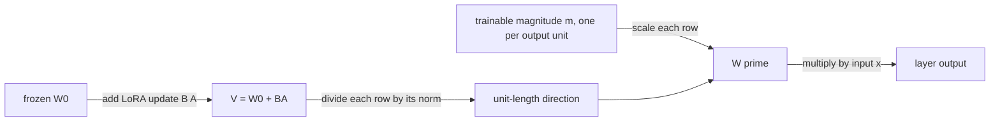
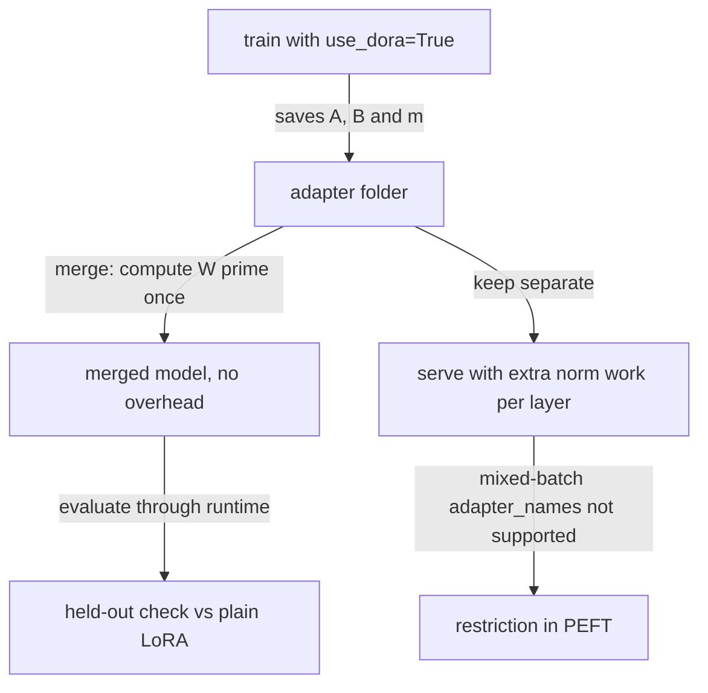

# DoRA: weight-decomposed low-rank adaptation

> **Key paper:** Liu, Wang, Yin, Molchanov, Wang, Cheng and Chen (NVIDIA and collaborators), 2024, "DoRA: Weight-Decomposed Low-Rank Adaptation" - [arXiv 2402.09353](https://arxiv.org/abs/2402.09353) (the arXiv comments field lists ICML 2024, oral). Tool documentation: Hugging Face [PEFT](https://huggingface.co/docs/peft/package_reference/lora) (`use_dora`), [MLX-LM](https://github.com/ml-explore/mlx-lm/blob/main/mlx_lm/LORA.md) and the community package [mlx-lm-lora](https://github.com/Goekdeniz-Guelmez/mlx-lm-lora).
>
> **Scope:** what DoRA changes relative to LoRA, how to switch it on, what it costs, and how well its gains hold up outside the authors' own experiments. LoRA mechanics are in [02 LoRA](./02-lora.md); the 4-bit base is in [03 QLoRA](./03-qlora.md).

Written 2026-11-26. This is the youngest and least settled of the four techniques; evidence status is spelled out throughout.

## Read this first

**The idea in one sentence.** Split each pretrained weight into a length (magnitude) and a direction, train the direction with ordinary LoRA, and train the length separately as a small extra vector.

**Who this is for.** A team already comfortable with LoRA that wonders whether a one-line switch (`use_dora=True`) is worth turning on, and a buyer asked to pay for a "DoRA-tuned" model.

**Afterwards you will be able to** compute a DoRA update by hand on a small matrix; count the extra parameters; switch it on in PEFT or MLX-LM; say what overhead and serving restrictions it brings; and state honestly how strong the evidence for it is.

**Reading time.** About 35 minutes; Tutorial 1 is about 10.

**Have read first (reading order, no claim):** [02 LoRA](./02-lora.md). Useful: [03 QLoRA](./03-qlora.md) for the quantized-base variant.

**The one thing most people get wrong.** **Judgment:** they treat DoRA as a proven upgrade. The authors report gains in their own experiments; the [PEFT documentation](https://huggingface.co/docs/peft/package_reference/lora) says it "can improve the performance of LoRA especially at low ranks"; but independent checks are mixed. The abstract of [Lee et al.](https://arxiv.org/abs/2602.04998) says that once learning rates are tuned all LoRA variants reach similar peak performance (within 1-2 percent), and the abstract of an [AACL 2026 audit](https://aclanthology.org/2026.aacl-short.32/) says DoRA "shows no supported gain in any of its seven audited cells" (abstracts only; neither paper was read in full). **Judgment:** the sensible position is "cheap to test, not a reason to skip tuning your learning rate".

## The technique in one worked example

Constructed by this guide, with the same small matrix as in [02](./02-lora.md) so you can compare. Convention: output = W times input, W is out x in, and magnitude is measured per output unit (per row of W). The [paper](https://arxiv.org/html/2402.09353) writes the norm as column-wise because of how it lays out matrices (Figure 1 caption, Section 3.2); the PEFT implementation's per-output-unit norm is the same idea in the transposed layout (this guide's reading of the implementation, unverified).

- W0 = [[1, 2], [3, 4]]. Row norms: sqrt(1 + 4) = 2.236 and sqrt(9 + 16) = 5.000. So the **magnitude vector** starts as m = [2.236, 5.000] (the paper initialises m to the norm of W0, [Section 4.1 and Equation 5](https://arxiv.org/html/2402.09353)).
- LoRA pair B = [[0.5], [1.0]], A = [[1, -1]], so BA = [[0.5, -0.5], [1.0, -1.0]].
- Combined direction matrix V = W0 + BA = [[1.5, 1.5], [4, 3]]. Row norms of V: sqrt(2.25 + 2.25) = 2.121 and sqrt(16 + 9) = 5.000.
- **DoRA at this point (m unchanged):** W' = m x V divided by row norms of V. Row 1: [1.5, 1.5] / 2.121 x 2.236 = [1.581, 1.581]. Row 2: [4, 3] / 5 x 5 = [4, 3]. The row norms of W' are [2.236, 5.000], exactly m, so the update has changed direction only.
- **Plain LoRA at the same point:** W0 + BA = [[1.5, 1.5], [4, 3]], whose row norms are [2.121, 5.000]. LoRA moved the length of row 1 from 2.236 to 2.121 as a side effect of changing its direction. [The paper's analysis](https://arxiv.org/html/2402.09353) argues that LoRA ties magnitude and direction changes together in this way (a consistent positive slope, correlation 0.83) and full fine-tuning does not (correlation -0.62; Sections 3.2 and 4.1).
- **Now train the magnitude** (the second half of DoRA): suppose training moves m to [2.5, 4.0]. Then W' = m x V / row norms = [[1.768, 1.768], [3.2, 2.4]], with row norms [2.5, 4.0]. For input x = [2, 1]: W0 x = [4, 10]; LoRA gives [4.5, 11]; DoRA gives [5.303, 8.8] (all constructed by this guide, checkable by hand).

**Counting extra parameters at a real shape.** The shape from [02](./02-lora.md) (hidden size 4,096, feed-forward 11,008, 32 layers; the [Transformers `LlamaConfig` defaults](https://huggingface.co/docs/transformers/model_doc/llama2) match Llama-2-7B). This paragraph is this guide's arithmetic: one magnitude number per output unit of each adapted matrix. Per layer: five matrices with 4,096 outputs (q, k, v, o, down) and two with 11,008 (gate, up): 5 x 4,096 + 2 x 11,008 = 42,496. Over 32 layers: **1,359,872** extra numbers, compared with 39,976,960 adapter numbers at rank 16 (3.4 percent more) and 6.74 billion weights (0.02 percent). The [paper](https://arxiv.org/html/2402.09353) calls the increase over LoRA "marginal" and gives 0.01 percent (Section 5.1; Table 1 lists 0.84 against 0.83 percent of parameters for LLaMA-7B), which is the same order as this guide's 0.02 percent of 6.74 billion weights.



The direction passes through LoRA's low-rank pair and is normalised; the length comes only from m. Gradients reach A, B and m; W0 stays frozen.



The practical message of the second diagram follows the [PEFT documentation](https://huggingface.co/docs/peft/package_reference/lora): DoRA's overhead is larger than LoRA's, so merge for inference, and it cannot be used with mixed-batch multi-adapter inference. Later sections refer back to the 2 x 2 example and the 1,359,872 figure.

## Words you need

| Term | Plain definition | In the worked example |
|---|---|---|
| Magnitude | The length of a weight vector (here a row of W) | m = [2.236, 5.000] |
| Direction | The weight vector divided by its length | [1.5, 1.5] / 2.121 for row 1 of V |
| Weight decomposition | Writing W as magnitude times direction | W0 = m times its normalised rows |
| Magnitude vector m | The extra trainable numbers, one per output unit | [2.5, 4.0] after training |
| Norm | The length of a vector: square root of the sum of squares | 2.236 = sqrt(1 + 4) |
| Gradient detachment | Treating the normalising norm as a constant when computing gradients, to save memory | Section 4.3 of the paper |
| QDoRA | DoRA applied on a 4-bit base like [QLoRA](https://arxiv.org/html/2305.14314); a community project reported in the paper | Section 6.1 of the paper |
| `use_dora` | The PEFT flag in `LoraConfig` that turns DoRA on | `LoraConfig(use_dora=True)` |
| Low-rank direction update | LoRA's BA, used to change direction only | BA = [[0.5, -0.5], [1.0, -1.0]] |
| Replication | An independent team reproducing a claimed gain | Tutorial 3, threats |

## Tutorial 1 - Intuitive understanding

### What was broken before

Full fine-tuning beats standard-rank LoRA on hard tasks such as code and maths ([02](./02-lora.md), and [LoRA Learns Less](https://arxiv.org/html/2405.09673), abstract). The DoRA authors ask why. They compare how full fine-tuning and LoRA change weights and report that LoRA tends to move magnitude and direction together, whereas full fine-tuning can change them more independently ([Section 3 of the paper](https://arxiv.org/html/2402.09353); the analysis itself is not reproduced here). **Judgment:** if the coupling is the limitation, decoupling might close part of the gap without more memory; the paper's evidence is correlational.

### The idea

Every row of a weight matrix is an arrow with a length and a pointing direction. LoRA nudges the arrow with a thin low-rank push, which changes both together. DoRA separates the jobs: the low-rank push decides which way the arrow points, and a single new number per arrow decides how long it is.

**Analogy (Judgment).** Steering a ship. LoRA is a rudder that also changes the engine speed whenever you turn; DoRA gives you the rudder and a separate throttle.

**Where the analogy breaks (Judgment).** A ship's rudder and throttle are independent by design; here the "throttle" is only one number per row and the "rudder" is still rank-limited, so DoRA does not give full fine-tuning's freedom. The decomposition is also a modelling choice, not a physical fact about the network: a better-looking decomposition does not by itself prove better accuracy, and the evidence has to come from experiments.

### How it works, step by step

1. **Initialise.** Set m to the length of each row of the pretrained weight ([paper Section 4.1](https://arxiv.org/html/2402.09353)). Set B to zero as in LoRA. The model starts exactly as the base did.
2. **Forward.** Form W0 plus BA, normalise each row to length one, multiply by m, then apply to the input (Equation 5; worked example above).
3. **Backward.** Gradients flow to A, B and m. With gradient detachment ([Section 4.3](https://arxiv.org/html/2402.09353)), the normalisation's length is treated as a constant, which saves memory.
4. **Save** A, B and m for each adapted layer.
5. **Ship** merged (compute the combined weight once) or separate.

### What the evidence says

- **Authors' headline ([Table 1](https://arxiv.org/html/2402.09353)).** Average accuracy over eight commonsense-reasoning benchmarks: LLaMA-7B 74.7 for LoRA against 78.4 for DoRA; LLaMA-13B 80.5 against 81.5; LLaMA2-7B 77.6 against 79.7; LLaMA3-8B 80.8 against 85.2. In plain terms (this guide's arithmetic, 85.2 - 80.8): on LLaMA3-8B, for every 100 benchmark questions DoRA answered about 4.4 more correctly than the LoRA run in the same paper. DoRA at *half* the rank scored 77.5, 80.8, 80.5 and 85.0.
- **Other settings ([Tables 2 to 4](https://arxiv.org/html/2402.09353)).** VL-BART image-text 77.4 (DoRA) against 76.5 (LoRA); video-text 85.4 against 83.5; LLaVA-1.5-7B visual instruction tuning 67.6 against 66.9.
- **Independent checks, mixed (abstracts and the first part of one paper read; not full texts).** "Learning Rate Matters: Vanilla LoRA May Suffice for LLM Fine-tuning" ([Lee et al., arXiv 2602.04998](https://arxiv.org/abs/2602.04998), 2026 preprint) says that once learning rates are properly tuned all methods reach similar peak performance (within 1-2 percent); in its Section 1 all methods fall within a 0.84 percent range on Qwen3-0.6B at rank 128, while Section 3.3.2 reports DoRA gains over LoRA "specifically in low-rank regimes", up to 1.1 percent on maths and 0.95 percent on code at rank 8 on Gemma-3-1B. A paired multi-seed audit ([Lee and Kim, AACL 2026 short paper](https://aclanthology.org/2026.aacl-short.32/)) says in its abstract that "most published PEFT improvements over LoRA do not survive paired multi-seed evaluation" and that DoRA "shows no supported gain in any of its seven audited cells". A study of reinforcement-learning-based fine-tuning ([arXiv 2512.23165](https://arxiv.org/abs/2512.23165)) says in its abstract that DoRA, AdaLoRA and MiSS "consistently outperform LoRA".

### What this does not show

- It does not show DoRA beats a well-tuned LoRA. The paper lists learning rates per setting ([Appendix A.3, Tables 8 and 11](https://arxiv.org/html/2402.09353)) but the sweep breadth for LoRA was not confirmed here (unverified).
- It does not show the gain holds on small base models, structured-output tasks or private documents. The paper's tests are commonsense benchmarks, vision-language tasks and Alpaca-style instruction tuning (Tables 1 to 4 and 11).
- It does not show that the magnitude-direction story is the cause of any gain; that is the authors' interpretation.
- The numbers above are the authors' own and show small inconsistencies between text and tables (see Tutorial 3).

### Teach-back

<details>
<summary>1. In the worked example, what changes between "DoRA with m unchanged" and "plain LoRA" for row 1?</summary>

LoRA's row-1 length drops from 2.236 to 2.121 as a side effect of changing direction (worked example, this guide's arithmetic). DoRA rescales the row back to 2.236, so with m untouched only the direction has changed.
</details>

<details>
<summary>2. What are the extra trainable parameters in DoRA and how many are there?</summary>

One magnitude number per output unit of each adapted matrix: 1,359,872 for the 7B-shaped model in the example, about 3.4 percent more than the rank-16 LoRA adapter (this guide's arithmetic; the [paper](https://arxiv.org/html/2402.09353) says the increase is marginal, Section 5.1).
</details>

<details>
<summary>3. Why does PEFT recommend merging for inference?</summary>

Because DoRA's separate normalisation and rescaling is extra work per layer when unmerged (**Judgment:** this guide's explanation); the [PEFT documentation](https://huggingface.co/docs/peft/package_reference/lora) says it "introduces a bigger overhead than pure LoRA, so it is recommended to merge weights for inference".
</details>

<details>
<summary>4. Why should you be cautious about the Table 1 gains?</summary>

They are the authors' own, one comparison per cell (this guide's reading), and the independent abstracts cited in Tutorial 1 report that tuned LoRA closes most of the gap or that DoRA shows no supported gain in audited cells.
</details>

## Tutorial 2 - Practitioner understanding

### The design in concrete terms

**PEFT.** `LoraConfig(use_dora=True, ...)` ([PEFT `LoraConfig` documentation](https://huggingface.co/docs/peft/package_reference/lora)). The documentation says: "Enable 'Weight-Decomposed Low-Rank Adaptation' (DoRA). This technique decomposes the updates of the weights into two parts, magnitude and direction. Direction is handled by normal LoRA, whereas the magnitude is handled by a separate learnable parameter. This can improve the performance of LoRA especially at low ranks." It supports linear and Conv2D layers only; "DoRA introduces a bigger overhead than pure LoRA, so it is recommended to merge weights for inference"; it is not compatible with `adapter_names` mixed-batch inference, so set `use_dora=False` if you need that.

**Hyper-parameters from the paper ([Appendix A.3](https://arxiv.org/html/2402.09353)).** Commonsense (Table 8): AdamW, batch 16, 100 warmup steps, 3 epochs, dropout 0.05, targets Q, K, V, Up, Down; rank 16 uses alpha 32 and rank 32 uses alpha 64 (the rank-32 setting matches the full-rank DoRA rows of Table 1 and the rank-16 setting the half-rank rows); learning rates between 1e-4 and 3e-4 depending on model and rank (the two ranks, in the order Table 8 lists them: LLaMA-7B 2e-4 and 1e-4, LLaMA-13B 3e-4 and 2e-4, LLaMA2-7B 2e-4 and 2e-4, LLaMA3-8B 1e-4 and 1e-4). Alpaca (Table 11): rank 64, learning rate 4e-4, cosine schedule, batch 4 with 4 accumulation steps, warmup ratio 0.1, 1 epoch. These are the authors' settings, not universal advice. **Judgment:** start from the LoRA values in [02](./02-lora.md): all linear layers, rank 16, alpha = 2r, learning rate 1e-4 to 2e-4, and sweep the rate for each method separately.

**Platforms.**

- **Hugging Face PEFT with TRL.** One flag on [`LoraConfig`](https://huggingface.co/docs/peft/package_reference/lora); the adapter then holds the magnitude vectors as well (the paper saves A, B and m, Section 4.1; this guide's reading of the PEFT adapter format, unverified).
- **MLX-LM.** The [`LORA.md` page](https://github.com/ml-explore/mlx-lm/blob/main/mlx_lm/LORA.md) read on 2026-11-26 says: "Currently supported fine-tuning types are `lora` (default), `dora`, and `full`" with `--fine-tune-type`. The lab's [01 Options](../01-options-and-trade-offs.md#2-fine-tuning-methods) row now lists `dora` as an MLX-LM type as well.
- **[mlx-lm-lora](https://github.com/Goekdeniz-Guelmez/mlx-lm-lora) (community).** A package that trains LoRA, DoRA, full, quantized (4, 6 or 8-bit) and quantization-aware modes; the page lists `--train-type` with `lora` (default), `dora` or `full`. Apache-2.0 licence; 474 stars when read; citation block version 0.1.0; no release entries listed in the README ([repository](https://github.com/Goekdeniz-Guelmez/mlx-lm-lora), read 2026-11-26). **Judgment:** treat it as a community project and pin the version.
- **Serving.** Merge first. vLLM's LoRA page did not mention DoRA in the parts read; whether unmerged DoRA adapters serve there is unverified.

### A minimal version

Unrun. Real PEFT arguments ([`LoraConfig`](https://huggingface.co/docs/peft/package_reference/lora)); shapes as in [02](./02-lora.md). Output is an adapter folder containing A, B and magnitude vectors.

```python
# Unrun. pip install trl peft datasets
import torch
from datasets import load_dataset
from peft import LoraConfig
from trl import SFTConfig, SFTTrainer

ds = load_dataset("json", data_files={"train": "train.jsonl", "validation": "valid.jsonl"})

peft_cfg = LoraConfig(
    r=16,
    lora_alpha=32,
    lora_dropout=0.05,
    target_modules="all-linear",
    use_dora=True,                  # the only change from plain LoRA
    task_type="CAUSAL_LM",
)
args = SFTConfig(
    output_dir="out-dora",
    model_init_kwargs={"dtype": torch.bfloat16},
    learning_rate=2e-4,
    num_train_epochs=2,
    per_device_train_batch_size=4,
    gradient_accumulation_steps=4,
    max_length=2048,
    assistant_only_loss=True,
    eval_strategy="steps", eval_steps=50,
)
trainer = SFTTrainer(model="Qwen/Qwen3-4B-Base", args=args,
                     train_dataset=ds["train"], eval_dataset=ds["validation"],
                     peft_config=peft_cfg)
trainer.train()
trainer.save_model("out-dora/adapter")
```

Apple-silicon version, also unrun:

```bash
# core MLX-LM, per LORA.md
mlx_lm.lora --model ./qwen3-8b-4bit --train --data ./data \
  --fine-tune-type dora --mask-prompt --batch-size 2 --iters 600 --grad-checkpoint
# community package, per its README (flag spelling to be checked with --help)
mlx_lm_lora.train --model <model> --train --data <data> --train-type dora --iters 600
```

### What it costs

Assumption: the 6.74-billion-weight shape; rank 16; float32 adapter state; activations excluded. All figures in the first two rows of the table are this guide's arithmetic.

| Item | LoRA | DoRA |
|---|---|---|
| Adapter trainable numbers | 39,976,960 | 41,336,832 (adds 1,359,872) |
| Adapter, gradients, Adam state in float32 (16 bytes each) | 0.64 GB | 0.66 GB |
| Training memory beyond the adapter | baseline | higher: [the paper reports](https://arxiv.org/html/2402.09353) a 24.4 percent reduction (37.3 GB to 28.2 GB on LLaMA-7B, Table 7) from gradient detachment, which this guide infers means undetached DoRA has a large activation overhead |
| Training time | baseline | slower; [PEFT](https://huggingface.co/docs/peft/package_reference/lora) calls the overhead "bigger"; no measured factor confirmed here (unverified) |
| Inference after merge | baseline | same as LoRA |
| Inference unmerged | small extra | larger extra; the size was not measured here |

The real cost is activation memory and time during training, and the loss of mixed-batch adapter serving ([PEFT](https://huggingface.co/docs/peft/package_reference/lora)). **Judgment:** the parameter overhead is negligible; budget extra GPU time for a three-arm comparison (LoRA, DoRA, a learning-rate sweep for each): roughly three to six runs instead of one.

**A note on the 24.4 percent figure.** It is the authors' reduction relative to their own undetached DoRA implementation ([Section 4.3, Table 7](https://arxiv.org/html/2402.09353)), with accuracy moving from 78.3 to 78.1 on LLaMA and, on VL-BART, from 77.3 to 77.4, which the text calls unchanged. Whether the PEFT default matches that trick is not confirmed here.

### How it fails

**Judgment:** the causes and mitigations below are this guide's diagnoses unless a source is named.

| Symptom | Likely cause | Mitigation |
|---|---|---|
| Out-of-memory where LoRA fit | Extra activation memory from the norm computation | Smaller batch; shorter sequences; gradient checkpointing; fall back to LoRA |
| Slower training than LoRA | The extra normalisation and scaling | Expected; budget for it |
| No gain over LoRA | Gain is small or absent when LoRA's learning rate is tuned | Sweep the rate separately for each method; stop if the difference is inside noise |
| Mixed-batch serving error | `adapter_names` not supported with DoRA | Merge per task, or train with `use_dora=False` for adapters you will serve together |
| Unmerged serving slower | Overhead documented by PEFT | Merge for inference |
| Quantized base misbehaves | DoRA on a 4-bit base is the community QDoRA; support varies by library version | Pin versions; evaluate the exact served file ([03](./03-qlora.md)) |
| Results differ between runs | Seeds; small effect sizes | Three or more seeds per arm before concluding anything |
| Adapter from one library fails in another | Magnitude vectors are not in the plain LoRA adapter format | Test the load path; keep the same library for train and serve |

### Evaluating your version

**Metric and test set (Judgment).** Same as [02](./02-lora.md): task metric on at least 400 held-out items (small effects need larger sets: a 2-point difference at around 80 percent accuracy needs well over 1,000 items to separate from noise, this guide's arithmetic from a normal approximation), split by what is new in production.

**Baseline (Judgment).** LoRA at the same rank and alpha, with its own learning-rate sweep (at least three values, for example 5e-5, 1e-4, 2e-4 and 4e-4). Compare best against best.

**Seeds (Judgment).** Three seeds per arm; report the mean and the spread.

**Stop rule (Judgment).** Adopt DoRA only if its mean beats tuned LoRA by more than the larger of the two seed spreads on the held-out new-format split, and the served artifact keeps the gain. Otherwise stay with LoRA.

### Adopt, adapt or skip

**Judgment (Adapt): treat as an experiment, not a default.** For an enterprise building a small model over private documents, plain LoRA ([02](./02-lora.md)) with a tuned learning rate is the baseline. Run DoRA as one extra arm when you have a stable evaluation set and a spare day of GPU time, because the switch is one flag and merged inference is free. **Skip** it if you need unmerged multi-adapter serving, if memory is tight, or if you cannot afford the second learning-rate sweep. **Do not** pay a premium for "DoRA" as such; ask for held-out numbers against a tuned LoRA with several seeds.

## Tutorial 3 - Researcher understanding

### Formal setup

**Notation.** W0 is the frozen weight of shape d x k (the paper's layout; this guide's example uses out x in). Let ||.||_c be the vector-wise norm taken per column in the paper's layout. LoRA gives W0 + BA with B of shape d x r, A of shape r x k. DoRA writes the adapted weight as

W' = m * (W0 + BA) / ||W0 + BA||_c

([Equation 5, Section 4.1](https://arxiv.org/html/2402.09353)), with m a trainable vector initialised to ||W0||_c. Equivalent view: W0 = m0 * V0 with V0 = W0 / ||W0||_c; DoRA trains m and updates the direction through BA.

**Numeric toy instance (this guide's arithmetic).** The worked example: m0 = [2.236, 5.000]; V rows [1.5, 1.5] and [4, 3]; W' = [[1.581, 1.581], [4, 3]] at m = m0, and [[1.768, 1.768], [3.2, 2.4]] at m = [2.5, 4.0]. Extra parameters: one per output unit.

**Gradient detachment ([Section 4.3, Equation 11](https://arxiv.org/html/2402.09353)).** Treat the norm C = ||V + delta V||_c as a constant when differentiating, so the gradient becomes (m / C) times the gradient with respect to W'. This drops the gradient path through the norm and saves memory; the paper reports small accuracy changes.

### The claims, stated precisely

1. DoRA "consistently outperforms LoRA" ([paper abstract](https://arxiv.org/html/2402.09353)) when fine-tuning LLaMA, LLaVA and VL-BART across commonsense reasoning, visual instruction tuning and image and video-text understanding, without added inference cost once merged (abstract).
2. DoRA improves learning capacity and training stability (abstract); in Table 1 half-rank DoRA beats full-rank LoRA on all four models.
3. The gap to full fine-tuning narrows: in Table 4, LLaVA-1.5-7B DoRA 67.6 against full fine-tuning 66.5 and LoRA 66.9; in Table 3, video-text DoRA 85.4 against full fine-tuning 87.5.

Not claimed in what this guide read (its own reading of the paper, not exhaustive): any result on small (under 1B or 4B) models, any private-document task, any result with seeds and confidence intervals, or a convergence guarantee.

### Evidence, table by table

**[Table 1](https://arxiv.org/html/2402.09353) (commonsense reasoning, eight tasks, averages; re-checked against the HTML).**

| Model | LoRA (percent of parameters) | DoRA at half rank | DoRA |
|---|---|---|---|
| LLaMA-7B | 74.7 (0.83) | 77.5 (0.43) | 78.4 (0.84) |
| LLaMA-13B | 80.5 (0.67) | 80.8 (0.35) | 81.5 (0.68) |
| LLaMA2-7B | 77.6 (0.83) | 80.5 (0.43) | 79.7 (0.84) |
| LLaMA3-8B | 80.8 (0.70) | 85.0 (0.35) | 85.2 (0.71) |

Three oddities in the paper: for LLaMA-13B Section 5.1 says half-rank DoRA beats LoRA "by 1%" while Table 1 gives 80.8 against 80.5, a gap of 0.3 (the 1.0 gap is full-rank DoRA's, 81.5); Tables 6 and 7 list DoRA on LLaMA-7B at 78.1 while Table 1 lists 78.4; and for LLaMA2-7B half-rank DoRA (80.5) exceeds full-rank DoRA (79.7). **Judgment:** the last is hard to explain by any capacity story and suggests run-to-run noise of at least a point.

**[Tables 2 to 4](https://arxiv.org/html/2402.09353).** VL-BART image-text: full fine-tuning 77.3 (100 percent of parameters), LoRA 76.5 (5.93), DoRA 77.4 (5.96). Video-text: 87.5, 83.5 (5.17), 85.4 (5.19). LLaVA-1.5-7B: 66.5, 66.9 (4.61), 67.6 (4.63). These associate DoRA with higher average scores in single comparisons (**Judgment:** they do not isolate magnitude-direction decoupling from other differences such as training stability).

**[Table 7](https://arxiv.org/html/2402.09353) (memory).** Gradient detachment reduces training memory about 24.4 percent for LLaMA-7B (37.3 to 28.2 GB) and 12.4 percent for VL-BART (23.4 to 20.5 GB), at about 0.2 accuracy change on LLaMA (78.3 to 78.1).

**Section 6.1 and Figure 6 (QDoRA).** A community project replacing LoRA with DoRA inside QLoRA; the text says QDoRA "significantly surpasses QLoRA by 0.19/0.23" on LLaMA2-7B and LLaMA3-8B, with units not stated in the text I read and no significance test visible; the claim that it also beats full fine-tuning at lower memory was not checked (unverified). **Judgment:** this is the main reason DoRA appears in 4-bit tools.

### Ablations and what they isolate

- **Half-rank DoRA (Table 1):** isolates whether the magnitude vector substitutes for rank. **Judgment:** it suggests so, with the noise caveat above.
- **Gradient detachment (Table 7):** isolates the cost-saving approximation.
- **Across model families (Table 1):** tests breadth over four LLaMA-family bases.
- **Missing (this guide's reading, unverified):** a controlled ablation of magnitude only (train m, freeze the direction) versus direction only was not seen in what I read, so the "both parts needed" claim is unverified here. A tuned learning-rate sweep for the LoRA arm in the same paper was not confirmed.

### Threats to validity

- **Authors' own results.** One group; this guide saw one training run per cell and no seeds or intervals (its own reading, not exhaustive).
- **Learning-rate fairness.** Two independent write-ups ([Lee et al., arXiv 2602.04998](https://arxiv.org/abs/2602.04998) and the [AACL 2026 audit](https://aclanthology.org/2026.aacl-short.32/)) argue, in the abstracts this guide read, that tuned LoRA closes the gap and that most published variant gains do not survive paired multi-seed testing. **Judgment:** treat them as leads, not settled findings, since only abstracts (and the first part of the first paper) were read. [arXiv 2512.23165](https://arxiv.org/abs/2512.23165) says in its abstract that DoRA beats LoRA in reinforcement-learning-based fine-tuning with verifiable rewards.
- **Benchmark age and contamination.** **Judgment:** commonsense benchmarks are public and old, so contamination is possible; this guide has no measurement.
- **Base-model era.** The paper's bases are LLaMA, LLaMA2 and LLaMA3 ([Table 1](https://arxiv.org/html/2402.09353)); **Judgment:** newer small models may differ.
- **Implementation details.** **Judgment:** detachment and norm layout choices can differ across libraries; results may not transfer between the paper's code and PEFT or MLX.
- **Preprint plus venue.** The [arXiv listing](https://arxiv.org/abs/2402.09353) shows the comment "ICML2024(Oral)", so the paper was peer reviewed; **Judgment:** that does not by itself replicate the effect.

### Open problems and follow-ups

- **Judgment (open question):** a proper multi-seed, learning-rate-tuned comparison on 1B to 8B current models and on structured-output tasks.
- **Judgment (open question):** whether the magnitude vector alone explains the gain (train m only).
- **Judgment (open question):** memory-efficient implementations without gradient detachment's approximation.
- **Judgment (open question):** variants combining DoRA with other LoRA modifications (rsLoRA scaling, different initialisations); [PEFT](https://huggingface.co/docs/peft/package_reference/lora) lists several `init_lora_weights` options, which this guide did not evaluate.
- Companions: [02 LoRA](./02-lora.md) and [03 QLoRA](./03-qlora.md).

### What would change my mind

- **Judgment:** a multi-seed, tuned-rate study on current small models in which DoRA beats LoRA by more than the seed spread across at least three tasks would move DoRA to "default on".
- **Judgment:** a magnitude-only ablation showing the gain comes from training m alone would suggest simpler methods.
- **Judgment:** a measured serving benchmark showing unmerged DoRA overhead under 5 percent would remove the multi-adapter objection, once library support exists.
- **Judgment:** the reverse, a failed replication of Table 1 on the same models would move DoRA to "skip".

## Reading map for the key papers

| Paper section or figure | What it contains | Read / skim / skip | Answered in this guide |
|---|---|---|---|
| Abstract, Section 1 | Claim and motivation | Read | Tutorial 1 |
| Section 3 | Weight-decomposition analysis, magnitude versus direction changes | Read | Tutorial 1, the idea |
| Section 4.1, Equation 5 | The DoRA formula | Read | Worked example, Tutorial 3 |
| Section 4.3, Equation 11, Table 7 | Gradient detachment and memory | Read | Tutorial 2, costs |
| Section 5.1, Table 1 | Commonsense reasoning results | Read, re-verify numbers | Tutorial 3, evidence |
| Section 5.1, Tables 2 to 4 | Vision-language results | Skim | Tutorial 3 |
| Section 6.1, Figure 6 | QDoRA | Skim | Tutorial 3 |
| Appendix A.3, Tables 8 to 11 | Hyper-parameters | Read | Tutorial 2 |
| PEFT `LoraConfig` page, `use_dora` | Flag, caveats | Read | Tutorial 2 |
| MLX-LM `LORA.md`; mlx-lm-lora README | DoRA on Apple silicon | Read | Tutorial 2 |

## Questions readers get stuck on

**What is the difference between DoRA and LoRA in one line of code?** In [PEFT](https://huggingface.co/docs/peft/package_reference/lora), `use_dora=True` on the same `LoraConfig`. Internally the adapted weight is normalised per output unit and multiplied by a learned magnitude vector (paper Equation 5; the per-unit layout is this guide's reading), which costs one extra parameter per output unit.

**Why decompose into magnitude and direction at all?** The authors report that LoRA changes both together and full fine-tuning changes them more independently ([Section 3](https://arxiv.org/html/2402.09353)). **Judgment:** the hope is that letting them move separately gives LoRA more of full fine-tuning's flexibility at almost no parameter cost; it is a hypothesis supported by their analysis, not a proven mechanism.

**How many extra parameters does it add?** One per output unit of each adapted matrix. For the 7B-shaped example it is 1,359,872, about 3.4 percent of the rank-16 adapter (this guide's arithmetic). The [paper](https://arxiv.org/html/2402.09353) cites about 0.01 percent over LoRA in terms of the base model's parameters (Section 5.1; Table 1 lists 0.84 against 0.83 percent for LLaMA-7B).

**Does DoRA slow inference?** After merging, no; the merged weight is an ordinary matrix. Unmerged it does extra normalisation per layer, and [PEFT says to merge](https://huggingface.co/docs/peft/package_reference/lora). Mixed-batch inference over several adapters is not supported with DoRA in PEFT (same page, inference section).

**Is half-rank DoRA really better than full-rank LoRA?** In [Table 1](https://arxiv.org/html/2402.09353), yes on all four models, by margins from 0.3 to 4.2 points (this guide's arithmetic); but one row (LLaMA2-7B) has half-rank beating full-rank DoRA, which suggests noise of a point or more. **Judgment:** it is a lead worth testing, not a rule.

**Why are some papers saying DoRA is not better?** Two reasons they raise, per the abstracts of [Lee et al.](https://arxiv.org/abs/2602.04998) and the [AACL audit](https://aclanthology.org/2026.aacl-short.32/): comparisons at a single learning-rate setting favour whichever method that setting suits, and few comparisons use several seeds. I did not read the papers in full, so judge by running your own comparison.

**Can I use DoRA with QLoRA?** The [paper's Section 6.1](https://arxiv.org/html/2402.09353) reports a community QDoRA that does exactly that, and [mlx-lm-lora](https://github.com/Goekdeniz-Guelmez/mlx-lm-lora) lists quantized training together with DoRA. Library support varies; check versions. The adapter-transfer caveat from [03](./03-qlora.md) applies.

**Which should I use on a Mac?** Core MLX-LM now lists `dora` as a fine-tuning type ([current `LORA.md`](https://github.com/ml-explore/mlx-lm/blob/main/mlx_lm/LORA.md)), and the community package mlx-lm-lora also supports it. **Judgment:** prefer the core tool for fewer dependencies.

**Will DoRA fix forgetting?** Nothing I read tests it. LoRA's lower forgetting comes from the [LoRA Learns Less study](https://arxiv.org/html/2405.09673); whether the magnitude vector changes it is unmeasured here.

**Why not train the magnitude vector alone?** That is a sound ablation, and I did not find it in the sections read. It is on the open-problems list; if the gain comes from m alone, a simpler method would do.

## Prerequisites you actually need

### Prerequisite 1 - Vector length (norm) and direction

**Plain explanation.** A vector's norm is its length, the square root of the sum of squares; dividing by it leaves a vector of length one pointing the same way.

**Tiny example (this guide's arithmetic).** The vector [3, 4] has norm 5 and direction [0.6, 0.8]; 5 x [0.6, 0.8] gives back [3, 4].

**Where used.** The decomposition W = magnitude times direction.

**Pointer.** [Math bridge](../../../llm-learning-repository/references/math-bridge.md).

### Prerequisite 2 - LoRA update and merge

**Plain explanation.** LoRA adds B times A to a frozen weight ([02](./02-lora.md)), starting from zero.

**Tiny example (this guide's arithmetic).** B = [[0.5], [1.0]] times A = [[1, -1]] gives [[0.5, -0.5], [1.0, -1.0]], added to W0 to give V.

**Where used.** The direction update in DoRA.

**Pointer.** [02 LoRA](./02-lora.md) and the lab's [LoRA guide](../../../llm-learning-repository/tutorials/02-building/09-lora.md).

### Prerequisite 3 - What "replication" and "noise" mean

**Plain explanation (Judgment).** A result is credible when an independent team repeats it, and when a gap is larger than the variation between runs that differ only in the random seed.

**Tiny example (this guide's arithmetic).** If three seeds of the same method score 78.0, 79.5 and 77.0, a rival that scores 78.4 on one run has not beaten it: the spread is 2.5 points.

**Where used.** Judging Table 1 and the evaluation plan.

**Pointer.** [04 Build and deploy playbook, evaluation](../04-build-and-deploy-playbook.md#4-evaluation).

### Prerequisite 4 - Why learning rate is a confounder

**Plain explanation.** Each method has its own best learning rate; comparing two methods at one rate can favour either by accident.

**Tiny example (this guide's arithmetic; invented numbers).** LoRA scores 74 at 1e-4, 78 at 2e-4, 76 at 4e-4; DoRA scores 77, 78.5, 75. Comparing at 1e-4 shows a 3-point DoRA win; comparing each at its best shows 0.5.

**Where used.** The evaluation plan and the independent-study discussion.

**Pointer.** [02 LoRA, learning-rate guidance](./02-lora.md) and [01](./01-full-fine-tuning-and-sft.md).

## Where this sits

**Before (reading order, no claim):** [02 LoRA](./02-lora.md); optionally [03 QLoRA](./03-qlora.md) and [01 Full fine-tuning and SFT](./01-full-fine-tuning-and-sft.md).

**After (reading order, no claim):** the build process in [04 Build and deploy playbook](../04-build-and-deploy-playbook.md) and serving choices in [03 Vehicles](../03-vehicles.md).

**Nearest techniques.** **Judgment:** *LoRA* is the same low-rank direction update without a separate magnitude: simpler, faster, supported everywhere ([02](./02-lora.md)). *QLoRA* changes how the base is stored, not what is trained; DoRA changes what is trained, not how the base is stored, and the two can be combined.

**Read next:** run the three-arm comparison in this guide on your own held-out set, then read the lab's [LoRA guide](../../../llm-learning-repository/tutorials/02-building/09-lora.md) for the paper-level mechanism of the low-rank part.

## Checkpoint

<details>
<summary>1. (Compute) For W0 = [[3, 4], [6, 8]], what is the initial magnitude vector (per row)?</summary>

Row norms: sqrt(9 + 16) = 5 and sqrt(36 + 64) = 10. So m = [5, 10] (this guide's arithmetic).
</details>

<details>
<summary>2. (Compute) With V = W0 (B = 0) and m = [5, 10], what is W'?</summary>

Each row of V is divided by its own norm and multiplied by m, which returns W0 exactly: [[3, 4], [6, 8]]. This is why DoRA starts as a no-op.
</details>

<details>
<summary>3. (Compute) How many magnitude parameters does one 4,096-by-11,008 layer (11,008 outputs) add, and how does that compare with its rank-16 adapter of 241,664 numbers?</summary>

11,008 extra numbers, about 4.6 percent of 241,664 (this guide's arithmetic).
</details>

<details>
<summary>4. (Explain) State two operational restrictions of DoRA from the PEFT documentation.</summary>

Larger overhead than LoRA, so merge for inference; incompatible with mixed-batch `adapter_names` inference. It supports only linear and Conv2D layers ([PEFT `LoraConfig` and inference section](https://huggingface.co/docs/peft/package_reference/lora)).
</details>

<details>
<summary>5. (Critique) A vendor shows DoRA beating LoRA by 3 points on one run each. What do you ask for?</summary>

Held-out new-format data, learning-rate sweeps for both methods, at least three seeds with spread, the same rank and alpha, and the served artifact scored through the production runtime.
</details>

<details>
<summary>6. (Critique) Which statement in this guide's own source set is internally inconsistent, and what does that tell you?</summary>

[Table 1](https://arxiv.org/html/2402.09353) against its text: Section 5.1's "by 1%" for LLaMA-13B half-rank DoRA against +0.3 in the table, DoRA on LLaMA-7B at 78.4 in Table 1 but 78.1 in Tables 6 and 7, and LLaMA2-7B half-rank beating full-rank DoRA. It suggests noise or editing slips; verify against the paper before quoting numbers.
</details>
