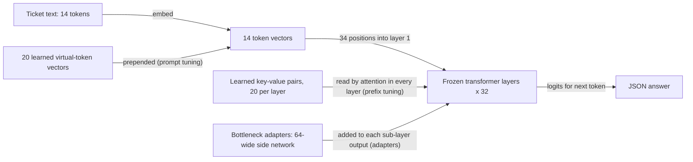
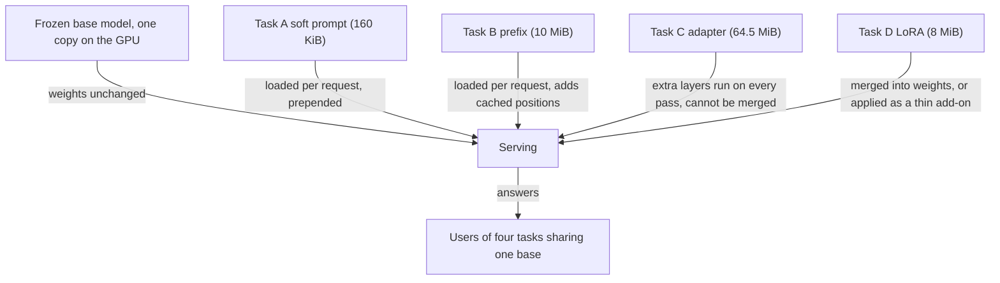

# Adapters, prefix tuning, prompt tuning and P-tuning

> **Key papers:** Houlsby, Giurgiu, Jastrzebski, Morrone, de Laroussilhe, Gesmundo, Attariyan and Gelly, 2019, "Parameter-Efficient Transfer Learning for NLP" ([arXiv 1902.00751](https://arxiv.org/abs/1902.00751)); Li and Liang, 2021, "Prefix-Tuning" ([arXiv 2101.00190](https://arxiv.org/abs/2101.00190)); Lester, Al-Rfou and Constant, 2021, "The Power of Scale for Parameter-Efficient Prompt Tuning" ([arXiv 2104.08691](https://arxiv.org/abs/2104.08691)); Liu et al., 2021, "GPT Understands, Too" (P-tuning, [arXiv 2103.10385](https://arxiv.org/abs/2103.10385)) and Liu et al., 2021, "P-Tuning v2" ([arXiv 2110.07602](https://arxiv.org/abs/2110.07602)).
>
> **Scope:** the older parameter-efficient methods that add new parts or new input vectors to a frozen model, why LoRA replaced them in most toolchains, and what is still worth using. It does not re-teach LoRA; for that, read the [LoRA guide](../../../llm-learning-repository/tutorials/02-building/09-lora.md).

Written 2026-11-26. Library and serving support changes monthly; every tool statement below says what was checked and what was not.

## Read this first

**The idea in one sentence.** Instead of changing a model's weights, you freeze the model and train a small amount of new material that steers it: either tiny extra layers inserted inside it (adapters), or a few learned vectors the model reads as if they were extra words (prompt tuning, prefix tuning, P-tuning).

**Who this is for.** A team deciding how to customise a small language model (SLM) who keeps meeting these names in papers, library menus and vendor slides, and needs to know which, if any, to pick in 2026.

**Afterwards you will be able to** count the trainable numbers for each method on a real model shape, say why a bottleneck adapter costs inference time and a LoRA adapter does not once merged, explain what a "virtual token" is, and say which libraries and servers still handle each method (and which claims about serving I could not verify).

**Reading time.** About 40 minutes; Tutorial 1 alone is about 15. **Have read first:** the [LoRA guide](../../../llm-learning-repository/tutorials/02-building/09-lora.md) (the method that replaced these) and [01 Options and trade-offs](../01-options-and-trade-offs.md), where these methods are listed as "largely superseded". Useful: [InstructGPT](../../../llm-learning-repository/tutorials/02-building/08-instructgpt.md) for what full fine-tuning at scale costs.

**The one thing most people get wrong.** "Prompt tuning" is not prompt engineering. A prompt-tuned model has learned numbers that do not correspond to any words; you cannot read them, edit them, or send them to a hosted model's text API. Like LoRA, prompt tuning needs a model whose internals you can run and train. The other common error is to read "0.1 percent of the parameters" as "0.1 percent of the cost". The training pass still runs through the whole frozen model, so memory and time for the forward and backward pass are close to those of any other method; what shrinks is the checkpoint you store.

## The technique in one worked example

Constructed by this guide, so every number can be checked by hand. Take a model shaped like a typical 8 billion parameter decoder: hidden width d = 4,096, 32 layers, and (for simplicity) attention keys and values that are also 4,096 wide. Real models that use grouped-query attention have narrower keys and values, so prefix tuning would be smaller than shown; the shape here is a deliberate simplification. We want it to answer support tickets in a fixed format. Compare the new material each method would train.

| Method | What is trained | Arithmetic | Trainable numbers |
|---|---|---|---|
| Prompt tuning, 20 virtual tokens | 20 vectors of width 4,096 at the input only | 20 x 4,096 | 81,920 |
| Prefix tuning, 20 virtual tokens, no reparameterisation | A key and a value vector for each of 20 positions in each of 32 layers | 2 x 32 x 20 x 4,096 | 5,242,880 |
| Bottleneck adapter (Houlsby layout), bottleneck m = 64 | Two adapters per layer, each 2md + d + m numbers (Houlsby Section 2.1) | 32 x 2 x (2 x 64 x 4,096 + 4,096 + 64) | 33,820,672 |
| LoRA, rank 8 on the query and value matrices (for comparison) | Two thin matrices per target matrix: 8 x (4,096 + 4,096) | 32 x 2 x 8 x 8,192 | 4,194,304 |

Now trace a single request. A ticket arrives: "Order 8841 arrived broken, want refund". After tokenising it is, say, 14 tokens.

1. **Prompt tuning.** The model receives 20 learned vectors followed by the 14 real token vectors: 34 positions. The learned vectors sit at the front; the ordinary layers compute everything else. The output might be the JSON string `{"intent":"refund","order":"8841"}`.
2. **Prefix tuning.** The input is still 14 positions, but in every layer the attention can also look at 20 extra learned key-value pairs. Those pairs are not computed from words; they are stored numbers pasted into the model's working memory. The same JSON comes out.
3. **Adapter.** The input is 14 positions. In each layer, after the attention block and after the feed-forward block, the hidden state passes through a small side network (shrink 4,096 to 64, apply a nonlinearity, expand to 4,096, add the original back). The same JSON comes out.
4. **Storage and serving.** At 2 bytes per number the prompt is about 160 KiB, the prefix 10 MiB, the adapter 64.5 MiB and the rank-8 LoRA 8 MiB, against about 16 GB for the base. A 20-token prefix adds 20 cached positions per request, 10 MiB with this shape (arithmetic in Tutorial 2). The adapter adds two small matrix multiplications per layer that cannot be folded away, because a nonlinearity sits between them; merged LoRA adds nothing.



What to notice: the three methods push learned numbers into three different places (the input, every layer's attention memory, every layer's output path), and all of them leave the frozen layers untouched. That placement decides what each method costs at serving time.



What to notice: this is the sales pitch of every method in this guide, many tasks sharing one base, and it is also the pitch LoRA makes. The difference is in the arrows: only LoRA offers a path where the extra part disappears into the weights.

## Words you need

| Term | Plain definition | In the worked example |
|---|---|---|
| Parameter-efficient fine-tuning (PEFT) | Training a small number of new or selected numbers while the rest of the model stays frozen | All four rows of the table |
| Adapter | A small trained network inserted inside a frozen model's layers | The 64-wide side network after each sub-layer |
| Bottleneck | The narrow middle of an adapter (width m) that forces few parameters | m = 64 against d = 4,096 |
| Soft prompt / virtual token | A learned vector the model reads like a word embedding, matching no real word | The 20 vectors in the prompt-tuning row |
| Prompt tuning | Learn soft-prompt vectors at the input only (Lester et al.) | 81,920 trainable numbers |
| Prefix tuning | Learn key-value pairs that every layer's attention can read (Li and Liang) | 5,242,880 trainable numbers |
| P-tuning | Learn soft prompts produced by a small prompt encoder and placed among the input tokens (Liu et al.) | A variant of the prompt row, with an LSTM making the vectors |
| Reparameterisation | Training a smaller matrix passed through a small network, then throwing the network away after training | Prefix tuning's training-time MLP (Li and Liang Section 4.3) |
| Merge | Folding a learned update into the base weights so inference has no extra work | Possible for LoRA; not possible for bottleneck adapters |

## Tutorial 1 - Intuitive understanding

### What was broken before

By 2018 the standard way to adapt a pretrained language model to a task was fine-tuning: copy the whole model and nudge every number. Houlsby et al. put the problem in terms of a company with many tasks: each task needs its own full copy of the model, so storage grows with the number of tasks. For a BERT-Large model that cost is 100 percent of the parameters per task (Table 1 of their paper). Training also had to touch every number, which needs a lot of memory for large models.

The other end was equally unattractive. Prompting a frozen model with hand-written text needs no training, but small wording changes can change results a lot; the P-tuning paper's abstract describes manually written prompts as unstable and says small changes can cause large performance drops. And prompts are limited to what words can express.

So the question these papers ask is: can we keep one frozen copy of a big model and store only a small, per-task add-on?

### The idea

**Analogy.** Think of a big, capable consulting firm (the frozen model) that you rent by the hour. Fine-tuning is rebuilding the whole firm for each client. Adapters are installing a small desk in each department that rewrites every memo slightly before it moves on. Prompt tuning is handing the firm's front door a briefing note written in a private shorthand nobody can read but the firm. Prefix tuning is giving every department the same briefing note, so each one consults it while working.

**Where the analogy breaks.** A briefing note in a human language can be read and edited by a person; a soft prompt is just numbers, and no one can tell what it says or audit it. Departments in a real firm can ignore a note; a transformer's attention is forced to spread over everything in its window, so extra notes also take attention away from the real input. And a real desk can be removed at no cost, whereas an adapter inserted into the computation stays in the path and costs time on every request.

### How it works, step by step

1. Start with a pretrained model and freeze every weight.
2. Add the new material: adapters inside each layer, or learned vectors at the input, or learned key-value pairs in every layer.
3. Train only that material on your examples, using the ordinary next-word loss. Gradients still flow back through the frozen model, because the new material sits in the middle or at the front of it.
4. Store only the new material, which is a file measured in kilobytes to tens of megabytes.
5. At serving time load the frozen model once, and attach the right add-on for each request.

Adapters differ in step 2: Houlsby et al. insert two per layer, after the attention block and after the feed-forward block, each shrinking the hidden state to m dimensions, applying a nonlinearity, expanding back and adding the original, initialised near zero so the model starts unchanged (Sections 2, 3.6). Prefix tuning differs from prompt tuning in that its vectors enter every layer (Li and Liang Section 4.1). P-tuning uses a small LSTM to generate the soft-prompt vectors (per the PEFT documentation; the paper abstract does not mention it).

### What the evidence says

All numbers below are the papers' own and were read from the arXiv HTML; none was reproduced here.

- **Adapters (Houlsby et al., Table 1, GLUE test set).** Fine-tuning BERT-Large scored 80.4 with 100 percent of parameters trained per task; adapters scored 80.0 with 3.6 percent per task, and a fixed adapter size of 64 scored 79.6 with 2.1 percent. In words: across the benchmark, adapters gave up 0.4 points of score to train about 28 times fewer numbers per task (100 divided by 3.6).
- **Prefix tuning (Li and Liang, Table 1, E2E table-to-text, GPT-2 medium).** Fine-tune 68.2 BLEU, adapter at 3 percent 68.9, prefix at 0.1 percent 69.7. The gain of 1.5 BLEU over fine-tuning is small and comes from one dataset and one model size. On the summarisation set XSUM with BART-large (Table 2) prefix tuning was slightly below fine-tuning: ROUGE-1 of 43.80 at 2 percent of parameters against 45.14 for fine-tuning. The authors attribute this to the larger dataset, longer inputs and harder task (Section 6.2); that is their speculation.
- **Low-data setting (Li and Liang Section 6.3).** With 50 to 500 training examples, prefix tuning beat fine-tuning by 2.9 BLEU on average, meaning that with a few hundred examples the frozen model sometimes behaves better than a model whose every weight was nudged on so little data.
- **Prompt tuning (Lester et al.).** It becomes competitive as models grow: at 11 billion parameters (T5-XXL) it matches the strong multi-task fine-tuning baseline on SuperGLUE (Figure 1), while smaller models lag clearly.
- **P-tuning v2 (abstract).** The authors report that, properly optimised, prompt tuning matches fine-tuning with 0.1 to 3 percent of parameters tuned across model sizes and NLU tasks, including harder sequence labelling.

### What this does not show

These results are for 2019 to 2021 models and tasks: BERT-Large, GPT-2 medium and large (345 million and 774 million parameters), BART-large, T5. None of the four papers tests a modern instruction-tuned decoder of 1 to 14 billion parameters on structured extraction, and Lester et al. say prompt tuning is weaker below billions of parameters, the size an SLM team uses. None measures serving latency or compares with LoRA, which came later.

### Teach-back

<details>
<summary>1. Why does 0.1 percent of the parameters not mean 0.1 percent of the training cost?</summary>

Gradients must travel backward through the entire frozen model to reach the learned vectors, and the forward pass runs through every layer. You save optimiser state and the stored checkpoint, not the compute of the forward and backward passes.
</details>

<details>
<summary>2. What is the difference between prompt tuning and prefix tuning?</summary>

Prompt tuning learns vectors only at the input embedding layer. Prefix tuning learns key and value vectors that every layer's attention reads. Prefix tuning therefore has many more trainable numbers and a stronger grip on the model.
</details>

<details>
<summary>3. Why can a merged LoRA add no inference cost while a bottleneck adapter cannot?</summary>

LoRA's update is a product of two matrices added to an existing weight matrix, so the sum can be computed once. An adapter has a nonlinearity between its two matrices, so it is a separate computation that must run on every forward pass.
</details>

## Tutorial 2 - Practitioner understanding

### The design in concrete terms

**Bottleneck adapters (Houlsby).** Two adapters per transformer layer, inserted after the attention projection and after the feed-forward projection, before the skip connection is added (Section 2, Figure 2). Each has 2md + d + m trainable numbers including biases. The layer-normalisation parameters are also trained, 2d per layer. Weights start from a zero-mean Gaussian with standard deviation 0.01, truncated at two standard deviations, so the adapter begins near the identity (Section 3.6). The paper chose the adapter size from {8, 64, 256} per task and found that fixing it across tasks cost little: mean validation accuracy over eight tasks was 86.2 percent at size 8, 85.8 at 64 and 85.7 at 256 (Section 3.6).

**Prefix tuning (Li and Liang).** The decoder input becomes [prefix; x; y] (Section 4.2). Training passes a smaller matrix through a feed-forward network, because direct optimisation was unstable (Section 4.3); hidden size 512 for table-to-text and 800 for summarisation; the network is dropped afterwards. Prefix lengths were 5 for E2E and WebNLG, 10 for DART and 100 for XSUM (Table 5). Initialising from real-word activations beat random (Section 7.4).

**Prompt tuning (Lester et al.).** A matrix of p x e learned embeddings is prepended to the embedded input. Tested lengths were 1, 5, 20, 100 and 150, default 100; beyond 20 tokens gains were marginal (Section 3.2). Initialisation options were uniform random in [-0.5, 0.5], sampled vocabulary from the 5,000 most common tokens, and class-label embeddings; the last was best at small sizes and the differences vanished at XXL. The T5 models needed "LM adaptation" (continued training with a language-modelling objective for up to 100,000 steps) to make prompt tuning work reliably (Section 2.2, Section 3.2).

**P-tuning and P-tuning v2.** P-tuning feeds learned embeddings, produced by a prompt encoder, into the input. P-tuning v2 applies deep prompt tuning (prompts at every layer), closer to prefix tuning, and was tuned for understanding tasks including sequence labelling (abstract).

**Library calls (PEFT).** The PEFT documentation lists soft-prompt methods (prompt tuning, prefix tuning, P-tuning, multitask prompt tuning, context-aware prompt tuning) with configuration classes `PromptTuningConfig`, `PrefixTuningConfig` and `PromptEncoderConfig`. The prefix-tuning page documents `num_virtual_tokens`, `prefix_projection` (default `False`), `encoder_hidden_size` and `init_weights="zero"`, and notes that for encoder-decoder models the prefix is applied only to the decoder, unlike the paper, so other methods are advised there. The PEFT method-overview page lists LoRA-family and related adapters (LoHa, LoKr, AdaLoRA, OFT, BOFT, MiSS, IA3) but no Houlsby-style bottleneck adapter; I found none elsewhere in the pages read (not a code search). The separate `adapters` library lists `seq_bn` bottleneck adapters, `prefix_tuning`, `lora` and `prompt_tuning` for BERT, GPT-2, LLaMA, Mistral, T5 and others; whether `seq_bn` matches Houlsby's layout, and that library's maintenance level, are unverified.

### A minimal version

Unrun. Prompt tuning on a causal model with PEFT and Transformers. Input shapes: token ids [batch, seq]; the model sees [batch, 20 + seq] positions. Output: a checkpoint of about 20 x hidden numbers.

```python
# UNRUN sketch. Requires: pip install transformers peft datasets
from transformers import AutoModelForCausalLM, AutoTokenizer, Trainer, TrainingArguments
from peft import PromptTuningConfig, PromptTuningInit, TaskType, get_peft_model

name = "Qwen/Qwen3-4B"  # any open causal model you may train
tok = AutoTokenizer.from_pretrained(name)
base = AutoModelForCausalLM.from_pretrained(name, torch_dtype="auto")

cfg = PromptTuningConfig(
    task_type=TaskType.CAUSAL_LM,
    num_virtual_tokens=20,                    # tokens beyond ~20 add little (Lester Sec. 3.2)
    prompt_tuning_init=PromptTuningInit.TEXT, # start from real words, not random
    prompt_tuning_init_text="Classify the support ticket and answer in JSON:",
    tokenizer_name_or_path=name,
)
model = get_peft_model(base, cfg)
model.print_trainable_parameters()  # expect 20 x hidden (e.g. 20 x 2,560 for a 2,560-wide model)

args = TrainingArguments(
    output_dir="out-prompt-tuning",
    learning_rate=3e-2,   # soft prompts need a far larger rate than weights; Lester used 0.3 with Adafactor (unverified here)
    per_device_train_batch_size=8,
    num_train_epochs=5,
)
# train_ds: tokenised examples with input_ids, attention_mask, labels, shape [seq]
Trainer(model=model, args=args, train_dataset=train_ds).train()
model.save_pretrained("ticket-soft-prompt")  # adapter_config.json + a small tensor file
```

Swap in `PrefixTuningConfig(task_type="CAUSAL_LM", num_virtual_tokens=20)` for prefix tuning or `PromptEncoderConfig(task_type="CAUSAL_LM", num_virtual_tokens=20, encoder_hidden_size=128)` for P-tuning (class names from the PEFT docs; the encoder size is a guess). I did not verify a recommended soft-prompt learning rate in the PEFT docs; treat the value above as a starting point.

### What it costs

Assumptions: an 8 billion parameter model (shape in the worked example), 16-bit weights, a single 80 GB GPU.

- **Stored per task.** About 160 KiB (prompt), 10 MiB (prefix), 64.5 MiB (adapter), against 8 MiB for rank-8 LoRA on the query and value matrices. The ratio between methods is under 10 to 1 for the three bigger ones; the ratio to the base is over 200 to 1 for all of them.
- **Serving memory.** A 20-token prefix adds 10 MiB of attention cache per concurrent request (arithmetic in the worked example); at 100 concurrent requests that is 1 GiB. A 100-token prompt-tuning setting as in Lester's default adds 100 positions of cache per request at the same per-position size: 100 x 524,288 = 52,428,800 bytes, 50 MiB per request, about 5 GiB at 100 requests.
- **Serving time.** The LoRA paper reports, for GPT-2 medium at batch size 32 and sequence length 512, a forward pass of 1449.4 ms for the baseline and LoRA, 1482.0 ms for AdapterL (+2.2 percent) and 1492.2 ms for AdapterH (+3.0 percent) (Table 1). The authors say the overhead matters more at small batch sizes; the exact figure for those settings was not read here. That is a measurement by the authors of a rival method on a 2021 GPU, so treat it as direction, not a number to plan on.
- **People time.** Soft prompts are sensitive to initialisation, length and learning rate (Lester Sections 2.1, 3.2); budget evaluation runs, not GPUs.

### How it fails

| Symptom | Likely cause | Mitigation |
|---|---|---|
| Prompt tuning scores far below LoRA on a 1B to 8B model | Lester et al. found prompt tuning needs very large models to match fine-tuning | Use LoRA at this size; use prompt tuning only to compare |
| Training is unstable or results vary wildly across seeds | Random initialisation (Lester Figure 3b; Li and Liang Section 7.4) | Initialise from real words or class labels; run several seeds |
| Prefix training loss falls but test score drops | Prefix too long; overfitting (Li and Liang Section 7.1, footnote 14) | Shorten the prefix; early-stop on held-out data |
| Prefix tuning works on a decoder, poorly on an encoder-decoder | PEFT applies the prefix only to the decoder (PEFT docs note) | Choose another method for encoder-decoder models |
| Input window shrinks | Virtual tokens occupy context positions (the LoRA paper makes this point) | Count them against the context budget; keep the prompt short |
| Latency up with adapters | Unmergeable side layers on every pass (LoRA paper Table 1) | Merge-capable LoRA instead |
| Server cannot load the add-on | Serving stack supports LoRA only (vLLM LoRA page covers LoRA only) | Check support before training; fall back to a merged model |
| Adapter does nothing | Zero-near initialisation plus a very small learning rate | Raise the rate; check that trainable parameters count is non-zero |

### Evaluating your version

- **Metric.** Task score (exact match on a fixed schema) plus the share of outputs that fail to parse.
- **Baselines.** The base model with a good hand-written prompt, the same model with rank-8 LoRA, and your soft-prompt method. A method that loses to the hand-written prompt is not worth shipping.
- **Test set.** At least 300 held-out examples from unseen sources; at 85 percent pass rate the 95 percent interval is about plus or minus 4 points (1.96 x sqrt(0.85 x 0.15 / 300) = 0.040).
- **Stop rule.** Drop the method unless it beats the hand-written baseline by 5 points and trails LoRA by at most 2 on held-out data (this guide's suggestion, not from a paper).

### Adopt, adapt or skip

**Skip for new projects.** For an enterprise building a small model over private documents in 2026, use LoRA (or QLoRA) as the default parameter-efficient method. Reasons from the evidence above: the merge path leaves no inference cost; serving support in the tools surveyed in [03 Vehicles](../03-vehicles.md) is built around LoRA; the 2021 papers show soft prompts weak below billions of parameters. 

**Adapt in one narrow case.** Many tenants who each need a tiny behavioural nudge, a runtime you control, and a confirmed loader for soft prompts. For BERT-style encoders the `adapters` library remains a documented option, though LoRA works there too.

**Adopt only to read papers.** These methods matter for understanding later work: LoRA, DoRA and most modern PEFT descend from the adapter idea, and "virtual tokens" reappear in prompt-compression and memory research.

## Tutorial 3 - Researcher understanding

### Formal setup

Let a frozen model with weights theta map a token sequence x to a distribution over the next token. We train new parameters phi (with |phi| much smaller than |theta|) to minimise the usual cross-entropy loss over target tokens, theta held fixed.

- **Adapter.** For a hidden state h in R^d at a sub-layer output, h' = h + W_up f(W_down h), with W_down in R^(m x d), W_up in R^(d x m), f a nonlinearity. Trainable count per adapter: 2md + d + m (Houlsby Section 2.1). Toy: d = 4, m = 2 gives 2x2x4 + 4 + 2 = 22 numbers.
- **Prompt tuning.** Let E(x) in R^(n x e) be the embedded input. Learn P in R^(p x e) and feed [P; E(x)]. Trainable count: p x e. Toy: p = 2, e = 4 gives 8.
- **Prefix tuning.** For each layer l and each of p prefix positions, learn a key and value vector, so P_l = (K_l, V_l) in R^(p x d) each. Attention at layer l attends over [K_l; K(x)] and [V_l; V(x)]. Trainable count: 2 x L x p x d. Toy: L = 2, p = 2, d = 4 gives 2x2x2x4 = 32.
- **Training reparameterisation (prefix).** P = MLP(P') with P' smaller; discard the MLP afterwards (Li and Liang Section 4.3).
- **P-tuning.** Soft-prompt vectors are the output of an encoder g (an LSTM, per the PEFT documentation) applied to learned inputs, placed at chosen positions in the input.

Numeric check of the toy counts: adapter 22, prompt 8, prefix 32. The prefix has four times the prompt count here because it is stored in two layers and as a key and a value, and the ratio L x 2 is what the worked example's 5,242,880 over 81,920 equals (64).

### The claims, stated precisely

1. **Adapters (Houlsby).** On 26 text-classification tasks, adapters come within 0.4 GLUE points of fine-tuning (80.0 against 80.4) while training 3.6 percent of parameters per task (abstract, Table 1).
2. **Prefix tuning (Li and Liang).** With 0.1 percent of parameters on GPT-2, prefix tuning matches fine-tuning on table-to-text with full data, beats it by 2.9 BLEU on average in low-data settings, and extrapolates better to unseen topics (abstract, Section 6).
3. **Prompt tuning (Lester).** The gap to model tuning closes as models grow; at 11 billion parameters it matches (abstract, Figure 1).
4. **P-tuning and v2 (Liu).** Continuous prompts reduce sensitivity to manual wording and improve LAMA and SuperGLUE results; v2 reaches fine-tuning level with 0.1 to 3 percent of parameters, including sequence labelling (abstracts).
5. **Latency (the LoRA paper, not these papers).** Serial adapters add latency that merging cannot remove: +2.2 and +3.0 percent in one setting (Table 1).

### Evidence, table by table

- **Houlsby Table 1** (rows: BERT-Large fine-tune, adapters 8 to 256, adapters 64; columns: parameter multiple, trained per task, GLUE). Headline 80.4, 80.0, 79.6. Associational: adapter size was picked per task on validation data, one benchmark, one base model. It does not show behaviour in low-data or large-model regimes. Section 3.6 (mean validation accuracy 86.2, 85.8, 85.7 at sizes 8, 64, 256) shows insensitivity to size; I did not extract the seed variance, so the ordering is unverified.
- **Li and Liang Table 1** (E2E, WebNLG, DART; GPT-2 medium and large). E2E BLEU: fine-tune 68.2, adapter 3 percent 68.9, adapter 0.1 percent 66.3, prefix 69.7. WebNLG overall: 46.5, 54.9, 50.2, 55.1. In the unseen-category column fine-tune scored 27.7, prefix 45.6, adapter at 3 percent 48.3, so "extrapolates better" holds against fine-tuning, not against adapters.
- **Li and Liang Table 2** (XSUM, BART-large). ROUGE-1 45.14 for fine-tune against 43.80 (prefix, 2 percent) and 42.92 (0.1 percent): a loss for the method on a larger task.
- **Lester Figure 1, Table 3.** Scale curve identifies the effect of model size; the five-prompt ensemble (91.3 against 90.5) shows variance across prompts. Tables 1 and 2 are mixed: +12.5 F1 on TextbookQA (66.8 against 54.3) but -1.8 on DROP.
- **LoRA paper Table 1.** One GPU, GPT-2 medium: identifies the cost of unmerged serial layers in that setting only.

### Ablations and what they isolate

Li and Liang Table 4 isolates where vectors enter: embedding-only with 10 tokens scored 62.2 BLEU against 69.7 for the full prefix. Lester isolates length, initialisation and pretraining objective (Figure 3); Houlsby isolates adapter size (Section 3.6).

### Threats to validity

- **Small, old setups.** GPT-2 and BERT with saturated benchmarks; several gaps sit within plausible seed noise.
- **Uneven tuning effort.** Each paper tunes its own method most carefully; prefix tuning's lead over the 0.1 percent adapter depends on how well that adapter was tuned.
- **Internal inconsistencies.** Li and Liang give a summarisation prefix threshold of 200 in the text and 100 in Table 5, and quote GPT-2 as 774 million in one place and 345 million in another (the medium and large sizes).
- **No modern comparison.** Later studies against LoRA exist but were not verified, so none is quoted. Latency is hardware- and implementation-specific.

### Open problems and follow-ups

- Do soft prompts compete with LoRA on structured tasks for 1 to 14 billion parameter instruction-tuned models? None of the sources read answers it.
- Multi-tenant serving: a contributor's blog post says prefix-adapter support entered vLLM through PR 4645 as a separate module, and vLLM v0.9.x API docs list `vllm.prompt_adapter`. The current LoRA page covers only LoRA. Whether the module survives in the latest release is unverified; check release notes.
- Related lines (multitask prompt tuning 2303.02861, context-aware prompt tuning 2410.17222, low-rank prompt adaptation 2405.15282) were not checked.

### What would change my mind

I recommend skipping these for a new SLM project. I would reverse if (a) a reproducible comparison on 1 to 14 billion parameter instruction-tuned models showed prompt or prefix tuning within 1 point of LoRA on structured extraction, and (b) a mainstream server documented first-class multi-tenant loading of soft prompts with cache and batching support.

## Reading map for the key papers

| Paper section or figure | What it contains | Read, skim or skip | Where this guide answers the questions |
|---|---|---|---|
| Houlsby Section 2, Figure 2 | Adapter layout, placement, parameter count | Read | Tutorial 2 design, Tutorial 3 formal setup |
| Houlsby Table 1 and Section 3.2 | GLUE results and size choice | Read | Tutorial 1 evidence, Tutorial 3 tables |
| Houlsby Section 3.6 | Size and initialisation ablations | Skim | Tutorial 2 design |
| Li and Liang Sections 3 and 4 | Prefix definition and reparameterisation | Read | Tutorial 2 design |
| Li and Liang Tables 1 to 3, Section 6 | Generation results, low data, extrapolation | Read | Tutorial 1 evidence, Tutorial 3 tables |
| Li and Liang Section 7 | Length, position and initialisation ablations | Skim | Tutorial 3 ablations |
| Lester Sections 2 and 3, Figures 1 and 3 | Method, scale effect, design choices | Read | Tutorial 2 design, Tutorial 3 claims |
| Lester Sections 5 and 6 | Domain shift and ensembling | Skim | Tutorial 3 tables |
| Liu 2103.10385 (P-tuning) | Prompt encoder, LAMA and SuperGLUE | Skim | Words you need, Tutorial 2 design |
| Liu 2110.07602 (P-tuning v2) | Deep prompts for NLU | Skim | Tutorial 2 design |
| LoRA paper Section 3 and Table 1 | Why existing solutions were not enough | Read | What it costs, Tutorial 3 claim 6 |

Other sources read for this guide: [LoRA, arXiv 2106.09685](https://arxiv.org/abs/2106.09685); [PEFT method overview](https://huggingface.co/docs/peft/main/en/methods/overview); [PEFT soft prompts](https://huggingface.co/docs/peft/main/en/conceptual_guides/prompting); [PEFT prefix tuning](https://huggingface.co/docs/peft/main/en/package_reference/prefix_tuning); [Adapters library](https://docs.adapterhub.ml/overview.html); [vLLM LoRA page](https://docs.vllm.ai/en/latest/features/lora.html); [vLLM v0.9.2 prompt_adapter docs](https://docs.vllm.ai/en/v0.9.2/api/vllm/prompt_adapter/index.html); [contributor blog on vLLM prefix adapters](https://swapnilparekh.github.io/vllm-prefix-adapter-contribution/).

## Questions readers get stuck on

**Is a soft prompt the same as a system prompt?** No. A system prompt is text, tokenised into ordinary word vectors, and you can send it to any model. A soft prompt is a set of learned vectors that match no tokens; it can only be used on a model whose embedding layer you can feed directly.

**If these methods train so few numbers, why did LoRA replace them?** Three reasons appear in the sources. Adapters add serial layers that cost latency (LoRA paper Table 1: +2.2 to +3.0 percent in one setting). Prefix and prompt tuning use up part of the context window and were harder to optimise (the LoRA paper's Section 3; Lester's sensitivity to initialisation). And LoRA can be merged into the weights, which makes serving identical to an ordinary model. Tooling followed: PEFT, vLLM and most trainers are built around LoRA.

**What does "virtual token" mean?** A position in the input that has a learned vector in place of a word. The model attends to it like any other token. You pay for it in context length and attention cache, but it was never a word in the vocabulary.

**Does prompt tuning work on small models?** Lester et al. report that it becomes competitive only as models grow, matching model tuning at 11 billion parameters (Figure 1). For models of 1 to 8 billion, this guide found no published evidence in the sources read; do not assume it works.

**Can I serve these with vLLM?** For LoRA, yes; the current vLLM LoRA page covers LoRA only. A soft-prompt module existed in vLLM v0.9.x documentation; its status in later releases is unverified here. For adapters of the Houlsby kind, I found no serving support documented in any of the pages read.

**Is a bottleneck adapter the same thing as LoRA?** No, though LoRA descends from the adapter idea. A bottleneck adapter is a small network with a nonlinearity inserted in the layer path; LoRA adds a low-rank matrix product to an existing weight, which can be merged.

**What does "unverified" mean in this guide?** The figure or claim was not confirmed against a primary source in this pass. Treat it as a lead to check, not a fact.

**Are results like "0.1 percent of parameters matches fine-tuning" trustworthy for my task?** They are true for the cited models and datasets. They tell you little about a modern SLM on private documents, which none of the four papers tested; measure on your own held-out set.

## Prerequisites you actually need

### Prerequisite 1 - Frozen versus trained parameters

A model is a set of numbers. "Freezing" means gradient updates skip them. Example: a model with 1,000 numbers and 10 added trainable numbers has 1,010 total and 10 trainable, 0.99 percent of the whole. Here: every method in this guide freezes the base and trains only the added material. See the [LoRA guide](../../../llm-learning-repository/tutorials/02-building/09-lora.md) for the same idea with matrices.

### Prerequisite 2 - Embeddings and attention keys and values

A token becomes a vector (an embedding). Each attention layer turns every vector into a query, a key and a value; a position pays attention to others by comparing its query to their keys and reading their values. Example: with two positions, one real and one learned prefix, the real token's output is a weighted mix of both value vectors. Here: prompt tuning supplies extra embeddings; prefix tuning supplies extra keys and values directly. Reference: the [Transformer guide](../../../llm-learning-repository/tutorials/01-foundations/01-transformer.md).

### Prerequisite 3 - The attention (KV) cache

While generating, a model stores the keys and values of every earlier position. One position costs 2 x 32 x 4,096 x 2 = 524,288 bytes with the worked example's shape. Here: every virtual token is an extra cached position for every request. Reference: [03 Vehicles](../03-vehicles.md).

## Where this sits

**Read before:** the [LoRA guide](../../../llm-learning-repository/tutorials/02-building/09-lora.md) for the method that replaced these, and [01 Options and trade-offs](../01-options-and-trade-offs.md) for the decision ladder. **Read after:** [06 Preference tuning](./06-preference-tuning.md) for training signals beyond next-word prediction, and [04 Build and deploy playbook](../04-build-and-deploy-playbook.md) for serving and evaluation.

**Nearest techniques.** LoRA also freezes the base but its add-on is a low-rank change to existing weights, so it can be merged away. Full fine-tuning changes everything: highest ceiling, highest storage. Retrieval and in-context learning change only what the model reads; soft prompts are the trained cousin of those.

**Read next.** [06 Preference tuning](./06-preference-tuning.md), then [07 Reinforcement learning with verifiable rewards](./07-rl-with-verifiable-rewards.md) and [08 Distillation](./08-distillation.md).

## Checkpoint

<details>
<summary>1. Compute the trainable numbers for prompt tuning with 30 virtual tokens on a model with hidden width 2,560, and for a Houlsby adapter with bottleneck 32 on 28 layers (two adapters per layer, biases included, layer norms excluded).</summary>

Prompt: 30 x 2,560 = 76,800. Adapter: per adapter 2 x 32 x 2,560 + 2,560 + 32 = 163,840 + 2,592 = 166,432; times 2 per layer times 28 layers = 9,320,192.
</details>

<details>
<summary>2. A 50-token prefix with keys and values 4,096 wide, 32 layers, 2 bytes each: how much cache does it add per request, and for 200 concurrent requests?</summary>

50 x 2 x 32 x 4,096 x 2 = 26,214,400 bytes, 25 MiB per request. For 200 requests: 5,242,880,000 bytes, about 4.9 GiB.
</details>

<details>
<summary>3. Explain, without equations, why LoRA can be merged and a bottleneck adapter cannot.</summary>

LoRA's update is a plain matrix added to an existing weight, so one pre-computed sum gives the same answer as two steps. A bottleneck adapter has a nonlinearity between two matrices and adds the result back to the hidden state, so it is a separate computation on every pass.
</details>

<details>
<summary>4. Critique this claim: "Prefix tuning beats fine-tuning, so use it." Name two things in the evidence that limit it.</summary>

The gains are small (1.5 BLEU on one E2E setting) and come from GPT-2 sized models; on XSUM summarisation prefix tuning lost (ROUGE-1 43.80 against 45.14). Also no tested model resembles a modern instruction-tuned SLM, and the adapter at 3 percent beat prefix tuning on WebNLG unseen categories (48.3 against 45.6).
</details>

<details>
<summary>5. Your serving stack is vLLM and your team wants soft prompts for 500 tenants. What do you check first and what is the fallback?</summary>

Check whether the vLLM release you run still supports a prompt-adapter module (v0.9.x docs listed one; later status unverified; the current LoRA page covers LoRA only). If not supported, train LoRA per tenant, or merge the soft behaviour into a LoRA adapter by training that instead.
</details>

</details>
