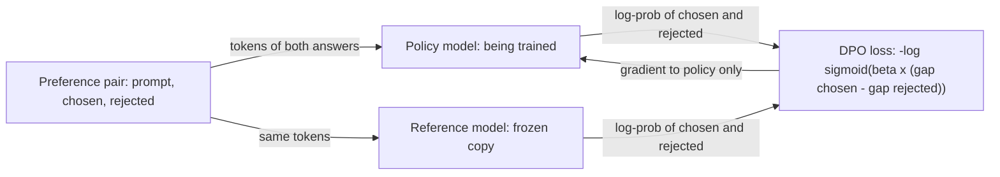
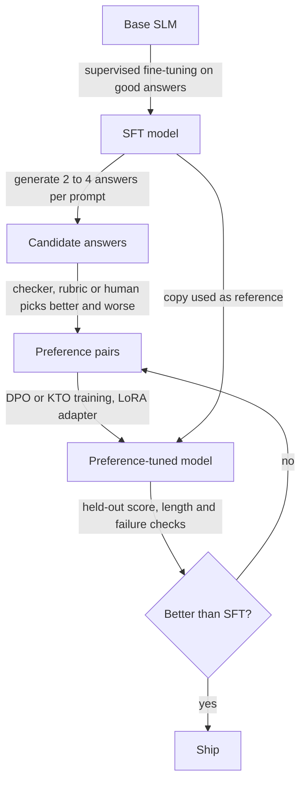

# Preference tuning: DPO, ORPO, KTO and SimPO

> **Key papers:** Rafailov, Sharma, Mitchell, Ermon, Manning and Finn, 2023, "Direct Preference Optimization" (DPO, [arXiv 2305.18290](https://arxiv.org/abs/2305.18290)); Hong, Lee and Thorne, 2024, "ORPO" ([arXiv 2403.07691](https://arxiv.org/abs/2403.07691)); Ethayarajh, Xu, Muennighoff, Jurafsky and Kiela, 2024, "KTO" ([arXiv 2402.01306](https://arxiv.org/abs/2402.01306)); Meng, Xia and Chen, 2024, "SimPO" ([arXiv 2405.14734](https://arxiv.org/abs/2405.14734)). Failure-mode papers: Park et al., 2024 ([arXiv 2403.19159](https://arxiv.org/abs/2403.19159)) and "Unintentional Unalignment" ([arXiv 2410.08847](https://arxiv.org/abs/2410.08847)).
>
> **Scope:** training a model from comparisons ("this answer over that one") without a reward model or a reinforcement-learning loop. It does not cover reward-model RLHF in depth (see the [InstructGPT guide](../../../llm-learning-repository/tutorials/02-building/08-instructgpt.md)) or checker-scored reinforcement learning ([07](./07-rl-with-verifiable-rewards.md)).

Written 2026-11-26. Library status and defaults were read from the TRL documentation on that date and change often.

## Read this first

**The idea in one sentence.** Show the model pairs of answers to the same question, one good and one bad, and nudge it to make the good one more likely than the bad one, using an ordinary training loss instead of a reward model plus reinforcement learning.

**Who this is for.** A team that has already done supervised fine-tuning (SFT) on a small language model (SLM), sees failures that "show, don't tell" examples do not fix (too long, too chatty, wrong tone, unsafe, confidently wrong), and has, or can cheaply make, comparisons.

**Afterwards you will be able to** compute the DPO loss on one pair by hand, say what beta does, size the memory for the reference model, name which of DPO, ORPO, KTO and SimPO needs which data, read TRL's current status for each, and recognise two documented failure modes: length bias and likelihood displacement.

**Reading time.** About 40 minutes. **Have read first:** [05 Adapters, prefix and prompt tuning](./05-adapters-prefix-prompt-tuning.md) is optional; the [LoRA guide](../../../llm-learning-repository/tutorials/02-building/09-lora.md) helps because preference tuning on an SLM is usually run with LoRA. For the reinforcement-learning version this replaces, read the [InstructGPT guide](../../../llm-learning-repository/tutorials/02-building/08-instructgpt.md).

**The one thing most people get wrong.** Preference tuning is not a way to teach facts or skills the model lacks. It reshuffles probability among answers the model can already produce. If the "good" answers are not within the model's reach, the loss goes down and nothing useful happens. The second mistake: assuming every method needs paired data and a copy of the model. DPO needs both pairs and a reference; KTO needs only thumbs-up or thumbs-down labels; ORPO and SimPO need no reference model.

## The technique in one worked example

Constructed by this guide; the arithmetic is checkable by hand. Beta is TRL's default, 0.1 (DPOConfig in the TRL docs).

**The pair.** Prompt: "Order 8841 arrived broken. What now?" Chosen answer: "Sorry about that. I have started a refund for order 8841; expect it in 5 days." Rejected answer: a long reply that asks the customer for the order number they already gave. Imagine we can read the model's log-probability of each whole answer (the sum over its tokens, always negative):

| Quantity | Chosen | Rejected |
|---|---|---|
| Frozen reference model, log pi_ref | -14.0 | -19.0 |
| Policy before training (starts equal to reference) | -14.0 | -19.0 |
| Policy after some training | -12.0 | -20.0 |

**Step 1, log-ratios.** Chosen: -12.0 - (-14.0) = +2.0. Rejected: -20.0 - (-19.0) = -1.0. The model has moved toward the chosen answer and away from the rejected one.

**Step 2, implicit reward margin.** beta x (2.0 - (-1.0)) = 0.1 x 3.0 = 0.3.

**Step 3, loss.** sigmoid(0.3) = 0.5744, so loss = -ln(0.5744) = 0.5544. Before training the margin was 0, sigmoid(0) = 0.5 and the loss was ln 2 = 0.6931. The loss fell from 0.6931 to 0.5544, meaning that on this pair the model now assigns the chosen answer a higher "reward" than the rejected one.

**Step 4, how hard the pair still pushes.** The gradient on this pair is scaled by 1 - sigmoid(0.3) = 0.4256 (DPO paper Section 4: the update is weighted by how wrongly the implicit reward orders the pair). A pair that is already well separated pushes little; a pair that is ordered wrongly pushes hard.

**Step 5, what beta changes.** With the same log-ratio gap of 3.0: beta 0.05 gives margin 0.15 and loss 0.6210; beta 0.1 gives 0.3 and 0.5544; beta 0.5 gives 1.5 and 0.2014; beta 1.0 gives 3.0 and 0.0486. A larger beta makes the same movement count for more, so training stops pushing sooner and the model stays closer to the reference (TRL docs: "Higher beta means less deviation from the reference model").

**What DPO did here.** Notice the numbers: the chosen answer's probability went up (-14.0 to -12.0), but the rejected one fell by one unit while the chosen rose by two. The TRL docs say that in practice DPO works mostly by pushing the rejected likelihood down. When both log-probabilities fall (for example chosen -14.0 to -15.0 and rejected -19.0 to -23.0), the margin still grows to 0.1 x (-1 - (-4)) = 0.3 and the loss is identical, even though the chosen answer became less likely. That case is likelihood displacement, below.



What to notice: the reference model never trains; it only supplies the yardstick against which movement is measured. That second model is the memory cost that ORPO and SimPO remove.



What to notice: the loop starts from an SFT model and needs fresh candidate answers from it. Pairs written by someone else's model are "off-policy" and work less well, a point developed in Tutorial 3.

## Words you need

| Term | Plain definition | In the worked example |
|---|---|---|
| Preference pair | A prompt with a chosen (better) and a rejected (worse) answer | The refund reply and the long reply |
| Policy | The model being trained | The row "after some training" |
| Reference model | A frozen copy of the starting model, used as a yardstick | The row "frozen reference" |
| Log-probability | The log of the chance the model gives an answer; sum over tokens, always below zero | -12.0 for the chosen answer |
| Beta | Knob scaling how strongly movement away from the reference counts | 0.1 |
| Implicit reward | beta times the log-ratio of policy to reference for an answer | 0.1 x 2.0 = 0.2 for the chosen answer |
| Odds | p divided by (1 - p); ORPO compares odds, not raw probabilities | A 0.8 chance is odds of 4 |
| Unpaired data | Single answers each labelled desirable or undesirable, with no pairing; KTO's input | One thumbs-up reply on its own |
| Length bias | The tendency to prefer longer answers because raters or the loss reward them | The long rejected reply scoring well |
| Likelihood displacement | The probability of the chosen answer falls during training | Chosen -14.0 to -15.0 above |
| RLHF | Reinforcement learning from human feedback: train a reward model on comparisons, then optimise the policy against it | What DPO replaces |

## Tutorial 1 - Intuitive understanding

### What was broken before

Supervised fine-tuning shows the model one good answer per question. It cannot say "not like that". The classic fix, reinforcement learning from human feedback (RLHF), trains a second model to score answers, then runs a reinforcement-learning loop in which the main model writes answers, the scorer rates them, and the model shifts toward high scores. InstructGPT used it, and the [lab guide](../../../llm-learning-repository/tutorials/02-building/08-instructgpt.md) walks through it. It works but is heavy: several models in memory, generation inside the training loop, and many settings that interact. For an enterprise SLM team that is a lot of machinery for "make answers shorter and politer".

### The idea

**Analogy.** Teaching a junior writer by marking up pairs: for each brief you hand back two drafts and say "this one, not that one". Do this a few thousand times and their drafts drift toward the style you chose, without anyone building a scoring rubric.

**Where the analogy breaks.** A person learns why one draft was better; the model only learns to make the chosen text more likely than the rejected text, relative to where it started. It cannot tell whether you preferred the draft for its facts or its length, so it will happily learn the easier signal. And unlike a human, it has a frozen "where it started" copy tugging on it: DPO measures progress against that copy, and if the copy is a poor match for how the pairs were written, the signal is distorted.

### How it works, step by step

1. Start from a model that has been fine-tuned (SFT) so it already writes in roughly the right format.
2. Collect pairs: for the same prompt, a better and a worse answer.
3. For each pair, compute how likely the current model and the frozen copy find each answer.
4. Raise the "score" of the chosen answer relative to the rejected one, where the score is how much more likely the current model finds the answer compared to the copy.
5. Stop early, check, and compare to the SFT model on a held-out set.

The four methods differ in step 3 and 4. DPO uses a frozen copy and pairs. ORPO adds a small penalty term to the ordinary SFT loss and needs no copy and no separate SFT stage. KTO uses single answers labelled good or bad. SimPO scores each answer by its average per-token likelihood, which needs no copy.

### What the evidence says

- **DPO (the paper's Section 6).** On a controlled sentiment task with a GPT-2-large model, DPO achieved the best reward-versus-drift trade-off, ahead of PPO even when PPO was given the true reward (Figure 2). On Reddit summarisation with GPT-J, DPO's win rate was about 61 percent at temperature 0 against about 57 percent for PPO at its best temperature (Figure 2, judged by GPT-4). On out-of-distribution news summarisation, GPT-4 win rate against ground-truth summaries was 0.36 for DPO and 0.26 for PPO (Table 1). A human study found DPO preferred 58 percent of the time to PPO (Section 6.4, Table 2). In plain terms: out of every 100 head-to-head comparisons, about 58 went to DPO. The paper evaluated models up to 6 billion parameters.
- **KTO (abstract, Section 4.3).** The authors report that KTO matches or exceeds preference-based methods from 1B to 30B parameters while needing only a good or bad label per answer. For Llama 7B, 13B and 30B, KTO alone beat DPO alone (Figure 3); Pythia showed no significant difference. For Llama-7B, up to 90 percent of the desirable examples could be dropped and KTO still beat DPO (Figure 5). On OpenAssistant with Mistral-7B, KTO with one output per prompt scored a 0.631 win rate against the SFT target against 0.600 for DPO, with 72 percent less training data (Table 3).
- **ORPO (abstract, Table 1).** Fine-tuning Mistral-7B with ORPO on UltraFeedback alone, one epoch, reached 12.20 percent on AlpacaEval 2.0 (Mistral-ORPO-beta), 7.32 on MT-Bench and 66.19 percent on IFEval; Phi-2 (2.7B) reached 6.35 percent on AlpacaEval 2.0 and Llama-2-7B 9.44 percent.
- **SimPO (Table 4).** Replacing DPO with SimPO raised AlpacaEval 2 length-controlled win rate from 15.1 to 21.5 (Mistral base), 26.8 to 32.1 (Mistral instruct), 18.2 to 22.0 (Llama-3 base) and 40.3 to 44.7 (Llama-3 instruct). Table 5, an ablation on Mistral base, shows 21.5 for SimPO, 11.9 without length normalisation, and 16.8 with the margin set to zero.

All of these are the authors' own reports, mostly judged by a language model (GPT-4 or the AlpacaEval and Arena-Hard judges) rather than by task correctness.

### What this does not show

None of the four papers tests an enterprise task with a deterministic scorer (does the JSON parse, is the amount correct). The benchmarks are chat quality judged by another model, which carries its own verbosity bias; the DPO paper itself notes win rates depend on the judge prompt. Models are 2.7B to 30B and mostly general chat. The comparisons between DPO, ORPO, KTO and SimPO come from different papers with different data, base models and tuning effort, so the papers do not establish a winner; each method's authors report that their own method wins. Nothing here measures what happens to an SLM's narrow task skill, as opposed to its chat style, after preference tuning.

### Teach-back

<details>
<summary>1. In the worked example the loss fell from 0.6931 to 0.5544. What does 0.6931 correspond to?</summary>

The starting point: the policy equals the reference, so the margin is zero, sigmoid(0) = 0.5, and the loss is -ln(0.5) = ln 2 = 0.6931. Any lower loss means the chosen answer's implicit reward has risen above the rejected one's.
</details>

<details>
<summary>2. Why does a bigger beta keep the model closer to where it started?</summary>

Beta multiplies the movement. A larger beta makes a small movement already count as a large reward margin, so the loss saturates sooner and the gradient weight 1 - sigmoid(margin) shrinks sooner.
</details>

<details>
<summary>3. Which method needs no frozen copy, and which needs no paired data?</summary>

ORPO and SimPO need no reference model. KTO needs no pairs, only a desirable or undesirable label per answer. DPO needs both pairs and a reference.
</details>

<details>
<summary>4. Can preference tuning teach a model a fact it does not know?</summary>

Not reliably. It shifts probability among answers the model can already produce. Facts belong in retrieval or SFT data.
</details>

## Tutorial 2 - Practitioner understanding

### The design in concrete terms

**Data format (TRL docs).** A preference dataset has a `prompt`, a `chosen` and a `rejected` field, as plain strings or as lists of chat messages. An explicit prompt is recommended over the implicit form that puts the prompt inside both answers. For conversations: `{"prompt": [{"role": "user", "content": "..."}], "chosen": [{"role": "assistant", "content": "..."}], "rejected": [{"role": "assistant", "content": "..."}]}`. KTO uses `prompt`, `completion` and a boolean `label`; TRL also converts a paired dataset to that form automatically.

**DPO (TRL DPOTrainer, docs read 2026-11-26).** Defaults in `DPOConfig`: `beta=0.1`, `learning_rate=1e-6`, `num_train_epochs=3.0`, `max_length=1024`, `loss_type=["sigmoid"]`, `precompute_ref_log_probs=False`, `per_device_train_batch_size=8`. The `loss_type` list includes `ipo`, `hinge`, `robust`, `bco_pair`, `sft`, `apo_zero` and `sigmoid_norm`, the last described as the SimPO authors' length normalisation (it does not mention SimPO's margin or reference-free design, so this is not full SimPO). When `ref_model` is `None` the trainer uses the initial policy as the reference. The docs add that PEFT adapters are supported and, when training adapters, suggest a higher learning rate around 1e-5.

**The paper's settings.** The DPO paper swept beta over 0.05, 0.1, 1 and 5 (Section 6.1); the reference is the SFT model, or a model trained to maximise the likelihood of the chosen answers if none exists (Section 4).

**ORPO.** The loss is the SFT negative log-likelihood plus lambda times an odds-ratio term, no reference model (Eqs. 6, 7). Lambda was 0.25 for Phi-2, 0.2 for Llama-2-7B and 0.1 for Mistral-ORPO-alpha (Section 6.1); maximum learning rate 8e-6 for the models trained for 10 epochs (Appendix C). In TRL it is `trl.experimental.orpo.ORPOTrainer` with `ORPOConfig(beta=0.1)`, where TRL's `beta` is the paper's lambda.

**KTO.** TRL's `KTOConfig` defaults: `beta=0.1`, `learning_rate=1e-6`, `desirable_weight=1.0`, `undesirable_weight=1.0`. The TRL docs advise a per-device batch size of at least 4 and an effective batch size of 16 to 128 (the KL estimate is poor otherwise), a learning rate between 5e-7 and 5e-6, and weights set so that desirable_weight times the number of desirable examples over undesirable_weight times the number of undesirable ones lies between 1:1 and 4:3.

**SimPO.** Reward is the average per-token log-probability times beta (Eq. 4); a target margin gamma is subtracted in a Bradley-Terry loss (Eq. 6). The paper says beta between 2.0 and 2.5 and gamma between 0.5 and 1.5 work well (Section 3); its grid in Appendix B Table 7 is beta in [2.0, 2.5] and gamma in [0.3, 0.5, 1.0, 1.2, 1.4, 1.6]. The text range and the grid disagree slightly. Whether TRL's current stable surface offers full SimPO is unverified: its DPO page offers only `sigmoid_norm`, and the CPO trainer (experimental) is where SimPO lived historically (this guide's recollection, not re-checked).

**TRL maturity (index page, 2026-11-26).** The TRL front page lists DPOTrainer and KTOTrainer under stable offline methods; CPOTrainer and ORPOTrainer under experimental. The brief for this guide expected both KTO and ORPO to be experimental; that was true in earlier TRL releases, but the page read here lists KTO as stable. Re-check before you pin a version.

### A minimal version

Unrun. DPO with a LoRA adapter on an SFT checkpoint. Input: a dataset with `prompt`, `chosen`, `rejected` columns, for example 3,000 rows. Output: a LoRA adapter directory of a few megabytes.

```python
# UNRUN sketch; API as in the TRL DPO page read on 2026-11-26.
from datasets import load_dataset
from peft import LoraConfig
from trl import DPOConfig, DPOTrainer

train = load_dataset("json", data_files="prefs.jsonl", split="train")
# each row: {"prompt": [...messages], "chosen": [...], "rejected": [...]}

cfg = DPOConfig(
    output_dir="out-dpo",
    beta=0.1,                       # default; sweep 0.05 to 0.5
    learning_rate=1e-5,             # docs suggest ~1e-5 when training adapters
    num_train_epochs=1,             # preference tuning over-fits quickly (this guide's advice)
    per_device_train_batch_size=4,
    gradient_accumulation_steps=8,  # effective batch 32
    max_length=1024,
    bf16=True,
    precompute_ref_log_probs=True,  # documented: saves keeping a reference model in memory
)
trainer = DPOTrainer(
    model="my-org/ticket-sft-4b",   # an SFT checkpoint you own
    args=cfg,
    train_dataset=train,
    peft_config=LoraConfig(r=16, lora_alpha=32, target_modules="all-linear", task_type="CAUSAL_LM"),
)
trainer.train()
trainer.save_model("out-dpo/adapter")
# Watch rewards/accuracies, rewards/margins and logps/chosen in the logs.
```

Watch `logps/chosen`: if it falls steadily while `rewards/margins` rises, you are seeing likelihood displacement.

### What it costs

Assumptions: 8 billion parameter model, bf16 (2 bytes per number), 10,000 pairs, each pair 2 x 500 tokens, one epoch.

- **Memory, full tuning.** The policy needs 16 GB for weights plus gradients and optimiser state; the reference adds another 16 GB (8e9 x 2 bytes). DPO therefore holds about 32 GB of weights before any training state.
- **Memory with LoRA.** Frozen base 16 GB plus a small adapter. The TRL docs' constraint about `sync_ref_model` and PEFT implies that with an adapter the reference is the base with the adapter off, so no second copy is needed; this guide infers that from the constraint and did not read the code. `precompute_ref_log_probs=True` is documented as removing the need to keep the reference model during training.
- **Compute.** Tokens per epoch: 10,000 x 1,000 = 10 million. Policy forward and backward costs about 6 x N x T floating-point operations, reference forward about 2 x N x T: 8 x 8e9 x 1e7 = 6.4e17. At an assumed sustained 4e14 operations per second (roughly 40 percent of an H100's bf16 peak, an assumption) that is 1,600 seconds, about 27 minutes, about $1.10 at an assumed $2.50 per GPU-hour. Real runs are slower because of padding and long-sequence inefficiency.
- **Dominant cost.** The pairs. Producing 10,000 reliable pairs by human labelling or by a verified checker is the real budget item; the compute is a rounding error next to it.

### How it fails

| Symptom | Likely cause | Mitigation |
|---|---|---|
| Answers get longer after tuning | Length bias: raters and the loss favour longer answers (Park et al., arXiv 2403.19159, report length exploitation in DPO and propose a regulariser claimed to give up to 20 percent better win rates when length is controlled) | Balance chosen and rejected lengths; track length; try a length-normalised loss such as `sigmoid_norm` or SimPO |
| Chosen answer's log-probability falls, outputs get odd | Likelihood displacement (arXiv 2410.08847): probability moves to unrelated answers; in their safety experiment refusal rate fell from 74.4 percent to 33.4 percent on Llama-3-8B-Instruct | Avoid pairs whose answers are near-identical in meaning; filter such pairs; add an SFT term (`loss_type` includes `sft`); stop early |
| Training loss near zero, held-out score flat | Pairs too easy, or over-fitting | One epoch; harder negatives from the model's own samples |
| Model ignores formatting it had after SFT | Preference stage drifted from the reference | Raise beta; lower learning rate; keep SFT term |
| Out-of-memory | Reference model, long sequences | LoRA, `precompute_ref_log_probs`, shorter `max_length` |
| KTO unstable | Per-device batch size 1, or imbalanced labels | Batch size at least 4; set weights per the 1:1 to 4:3 rule |
| Gains vanish on real inputs | Pairs written off-policy or by a different model | Sample candidates from your own SFT model |
| Judge loves the model, users do not | Evaluating with a language-model judge with verbosity bias | Use deterministic checks and length-controlled comparison |

### Evaluating your version

- **Metric.** A deterministic task score first (exact match, schema validity, a rule-based quality check); a length-controlled pairwise comparison against the SFT model second; mean output length always.
- **Baseline.** The SFT model with the same prompt. Also keep a "just more SFT on the chosen answers" baseline: if that matches preference tuning, skip the preference stage.
- **Test set.** At least 300 held-out prompts from sources the pairs did not touch; at an 80 percent pass rate, 300 prompts give about plus or minus 4.5 points at 95 percent confidence (1.96 x sqrt(0.8 x 0.2 / 300) = 0.045).
- **Stop rule.** Evaluate at a fixed schedule (every 100 steps); stop when held-out score has not improved by 1 point over two evaluations, or when mean length grows more than 20 percent without a score gain. Choose these numbers before looking at results (this guide's suggestion).

### Adopt, adapt or skip

**Adapt, and later.** For an enterprise SLM over private documents, preference tuning is the third or fourth thing to try, after SFT, retrieval and, where a checker exists, [RL with verifiable rewards](./07-rl-with-verifiable-rewards.md). It earns its place when the failure is stylistic or behavioural and you can rank outputs: refuse versus comply, concise versus rambling, cautious versus overconfident. If you have only thumbs-up and thumbs-down signals from users, KTO fits the data you have. If you can write a deterministic checker, prefer sampling several answers, keeping the ones that pass and the ones that fail as pairs, and running DPO on them: that gives you pairs with no human labelling. Skip it when the task is extraction or classification with ground truth; there, SFT plus a checker is simpler and more direct.

## Tutorial 3 - Researcher understanding

### Formal setup

Notation. x is a prompt, y_w the chosen and y_l the rejected answer, pi_theta the policy, pi_ref the reference, sigma the logistic function, beta > 0. Write the log-ratio r(x, y) = log pi_theta(y|x) - log pi_ref(y|x).

- **DPO (Eq. 7).** L = -E[ log sigma( beta r(x, y_w) - beta r(x, y_l) ) ].
- **ORPO (Eqs. 4, 6, 7).** odds(y|x) = p / (1 - p) with p = P(y|x); L = L_SFT + lambda x ( -log sigma( log odds(y_w|x) - log odds(y_l|x) ) ), no reference.
- **KTO (Eq. 7 in the TRL page).** For desirable y: value = sigma( beta (r(x,y) - z0) ); for undesirable: sigma( beta (z0 - r(x,y)) ); loss = w(y) x (1 - value), with z0 a batch KL estimate and w the desirable or undesirable weight.
- **SimPO (Eqs. 4, 6).** reward(x, y) = (beta / |y|) log pi_theta(y|x); L = -log sigma( reward(x,y_w) - reward(x,y_l) - gamma ).

Numeric toy for SimPO (constructed): chosen has 8 tokens with total log-probability -12.0 (average -1.5); rejected has 20 tokens with total -20.0 (average -1.0). With beta = 2.0 the rewards are -3.0 and -2.0, the reward gap is -1.0, and with gamma = 1.0 the logit is -2.0, so loss = -ln sigmoid(-2) = 2.127 (against 1.313 with gamma 0). The loss is high because per token the rejected answer is more likely; under DPO's sum-based scoring the longer answer is penalised for length simply because it has more tokens. Normalising by length is SimPO's answer to the length effect.

### The claims, stated precisely

1. **DPO.** Under the Bradley-Terry preference model, the RLHF objective's optimal policy has a closed form, so the reward model can be reparameterised through the policy and the whole procedure becomes a classification loss (abstract, Section 4).
2. **DPO, empirical.** It matches or beats PPO-based RLHF on sentiment control, summarisation and single-turn dialogue at up to 6B parameters (Section 6).
3. **ORPO.** A small odds-ratio penalty added to SFT is enough for preference alignment in one stage with no reference model (abstract).
4. **KTO.** A loss built on prospect-theory-style utility needs only binary labels and matches or beats preference-based methods at 1B to 30B (abstract).
5. **SimPO.** A length-normalised, reference-free reward with a target margin beats DPO by up to 6.4 points on AlpacaEval 2 length-controlled win rate and 7.5 on Arena-Hard (abstract, Table 4).
6. **Failure modes (other papers).** DPO exploits length (Park et al.); DPO-style training can lower the probability of the preferred answers, with a theoretical link to similar embeddings of the two answers (arXiv 2410.08847).

### Evidence, table by table

- **DPO Figure 2 and Table 1.** The sentiment figure plots reward against KL drift; it supports "better frontier" for a synthetic task where the true reward is known. The summarisation win rates (about 61 against about 57) are single-judge GPT-4 comparisons. Table 1 (CNN/DailyMail, out of distribution): DPO 0.36 and 0.31 at temperatures 0 and 0.25, PPO 0.26 and 0.23. Associational: no seeds are reported in the extracts I read; whether the gaps exceed run-to-run noise is unverified. Table 2 (human validation) gives 58 percent for DPO over PPO.
- **KTO Figure 3, Table 3, Figure 5.** Win rates against reference outputs judged by GPT-4 (per the extracted text), with significance reported for Llama 7B and 30B at p < 0.01 after correction. The dropped-data result (up to 90 percent of desirables) identifies robustness to imbalance; the 72 percent less-data result in Table 3 compares one output per prompt to paired data on one dataset and one model.
- **ORPO Table 1 and Figure 1.** AlpacaEval 1.0 and 2.0 for four models: 71.80 and 6.35 (Phi-2), 81.26 and 9.44 (Llama-2-7B), 87.92 and 11.33 (Mistral-ORPO-alpha), 91.41 and 12.20 (Mistral-ORPO-beta). The paper's Introduction gives 7.24 for MT-Bench of alpha while Section 6.2 gives 7.23: a small internal inconsistency. The benchmarked models differ in base model and data from the baselines, so the table associates, but does not isolate, ORPO's contribution.
- **SimPO Tables 4 and 5.** Table 4 is a matched comparison of DPO and SimPO across four setups (Mistral base and instruct, Llama-3 base and instruct); gains range from +3.8 to +6.4 on AlpacaEval 2 LC and +1.2 to +7.5 on Arena-Hard. Table 5 is the ablation (21.5, 11.9, 16.8). A headline of 44.7 belongs to Llama-3-8B-Instruct; the 72.4 figure is for Gemma-2-9B-it. Both are judge-scored.

### Ablations and what they isolate

SimPO's Table 5 isolates length normalisation (removing it drops LC win rate from 21.5 to 11.9) and the target margin (zero margin gives 16.8). DPO's Appendix C.3 shows that dropping the per-pair weighting degenerates outputs. KTO's Figure 4 isolates the SFT stage: KTO without SFT stayed competitive for Llama-13B and 30B, while DPO without SFT lengthened responses substantially. ORPO's lambda ablation (Appendix E) was not read.

### Threats to validity

- **Judge dependence.** Most results come from GPT-4 or AlpacaEval and Arena-Hard judges; DPO's authors note prompt dependence, and these judges are known to prefer length.
- **Different bases and data across papers.** The methods were not compared in one controlled study in the sources read here.
- **Untuned baselines.** Each method's authors tuned their own method; the DPO baseline hyper-parameters in particular are a known source of disagreement.
- **Small-model, narrow-task gap.** 2.7B to 30B chat models are not enterprise SLMs scored by deterministic checks.
- **Off-policy pairs.** Public pair datasets were generated by other models; on-policy sampling changes the dynamics (this guide's inference, not read in these papers).
- **Library drift.** TRL has moved trainers between stable and experimental; defaults such as `learning_rate=1e-6` differ from paper values.

### Open problems and follow-ups

- Why DPO lowers the likelihood of preferred answers, and cheap prevention (arXiv 2410.08847 proposes filtering by an embedding-similarity score).
- Controlled comparisons of DPO, KTO, ORPO and SimPO on narrow, checker-scored tasks, and against rejection-sampled SFT.

### What would change my mind

I recommend preference tuning only after SFT and as a behaviour fix. I would recommend it earlier if a controlled study on checker-scored enterprise-style tasks showed DPO or KTO beating rejection-sampled SFT by more than 3 points at equal data. I would drop KTO as the default for thumbs-up data if a replication found its edge over DPO disappears at 4B to 8B scale with identical data; the KTO paper reports no significant difference for Pythia.

## Reading map for the key papers

| Paper section or figure | What it contains | Read, skim or skip | Where this guide answers the questions |
|---|---|---|---|
| DPO Sections 3 and 4 | Derivation from the RLHF objective, loss, gradient | Read | Worked example, Tutorial 3 formal setup |
| DPO Section 6, Figures 2 and 3, Tables 1 and 2 | Sentiment, summarisation, dialogue, human check | Read | Tutorial 1 evidence, Tutorial 3 tables |
| DPO Appendix B and C | Hyper-parameters and the unweighted-loss failure | Skim | Tutorial 2 design |
| ORPO Sections 4 and 7.3 | Odds-ratio loss and the compute argument | Read | Formal setup |
| ORPO Section 6, Tables 1 and 6 | Benchmarks, lambda values | Skim | Tutorial 1 evidence |
| KTO Section 4 | Loss, imbalance, no-SFT results | Read | Tutorial 1 evidence, Tutorial 2 design |
| SimPO Sections 2 and 3 | Reward and hyper-parameters | Read | Formal setup |
| SimPO Tables 4 and 5 | DPO comparison and ablations | Read | Tutorial 3 tables |
| arXiv 2403.19159 and 2410.08847 | Length exploitation; likelihood displacement | Skim | How it fails |

Documentation read for this guide: [TRL DPO trainer](https://huggingface.co/docs/trl/main/en/dpo_trainer); [TRL KTO trainer](https://huggingface.co/docs/trl/main/en/kto_trainer); [TRL ORPO trainer](https://huggingface.co/docs/trl/main/en/orpo_trainer); [TRL index](https://huggingface.co/docs/trl/main/en/index).

## Questions readers get stuck on

**Is DPO reinforcement learning?** No. There is no sampling during training and no reward model; the loss is a classification-style loss on stored pairs. It is derived from the RLHF objective, which is why it is called "direct", but training is ordinary supervised optimisation.

**What is the reference model for if I use LoRA?** It is the yardstick for "how far have I moved". With LoRA, the starting model is the base with the adapter switched off, so you do not need a second copy in memory; TRL also documents `precompute_ref_log_probs` to calculate the reference values once up front.

**What beta should I use?** Start at 0.1, the DPO paper's middle value and TRL's default; the paper swept 0.05, 0.1, 1 and 5. Lower beta lets the model move further from the reference. Watch the length of outputs and the SFT-behaviour regression set, and sweep two or three values.

**Why do my answers get longer?** Raters and likelihood-based losses both tend to reward length. Check mean length at every evaluation, balance the lengths of chosen and rejected answers when building data, or use a length-normalised objective (SimPO, `sigmoid_norm`).

**Why is the chosen answer's probability going down?** That is likelihood displacement. The loss only demands that the gap widens, not that chosen becomes more likely. The paper linked it to pairs whose answers look similar to the model; filtering such pairs and adding an SFT term are the mitigations.

**Do I need SFT first?** DPO's paper starts from an SFT model. KTO's authors report that KTO on Llama-13B and 30B was competitive without SFT, while DPO without SFT lengthened responses. ORPO folds SFT into its loss. For an enterprise SLM, do SFT first: it is cheap and gives you the model you will use as reference.

**Which method should I pick?** Pairs and moderate memory: DPO, the best-supported in TRL. Only thumbs-up and thumbs-down signals: KTO. Very tight memory, one stage: ORPO (experimental in TRL). Length problems: try SimPO's normalisation. This guide has no evidence that any one wins on your task; run two on your held-out set.

**Can a checker replace human labels?** Yes, for tasks with a deterministic check: sample several answers, label those that pass as chosen and those that fail as rejected. This keeps the data on-policy and removes the labelling bill; it is the bridge to [reinforcement learning with verifiable rewards](./07-rl-with-verifiable-rewards.md).

## Prerequisites you actually need

### Prerequisite 1 - Log-probability of a sequence

A model gives each next token a probability. The probability of a whole answer is the product, so its log is the sum of the token logs. Example: tokens with probabilities 0.5, 0.25, 0.5 give log-probabilities -0.69, -1.39, -0.69, total -2.77. Here: DPO's "log pi(y|x)" is exactly this sum, which is why longer answers have more negative values. Reference: [GPT-3 guide](../../../llm-learning-repository/tutorials/01-foundations/03-gpt3.md).

### Prerequisite 2 - The sigmoid and the logistic loss

sigmoid(z) = 1 / (1 + e^-z) maps any number to a probability. Example: sigmoid(0) = 0.5; sigmoid(0.3) = 0.5744; sigmoid(3) = 0.9526. The loss -ln(sigmoid(z)) is large when z is negative and near zero when z is large. Here: z is beta times the gap in log-ratios.

### Prerequisite 3 - Preference modelling (Bradley-Terry)

The chance that A beats B is modelled as sigmoid(score A - score B). Example: score gap 0.3 gives a 57.4 percent chance that A is preferred. Here: DPO assumes human choices follow this model, with the implicit reward as the score. Reference: the preference-model stage in the [InstructGPT guide](../../../llm-learning-repository/tutorials/02-building/08-instructgpt.md).

## Where this sits

**Read before:** [05 Adapters, prefix and prompt tuning](./05-adapters-prefix-prompt-tuning.md) for the older parameter-efficient methods, the [LoRA guide](../../../llm-learning-repository/tutorials/02-building/09-lora.md) for the adapter you will train with, and [01 Options and trade-offs](../01-options-and-trade-offs.md) for the decision ladder. **Read after:** [07 Reinforcement learning with verifiable rewards](./07-rl-with-verifiable-rewards.md) and [08 Distillation](./08-distillation.md); for evaluation and serving, [04 Build and deploy playbook](../04-build-and-deploy-playbook.md).

**Nearest techniques.** SFT trains on good answers only; preference tuning adds "and not like that", relative to a reference. Reinforcement learning with verifiable rewards generates new answers during training and scores them with a checker, so it needs no stored pairs but costs generation inside the loop; preference tuning reuses fixed pairs and is much lighter. Distillation copies a teacher's behaviour; preference tuning refines a model that is already behaving roughly right.

## Checkpoint

<details>
<summary>1. Compute the DPO loss for chosen log-ratio +1.0, rejected log-ratio -2.0, beta 0.1.</summary>

Margin = 0.1 x (1.0 - (-2.0)) = 0.3, sigmoid = 0.5744, loss = 0.5544. The same as the worked example: only the gap between the log-ratios matters.
</details>

<details>
<summary>2. With 10,000 desirable and 2,500 undesirable examples, which KTO weights satisfy the TRL docs' 1:1 to 4:3 rule?</summary>

desirable_weight 1.0 and undesirable_weight 3.0 give (1 x 10,000) / (3 x 2,500) = 1.33, which is 4:3.
</details>

<details>
<summary>3. Your DPO run shows rewards/margins rising and logps/chosen falling. What is happening and what do you try?</summary>

Likelihood displacement: the gap grows because the rejected answer falls faster than the chosen one. Try fewer epochs, filter near-duplicate pairs, add the `sft` loss term, or raise beta.
</details>

<details>
<summary>4. After tuning, mean answer length grew 40 percent and the language-model judge score rose 6 points. Should you ship?</summary>

Not on that evidence. A judge with verbosity bias may be rewarding length. Compare with a length-controlled metric and with a deterministic task score before deciding.
</details>

<details>
<summary>5. Critique: "SimPO beats DPO, so use SimPO."</summary>

The 6.4-point gain is on chat benchmarks judged by a language model, in the SimPO authors' own matched comparison with tuned hyper-parameters. It is not evidence about checker-scored enterprise tasks, and TRL's current docs expose only a normalisation option, not full SimPO (unverified for the experimental trainer).
</details>
