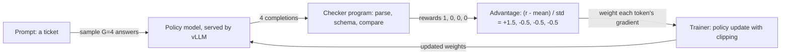
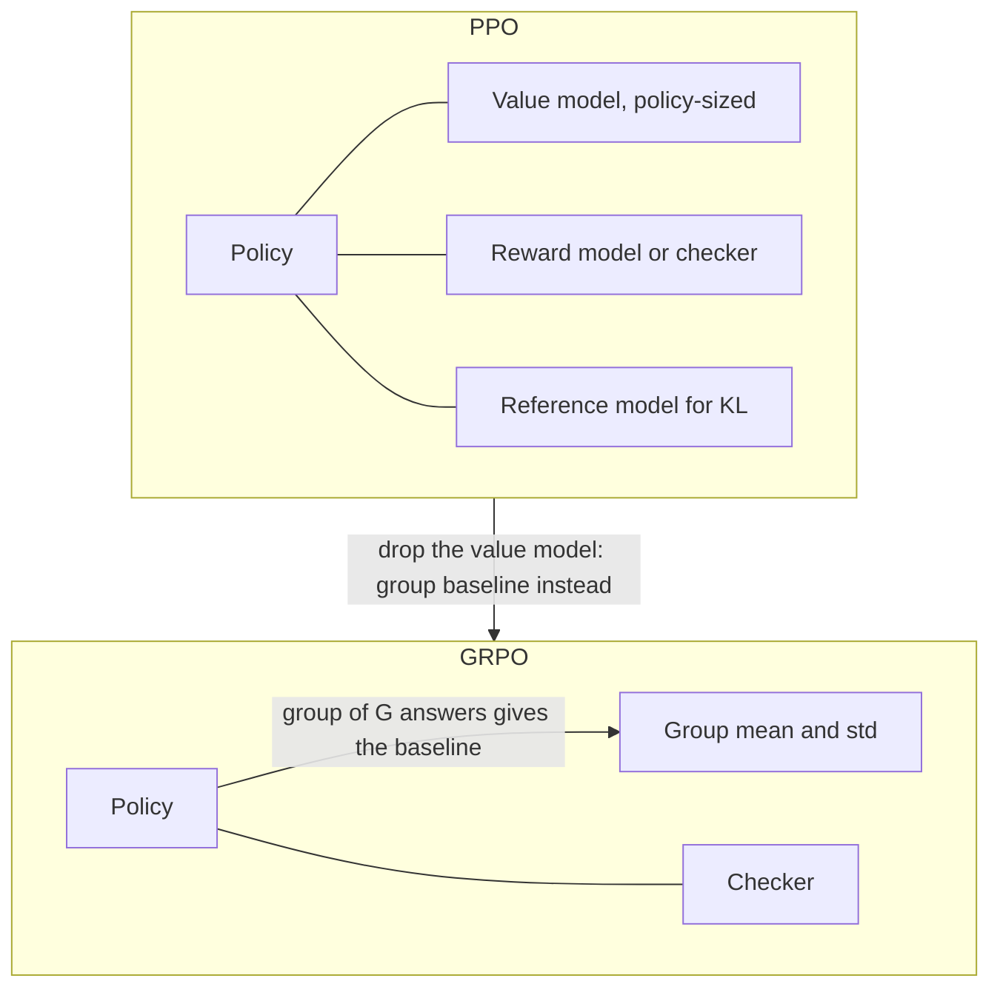

# Reinforcement learning with verifiable rewards: GRPO, RLOO and PPO

> **Key papers:** Shao et al., 2024, "DeepSeekMath" (introduces GRPO, [arXiv 2402.03300](https://arxiv.org/abs/2402.03300)); DeepSeek-AI, 2025, "DeepSeek-R1" ([arXiv 2501.12948](https://arxiv.org/abs/2501.12948)); Ahmadian et al., 2024, "Back to Basics" (RLOO, [arXiv 2402.14740](https://arxiv.org/abs/2402.14740)); Lambert et al., 2024, "Tulu 3" (names RLVR, [arXiv 2411.15124](https://arxiv.org/abs/2411.15124)); Dang and Ngo, 2025, small-model RL ([arXiv 2503.16219](https://arxiv.org/abs/2503.16219), preprint).
>
> **Scope:** training a model by letting it answer, scoring the answers with a program, and shifting it toward the higher-scoring ones. It covers the group-based methods (GRPO, RLOO) and contrasts them with PPO. It does not cover learned reward models in depth ([InstructGPT guide](../../../llm-learning-repository/tutorials/02-building/08-instructgpt.md)) or preference pairs ([06](./06-preference-tuning.md)).

Written 2026-11-26. TRL and Unsloth change monthly; each tool statement says what was read.

## Read this first

**The idea in one sentence.** If a program can check an answer (the JSON parses, the SQL returns the right rows, the tests pass), let the model try several answers to each question, reward the ones that pass, and update the model toward the winners, with no labelled "ideal answers" and no human preference data.

**Who this is for.** A team with a narrow task whose output can be checked by deterministic code, and a small language model (SLM) that gets the task right some of the time but not reliably.

**Afterwards you will be able to** compute a GRPO group advantage by hand, write a reward function in TRL's format, size a run's generation and training time, spot reward hacking, and judge the published evidence for small models, including which of it is preprint or vendor-reported.

**Reading time.** About 40 minutes. **Have read first:** [06 Preference tuning](./06-preference-tuning.md) (the offline cousin) and the [InstructGPT guide](../../../llm-learning-repository/tutorials/02-building/08-instructgpt.md) (RLHF and PPO). LoRA helps: the [LoRA guide](../../../llm-learning-repository/tutorials/02-building/09-lora.md).

**The one thing most people get wrong.** The model can only be rewarded for answers it actually produces. If it solves a prompt 0 times in 8 tries, that prompt teaches nothing. Reinforcement learning with verifiable rewards (RLVR) therefore sharpens skills a model partly has; it is poor at teaching a task from zero. Teams start it too early, on a base model that never passes the checker, and see a flat reward curve for days.

## The technique in one worked example

Constructed by this guide; numbers are checkable by hand. Task: turn a ticket into JSON with fields `intent` and `order_id`. Prompt: "Order 8841 arrived broken, want refund". The checker is a program, not a person: reward 1.0 if the output parses as JSON, has exactly those two fields, `intent` is in an allowed list and `order_id` equals "8841"; otherwise 0.

**Step 1, sample a group.** The model writes G = 4 answers at temperature 1.0:

| # | Output | Checker result | Reward |
|---|---|---|---|
| 1 | `{"intent":"refund","order_id":"8841"}` | passes | 1.0 |
| 2 | `{"intent":"refund","order":"8841"}` | wrong field name | 0.0 |
| 3 | `Refund order 8841.` | not JSON | 0.0 |
| 4 | `{"intent":"complaint","order_id":"8841"}` | wrong intent | 0.0 |

**Step 2, group-relative advantage.** Mean reward 0.25. Standard deviation: using the sample formula (divide by n - 1 = 3) it is 0.5; using the population formula it is 0.433. The advantage of each answer is (reward - mean) / std: with the sample std, answer 1 gets (1 - 0.25) / 0.5 = +1.5 and answers 2 to 4 each get (0 - 0.25) / 0.5 = -0.5. With the population std: +1.732 and -0.577. The TRL docs show the formula without saying which; this guide did not check the code.

**Step 3, update.** Every token of answer 1 is nudged to be more likely, weighted by +1.5; every token of answers 2 to 4 is nudged less likely, weighted by -0.5. No second model scored the answers and none estimated "how good is this state"; the other three answers served as the baseline. That is what removes PPO's value model (DeepSeekMath Section 4.1.1).

**Step 4, the leave-one-out cousin (RLOO).** Instead of the group mean, each answer's baseline is the mean of the others: answer 1 gets 1 - 0 = +1.0, each other answer gets 0 - (1/3) = -0.333. Same idea, different baseline, no division by the standard deviation.

**Step 5, when nothing happens.** If all four answers had passed, or all four failed, every advantage would be 0 and the prompt would give no signal. If the model's true pass rate on a prompt is 2 percent, the chance that at least one of 8 samples passes is 1 - 0.98^8 = 14.9 percent. At 25 percent it is 1 - 0.75^8 = 90.0 percent. This is why the choice of prompts, not only the algorithm, decides whether the run learns.



What to notice: this is a loop, and the model that writes the answers is the model being trained. Generation sits inside training, which is where the cost comes from.



What to notice: GRPO's saving is the value model. TRL's current default also drops the reference model by setting the KL coefficient to 0.0, which saves another copy.

## Words you need

| Term | Plain definition | In the worked example |
|---|---|---|
| Verifiable reward | A score computed by deterministic code that can be re-run and audited | The JSON checker returning 1.0 or 0.0 |
| Rollout / sample | One answer generated during training | Each of the four outputs |
| Group (G) | The set of answers sampled for the same prompt | G = 4 |
| Advantage | How much better an answer is than its baseline | +1.5 for answer 1 |
| Baseline | The reference score subtracted to reduce noise: group mean in GRPO, mean of the others in RLOO | 0.25 or 0 for the others |
| Policy | The model being trained | The SLM |
| PPO | Proximal Policy Optimization: needs a value model, reward signal and clipping | The left box of the second diagram |
| Clipping | Limiting how far one update can move the probabilities | TRL default epsilon 0.2 |
| KL penalty | A penalty for drifting from a reference model | TRL default beta 0.0 |
| Reward hacking | Scoring high on the checker without doing the real task | Output that satisfies the schema but copies a field from the prompt |
| Colocated vLLM | The inference engine runs inside the trainer process on the same GPU | `vllm_mode="colocate"` |

## Tutorial 1 - Intuitive understanding

### What was broken before

Supervised fine-tuning needs a correct answer for every training example, and writing them is the expensive part. Preference tuning ([06](./06-preference-tuning.md)) needs pairs. RLHF with PPO needs a reward model, a value model and a reference model beside the policy, which is heavy for a small team. Meanwhile many enterprise tasks already have a cheap, exact judge: a parser, a schema validator, a unit test, a SQL engine that can run the query and compare rows. The question is whether that judge alone can teach.

### The idea

**Analogy.** A coach for a free-throw shooter who cannot demonstrate a good shot but can see whether the ball went in. The shooter takes eight shots; the coach says "the two that went in, do more of that, the six that missed, less". The shooter finds a stance through trial, never being told one.

**Where the analogy breaks.** A shooter sees why a shot missed; the model only gets a number for the whole answer, spread over every token. A shooter who never makes a shot gets nothing to repeat; so too here, which is why a prompt the model always fails teaches nothing. And a coach who only watches the scoreboard can be fooled: the model may find a trick that raises the number without doing the job (reward hacking), which a human coach would notice.

### How it works, step by step

1. Choose prompts the model sometimes passes: some successes and some failures per prompt.
2. For each prompt, generate several answers (4 to 16 is typical, TRL's default is 8).
3. Score each with the checker.
4. Compare each answer to the others in its group; above-average answers get positive weight, below-average negative.
5. Update the model by a small, clipped step; repeat for hundreds of steps.
6. Evaluate on held-out prompts the training never saw, with the same checker and a second, independent check.

GRPO (Group Relative Policy Optimization) does step 4 using the group's mean and spread. RLOO (REINFORCE leave-one-out) uses the mean of the other answers. PPO uses a separate value model to estimate what a good answer is worth.

### What the evidence says

- **GRPO's origin (DeepSeekMath, Section 4.2, Table 5).** DeepSeekMath-RL 7B, trained with GRPO on about 144 thousand chain-of-thought questions, improved over the instruction-tuned starting model on GSM8K from 82.9 to 88.2 percent and on MATH from 46.8 to 51.7 percent. In plain terms, about 5 more problems in every 100 on each benchmark. RL settings: learning rate 1e-6, KL coefficient 0.04, 64 outputs per question, batch 1,024, maximum length 1,024.
- **Pure RL from a base model (DeepSeek-R1-Zero, Section 2.3, Table 3).** The paper reports AIME 2024 pass@1 rising from 15.6 percent to 77.9 percent in the current arXiv version (v2, January 2026), with majority voting reaching 86.7 percent. A model-card summary and the first version of the paper gave a lower figure, which this guide could not re-check, so treat 77.9 as the number in the version read. Rewards were rule-based: accuracy plus format (Section 2.2). Settings: learning rate 3e-6, KL coefficient 0.001, 16 outputs per question, 10,400 steps.
- **Small models by distillation (Hugging Face model card, DeepSeek-R1-Distill).** Models made by supervised fine-tuning a small base on 800 thousand samples curated with R1, no RL on the small model: AIME 2024 pass@1 of 28.9 percent (Qwen 1.5B), 55.5 (7B), 69.7 (14B), 72.6 (32B), 70.0 (Llama 70B). That is a model card, i.e. the developer's own table. The paper's comparison of distillation against RL on a small model was not located in the text read, so it is unverified here; see [08](./08-distillation.md).
- **Small-model RL on a budget (Dang and Ngo, abstract; preprint).** Starting from the distilled 1.5B model, GRPO on about 7,000 samples within 24 hours on four 48 GB GPUs raised AMC23 accuracy from 63 percent to 80 percent, with AIME24 at 46.7 percent, at a stated cost of about 42 dollars; the authors also report instability and length limits with longer training. Self-reported, a preprint, math only.
- **RLVR in a product recipe (Tulu 3, abstract).** The authors introduce RLVR as one stage of an open post-training recipe on Llama 3.1 bases; the abstract reports gains over instruct baselines but gives no stage-by-stage figure.

### What this does not show

Almost all of this evidence is maths or code, where checkers are cheap and exact. None of it tests an enterprise extraction task over messy private documents with a schema checker. The distilled-model numbers come from supervised copying of a very large teacher, not RL on the small model itself, so they show what is achievable with distillation. The small-model RL result begins from an already reasoning-tuned model. And the question of whether RL creates new capability or only makes existing answers more likely is open: one paper (arXiv 2506.14245, preprint) argues RLVR extends the reasoning boundary; this guide did not verify the counter-evidence it responds to.

### Teach-back

<details>
<summary>1. In the worked example, why did answer 1 get +1.5 and the others -0.5?</summary>

The mean reward is 0.25 and the sample standard deviation 0.5. Answer 1 is 0.75 above the mean, 0.75 / 0.5 = 1.5; the others are 0.25 below, -0.25 / 0.5 = -0.5.
</details>

<details>
<summary>2. Why does a prompt the model always fails teach nothing?</summary>

With all rewards equal, every advantage is zero, so there is no gradient signal. Nothing distinguishes any answer from the others.
</details>

<details>
<summary>3. What did GRPO remove compared with PPO?</summary>

The separate value model (about as large as the policy); the group's mean reward serves as the baseline instead. TRL's default also omits the reference model by setting beta to 0.0.
</details>

<details>
<summary>4. Why can a 100 percent checker pass rate on training prompts mislead?</summary>

The model may have found a loophole in the checker, or memorised the prompts. Only a held-out set with an independent check shows whether the skill is real.
</details>

## Tutorial 2 - Practitioner understanding

### The design in concrete terms

**Data.** A dataset with a `prompt` column (plain text or chat messages). Any other columns, such as `ground_truth` or `schema`, are passed to reward functions as keyword arguments (TRL docs).

**Reward functions (TRL docs).** A function accepting `prompts`, `completions`, `completion_ids` and any dataset columns via `**kwargs`, returning a list of floats, one per completion. Several functions are summed or weighted with `reward_weights`. Returning `None` for a sample skips that function for it. They may be `async` for slow checkers such as a SQL engine.

**Checkers that make good rewards.** Parsers and schema validators; unit tests run in a sandbox; SQL execution with result-set comparison; numeric answers compared within a tolerance; regular-expression format checks. Prefer several small rewards over one all-or-nothing score; Unsloth's guide advises breaking a goal into smaller verifiable rewards and warns that GRPO's default tendency is to learn only formatting unless you pre-fine-tune.

**GRPOConfig defaults (TRL docs read 2026-11-26).** `num_generations=8`, `max_completion_length=512`, `learning_rate=1e-6`, `beta=0.0` (the KL term and reference model are off; the docs note DeepSeek-R1 used 0.001), `epsilon=0.2`, `temperature=1.0`, `loss_type='dapo'` (token-level normalisation; the docs list `grpo`, `dr_grpo` and `sapo` as alternatives and say the original per-sequence form has a length bias), `scale_rewards='group'`, `use_vllm=False`, `vllm_mode='colocate'`, `vllm_gpu_memory_utilization=0.3`. The effective batch size must be divisible by `num_generations`.

**vLLM in the loop.** Generation dominates the time, so TRL can hand it to vLLM. Colocate mode runs vLLM inside the trainer process and shares the GPU, with possible memory contention; server mode runs vLLM on separate GPUs (`vllm_mode="server"`), which must differ from the trainer's. For memory trouble the docs suggest `vllm_enable_sleep_mode` and tuning `vllm_gpu_memory_utilization`. TRL's index lists `AsyncGRPOTrainer` as stable, running generation and training concurrently (read there; its tuning was not read).

**Unsloth.** Its RL guide covers GRPO with vLLM (`fast_inference=True`), and makes vendor claims: "5GB VRAM is enough" for models of 1.5B parameters or less, 15 GB for models up to 17B, Llama 3.1 8B at 20K context and 8 generations in 54.3 GB against 510.8 GB for a standard implementation, "at least 300 steps" before reward rises, at least 12 hours, and at least 500 data rows for best results. These are Unsloth's figures, not independently measured here.

**RLOO.** `RLOOTrainer` is listed among TRL's stable online methods; the paper's abstract says REINFORCE-style variants outperform PPO and offline methods such as DPO and RAFT (no numbers were read).

### A minimal version

Unrun. GRPO with a schema checker, LoRA, vLLM colocated. Input: rows with `prompt` and `order_id`. Output: an adapter directory.

```python
# UNRUN sketch; parameter names from the TRL GRPO page read 2026-11-26.
import json, re
from datasets import load_dataset
from peft import LoraConfig
from trl import GRPOConfig, GRPOTrainer

ALLOWED = {"refund", "exchange", "complaint"}

def json_reward(completions, order_id, **kwargs):
    # completions: list of message lists in conversational format
    out = []
    for comp, gt in zip(completions, order_id):
        text = comp[0]["content"].strip()
        try:
            obj = json.loads(text)
            ok = set(obj) == {"intent", "order_id"} and obj["intent"] in ALLOWED
            out.append(1.0 if ok and obj["order_id"] == gt else (0.2 if ok else 0.0))
        except Exception:
            out.append(0.0)       # unparseable
    return out

train = load_dataset("json", data_files="tickets.jsonl", split="train")
cfg = GRPOConfig(
    output_dir="out-grpo",
    num_generations=8, max_completion_length=256,
    per_device_train_batch_size=8, gradient_accumulation_steps=2,  # 16 divisible by 8
    learning_rate=1e-6, beta=0.0, use_vllm=True, vllm_mode="colocate",
    max_steps=300, bf16=True,
)
trainer = GRPOTrainer(model="my-org/ticket-sft-4b", reward_funcs=json_reward,
                      args=cfg, train_dataset=train,
                      peft_config=LoraConfig(r=16, target_modules="all-linear"))
trainer.train()
```

Check before running: the learning rate for LoRA is usually higher than 1e-6 (the TRL DPO page suggests about 1e-5 for adapters; no GRPO-specific figure was read), the 0.2 partial credit is a design choice, and `max_steps=300` echoes Unsloth's "at least 300 steps" advice.

### What it costs

Assumptions: 4B model; 16 prompts per step, 8 generations each = 128 completions per step; 512 generated tokens per completion and 300 prompt tokens; 1,000 steps; vLLM generation at 4,000 tokens per second (Unsloth's vendor figure for a 4-bit 3B model on an A100 40 GB; treat as optimistic); training at 4e14 sustained operations per second; $2.50 per GPU-hour. All of these are assumptions.

- **Generated tokens.** 128 x 512 x 1,000 = 65.5 million tokens; at 4,000 per second that is 16,384 seconds, 4.6 hours.
- **Training compute.** Tokens trained: 128 x 812 x 1,000 = 104 million. At 6 x N x T = 6 x 4e9 x 1.04e8 = 2.5e18 operations, 6,236 seconds at 4e14 per second, 1.7 hours.
- **Total** about 6.3 hours, about 16 dollars. Generation is roughly three quarters of it; the checker's time is extra (a SQL engine or test suite can dominate).
- **Memory.** With `beta=0.0` there is no reference model. Colocated vLLM takes a share of the GPU (default 0.3 of memory) beside the policy, adapter, optimiser state and activations; long completions raise it quickly.
- **The comparison that matters.** DeepSeek-R1-Zero used 16 outputs per question for 10,400 steps (Section 2.1); your run will be orders of magnitude smaller, and small-scale behaviour is not guaranteed to mirror theirs.
- **People time.** Writing and attacking the checker is the real work; budget days for it.

### How it fails

| Symptom | Likely cause | Mitigation |
|---|---|---|
| Reward flat near zero | The base model almost never passes; groups all zero | SFT first; add partial-credit rewards; pick prompts the model sometimes solves |
| Reward rises to near 1.0, held-out score flat | Reward hacking or memorised prompts | Independent held-out check; audit samples; harden the checker |
| Outputs get longer, then truncated | Length bias in the loss or reward (TRL docs on loss types; Dang and Ngo report length constraints) | Use `dapo` or `dr_grpo`; cap length; penalise overlong |
| Model learns only the format | Format reward easy, correctness reward rare | Staged rewards; pre-fine-tune on format (Unsloth advice) |
| Instability late in training | Prolonged training (Dang and Ngo) | Early stop on held-out score; keep checkpoints |
| Out of memory | Colocated vLLM plus long completions | Lower `vllm_gpu_memory_utilization`, shorter completions, server mode |
| Slow steps | Generation-bound or slow checker | vLLM, async rewards, asynchronous trainer |
| Checker passes bad answers | Under-specified check (schema valid but value copied) | Add semantic checks; adversarial tests of the checker itself |

### Evaluating your version

- **Metric.** The checker's pass rate on held-out prompts, plus a second independent measure (for SQL, results on a differently generated database; for extraction, human review of 50 samples); also mean output length and parse-failure rate.
- **Baseline.** The SFT model; and "SFT on rejection-sampled passes" (sample, keep winners, fine-tune), which often gets much of the gain with no RL machinery ([08](./08-distillation.md)).
- **Test set.** At least 300 held-out prompts from new sources; at 70 percent pass rate, 300 prompts give about plus or minus 5 points at 95 percent confidence (1.96 x sqrt(0.7 x 0.3 / 300) = 0.052).
- **Stop rule.** Evaluate every 50 steps; stop when held-out pass rate has not risen by 1 point in 3 evaluations or when training reward exceeds held-out by 15 points (gap threshold is this guide's suggestion).

### Adopt, adapt or skip

**Adapt, selectively.** For an enterprise SLM over private documents, RLVR fits where you have a deterministic checker and a model that already passes 10 to 60 percent of the time: structured extraction with schema validation, text-to-SQL against a test database, code generation with unit tests, tool-call formatting. It is a poor fit for open-ended writing and for tasks where the check is a judgement. Try cheaper routes first: prompting, constrained decoding, SFT on checked outputs, and rejection-sampled SFT. Move to GRPO when those plateau and you can afford a day of GPU time and a checker you trust. Treat any reward curve as untrustworthy until a held-out, independently checked set agrees.

## Tutorial 3 - Researcher understanding

### Formal setup

Prompt q, policy pi_theta, old policy pi_old (the one that generated the samples), G sampled outputs o_1..o_G, scalar rewards r_1..r_G from a checker, token t of output i written o_{i,t}.

- **GRPO advantage (Eq. 3, outcome supervision).** A_i = (r_i - mean(r)) / std(r), applied to every token of o_i.
- **Clipped objective.** Per token, ratio rho = pi_theta(o_{i,t}|...) / pi_old(o_{i,t}|...); maximise min(rho A_i, clip(rho, 1 - epsilon, 1 + epsilon) A_i) averaged over tokens and samples, with a KL penalty weighted by beta added to the loss rather than the reward (Section 4.1.1). TRL default epsilon is 0.2.
- **RLOO advantage.** A_i = r_i - (1 / (G - 1)) x sum_{j != i} r_j.
- **PPO.** Advantage from a learned value function V (a model of policy size), typically by generalised advantage estimation; reward includes a per-token KL term.
- **Toy numbers (constructed).** r = (1, 0, 0, 0): GRPO with sample std gives (1.5, -0.5, -0.5, -0.5); RLOO gives (1.0, -0.333, -0.333, -0.333); both advantages sum to zero across the group.

Normalisation variants matter. The TRL docs list `grpo` (per-sequence length average), `dapo` (token-level over the batch) and `dr_grpo` (constant divisor, recommended to be the maximum completion length), and say turning off std scaling means update size depends on raw reward scale.

### The claims, stated precisely

1. **GRPO (DeepSeekMath).** A group-relative baseline removes the value model, cutting PPO's memory, and improves a math-tuned 7B model's GSM8K from 82.9 to 88.2 and MATH from 46.8 to 51.7 (Section 4, Table 5).
2. **DeepSeek-R1-Zero.** Pure RL with rule-based rewards on a base model, without supervised data, yields large reasoning gains and emergent behaviours such as reflection (abstract, Section 2.3).
3. **RLOO.** REINFORCE-style variants outperform PPO and offline "RL-free" methods in RLHF at lower cost (abstract of arXiv 2402.14740).
4. **Small models.** A 1.5B distilled model gains on maths benchmarks from GRPO within 24 hours on four GPUs (abstract of arXiv 2503.16219, self-reported preprint).

### Evidence, table by table

- **DeepSeekMath Table 5** (rows: benchmarks GSM8K, MATH, MGSM-zh, CMATH; columns: Instruct 7B, RL 7B): 82.9 to 88.2, 46.8 to 51.7, 73.2 to 79.6, 84.6 to 88.8. Within one model family, before and after RL, so it identifies the effect of the RL stage on that model, not GRPO versus PPO. The extracted text gives no numeric PPO-versus-GRPO comparison; the paper's Figure 5 compares outcome and process supervision, with values not extracted here.
- **DeepSeek-R1 Table 3.** R1-Zero and R1: AIME 2024 pass@1 77.9 and 79.8; MATH-500 95.9 and 97.3; GPQA Diamond 75.8 and 71.5; LiveCodeBench 50.0 and 65.9. R1-Zero beating R1 on GPQA shows later stages are not uniformly better. These are on a very large model; the paper's pipeline stages (cold-start data, rejection sampling, second RL) mix several interventions, so the table associates, not isolates.
- **Distilled-model table (model card).** The Qwen 7B student at 55.5 AIME versus the R1-Zero numbers shows a gap between a 7B student and the teacher, but the comparison is cross-model.
- **Dang and Ngo.** Before-and-after on one 1.5B starting point with a compact dataset: AMC23 63 to 80 percent, AIME24 46.7 percent. No variance reported in the abstract; whether results hold across seeds is unverified.

### Ablations and what they isolate

DeepSeekMath compares outcome supervision (one reward per answer) with process supervision (reward per reasoning step) in Section 4.1.3 and Figure 5; the text I read says process supervision did better, with no numbers extracted. R1-Zero's Section 2.3 and Figure 9 track reflection words over training, an observational measure rather than an ablation. TRL's loss-type list is itself a record of ablation-by-community: each variant exists to fix a bias in the previous one (length, std scaling).

### Threats to validity

- **Domain.** Maths and code, with exact checkers.
- **Scale.** Teachers of hundreds of billions of parameters and datasets of 144 thousand questions; SLM runs of 7 thousand samples differ in kind.
- **Self-report.** Model cards, vendor docs and preprints (Dang and Ngo, Tulu 3 blog-style claims, Unsloth's VRAM and time figures) are not independent measurements.
- **Version drift.** The R1-Zero AIME headline differs between versions of the same paper.
- **Evaluation contamination.** Benchmark questions may overlap pretraining data; none of the sources read here rules it out.
- **Checker gaming.** Reported reward is the quantity being optimised; held-out independence is what the sources' benchmarks supply, but yours must supply it.

### Open problems and follow-ups

- Does RL expand what a model can solve, or increase the probability of what it could already solve? arXiv 2506.14245 argues the former with a reasoning-aware pass metric; the opposing evidence was not reviewed.
- Reward design for tasks between exact and subjective (rubrics, partial credit).
- Stable training at small scale and long horizons (Dang and Ngo report instability).
- Efficient asynchronous generation and training (TRL's `AsyncGRPOTrainer`).

### What would change my mind

I recommend RLVR only where a trusted checker exists and prior rungs have plateaued. I would recommend it more broadly if a controlled study on 1B to 8B models over enterprise-style schema or SQL tasks showed GRPO beating rejection-sampled SFT by at least 3 points at equal compute. I would recommend against it entirely for our class of task if replication showed gains vanish once the checker is replaced by an independent held-out check.

## Reading map for the key papers

| Paper section or figure | What it contains | Read, skim or skip | Where this guide answers the questions |
|---|---|---|---|
| DeepSeekMath Section 4.1 | GRPO definition, outcome and process supervision | Read | Worked example, Tutorial 3 formal setup |
| DeepSeekMath Section 4.2 and Table 5 | RL settings and results | Read | Tutorial 1 evidence |
| DeepSeek-R1 Sections 2.1 to 2.3 | R1-Zero rewards, settings, results | Read | Tutorial 1 evidence, Tutorial 3 tables |
| DeepSeek-R1 Section 3, Table 3 | Full pipeline and stage results | Skim | Tutorial 3 tables |
| DeepSeek-R1 distillation appendix | Student results (not read here) | Read in full | Tutorial 1 evidence (model card used instead) |
| RLOO paper (2402.14740) | REINFORCE variants versus PPO | Skim | Formal setup |
| Dang and Ngo (2503.16219) | Small-model GRPO on a budget | Skim | Tutorial 1 evidence, How it fails |
| TRL GRPO and RLOO pages | Defaults, reward signature, vLLM modes | Read | Tutorial 2 |

Other sources read for this guide: [TRL GRPO trainer](https://huggingface.co/docs/trl/main/en/grpo_trainer); [TRL RLOO trainer](https://huggingface.co/docs/trl/main/en/rloo_trainer); [TRL index](https://huggingface.co/docs/trl/main/en/index); [Unsloth RL guide](https://unsloth.ai/docs/get-started/reinforcement-learning-rl-guide); [DeepSeek-R1-Distill-Qwen-7B model card](https://huggingface.co/deepseek-ai/DeepSeek-R1-Distill-Qwen-7B); [arXiv 2506.14245](https://arxiv.org/abs/2506.14245).

## Questions readers get stuck on

**Is this the same as RLHF?** It is the same loop (sample, score, update) with a different judge. RLHF scores with a learned reward model trained on human comparisons; RLVR scores with deterministic code. That removes the reward model and its biases but restricts you to tasks code can judge.

**Why does GRPO divide by the standard deviation?** It puts advantages on a common scale so that a prompt where rewards differ by 0.1 is not drowned by one where they differ by 10. TRL's `scale_rewards` lets you disable it, and the docs warn that update size then depends on raw reward scale.

**Do I need a reference model?** TRL's default `beta=0.0` means no, and the docs say the reference model is then not loaded, saving memory. DeepSeekMath used a KL coefficient of 0.04 and R1-Zero 0.001. Without it nothing stops drift except clipping and your early stop.

**How many generations per prompt?** TRL defaults to 8; DeepSeekMath used 64 and R1-Zero 16. More samples give a better baseline and more chances of a success on hard prompts, at proportional generation cost.

**Why is generation the bottleneck?** Each step needs fresh answers from the current model, and generating a few hundred tokens per answer is slower per token than training. That is why TRL integrates vLLM, and why Unsloth quotes vLLM throughput.

**How do I know it is reward hacking?** Training reward climbs while a differently built held-out check does not, or sampled outputs look strange (empty fields, copied prompt text, repeated tokens). Read at least 30 random samples at several checkpoints; never trust the curve alone.

**GRPO versus RLOO versus PPO, which one?** For a small team start with TRL's GRPOTrainer, whose docs are the most extensive of the three. RLOO's paper claims simpler is enough in RLHF (abstract only). PPO needs the extra value model and is the heaviest. This guide has no evidence of one winning on your task.

**Is SFT on the model's own passing answers just as good?** Often, for a first gain, and it is far cheaper: sample, keep winners, fine-tune. RL adds the use of failures and iterative improvement, at the cost of a loop. Run rejection-sampled SFT first as the baseline.

**Can I run this on a laptop?** Unsloth claims 5 GB of VRAM for a 1.5B model (vendor claim). Time is the limit: its guide says at least 300 steps and at least 12 hours. This guide ran nothing.

## Prerequisites you actually need

### Prerequisite 1 - Mean, standard deviation and z-scores

A z-score is (value - mean) / std. Example: rewards 1, 0, 0, 0 have mean 0.25, sample std 0.5; the z-score of the 1 is 1.5. Here: that is the GRPO advantage.

### Prerequisite 2 - Policy gradient in one idea

To make a rewarded output more likely, move the weights in the direction that raises its probability, scaled by how much better than average it was. Example: an advantage of +1.5 pushes up the answer's token probabilities 3 times as hard as an advantage of +0.5. Here: every token of an answer shares its answer's advantage. Reference: [InstructGPT guide](../../../llm-learning-repository/tutorials/02-building/08-instructgpt.md).

### Prerequisite 3 - Sampling and temperature

At temperature 1.0 the model samples from its own distribution, so the same prompt gives different answers. Example: if 25 percent of answers pass, 8 samples include at least one pass with probability 1 - 0.75^8 = 90 percent. Here: RL needs this variety to find successes.

## Where this sits

**Read before:** [06 Preference tuning](./06-preference-tuning.md) and the [LoRA guide](../../../llm-learning-repository/tutorials/02-building/09-lora.md). **Read after:** [08 Distillation](./08-distillation.md); for serving and evaluation, [04 Build and deploy playbook](../04-build-and-deploy-playbook.md).

**Nearest techniques.** Preference tuning learns from stored pairs, offline and cheaply, but cannot go beyond the pairs; RLVR generates fresh answers and scores them, which needs a checker and costs generation time. Distillation learns from a stronger model's answers; RLVR needs no teacher but needs a model that sometimes succeeds. Rejection-sampled fine-tuning is RLVR's one-shot cousin: sample, filter by checker, fine-tune once.

## Checkpoint

<details>
<summary>1. Rewards for a group of 4 are (1, 1, 0, 0). Compute GRPO advantages with the sample std, and RLOO advantages.</summary>

Mean 0.5; sample std = sqrt(1/3) = 0.577. GRPO: (+0.866, +0.866, -0.866, -0.866). RLOO: for a 1, 1 - (1 + 0 + 0)/3 = +0.667; for a 0, 0 - (1 + 1 + 0)/3 = -0.667.
</details>

<details>
<summary>2. A prompt is passed 1 time in 100 by your model. With 8 generations, how likely is any signal?</summary>

1 - 0.99^8 = 7.7 percent. Most groups are all-zero and give no gradient; replace the prompt or add partial credit.
</details>

<details>
<summary>3. Write a reward function for text-to-SQL and name one way it could be hacked.</summary>

Run the SQL against a test database and compare result rows with the expected rows: 1.0 if equal, else 0. It can be hacked by a query that hard-codes the expected rows from the prompt or exploits a tiny database; mitigate with several databases and hidden tests.
</details>

<details>
<summary>4. Estimate generation time for 1,000 steps of 64 completions at 400 tokens each at 3,000 tokens per second.</summary>

64 x 400 x 1,000 = 25.6 million tokens; 25.6e6 / 3,000 = 8,533 seconds, 2.4 hours.
</details>

<details>
<summary>5. A reward curve hits 0.95 but held-out pass rate is flat. What do you do?</summary>

Assume hacking or memorisation: read samples, build an independent check, shrink the policy's freedom (shorter length, KL term), stop at the best held-out checkpoint.
</details>

<details>
<summary>6. Critique: "R1-Zero went from 15.6 to 77.9 on AIME, so RL will fix our extraction model."</summary>

The figure is for a very large base model on math with exact checking, from one version of a paper. It does not transfer to a small model on messy documents; it says nothing about your checker or your model's starting pass rate.
</details>
