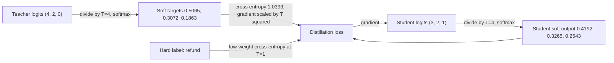
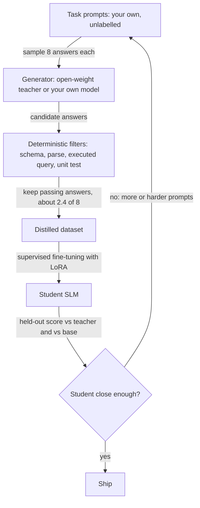

# Distillation: teaching a small model from a larger one

> **Key papers:** Hinton, Vinyals and Dean, 2015, "Distilling the Knowledge in a Neural Network" ([arXiv 1503.02531](https://arxiv.org/abs/1503.02531)); Sanh, Debut, Chaumond and Wolf, 2019, "DistilBERT" ([arXiv 1910.01108](https://arxiv.org/abs/1910.01108)); Gu, Dong, Wei and Huang, 2023, "MiniLLM" ([arXiv 2306.08543](https://arxiv.org/abs/2306.08543)); DeepSeek-AI, 2025, "DeepSeek-R1", whose released distilled models are the best-known recent LLM case ([arXiv 2501.12948](https://arxiv.org/abs/2501.12948)); Yuan et al., 2023, rejection-sampling fine-tuning ([arXiv 2308.01825](https://arxiv.org/abs/2308.01825)).
>
> **Scope:** the idea, the two main forms (matching a teacher's probabilities; training on a teacher's written answers), the legal point about whose outputs you may train on, and the filtered self-distillation variant that avoids it. It does not cover quantisation or pruning, which shrink the same model rather than train a new one.

Written 2026-11-26. This is not legal advice; licence and terms-of-service facts change and must be read from the provider at the time you use them.

## Read this first

**The idea in one sentence.** Use a stronger model (the teacher) to produce training signal, either its probability distributions or its written answers, and train a smaller model (the student) to imitate it on your task.

**Who this is for.** A team that has a large model doing the task well but too slowly, too expensively or too far from the data boundary, and wants a small model that runs where it must.

**Afterwards you will be able to** compute softened teacher probabilities by hand, explain why "dark knowledge" in the wrong answers helps, tell logit distillation from sequence-level distillation, decide which teachers you may legally use, and build a filtered, self-generated training set with deterministic checks.

**Reading time.** About 40 minutes. **Have read first:** [06 Preference tuning](./06-preference-tuning.md) and [07 RL with verifiable rewards](./07-rl-with-verifiable-rewards.md) help (rejection sampling is shared); the [LoRA guide](../../../llm-learning-repository/tutorials/02-building/09-lora.md) for how students are usually trained.

**The one thing most people get wrong.** Distillation does not remove the question "may I train on this model's outputs?". Hosted-model terms of service can restrict using outputs to train other models, and open-weight licences carry their own conditions. The technique is easy; the permission is the project risk. The safest teacher is one you may legally use: an open-weight model under a permissive licence, or your own model.

## The technique in one worked example

Constructed by this guide; arithmetic checkable by hand. Two parts: the classic form (Hinton) and the form used for language models (train on written answers, filtered).

**Part A, soft targets.** A teacher classifying a ticket into three classes (refund, exchange, complaint) outputs logits z = (4, 2, 0).

| Temperature T | Probabilities (refund, exchange, complaint) |
|---|---|
| 1 | 0.8668, 0.1173, 0.0159 |
| 4 | 0.5065, 0.3072, 0.1863 |
| 20 | 0.3672, 0.3322, 0.3006 |

Computation at T = 4: exp(4/4) = 2.718, exp(2/4) = 1.649, exp(0/4) = 1; sum 5.367; probabilities 0.5065, 0.3072, 0.1863 (Hinton Eq. 1: q_i = exp(z_i / T) / sum_j exp(z_j / T)). At T = 1 the teacher says "refund, nearly certain"; at T = 4 it also says "exchange is a lot more plausible than complaint". That ranking among the wrong answers is the extra information a hard label lacks.

A student with logits (3, 2, 1), softened at the same T = 4, gives (0.4192, 0.3265, 0.2543). Its cross-entropy against the teacher's soft targets is 1.0393. Hinton multiplies soft-target gradients by T squared (16 here) so their size stays comparable across temperatures, and mixes in a hard-label term at T = 1 with a lower weight; for the true class refund the student's softmax at T = 1 gives 0.6652, so that hard loss is -ln(0.6652) = 0.4077. (Section 2: weighted average of two cross-entropies, with a lower weight on the hard-label term.)

**Part B, sequence-level, with a filter.** Prompt: "Order 8841 arrived broken, want refund". The teacher (or the student itself) writes 8 candidate answers; a program checks each for valid JSON with the right fields. If the model's pass rate is 30 percent, the chance that at least one of 8 passes is 1 - 0.7^8 = 94.2 percent, and the expected number kept is 8 x 0.3 = 2.4. The kept answers become ordinary supervised fine-tuning examples: input the ticket, target the passing JSON. The student never sees the teacher's probabilities, only its text.



What to notice: both sides are softened by the same temperature; the temperature is a training-time tool and the deployed student runs at T = 1 (Hinton Section 2).



What to notice: the filter, not the teacher's authority, decides what the student learns. That is why this variant is both safer legally and often cleaner than raw teacher text.

## Words you need

| Term | Plain definition | In the worked example |
|---|---|---|
| Teacher | The larger or better model whose behaviour is copied | The model giving logits (4, 2, 0) |
| Student | The smaller model being trained | Logits (3, 2, 1) |
| Soft target | The teacher's full probability distribution, not just its top answer | 0.5065, 0.3072, 0.1863 |
| Temperature (T) | A divisor on logits before softmax; higher means flatter | T = 4 |
| Dark knowledge | The information in the relative sizes of the wrong answers' probabilities | Exchange more plausible than complaint |
| Logit distillation | Training the student to match the teacher's probabilities at each token | Part A |
| Sequence-level distillation | Training the student on text the teacher wrote | Part B |
| Rejection sampling | Generate many answers, keep only those that pass a check | The 2.4 of 8 kept |
| Self-distillation | The model (or its own earlier version) is its own teacher, usually with a filter | The "your own model" branch |
| Forward and reverse KL | Two ways to measure the gap between distributions: one makes the student cover everything the teacher does, the other makes it concentrate on the teacher's main modes | MiniLLM uses reverse KL |
| Terms of service (ToS) | The provider's contract on how you may use a hosted model and its outputs | Read before Part B with a hosted teacher |

## Tutorial 1 - Intuitive understanding

### What was broken before

Big models do the task but are costly to run, and a small model trained from scratch on your labels lacks the nuance. Hinton et al. put the problem in terms of deployment: an ensemble of models predicts better, but serving all of them is too expensive. A single small model trained only on hard labels learns less than it could, because a label says "refund" and nothing about how close "exchange" was.

For language models there is a second problem. Writing thousands of ideal answers by hand is slow. A strong model can write them quickly, which raises the new question this guide spends a section on: are you allowed to use them?

### The idea

**Analogy.** An apprentice learning from a master. Marking an apprentice's essay right or wrong teaches little; having them watch how the master weighs the alternatives ("this clause could be a refund or an exchange, but not a complaint") teaches much more, and an apprentice can also learn from a pile of the master's worked solutions.

**Where the analogy breaks.** An apprentice can ask why; a student model only copies outputs or probabilities, and copies the master's mistakes and habits with equal fidelity. An apprentice is bound by an employment contract that allows learning; a student model's training data may be covered by a contract that does not. And the student can match the teacher's style without matching its knowledge, so it can look as good as the teacher on easy inputs and fall off on unseen ones.

### How it works, step by step

1. Choose a teacher whose outputs you may legally use and that does the task well.
2. Gather prompts from your own task, not from a general benchmark.
3. Either record the teacher's probabilities (logit distillation) or have it write answers (sequence-level).
4. Filter: keep only what a deterministic checker accepts, where you can write one.
5. Fine-tune the student on this data, usually with LoRA.
6. Compare the student with the teacher and with the untouched base on held-out, never-seen inputs.

Logit distillation needs access to the teacher's probabilities and, in TRL's implementation, a teacher that shares the student's vocabulary. Sequence-level distillation needs only the teacher's text, so it works across model families, including hosted ones, which is exactly where the terms-of-service issue lies.

### What the evidence says

- **Hinton et al. (Section 3, Table 1).** On MNIST a large net made 67 test errors and a small net trained on hard labels made 146; the small net distilled from the large one made 74. In speech recognition (Table 1, Section 4), a baseline reached 58.9 percent frame accuracy and 10.9 percent word error; a ten-model ensemble 61.1 and 10.7; one distilled model 60.8 and 10.7, recovering over 80 percent of the ensemble's accuracy gain by the authors' count. With only 3 percent of the speech training data, soft targets gave 57.0 percent test frame accuracy against 44.5 percent for hard targets (Section 6, Table 5): out of every 100 frames, about 12.5 more were right.
- **DistilBERT (Sanh et al., Tables 1 to 3).** A student with half of BERT's layers, initialised from every second teacher layer, kept GLUE macro-score at 77.0 against BERT-base 79.5, with 66 million parameters against 110 million (40 percent smaller) and 410 seconds against 668 seconds for inference on one benchmark on CPU at batch size 1. The paper's abstract says it keeps 97 percent of language understanding (77.0 / 79.5 = 96.9 percent) and is 60 percent faster. Training took about 90 hours on eight 16 GB V100 GPUs (Section 3).
- **MiniLLM (Gu et al., Table 1).** For a LLaMA-13B teacher and LLaMA-7B student, reverse-KL distillation beat plain supervised fine-tuning and standard distillation on instruction-following sets: DollyEval GPT-4 score 76.4 against 73.0 for fine-tuning without distillation, and Rouge-L on DollyEval 29.0 against 26.3; the student exceeded the teacher on only two of the ten reported metrics.
- **DeepSeek-R1 distilled models (Hugging Face model card; developer-reported).** Small models fine-tuned on 800 thousand samples curated with R1 reach AIME 2024 pass@1 of 28.9 percent (Qwen 1.5B), 55.5 (7B), 69.7 (14B), 72.6 (32B) and 70.0 (Llama 70B). These came from supervised fine-tuning on the teacher's text, not logit matching.
- **Rejection-sampling fine-tuning (Yuan et al., abstract).** Pooling rejection samples from several models raised LLaMA-7B on GSM8K to 49.3 percent against 35.9 percent from supervised fine-tuning alone; the authors say weaker models gain more.

### What this does not show

Hinton's results are classification with the same input type, years before language models. DistilBERT's benchmark scores are for an encoder on classification, not generation. MiniLLM's evaluations use a GPT-4 judge and Rouge on instruction sets, and the student mostly stays below the teacher. The R1 table is the developer's own, on maths and code with exact checkers, and the teacher is a model of hundreds of billions of parameters unavailable on most infrastructure. None of these tests a private enterprise task, and none measures how much of the gain is lost when teacher outputs are filtered or when the teacher is a small open model.

### Teach-back

<details>
<summary>1. What extra information do soft targets carry that a hard label does not?</summary>

How the teacher ranks the wrong answers. With teacher probabilities (0.5065, 0.3072, 0.1863) the student learns that exchange is closer to refund than complaint is, which "refund" alone does not say.
</details>

<details>
<summary>2. Why do you divide the logits by a temperature during distillation?</summary>

At T = 1 the teacher is nearly certain (0.8668) and the other probabilities are tiny, so they carry little gradient. A higher T flattens the distribution so those relative sizes show up.
</details>

<details>
<summary>3. Which form works with a hosted teacher you can only call by API, and what is the catch?</summary>

Sequence-level distillation (train on its written answers), since it needs only text. The catch is that the provider's terms may restrict training on its outputs; read them first.
</details>

<details>
<summary>4. Why can filtering by a checker make the student better than the teacher on that task?</summary>

The checker removes the teacher's failures, so the student only imitates the teacher's passing answers; the training distribution is better than the teacher's average output.
</details>

## Tutorial 2 - Practitioner understanding

### The design in concrete terms

**Logit distillation, classic.** Loss = alpha x T squared x KL(soft teacher at T, soft student at T) + (1 - alpha) x cross-entropy(hard label, student at T = 1), with a lower weight on the hard term (Hinton Section 2). In speech experiments the hard-target weight was 0.5 and the temperature was chosen from 1, 2, 5, 10, with 2 best (Section 4); for MNIST the transfer used T = 20 (Section 3).

**DistilBERT recipe (Section 2, 3).** Triple loss: distillation (soft target cross-entropy), masked-language-modelling and cosine embedding between hidden states; student layers halved and initialised from alternate teacher layers; same temperature for teacher and student, T = 1 at inference. Table 4 ablation of GLUE macro-score: dropping the distillation and cosine terms (keeping only masked language modelling) cost 2.96 points, and the triple loss with random initialisation cost 3.69.

**TRL's `DistillationTrainer` (docs read 2026-11-26).** The TRL index lists `DistillationTrainer` under stable knowledge distillation, with `GKDTrainer`, `GOLDTrainer`, `SDFTTrainer` and others under experimental. It implements on-policy distillation (Agarwal et al., arXiv 2306.13649): the student generates completions, optionally with vLLM, and is trained to match the teacher's next-token distribution on them, using a chunked generalised Jensen-Shannon divergence. The key setting is `beta` in `DistillationConfig` (default 1.0): 0.0 gives forward KL, 1.0 reverse KL, 0.5 the standard Jensen-Shannon; unlike GRPO's beta it picks the divergence and there is no reference-model penalty. Other defaults: `learning_rate=1e-6`, `max_completion_length=512`, `temperature=1.0`, `use_vllm=False`. **Every teacher must share the student's vocabulary**, so cross-family logit distillation is not available there.

**Sequence-level, the simple route.** Generate answers, filter, fine-tune with ordinary SFT (`SFTTrainer`, LoRA). It works across model families and across vocabularies, because only text moves. This is how the R1-distilled models were produced according to their model card (800 thousand samples, fine-tuning only).

**Rejection sampling and self-distillation.** For a task with a checker, sample k answers per prompt from the teacher or from your own SFT model, keep those that pass, and fine-tune. In the rejection-sampling fine-tuning paper this lifted LLaMA-7B on GSM8K from 35.9 to 49.3 percent when samples from several models were combined (abstract). This is the enterprise-safe variant: no hosted teacher is needed, so no outside terms apply, only your model's own licence.

**Data shape.** Chat-format JSON lines: `{"messages": [{"role": "user", "content": "..."}, {"role": "assistant", "content": "{\"intent\":\"refund\",\"order_id\":\"8841\"}"}]}`. Keep the system prompt and chat template identical between training and serving.

### A minimal version

Unrun. Rejection-sampled self-distillation with a schema checker, then LoRA SFT. Input: unlabelled prompts; output: a filtered dataset and an adapter.

```python
# UNRUN sketch. Requires vllm, trl, peft, datasets.
import json
from vllm import LLM, SamplingParams

llm = LLM("my-org/ticket-sft-4b")          # or an open-weight teacher you may use
params = SamplingParams(n=8, temperature=1.0, max_tokens=256)
prompts = [json.loads(l)["prompt"] for l in open("prompts.jsonl")]
outs = llm.chat([[{"role": "user", "content": p}] for p in prompts], params)

ALLOWED = {"refund", "exchange", "complaint"}
def passes(text, order_id):
    try:
        o = json.loads(text)
        return set(o) == {"intent", "order_id"} and o["intent"] in ALLOWED and o["order_id"] == order_id
    except Exception:
        return False

rows = []
for rec, out in zip(map(json.loads, open("prompts.jsonl")), outs):
    good = [c.text for c in out.outputs if passes(c.text, rec["order_id"])]
    if good:                                 # keep one passing answer per prompt
        rows.append({"messages": [{"role": "user", "content": rec["prompt"]},
                                  {"role": "assistant", "content": good[0]}]})
json.dump(rows, open("distilled.json", "w"))
print(len(rows), "of", len(prompts), "prompts kept")

# Then, in a separate script:
# from trl import SFTTrainer, SFTConfig; from peft import LoraConfig
# SFTTrainer(model="my-org/ticket-sft-4b", train_dataset=load_dataset("json", data_files="distilled.json", split="train"),
#            args=SFTConfig(output_dir="out-distill", learning_rate=2e-4, num_train_epochs=2),
#            peft_config=LoraConfig(r=16, target_modules="all-linear")).train()
```

The vLLM `chat` call and the `SFTTrainer` signature follow the libraries' public APIs as this guide remembers them; neither was run or re-checked against current docs, so verify before use. The SFT learning rate of 2e-4 is a common LoRA starting point (this guide's recollection, not from a source read).

### What it costs

Assumptions: 20,000 prompts, 8 samples each, 300 generated tokens per sample; a self-hosted teacher generating 1,500 tokens per second on one GPU at $2.50 per hour (assumptions); a 4B student trained for 3 epochs on the kept data.

- **Generation.** 20,000 x 8 x 300 = 48 million tokens; at 1,500 per second that is 32,000 seconds, 8.9 hours, about $22. (For one sample per prompt instead of eight: 6 million tokens, 1.1 hours, about $2.80.)
- **Training the student.** If 60 percent of prompts yield an answer and each example is about 600 tokens including the prompt: 12,000 x 600 = 7.2 million tokens per epoch, 21.6 million over three epochs; 6 x 4e9 x 21.6e6 = 5.2e17 operations, at an assumed 4e14 per second about 1,300 seconds, 22 minutes.
- **Checker and data work.** The real cost: writing checkers, deduplicating prompts, auditing samples. Compute is tens of dollars; people time is the budget.
- **Logit distillation memory.** Both models must be in memory at once: a 4B student plus a 32B teacher in bf16 is 8 + 64 = 72 GB of weights before activations (2 bytes per parameter). TRL's chunked loss avoids materialising the full vocabulary tensor (docs).
- **Versus hosted-API teachers.** Token prices are provider- and date-specific and were not checked here; cost is secondary to the terms question.

### How it fails

| Symptom | Likely cause | Mitigation |
|---|---|---|
| Student matches teacher on training prompts, not on real ones | Prompt set unlike production | Sample prompts from real traffic types; hold out whole sources |
| Student inherits the teacher's errors and style | Unfiltered imitation | Filter by deterministic checks; audit samples |
| Student cannot be trained with logit distillation | Teacher and student vocabularies differ | Use sequence-level, or pick a same-family teacher |
| Student worse than base on other tasks | Narrow data, forgetting | LoRA, mix some general data, regression set |
| Terms or licence problem found late | Teacher outputs restricted | Decide the teacher and read the terms before generating |
| Short, truncated, or repetitive student output | Exposure mismatch between teacher-forced training and free generation (MiniLLM's argument) | On-policy distillation; teacher-mixed sampling |
| Few prompts survive the filter | Teacher pass rate too low | Easier prompts; better teacher; few-shot examples in the prompt |
| Benchmark score high, users unhappy | Judge-based or contaminated evaluation | Deterministic held-out set from real inputs |

### Evaluating your version

- **Metric.** The task's deterministic score on held-out real inputs; parse-failure rate; mean output length.
- **Baselines.** The untouched base with a good prompt; the SFT student trained on human labels if you have any; the teacher. Report the student as a fraction of teacher score and as points over base.
- **Test set.** At least 300 held-out inputs from sources absent from distillation prompts; at 80 percent pass rate the 95 percent interval is about plus or minus 4.5 points (1.96 x sqrt(0.8 x 0.2 / 300) = 0.045).
- **Stop rule.** Before training, fix a target (for example student within 5 points of teacher); stop adding data when two doublings of data move the held-out score less than 1 point; if the student cannot get within 10 points after two rounds, switch the teacher, the task decomposition or the approach.

### Adopt, adapt or skip

**Adapt, with the filter and the licence first.** For an enterprise building an SLM over private documents, distillation's best form is rejection-sampled self-distillation: your own SFT model or a permissively licensed open-weight teacher generates, a deterministic checker filters, LoRA fine-tuning trains the student. Do not distil from a hosted model's outputs until the provider's current terms, read in full by someone accountable, permit it for your use; this guide quotes no clause and none should be assumed. Check the licence of every open-weight teacher too: permissive licences such as Apache 2.0 and MIT are simplest, and the R1 distilled models' own card lists MIT, derived from Qwen bases it lists as Apache 2.0 (read from the model card; confirm the field yourself). Skip logit distillation unless teacher and student share a vocabulary and you have the memory for both. Skip distillation altogether when a retrieval or SFT-on-human-labels approach already meets the target.

## Tutorial 3 - Researcher understanding

### Formal setup

Teacher distribution p_T(y | x), student p_S(y | x; theta), temperature T, logits z.

- **Softened distribution.** q_i(T) = exp(z_i / T) / sum_j exp(z_j / T). Toy: z = (4, 2, 0), T = 4 gives (0.5065, 0.3072, 0.1863).
- **Hinton loss.** L = T squared x CE(q_T^teacher, q_T^student) + lambda x CE(y_hard, q_1^student); gradient scaling by T squared keeps magnitudes comparable (Section 2).
- **Matching logits (Section 2.1).** At high T with zero-mean logits, the objective approaches minimising one half of the squared difference of logits.
- **Sequence-level.** Minimise the standard negative log-likelihood of teacher-written sequences y ~ p_T(. | x), possibly filtered by an indicator f(x, y) in {0, 1}. This is supervised fine-tuning on a filtered, sampled dataset.
- **Reverse versus forward KL.** Forward KL(p_T || p_S) forces the student to put mass wherever the teacher does; reverse KL(p_S || p_T) lets a small student concentrate on the teacher's main modes (MiniLLM, abstract). In TRL, `beta=0` forward, `beta=1` reverse.
- **Filtered yield.** With pass probability p per sample and k samples, the chance of at least one keep is 1 - (1 - p)^k; toy p = 0.3, k = 8 gives 0.942.

### The claims, stated precisely

1. **Hinton.** Soft targets from a large model or ensemble transfer most of its accuracy to a single small model (Table 1) and act as a regulariser when data are scarce (Table 5).
2. **DistilBERT.** Distilling BERT during pre-training with a triple loss gives a model 40 percent smaller retaining 97 percent of GLUE performance (abstract, Tables 1 and 3).
3. **MiniLLM.** For generative language models, reverse KL optimised on-policy produces better students than forward-KL distillation, with less exposure bias (abstract, Table 1).
4. **R1 distillation.** Training small models on a large reasoning model's curated text yields strong maths and code performance (model card table, developer-reported).
5. **Rejection sampling.** Filtering sampled reasoning paths by correctness and fine-tuning on them improves smaller models, more so for weaker ones (abstract of arXiv 2308.01825).

### Evidence, table by table

- **Hinton Table 1** (speech: baseline, ten-model ensemble, distilled; frame accuracy and word error). 58.9 / 61.1 / 60.8 and 10.9 / 10.7 / 10.7. The distilled student recovers most of the ensemble's gain. One task, one dataset size; no seed variation reported in the extract read. The MNIST numbers (67, 146, 74 errors) identify the benefit of soft targets for a small net on one dataset.
- **Hinton Table 5** (3 percent of data): 57.0 versus 44.5 percent. This isolates the regularising effect of soft targets from compression.
- **DistilBERT Tables 1 to 4.** GLUE macro 68.7 (ELMo), 79.5 (BERT-base), 77.0 (DistilBERT); IMDb 93.46 and 92.82; SQuAD EM and F1 81.2 / 88.5 against 77.7 / 85.8 (79.1 / 86.9 with a second distillation step); parameters and CPU inference time 110M / 668 s against 66M / 410 s. The STS-B inference time is not a quality measure and the caption mislabels STS-B as sentiment. Table 4 is an ablation (below).
- **MiniLLM Table 1** (teacher LLaMA-13B, student LLaMA-7B). Teacher DollyEval 79.0 GPT-4 and 29.7 Rouge-L; fine-tuned student 73.0 and 26.3; KD 73.7 and 27.4; SeqKD 73.6 and 27.5; MiniLLM 76.4 and 29.0. Judge-scored and Rouge on instruction data. The exposure-bias analysis (Figure 6) uses GPT-2 models, not LLaMA, so it does not directly support the LLaMA rows.
- **R1 distilled table (model card).** The 1.5B to 70B rows are a size curve, not a controlled ablation: base models differ between families.
- **Rejection sampling (abstract only).** 49.3 versus 35.9 percent on GSM8K: associational across data sources; the paper's tables were not read.

### Ablations and what they isolate

DistilBERT Table 4 (change in GLUE macro-score): removing the cosine and masked-language-modelling terms (distillation only) -2.96; removing distillation and masked-language-modelling (cosine only) -1.46; removing distillation and cosine (masked-language-modelling only) -0.31; triple loss with random student initialisation -3.69. So initialisation from teacher layers matters more than any single loss term, and each loss adds on top of the plain task loss. Hinton's omitted-class MNIST experiment isolates what soft targets transmit: a student never shown 3s still got 98.6 percent of test 3s right after a bias correction, evidence that the soft targets carry class structure.

### Threats to validity

- **Teacher quality and leakage.** The student cannot exceed what the teacher's data contain, except through filtering; teacher benchmark contamination passes to the student.
- **Judge and metric choice.** MiniLLM relies on GPT-4 scoring and Rouge.
- **Developer-reported results.** The R1 table is the model card's; third-party reproductions have reported somewhat different numbers on a related model (a search summary, not checked at the source).
- **Incomparable baselines across papers.** Different sizes, tasks and years.
- **Legal confounding.** Public distilled datasets may carry terms of the teacher that generated them.
- **Narrow tasks.** None of these papers addresses an enterprise extraction task with private documents.

### Open problems and follow-ups

- Logit distillation across different vocabularies (TRL requires shared vocabularies).
- When on-policy distillation beats sequence-level on small students for narrow tasks.
- How much filtering to apply: yield versus diversity.
- Related work not read for this guide: generalized knowledge distillation (Agarwal et al., arXiv 2306.13649, abstract read via the TRL page); MiniLLM's code and data; Hinton's specialist ensembles (Section 5).

### What would change my mind

I recommend filtered self-distillation first and logit distillation rarely. I would favour logit distillation if a controlled comparison on 1B to 8B students over enterprise-style structured tasks showed it beating filtered sequence-level fine-tuning by more than 3 points at equal prompts. I would loosen the caution on hosted teachers only after reading the provider's current terms and getting a written answer from counsel, not from any summary.

## Reading map for the key papers

| Paper section or figure | What it contains | Read, skim or skip | Where this guide answers the questions |
|---|---|---|---|
| Hinton Section 2 | Temperature, soft targets, loss, T squared scaling | Read | Worked example, Tutorial 3 formal setup |
| Hinton Sections 3 and 4, Table 1 | MNIST and speech results | Read | Tutorial 1 evidence |
| Hinton Section 5 (specialists) | Ensembles with specialist models | Skip | Open problems |
| Hinton Section 6, Table 5 | Soft targets as regulariser | Skim | Tutorial 3 tables |
| DistilBERT Sections 2 and 3 | Triple loss, initialisation | Read | Tutorial 2 design |
| DistilBERT Tables 1 to 4 | GLUE, speed, ablation | Read | Tutorial 3 tables, ablations |
| MiniLLM Sections 2 and 3 | Reverse KL, on-policy optimisation | Skim | Formal setup |
| MiniLLM Table 1 and Figure 6 | LLaMA results; exposure bias | Skim | Tutorial 3 tables |
| R1 distillation appendix | Student training details (not read here) | Read in full | Tutorial 1 evidence (model card used) |

Other sources read for this guide: [TRL DistillationTrainer docs](https://huggingface.co/docs/trl/main/en/distillation_trainer); [TRL index](https://huggingface.co/docs/trl/main/en/index); [DeepSeek-R1-Distill-Qwen-7B model card](https://huggingface.co/deepseek-ai/DeepSeek-R1-Distill-Qwen-7B); [on-policy distillation, arXiv 2306.13649](https://arxiv.org/abs/2306.13649); [Hinton et al. HTML text](https://arxiv.org/html/1503.02531).

## Questions readers get stuck on

**Is distillation the same as fine-tuning on a teacher's outputs?** Partly. Training on a teacher's written answers is sequence-level distillation and is ordinary supervised fine-tuning with a particular data source. Hinton's version instead matches the teacher's probabilities, which carries more information per example but needs the teacher's logits.

**Why does a small model trained on soft targets beat one trained on labels?** The soft targets say how plausible each wrong answer is. In Hinton's speech experiment, soft targets with 3 percent of the data reached 57.0 percent frame accuracy against 44.5 percent for hard labels, so they also act as a regulariser.

**What temperature should I use?** Hinton used 20 on MNIST and picked 2 from {1, 2, 5, 10} for speech, so it depends on the task. Treat it as a hyper-parameter to sweep; the T squared factor keeps gradient sizes comparable across values.

**Can I distil from a hosted frontier model?** That is a contract question, not a technical one. Hosted-model terms can restrict using outputs to train other models; some may not. This guide did not verify any provider's wording; read the provider terms as they stand when you generate the data, and keep a record of the version you read. The safe default is an open-weight teacher under a permissive licence, or your own model.

**Does an open-weight teacher remove the problem?** It changes it. Open-weight licences range from permissive (Apache 2.0, MIT) to custom ones with attribution and use conditions that can carry into derivatives. Check each licence and record it; the model card's licence field is the starting point.

**What is "rejection sampling" here, and why is it the enterprise-safe variant?** Sample several answers from a model you may use, keep only those that pass a deterministic check, and fine-tune on the keepers. No outside provider's outputs are involved if the generator is your own model, and the filter, not the generator, defines quality.

**Why must teacher and student share a vocabulary for logit distillation?** The loss compares probability distributions token by token over the same vocabulary. TRL's DistillationTrainer states that every teacher must share the student's vocabulary. Sequence-level distillation sidesteps this because it passes text.

**How is on-policy distillation different?** The student writes the completions and the teacher scores them token by token, so training covers the student's own mistakes. The method (generalized knowledge distillation) and the TRL trainer follow Agarwal et al.; MiniLLM makes a similar argument about exposure bias.

**Do distilled students beat the teacher?** Rarely. In MiniLLM's LLaMA table the student passed the teacher on two of ten metrics. With a checker filter a student can beat the teacher's average on that task, because it learns only from passing answers.

**Is the R1 result evidence that I should distil from the biggest model available?** It shows what is possible with a very strong teacher on maths and code with exact checkers (developer-reported). It says nothing about licence suitability or your task.

## Prerequisites you actually need

### Prerequisite 1 - Softmax and temperature

Softmax turns scores into probabilities that sum to 1. Dividing scores by T first flattens them. Example: scores (4, 2, 0): T = 1 gives (0.867, 0.117, 0.016); T = 4 gives (0.507, 0.307, 0.186). Here: Hinton's soft targets. Reference: the [Transformer guide](../../../llm-learning-repository/tutorials/01-foundations/01-transformer.md).

### Prerequisite 2 - Cross-entropy and KL divergence

Cross-entropy measures how surprised a model is by the right distribution. KL divergence is cross-entropy minus the target's own entropy; it is zero only when the two distributions match. Example: if the teacher says (0.5, 0.5) and the student says (0.9, 0.1), the student is penalised on the second class: KL = 0.5 ln(0.5 / 0.9) + 0.5 ln(0.5 / 0.1) = -0.294 + 0.805 = 0.511. Here: the distillation loss.

### Prerequisite 3 - Supervised fine-tuning with LoRA

The student is trained on (prompt, answer) pairs by ordinary next-token loss, usually with a LoRA adapter. See the [LoRA guide](../../../llm-learning-repository/tutorials/02-building/09-lora.md) and [01 Options and trade-offs](../01-options-and-trade-offs.md).

### Prerequisite 4 - Probability of at least one success

If each attempt succeeds with probability p, then k attempts give at least one success with probability 1 - (1 - p)^k. Example: p = 0.3, k = 8 gives 0.942. Here: how many candidates to sample before filtering.

## Where this sits

**Read before:** [06 Preference tuning](./06-preference-tuning.md) and [07 Reinforcement learning with verifiable rewards](./07-rl-with-verifiable-rewards.md), whose sample-and-filter idea reappears here; and the [LoRA guide](../../../llm-learning-repository/tutorials/02-building/09-lora.md). **Read after:** [04 Build and deploy playbook](../04-build-and-deploy-playbook.md) for evaluation, governance and serving, and [01 Options and trade-offs](../01-options-and-trade-offs.md), whose distillation row this expands.

**Nearest techniques.** Plain supervised fine-tuning learns from human-written answers; distillation learns from a model's. Reinforcement learning with verifiable rewards uses the same checker but lets the model improve itself over many rounds; rejection-sampled distillation is its one-round version. Quantisation and pruning shrink an existing model without training a new student.

## Checkpoint

<details>
<summary>1. Compute softened probabilities for logits (2, 1, 0) at T = 1 and T = 2.</summary>

T = 1: exp values 7.389, 2.718, 1; sum 11.107; probabilities 0.665, 0.245, 0.090. T = 2: exp(1) = 2.718, exp(0.5) = 1.649, 1; sum 5.367; probabilities 0.506, 0.307, 0.186.
</details>

<details>
<summary>2. Your teacher passes 20 percent of prompts per sample. How many samples per prompt for a 95 percent chance of at least one keeper?</summary>

Need 1 - 0.8^k at least 0.95, so 0.8^k at most 0.05: k at least ln(0.05) / ln(0.8) = 13.4, so 14 samples (1 - 0.8^14 = 0.956).
</details>

<details>
<summary>3. Estimate generation time for 10,000 prompts, 4 samples, 250 tokens each at 2,000 tokens per second.</summary>

10,000 x 4 x 250 = 10 million tokens; 10e6 / 2,000 = 5,000 seconds, about 1.4 hours.
</details>

<details>
<summary>4. A colleague proposes distilling from a hosted model because "everyone does". What do you require first?</summary>

The provider's current terms, read in full by the accountable person, with a record of the version read and a written decision on whether training a model on outputs is permitted for your use; otherwise use an open-weight teacher under a permissive licence or your own filtered samples.
</details>

<details>
<summary>5. Why can a student trained with a checker filter beat the unfiltered teacher on that task?</summary>

The filter keeps only passing outputs, so the student imitates the teacher's successes and never its failures, raising the expected quality of the training targets above the teacher's average output.
</details>

<details>
<summary>6. Critique: "DistilBERT keeps 97 percent of BERT, so a 4B student will keep 97 percent of a 70B teacher."</summary>

DistilBERT's figure is GLUE macro-score for an encoder on classification, with a student half the teacher's depth. It does not transfer to generation, to a 17-fold gap in size, or to a private task; measure on your own held-out set.
</details>
