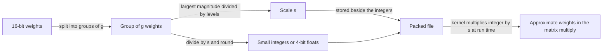
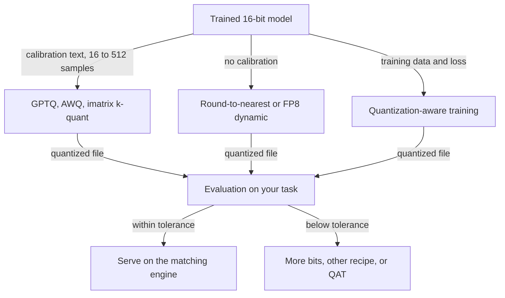

# Quantization: post-training (PTQ) and quantization-aware training (QAT)

> **Key papers:** Frantar, Ashkboos, Hoefler and Alistarh, 2022, GPTQ - [arXiv 2210.17323](https://arxiv.org/abs/2210.17323). Lin, Tang, Tang, Yang, Chen, Wang, Xiao, Dang, Gan and Han, 2023, AWQ - [arXiv 2306.00978](https://arxiv.org/abs/2306.00978). NVIDIA and others, 2025, "Pretraining Large Language Models with NVFP4" (preprint) - [arXiv 2509.25149](https://arxiv.org/abs/2509.25149). Li and 396 co-authors (Apple), 2025, Apple Intelligence Foundation Language Models tech report (vendor report) - [arXiv 2507.13575](https://arxiv.org/abs/2507.13575). Tool sources: llama.cpp k-quants pull request 1684 and quantize README, vLLM quantization docs, NVIDIA NVFP4 blog, Google Gemma 3 QAT blog.
>
> **Scope:** storing weights and the key-value cache in fewer bits, which format runs where, the quality cost and how to measure it on your task. Not covered: low-precision pretraining (the NVFP4 paper is used only for the format definition), pruning, distillation.

Written 2026-11-26. Tool support and model-card numbers change monthly; each fact says where it came from.

## Read this first

**The idea in one sentence.** Store each weight in 4 or 8 bits instead of 16, so the model needs a quarter to a half of the memory (this guide's arithmetic) and reads fewer bytes per token, and accept a small, measurable loss of quality (sizes in the evidence below).

**Who it is for.** Anyone who will serve a small language model (SLM) on a laptop, a modest GPU or a phone, or who will download a quantized file and must decide whether to trust it.

**Afterwards you will be able to** compute the memory of a quantized model including scale overhead; say why a long context can use more memory than the weights; pick a format for a given engine and chip; and test whether a quantized file is good enough for your task.

**Reading time.** About 40 minutes; Tutorial 1 alone is about 12. **Have read first:** [03 Vehicles](../03-vehicles.md). **Useful:** the [LoRA guide](../../../llm-learning-repository/tutorials/02-building/09-lora.md), because "merge before you quantize" depends on it.

**The one thing most people get wrong.** **Judgment:** "4-bit" is not a property of a model. It is a property of one file, made by one recipe with one calibration set, run by one engine kernel. Two "Q4" files of the same model can differ on your task, and a good public score for the 16-bit model proves neither. The second error is counting only weights: the key-value (KV) cache grows with context and users and is often the larger number.

## The technique in one worked example

Constructed by this guide; the arithmetic was run in numpy.

### Part A - eight weights, two ways

Eight weights from one matrix row: `[0.9, -0.3, 0.05, 1.2, -6.0, 0.6, -0.1, 0.4]`. The -6.0 is an outlier. Store each as an integer from -7 to 7 plus a scale.

**One scale for all eight.** Scale = 6.0 / 7 = 0.857; each weight becomes `round(w / 0.857)`:

| Weight | 0.9 | -0.3 | 0.05 | 1.2 | -6.0 | 0.6 | -0.1 | 0.4 |
|---|---|---|---|---|---|---|---|---|
| Stored integer | 1 | 0 | 0 | 1 | -7 | 1 | 0 | 0 |
| Read back | 0.857 | 0 | 0 | 0.857 | -6.0 | 0.857 | 0 | 0 |
| Absolute error | 0.043 | 0.3 | 0.05 | 0.343 | 0 | 0.257 | 0.1 | 0.4 |

The outlier is exact but the others collapse; average error is about 0.187.

**One scale per group of four.** Group one `[0.9, -0.3, 0.05, 1.2]` gets scale 1.2 / 7 = 0.171 and reads back `[0.857, -0.343, 0, 1.2]` (errors up to 0.05); group two is unchanged. Average error falls to about 0.112. A 16-bit scale per four weights would add 16 / 4 = 4 bits per weight, doubling the 4-bit cost to 8, so real formats use larger groups (16 in [NVFP4](https://developer.nvidia.com/blog/introducing-nvfp4-for-efficient-and-accurate-low-precision-inference/), 32 in [MXFP4](https://arxiv.org/abs/2310.10537) Table 1, 256-weight super-blocks in [k-quants](https://github.com/ggml-org/llama.cpp/pull/1684)). Arithmetic in this section is this guide's.

The mechanism: **round to a small grid, with a scale that fits the local range**. GPTQ, AWQ, k-quants, FP8 and NVFP4 differ in how they choose grid and scale.

### Part B - memory for one real model

Qwen3-4B has 36 layers, 8 key-value heads and head dimension 128 ([its Hugging Face config.json](https://huggingface.co/Qwen/Qwen3-4B/blob/main/config.json)). **Assumption:** 4.0 billion parameters.

- Weights at 16 bits: 4.0e9 x 16 / 8 = 8.0 GB.
- Weights at 4.89 bits per weight (GGUF Q4_K_M measures 4.8944 on Llama 3.1 8B in the [llama.cpp quantize README](https://github.com/ggml-org/llama.cpp/blob/master/tools/quantize/README.md); applying it here is this guide's inference, applying a Llama 3.1 8B measurement to a different model): 2.45 GB.
- KV cache per token at 16 bits: 2 x 36 x 8 x 128 = 73,728 numbers = 147,456 bytes.
- One 32,768-token conversation: 4.83 GB at 16 bits, 2.42 GB at 8 bits. Eight at once: 38.7 GB at 16 bits.

So quantizing weights turns 12.8 GB (8.0 + 4.83) into about 7.3 GB for one long chat, and the cache is then two thirds of what remains (this guide's arithmetic).



What to notice: the file holds integers and scales; reconstruction happens in the kernel, so a format and an engine kernel come as a pair (**Judgment:** a simplification; see the [vLLM hardware matrix](https://docs.vllm.ai/en/latest/features/quantization/) for kernel and chip pairings).



Three ways to make a file, one gate, one way back.

## Words you need

| Term | Plain definition | Example from the worked example |
|---|---|---|
| Quantization | Storing numbers on a small grid instead of as 16-bit floats | Eight weights stored as integers -7 to 7 |
| Bits per weight (bpw) | File bits divided by weight count, scales included | Q4_K_M measures 4.8944 |
| Scale | Multiplier that maps integers back to real values | 0.857 for the row, 0.171 for group one |
| Group (block) size | Weights sharing one scale | 4 in the toy; 16 to 256 in real formats |
| Post-training quantization (PTQ) | Quantize a finished model, sometimes using sample text | GPTQ, AWQ, imatrix k-quants |
| Quantization-aware training (QAT) | Keep training with rounding switched on so the model adapts | Gemma 3 QAT; Apple's 2-bit model |
| Calibration data | Sample inputs that reveal which weights matter | 128 segments of 2,048 tokens for GPTQ |
| Outlier | A value far larger than its neighbours, forcing a coarse scale | The -6.0 |
| Salient weight | A weight made important by large inputs | AWQ protects about 1 percent of channels |
| KV cache | Stored keys and values of earlier tokens | 147,456 bytes per token for Qwen3-4B at 16 bits |
| Perplexity | Surprise at held-out text; lower is better | Used in the paper tables below |
| Straight-through estimator | Passing gradients through rounding as if it were the identity | How QAT trains despite rounding |

## Tutorial 1 - Intuitive understanding

### What was broken before

A language model is a large table of numbers, 16 bits each. A 4-billion-number model is 8 GB and a 70-billion-number model is 140 GB (this guide's arithmetic), which most laptops cannot hold. Speed is the second problem: **Judgment:** producing one word reads essentially all the weights from memory once, and waiting for memory, not arithmetic, is usually what takes the time (the [llama.cpp README](https://github.com/ggml-org/llama.cpp/blob/master/tools/quantize/README.md) token rates, below, are consistent with this).

**Judgment:** plain rounding to the nearest 4-bit value is the obvious fix, and the evidence below shows it works badly on big models. On OPT-175B it raises WikiText2 perplexity from 8.34 to 10.54 at 4 bits and to 7,300 at 3 bits ([GPTQ paper, Table 3](https://arxiv.org/html/2210.17323)). The method is described in the [GPTQ abstract](https://arxiv.org/abs/2210.17323).

### The idea

**Analogy.** Photograph a document and choose how many shades of grey to keep. Sixteen shades are enough for text if the brightness range matches the page; one bright flash in a corner makes a naive setting spend all its shades on the flash. The scale is the brightness range, groups set the range per region of the page, and calibration is looking at what the page is mostly made of first.

**Where the analogy breaks.** A photo's error is local and visible. A model's rounding errors add up across dozens of layers and show up as a quiet accuracy drop on some tasks (exact formats, long reasoning, other languages). And good schemes spend more bits where it matters, which a uniform photo setting does not.

**Post-training quantization** rounds a finished model cleverly. **Quantization-aware training** keeps training briefly with rounding on, so the model adjusts to the grid. **Judgment:** PTQ is cheap and works well to about 4 bits on the evidence below; QAT costs training compute and is how the most aggressive result here (2 bits, [Apple](https://arxiv.org/html/2507.13575v3)) was obtained.

### How it works, step by step

1. **Choose a format:** bits, group size, integer or tiny floating-point grid. This fixes file size.
2. **Choose a scale per group,** from the largest magnitude or a better rule.
3. **Round** each weight to the grid and store the integer.
4. **Compensate (smart PTQ).** [GPTQ](https://arxiv.org/abs/2210.17323) rounds one column at a time and adjusts the not-yet-rounded columns to cancel the error just made, using statistics from calibration text. [AWQ](https://arxiv.org/abs/2306.00978) scales up the channels whose inputs are large before rounding. GGUF "imatrix" files record input importance from sample text (the [llama.cpp README](https://github.com/ggml-org/llama.cpp/blob/master/tools/quantize/README.md) says an imatrix file can minimise accuracy loss).
5. **Pack** integers and scales in an engine-specific layout.
6. **Run.** The kernel reads integers, applies scales and multiplies. FP8 and NVFP4 on newer chips also do the arithmetic in low precision ([vLLM FP8 docs](https://docs.vllm.ai/en/latest/features/quantization/llm_compressor/fp8/); [NVIDIA blog](https://developer.nvidia.com/blog/introducing-nvfp4-for-efficient-and-accurate-low-precision-inference/)).
7. **QAT only:** the forward pass uses rounded weights while the optimizer updates a hidden full-precision copy, with a straight-through estimator (Apple's [Section 6](https://arxiv.org/html/2507.13575v3) describes the straight-through estimator; the hidden-copy description is this guide's summary).

### What the evidence says

- **[GPTQ](https://arxiv.org/html/2210.17323)** quantizes a 175B-parameter model in about four GPU hours; OPT-175B at 4 bits scores 8.37 against 8.34 at 16 bits and 10.54 for plain rounding (Table 3); at 3 bits 8.68 against 7.3e3. It uses 128 random 2,048-token C4 segments (calibration data, per the paper). The [abstract](https://arxiv.org/abs/2210.17323) reports 3.25x faster generation on an A100 and 4.5x on an A6000 than 16-bit (the paper's Table 6 gives 3.24x and 4.53x for 3-bit at batch size 1).
- **[AWQ](https://arxiv.org/html/2306.00978)** protecting 1 percent of channels chosen by activation brings OPT-6.7B 3-bit perplexity from 23.54 to 11.39 against 10.86 at 16 bits; choosing by weight size or at random does not help (22.37, 24.23) (Table 1). Llama-2-7B, 4-bit, group 128: 5.47 at 16 bits, 5.73 plain, 5.69 GPTQ, 5.60 AWQ (Table 4).
- **k-quants** ([pull request 1684](https://github.com/ggml-org/llama.cpp/pull/1684)): 7B WikiText perplexity 5.9066 at F16, 5.9601 at Q4_K_M (3.80 GB versus 13.0 GB), 6.7764 at Q2_K. A newer source comment in llama.cpp's [quantize.cpp](https://github.com/ggml-org/llama.cpp/blob/master/tools/quantize/quantize.cpp) lists perplexity changes on Llama-3-8B of +0.0026 for Q8_0 and +0.1754 for Q4_K_M.
- **FP8:** [vLLM documents](https://docs.vllm.ai/en/latest/features/quantization/llm_compressor/fp8/) about half the memory, up to 1.6x throughput and "minimal accuracy impact" (documentation claim).
- **NVFP4** PTQ on DeepSeek-R1-0528 [loses](https://developer.nvidia.com/blog/introducing-nvfp4-for-efficient-and-accurate-low-precision-inference/) a point or less versus FP8 on most benchmarks (MMLU-Pro 85 to 84, GPQA Diamond 81 to 80) and gains on AIME 2024 (89 to 91) ([NVIDIA blog](https://developer.nvidia.com/blog/introducing-nvfp4-for-efficient-and-accurate-low-precision-inference/); vendor figures).
- **QAT:** Google [reports](https://developers.googleblog.com/en/gemma-3-quantized-aware-trained-state-of-the-art-ai-to-consumer-gpus/) its Gemma 3 QAT cuts the perplexity drop of Q4_0 by 54 percent (vendor blog). Apple [reports](https://arxiv.org/html/2507.13575v3) the 2-bit on-device model at 64.4 MMLU versus 67.8 at 16 bits (Table 3), with QAT, adapters and other steps combined.

### What this does not show

- Nothing here is on your task. **Judgment:** a loss of 0.1 perplexity can hide a bigger loss on strict JSON, long documents or a non-English field.
- Public comparisons are between recipes made by the authors; [AWQ's Table 4](https://arxiv.org/html/2306.00978) shows AWQ ahead but the authors built it. Independent head-to-head evidence on small models was not found.
- Vendor blogs report the vendor's models on the vendor's benchmarks.
- None of the sources read shows that a fine-tuned SLM keeps its tuning gains after quantizing. **Judgment:** measure it.

### Teach-back

<details>
<summary>1. Why can one outlier hurt every other weight in its group?</summary>

The scale is set by the largest magnitude. A -6.0 forces scale 0.857, so 0.05 or 0.4 round to 0 or 1. Average error is 0.187 with one scale and 0.112 with groups of four (this guide's arithmetic).
</details>

<details>
<summary>2. How do GPTQ and AWQ differ?</summary>

[GPTQ](https://arxiv.org/abs/2210.17323) rounds column by column and corrects the remaining columns using second-order statistics from calibration text. [AWQ](https://arxiv.org/abs/2306.00978) uses no backpropagation or reconstruction (per the paper's calibration-sensitivity discussion); it scales up channels with large inputs before rounding.
</details>

<details>
<summary>3. Why can the KV cache matter more than the weights?</summary>

It grows with context length and with simultaneous chats. One 32,768-token chat needs 4.83 GB at 16 bits, about double the 2.45 GB of 4-bit weights (this guide's arithmetic, worked example Part B).
</details>

<details>
<summary>4. What does QAT change that PTQ does not?</summary>

QAT updates the weights while rounding is on, so the model adapts to the grid (see Apple's [Section 6](https://arxiv.org/html/2507.13575v3) and the [Gemma 3 QAT blog](https://developers.googleblog.com/en/gemma-3-quantized-aware-trained-state-of-the-art-ai-to-consumer-gpus/)). PTQ only chooses how to round learned values. **Judgment:** QAT needs data, compute and a training pipeline.
</details>

## Tutorial 2 - Practitioner understanding

### The design in concrete terms

Formats and engines ([vLLM hardware matrix](https://docs.vllm.ai/en/latest/features/quantization/) read 2026-11-26; [llama.cpp README](https://github.com/ggml-org/llama.cpp/blob/master/tools/quantize/README.md)):

| Format | Bits per weight | Calibration | Runs in | Hardware note |
|---|---|---|---|---|
| GGUF Q8_0 | 8.5008 | None | llama.cpp, Ollama | CPU, Apple silicon, GPUs |
| GGUF Q6_K, Q5_K_M | 6.5633, 5.7036 | Optional imatrix | Same | Same |
| GGUF Q4_K_M | 4.8944 | Optional imatrix | Same | Same |
| GGUF Q3_K_M, Q2_K | 3.9960, 3.1593 | imatrix advised (**Judgment:** inference) | Same | Same |
| GPTQ 4-bit, group 128 | about 4.1 to 4.2 (**Assumption:** a 16-bit scale and optional 4-bit zero-point per 128 weights; this guide's arithmetic) | 128+ segments | vLLM, Transformers | vLLM: Volta and newer |
| AWQ 4-bit, group 128 | about 4.1 to 4.2 (same assumption) | Small | vLLM, TinyChat | vLLM: Turing and newer, not Volta |
| FP8 W8A8 dynamic | 8 | None | vLLM, NVIDIA stacks | FP8 compute needs capability 8.9+ (Ada, Hopper, Blackwell); Ampere gets weight-only FP8 via Marlin |
| MXFP4 | about 4.25 (4 + 8/32; [MX paper Table 1](https://arxiv.org/abs/2310.10537)) | None to small | vLLM; gpt-oss ships in it | Marlin MXFP4 not on Turing |
| NVFP4 | about 4.5 ([NVIDIA blog](https://developer.nvidia.com/blog/introducing-nvfp4-for-efficient-and-accurate-low-precision-inference/)) | Small | vLLM, TensorRT-LLM | Native on Blackwell |
| MLX 4-bit | unverified | n/a | MLX | Apple silicon |

**Why Q4_K_M is 4.89, not 4.0.** k-quants store super-blocks of 256 weights split into blocks of 32 or 16, each with a scale ([pull request 1684](https://github.com/ggml-org/llama.cpp/pull/1684): Q4_K 4.5, Q5_K 5.5, Q6_K 6.5625 bits per weight; Q4_K and Q5_K use 8 blocks of 32, Q6_K 16 blocks of 16). The "M" mix keeps some tensors at higher precision, lifting the average: the pull request says Q4_K_M uses Q6_K for half of the `attention.wv` and `feed_forward.w2` tensors and Q4_K for the rest. The quantize.cpp source comment lists perplexity changes on Llama-3-8B of +0.0026 (Q8_0) and +0.1754 (Q4_K_M) ([quantize.cpp](https://github.com/ggml-org/llama.cpp/blob/master/tools/quantize/quantize.cpp)).

**KV cache.** [vLLM's `kv_cache_dtype`](https://docs.vllm.ai/en/latest/features/quantization/quantized_kvcache/) accepts `auto`, `fp8`, `fp8_e4m3`, `fp8_e5m2`. Plain `fp8` uses scales of 1.0; the docs recommend calibrating with llm-compressor and warn sliding-window layers are more sensitive (`--kv-cache-dtype-skip-layers`). [Apple](https://arxiv.org/html/2507.13575v3) quantizes its KV cache to 8 bits with recovery adapters (Section 6).

**QAT in practice.** [Gemma 3 QAT](https://developers.googleblog.com/en/gemma-3-quantized-aware-trained-state-of-the-art-ai-to-consumer-gpus/) used about 5,000 steps with the non-quantized checkpoint's probabilities as targets; weights-only memory for 27B falls 54 to 14.1 GB, 4B 8 to 2.6 GB. The [4B Q4_0 GGUF card](https://huggingface.co/google/gemma-3-4b-it-qat-q4_0-gguf) lists 3.16 GB versus our 2.25 GB estimate for pure Q4_0 (**Assumption:** 4.5 bits per weight for Q4_0 on 4.0 billion parameters; this guide's arithmetic); **Judgment:** the gap is probably larger embeddings stored at higher precision, which was not checked. The card's benchmark scores are for the original checkpoint, so they do not measure QAT. [Apple (Section 6)](https://arxiv.org/html/2507.13575v3): 2-bit weights, learnable scale, straight-through estimator, AdamW with weight decay 0, weight averaging, level set {-1.5, -0.5, 0.5, 1.5} (smoother than an unbalanced set, the authors say), 4-bit embeddings, and LoRA quality-recovery adapters.

### A minimal version

FP8 with llm-compressor (Hugging Face directory in, FP8 safetensors with scales out). **Unrun**; the calls (`QuantizationModifier`, `FP8_DYNAMIC`, `ignore=["lm_head"]`, `oneshot`) were checked against the docs page; the calls follow the [vLLM documentation](https://docs.vllm.ai/en/latest/features/quantization/llm_compressor/fp8/) for the recipe, and the model name is a placeholder.

```python
from transformers import AutoModelForCausalLM, AutoTokenizer
from llmcompressor import oneshot
from llmcompressor.modifiers.quantization import QuantizationModifier

MODEL = "your-org/your-merged-16bit-model"       # merged, 16-bit, safetensors
model = AutoModelForCausalLM.from_pretrained(MODEL, device_map="auto", dtype="auto")
tok = AutoTokenizer.from_pretrained(MODEL)
recipe = QuantizationModifier(targets="Linear", scheme="FP8_DYNAMIC", ignore=["lm_head"])
oneshot(model=model, recipe=recipe)              # dynamic: no calibration data
SAVE = MODEL.split("/")[-1] + "-FP8-Dynamic"
model.save_pretrained(SAVE); tok.save_pretrained(SAVE)
# serve: vllm serve ./<SAVE> --kv-cache-dtype fp8   # flag name unverified
```

GGUF route, also **unrun** (`--imatrix` and the command names are from the llama.cpp README; the `llama-imatrix` and KL-divergence flags are from memory, unverified):

```sh
python convert_hf_to_gguf.py ./merged-16bit --outfile model-f16.gguf --outtype f16
llama-imatrix -m model-f16.gguf -f calib.txt -o imatrix.gguf   # calib.txt: task-like text
llama-quantize --imatrix imatrix.gguf model-f16.gguf model-q4km.gguf Q4_K_M
llama-perplexity -m model-f16.gguf -f heldout.txt --kl-divergence-base base.kld
llama-perplexity -m model-q4km.gguf -f heldout.txt --kl-divergence-base base.kld --kl-divergence
```

### What it costs

**Assumption:** the worked-example model, decode limited by memory bandwidth of 100 GB/s. The table is this guide's arithmetic.

| Item | 16-bit | 4.89 bpw |
|---|---|---|
| Weights | 8.0 GB | 2.45 GB |
| KV cache, 1 chat of 32,768 tokens | 4.83 GB | 4.83 GB (2.42 GB with 8-bit cache) |
| KV cache, 8 chats of 8,192 tokens | 9.66 GB | 9.66 GB (4.83 GB with 8-bit cache) |
| Speed ceiling (weights only) | about 12 tokens/s | about 41 tokens/s |

The ceiling ratio, about 3.3, is **Judgment:** the most you can expect from quantizing weights when decoding is bandwidth-bound. The [llama.cpp README](https://github.com/ggml-org/llama.cpp/blob/master/tools/quantize/README.md) measures Llama 3.1 8B at 29.17 tokens/s (F16) versus 71.93 (Q4_K_M), about 2.5x, on a reference machine whose hardware we did not capture. GPTQ on a 175B model took about four GPU hours ([abstract](https://arxiv.org/abs/2210.17323)); the time for a 4B model was not found (unverified). QAT is a training job: Gemma used about 5,000 steps ([blog](https://developers.googleblog.com/en/gemma-3-quantized-aware-trained-state-of-the-art-ai-to-consumer-gpus/)), so **Judgment:** budget it like a fine-tuning run.

### How it fails

**Judgment:** the rows are this guide's synthesis; where a source informs a row it is named in the cell.

| Symptom | Likely cause | Mitigation |
|---|---|---|
| Public benchmarks fine, your task drops | Calibration unlike your data; fragile formats | Calibrate on task-like text; compare 8-bit and 4-bit on your test set |
| Collapse at 3 bits or less | No compensation (7.3e3 for plain rounding, GPTQ Table 3) | Use 4 bits, imatrix, GPTQ or AWQ, or QAT |
| Fine-tuned behaviour disappears | Quantized before merging, or adapter on quantized base | Merge in 16 bits, then quantize; test the exact file |
| Engine will not load or runs slow | Format and kernel mismatch with GPU generation | Check the matrix for your chip; test the container |
| Out of memory at long context | KV cache not budgeted | Budget per user; 8-bit cache; shorter context |
| Long-context recall worsens with 8-bit cache | Scales left at 1.0; sliding-window layers | Calibrate scales; skip sensitive layers |
| Same file scores differently on two machines | Engine version, sampling, template differ | Pin versions; greedy decoding on the serving stack |
| NVFP4 profile worse than FP8 | NIM release notes flag conformance failures in some releases ([03 Vehicles](../03-vehicles.md), which cites them) | Evaluate per profile; keep FP8 as fallback |

### Evaluating your version

- **Metric:** **Judgment:** your task metric (exact match, schema-valid rate, field F1) on the exact served file, plus perplexity or KL divergence against the 16-bit model on a few hundred task-like documents as an early warning.
- **Test set:** **Judgment:** at least 300 to 500 items (**Assumption:** a 95 percent interval at 400 items and a 90 percent pass rate is about plus or minus 3 points, 1.96 x sqrt(0.9 x 0.1 / 400) = 0.029, this guide's arithmetic; smaller drops are invisible). Same items for baseline and every candidate.
- **Baseline:** **Judgment:** the 16-bit merged model in the same engine, plus 8-bit as one rung up.
- **Paired comparison:** **Judgment:** count items the quantized model fails that the baseline passes, and the reverse.
- **Stop rule:** **Judgment:** ship the smallest file within a tolerance fixed beforehand (for example 1 point below 16-bit, no critical slice worse). If 4 bits fails, try Q5_K_M, Q6_K or 8-bit before QAT.

### Adopt, adapt or skip

**Judgment: adopt** PTQ for every SLM that leaves a developer GPU: FP8 on Ada, Hopper or Blackwell; AWQ or GPTQ on older GPUs; GGUF Q4_K_M or Q5_K_M on laptops. **Adapt** by calibrating with task-like private text kept inside your boundary and by testing the 8-bit cache separately. **Skip QAT** at first; it is justified when a PTQ file at your target size fails tolerance and you have a training pipeline. Plan it early only for a phone or browser target at 2 or 3 bits, where Apple's report is the sole worked evidence found. Do not adopt MXFP4 or NVFP4 without Blackwell chips and your own evaluation, because the headline numbers are vendor figures on very large models ([NVIDIA blog](https://developer.nvidia.com/blog/introducing-nvfp4-for-efficient-and-accurate-low-precision-inference/)).

## Tutorial 3 - Researcher understanding

### Formal setup

A weight matrix W has shape (d_out, d_in). A symmetric b-bit quantizer (the guide's own formulation, constructed) with group size g maps a group w to q_i = clip(round(w_i / s), -(2^(b-1) - 1), 2^(b-1) - 1) with s = max|w_i| / (2^(b-1) - 1), reconstructing s q_i. In the toy row, b = 4; g = 8 gives s = 6/7 and g = 4 gives s = 1.2/7 for group one.

PTQ minimizes layer output error on calibration inputs X: the squared norm of (W - W-hat) X, whose Hessian per row is proportional to X X-transpose. [GPTQ](https://arxiv.org/abs/2210.17323) quantizes columns in a fixed order and updates the remaining columns with the inverse Hessian. [AWQ](https://arxiv.org/html/2306.00978) instead picks per-input-channel scales s_X^alpha (Eq. 5, alpha grid size 20 in Section 5.1; s_X mean absolute activation, alpha searched over 20 values in [0, 1]).

Toy instance (constructed): input channel magnitudes [10, 1], weights [0.5, 0.5]. Rounding error on the first weight is amplified 10x at the output. Scaling that weight by 10^0.5 = 3.16 and dividing its input by 3.16 leaves the product unchanged but gives the weight a finer relative grid.

Bits per weight = b + (scale and minimum bits) / g (this guide's definition). QAT trains W through the quantizer Q with dQ/dW taken as 1 inside the clipping range (the straight-through estimator, [Apple Section 6](https://arxiv.org/html/2507.13575v3)).

### The claims, stated precisely

1. **C1 ([GPTQ](https://arxiv.org/abs/2210.17323)).** One-shot second-order PTQ takes 175B models to 3 or 4 bits with perplexity near FP16 in about four GPU hours (abstract; Tables 3 and 4).
2. **C2 ([AWQ](https://arxiv.org/abs/2306.00978)).** Error is dominated by a small set of salient channels identified by activations, and per-channel scaling protects them without mixed precision (Tables 1, 2).
3. **C3 ([AWQ](https://arxiv.org/html/2306.00978)).** Without backpropagation or reconstruction, AWQ is less sensitive to calibration mismatch: perplexity rises 0.5 to 0.6 versus 2.3 to 4.9 for GPTQ (Figure 8; OPT-6.7B INT3-g128).
4. **C4 (k-quants).** Super-block formats with mixed tensor types improve the size-quality trade-off ([pull request 1684](https://github.com/ggml-org/llama.cpp/pull/1684); an engineering report, not a paper).
5. **C5 (NVFP4).** A 4-bit format with 16-element blocks, an FP8 E4M3 scale and an FP32 tensor scale trains a 12B model on 10T tokens with a relative validation-loss error against FP8 that the paper says stays below 1 percent in the stable phase and widens to slightly above 1.5 percent as the learning rate decays (re-checked in the [paper's Section 3, Figure 2](https://arxiv.org/html/2509.25149); the format is defined in Section 2; the [abstract](https://arxiv.org/abs/2509.25149) says "comparable"). It concerns pretraining, not PTQ.
6. **C6 (QAT).** 2-bit QAT plus adapters keeps the on-device model at 64.4 MMLU versus 67.8 ([Apple, Table 3](https://arxiv.org/html/2507.13575v3)).

### Evidence, table by table

| Id | Rows and columns | Headline numbers | Causal or associational |
|---|---|---|---|
| GPTQ Table 3 | OPT sizes; RTN vs GPTQ at 4 and 3 bits; WikiText2 | OPT-175B: 8.34, RTN-4 10.54, GPTQ-4 8.37, RTN-3 7.3e3, GPTQ-3 8.68 | Causal for method vs RTN on that model and metric; silent on downstream tasks |
| GPTQ Table 4 | BLOOM sizes, same layout | BLOOM-176B: 8.11, RTN-4 8.37, GPTQ-4 8.21, RTN-3 571, GPTQ-3 8.64 | Same |
| GPTQ Tables 5, 7 | Table 5: 3-bit with group sizes 1024 and 128; Table 7: group-size sweep | Table 5, OPT-175B WikiText2: 8.45 for both g1024 and g128. Table 7 (caption says 2-bit) gives g128 9.58, g64 9.18, g32 8.94 beside 8.68 for plain 3-bit; the source's caption and column labels disagree, so treat Table 7 as approximate | Causal for group size on that model |
| AWQ Table 1 | OPT-6.7B INT3-g128; keep 0.1/1/3 percent in FP16 by activation, weight or random | 10.86 FP16; RTN 23.54; activation 11.39; weight 22.37; random 24.23 | Causal for channel choice; mixed precision is an analysis only |
| AWQ Table 2 | Scale s on the 1 percent channels | s=1 23.54; 1.25 12.87; 2 11.92; 4 12.36 | Interior optimum |
| AWQ Table 4 | LLaMA and Llama-2, INT3 and INT4, g128 | Llama-2-7B INT4: 5.47 FP16, RTN 5.73, GPTQ 5.69, AWQ 5.60 | Associational: authors' own implementations |
| AWQ Figure 8 | Calibration size and distribution | 16 vs 192 sequences; mismatch cost as in C3 | Causal for calibration on that model |
| PR 1684 | 7B and 13B; F16 to Q2_K | 7B: 5.9066, Q4_K_M 5.9601 (3.80G), Q2_K 6.7764; 13B: 5.2543, 5.3002, 5.8545 | Causal for type; one corpus |
| NVFP4 Table 2 | 12B, FP8 vs NVFP4 pretraining | MMLU 77.36 vs 76.57; GSM8K 89.08 vs 92.27; code 59.52 vs 56.67 | One run per arm, no intervals |
| NVIDIA blog | R1-0528 FP8 vs NVFP4 PTQ | MMLU-Pro 85 vs 84; AIME 2024 89 vs 91 | Vendor, whole points, one model |
| Apple Table 3 | Before and after all compression | On-device 67.8 to 64.4 MMLU; server 80.0 to 79.2 | Associational: steps combined |

In AWQ's Table 4 (INT4-g128) AWQ is ahead of GPTQ by 0.01 to 0.09 perplexity on Llama-2 (7B, 13B, 70B) and by 0.03 to 0.44 on LLaMA (7B to 65B; the 0.44 is LLaMA-7B). **Judgment:** gaps of a few hundredths are inside what recipe details (reordering, group handling) can shift.

### Ablations and what they isolate

- **GPTQ steps ([Section 4](https://arxiv.org/abs/2210.17323)):** fixed order, lazy blocks (B = 128) and Cholesky; **Judgment:** these are engineering changes that this guide reads as affecting runtime and stability, not quality.
- **AWQ Table 1:** what to protect (activation-based, not weight-based). **Table 2:** how much to scale (moderate). **Figure 8:** data volume and domain match.
- **NVFP4 versus MXFP4 ([Section 5, Figure 6](https://arxiv.org/html/2509.25149)):** about 2.5 versus 1.5 percent relative loss error on an 8B model, and about 36 percent more tokens (1.36T versus 1T) for MXFP4 to match. The element type is shared (E2M1), so this isolates block size and scale format (**Judgment:** the paper's own comparison, read by this guide as an isolation).
- **NVFP4 layer precision ([Section 4.1](https://arxiv.org/html/2509.25149)):** the first two and last eight blocks of the 12B model stay BF16 (about 16 percent of linear layers).
- **Apple level set:** balanced levels train more smoothly, per the authors ([Section 6](https://arxiv.org/html/2507.13575v3)); no table sizes the effect in what we read.

### Threats to validity

**Judgment:** the list below is this guide's assessment, not the sources' own limitations.

- **Metric:** perplexity on one corpus is a weak proxy for exact-output tasks.
- **Scale:** GPTQ's headline is 175B and AWQ's tables run 7B to 70B. Small models have less redundancy, so rounding probably hurts more; this is an expectation, unverified.
- **Authorship:** NVFP4 ([NVIDIA](https://arxiv.org/abs/2509.25149)), [Apple](https://arxiv.org/html/2507.13575v3) and [Gemma](https://developers.googleblog.com/en/gemma-3-quantized-aware-trained-state-of-the-art-ai-to-consumer-gpus/) numbers come from the model builder.
- **Single runs:** the NVFP4 and vendor tables show no intervals in the text read, so 1 to 3 point differences are not separable from noise (this guide's inference).
- **Moving engines:** a result about a file is a result about file, engine and version.
- **Fine-tuned models:** papers quantize base or instruction models; added behaviours are not studied.

### Open problems and follow-ups

- Where the curve bends for 1B to 4B models, per task type, at fixed bits per weight.
- Whether calibrating on a fine-tuned model's own task data beats web text on task metrics.
- QAT against a LoRA-adapted base versus quantizing after the merge.
- Effect of 8-bit KV cache on long-context retrieval (vLLM flags sensitivity without numbers).
- Independent like-for-like comparison of GPTQ, AWQ, k-quants and NVFP4 PTQ on small models.

### What would change my mind

**Judgment:** all three are this guide's thresholds.

- An independent study with 4-bit PTQ of fine-tuned 4B models losing over 3 points on structured extraction would make 8-bit the default.
- A reproducible QAT recipe under a day of one-GPU time beating PTQ by 2+ points at 4 bits would make QAT the default.
- Evidence that MXFP4 or NVFP4 PTQ on small dense models matches FP8 on task metrics would make them default on supporting hardware.

## Reading map for the key papers

| Paper section or figure | What it contains | Read, skim or skip | Where this guide answers |
|---|---|---|---|
| GPTQ Sections 1-3 | Problem and layer-wise objective | Read | Formal setup |
| GPTQ Section 4, Algorithm 1 | Order, lazy updates, Cholesky | Skim | Ablations |
| GPTQ Tables 3, 4, 5, 7 | Perplexity at 4, 3, 2 bits; groups | Read Table 3 | Evidence table |
| GPTQ Section 5 | Speedups; ternary | Skim | What it costs |
| AWQ Sections 1-3 | Salient channels, scaling | Read | Tutorial 1 step 4 |
| AWQ Tables 1, 2, 4, Figure 8 | 1 percent experiment, comparison, calibration | Read Table 1, Figure 8 | Evidence; How it fails |
| AWQ TinyChat | On-device system | Skim | Where this sits |
| NVFP4 Sections 2, 4 | Format; layers kept in BF16 | Read Section 2 | Format table |
| NVFP4 Sections 3, 5, Appendix D | Loss gap; MXFP4 comparison | Skim | Ablations |
| Apple Section 6, Table 3 | 2-bit QAT, ASTC, KV, adapters | Read Section 6 | Design in concrete terms |
| PR 1684, quantize README | k-quant layout; flags | Read README table | Minimal version |

## Questions readers get stuck on

**Why is a "4-bit" file bigger than 4 bits times the parameter count?**
Each group carries a scale, and some tensors stay at higher precision. Q4_K_M measures 4.8944 bits per weight on Llama 3.1 8B ([llama.cpp README](https://github.com/ggml-org/llama.cpp/blob/master/tools/quantize/README.md)), 22 percent above the nominal four.

**Is perplexity a good enough test?**
**Judgment:** no, it is an early warning. A model can keep perplexity and lose exact-format behaviour (not measured in the sources read). Gate on your task metric and screen with perplexity or KL divergence from the 16-bit model.

**GPTQ or AWQ?**
The evidence found is the [AWQ paper's own Table 4](https://arxiv.org/html/2306.00978), where at 4 bits (INT4-g128) AWQ leads GPTQ by 0.01 to 0.09 perplexity on Llama-2 and by 0.03 to 0.44 on LLaMA (the 0.44 is LLaMA-7B), plus its lower calibration sensitivity (Figure 8 text). [vLLM supports both](https://docs.vllm.ai/en/latest/features/quantization/). Comparative quality was not independently verified, so quantize your merged model both ways and keep the better scorer.

**Why does quantization need calibration data?**
**Judgment:** rounding should hurt least where inputs are large, and only sample inputs reveal that. [GPTQ](https://arxiv.org/abs/2210.17323) builds its correction from calibration data; [AWQ](https://arxiv.org/abs/2306.00978) ranks channels with calibration activations; imatrix files record input importance from sample text ([README](https://github.com/ggml-org/llama.cpp/blob/master/tools/quantize/README.md)). FP8 dynamic needs no calibration data because activation scales are computed at run time ([vLLM docs](https://docs.vllm.ai/en/latest/features/quantization/llm_compressor/fp8/)).

**Can I quantize a LoRA-tuned model?**
**Judgment:** yes: merge the adapter into 16-bit weights, quantize, then re-evaluate the file. Merging into an already quantized base was not tested here and may lose the adapter's small deltas to rounding (a plausible mechanism, not a measured one).

**MXFP4 versus NVFP4?**
Both store E2M1 4-bit floats. MXFP4 is a block of 32 elements with an 8-bit E8M0 (power-of-two) scale ([MX paper, Table 1](https://arxiv.org/abs/2310.10537)); NVFP4 is a block of 16 with an FP8 (E4M3) scale plus an FP32 tensor scale, at about 4.5 bits per value ([NVIDIA blog](https://developer.nvidia.com/blog/introducing-nvfp4-for-efficient-and-accurate-low-precision-inference/); [arXiv 2509.25149](https://arxiv.org/abs/2509.25149), Section 2). Overhead is 8/32 = 0.25 versus 8/16 = 0.5 bits, hence about 4.25 versus 4.5 (this guide's arithmetic).

**Why not train a smaller model instead?**
**Judgment:** sometimes you should. A 1B model at 16 bits and a 4B model at 4 bits take similar memory (this guide's arithmetic: 2.0 GB versus about 2.45 GB), and the larger usually knows more, but no controlled study across tasks was found. Test both on your task.

**Does quantization make models faster or only smaller?**
Both when decoding is memory-bound, because fewer bytes are read per token: the [llama.cpp README](https://github.com/ggml-org/llama.cpp/blob/master/tools/quantize/README.md) measures 29.17 tokens/s at F16 versus 71.93 at Q4_K_M on Llama 3.1 8B. **Judgment:** gains shrink at large batch sizes, where compute dominates (not measured in the sources read). FP8 and NVFP4 can also speed the arithmetic on supporting chips ([vLLM FP8 docs](https://docs.vllm.ai/en/latest/features/quantization/llm_compressor/fp8/), [NVIDIA blog](https://developer.nvidia.com/blog/introducing-nvfp4-for-efficient-and-accurate-low-precision-inference/)).

**What does QAT cost compared with a LoRA run?**
Gemma's QAT used about 5,000 steps ([Google blog](https://developers.googleblog.com/en/gemma-3-quantized-aware-trained-state-of-the-art-ai-to-consumer-gpus/); that it trained the full model is this guide's reading), **Judgment:** closer to a full fine-tune than to a conversion. QLoRA saves training memory but is not itself a recipe for an accurate low-bit deployment file.

## Prerequisites you actually need

### Prerequisite 1 - Integers, floats and grids

A 16-bit float covers a huge range at about three decimal digits. A signed 4-bit integer holds -8 to 7. Example (this guide's arithmetic): 0.9 stored as integer 1 with scale 0.857 reads back as 0.857. The FP4 element (E2M1, per [MX paper Table 1](https://arxiv.org/abs/2310.10537)) has only eight magnitudes, which this guide enumerates as 0, 0.5, 1, 1.5, 2, 3, 4, 6 (the NVIDIA blog gives a range of about plus or minus 6). Background: the lab [glossary](../../../llm-learning-repository/references/glossary.md).

### Prerequisite 2 - Matrix multiplication and memory bandwidth

A layer computes y = W x and the chip reads every weight once per token. Example (this guide's arithmetic): 2.45 GB over a 100 GB/s bus takes 24.5 ms, so at most about 41 tokens per second whatever the arithmetic speed. See the [math bridge](../../../llm-learning-repository/references/math-bridge.md).

### Prerequisite 3 - The KV cache

Attention needs the keys and values of every earlier token. Per token the cache holds 2 x layers x kv_heads x head_dim numbers (this guide's formula): 73,728 for Qwen3-4B ([config](https://huggingface.co/Qwen/Qwen3-4B/blob/main/config.json)). It grows with context and chats. See the [Transformer guide](../../../llm-learning-repository/tutorials/01-foundations/01-transformer.md).

### Prerequisite 4 - Perplexity and held-out evaluation

Perplexity is the exponential of the average negative log-probability of each true next token; 8.34 means roughly choosing among 8.3 equally likely tokens. 8.34 to 8.37 is tiny; to 10.54 is large (**Judgment:**; figures from [GPTQ Table 3](https://arxiv.org/html/2210.17323)). Task evaluation needs a held-out set never used for calibration. See [04 Build and deploy playbook](../04-build-and-deploy-playbook.md#4-evaluation).

### Prerequisite 5 - LoRA and merging

LoRA adds a small learned correction to frozen weights and can be folded in. Example (constructed by this guide): base 1.00 plus adapter 0.03 merges to 1.03; a grid with step 0.2 rounds that to 1.0 and erases the adapter's effect, which is why **Judgment:** you merge first and test the quantized file. See the [LoRA guide](../../../llm-learning-repository/tutorials/02-building/09-lora.md).

## Where this sits

**Read before:** [03 Vehicles](../03-vehicles.md) and [04 Build and deploy playbook](../04-build-and-deploy-playbook.md); the [LoRA guide](../../../llm-learning-repository/tutorials/02-building/09-lora.md) (merge, then quantize).

**Nearest techniques.** **Judgment:** [Mixture of experts](./10-mixture-of-experts.md) also changes memory and speed, by activating fewer parameters rather than storing them in fewer bits; the two combine (gpt-oss stores expert weights in MXFP4, per its [model card](https://arxiv.org/abs/2508.10925)). [Model merging](./11-model-merging.md) combines trained weights, and should happen before quantization in 16 bits. [QLoRA](./03-qlora.md) uses a quantized base during training; [pruning and compression](./12-pruning-and-compression.md) is the other route to a smaller model.

**Read next.** Mixture of experts if your candidate base has a large total and small active size; then model merging if you hold several adapters for one base.

## Checkpoint

<details>
<summary>1. Compute: a 7B model at 5.7 bits per weight. How large are the weights?</summary>

7.0e9 x 5.7 / 8 = 4.99 GB, before KV cache and runtime overhead (this guide's arithmetic).
</details>

<details>
<summary>2. Compute: KV cache for one 16,384-token chat on a model with 32 layers, 8 KV heads, head dimension 128, at 16 bits?</summary>

Per token 2 x 32 x 8 x 128 = 65,536 numbers = 131,072 bytes. Times 16,384 tokens is 2.15 GB; at 8 bits 1.07 GB (this guide's arithmetic).
</details>

<details>
<summary>3. Explain: why does AWQ scale up weights for channels with large activations without changing the output?</summary>

**Judgment:** large activations amplify rounding error in the weights they multiply, so those weights deserve a finer grid ([AWQ](https://arxiv.org/abs/2306.00978)). Multiplying the weight by s and dividing its input by s leaves the product unchanged but represents the weight with smaller relative error.
</details>

<details>
<summary>4. Critique: a vendor shows NVFP4 within 1 point of FP8 on seven benchmarks. What do you still need?</summary>

**Judgment:** whether it is your task and model size (their table is DeepSeek-R1-0528, a very large model per the [NVIDIA blog](https://developer.nvidia.com/blog/introducing-nvfp4-for-efficient-and-accurate-low-precision-inference/)), whether results are single runs, whether engine and settings matched, and whether your hardware has native kernels. Then evaluate the exact file on your held-out set.
</details>

<details>
<summary>5. Decide: merged 4B model, 24 GB Ampere GPU, 300-item test set. Which format first, and what is your stop rule?</summary>

Ampere lacks FP8 compute support in vLLM (it needs compute capability 8.9+, per the [vLLM FP8 docs](https://docs.vllm.ai/en/latest/features/quantization/llm_compressor/fp8/)), so **Judgment:** try AWQ or GPTQ 4-bit (or weight-only FP8 via Marlin) and GGUF Q5_K_M. Stop at the smallest file within the pre-set tolerance; if none passes at 4 bits, go to 5 or 6 bits or 8-bit before QAT.
</details>

<details>
<summary>6. Explain: why can one "Q4" file work in one engine and badly in another?</summary>

**Judgment:** the format fixes packing, but each engine has its own kernels, supported chips and defaults (see the [vLLM hardware matrix](https://docs.vllm.ai/en/latest/features/quantization/)). The NIM release notes cited in [03 Vehicles](../03-vehicles.md) mention NVFP4 profiles failing checks that BF16 and FP8 passed. Evaluate the exact file in the exact engine.
</details>
