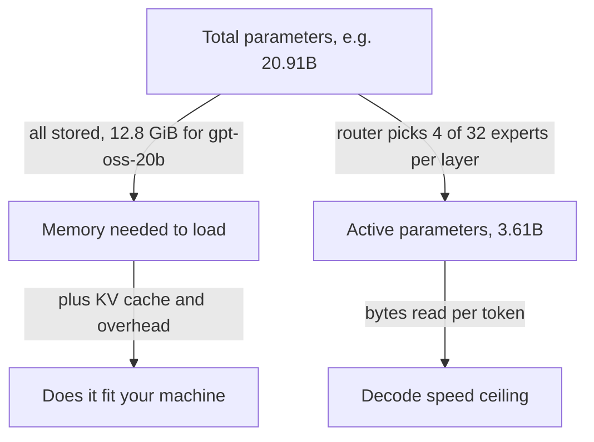

# Mixture of experts (MoE)

> **Key papers:** Shazeer, Mirhoseini, Maziarz, Davis, Le, Hinton and Dean, 2017 - [arXiv 1701.06538](https://arxiv.org/abs/1701.06538). Fedus, Zoph and Shazeer, 2021, Switch Transformers - [arXiv 2101.03961](https://arxiv.org/abs/2101.03961). Jiang and others, 2024, Mixtral of Experts - [arXiv 2401.04088](https://arxiv.org/abs/2401.04088). Dai and others, 2024, DeepSeekMoE - [arXiv 2401.06066](https://arxiv.org/abs/2401.06066). DeepSeek-AI, 2024, DeepSeek-V3 - [arXiv 2412.19437](https://arxiv.org/abs/2412.19437). OpenAI, 2025, gpt-oss model card (vendor) - [arXiv 2508.10925](https://arxiv.org/abs/2508.10925). Li and others, 2024, MixLoRA - [arXiv 2404.15159](https://arxiv.org/abs/2404.15159).
>
> **Scope:** what an MoE model is, what its two parameter counts mean, what that does to memory, speed, fine-tuning and serving on a small team's hardware, and the cheaper "MoE of adapters" idea. It does not teach how to pretrain an MoE; a team will almost never do that.

Written 2026-11-26. Model cards and tool docs change monthly; each fact names its source.

## Read this first

**The idea in one sentence.** Replace each feed-forward block of a transformer with many parallel blocks ("experts") and a small router that sends each token to only a few of them, so the model holds many parameters but uses few for any one token.

**Who it is for.** A team choosing a base model for an SLM project that sees names like "30B-A3B" or "26B-A4B" and has to decide whether that is a 3B model or a 30B model for its laptop or GPU.

**Afterwards you will be able to** read total versus active parameters, compute the memory and the speed ceiling of an MoE model, say what is risky about fine-tuning one, and choose between an MoE base model, a dense small model and a set of LoRA adapters.

**Reading time.** About 40 minutes; Tutorial 1 alone is about 12. **Have read first:** [09 Quantization](./09-quantization-ptq-and-qat.md) (memory arithmetic, KV cache) and [03 Vehicles](../03-vehicles.md). **Useful:** [LoRA](./02-lora.md) and the [LoRA paper guide](../../../llm-learning-repository/tutorials/02-building/09-lora.md).

**The one thing most people get wrong.** "Active parameters" tells you the speed, not the memory. A model with 3.8 billion active parameters still has to keep all 25.2 billion in memory ([Gemma 4 26B A4B card](https://huggingface.co/google/gemma-4-26B-A4B-it)). It runs at the speed of a 4B model and needs the memory of a 26B model. That is a different deployment problem from a 4B dense model, not a cheaper version of a 26B one.

## The technique in one worked example

Part A is constructed by this guide (arithmetic run in numpy). Part B uses published figures.

### Part A - one token through one MoE layer

A layer has 4 experts. The router multiplies the token's vector by a small matrix and gets four scores (logits): `[2.0, 1.0, 0.5, -1.0]`. With top-2 routing, keep experts 0 and 1, and take a softmax over just those two scores, as Mixtral does ([Section 2.1](https://arxiv.org/html/2401.04088)): weights `0.731` and `0.269`. Suppose expert 0 turns this token into 4.0 and expert 1 into -2.0 (one number each, for simplicity). The layer outputs 0.731 x 4.0 + 0.269 x (-2.0) = 2.386. Experts 2 and 3 do no work for this token and their weights are not read for it.

Now balance. Eight tokens are routed top-1 across the 4 experts. Counts are `[6, 1, 1, 0]`, so the fraction of tokens f = `[0.75, 0.125, 0.125, 0]`; the router's average probabilities are P = `[0.6, 0.2, 0.15, 0.05]`. The Switch Transformer balancing loss ([Section 2.2, Eq. 4](https://arxiv.org/html/2101.03961)) is alpha x N x sum(f_i x P_i) = alpha x 4 x 0.49375 = 1.975 alpha. If routing were perfectly even (f = P = 0.25 each) the sum is 0.25 and the loss is 1.0 alpha, its minimum. The penalty pushes the router towards even use.

### Part B - real parameter counts

[gpt-oss-20b](https://arxiv.org/html/2508.10925) (model card Table 1): 20.91B total parameters, 3.61B active per token, 32 experts per layer, 24 layers, checkpoint 12.8 GiB. The same card says expert (MLP) weights are 19.12B of the total and are stored in MXFP4 at 4.25 bits per parameter, while attention (0.64B) and embeddings (1.16B) stay 16-bit. Check: 19.12e9 x 4.25 / 8 = 10.16e9 bytes = 9.46 GiB, plus (0.64 + 1.16)e9 x 2 = 3.6e9 bytes = 3.35 GiB, total 12.81 GiB, matching the card's 12.8. So **memory follows total parameters (12.8 GiB), while the weights read per token follow active ones (about 3.61B)**.

```mermaid
flowchart LR
  T[Token vector x] -->|multiplied by router matrix| L[Scores for N experts]
  L -->|keep k largest, softmax over them| G[k gate weights]
  T -->|sent only to the chosen k experts| E[Selected experts compute]
  G -->|weights each expert output| C[Weighted sum]
  E -->|k expert outputs| C
  C -->|added to the residual stream| O[Layer output]
  L -.|fractions and probabilities feed| B[Balancing loss]
```

Notice that unselected experts are skipped entirely, but all of them must sit in memory because the next token may choose them. The dotted edge is training only.



The two arrows from the same model are the whole story: one number decides whether it fits, the other decides how fast it runs.

## Words you need

| Term | Plain definition | Example from the worked example |
|---|---|---|
| Expert | One of several parallel feed-forward blocks in a layer | The 4 experts in Part A; 32 per layer in gpt-oss-20b |
| Router (gate) | A small learned layer that scores experts for each token | The matrix that produced `[2.0, 1.0, 0.5, -1.0]` |
| Top-k routing | Keep the k highest-scoring experts for each token | k = 2 in Part A; Switch uses k = 1 |
| Total parameters | Every weight stored, all experts included | 20.91B for gpt-oss-20b |
| Active parameters | Weights actually used for one token | 3.61B for gpt-oss-20b |
| Dense model | A model where every parameter is used for every token | A 4B dense model: total equals active |
| Load balancing loss | An extra training penalty that discourages using a few experts | 1.975 alpha versus 1.0 alpha |
| Expert capacity | Maximum tokens one expert may take per batch; extras are dropped or passed through | Switch Eq. 3: tokens per batch / experts x capacity factor |
| Shared expert | An expert every token always uses, beside the routed ones | Gemma 4 26B A4B: 8 active of 128, plus 1 shared |
| Expert parallelism | Placing different experts on different GPUs | vLLM `--enable-expert-parallel` |
| Router collapse | Training failure where a few experts take nearly all tokens | Counts `[6, 1, 1, 0]` taken to the extreme |

## Tutorial 1 - Intuitive understanding

### What was broken before

Making a language model smarter by making it bigger makes every answer slower and costlier, because every token passes through every parameter. Capacity and cost were tied together. Researchers wanted a model that knows a lot, meaning many parameters, without paying to use all of them for each word.

### The idea

**Analogy.** A hospital has many specialist departments and a triage desk. Each patient (token) is sent to two departments, not all of them, so the hospital can employ a huge range of expertise while each patient's visit stays short. The triage desk is the router.

**Where the analogy breaks.** Experts in a trained model are not neat specialists such as "cardiology". Mixtral's authors looked and found "surprisingly" no obvious assignment of experts by topic: experts looked similar across arXiv, PubMed and philosophy text, and routing followed syntax more than subject ([Section 5](https://arxiv.org/html/2401.04088)). Second, a hospital's departments can be far away; here all departments must be in the building (in memory) at all times, even the ones used rarely.

### How it works, step by step

1. **Keep the attention layers as they are;** swap the feed-forward block of (most) layers for N experts plus a router.
2. **Route each token:** the router scores all experts, picks the top k, and normalises their weights.
3. **Compute only the chosen experts** and sum their outputs with the gate weights.
4. **Train with a balancing penalty** so the router spreads tokens, because otherwise a few experts win early and everyone else stops learning (the cause of router collapse; the [Switch paper](https://arxiv.org/html/2101.03961) sets alpha to 0.01 after sweeping powers of ten).
5. **Serve with all experts resident:** experts may be split across GPUs (expert parallelism) or, on a laptop, partly kept on the CPU ([llama.cpp flags](https://raw.githubusercontent.com/ggml-org/llama.cpp/master/tools/server/README.md) `--cpu-moe` and `--n-cpu-moe N`).

Newer designs refine the idea. [DeepSeekMoE](https://arxiv.org/html/2401.06066) cuts experts into smaller pieces (more of them, more chosen) and isolates shared experts that every token uses. [DeepSeek-V3](https://arxiv.org/abs/2412.19437) keeps balance without the penalty term ("auxiliary-loss-free" balancing).

### What the evidence says

- **Capacity at small cost.** The [2017 paper](https://arxiv.org/abs/1701.06538) reports over 1,000x more model capacity with minor loss of computational efficiency, up to 137B parameters. The [Switch paper](https://arxiv.org/abs/2101.03961) reports up to 7x faster pre-training than T5-Base at equal compute and a 4x speedup over T5-XXL for trillion-parameter models.
- **Open models.** [Mixtral 8x7B](https://arxiv.org/html/2401.04088) uses 8 experts with top-2 routing, about 47B total and 13B active parameters, and in Table 2 beats Llama 2 70B on MMLU (70.6 versus 69.9), GSM8K (74.4 versus 69.6) and MATH (28.4 versus 13.8), while trailing on HellaSwag (84.4 versus 85.4). That means about 5 more of every 100 GSM8K problems solved than Llama 2 70B, at roughly a fifth of the active parameters.
- **DeepSeekMoE** reports its 16B model (2.8B active) matching LLaMA2 7B with about 40 percent of the computation ([abstract](https://arxiv.org/abs/2401.06066), Section 5).
- **Scale of today's models:** [DeepSeek-V3](https://arxiv.org/abs/2412.19437) has 671B total and 37B active parameters; [Qwen3-30B-A3B](https://huggingface.co/Qwen/Qwen3-30B-A3B) 30.5B and 3.3B (128 experts, 8 active, Apache 2.0); [Gemma 4 26B A4B](https://huggingface.co/google/gemma-4-26B-A4B-it) 25.2B and 3.8B (Apache 2.0); gpt-oss-120b 116.83B and 5.13B.

### What this does not show

- Active-parameter counts are a compute measure. The [Mixtral paper](https://arxiv.org/html/2401.04088) itself says serving memory is proportional to the 47B sparse count.
- The strongest results compare against dense models of the builder's choosing, often on public benchmarks, not on private-document tasks.
- Nothing here shows MoE models fine-tune as easily as dense ones. The available evidence is tool documentation, not controlled studies (Tutorial 2).
- Whether an MoE base is better than a dense one at the same memory budget for a narrow task was not found in a controlled comparison.

### Teach-back

<details>
<summary>1. What is the difference between total and active parameters, and which sets memory?</summary>

Total is every stored weight; active is what one token uses. Memory follows total, speed follows active. gpt-oss-20b is 20.91B total, 3.61B active, 12.8 GiB checkpoint.
</details>

<details>
<summary>2. Why is a balancing loss needed?</summary>

Without it the router tends to favour a few experts, which then get trained more and favoured further, leaving others idle. The penalty is smallest when use is even: 1.0 alpha versus 1.975 alpha in the example.
</details>

<details>
<summary>3. Why is a 26B-A4B model not a 4B model for a laptop?</summary>

It decodes at roughly 4B speed but all 25.2B parameters must be loaded. At about 4.89 bits per weight that is about 15.4 GB versus 2.4 GB for a 4B dense model.
</details>

<details>
<summary>4. Are experts topic specialists?</summary>

Mixtral's analysis found no obvious topic pattern; routing followed syntax more than domain. Do not expect to prune or tune "the medical expert".
</details>

## Tutorial 2 - Practitioner understanding

### The design in concrete terms

| Model | Total / active | Experts and routing | Licence | Source |
|---|---|---|---|---|
| Mixtral 8x7B | about 47B / 13B | 8, top-2, 32 layers | Not checked here | [paper](https://arxiv.org/html/2401.04088) |
| DeepSeekMoE 16B | 16B / 2.8B | fine-grained plus shared | Not checked here | [paper](https://arxiv.org/html/2401.06066) |
| DeepSeek-V3 | 671B / 37B | fine-grained plus shared | Not checked here | [abstract](https://arxiv.org/abs/2412.19437) |
| gpt-oss-120b | 116.83B / 5.13B | 128 experts, 36 layers | Apache 2.0 ([OpenAI](https://openai.com/index/gpt-oss-model-card/)) | [card](https://arxiv.org/html/2508.10925) |
| gpt-oss-20b | 20.91B / 3.61B | 32 experts, 24 layers | Apache 2.0 | [card](https://arxiv.org/html/2508.10925) |
| Qwen3-30B-A3B | 30.5B / 3.3B | 128, 8 active, 48 layers | Apache 2.0 | [card](https://huggingface.co/Qwen/Qwen3-30B-A3B) |
| Gemma 4 26B A4B | 25.2B / 3.8B | 128, 8 active, plus 1 shared, 30 layers | Apache 2.0 | [card](https://huggingface.co/google/gemma-4-26B-A4B-it) |

The gpt-oss card's top-k value did not render clearly in our fetch (it read "top-44"); this guide takes it to be 4 and marks that unverified.

**Serving.** [vLLM](https://docs.vllm.ai/en/latest/serving/expert_parallel_deployment/) shards experts across GPUs with `--enable-expert-parallel` (EP size equals tensor-parallel size times data-parallel size) and warns that expert-load balancing adds memory for redundant experts. llama.cpp can keep MoE weights of the first N layers on the CPU with `--n-cpu-moe N`, or all of them with `--cpu-moe`. Quantization applies to experts as well: gpt-oss ships its expert weights in MXFP4 ([card](https://arxiv.org/html/2508.10925)); see [09](./09-quantization-ptq-and-qat.md).

**Fine-tuning an MoE.** Three facts from tool documentation, not studies:
- [Unsloth](https://unsloth.ai/docs/basics/faster-moe) says it is "not a good idea to fine-tune the router layer", so router tuning is disabled by default; its LoRA targets include the expert projections (`gate_up_proj`, `down_proj`). It reports (vendor benchmark, LoRA rank 64) 7x faster training and 36 percent less VRAM for gpt-oss BF16 on a B200, about 1.7x faster for Qwen3-30B-A3B, and says Qwen3-30B-A3B 16-bit LoRA uses 63 GB while gpt-oss-20b fine-tunes in 12.8 GB.
- [Axolotl](https://github.com/axolotl-ai-cloud/axolotl) added LoRA on expert weights through ScatterMoE kernels in February 2026 (per a search summary of its README; not verified at source) and warns Qwen3 MoE may train slower because of the upstream MoE layers.
- In [Transformers](https://huggingface.co/docs/transformers/v4.38.2/en/model_doc/mixtral), the Mixtral config has `output_router_logits` (off by default) and `router_aux_loss_coef` (0.001 default). Whether TRL forwards these was not found; check the TRL source.

The [Switch paper](https://arxiv.org/html/2101.03961) also found sparse models overfit small downstream tasks and fixed it with expert dropout (0.4 inside experts, 0.1 elsewhere; GLUE 85.2 versus 82.9, Table 4, a 2021 T5-scale result). Small private fine-tuning sets are exactly the small-task regime.

**The cheaper cousin: an MoE of LoRA adapters.** [MixLoRA](https://arxiv.org/abs/2404.15159) keeps a dense base frozen and inserts LoRA-based experts into its feed-forward blocks with a top-k router. Its abstract claims about 9 percent better accuracy than state-of-the-art parameter-efficient methods in multi-task settings, 40 percent less GPU memory and 30 percent lower token latency, from its own training and inference framework (authors' claims; base models not named in the abstract). [LoRAMoE](https://arxiv.org/abs/2312.09979) uses the same idea to keep world knowledge during alignment. A simpler route needs no router: keep one adapter per task and serve several on one base with [vLLM multi-LoRA](../03-vehicles.md#2-runtime-what-loads-and-runs-it) (`--enable-lora`, `--max-loras`). **Judgment:** for a team with a few tasks, per-task adapters are easier to version and roll back than a trained router over adapters.

### A minimal version

Loading an MoE for LoRA tuning with Hugging Face PEFT. **Unrun.** The target-module names differ by model; check `model.named_modules()` first. Input: a base checkpoint and chat-formatted examples; output: an adapter directory.

```python
import torch
from transformers import AutoModelForCausalLM, AutoTokenizer
from peft import LoraConfig, get_peft_model

NAME = "Qwen/Qwen3-30B-A3B"                     # 30.5B total, 3.3B active (model card)
tok = AutoTokenizer.from_pretrained(NAME)
model = AutoModelForCausalLM.from_pretrained(NAME, torch_dtype=torch.bfloat16, device_map="auto")
model.config.output_router_logits = True        # makes the router's balancing loss available
cfg = LoraConfig(r=16, lora_alpha=32, lora_dropout=0.05,
                 target_modules=["q_proj", "k_proj", "v_proj", "o_proj"],  # attention only
                 task_type="CAUSAL_LM")
model = get_peft_model(model, cfg)              # router and experts stay frozen
model.print_trainable_parameters()              # expect well under 1 percent
```

Attention-only adapters are this guide's conservative choice; adapting expert projections as well is supported by Unsloth and Axolotl but has the least evidence. Whether `router_aux_loss_coef` is applied during PEFT training depends on your trainer.

### What it costs

Assumption: 4.89 bits per weight (GGUF Q4_K_M on Llama 3.1 8B, [llama.cpp README](https://github.com/ggml-org/llama.cpp/blob/master/tools/quantize/README.md)) applied to every model below, memory bandwidth 100 GB/s; this is this guide's arithmetic, not a measurement.

| Model | Weights in memory (Q4_K_M-like) | Weights read per token | Speed ceiling |
|---|---|---|---|
| Dense 4B | 2.45 GB | 2.45 GB | about 41 tokens/s |
| Gemma 4 26B A4B (25.2B / 3.8B) | 15.4 GB | 2.32 GB | about 43 tokens/s |
| Dense 25B | 15.3 GB | 15.3 GB | about 6.5 tokens/s |

So the MoE model decodes about as fast as the 4B dense model and needs about six times its memory, while being about six to seven times faster than a dense model of the same memory. Attention and the KV cache are extra: Gemma's 256K context makes the cache a first-class budget item ([09](./09-quantization-ptq-and-qat.md)). Real speeds fall below these ceilings, because routing, imbalance between experts and kernel overheads cost time; [Mixtral](https://arxiv.org/html/2401.04088) notes memory cost and, in its own words, that active parameters do not capture it.

Training cost: Unsloth's reported 63 GB for 16-bit LoRA on Qwen3-30B-A3B needs an 80 GB-class GPU, against about 17.5 GB for the 4-bit path it documents for the same model ([Unsloth](https://unsloth.ai/docs/basics/faster-moe) figures from our search summary). A 4B dense LoRA run fits a 24 GB card ([README](../README.md)).

### How it fails

| Symptom | Likely cause | Mitigation |
|---|---|---|
| Model fits on a laptop in the spec but not in practice | Memory sized from active, not total, parameters | Size from total; add KV cache; test the exact quantized file |
| Fine-tuned model worse than the base on general prompts | Router drift or expert overfit on a small set | Freeze the router (Unsloth default); attention-only adapters; lower rank; evaluate general tasks |
| Few experts handle most tokens after tuning | Imbalance when the balancing loss is off or the data is narrow | Enable router logits and aux loss; inspect per-expert token counts |
| Throughput lower than the active-parameter claim | Expert imbalance, small batches, CPU offload | Measure tokens per second on your hardware; batch more |
| Adapter will not load in the serving engine | MoE LoRA target modules and engine support differ | Test merge or load path on the exact engine version |
| Quantized MoE worse than dense at the same size | Experts see fewer tokens, so calibration data may under-cover some | Calibrate on task-like text; check each expert's coverage if the tool reports it |
| Multi-GPU serving slower than one GPU | All-to-all communication between expert shards | Prefer one GPU or tensor parallel at small scale; use expert parallelism only when the model does not fit |

### Evaluating your version

- **Metric:** your task metric (schema-valid rate, field F1, pass rate) on the exact served file, plus tokens per second and peak memory on your target machine.
- **Test set:** at least 300 to 500 held-out items (at 400 items and a 90 percent rate, the 95 percent interval is about plus or minus 3 points); a second set of general prompts to detect forgetting.
- **Baselines:** a dense model of similar total size and a dense model of similar active size, both tuned the same way, plus the untuned MoE.
- **Stop rule:** adopt the MoE only if it beats the better dense baseline by more than the interval on your metric and meets the memory and latency limit. Otherwise take the dense model; it is simpler to tune and serve.

### Adopt, adapt or skip

**Skip training an MoE from scratch.** Pretraining one needs large token budgets, expert-parallel infrastructure and balancing know-how; the reported runs are DeepSeek-V3's 14.8T tokens and 2.788M H800 GPU hours ([abstract](https://arxiv.org/abs/2412.19437)). **Adopt an open MoE as a base model only when** the target is a server GPU with enough memory for the total size, or a workstation with a big unified memory, and the per-token speed matters. **Adapt** by freezing the router, tuning attention (and perhaps expert projections) with LoRA, and testing for forgetting. **For laptops and phones choose a dense 1B to 4B model by default,** because total parameters, not active, set what fits. **For many tasks on one base,** compare per-task adapters with multi-LoRA serving before considering any trained mixture of adapters.

## Tutorial 3 - Researcher understanding

### Formal setup

A dense feed-forward block computes y = FFN(x). An MoE layer has experts E_1..E_N and a router matrix W_g. Scores h = W_g x; keep the index set T of the k largest; gates g_i = softmax(h_T)_i for i in T; output y = sum over i in T of g_i E_i(x) ([Mixtral Section 2.1](https://arxiv.org/html/2401.04088); [Shazeer 2017](https://arxiv.org/abs/1701.06538) adds noise to the scores). Total parameters = shared parameters + N x |E|; active = shared + k x |E|. Switch uses k = 1, with capacity C = (tokens per batch / N) x capacity factor ([Eq. 3](https://arxiv.org/html/2101.03961)). Balancing loss: alpha N sum f_i P_i, f_i the dispatched fraction and P_i the mean router probability.

Toy instance: Part A, giving output 2.386 and balancing loss 1.975 alpha. For gpt-oss-20b, active/total = 3.61 / 20.91 = 17 percent; for Qwen3-30B-A3B 3.3 / 30.5 = 11 percent; for Gemma 4 26B A4B 3.8 / 25.2 = 15 percent; DeepSeek-V3 37 / 671 = 5.5 percent (all computed by this guide from the cited figures).

### The claims, stated precisely

1. **C1 ([Shazeer](https://arxiv.org/abs/1701.06538)).** A sparsely gated MoE layer with up to thousands of experts gives over 1000x capacity with minor efficiency loss.
2. **C2 ([Switch](https://arxiv.org/abs/2101.03961)).** Top-1 routing, a simple balancing loss and selective precision let MoE models train in bfloat16, with up to 7x faster pre-training than T5-Base at equal compute.
3. **C3 ([Mixtral](https://arxiv.org/html/2401.04088)).** A 47B-total, 13B-active model matches or beats Llama 2 70B on most reported benchmarks (Table 2).
4. **C4 ([DeepSeekMoE](https://arxiv.org/abs/2401.06066)).** Fine-grained segmentation plus shared experts gives a better quality-per-compute trade-off: 2B model comparable to GShard 2.9B with 1.5x the expert parameters; 16B model with 2.8B active comparable to LLaMA2 7B at about 40 percent of compute.
5. **C5 ([DeepSeek-V3](https://arxiv.org/abs/2412.19437)).** Balancing without an auxiliary loss, at 671B total and 37B active, trains stably (the authors report no irrecoverable loss spikes).
6. **C6 ([MixLoRA](https://arxiv.org/abs/2404.15159)).** Placing LoRA experts in a frozen dense model improves multi-task accuracy by about 9 percent over other parameter-efficient methods (abstract; authors' claim).

### Evidence, table by table

| Id | Rows and columns | Headline numbers | Causal or associational |
|---|---|---|---|
| Switch Table 1 | MoE-Base and Switch-Base at capacity 2.0, 1.25, 1.0; quality, speed | Switch at 1.0: -1.561 quality, 1000 examples/s; MoE-Base at 1.0: -1.572, 860 | Causal within the T5 setup (same data and steps) |
| Switch Table 4 | Expert dropout configurations on fine-tuning | 85.2 GLUE (0.1 / 0.4 dropout) versus 82.9 for T5-Base | Causal for the regulariser, one benchmark family |
| Mixtral Table 2 | Mixtral 8x7B versus Llama 2 and others, benchmarks | MMLU 70.6 vs 69.9; HumanEval 40.2 vs 29.3; MBPP 60.7 vs 49.8; GSM8K 74.4 vs 69.6; MATH 28.4 vs 13.8; WinoGrande 77.2 vs 80.4 | Associational: different training data and recipes |
| Mixtral Section 5, Table 5 | Expert assignment by domain | No obvious topic pattern; adjacent tokens often share experts | Descriptive |
| DeepSeekMoE abstract and Section 5 | 2B, 16B, 145B against dense and GShard | 16B (2.8B active) matches LLaMA2 7B at about 40 percent of compute | Associational for 16B; the 2B comparisons use matched data |
| gpt-oss Table 1 | Parameter breakdown | 120b: 116.83B total, 5.13B active; 20b: 20.91B, 3.61B | Descriptive; vendor |
| Unsloth page | Speed and VRAM for MoE LoRA | 7x and 36 percent on B200; about 1.7x on Qwen3-30B-A3B | Vendor benchmark, rank 64, own baselines |

### Ablations and what they isolate

- **Capacity factor (Switch Table 1)** isolates token dropping versus padding: Switch is better at lower capacity factors, so waste matters more for it than for top-2 MoE.
- **Loss coefficient sweep (Switch Section 2.2)** isolates balancing strength: alpha = 1e-2 balanced load without disturbing the main loss.
- **Expert dropout (Switch Table 4)** isolates overfitting of experts during fine-tuning.
- **Fine-grained and shared experts (DeepSeekMoE)** isolate expert granularity and redundancy at fixed compute.
- **Aux-loss-free balancing (DeepSeek-V3)** isolates the cost of the balancing term on quality; what we read gives the claim in the abstract only, so treat the size of the effect as unverified.

### Threats to validity

- **Compute matching.** "Same compute" counts active FLOPs, not memory or communication, which favours MoE.
- **Data and recipe differences** between Mixtral and Llama 2 are not controlled.
- **Vendor authorship** for gpt-oss, Qwen, Gemma and Unsloth figures.
- **Fine-tuning evidence** is documentation, not experiments; no controlled MoE-versus-dense small-task study was found.
- **Scale.** The 2017 to 2021 results are on LSTM and T5-scale models; whether an expert-dropout style fix is needed for 2025 models of 3B active parameters is not shown.
- **Router analysis** covers Mixtral only.

### Open problems and follow-ups

- Does router tuning help or hurt on small private datasets, and with what learning rate?
- Quantizing experts: do rarely used experts need more calibration data?
- Pruning experts for a domain: [pruning](./12-pruning-and-compression.md) results for MoE were not reviewed here.
- Real tokens per second for MoE on laptops with CPU offload versus dense models at equal memory.
- Comparing MixLoRA-style routing with per-task adapters under equal parameter budgets.

### What would change my mind

- A controlled study where a 3B-active MoE tuned on 2,000 examples beats a dense 4B model and a dense model of equal total size on a narrow task would move "default to dense" to "default to MoE on servers".
- Evidence that router fine-tuning with a balancing loss is stable and beneficial on small data would reverse the freeze-the-router advice.
- Measured laptop decode speeds close to the ceiling above would make mid-size MoE models practical for desktop products.

## Reading map for the key papers

| Paper section or figure | What it contains | Read, skim or skip | Where this guide answers |
|---|---|---|---|
| Shazeer 2017, Sections 2-3 | Gating, noise, balancing losses | Skim | Formal setup |
| Switch Sections 2.1-2.4 | Top-1 routing, capacity, loss, dropout | Read | Worked example Part A; Tutorial 2 |
| Switch Sections 3-4 | Scaling and distillation results | Skim | Evidence |
| Mixtral Sections 2-3 | Architecture and size | Read | Words; costs |
| Mixtral Section 5 | Routing analysis | Read | Teach-back 4 |
| DeepSeekMoE Sections 3-4 | Fine-grained and shared experts | Read Section 3 | Tutorial 1, steps |
| DeepSeek-V3 architecture | MLA, balancing, multi-token prediction | Skim | Claims C5 |
| gpt-oss card, Table 1 and quantization section | Parameters and MXFP4 | Read | Worked example Part B |
| MixLoRA | LoRA experts | Skim | Tutorial 2 |

## Questions readers get stuck on

**What does "30B-A3B" mean?**
About 30 billion total parameters, about 3 billion active per token (Qwen3-30B-A3B is 30.5B and 3.3B on its [card](https://huggingface.co/Qwen/Qwen3-30B-A3B)). The first number sets memory; the second sets speed.

**Will a 3B-active MoE run on my 8 GB laptop?**
Probably not. At about 4.89 bits per weight, 25 to 30B total parameters need 15 to 18 GB for weights alone (this guide's arithmetic). llama.cpp can keep expert weights on the CPU side, but that moves the problem to memory bandwidth and RAM size.

**Is an MoE the same as an ensemble of models?**
No. An ensemble runs several complete models and combines answers. An MoE layer sits inside one model, shares attention and embeddings, and chooses experts per token and per layer.

**Why are balancing losses needed, and are they always used?**
Without one, routing concentrates on a few experts. Switch uses alpha = 0.01; DeepSeek-V3 reports balancing without an auxiliary loss ([abstract](https://arxiv.org/abs/2412.19437)). Details beyond the abstract were not read.

**Should I fine-tune the router?**
Unsloth documents that router tuning is disabled by default because it is not a good idea. That is a tool maintainer's view, not a controlled result; start with the router frozen and test.

**Can I make my own MoE from my adapters?**
Tools such as [mergekit](https://github.com/arcee-ai/mergekit) have a `mergekit-moe` script that merges several dense models into an MoE, per its README (see [11](./11-model-merging.md)). Whether the result beats a single multi-task model was not studied here. MixLoRA is the adapter-level analogue.

**Why not just use a dense model of the same total size?**
Because per-token compute grows with the active size. A 25B dense model reads about 15 GB per token against about 2.3 GB for a 3.8B-active MoE of the same file size, so the MoE is much faster, as the cost table in Tutorial 2 shows.

**How do I serve many users on an MoE?**
At server scale vLLM shards experts with expert parallelism, usually combined with data parallelism. At small scale a single GPU holding all experts is simpler and avoids all-to-all traffic.

**Do experts specialise by topic so I could keep only the ones I need?**
The Mixtral analysis found no obvious topic pattern, so dropping experts for a domain is not a safe shortcut. Pruning experts is an open topic here.

**What about quantizing an MoE?**
It works and is standard: gpt-oss stores its experts in MXFP4, giving a 12.8 GiB checkpoint for a 20.91B model. The [quantization guide](./09-quantization-ptq-and-qat.md) covers how to evaluate such a file.

## Prerequisites you actually need

### Prerequisite 1 - The transformer feed-forward block

Each transformer layer has attention, which mixes information between tokens, and a feed-forward block, which transforms each token separately and holds most of the parameters. Example: in gpt-oss-20b the expert (MLP) weights are 19.12B of 20.91B, about 91 percent ([card](https://arxiv.org/html/2508.10925)). MoE replaces exactly that block. See the [Transformer guide](../../../llm-learning-repository/tutorials/01-foundations/01-transformer.md).

### Prerequisite 2 - Softmax and top-k

Softmax turns scores into positive weights summing to 1. Example: scores 2.0 and 1.0 give e^2 = 7.389 and e^1 = 2.718; divided by their sum 10.107 they become 0.731 and 0.269. Top-k keeps the k largest scores first. See the [math bridge](../../../llm-learning-repository/references/math-bridge.md).

### Prerequisite 3 - Memory versus bandwidth

Weights memory is parameters x bits / 8; decode speed is capped by bytes read per token divided by memory bandwidth. Example: 2.32 GB per token at 100 GB/s gives about 43 tokens per second. See [09](./09-quantization-ptq-and-qat.md).

### Prerequisite 4 - Low-rank adapters

A LoRA adapter adds two thin matrices to a frozen weight. A MixLoRA expert is such a pair; a router picks among them. See [02 LoRA](./02-lora.md) and the [paper guide](../../../llm-learning-repository/tutorials/02-building/09-lora.md).

## Where this sits

**Read before:** [09 Quantization](./09-quantization-ptq-and-qat.md), [02 LoRA](./02-lora.md), [03 Vehicles](../03-vehicles.md).

**Nearest techniques.** Quantization stores the same parameters in fewer bits; MoE uses fewer of them per token, and the two multiply (MXFP4 experts). [Model merging](./11-model-merging.md) combines trained models without a router, whereas MoE keeps the specialists apart and chooses at run time. [Pruning and compression](./12-pruning-and-compression.md) removes parameters permanently, while MoE only skips them per token.

**Read next:** [11 Model merging](./11-model-merging.md) for combining adapters or tasks, then the [build and deploy playbook](../04-build-and-deploy-playbook.md).

## Checkpoint

<details>
<summary>1. Compute: weights memory of a 30.5B-total MoE at 4.89 bits per weight, and the per-token read of its 3.3B active parameters.</summary>

30.5e9 x 4.89 / 8 = 18.6 GB in memory; 3.3e9 x 4.89 / 8 = 2.02 GB read per token.
</details>

<details>
<summary>2. Compute: top-2 routing with scores [1.0, 0.0, 3.0, -1.0]. Which experts, and what gate weights?</summary>

Experts 2 and 0 (scores 3.0 and 1.0). Softmax over those two: e^3 = 20.09 and e^1 = 2.718, sum 22.80, weights 0.881 and 0.119.
</details>

<details>
<summary>3. Explain: why does an MoE model decode quickly but still not fit a small device?</summary>

Decoding reads only the chosen experts, so cost follows active parameters. Loading must hold every expert because any token may choose any of them, so memory follows total parameters.
</details>

<details>
<summary>4. Critique: "Our 26B-A4B model is as cheap to run as a 4B model." What is right and what is missing?</summary>

Right for per-token arithmetic and bytes read. Missing: memory (about six times larger), KV cache for the context, offload or quantization effects, and measured speed on the target machine.
</details>

<details>
<summary>5. Decide: you hold five task-specific LoRA adapters for one dense base. Do you train a MixLoRA-style router?</summary>

Not first. Serve the five adapters with multi-LoRA in vLLM and route by task identity, which is deterministic and easy to roll back. Consider a learned mixture only if tasks are not separable and a controlled test shows a gain.
</details>

<details>
<summary>6. Explain: what does the Switch balancing loss minimise, and what are its minimum and its value in Part A?</summary>

It is alpha N sum f_i P_i, smallest when every expert gets an equal share. Its minimum is 1.0 alpha for N = 4; Part A gives 1.975 alpha.
</details>
