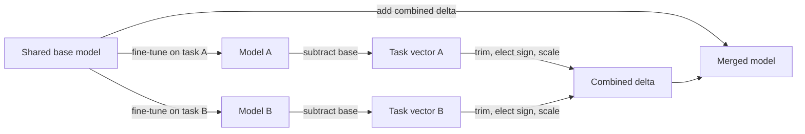
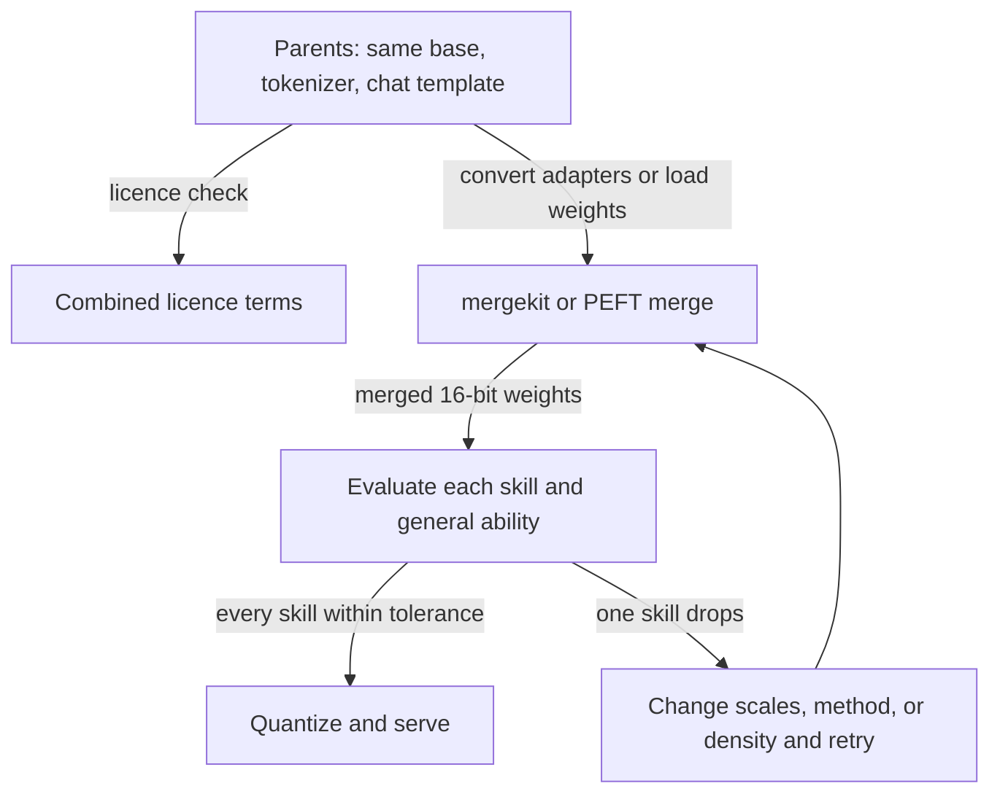

# Model merging

> **Key papers:** Wortsman and others, 2022, model soups - [arXiv 2203.05482](https://arxiv.org/abs/2203.05482). Ilharco and others, 2023, task arithmetic - [arXiv 2212.04089](https://arxiv.org/abs/2212.04089). Yadav, Tam, Choshen, Raffel and Bansal, 2023, TIES-merging - [arXiv 2306.01708](https://arxiv.org/abs/2306.01708). Yu, Yu, Yu, Huang and Li, 2024, DARE ("Language Models are Super Mario") - [arXiv 2311.03099](https://arxiv.org/abs/2311.03099). Tool: [mergekit](https://github.com/arcee-ai/mergekit); [PEFT merging guide](https://huggingface.co/docs/peft/main/en/developer_guides/model_merging).
>
> **Scope:** combining the weights of models (or adapters) that share one base, without further training: when it helps an enterprise small language model (SLM) team, how it fails, and how to test a merge. Not covered: evolutionary or learned merging search, or merging models of different architectures.

Written 2026-11-26. Tool status and licences move; each fact says where it came from.

## Read this first

**The idea in one sentence.** If two models were fine-tuned from the same starting model, the difference between each and that start can be added, averaged or pruned and re-applied to the start, giving one model with some of each skill and no new training.

**Who it is for.** A team holding several fine-tuned variants or LoRA adapters of one base model (a format tuner, a domain tuner, a safety tuner) that wants one artifact to serve, or wants to recover general ability lost in tuning.

**Afterwards you will be able to** compute a task vector, merge two of them by averaging, task arithmetic and TIES by hand; choose a method and a tool; list the preconditions (same base, same tokenizer, licences); and design a test that tells you whether the merge kept both skills.

**Reading time.** About 40 minutes; Tutorial 1 alone is about 12. **Have read first:** [02 LoRA](./02-lora.md) (adapters and merging them into weights). **Useful:** [09 Quantization](./09-quantization-ptq-and-qat.md) (merge in 16 bits first) and [10 Mixture of experts](./10-mixture-of-experts.md) (the router-based alternative).

**The one thing most people get wrong.** Merging is not free multi-tasking. It works because fine-tuned models from one start stay in the same region of weight space; the papers show it holds for the cases they test, and show it breaking when deltas are large or the start differs. A merged model needs the same evaluation as any new model, on every skill you wanted, and its licence is the combination of its parents' licences.

## The technique in one worked example

Constructed by this guide with four numbers instead of billions; the arithmetic was run in numpy.

**Setup.** A base model has four weights `[1.0, 2.0, 3.0, 4.0]`. Fine-tune A (say, for a format) gives `[1.4, 2.0, 2.6, 4.1]`; fine-tune B (a domain) gives `[1.2, 2.5, 3.3, 3.6]`. A **task vector** is fine-tuned minus base ([task arithmetic](https://arxiv.org/abs/2212.04089)): tA = `[0.4, 0.0, -0.4, 0.1]` and tB = `[0.2, 0.5, 0.3, -0.4]`.

| Method | Calculation | Merged weights |
|---|---|---|
| Weight average ([soup](https://arxiv.org/abs/2203.05482), uniform) | (A + B) / 2 | `[1.3, 2.25, 2.95, 3.85]` |
| Task arithmetic, scale 1 | base + tA + tB | `[1.6, 2.5, 2.9, 3.7]` |
| TIES, keep top 3 of 4 per vector | trim, elect sign, average agreeing | `[1.4, 2.5, 2.6, 3.6]` |

**How TIES gets its row.** Trim: tA keeps `[0.4, 0, -0.4, 0.1]` (it already had a zero) and tB drops its smallest entry, giving `[0, 0.5, 0.3, -0.4]`. Elect sign: add the trimmed vectors, `[0.4, 0.5, -0.1, -0.3]`, so the signs are `[+, +, -, -]`. Merge: for each position average only the entries that agree with the elected sign: position 1 uses 0.4, position 2 uses 0.5, position 3 uses -0.4 (tB's +0.3 disagrees and is dropped), position 4 uses -0.4 (tA's +0.1 is dropped). Result: base + `[0.4, 0.5, -0.4, -0.4]`.

**What to notice.** Positions 3 and 4 are where the two fine-tunes disagree on direction. Averaging and adding blur them (position 3 moves only -0.05 or -0.1, though A alone moved it -0.4); TIES keeps the larger-evidence direction at full strength and discards the conflicting update. Whether that is good depends on whether the dropped update mattered to B, which only a test can tell. Every later section refers back to these three rows.



Everything flows through the shared base: without it the "delta" has no meaning.



The loop on the right is the real workflow: merging is cheap, so you try several settings and let the evaluation choose.

## Words you need

| Term | Plain definition | Example from the worked example |
|---|---|---|
| Merging | Combining the weights of several models into one, without training | The three rows of the table |
| Task vector | A fine-tuned model's weights minus its base's | tA = `[0.4, 0.0, -0.4, 0.1]` |
| Weight averaging | Averaging parameters of models | `[1.3, 2.25, 2.95, 3.85]` |
| Model soup | Averaging models fine-tuned from one start with different settings | The row labelled soup |
| Task arithmetic | Adding scaled task vectors to the base (or subtracting to forget) | `[1.6, 2.5, 2.9, 3.7]` |
| Interference | Updates from different tasks pulling the same weight in different ways | Positions 3 and 4 |
| Trim | Zero the small entries of a task vector (TIES) | tB's 0.2 dropped |
| Sign election | Choose a direction per weight by the summed signed mass | `[+, +, -, -]` |
| Density | Fraction of delta entries kept after trimming or dropping | 0.75 in the example; 0.2 in the PEFT guide's examples |
| DARE | Drop a random share of delta entries and rescale the rest by 1/(1-p) | Drop 90 percent, multiply survivors by 10 |
| Homologous models | Models fine-tuned from the same base | A and B |
| mergekit | An open-source toolkit that runs these merges from a YAML file | `mergekit-yaml config.yml out/` |

## Tutorial 1 - Intuitive understanding

### What was broken before

A team trains one model per task: one for output format, one for a domain, one for tone. Serving five models costs five times the memory, and training one model on all tasks together needs all the data in one place and a full retraining each time a task changes. Fine-tuning for a narrow task can also make a model worse at things it used to do ("forgetting").

### The idea

**Analogy.** Two editors each mark up a copy of the same manuscript. Rather than hiring a third editor to redo the work, you take the original and apply both sets of marks. Where the marks agree, fine. Where they contradict (one deletes a sentence, the other rewrites it) you need a rule.

**Where the analogy breaks.** Marks on a manuscript are discrete and readable; weight changes are millions of small nudges with no individual meaning, and a conflict is not visible. Also, the manuscript copies must be the same text. If the two models started from different bases, there is no common original, and the "marks" cannot be combined. Both facts matter: you cannot inspect a merge, and the common-base condition is absolute.

### How it works, step by step

1. **Confirm a shared start.** Same base weights, same tokenizer, same vocabulary and chat template.
2. **Compute task vectors** (fine-tuned minus base), or use adapter deltas directly.
3. **Choose a rule:** average the weights; add scaled task vectors; or first reduce interference (TIES trims small entries and resolves signs; DARE randomly drops most entries and rescales the rest).
4. **Apply** the combined delta to the base, with scale factors you choose and tune.
5. **Evaluate every skill** on held-out tests; adjust scales or density and repeat.
6. **Quantize and serve** the merged 16-bit file ([09](./09-quantization-ptq-and-qat.md)).

### What the evidence says

- **Model soups** ([paper](https://arxiv.org/html/2203.05482)): averaging fine-tuned ViT-G/14 models gave 90.94 percent top-1 on ImageNet (a greedy soup that kept 14 of 58 models), against 90.72 for the best model chosen on held-out data and 90.78 for the best chosen on the test set; meaning that out of every 1,000 images the soup labelled about two more correctly than the best single model (Tables 1 and 4). Uniform averaging can fail: in the CLIP ablation it scored 79.97 against 80.38 for the best single model (Table 3).
- **Task arithmetic** ([paper](https://arxiv.org/html/2212.04089)): adding task vectors from pairs of eight image tasks reached 98.9 percent normalised accuracy on average, and all eight gave 91.2 percent average (Section 4.1). Subtracting a toxicity vector cut toxic GPT-2 generations from 4.8 to 0.8 percent while WikiText-103 perplexity moved from 16.4 to 16.9 (Table 2).
- **TIES** ([paper](https://arxiv.org/html/2306.01708), Table 1): average accuracy 73.9 for T5-Base and 76.9 for T5-Large over seven tasks, against 73.2 and 73.3 for task arithmetic, using a validation set; ViT-L/14 86.0 versus 84.5.
- **DARE** ([paper](https://arxiv.org/html/2311.03099)): up to 90 or 99 percent of fine-tuning deltas can be dropped with little loss when deltas are small (within about 0.002); merging WizardLM-13B with WizardMath-13B kept GSM8K at 66.3 against 64.2 for the math model alone (Table 1).

### What this does not show

- Soups, task arithmetic and TIES evidence is mostly image models and T5, 2022 to 2023 scale; DARE is the main language-model evidence and covers 7B to 13B instruction models.
- Gains are against weak baselines (simple averaging, other merge methods). None of these papers compares merging with training on the union of the data, which is the real alternative for an enterprise.
- Results use validation data to pick scales; without it TIES lost to task arithmetic on T5-Base (69.7 versus 73.2).
- Nothing shows merging preserves safety behaviour, structured-output reliability or private-data tuning.

### Teach-back

<details>
<summary>1. What is a task vector, and why does merging need a shared base?</summary>

It is fine-tuned weights minus base weights. Its meaning is "how this task moved the model from that start", so vectors from different starts cannot be added meaningfully. Task arithmetic's own limitation is that it was tested only on models from the same initialization.
</details>

<details>
<summary>2. Why does TIES trim and elect signs?</summary>

Many entries barely change in fine-tuning and add noise when merged, and different tasks sometimes push the same weight in opposite directions. TIES zeroes small entries and keeps only entries that agree with the summed direction.
</details>

<details>
<summary>3. In the example, why do averaging and TIES give different weights at position 3?</summary>

A moves it -0.4 and B +0.3. Averaging gives -0.05 of change; adding gives -0.1; TIES elects negative and keeps only A's -0.4.
</details>

<details>
<summary>4. Name two reasons a merged model could be worse than either parent on a task.</summary>

Interference between conflicting updates, and a scale or density that is wrong for that task. Large deltas (for example after continued pretraining) also break DARE, per its authors.
</details>

## Tutorial 2 - Practitioner understanding

### The design in concrete terms

**Which method.** Use linear (average) when you hold several fine-tunes of the same base trained with similar data and settings (the soup case). Use task arithmetic when you want to add tasks with scales or subtract a behaviour. Use TIES or DARE-TIES when two or more task vectors collide. Start with scale 1 for each vector and tune.

**mergekit.** [mergekit](https://github.com/arcee-ai/mergekit) is licensed LGPL-3.0, is not archived, and had its last push on 2026-10-31 with about 7,500 stars (GitHub API, read 2026-11-26). Its README lists merge methods `linear`, `slerp`, `task_arithmetic`, `ties`, `dare_linear`, `dare_ties`, `della`, `breadcrumbs`, `sce`, `model_stock`, `passthrough` and others; all except `linear`, `karcher` and `passthrough` need a `base_model`. Its YAML keys are `merge_method`, `models`, `base_model`, `parameters` (weights and densities), `dtype`, `tokenizer` (or older `tokenizer_source`) and `chat_template`. CLI: `mergekit-yaml config.yml ./out [--cuda] [--lazy-unpickle]`. It also offers `mergekit-extract-lora` (turn a fine-tune into a LoRA by low-rank approximation of its delta) and `mergekit-moe` (merge dense models into an MoE; see [10](./10-mixture-of-experts.md)). Tokenizer handling: `union` combines vocabularies, `base` uses the base's; the `--unsafe-truncate-embeddings` option is off by default.

**PEFT adapter merging.** The [PEFT guide](https://huggingface.co/docs/peft/main/en/developer_guides/model_merging) merges LoRA adapters through `add_weighted_adapter(adapters, weights, adapter_name, combination_type, density)` with `ties` and `dare_ties` options. It says weights above 1.0 typically preserve scale, suggests 1.0 as a default start, uses density 0.2 in its examples, and warns that full-model merges must watch special tokens added at the same embedding index (not an issue for adapters from one base).

**Licences.** The merged model is a derivative of every parent. Each parent's licence terms (attribution, naming, use restrictions, acceptable-use policies) carry into it; a model under a custom licence cannot be relicensed by merging it with an Apache 2.0 one ([01 section 4](../01-options-and-trade-offs.md#4-choosing-a-base-model) covers custom licences). mergekit's LGPL-3.0 applies to the tool; this guide's reading, a judgment and not legal advice, is that it does not by itself license the weights you produce. Record every parent repository and revision in the model card.

### A minimal version

Merging two LoRA adapters of one base with PEFT, then folding the result into the weights. **Unrun**; the calls follow the PEFT guide above. Adapter paths are placeholders. Input: a base model and two adapter directories; output: one merged 16-bit model directory.

```python
import torch
from transformers import AutoModelForCausalLM, AutoTokenizer
from peft import PeftModel

BASE = "your-org/base-model"                      # exact revision, record it
tok = AutoTokenizer.from_pretrained(BASE)
model = AutoModelForCausalLM.from_pretrained(BASE, torch_dtype=torch.bfloat16, device_map="auto")
model = PeftModel.from_pretrained(model, "adapters/format", adapter_name="format")
model.load_adapter("adapters/domain", adapter_name="domain")
model.add_weighted_adapter(["format", "domain"], [1.0, 1.0], "merged",
                           combination_type="ties", density=0.5)
model.set_adapter("merged")
merged = model.merge_and_unload()                 # folds the merged adapter into base weights
merged.save_pretrained("merged-16bit"); tok.save_pretrained("merged-16bit")
```

A full-weight merge with mergekit, also **unrun** (YAML keys per its README; the model names are placeholders):

```yaml
merge_method: ties
base_model: your-org/base-model
models:
  - model: your-org/format-tuned
    parameters: {weight: 1.0, density: 0.5}
  - model: your-org/domain-tuned
    parameters: {weight: 1.0, density: 0.5}
dtype: bfloat16
tokenizer: {source: base}
```

Run `mergekit-yaml config.yml ./merged-16bit`. Check the README for the exact `tokenizer` block syntax and for per-method parameter names before use.

### What it costs

Merging is arithmetic on weights: one pass over each parent's files. Assumptions: a 4B model in bf16 is 8.0 GB per parent (4.0e9 x 16 / 8); three parents need about 24 GB of disk and, with mergekit's lazy loading, far less RAM than the sum, since it works tensor by tensor (the README documents `--lazy-unpickle`; the memory saving is this guide's inference). Wall-clock time is minutes on a CPU for 4B models, versus a fine-tuning run for retraining. Evaluation dominates the cost: each trial needs your full test set, say 400 items per skill, run against each candidate (a grid of 3 scales x 3 densities is 9 candidates, so 3,600 item evaluations per skill). Serving cost falls: one merged file replaces N models, though N LoRA adapters on one base already cost megabytes each ([03](../03-vehicles.md)), so merging adapters mainly saves complexity and per-request adapter switching, not memory.

### How it fails

| Symptom | Likely cause | Mitigation |
|---|---|---|
| One skill collapses, the other fine | Conflicting deltas; scale too high or too low | TIES or DARE-TIES; tune per-model weights; lower density |
| Gibberish or near-zero accuracy | Parents not from the same base, or different tokenizer or vocabulary | Check base hash and tokenizer; use `tokenizer` settings; never merge across bases |
| DARE destroys a model | Deltas too large (continued pretraining; for example WizardCoder-Python-13B built on Llama-2 fell from 63.41 HumanEval to 0.0 after dropping 10 percent, per the paper) | Check delta magnitude; use a lower drop rate or a non-DARE method |
| Special tokens or chat template break | Two parents added tokens at the same embedding index | Resize embeddings; merge adapters not full weights; verify template |
| Safety or refusal behaviour changes | A parent's guard behaviour diluted | Evaluate it as a skill; keep a guard layer outside the model |
| Merged model strong on tests, weak in production | Test set from the parents' training data | Hold out data from both parents; test on new customers or formats |
| Licence violation found late | Parent licence terms not carried | Licence register per parent; legal review before release |
| Quantized merge worse than 16-bit merge | Rounding erased small deltas | Merge first, quantize second, evaluate the final file ([09](./09-quantization-ptq-and-qat.md)) |

### Evaluating your version

- **Metric:** your task metric for each skill separately (format validity, domain F1, refusal correctness), plus a general-ability set to catch regression.
- **Test set:** at least 300 to 500 held-out items per skill (95 percent interval about plus or minus 3 points at 400 items and a 90 percent rate), never drawn from either parent's training data.
- **Baselines:** each parent on its own skill, the base model, and a single model trained on the union of the data if you can afford one run.
- **Stop rule:** accept a merge only if every skill is within a tolerance fixed beforehand (for example 2 points of its parent's score) and the general set does not fall more than 1 point. If no setting passes after a small grid, stop merging and either serve adapters separately or train on the union.

### Adopt, adapt or skip

**Adopt** merging for two narrow cases: folding several adapters (or one adapter plus an instruction-tuned base) from one base into a single 16-bit file for simpler shipping; and trying to recover general ability by blending a fine-tune back toward its base (an interpolation; its SLM-specific evidence in these papers is thin, so treat it as unverified and test). **Adapt** by keeping the scales and density as part of the artifact record and by running the full test on every candidate. **Skip** merging as a substitute for multi-task training when tasks truly conflict, when parents come from different bases, and when a parent's licence forbids derivatives. For a team with a few high-volume tasks, per-task adapters served with multi-LoRA ([03](../03-vehicles.md)) avoid the interference problem altogether; merge only if shipping one file is worth the testing.

## Tutorial 3 - Researcher understanding

### Formal setup

Let theta_0 be the shared pretrained weights and theta_t the weights fine-tuned on task t. The task vector is tau_t = theta_t - theta_0. Weight averaging gives (1/T) sum theta_t. Task arithmetic gives theta_0 + lambda sum tau_t, with lambda tuned on validation data ([Section 2](https://arxiv.org/html/2212.04089); the grid in Appendix B.1 is 0.0 to 1.0 in steps of 0.05 for the forgetting experiments). TIES applies, per task vector, a trim that keeps the top-k percent by magnitude, then elects a sign gamma_p = sign(sum_t trimmed tau_t[p]) per parameter p, then averages only the entries whose sign equals gamma_p, scaled by lambda ([paper](https://arxiv.org/abs/2306.01708)). DARE draws a Bernoulli mask m with drop rate p, forming (1 - m) times tau, divided by (1 - p), before merging ([Eq. 1](https://arxiv.org/html/2311.03099)).

Toy instance: the worked example, where TIES with k = 3 of 4 gives base + `[0.4, 0.5, -0.4, -0.4]`. DARE check: with p = 0.9 and a delta of 0.01, a survivor is multiplied by 10 to 0.1; in expectation the delta is unchanged (0.1 x 0.1 = 0.01), which is why random dropping can be tolerated when deltas are small.

### The claims, stated precisely

1. **C1 ([soups](https://arxiv.org/abs/2203.05482)).** Averaging models fine-tuned from one initialization with different hyperparameters can beat the best single model with no added inference cost.
2. **C2 ([task arithmetic](https://arxiv.org/abs/2212.04089)).** Task vectors support addition (multi-task) and negation (forgetting), and analogies.
3. **C3 ([TIES](https://arxiv.org/abs/2306.01708)).** Interference from redundant values and sign disagreement is a main cause of merging loss; resolving it improves on prior merging methods across modalities and sizes.
4. **C4 ([DARE](https://arxiv.org/abs/2311.03099)).** Fine-tuning deltas are highly redundant; most can be dropped and rescaled without loss when deltas are small, enabling merging of homologous LLMs.
5. **C5 (tool).** These methods are packaged in mergekit and PEFT as configuration, so cost is low and iteration fast.

### Evidence, table by table

| Id | Rows and columns | Headline numbers | Causal or associational |
|---|---|---|---|
| Soups Tables 1, 4 | ViT-G/14 ImageNet top-1 for soup, best model, ensemble | Greedy soup 90.94; best by validation 90.72; best by test 90.78; greedy ensemble 90.93; 14 of 58 models | Causal for soup versus single model within the paper's fine-tuning grid |
| Soups Table 3 | CLIP ablation | Uniform soup 79.97 versus best 80.38; greedy 81.03 | Shows uniform averaging can lose |
| Task arithmetic Section 3.1, Table 1 | Negation, ViT-L/14 | Target accuracy 64.8 to 19.0, control 75.5 to 72.9 | Causal (vector applied or not) |
| Task arithmetic Table 2 | GPT-2 toxicity | Toxic generations 4.8 to 0.8 percent; perplexity 16.4 to 16.9 | Causal for the one metric; toxicity classifier is a proxy |
| Task arithmetic Section 4.1 | Addition on eight image tasks | 98.9 percent normalised (pairs); 91.2 percent (all eight) | Causal |
| TIES Table 1 | T5-Base, T5-Large (7 tasks), ViT-B/32, ViT-L/14 (8 tasks) | TIES 73.9 / 76.9 / 73.6 / 86.0 with validation; task arithmetic 73.2 / 73.3 / 70.1 / 84.5; no-validation TIES 69.7 / 74.4 / 72.4 / 86.0 | Causal across methods with same vectors; single runs |
| DARE Table 1 | WizardLM, WizardMath, code-alpaca at 13B, Task Arithmetic with and without DARE | LM and Math, DARE: GSM8K 66.26 versus 66.34 without; Math alone 64.22; LM and Math and Code, DARE: HumanEval 23.17 versus 18.29 without | Causal within the setup; differences of a point or two are small |
| DARE Section 4.6 | Delta magnitude | Works when deltas within about 0.002; fails around 0.03 after continued pretraining | Descriptive plus case study |

### Ablations and what they isolate

- **Greedy versus uniform soup:** selection by held-out accuracy avoids models from other basins (high learning rates); isolates the basin assumption.
- **TIES with and without validation:** isolates the value of tuning lambda and k on held-out data; without it TIES still led on three of four columns in Table 1.
- **Task arithmetic scaling grid:** isolates lambda; chosen to keep at least 95 percent of control accuracy for forgetting (Appendix B.1).
- **DARE with and without TIES-style sign handling** in mergekit's `dare_ties` is a combination, not an ablation, in the paper; the contribution of each was not separated in what we read.

### Threats to validity

- **Domain:** vision and T5 for three of the four papers; LLM evidence rests on one family of 7B to 13B models.
- **Baselines:** compared with other merging methods, not with multi-task training on the union.
- **Validation leakage:** scales tuned on the same distribution as the test.
- **Shared initialization:** every positive result assumes it; the task arithmetic authors list it as a limitation ([Section 6](https://arxiv.org/html/2212.04089)).
- **Metrics:** accuracy and benchmark scores, not safety, calibration or exact-output reliability.
- **Single runs:** no intervals in the tables read.

### Open problems and follow-ups

- Merging after continued pretraining or large deltas, where DARE-style dropping breaks.
- Merging LoRA adapters of different ranks and targets: the information lost in summing low-rank products.
- Interaction between merging and quantization-aware or quantized bases.
- Formal conditions for linear mode connectivity at LLM scale.
- Controlled comparison of merging versus multi-task LoRA versus per-task adapters on enterprise-style tasks.

### What would change my mind

- A controlled study showing merged adapters match multi-task training within one point on structured extraction at 4B would move merging from "ship convenience" to "default".
- A reproducible failure on same-base, same-tokenizer parents with small deltas would lower trust in the method's central assumption.
- Evidence that blending toward the base reliably restores general ability after narrow tuning at 4B would turn the "recover lost ability" use from unverified to recommended.

## Reading map for the key papers

| Paper section or figure | What it contains | Read, skim or skip | Where this guide answers |
|---|---|---|---|
| Soups Sections 2-3, Tables 1, 3, 4 | Recipes and ImageNet results | Read Section 2 | Worked example; Tutorial 3 |
| Soups Section 3.3 | Why uniform soups fail | Read | How it fails |
| Task arithmetic Sections 2-4 | Task vectors, negation, addition | Read | Words; Tutorial 1 |
| Task arithmetic Section 6 | Limitations, same initialization | Read | Threats |
| TIES Sections 3-5, Table 1 | Interference, three steps, results | Read | Worked example |
| TIES Appendix | Hyperparameters, extra ablations | Skip | Open problems |
| DARE Sections 3-4, Table 1 | Drop and rescale; merge results | Read Section 3 | Formal setup |
| DARE Section 4.6 | When it fails | Read | How it fails |
| mergekit README | Methods, YAML, tokenizer, LoRA extraction | Read | Design in concrete terms |
| PEFT merging guide | Adapter merging calls | Read | Minimal version |

## Questions readers get stuck on

**Is merging the same as an ensemble?**
No. An ensemble runs every model and combines outputs, costing N times the compute. A merge produces one model whose weights combine the parents, with the inference cost of one ([soups abstract](https://arxiv.org/abs/2203.05482)).

**Can I merge models from different base models?**
Not with these methods. They assume a shared starting point; the task arithmetic authors perform operations only on models fine-tuned from the same initialization (Section 6). Different tokenizers add a second blocker.

**What happens if the tokenizers differ slightly?**
Embedding rows no longer mean the same token, so averaged rows are meaningless. mergekit offers `union` and `base` vocabulary options and the PEFT guide warns about special tokens at the same index; for an enterprise, require identical tokenizer files and chat template.

**Do I need the original base model?**
For task arithmetic, TIES and DARE yes (mergekit marks them as base-required). Plain averaging does not need it. Keep the base repository and revision in your records.

**Does merging LoRA adapters differ from merging full models?**
Adapters from one base are easier: the PEFT guide shows `add_weighted_adapter` with `ties` and `dare_ties`, and the special-token issue does not arise. The product of two low-rank updates is not low rank in general, so merged results can differ from training one adapter on both tasks.

**Can merging recover general ability lost in fine-tuning?**
Blending a fine-tune back toward its base is the idea, and task-vector negation or scaling gives the mechanism. Evidence for small language models in the papers read is thin, so run your general test set before relying on it (unverified).

**Why not just train one model on all my data?**
You usually should if the data can sit together and you can afford a rerun: no paper reviewed compares merging against that. Merge when tasks arrive separately, owners differ, or a rerun is impractical.

**Is it legal to merge models with different licences?**
Not legal advice: the merged weights are a derivative of every parent, so each parent's terms can apply. A custom licence with use restrictions or attribution carries into the merge, and merging with an Apache 2.0 model does not remove it. Check each parent and record revisions.

**Can I merge after quantizing?**
Avoid it. Rounding to 4 bits can wipe out small deltas, and the merged weights are not on any grid. Merge in 16 bits, then quantize ([09](./09-quantization-ptq-and-qat.md)).

**Is mergekit maintained and safe to use?**
It is LGPL-3.0, not archived, with a push in October 2026 per the GitHub API. Treat it like any dependency: pin a version, and note that loading checkpoints can execute code if they are pickle files, so prefer safetensors.

## Prerequisites you actually need

### Prerequisite 1 - Weights as one long vector

All of a model's parameters can be listed as one vector; fine-tuning moves that vector. Example: four weights `[1.0, 2.0, 3.0, 4.0]` moved to `[1.4, 2.0, 2.6, 4.1]`. A task vector is the movement. See the lab [glossary](../../../llm-learning-repository/references/glossary.md).

### Prerequisite 2 - Vector arithmetic

Adding vectors adds entries; scaling multiplies entries. Example: `[0.4, 0, -0.4, 0.1] + [0.2, 0.5, 0.3, -0.4] = [0.6, 0.5, -0.1, -0.3]`. See the [math bridge](../../../llm-learning-repository/references/math-bridge.md).

### Prerequisite 3 - LoRA deltas

A LoRA adapter adds B times A to a frozen weight, so its delta is the product of two thin matrices; merging an adapter means adding that delta. Example: a rank-1 delta from `[0.5, 0.5]` and `[0.2, 0.4]` has entries 0.1, 0.2, 0.1, 0.2. See [02 LoRA](./02-lora.md) and the [LoRA paper guide](../../../llm-learning-repository/tutorials/02-building/09-lora.md).

### Prerequisite 4 - Tokenizers and chat templates

A tokenizer maps text to integer ids, and each id indexes a row in the embedding table. Example: id 5 means "the" in one model and a new special token in another; averaging those rows mixes unrelated meanings. See [03 Vehicles](../03-vehicles.md) on recording tokenizer and template with every artifact.

## Where this sits

**Read before:** [02 LoRA](./02-lora.md), [03 QLoRA](./03-qlora.md) if you train adapters on quantized bases, and the [LoRA paper guide](../../../llm-learning-repository/tutorials/02-building/09-lora.md).

**Nearest techniques.** [Mixture of experts](./10-mixture-of-experts.md) keeps specialists separate and routes per token at run time (more memory, no merge conflicts); merging fuses them into one set of weights (no routing, possible interference). [Quantization](./09-quantization-ptq-and-qat.md) comes after merging, never before. [Pruning and compression](./12-pruning-and-compression.md) removes parameters; DARE's drop-and-rescale is a merge-time cousin.

**Read next:** the [build and deploy playbook](../04-build-and-deploy-playbook.md) for the evaluation and governance steps around any new artifact.

## Checkpoint

<details>
<summary>1. Compute: base `[2.0, 4.0]`, A `[2.5, 4.0]`, B `[2.0, 3.0]`. Task arithmetic with scale 1.</summary>

tA = `[0.5, 0]`, tB = `[0, -1.0]`. Sum = `[0.5, -1.0]`. Merged = `[2.5, 3.0]`. The parents' skills do not overlap here, so no interference.
</details>

<details>
<summary>2. Compute: DARE with drop rate 0.8 on a delta of 0.02 that survives. What is it afterwards, and why?</summary>

Rescale by 1 / (1 - 0.8) = 5, giving 0.10. In expectation (0.2 survival x 0.10) the delta stays 0.02.
</details>

<details>
<summary>3. Explain: why can a uniform soup lose to the best single model while a greedy soup does not?</summary>

A uniform soup includes every model, including ones from different basins (high learning rates), which damages the average. A greedy soup only keeps a model if it improves held-out accuracy, so it starts from the best and cannot do worse on that validation set (CLIP: 79.97 uniform, 81.03 greedy).
</details>

<details>
<summary>4. Critique: "TIES beat task arithmetic by 3.6 points on T5-Large, so use TIES." What is missing?</summary>

Table 1's 76.9 versus 73.3 used a validation set to tune; without it the gap shrank (74.4 versus 73.5) and on T5-Base TIES lost. Also T5 and 7 tasks are not your task, and there is no comparison with training on all the data.
</details>

<details>
<summary>5. Decide: two adapters from one base, one parent under a custom licence with a no-derivatives clause. Do you merge?</summary>

No, or only after legal clearance. The merged weights derive from both parents and the restrictive terms carry. Serve the adapters separately or replace that parent.
</details>

<details>
<summary>6. Explain: why merge before quantizing, and what do you re-test?</summary>

Quantization can round away small weight deltas, and merged weights have no grid to match. Merge in 16 bits, quantize, then re-run every skill's test on the exact quantized file.
</details>
