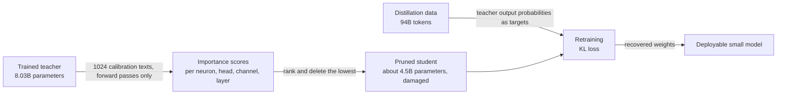
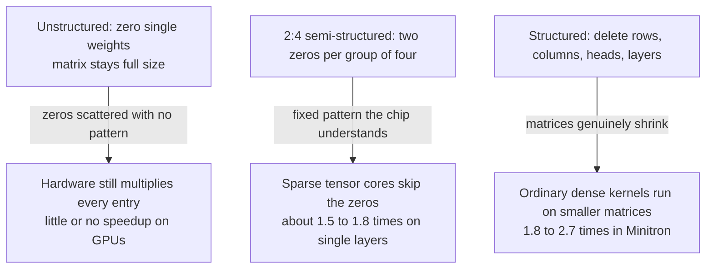

# Pruning and compression: making a small model out of a big one

> **Key papers:**
> Muralidharan, Turuvekere Sreenivas, Joshi, Chochowski, Patwary, Shoeybi, Catanzaro, Kautz and Molchanov (NVIDIA), 2024, "Compact Language Models via Pruning and Knowledge Distillation" - [arXiv 2407.14679](https://arxiv.org/abs/2407.14679) (preprint, v2 of 4 November 2024; the guide follows the arXiv HTML text).
> Turuvekere Sreenivas and 20 co-authors (NVIDIA), 2024, "LLM Pruning and Distillation in Practice: The Minitron Approach" - [arXiv 2408.11796](https://arxiv.org/abs/2408.11796) (preprint, v4 of 9 December 2024).
> Xia, Gao, Zeng and Chen (Princeton), 2023, "Sheared LLaMA: Accelerating Language Model Pre-training via Structured Pruning" - [arXiv 2310.06694](https://arxiv.org/abs/2310.06694).
> Frantar and Alistarh, 2023, "SparseGPT: Massive Language Models Can Be Accurately Pruned in One-Shot" - [arXiv 2301.00774](https://arxiv.org/abs/2301.00774).
> Sun, Liu, Bair and Kolter, 2023, "A Simple and Effective Pruning Approach for Large Language Models" (Wanda) - [arXiv 2306.11695](https://arxiv.org/abs/2306.11695).
>
> **Scope:** how to shrink an already-trained model by deleting parts of it and then re-teaching the smaller remainder with the original as teacher; why deleting individual weights rarely makes real hardware faster while deleting whole neurons, heads or layers does; and when an enterprise should do this instead of downloading a small base model. It does not cover quantisation (storing numbers in fewer bits), which is a different compression family, or pruning for vision models.

Written 2026-11-26. Tool facts and model names decay; the paper figures below do not.

## Read this first

**The idea in one sentence.** Take a big model that already knows a lot, cut out the neurons, attention heads or layers that matter least, then train the smaller leftover to copy the big model's outputs, which costs a small fraction of the data that training a small model from scratch would need.

**Who this is for.** Anyone on a small-language-model (SLM) project who has been told "we should compress a big model", and the person who must answer that with numbers.

**Afterwards you will be able to** tell unstructured from structured pruning, trace one pruning-plus-distillation run with real parameter counts, estimate its compute, say what the papers did and did not show, and decide whether to prune at all.

**Reading time.** About 40 minutes; Tutorial 1 alone is about 15. **Have read first:** [01 options and trade-offs](../01-options-and-trade-offs.md) and the lab's [scaling laws](../../../llm-learning-repository/tutorials/01-foundations/04-scaling-laws.md) guide for the "6 x parameters x tokens" compute rule. Useful: [LoRA](../../../llm-learning-repository/tutorials/02-building/09-lora.md), the cheap alternative to try first. Siblings: [continued pretraining](./13-continued-pretraining.md) and [constrained decoding](./14-constrained-decoding.md).

**The one thing most people get wrong.** Pruning is not a file-size trick you apply the afternoon before deployment. Cutting a model's parts without retraining wrecks it, and the retraining is the expensive part: the Minitron 4B recipe used 94 billion tokens of distillation (2408.11796 Table 4), which is a real training run, not a fine-tune. For a company that wants a small model, downloading one that someone else already pruned or trained is almost always the better first move.

## The technique in one worked example

This example is constructed by this guide from two real recipes. Part A uses the architecture of Llama 3.1 8B as this guide remembers it (32 layers, hidden size 4,096, MLP width 14,336, 32 attention heads, 8 key-value heads of size 128, vocabulary 128,256, input and output embeddings not shared). Those architecture figures are from memory and **unverified**; the paper figures quoted beside them are verified. Part B is a toy small enough to check by hand.

### Part A - from an 8B teacher to a 4B student, with counts

The Minitron practice paper reports compressing Llama 3.1 8B to a 4B model two ways (2408.11796 Section 3.3). **Width pruning** keeps 32 layers and cuts hidden size from 4,096 to 3,072 and MLP width from 14,336 to 9,216. **Depth pruning** keeps every width and cuts layers from 32 to 16.

Counting parameters with the remembered architecture (this guide's arithmetic, run in Python):

| Piece | Teacher (8B) | Width-pruned student | Depth-pruned student |
|---|---|---|---|
| MLP, 3 matrices per layer | 3 x 4,096 x 14,336 = 176.2M | 3 x 3,072 x 9,216 = 84.9M | 176.2M |
| Attention per layer | 41.9M | 31.5M | 41.9M |
| Layers | 32 | 32 | 16 |
| Embeddings (in plus out) | 1,050.7M | 788.0M | 1,050.7M |
| Total | 8.03B | 4.51B | 4.54B |

Both students land near 4.5 billion numbers, and both are about 56 percent of the teacher. The paper calls these models "4B"; this guide infers the name excludes embeddings (about 3.7B for the width variant by the same arithmetic). The exact paper totals were not checked, so treat 4.51B as this guide's estimate.

What the paper then reports, all from 2408.11796:

- **Recovery data:** 94 billion tokens of distillation (Table 4), against 15 trillion for the teacher (Section 5.1): about 0.6 percent, a ratio of roughly 160 to 1 (guide's arithmetic).
- **Quality (Table 1):** MMLU (Massive Multitask Language Understanding, a 57-subject multiple-choice exam) 60.5 width, 58.7 depth, 65.3 teacher. GSM8k (grade-school maths problems) 41.2 width, 16.8 depth, 48.6 teacher: out of every 100 problems the depth-pruned student solves about 32 fewer than the teacher.
- **Speed (Section 5.3, Figure 10, TensorRT-LLM, FP8, one H100):** depth 2.7 times the teacher's throughput, width 1.8 times (Section 6 says 1.7 for width).

### Part B - one importance score and one prune (constructed by this guide)

A hidden layer has four neurons. We run two short calibration sequences of two tokens each through the teacher and record each neuron's activation (invented numbers):

| Neuron | Seq 1, tok 1 | Seq 1, tok 2 | Seq 2, tok 1 | Seq 2, tok 2 |
|---|---|---|---|---|
| n0 | 1.0 | 3.0 | -2.0 | 0.0 |
| n1 | -0.2 | 0.2 | 0.1 | -0.3 |
| n2 | 0.5 | -0.5 | 0.5 | 0.5 |
| n3 | 0.0 | 0.1 | 0.0 | 0.1 |

Following the Minitron best practice "batch = L2, sequence = mean" (2407.14679 Section 4.1): take the mean absolute activation over tokens within each sequence, then the L2 norm (square root of sum of squares) across sequences.

- n0: sequence means 2.0 and 1.0, so sqrt(4 + 1) = **2.236**
- n1: means 0.2 and 0.2, so **0.283**
- n2: means 0.5 and 0.5, so **0.707**
- n3: means 0.05 and 0.05, so **0.071**

Prune half the neurons: keep n0 and n2, delete n1 and n3 (their rows and columns disappear, so the matrices get physically smaller). Then distillation re-teaches the survivors so that the student's output probabilities match the teacher's. Later sections refer back to "the four-neuron prune" and "the 8B-to-4.5B prune".



Notice that the teacher appears twice, once to rank what to delete and once as the answer key during retraining, and that no new human labels are needed at any point.

## Words you need

| Term | Plain definition | Example from this guide |
|---|---|---|
| Pruning | Deleting parts of a trained model that contribute least | Deleting n1 and n3 in the four-neuron prune |
| Unstructured pruning | Zeroing individual weights anywhere in a matrix, leaving the matrix the same size | SparseGPT and Wanda at 50 percent |
| Structured pruning | Deleting whole rows, columns, heads or layers, so matrices actually shrink | Hidden size 4,096 to 3,072 |
| Semi-structured (N:M) sparsity | A fixed pattern, such as at most 2 non-zero weights in every group of 4, that special hardware can skip | The 2:4 pattern in Wanda Section 3 |
| Knowledge distillation | Training a student to match the teacher's output probabilities, not only the right answers | The 94B-token retraining stage |
| Teacher and student | The big model that is copied, and the smaller model that learns to copy it | 8.03B teacher, 4.5B student |
| Width pruning | Shrinking hidden size, MLP width or head count while keeping all layers | 32 layers kept, hidden 3,072 |
| Depth pruning | Removing whole transformer layers | 32 layers cut to 16 |
| KL divergence (KLD) | A measure of how different two probability distributions are; the distillation loss | Forward KLD beat reverse KLD in Table 16 of 2407.14679 |
| Perplexity | How surprised a model is by held-out text; lower is better | Dense OPT-175B 8.35 on WikiText2 |

## Tutorial 1 - Intuitive understanding

### What was broken before

Each model size has traditionally been trained separately, from nothing, on trillions of words. Nemotron-3 8B saw 3.8 trillion tokens (2407.14679 Table 2); a 4B, an 8B and a 15B version mean three enormous runs, out of reach for all but a few labs.

The first workaround was to delete weights and hope. Removing half the weights of the 175-billion-parameter OPT model by plain size ("magnitude pruning") pushed perplexity from 8.35 to 43,000, which is noise (SparseGPT Section 3.4 table). And even when accuracy survived, scattered zeros did not make the model faster on ordinary graphics processors.

### The idea

**Analogy.** A university department needs a smaller version of its curriculum. Retraining a new cohort from first principles takes four years (training from scratch). Instead the head of department, who knows which courses overlap, removes the lowest-value half of the modules (pruning), then has the best professor re-teach the shortened course in one term, checking the new students' answers against how she would have answered (distillation).

**Where the analogy breaks.** A department can see which courses are redundant; a network cannot, and importance has to be estimated with a proxy such as average activation size on a few hundred sample texts. A course, once removed, leaves the others unchanged; deleting a neuron changes what every later layer receives, which is why the damaged student is poor until retrained. And the student can end up better than the teacher on a narrow test, as the NeMo-12B result below shows, which no shortened curriculum would normally do.

### How it works, step by step

1. **Pick the teacher.** The Minitron recipe says to start from the largest model you have and derive the smaller ones from it, preferring the final-stage checkpoint (2407.14679 Section 4.1, practices 1 and 10).
2. **Measure importance.** Run about 1,024 sample texts through the teacher and record how large each neuron's, head's and embedding channel's activations are. Layers are scored by how much removing them hurts. One pass is enough; an iterative version gave no benefit (Table 14).
3. **Delete the lowest.** Remove the lowest-scoring parts until the architecture reaches a target shape, for example hidden 3,072 and MLP 9,216.
4. **Retrain by distillation.** Feed the student ordinary text and train it so its predicted next-word probabilities match the teacher's, not only the actual next word. The paper uses a KL (Kullback-Leibler) divergence on the logits and, when many layers were removed, also on intermediate states (practices 5 to 7).
5. **Optionally correct the teacher.** If you do not have the data the teacher was originally trained on, briefly fine-tune the teacher on your distillation data first. The practice paper calls this teacher correction and reports it helps (2408.11796 Section 3.2 and Section 6).

A cousin is Sheared LLaMA: it learns masks under a constraint that forces a target shape, then continues training on a data mix that upweights lagging domains (2310.06694 Sections 2.1 and 2.2).



Notice that only the last route needs no special hardware, which is why every recipe aimed at building a small deployable model uses structured pruning.

### What the evidence says

- **Far less data.** Deriving the 8B and 4B Minitron models from the 15B Nemotron-4 needed up to 40 times fewer training tokens per model than from scratch, and saved 1.8 times the compute across the 15B, 8B and 4B family (2407.14679 abstract and Section 4.1).
- **Quality.** Minitron 8B scores 63.8 on MMLU against 54.7 for the from-scratch Nemotron-3 8B, 65.3 for Llama-3 8B and 64.1 for Mistral 7B (Table 2): it matches peers rather than beating them all.
- **Pruning beats random start.** For a 4B student, pruning Nemotron-4 15B and distilling reached 37.81 on MMLU, pruning the Minitron 8B reached 42.45, and training from random for 400B tokens reached 26.24 (Table 11). Random guessing scores 25.
- **Sheared LLaMA.** With 50 billion extra tokens the pruned 2.7B model averages 56.7 over 11 tasks against 55.7 for OpenLLaMA-3B-v2 (2310.06694 Table 2).
- **Speed.** Measured 1.8 and 2.7 times on a single H100 (2408.11796 Section 5.3).

### What this does not show

- The recovery runs in the Minitron papers use 94 to 380 billion tokens of pretraining-style text. Nothing here shows you can recover a pruned model using a few thousand private documents.
- Every headline comparison is on general benchmarks (MMLU, GSM8k and similar). None measures a specialised enterprise task, which is where a fine-tuned off-the-shelf small model is usually enough.
- The comparisons are against models whose training data and recipe differ, so differences in quality are not purely due to pruning. Only Table 11 holds the student architecture fixed.
### Teach-back

<details>
<summary>1. Why does zeroing half the weights of a model usually not make it faster on a GPU, while deleting a quarter of the neurons does?</summary>
Zeroed weights sit scattered inside a matrix that keeps its full shape, so a standard matrix multiplication still reads and multiplies every entry. Deleting neurons removes whole rows and columns, so the matrix itself is smaller and the same dense kernel does less work. Hardware only skips zeros when they follow a fixed pattern such as 2:4.
</details>

<details>
<summary>2. In the four-neuron prune, why is the score of n0 higher than n2 even though n2 is never zero?</summary>
The score tracks how large the activations are, not how often they are non-zero. n0 swings between 3.0 and 0.0, with sequence means 2.0 and 1.0, while n2 stays at magnitude 0.5. A neuron that carries larger signals changes later layers more when it is removed.
</details>

<details>
<summary>3. Why is distillation used for the retraining stage and not ordinary next-word training?</summary>
The teacher's full probability list tells the student how the teacher ranks all the wrong answers too, which is far more information per token than the single correct word. The paper's Table 11 shows distillation reaching better results than conventional training on the same architecture and recommends distillation only.
</details>

## Tutorial 2 - Practitioner understanding

### The design in concrete terms

**Structured recipe (Minitron).**

- Importance is activation-based, from forward passes on 1,024 calibration samples; the best aggregation was batch L2 with sequence mean (2407.14679 Section 2.2, Table 13).
- Depth is cut by single-layer perplexity impact or Block Importance (one minus the average cosine similarity of a layer's input and output). Choosing a contiguous block by downstream Winogrande beat perplexity: removing layers 16 to 31 gave about 0.595 Winogrande against about 0.5 for 16 layers picked by importance (2408.11796 Figures 8 and 9).
- Width gives better quality, depth more speed (2.7 against 1.8 times).
- Loss is L = L_CLM + L_logits + alpha x L_is, alpha set dynamically as the ratio of the two losses; forward KLD, temperature 1.0 (Section 3, Table 16). Learning rate cosine from 2e-4 to 4.5e-7, batch size 1,152.

**Mistral NeMo 12B to MN-Minitron-8B (2408.11796 Section 6).** Against its fine-tuned teacher the student rose from 55.7 to 58.5 on GSM8k and from 23.8 to 36.2 on HumanEval; the authors give no controlled cause.

**Unstructured methods.** SparseGPT works layer by layer and updates remaining weights to compensate; on one A100 80GB the 175B models take roughly 4 hours (abstract: under 4.5; Section 4: approximately 4). Wanda scores |W| times the L2 norm of the input feature per output row, with no weight update (2306.11695 Equations 1 and 2). NVIDIA's NeMo and TensorRT Model Optimizer carry the Minitron recipe and the abstract says the pruned weights are on Hugging Face; this guide ran none of these tools.

### A minimal version

This is a toy pure-Python width prune on one feed-forward layer, using the importance rule from Part B. It was run by this guide; it shows shapes only and trains nothing. The real recipe uses NeMo or TensorRT Model Optimizer plus a distillation loop, which this guide did not run.

```python
import math
# W1: hidden=3 -> 4 neurons, W2: 4 neurons -> hidden=3 (constructed numbers)
W1 = [[1, 0, 2], [0, 1, 0], [1, 1, 1], [0, 0, 1]]      # shape 4 x 3
W2 = [[1, 0, 1, 0], [0, 1, 1, 0], [1, 1, 0, 1]]        # shape 3 x 4
acts = [[[1.0, -0.2, 0.5, 0.0], [3.0, 0.2, -0.5, 0.1]],
        [[-2.0, 0.1, 0.5, 0.0], [0.0, -0.3, 0.5, 0.1]]]  # seq x tok x neuron

def score(j):  # batch = L2, sequence = mean (2407.14679 Section 4.1)
    per_seq = [sum(abs(t[j]) for t in s) / len(s) for s in acts]
    return math.sqrt(sum(x * x for x in per_seq))

scores = [score(j) for j in range(4)]                   # [2.236, 0.283, 0.707, 0.071]
keep = sorted(sorted(range(4), key=lambda j: -scores[j])[:2])   # [0, 2]
W1p = [W1[j] for j in keep]                             # shape 2 x 3
W2p = [[row[j] for j in keep] for row in W2]            # shape 3 x 2
print([round(s, 3) for s in scores], keep, len(W1p), len(W1p[0]), len(W2p), len(W2p[0]))
# prints: [2.236, 0.283, 0.707, 0.071] [0, 2] 2 3 3 2
```

Input shapes: W1 is 4 x 3 and W2 is 3 x 4. Output shapes: W1p is 2 x 3 and W2p is 3 x 2. The layer now holds half the parameters and runs as an ordinary dense matrix product, with no sparse kernel. The distillation step that would follow is a standard loop: forward the batch through teacher (no gradients) and student, take the KL divergence of their softmax outputs at temperature 1.0, and back-propagate through the student only.

### What it costs

Assumptions (this guide's): training compute is about 6 x parameters x tokens (Kaplan et al., Section 1.3 and 2.1; used by Hoffmann et al., Section 3.3), a student forward and backward costs 6 x 4.51B per token, a teacher forward costs 2 x 8.03B per token, an A100 sustains 40 percent of its 312 TFLOP/s (peak figure from NVIDIA's specification, not re-checked here), and a GPU-hour costs 2 dollars (an assumed rate, not a quote).

| Stage | Arithmetic | FLOPs | A100-hours | Dollars |
|---|---|---|---|---|
| Distillation, 94B tokens | (27.06 + 16.06) x 10^9 x 94 x 10^9 | 4.05 x 10^21 | about 9,000 | about 18,000 |
| Teacher correction, 100B tokens | 6 x 8.03B x 100B | 4.82 x 10^21 | about 10,700 | about 21,400 |
| Both stages | sum | 8.87 x 10^21 | about 19,700 | about 39,500 |
| From scratch, 4.51B on 15T tokens | 6 x 4.51B x 15T | 4.06 x 10^23 | about 903,000 | about 1.8 million |

Read the last row against the third: on these assumptions, from scratch costs about 46 times the pruned route's compute, though the token ratio is 160 to 1. The gap is smaller than the token ratio because every distillation token also runs the teacher. The 15 trillion figure is the Llama 3.1 training size quoted in 2408.11796 Section 5.1; it is the paper's figure for the teacher, used here as a proxy for a from-scratch student.

Compare with LoRA on an existing 4B to 8B model, which the lab puts at single-digit to low-double-digit dollars ([04 playbook](../04-build-and-deploy-playbook.md#3-what-it-costs)): pruning plus distillation is three to four orders of magnitude more compute.

### How it fails

| Symptom | Likely cause | Mitigation |
|---|---|---|
| Student scores near random right after pruning | Normal: pruning damages the model before recovery | Distil; Table 1 of 2407.14679 reports scores before and after lightweight retraining |
| Maths and code fall much more than knowledge tests | Depth pruning removes multi-step capacity (GSM8k 16.8 against 41.2 for width, 2408.11796 Table 1) | Prefer width pruning unless latency forces depth |
| Distilled student worse than its from-scratch peer | Distillation data narrower than the teacher's training data | Use a broad mixture; apply teacher correction if you lack the original data |
| Unstructured model not faster | Zeros are scattered, hardware multiplies them anyway | Use structured pruning or a 2:4 pattern with sparse-tensor-core kernels |
| 2:4 model faster in microbenchmarks but not end to end | Only linear layers speed up; attention, memory and overheads do not (Wanda: 1.6 times on layers, 1.24 times end to end on LLaMA-7B) | Measure end-to-end latency in your serving stack before committing |
| Quality good on benchmarks, poor on your task | Benchmarks and your task differ | Evaluate on your own held-out set; fine-tune after pruning |

### Evaluating your version

- **Metric.** Your own task score, a general check such as MMLU for damage elsewhere, and latency at your real batch size and prompt length. Perplexity alone can mislead: Sheared LLaMA's pruned model had higher perplexity than CoFiPruning but faster generation (2310.06694 Table 4: 10.3 against 9.1, and 58 against 51 tokens per second at 1.3B).
- **Test set.** At least 300 to 500 items (guide's rule of thumb: a 95 percent interval on 300 pass/fail items is about plus or minus 5.7 points at 50 percent accuracy).
- **Baselines.** The teacher, a good off-the-shelf small model of the target size, and that model with LoRA on your data.
- **Stop rule.** Stop if the distilled student does not beat the LoRA-tuned off-the-shelf model by at least 3 points on your task.

### Adopt, adapt or skip

**Skip, for nearly every enterprise building a small model over private documents.** Choosing an off-the-shelf small base (from 1B to 8B) and fine-tuning it with LoRA gets you a deployable model for tens of dollars and days, against tens of thousands of dollars and weeks for a Minitron-style run with a team that operates training clusters. Do it only if all of these hold: you need a size that does not exist (for example a 6B that fits one specific accelerator), no published small model of that size reaches the quality you need, you have a stack that can run multi-node distillation over hundreds of billions of tokens, and you can legally derive from the teacher. If you do go, **adapt**: take a published pruned model such as the Minitron releases as your base and fine-tune it, rather than pruning yourself. Compare this with [continued pretraining](./13-continued-pretraining.md), which is also a rung-5 technique and needs the same kind of cluster.

## Tutorial 3 - Researcher understanding

### Formal setup

A trained model has dimensions (L layers, hidden size d, MLP width f, heads h). **Structured pruning** picks a target shape (L', d', f', h') and a mask keeping that shape. **Importance** I(c) of a component c is estimated from calibration activations; the top-I components in each group are kept. **Distillation** minimises L_KD = sum over positions of KL(p_T(. | x_<t) || p_S(. | x_<t)) at temperature 1, plus a mean-squared term on selected hidden states weighted by alpha (2407.14679 Section 3). Sheared LLaMA instead learns masks by gradient descent under a Lagrangian that forces the target shape (2310.06694 Section 2.1). Wanda's score is S_ij = |W_ij| x ||X_j||_2, compared within each output row (2306.11695 Equations 1 and 2).

**Toy instance.** The four-neuron prune has I = (2.236, 0.283, 0.707, 0.071), so f' = 2 keeps n0 and n2. Wanda on one row of weights (0.5, -2.0, 1.5, 0.1) with input norms (4.0, 0.5, 1.0, 5.0) scores 2.0, 1.0, 1.5, 0.5 and keeps the first and third. Plain magnitude keeps the second and third, because Wanda also weighs how large the input is.

### The claims, stated precisely

1. Pruning a pretrained large model and retraining by distillation on under 3 percent of the original data yields small models competitive with from-scratch peers (2407.14679 abstract; the authors' claim).
2. Width pruning beats depth pruning at equal size up to the scales tested, while depth pruning is faster (2408.11796 Sections 4 and 5.3).
3. Distillation beats conventional retraining, and teacher correction helps when original data is unavailable (2407.14679 Table 11; 2408.11796 Section 3.2).
4. Targeted structured pruning with dynamic batch loading matches same-size from-scratch models at about 3 percent of the compute (2310.06694 abstract).
5. At 50 percent unstructured sparsity, SparseGPT and Wanda stay near dense perplexity where magnitude pruning does not.
6. Unstructured sparsity gives little GPU speedup, while structured and 2:4 patterns do; the check is in the evidence section below.

### Evidence, table by table

**2407.14679 Table 2 (5-shot MMLU).** Minitron 8B 63.8; Llama-3 8B 65.3; Mistral 7B 64.1; Gemma 7B 64.0; Nemotron-3 8B 54.7, trained on 3.8T tokens against 94B. Associational: baselines differ in data, architecture and recipe. **Table 3:** Minitron 4B 58.6, Phi-2 57.5, Gemma2 51.3, same caveat. **Table 4:** on an 8B target, LLM-Pruner 25.2, SliceGPT 37.1, LaCo 45.9, ShortGPT 54.7 against 63.8; this guide did not check whether retraining budgets were matched.

**Table 11** is the causal one for "is pruning plus distillation better than random initialisation given extra tokens": 37.81 and 42.45 against 26.24 at 400B tokens, with the student architecture fixed. **Table 10:** width-only has the best LM loss, 2.049. **Table 16:** forward KLD 2.155 against reverse 2.665.

**2408.11796 Table 1** (depth, width, teacher): MMLU 58.7, 60.5, 65.3; GSM8k 16.8, 41.2, 48.6; Winogrande 72.1, 73.5, 77.3; ARC-C 52.6, 55.6, 57.9; MBPP 30.7, 32.4, 42.3. Causal for width against depth at equal size and recovery data. **Table 2:** the 4B width student scores 6.88 on MT-Bench against 7.44 for Gemma2 2B.

**2310.06694.** Table 2: Sheared-LLaMA-2.7B 56.7, OpenLLaMA-3B-v2 55.7, INCITE-Base-3B 54.7; the 1.3B model 51.0 against TinyLlama 50.0. Table 3: dynamic loading moves the CC share of data from 67.0 to 36.1 percent. Table 5: more pruning tokens lower perplexity at a fixed 5B budget.

**SparseGPT** (Section 3.4 table): OPT-175B WikiText2 perplexity dense 8.35, 50 percent magnitude 4.3e4, 50 percent SparseGPT 8.21; 4:8 8.45, 2:4 8.74. Appendix E Table 7: CPU speedups of 1.57, 1.82, 2.16 times at 40, 50, 60 percent on OPT-2.7B with DeepSparse; Table 8: layer-level 2:4 GPU speedups 1.79, 1.67, 1.54 times.

**Wanda Table 3** (LLaMA-7B, WikiText, 50 percent): dense 5.68, magnitude 17.29, SparseGPT 7.22, Wanda 7.26; at 2:4, 42.13, 11.00, 11.53. Table 4: 203.1 s against 0.54 s pruning time, about 376 times by this guide's arithmetic (the paper says "300 times"). Section 4.3: 2:4 layer speedups of 1.63, 1.61, 1.54 times by simulation on LLaMA-65B, and 1.24 times end to end on LLaMA-7B (251 ms against 312 ms).

**The hardware claim, checked.** NVIDIA's Ampere material (vendor documentation, found by search) says unstructured sparsity lacks the structure that vector and matrix instructions need, and that 2:4 lets sparse tensor cores skip zeros for a theoretical 2 times peak. Every measured figure above is lower. No paper cited here measures unstructured-sparse latency on a GPU, so "rarely speeds up" rests on NVIDIA's design statement, the absence of such speedups in these papers and the CPU exception in SparseGPT Table 7: **unverified as a measured figure.**

### Ablations and what they isolate

- **Width, depth, combined (2407.14679 Table 10; 2408.11796 Figure 7).** Isolates which dimension to cut at fixed parameters, not scale: width-first is claimed up to 15B.
- **One-shot against iterative importance (Table 14).** Iteration buys nothing here.
- **Pruning against random init (Table 11).** The cleanest causal evidence in the set.
- **Layer-selection metric (2408.11796 Figures 8 and 9).** A downstream-task metric beat perplexity.

### Threats to validity

- **Contamination.** MMLU and GSM8k are public; the text read here reports no contamination checks (unverified whether they exist elsewhere).
- **Teacher advantage.** The student inherits what the teacher learned from trillions of tokens, so a from-scratch comparison measures inheritance plus pruning.
- **Different baselines.** Tables 2 and 3 compare against community models of unknown recipe.
- **Vendor stack.** Speed numbers use NVIDIA software on H100 in FP8; Wanda's 2:4 layer figures are partly simulated.
- **Chat gap.** The 4B instruct student trails Gemma2 2B on MT-Bench, so base-model parity does not carry over.
- **Internal inconsistencies.** 1.7 against 1.8 times in 2408.11796; "under 4.5 hours" against "approximately 4 hours" in SparseGPT.

### Open problems and follow-ups

Recovery with only a small private corpus; principled choice of target shape; joint pruning and quantisation latency; a measured unstructured against structured latency study on current GPUs; whether LoRA on a well-chosen small base closes the gap on narrow tasks (this guide infers yes, found no controlled study).

### What would change my mind

For "skip for most enterprises": a controlled study where a pruned student recovers with under 5 billion private tokens and beats a fine-tuned off-the-shelf model on a narrow task. For "structured over unstructured": a common GPU kernel making 50 percent unstructured sparsity 1.5 times faster end to end.

## Reading map for the key papers

| Paper section or figure | What it contains | Read, skim or skip | Where this guide answers it |
|---|---|---|---|
| 2407.14679 Sections 2 to 4.1 | Importance formulas, loss, ten best practices | Read | Tutorial 2, design |
| 2407.14679 Tables 2, 3, 11 | Results against baselines and random init | Read | Tutorial 3 evidence |
| 2407.14679 Tables 13 to 16 | Aggregation, iteration, loss ablations | Skim | Tutorial 3 ablations |
| 2408.11796 Sections 3 to 5.3 | Teacher correction, width and depth, speed | Read | Worked example, Tutorial 2 |
| 2310.06694 Sections 2 to 4 | Targeted pruning, dynamic batch loading, results | Skim | Formal setup |
| 2301.00774 Appendix E | CPU and GPU speedups | Read | Hardware claim check |
| 2306.11695 Sections 3 and 4.3 | Wanda metric, speed, 2:4 speedup | Read | Formal setup |

**Sources read for this guide (2026-11-26).** Paper text: [2407.14679 HTML](https://arxiv.org/html/2407.14679), [2408.11796 HTML](https://arxiv.org/html/2408.11796), [2310.06694 HTML](https://arxiv.org/html/2310.06694), [2301.00774 HTML](https://arxiv.org/html/2301.00774), [2306.11695 HTML](https://arxiv.org/html/2306.11695). Compute rule: [Kaplan et al.](https://arxiv.org/abs/2001.08361), [Hoffmann et al.](https://arxiv.org/abs/2203.15556). Hardware claim: [NVIDIA, Accelerating Sparsity in the Ampere Architecture (slides)](https://developer.download.nvidia.com/video/gputechconf/gtc/2020/presentations/s22085-accelerating-sparsity-in-the-nvidia-ampere-architecture%E2%80%8B.pdf), [Mishra et al., 2:4 sparsity](https://arxiv.org/abs/2104.08378); the NVIDIA and Mishra statements were read through a search summary, not the full documents.

## Questions readers get stuck on

**1. Why does the paper's "up to 40 times fewer tokens" not mean 40 times cheaper?**
The 40 is a token ratio per derived model (2407.14679 abstract). Distillation also runs the teacher on every token, and the practice recipe adds teacher correction on about 100 billion tokens. This guide's arithmetic gives about 46 times less compute than a from-scratch 15T-token run, for the 8B-to-4B case under stated assumptions, and the paper's family-level compute saving is 1.8 times because the 15B parent still has to be trained.

**2. What is the difference between pruning and quantisation?**
Pruning deletes parts so there are fewer numbers; quantisation keeps all the numbers but stores each in fewer bits. They stack, and the SparseGPT paper reports its method is compatible with quantisation. This explainer covers pruning only.

**3. Why do the papers say width pruning is better but depth is faster?**
Width pruning kept more of the teacher's behaviour per parameter (2408.11796 Table 1). Depth pruning gives fewer sequential steps and latency scales with layers, so it ran 2.7 times faster against 1.8. The quality gap is an empirical finding, not a proven mechanism.

**4. Is 2:4 sparsity the same as unstructured pruning?**
No. It forces at most two non-zero weights in each group of four, so hardware can store only the survivors and their positions. That is why it can be accelerated while arbitrary zeros cannot. The price is accuracy: at 50 percent on LLaMA-7B, the 2:4 pattern gave perplexity 11.00 to 11.53 against about 7.2 unstructured (Wanda Table 3).

**5. Why did a student beat its teacher on HumanEval?**
Table 1 of 2408.11796 shows 36.2 against 23.8 for its fine-tuned teacher, with no controlled explanation. Candidates are teacher correction weakening the teacher as a coder, code-rich distillation data and variance. It is not evidence that pruning improves models.

**6. Why not just pick a small base model?**
For most tasks you should. Small bases from 1B to 8B already exist and a LoRA on one costs tens of dollars. Pruning makes sense when you need a size that does not exist, or when you are a model builder amortising one teacher across several sizes.

**7. Is pruning the same as quantisation?**
No. Pruning deletes parts so there are fewer numbers; quantisation keeps them all but stores each in fewer bits. They stack, and the SparseGPT abstract says its method is compatible with quantisation.

**8. Can a pruned model be fine-tuned with LoRA like any other?**
In principle yes, since a structurally pruned model is a smaller dense model with unusual sizes such as an MLP width of 9,216. Check that your tooling accepts those shapes; this guide did not test it.

## Prerequisites you actually need

### Prerequisite 2 - Probability distributions and KL divergence

A model outputs a probability for each possible next token. KL divergence measures how much one distribution differs from another: zero when equal, larger when they disagree, and not symmetric.

*Tiny example.* Teacher says (0.7, 0.2, 0.1) and the student says (0.5, 0.3, 0.2). KL(teacher || student) = 0.7 ln(0.7/0.5) + 0.2 ln(0.2/0.3) + 0.1 ln(0.1/0.2) = 0.2355 - 0.0811 - 0.0693 = 0.085 nats (guide's arithmetic). A student with the teacher's exact numbers scores 0.


### Prerequisite 3 - Training compute as 6 x parameters x tokens

Training one token costs about 2 operations per parameter forward and 4 backward, so about 6N operations for N parameters. Total for D tokens is about 6ND. It is an approximation that ignores attention-length terms.

*Tiny example.* Check against the Chinchilla paper: 6 x 70e9 x 1.4e12 = 5.88e23 FLOPs, while the paper's Figure 2 caption gives Gopher's budget as 5.76e23 and says Chinchilla used the same; the rule is within about 2 percent here. For Gopher (280B, 300B tokens) the rule gives 5.04e23, which is 12.5 percent below the caption, so treat it as good to about 10 percent.


### Prerequisite 4 - Sparsity patterns and why hardware cares

A GPU multiplies blocks of numbers in fixed-size tiles. A tile full of scattered zeros still occupies the tile. A pattern the chip knows, such as two zeros in every four, lets it pack and skip.

*Tiny example.* A row (3, 0, 0, 5) obeys 2:4; (3, 0, 4, 5) does not, because three of four are non-zero. A 50 percent unstructured mask can produce both kinds of row.

## Where this sits

**Read before:** [01 options and trade-offs](../01-options-and-trade-offs.md), [03 vehicles](../03-vehicles.md) for where the resulting model will run, and the lab's [LoRA guide](../../../llm-learning-repository/tutorials/02-building/09-lora.md).

**Nearest techniques.** [Continued pretraining](./13-continued-pretraining.md) also trains a model on large token counts, but it adds knowledge or a language and keeps the model's size; pruning removes capacity and recovers it. LoRA fine-tuning changes behaviour with a few million trainable numbers and leaves the size alone, so it should be tried before either.

**Read next:** [continued pretraining](./13-continued-pretraining.md) for the other rung-5 option, then [constrained decoding](./14-constrained-decoding.md), the cheap rung that fixes output format without any training.

## Checkpoint

<details>
<summary>1. Explain in two sentences why Minitron prefers width pruning for quality but still reports depth pruning as the faster model.</summary>
Width pruning keeps all layers and shrinks each, which kept more benchmark ability (MMLU 60.5 against 58.7, GSM8k 41.2 against 16.8). Depth pruning removes whole layers, so fewer sequential steps run per token, giving 2.7 times the throughput against 1.8 times for width.
</details>

<details>
<summary>2. Compute: parameters in one MLP block with three matrices of hidden 3,072 and width 9,216, and the ratio to the teacher block (hidden 4,096, width 14,336).</summary>
Student 3 x 3,072 x 9,216 = 84,934,656. Teacher 3 x 4,096 x 14,336 = 176,160,768. The ratio is 0.482, so the student's MLP holds about 48 percent of the teacher's parameters per layer.
</details>

<details>
<summary>3. Compute: the training FLOPs of distilling a 4.5B student for 94B tokens with an 8B teacher, using 6ND for the student and 2N for the teacher forward.</summary>
(6 x 4.5e9 + 2 x 8e9) x 94e9 = (2.7e10 + 1.6e10) x 94e9, about 4.0e21 FLOPs. With the guide's exact counts (4.51B and 8.03B) it is 4.05e21. At 125 TFLOP/s sustained per GPU that is about 9,000 GPU-hours.
</details>

<details>
<summary>4. Critique: "Pruning cut training cost by 40 times, so we should prune instead of choosing a small base." What is wrong?</summary>
The 40 times is a token ratio against from-scratch training of the same size, and it excludes the parent's own training and teacher forward passes. The relevant alternative for an enterprise is an existing small model plus LoRA, which costs orders of magnitude less than either route. The claim also rests on general benchmarks, not a private task.
</details>

<details>
<summary>5. Why does Wanda keep a different weight from magnitude pruning in the toy row (0.5, -2.0, 1.5, 0.1) with input norms (4, 0.5, 1, 5)?</summary>
Wanda scores are |w| x norm: 2.0, 1.0, 1.5, 0.5, so it keeps positions one and three. Magnitude alone ranks 2.0 and 1.5, keeping positions two and three. Position two has a large weight but sees a small input, so it contributes little in practice.
</details>
