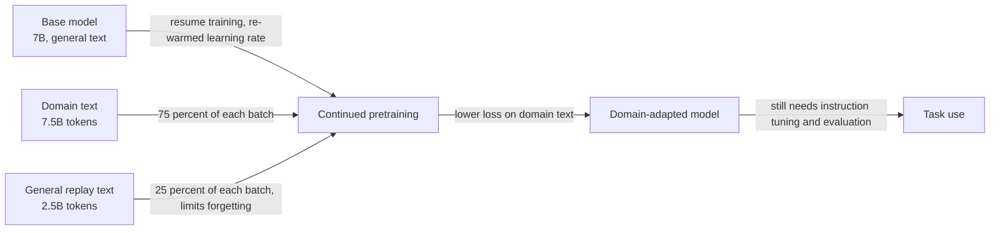
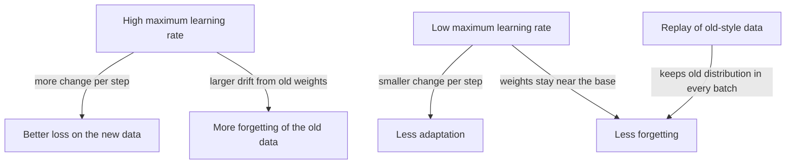

# Continued (domain-adaptive) pretraining

> **Key papers:**
> Gururangan, Marasovic, Swayamdipta, Lo, Beltagy, Downey and Smith (Allen Institute for AI and University of Washington), 2020, "Don't Stop Pretraining: Adapt Language Models to Domains and Tasks" - [arXiv 2004.10964](https://arxiv.org/abs/2004.10964).
> Gupta, Therien and co-authors, 2023, "Continual Pre-Training of Large Language Models: How to (re)warm your model?" - [arXiv 2308.04014](https://arxiv.org/abs/2308.04014) (preprint).
> Ibrahim, Therien, Gupta, Richter, Anthony, Lesort, Belilovsky and Rish, 2024, "Simple and Scalable Strategies to Continually Pre-train Large Language Models" - [arXiv 2403.08763](https://arxiv.org/abs/2403.08763).
> Ovadia, Brief, Mishaeli and Elisha (Microsoft), 2023, "Fine-Tuning or Retrieval? Comparing Knowledge Injection in LLMs" - [arXiv 2312.05934](https://arxiv.org/abs/2312.05934).
> Also used for examples: Roziere et al. (Meta), "Code Llama", [arXiv 2308.12950](https://arxiv.org/abs/2308.12950); Bolton et al., "BioMedLM", [arXiv 2403.18421](https://arxiv.org/abs/2403.18421); Yang, Liu and Wang, "FinGPT", [arXiv 2306.06031](https://arxiv.org/abs/2306.06031). Compute rule from Kaplan et al., [arXiv 2001.08361](https://arxiv.org/abs/2001.08361), and Hoffmann et al., [arXiv 2203.15556](https://arxiv.org/abs/2203.15556).
>
> **Scope:** resuming next-word training of an existing model on a new body of raw text so it absorbs a domain, language or vocabulary; the schedule, data-mixing and cost questions; and why it is usually the wrong tool for teaching a model facts. It does not cover instruction fine-tuning, LoRA on labelled examples, or training from scratch.

Written 2026-11-26. Model names and prices decay; the paper figures below do not.

## Read this first

**The idea in one sentence.** Take a model that already reads well, keep training it with the same "predict the next word" objective on a large pile of text from your domain, so it picks up that domain's vocabulary, style and background without starting from nothing.

**Who this is for.** Teams asked "should we pretrain on our documents?" or "should we build a domain model for our industry?", and anyone who has heard that a model "will learn our data" if you simply train it on the files.

**Afterwards you will be able to** separate continued pretraining from fine-tuning and retrieval; estimate its cost from tokens and parameters and check that estimate against published runs; explain why replay and learning-rate re-warming exist; say what Ovadia et al. do and do not show; and say when it is justified.

**Reading time.** About 40 minutes; Tutorial 1 alone is about 15. **Have read first:** the lab's [scaling laws](../../../llm-learning-repository/tutorials/01-foundations/04-scaling-laws.md) and [Chinchilla](../../../llm-learning-repository/tutorials/01-foundations/05-chinchilla.md) guides for the compute rule, and [01 options and trade-offs](../01-options-and-trade-offs.md). Useful: [LoRA](../../../llm-learning-repository/tutorials/02-building/09-lora.md). Siblings: [pruning and compression](./12-pruning-and-compression.md) and [constrained decoding](./14-constrained-decoding.md).

**The one thing most people get wrong.** Continued pretraining is not a reliable way to put facts into a model. In the one controlled comparison here, retrieval (RAG, giving the model the relevant text at question time) beat it on every model tested, and training on the new text barely moved some scores. What it does well is shift a model's language, vocabulary and style, and that is rarely what an enterprise needs.

## The technique in one worked example

Constructed by this guide, with real checks against published runs. A team has a 7-billion-parameter open base model and 10 billion tokens of private domain text. It plans 25 percent replay: a quarter of every batch is general text, to limit forgetting.

**Step 1, the mix.** 10 billion tokens is the training budget, so 7.5 billion are domain tokens and 2.5 billion general-text tokens (replay counted inside the budget, the accounting Ibrahim et al. use, Section 2).

**Step 2, the compute.** Training costs about 6 x parameters x tokens floating-point operations (FLOPs): 6 x 7 x 10^9 x 10 x 10^9 = **4.2 x 10^20**. The factor 6 is about 2 operations per parameter per token forward and 4 backward (Kaplan et al., Sections 1.3 and 2.1: "C is about 6N per training token", non-embedding, ignoring a context term).

**Step 3, check the rule against published runs.**

- Chinchilla: 6 x 70 x 10^9 x 1.4 x 10^12 = 5.88 x 10^23; the paper's Figure 2 caption gives Gopher's budget as 5.76 x 10^23 and says Chinchilla used the same, so the rule is 2 percent high. For Gopher (280B parameters, 300B tokens) the rule gives 5.04 x 10^23, 12.5 percent below the caption. Treat the rule as good to about 10 percent.
- BioMedLM: 2.7B parameters on 300B tokens gives 4.86 x 10^21. The paper reports 128 A100 GPUs for 6.25 days (Section 3.3), which is 19,200 GPU-hours, so the run delivered about 70 trillion FLOPs per second per GPU. An A100's peak is 312 trillion (NVIDIA specification, recalled, not re-checked), so about 22 percent utilisation. Real runs deliver a fraction of peak.

**Step 4, the time and money.** At an assumed 125 trillion FLOPs per second per GPU (40 percent of 312) the run is 4.2 x 10^20 / 1.248 x 10^14 = 3.37 x 10^6 GPU-seconds, **935 A100-hours**. At an assumed 2 dollars per hour that is about **1,870 dollars** of compute, before data preparation, evaluation and failed attempts. The BioMedLM check suggests utilisation of 22 percent is also plausible, which would multiply this by 1.8.

**Step 5, what comes out.** A model whose next-word loss on domain text is lower than the base's. The paper's own example is DAPT (domain-adaptive pretraining) on biomedical text: masked-language-model loss fell from 1.32 to 0.99 (2004.10964 Table 1), and ChemProt, a chemical-protein relation task, rose from 81.9 to 84.2 F1 (Table 5). Whether your task improves is a separate, measurable question, and Ovadia et al. suggest facts do not follow.



Notice that the output is another base model: it predicts text but does not follow instructions, so a fine-tuning stage still follows.

## Words you need

| Term | Plain definition | Example from this guide |
|---|---|---|
| Pretraining | Training a model to predict the next token over a huge text collection | The base model's original training |
| Continued pretraining | Resuming that same objective on new text | 10B domain-mix tokens on the 7B base |
| DAPT and TAPT | Domain-adaptive and task-adaptive pretraining: continuing on a domain's text, or only on the task's own unlabelled text | Table 5 of 2004.10964 |
| Catastrophic forgetting | Losing earlier abilities while learning new text | Pile loss rising during SlimPajama training in 2308.04014 |
| Replay | Mixing a share of the original-style data into the new training | 25 percent general text in the worked example |
| Re-warming | Raising the learning rate again at the start of the new phase | Maximum rates of 1.5e-4 to 6e-4 in 2308.04014 |
| Token | A word piece, the unit models count text in; about three-quarters of an English word (rule of thumb) | 10 billion tokens, about 7.5 billion words |
| FLOPs | Floating-point operations, a measure of arithmetic work | 4.2 x 10^20 for the example |
| Knowledge injection | Getting a model to answer from facts in new text | The Ovadia et al. test |
| RAG | Retrieval-augmented generation: look up relevant passages and put them in the prompt | The comparison arm that won |

## Tutorial 1 - Intuitive understanding

### What was broken before

General models are trained on broad internet-style text. A model that has seen little clinical writing, legal drafting or source code in your language reads those texts clumsily: it splits specialist words into many pieces, and it has little feel for how the field's documents flow. The two older fixes were to train a model from scratch on the domain, which costs as much as any model (BioMedLM took 128 A100 GPUs for 6.25 days even at 2.7 billion parameters, 2403.18421 Section 3.3), or to fine-tune on a small labelled set, which teaches a task but not the field's language.

### The idea

**Analogy.** A medical student who finished general schooling then spends a year reading only clinical journals. She does not learn new tasks by being told to, but she absorbs the jargon and the sentence shapes of the field, so every later lesson lands more easily.

**Where the analogy breaks.** A student keeps her general schooling while she reads journals. A model does not: update its numbers to fit journal text and it can lose general ability, called forgetting, unless you blend general text back in. And reading about a fact once does not give a model the fact. Ovadia et al. found that new facts needed many differently-worded repetitions, and even then lost to simply handing the model the document.

### How it works, step by step

1. **Pick a base** that is already strong, ideally the most recent checkpoint. Gupta et al. found earlier checkpoints no better for the new data (Section 4.5).
2. **Gather domain text**, clean it and remove duplicates. Quantity is in billions of tokens, not thousands of documents.
3. **Choose a mix.** Add some general text alongside the domain text (replay). Ibrahim et al. tested 0.5, 1, 5, 10, 25 and 50 percent.
4. **Set the learning rate schedule.** Raise it from near zero to a chosen maximum (re-warming), then lower it by cosine decay. Higher maxima adapt more and forget more.
5. **Train** with the next-token objective, watch loss on both domain and general held-out text.
6. **Evaluate on the task**, not only on loss, then fine-tune for instructions if you need a chat or task model.



Notice the trade-off is a dial, not a defect: replay is how the second branch gets less forgetting without giving up the first branch's adaptation.

### What the evidence says

- **It helps on tasks close to the domain.** On RoBERTa, domain-adaptive pretraining raised ACL-ARC (computer-science citation intent) from 63.0 to 75.4 F1 and ChemProt from 81.9 to 84.2 (2004.10964 Table 5), meaning about 12 more of every 100 citation intents classified correctly.
- **Relevance matters.** Adapting on an unrelated domain generally scored below or near plain RoBERTa: HyperPartisan 76.4 against 86.6 (Table 3, the non-DAPT column, against Table 5).
- **Small gains where the base already knows the domain.** News DAPT left AGNews unchanged at 93.9, and the masked-language-model loss on News rose from 1.08 to 1.16 (Table 1), because RoBERTa's own corpus already contained news.
- **Warm starting beats scratch for a long while.** Re-warming a Pythia 410M model onto 297B tokens of SlimPajama beat training from scratch at convergence, though a from-scratch model overtook a constant-rate continuation after about 200B tokens (2308.04014 Sections 4.3 and 4.4).
- **Replay plus schedule matches full retraining.** At 10B parameters with weak distribution shift, 5 percent replay averaged loss 1.89 against 1.87 for a model trained on both datasets together, and the authors say this uses a fraction of the compute (2403.08763 Table 4 and abstract).
- **Facts: retrieval won.** See Tutorial 3, Table 2 of 2312.05934.

### What this does not show

- Most evidence is for small models (RoBERTa about 125M by this guide's recollection, unverified; Pythia 410M; a 10B model in Ibrahim et al.). Behaviour at 70B and beyond is not shown by these papers.
- Gupta et al. note their upstream and downstream data are similar and rely on loss, not task benchmarks (Section 5).
- The Ibrahim et al. 10B average benchmark accuracy was 47.68 with 5 percent replay against 48.00 for the union model, and MMLU fell with replay, so "matches" refers to averages, not every benchmark (Table 5).
- None of this tests enterprise private documents, whose total token count is often far below the billions these studies use.

### Teach-back

<details>
<summary>1. A colleague says "we will train the model on our wiki so it knows our products". What do you tell them?</summary>
Continued pretraining on a small corpus mostly adapts style and vocabulary and does not reliably store facts. Ovadia et al. found retrieval beat fine-tuning on raw text for both old and new facts. Put the wiki behind retrieval first.
</details>

<details>
<summary>2. Why mix general text into the training data?</summary>
Updating weights for domain text can erode general ability (forgetting). Replay keeps old-style text in every batch so the model keeps its earlier skills while learning the new ones.
</details>

<details>
<summary>3. Why did News-domain DAPT not help RoBERTa on AGNews?</summary>
RoBERTa's original corpus already included news, so there was little new to learn. The News loss rose slightly from 1.08 to 1.16 and AGNews stayed at 93.9. The gains appear where the domain is far from the base's training data.
</details>

<details>
<summary>4. In the worked example, what changes if the corpus is 1 billion tokens instead of 10 billion?</summary>
Compute falls tenfold, to 4.2 x 10^19 FLOPs and about 94 A100-hours. But 1 billion tokens is below the 7.5 to 8.1 billion tokens the DAPT paper used for BioMed and CS, so the model may adapt much less.
</details>

## Tutorial 2 - Practitioner understanding

### The design in concrete terms

**What goes in.** A raw text corpus, deduplicated and filtered, tokenised with the base model's own tokenizer (changing the tokenizer discards the learned embeddings; BioMedLM trained its own 28,896-token biomedical vocabulary from scratch, 2403.18421 Section 3.2, so it is a from-scratch example, not continued pretraining; this guide infers from the paper's wording that it had no starting checkpoint, as the paper never says so outright).

**Published recipes.**

- **DAPT (2004.10964, Table 13).** 12.5K steps, batch 2,048 sequences, maximum learning rate 0.0005, Adam with beta 0.9 and 0.98, weight decay 0.01, linear decay, 6 percent warmup, on a single v3-8 TPU. TAPT: 100 epochs, batch 256, maximum rate 0.0001.
- **Corpus sizes (Table 1).** BioMed 7.55B tokens, CS 8.10B, News 6.66B, Reviews 2.11B, against 160GB for RoBERTa's own corpus.
- **Re-warming (2308.04014).** AdamW (0.9, 0.95), weight decay 0.1, clipping 1.0; linear warmup then cosine decay to 10 percent of the maximum; maximum rates 1.5e-4, 3e-4 and 6e-4. Warmup length of 0 to 2 percent of data made little difference (Section 4.1).
- **Replay (2403.08763).** 0.5 to 50 percent, counted inside the token budget; 5 percent was enough at 10B for weak shift, 25 percent at 405M for strong shift (Tables 3 and 4).
- **Code Llama (2308.12950, Sections 2.1 and 2.2).** Started from Llama 2 weights, 500B tokens for 7B, 13B and 34B and 1T for 70B, a mix of about 85 percent code, 8 percent code-related natural language and 7 percent general natural language. The GPU hours were not found in the text fetched (unverified).
- **FinGPT (2306.06031).** The abstract describes a data pipeline and a "lightweight low-rank adaptation technique", so it is a LoRA-style adaptation, not continued pretraining. It is a useful contrast: finance specialisation without any pretraining run.

**Tools.** Hugging Face Transformers and TRL support resuming causal-language-model training; larger runs use frameworks such as Megatron-LM, GPT-NeoX or NeMo (names only; none run here). Data tooling for deduplication is a separate workstream.

### A minimal version

Unrun, using real Hugging Face calls. Shapes: a text dataset of N rows becomes N / 4,096-token blocks of input_ids.

```python
# UNRUN sketch: continued pretraining of a causal LM with replay (Hugging Face)
from datasets import load_dataset, interleave_datasets
from transformers import (AutoModelForCausalLM, AutoTokenizer, Trainer,
                          TrainingArguments, DataCollatorForLanguageModeling)

base = "your-open-base-model"                       # same tokenizer as the base
tok = AutoTokenizer.from_pretrained(base)
model = AutoModelForCausalLM.from_pretrained(base)

domain = load_dataset("json", data_files="domain.jsonl", split="train")    # {"text": ...}
general = load_dataset("json", data_files="replay.jsonl", split="train")
mix = interleave_datasets([domain, general], probabilities=[0.75, 0.25], seed=0)

def pack(batch, block=4096):                        # concatenate, then cut to blocks
    ids = sum(tok(batch["text"])["input_ids"], [])
    n = len(ids) // block * block
    return {"input_ids": [ids[i:i + block] for i in range(0, n, block)]}
mix = mix.map(pack, batched=True, remove_columns=mix.column_names)

args = TrainingArguments(
    output_dir="cpt", per_device_train_batch_size=1, gradient_accumulation_steps=64,
    learning_rate=3e-5, lr_scheduler_type="cosine", warmup_ratio=0.01,   # re-warm
    max_steps=2000, bf16=True, logging_steps=20, save_steps=500)
Trainer(model=model, args=args, train_dataset=mix,
        data_collator=DataCollatorForLanguageModeling(tok, mlm=False)).train()
```

Rates here are illustrative and not from the papers: the papers used 1.5e-4 to 6e-4 on a 410M model, and larger models take smaller rates (this guide's inference; unverified for your size). Input is JSONL text; output is a checkpoint of the same shape as the base. With real data, add an evaluation set for domain text and one for general text, and log both.

### What it costs

Assumptions: 6ND FLOPs, 125 trillion FLOPs per second sustained per A100 (40 percent of the 312 trillion peak, recalled), 2 dollars per GPU-hour (assumed), 7B parameters.

| Tokens | FLOPs (6 x 7e9 x D) | A100-hours | Dollars at 2 per hour | Comparable published run |
|---|---|---|---|---|
| 1 billion | 4.2e19 | about 94 | about 190 | Below DAPT's 7.55B to 8.10B |
| 10 billion | 4.2e20 | about 935 | about 1,870 | The worked example |
| 100 billion | 4.2e21 | about 9,350 | about 18,700 | Under Ibrahim et al. 200B to 300B |
| 500 billion | 2.1e22 | about 46,700 | about 93,500 | Code Llama 7B (500B tokens) |

Add: data cleaning and deduplication (often more engineer-weeks than GPU time), evaluation runs, a second training run when the first mix is wrong, and the instruction-tuning stage afterwards. Plan three attempts. For comparison, a LoRA run on a 4B to 8B model costs single-digit to low-double-digit dollars ([04 playbook](../04-build-and-deploy-playbook.md#3-what-it-costs)), roughly two to three orders of magnitude below the 10-billion-token row.

For scale: Chinchilla's 70B model saw 1.4 trillion tokens, 20 tokens per parameter (guide's arithmetic from Hoffmann et al. Table 1, which does not state a ratio rule). A 7B model at that ratio would see 140B tokens, so a 10B-token continuation is about 7 percent of one full compute-optimal run.

### How it fails

| Symptom | Likely cause | Mitigation |
|---|---|---|
| General benchmarks drop after training | Forgetting from a high learning rate and no replay | Lower the maximum rate, add 5 to 25 percent replay, monitor general loss |
| Loss spike at start | Re-warming without warmup (the "stability gap") | Warm up over about 1 percent of steps; Gupta et al. found the spike did not matter later |
| Model does not answer from new facts | Facts need varied repetition and still lose to retrieval | Use RAG; if training, paraphrase each fact many times |
| Model no longer follows instructions | Next-token training on raw text erodes chat behaviour | Re-run instruction tuning after, or continue from the base model not the chat model |
| Domain loss falls but task score is flat | Domain already covered by the base (News in Table 1) | Test the task before spending; evaluate on task data |
| Worse than the original after long training | From-scratch can overtake a constant-rate continuation after about 200B tokens | Use decay to a low rate; consider whether retraining is warranted |
| Contaminated or private text leaks in outputs | Memorisation of repeated sensitive text | Deduplicate; this guide gives no legal or privacy guarantee |

### Evaluating your version

- **Metric.** Three numbers: loss or perplexity on held-out domain text, loss on held-out general text, and your task score. Gains on the first alone prove little.
- **Test set.** At least 300 to 500 task items; hold out domain documents entirely, not only random sentences, so the test does not contain training text.
- **Baselines.** The untouched base, the base with retrieval, and the base with LoRA on your task data.
- **Stop rule.** Stop the project if the continued model, after instruction tuning, beats the base-plus-retrieval pipeline on your task by under 3 points, or if general-text loss worsens by more than you can tolerate in the tasks that matter (set the number before training).

### Adopt, adapt or skip

**Skip for most enterprise SLM projects.** Start with retrieval for facts, prompting and a small LoRA for behaviour. **Adapt** only when one of these holds: a new language or script the base handles badly (Ibrahim et al.'s strong-shift German case is the nearest published analogue, though German is not low-resource); very specialised vocabulary the tokenizer shreds, such as chemical or legal notation, with a task proven to depend on it; or a large private corpus in the billions of tokens, with a team that can run multi-GPU training and a way to evaluate. Even then, choose a domain-adapted open base first if one exists, since that moves the cost to someone else; compare [pruning and compression](./12-pruning-and-compression.md), another rung-5 technique with a similar cost profile.

## Tutorial 3 - Researcher understanding

### Formal setup

A language model with parameters theta is trained to minimise next-token cross-entropy L(theta; D) = -(1/T) sum over positions of log p_theta(x_t | x_<t) on distribution D. Continued pretraining starts from theta_0, trained on D_0, and minimises the same loss on a mixture D_mix = (1 - r) D_1 + r D_0, where r is the replay fraction. Forgetting is L(theta; D_0) - L(theta_0; D_0). Adaptation is L(theta_0; D_1) - L(theta; D_1). The learning rate follows a schedule eta(t): linear warmup to eta_max, cosine decay to a floor. Compute is C of about 6 N D_tokens.

**Toy instance.** The worked example has r = 0.25 and D_tokens = 10^10, so D_1 supplies 7.5 x 10^9 tokens and D_0 2.5 x 10^9. If the base loss on D_1 text were 2.0 and fell to 1.6 while loss on D_0 text rose from 2.0 to 2.1, adaptation would be 0.4 nats and forgetting 0.1 nats (invented numbers).

### The claims, stated precisely

1. Continuing pretraining on in-domain text improves downstream tasks in that domain, over and above the base, and combining it with task-adaptive pretraining is best (2004.10964 abstract).
2. Re-warming raises loss on both old and new data first, then lowers loss on the new data; higher maxima adapt more and forget more (2308.04014 Sections 4.2 and 4.3).
3. Re-warming, re-decaying and replay match full retraining on the union in loss and average benchmark accuracy at 405M and 10B, at a fraction of the compute (2403.08763 abstract and Tables 2 to 5).
4. For injecting knowledge, unsupervised fine-tuning gives some improvement while RAG consistently outperforms it, for previously seen and new facts (2312.05934 abstract).

### Evidence, table by table

**2004.10964 Table 1.** Corpora and masked-LM loss, RoBERTa to DAPT: BioMed 1.32 to 0.99; CS 1.63 to 1.34; News 1.08 to 1.16; Reviews 2.10 to 1.93. **Table 5** (test F1, RoBERTa, DAPT, TAPT, both): ChemProt 81.9, 84.2, 82.6, 84.4; RCT 87.2, 87.6, 87.7, 87.8; ACL-ARC 63.0, 75.4, 67.4, 75.6; SciERC 77.3, 80.8, 79.3, 81.3; HyperPartisan 86.6, 88.2, 90.4, 90.0; AGNews 93.9, 93.9, 94.5, 94.6; Helpfulness 65.1, 66.5, 68.5, 68.7; IMDB 95.0, 95.4, 95.5, 95.6. **Table 3, non-DAPT column** (adapting to a different domain): ChemProt 79.4, ACL-ARC 66.4, HyperPartisan 76.4, a causal control for "is it the domain or just more training". **Table 6** (adapting to another task's data) lowers scores, e.g. ChemProt 82.6 to 80.4. **Table 7:** curated unlabelled data approximates DAPT cheaply in low-resource tasks.

**2308.04014.** Pythia 410M, Pile (300B) then about 297B SlimPajama tokens, no replay. Section 4.1: warmup length 0 to 2 percent made no significant difference. Section 4.2, Figures 2 to 4: maxima 1.5e-4, 3e-4, 6e-4; higher gives better downstream loss and more Pile forgetting. Section 4.3: warm start beats scratch at convergence; the from-scratch model overtakes a constant-rate continuation after about 200B tokens. Section 4.5: earlier checkpoints no better. Evidence is loss and perplexity at one small scale; Section 5 lists this and the similarity between datasets as limits.

**2403.08763.** Pile 300B then SlimPajama 300B (weak shift) or German Common Crawl about 200B (strong shift); union baselines of 600B or 500B tokens. Table 4 (10B, weak): 5 percent replay 1.89 against 1.87. Table 2 (405M, weak): 50 percent replay 2.35, equal to the union baseline with 150B fewer new tokens. Table 3 (405M, strong): 25 percent replay 1.75, equal to the union. Table 5: benchmark averages 47.68 against 48.00 at 10B and 35.14 against 34.30 at 405M, with MMLU falling at 10B. Comparisons are against the authors' own union baselines, so they identify the strategies' effect within the study but not against a tuned commercial recipe.

**2312.05934 Table 2 (910 current-events questions, accuracy).**

| Model | Base | Base + RAG | FT regular | FT paraphrased | FT regular + RAG | FT paraphrased + RAG |
|---|---|---|---|---|---|---|
| Mistral 7B | 0.481 | 0.875 | 0.504 | 0.588 | 0.810 | 0.830 |
| Llama2 7B | 0.353 | 0.585 | 0.219 | 0.392 | 0.326 | 0.520 |
| Orca2 7B | 0.456 | 0.876 | 0.511 | 0.566 | 0.820 | 0.826 |

Reading it as a person would: for Mistral, the base answered 48 of 100 questions, fine-tuning on the new text lifted that to 50, ten paraphrases of each chunk to 59, and plain retrieval to 88. Llama2 got worse after plain fine-tuning (0.353 to 0.219). Fine-tuning plus retrieval was below retrieval alone for every model. **Table 1** (MMLU subsets on anatomy, astronomy, college biology, college chemistry, prehistory; log-likelihood accuracy) shows the same ordering with small gaps, for example anatomy 0-shot Mistral 0.556 base, 0.570 fine-tuned, 0.681 with retrieval. The fine-tuning was unsupervised next-token training on Wikipedia-derived text.

### Ablations and what they isolate

- **Relevant against irrelevant domain, Table 3 of 2004.10964.** Isolates domain relevance from extra training steps.
- **Maximum learning rate and warmup (2308.04014).** Isolate the adaptation-forgetting dial.
- **Replay fraction (2403.08763).** Isolates how much old data is needed to hold loss at the union's level.
- **Paraphrase count (2312.05934 Figure 4).** Accuracy rose with the number of paraphrases, showing that repetition in varied forms matters; it isolates the format of the new knowledge.

### Threats to validity

- **Scale.** Core schedule results at 410M, 405M and 10B; frontier-scale behaviour is not shown.
- **Task difficulty.** Ovadia et al. test multiple-choice questions on Wikipedia-derived text, with 7B models, small fine-tuning corpora and a particular hyper-parameter search. Different recipes or far more tokens might close the gap; the authors' own paraphrase result hints at that. The token counts of their fine-tuning data were not found in the text read (unverified).
- **Metrics.** Loss and average accuracy hide per-task drops, as MMLU does in Ibrahim et al.
- **Contamination.** Benchmarks that appear in web-scale corpora can inflate gains; none of these papers is shown here to control for it.
- **Preprint status.** The review status of each paper was not checked; treat them as reported results, not independently replicated ones.

### Open problems and follow-ups

How much raw private text it takes to adapt a model at 7B and above. Whether synthetic paraphrase at scale makes knowledge injection competitive with retrieval at equal cost. Schedules that avoid re-warming (Ibrahim et al. Section 7.4 proposes infinite-learning-rate schedules, not read in full here). Forgetting measured on instruction-following, not only loss. Interaction with a later LoRA or instruction stage.

### What would change my mind

For "retrieval beats continued pretraining for facts": a replication at 7B and above where unsupervised training on a few hundred million private tokens matches retrieval on held-out questions without paraphrase tricks. For "skip for most enterprises": evidence that continued pretraining on under a billion private tokens reliably improves domain tasks that retrieval cannot reach, such as style or notation handling.

## Reading map for the key papers

| Paper section or figure | What it contains | Read, skim or skip | Where this guide answers it |
|---|---|---|---|
| 2004.10964 Tables 1, 3, 5 | Corpora, relevance control, main results | Read | Tutorial 3 evidence |
| 2004.10964 Sections 5 and 6 | TAPT and curated data | Skim | Words you need |
| 2308.04014 Sections 4.1 to 4.3 | Warmup and maximum rate | Read | Tutorial 1 and 2 |
| 2403.08763 Tables 2 to 5 | Replay and union comparison | Read | Tutorial 3 evidence |
| 2403.08763 Section 7.4 | Infinite learning rate schedules | Skim | Open problems |
| 2312.05934 Tables 1, 2, Figure 4 | RAG against fine-tuning, paraphrases | Read | Worked evidence |
| 2308.12950 Sections 2.1 and 2.2 | Code Llama data mix and tokens | Skim | Tutorial 2 recipes |

**Sources read for this guide (2026-11-26).** Paper text: [2004.10964 HTML](https://arxiv.org/html/2004.10964), [2308.04014 HTML](https://arxiv.org/html/2308.04014), [2403.08763 HTML](https://arxiv.org/html/2403.08763), [2312.05934 HTML](https://arxiv.org/html/2312.05934), [2308.12950 HTML](https://arxiv.org/html/2308.12950), [2403.18421 HTML](https://arxiv.org/html/2403.18421), [2203.15556 HTML](https://arxiv.org/html/2203.15556) and [2001.08361 HTML](https://arxiv.org/html/2001.08361). Only the first 100,000 characters of the longer papers were read.

## Questions readers get stuck on

**1. What is the difference between continued pretraining and fine-tuning?**
Continued pretraining uses raw text and the next-word objective, usually billions of tokens, and changes what the model knows about language in a domain. Fine-tuning usually uses labelled examples such as prompts with desired answers, thousands to hundreds of thousands of them, and changes how the model behaves on a task. They can be chained: continue pretraining, then fine-tune.

**2. Is the 6 x parameters x tokens rule exact?**
No. Kaplan et al. state it as an estimate of non-embedding compute and drop a context-length term. This guide's check found it 2 percent above the Chinchilla figure and 12.5 percent below the Gopher figure, so use it to about plus or minus 10 percent. Real GPU time is longer than the rule implies because GPUs run far below peak, about 22 percent in the BioMedLM check.

**3. How many tokens do I need?**
No source here gives a universal minimum. The DAPT papers used 2 to 8 billion tokens per domain, Ibrahim et al. used 200 to 300 billion, Code Llama 500 billion. Anything below about a billion is untested in these papers; this guide expects small gains there (inference).

**4. Why does a higher learning rate both help and hurt?**
It moves weights further per step, so the model fits the new data faster and also drifts further from what it knew. Gupta et al. measured both effects (Figures 2 to 4). Replay and a decay to a low rate are the usual controls.

**5. If retrieval beats it for facts, why does anyone do this?**
Because some things cannot be retrieved: the model's reading of a script, domain notation, or style. Code Llama is an example where code competence is a skill, not a lookup. And retrieval needs context window space and a search pipeline, which some deployments cannot afford.

**6. Does Ovadia et al. prove fine-tuning cannot teach facts?**
No. It shows that in its setup, with unsupervised training on Wikipedia-derived text and three 7B models, retrieval was better, and that paraphrasing each fact helped fine-tuning. The authors conclude retrieval is the more reliable choice. A larger or differently built training set was not tested.

**7. Is BioMedLM an example of continued pretraining?**
Not by what this guide could verify. The paper describes a GPT-2-style model trained on PubMed text with its own tokenizer and does not mention a starting checkpoint, so it looks like from-scratch domain training. It is useful as a cost reference and a "what a domain model costs" contrast.

**8. What is a token, and how many documents is 10 billion?**
A token is a word piece; as a rule of thumb about three-quarters of an English word (unverified, varies by tokenizer). 10 billion tokens is roughly 7.5 billion words, which is the text of about 75,000 novels of 100,000 words. Very few enterprises own that much clean text.

**9. Can I continue pretraining a chat model?**
You can, but raw-text training tends to erode instruction following (this guide's expectation; the cited papers train base models). Safer is to continue the base model and redo instruction tuning afterwards.

## Prerequisites you actually need

### Prerequisite 1 - Next-token loss and perplexity

A language model gives a probability to each possible next token. Cross-entropy loss is the average of minus the log of the probability it gave to the true next token; perplexity is the exponential of that loss.

*Tiny example.* If the model gave the true tokens probabilities 0.5, 0.25 and 0.5, the loss is the average of 0.693, 1.386 and 0.693, which is 0.924 nats, and the perplexity is e^0.924 = 2.52.

*Where used.* Every table of losses above. See [scaling laws](../../../llm-learning-repository/tutorials/01-foundations/04-scaling-laws.md).

### Prerequisite 2 - Training compute as 6 x parameters x tokens

Each token costs about 2 operations per parameter forward and 4 backward. With N parameters and D tokens, about 6ND operations.

*Tiny example.* 6 x 7e9 x 1e10 = 4.2e20; at 1.248e14 operations per second that is 3.37e6 seconds, 935 hours.

*Where used.* The cost table and the worked example; see the [Chinchilla guide](../../../llm-learning-repository/tutorials/01-foundations/05-chinchilla.md) for the data-per-parameter side.

### Prerequisite 3 - Learning-rate schedules

The learning rate sets how far each update moves the weights. A warmup raises it gradually from near zero; cosine decay lowers it along a half-cosine curve.

*Tiny example.* Maximum 3e-4, decay to 10 percent: halfway through the decay the rate is 0.5 x (3e-4 + 3e-5) = 1.65e-4.

*Where used.* Re-warming results; see the [LoRA guide](../../../llm-learning-repository/tutorials/02-building/09-lora.md) for learning rates in a fine-tuning setting.

### Prerequisite 4 - Retrieval-augmented generation

RAG searches a document store for passages relevant to the question and puts them in the prompt, so the model reads the fact rather than recalling it.

*Tiny example.* Question: "Who won the match on 3 October?" Retrieval returns the one paragraph about that match; the model answers from it. The base Mistral model scored 0.481 without retrieval and 0.875 with it on the current-events set (Ovadia et al. Table 2).

*Where used.* The comparison arm. See [01 options and trade-offs](../01-options-and-trade-offs.md).

## Where this sits

**Read before:** [01 options and trade-offs](../01-options-and-trade-offs.md), [04 build and deploy playbook](../04-build-and-deploy-playbook.md) for the cost of the cheaper rungs, and the lab's [LoRA guide](../../../llm-learning-repository/tutorials/02-building/09-lora.md).

**Nearest techniques.** LoRA fine-tuning changes behaviour from labelled examples with a few million trainable numbers; continued pretraining changes the base's reading of a domain from raw text and updates all weights. [Pruning and compression](./12-pruning-and-compression.md) changes the model's size and shares the need for a training cluster and large token counts.

**Read next:** [constrained decoding](./14-constrained-decoding.md), the inexpensive technique that guarantees output format without training, usually a better first spend than either rung-5 route.

## Checkpoint

<details>
<summary>1. Compute: FLOPs and A100-hours for 3B parameters on 20B tokens, at 125 trillion FLOPs per second per GPU.</summary>
6 x 3e9 x 2e10 = 3.6e20 FLOPs. Divided by 1.248e14 per second gives 2.88e6 seconds, about 800 A100-hours.
</details>

<details>
<summary>2. Explain why Llama2 7B scored lower after plain fine-tuning than before on the current-events set, yet higher after paraphrased fine-tuning.</summary>
Plain fine-tuning moved it from 0.353 to 0.219, so training on the text, one wording per fact, disturbed existing behaviour more than it taught. With ten paraphrases it reached 0.392, above base. The authors hypothesise that new knowledge must be repeated in varied forms to be learned.
</details>

<details>
<summary>3. Critique: "Ibrahim et al. showed continued pretraining matches retraining from scratch, so we can skip retraining." What is wrong?</summary>
It compares against retraining on the union of the two datasets, at 405M and 10B parameters, by average loss and benchmark accuracy. MMLU still fell at 10B, the models were far smaller than frontier size, and the token budgets were 200 to 300 billion. It does not speak to adding a few million private tokens to a 70B model.
</details>

<details>
<summary>4. Decide: an enterprise has 400 million tokens of internal policy documents and wants an assistant that answers staff questions. Continued pretraining or not?</summary>
Not first. The task is factual lookup, where Table 2 of Ovadia et al. has retrieval at 0.875 against 0.504 for fine-tuning on Mistral. 400 million tokens is also well under the several billion the DAPT papers used. Build retrieval, then measure the gap before considering training.
</details>

<details>
<summary>5. Check the 6ND rule against BioMedLM's reported run and say what the result means.</summary>
6 x 2.7e9 x 3e11 = 4.86e21 FLOPs. 128 GPUs x 6.25 days = 19,200 GPU-hours = 6.91e7 GPU-seconds, so 7.0e13 FLOPs per second per GPU, about 22 percent of an A100's 312 trillion peak. The rule gives a floor on arithmetic; real time depends on how well the cluster is used.
</details>
