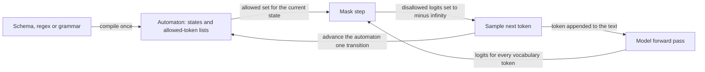
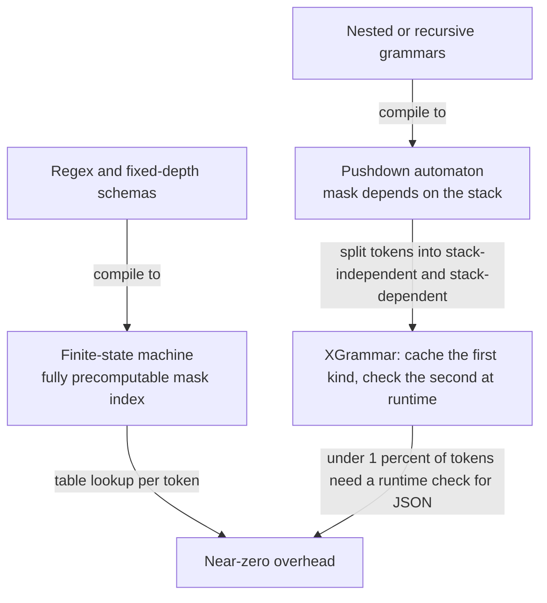

# Constrained decoding: forcing a model's output to fit a schema or grammar

> **Key papers and docs:**
> Willard and Louf (Normal Computing), 2023, "Efficient Guided Generation for Large Language Models" (the Outlines paper) - [arXiv 2307.09702](https://arxiv.org/abs/2307.09702) (preprint).
> Dong, Ruan, Cai, Lai, Xu, Zhao and Chen, 2024, "XGrammar: Flexible and Efficient Structured Generation Engine for Large Language Models" - [arXiv 2411.15100](https://arxiv.org/abs/2411.15100) (the arXiv page lists MLSys 2025).
> Tam, Wu, Tsai, Lin, Lee and Chen, 2024, "Let Me Speak Freely? A Study on the Impact of Format Restrictions on Performance of Large Language Models" - [arXiv 2408.02442](https://arxiv.org/abs/2408.02442) (EMNLP 2024 industry track, per a search result).
> Tool documentation read 2026-11-26: [llama.cpp grammars (GBNF)](https://github.com/ggml-org/llama.cpp/blob/master/grammars/README.md), [vLLM structured outputs](https://docs.vllm.ai/en/latest/features/structured_outputs.html), [SGLang structured outputs](https://docs.sglang.io/advanced_features/structured_outputs.html), [Ollama structured outputs](https://docs.ollama.com/capabilities/structured-outputs).
>
> **Scope:** how a decoding loop is made to produce only text that matches a JSON Schema, regular expression or grammar, what that does and does not guarantee, what it costs in speed and accuracy, and how to use it with small models for extraction and tool calls. It does not cover prompting for JSON without enforcement, or training a model to emit a format.

Written 2026-11-26. Option names and versions in the tools change often; check the linked docs before copying a flag.

## Read this first

**The idea in one sentence.** At each step of generation, work out which next tokens would still let the output become valid, set every other token's score to minus infinity, and sample from what is left, so invalid output cannot happen.

**Who this is for.** Anyone whose program must parse a model's answer: extraction into fields, routing labels, tool calls. It is the cheapest rung of the small-model ladder in [01 options and trade-offs](../01-options-and-trade-offs.md), and the usual reason a small model that "mostly gets the format right" becomes dependable.

**Afterwards you will be able to** trace a token mask step by step; say what a schema guarantee covers and what it cannot; estimate decoding overhead from published figures; explain why forcing a format can hurt reasoning and how to avoid that; and wire it into vLLM, SGLang, llama.cpp or Ollama.

**Reading time.** About 35 minutes; Tutorial 1 alone is about 12. **Have read first:** [01 options and trade-offs](../01-options-and-trade-offs.md) and [02 tools](../02-tools.md). Useful: [LoRA](../../../llm-learning-repository/tutorials/02-building/09-lora.md) for the fine-tuning interaction. Siblings: [pruning and compression](./12-pruning-and-compression.md) and [continued pretraining](./13-continued-pretraining.md).

**The one thing most people get wrong.** Constrained decoding guarantees syntax, not truth. A schema-valid answer can be the wrong answer, and a forced field can be filled with an invented value because the model had no valid way to say "unknown". Add an explicit "unknown" option to your schema, and measure accuracy, not parse rate.

## The technique in one worked example

Constructed by this guide, and run: a pure-Python toy, no model. The target output is the JSON text `{"ok":true}` or `{"ok":false}`, which is what the schema {"ok": boolean} allows when written without spaces (the regex is `\{"ok":(true|false)\}`). The toy vocabulary has 13 tokens, among them `{"`, `ok`, `":`, `true`, `false`, `}`, and chatty ones such as `Sure`, `yes` and `!`. The logits (raw scores) at each step are invented to make the model want to chat.

| Step | Text so far | Unmasked top token | Tokens the grammar allows | Chosen | Probability after masking |
|---|---|---|---|---|---|
| 0 | (empty) | `Sure` (about 0.58) | `{"`, `{` | `{"` | 0.622 |
| 1 | `{"` | `ok` | `ok` | `ok` | 1.000 |
| 2 | `{"ok` | `":` | `":` | `":` | 1.000 |
| 3 | `{"ok":` | `yes` (logit 3.0) | `true`, `false` | `true` | 0.525 |
| 4 | `{"ok":true` | `}` | `}` | `}` | 1.000 |

Final output `{"ok":true}`, a complete valid string. Arithmetic at step 0: among the allowed tokens the logits are 2.0 and 1.5, so the masked probabilities are e^2.0 / (e^2.0 + e^1.5) = 0.622 and 0.378. At step 3 the model's own favourite, `yes`, is not allowed; `true` has logit 1.1 and `false` 1.0, giving 0.525 and 0.475, so the choice between them is nearly a coin flip: the mask forced valid form, and left the answer to a model that barely preferred either. That is the guarantee and its limit in one row. The same mechanism is what Outlines formalises (Section 3, the example with the regex for floating-point numbers) and what XGrammar speeds up.



Notice that the schema is compiled once, before generation, and the loop only does a table lookup and a mask per token. The model is unchanged and never sees the constraint.

## Words you need

| Term | Plain definition | Example from the worked example |
|---|---|---|
| Logits | The raw score the model gives each possible next token before they are turned into probabilities | `Sure` 3.0, `{"` 2.0 at step 0 |
| Token mask | A list marking which tokens may be chosen now; others are given minus infinity | Only `{"` and `{` allowed at step 0 |
| Finite-state machine (FSM) | A set of states with allowed moves between them, enough to match a regular expression | The states are the prefixes of the two valid strings |
| Pushdown automaton (PDA) | An FSM plus a stack, so it can match nested structure such as brackets | Needed for JSON with nesting or recursion |
| Context-free grammar (CFG) | A rule set describing a language, including nesting; GBNF and EBNF are notations for it | A grammar for any JSON value |
| JSON Schema | A standard way to describe the shape of a JSON document: field names, types, required fields | {"ok": boolean} |
| Structured output | The product name for schema-constrained generation in APIs | Ollama's `format` parameter |
| Structural tag | A constraint applied only inside marked regions of otherwise free text | Tool-call JSON inside a chat reply |
| Index | A precomputed map from each automaton state to the vocabulary tokens allowed there | Table of allowed tokens per step |
| Tokenizer | The component that splits text into tokens and back | Why `":` may be one token |

## Tutorial 1 - Intuitive understanding

### What was broken before

Language models write text one token at a time and are free to write anything. Asked for JSON they usually comply, then once in a while add a friendly sentence, drop a closing brace or invent a field name, and the program that reads the answer crashes. The usual patches were to re-ask until it parses, which costs time and money, or to write fragile cleanup code. With small models the failure rate is higher, so the problem is sharper exactly where an enterprise wants to use them.

### The idea

**Analogy.** A form with tick-boxes and fixed-width fields. The clerk can think what they like, but the pen only moves inside the boxes, and the form cannot be handed in with a box left half-drawn.

**Where the analogy breaks.** The form restricts where the clerk writes, but they can still tick the wrong box. And a human clerk would stop and say "this form does not fit my case"; the model has no such move unless the schema includes one. The pen is also guided one token at a time, so a constraint can push the model into a path it would not have chosen, which is why accuracy can change.

### How it works, step by step

1. **Describe the shape** as a JSON Schema, a regular expression or a grammar.
2. **Compile it** into an automaton: a graph of states where each state knows which characters may come next.
3. **Build the token index.** Models emit tokens, which are word pieces and not characters, so for every state the engine works out which vocabulary tokens would keep the output valid (Outlines Algorithms 3 and 4). A token may span several characters or even several grammar elements.
4. **Generate.** At each step the model produces scores for every token; the engine masks the disallowed ones; the sampler picks from what remains.
5. **Advance the state** by the chosen token, and repeat until the automaton reaches an accepting state and the model emits end-of-text.

Regular expressions need only an FSM. Nested structure such as arbitrary JSON, SQL or code needs a pushdown automaton or a parser (Outlines Section 4.1 formalises this); the stack makes the mask harder to precompute, which is the problem XGrammar attacks.



Notice the split in the lower branch: most tokens are valid or invalid regardless of how deeply nested we are, so only a few need a live check.

### What the evidence says

- **Syntax becomes reliable.** XGrammar's evaluation reports syntactic correctness rising to 100 percent for function calling (from 62 percent) and XML generation (from 80 percent) with the grammar enforced (2411.15100 Table 4; the authors' own benchmark).
- **Overhead can be near zero.** On the MLC-LLM engine enabling XGrammar changed time per output token from 6.2 to 6.3 ms at batch size 1 (Table 2), and per-token mask latency was under 40 microseconds for JSON Schema (Section 4.1, Figure 9). Against 6.8 ms per token that is 0.6 percent (guide's arithmetic, mixing two sections).
- **Older tools were slower.** With SGLang on Llama-3.1 8B and a JSON Schema, time per output token fell from 44.2 ms with Outlines to 6.8 ms with XGrammar (Table 1). That is the XGrammar authors comparing against another tool, so treat it as a vendor-style claim until someone independent reproduces it.
- **Accuracy can fall on reasoning.** Tam et al. report large drops on reasoning when answers are forced into JSON, and gains on some classification tasks (see Tutorial 3).

### What this does not show

- A schema-valid answer is not a correct one. None of the three papers measures how often valid output is false for an enterprise task.
- The Tam et al. results are mostly for large hosted models whose "JSON mode" implementation is assumed, not verified, by the authors (Section 2). They do not directly describe a small model run through a grammar engine.
- Speed figures are on specific hardware and models in the XGrammar paper; the authors' hardware and batch sizes decide the numbers.
- None of the sources compares constrained decoding against fine-tuning for format on small models.

### Teach-back

<details>
<summary>1. In the worked example, why is the choice between `true` and `false` close to a coin flip even though the output is valid?</summary>
The mask only removes tokens that would break the format. The model's own scores for the two legal tokens were 1.1 and 1.0, so after masking the probabilities are 0.525 and 0.475. Validity is enforced; correctness still depends on what the model believes.
</details>

<details>
<summary>2. Why is a fixed regex easier to constrain than arbitrary nested JSON?</summary>
A regex needs only a finite-state machine, so the allowed tokens for each state can be listed in advance. Nested JSON needs to remember how many brackets are open, which requires a stack, so the allowed set depends on the stack and cannot be fully precomputed.
</details>

<details>
<summary>3. What is the risk of a required field the model cannot actually fill?</summary>
The mask removes every output that omits it, so the model must write something valid, which may be invented. Give such fields a nullable type or an explicit "unknown" value so the model has an honest option.
</details>

<details>
<summary>4. Does constrained decoding change the model?</summary>
No. The weights are untouched; the engine masks the scores at each step. The same model can be run with and without it, which makes an A/B test of accuracy straightforward.
</details>

## Tutorial 2 - Practitioner understanding

### The design in concrete terms

**Engines and how to ask (from the docs read on 2026-11-26).**

- **vLLM.** Constraint types under `structured_outputs`: `choice`, `regex`, `json`, `grammar` (context-free EBNF) and `structural_tag`. Online, send `extra_body={"structured_outputs": {...}}` or `response_format` with `"type": "json_schema"`; offline, wrap options in `StructuredOutputsParams` and pass them in `SamplingParams(structured_outputs=...)`. Backends are xgrammar, guidance and outlines, chosen with `--structured-outputs-config.backend` (default `auto`). The older `guided_json`, `guided_regex`, `guided_choice`, `guided_grammar` and `guided_decoding_backend` fields were removed in v0.12.0, and the docs say lm-format-enforcer was removed in v0.35.0; copied snippets from older blog posts will fail. Reasoning models need `--reasoning-parser`, and the constraint applies after the reasoning ends.
- **SGLang.** XGrammar is the default backend; `--grammar-backend outlines` or `llguidance` switch it. One of `json_schema`, `regex` or `ebnf` per request, through `response_format` (type `json_schema` with `name` and `schema`) or `extra_body`, or inside `sampling_params` on the native `/generate` endpoint. Structural tags (`triggered_tags` with `begin`, `content`, `end`) constrain tool-call segments inside free text. The docs advise also describing the format in the prompt.
- **llama.cpp.** Grammars in GBNF: `root ::= ...` rules, character ranges, `*`, `+`, `?`, `{m,n}`. Flags: `--grammar` (string) and `--grammar-file`; `--json` or `-j` with a schema in the CLI tools (the docs read do not list a `--json-schema` flag); `json_schema` field or `response_format` on the server. The docs warn that grammars have performance problems (use `x{0,N}` and not `x? x? x?`), that `additionalProperties` defaults to false, that unsupported schema features are skipped silently, and that `uniqueItems`, `not` and conditionals are unlikely to be supported. The schema is not added to the prompt, so describe it there.
- **Ollama.** The `format` field takes `"json"` or a JSON Schema object; in Python pass `Model.model_json_schema()` from Pydantic and parse back with `model_validate_json`. The docs suggest putting the schema in the prompt and setting temperature to 0. Ollama's cloud does not support it, and the page does not name the enforcement engine.

**Output shapes.** The model returns text that parses as the schema; with Pydantic or Zod you validate again anyway, to catch type narrowing the engine could not enforce (for example numeric ranges, which llama.cpp supports only for integers).

**Tool calling with small models.** A tool call is a JSON object naming a function and its arguments. A schema per tool, or a union of them, makes the call parse every time. For models that mix prose and calls, a structural tag constrains only the call region. Parsing was the failure XGrammar's function-calling benchmark counted (62 percent correct before, 100 after; Table 4), though that is syntax, not whether the right tool was picked.

### A minimal version

Part 1 is the toy from the worked example: pure Python, run by this guide, no model. Part 2 is a real call, unrun.

```python
import math
ALLOWED = ['{"ok":true}', '{"ok":false}']
def softmax(d):
    z = sum(math.exp(v) for v in d.values()); return {k: math.exp(v)/z for k, v in d.items()}
steps = [  # invented logits per step
 {'Sure':3.0,'{"':2.0,'{':1.5,'yes':1.0}, {'ok':2.5,'yes':2.0,'":':0.5,'!':1.0},
 {'":':2.2,'}':1.0,'ok':0.2}, {'true':1.1,'false':1.0,'yes':3.0,'}':0.5},
 {'}':2.0,'!':1.8,'true':0.1}]
out = ''
for lg in steps:
    ok = {t: v for t, v in lg.items() if any(a.startswith(out + t) for a in ALLOWED)}
    p = softmax(ok); out += max(p, key=p.get)
    if out in ALLOWED: break
print(out)   # prints {"ok":true}
```

```python
# UNRUN: real call through a local server with vLLM structured outputs
from openai import OpenAI
from pydantic import BaseModel
class Invoice(BaseModel):
    vendor: str
    total: float | None          # None is the honest "not found"
client = OpenAI(base_url="http://localhost:8000/v1", api_key="none")
r = client.chat.completions.create(
    model="your-served-model",
    messages=[{"role": "user", "content": "Extract vendor and total as JSON: ..."}],
    extra_body={"structured_outputs": {"json": Invoice.model_json_schema()}})
print(Invoice.model_validate_json(r.choices[0].message.content))  # Invoice(...)
```

Input shape: a prompt string plus a schema dictionary. Output: one string that always parses against the schema, then a Python object. The `total: float | None` line gives the model a legitimate way to say it found nothing.

### What it costs

Assumptions: per-token mask time from XGrammar's figures; decoding time per token from the same paper; a naive baseline invented by this guide.

| Approach | Per-token mask cost | Per-token decode (SGLang, Llama-3.1 8B, JSON Schema) | Overhead | Source |
|---|---|---|---|---|
| Precomputed index (FSM) | table lookup, O(1) on average | not reported | little, per the authors | 2307.09702 abstract and Section 1 |
| XGrammar mask | under 40 microseconds | 6.8 ms | about 0.6 percent | 2411.15100 Figure 9 and Table 1 |
| Outlines in that setup | not reported | 44.2 ms | about 6.5 times XGrammar | 2411.15100 Table 1 |
| Naive scan of 128,000 tokens at an assumed 1 microsecond each | 128 ms | roughly 135 ms | about 20 times the 6.8 ms step | constructed by this guide |

Memory: the Outlines paper reports a naive index for a slightly extended Python grammar of around 50 MB (Section 5); XGrammar reports shrinking the cache for Llama-3.1 and a JSON grammar from 160 MB to 0.46 MB (Section 3.1). One-time compile cost per schema grows with schema size; this guide found no figure for large enterprise schemas (unverified), so cache compiled schemas and reuse them.

Money: there is no training cost. The cost of getting this wrong is accuracy, which Tutorial 3 covers. For comparison, a LoRA run costs single-digit to low-double-digit dollars ([04 playbook](../04-build-and-deploy-playbook.md#3-what-it-costs)), and constrained decoding is a serving flag.

### How it fails

| Symptom | Likely cause | Mitigation |
|---|---|---|
| Reasoning accuracy drops after adding the schema | The answer field comes before the reasoning field, or the format leaves no room to think (Tam et al.: GPT-3.5 put "answer" before "reason" in 100 percent of cases) | Put a reasoning field first, or let the model think freely then format in a second pass |
| Valid JSON, wrong or invented values | Required fields with no honest option | Nullable fields, an enum with "unknown", and field-level validation |
| Output ends early or runs on | Max tokens hit before the closing brace, or whitespace loops | Raise the token limit, restrict whitespace in the grammar |
| Request is rejected or the schema is quietly ignored | Unsupported schema keywords (llama.cpp skips them silently) | Test the compiled grammar, simplify the schema, validate after |
| Very slow first request or slow generation | Large grammar compile, or a pathological grammar | Cache compiled schemas; use `x{0,N}`; try another backend |
| Snippets from tutorials fail on a new vLLM | The `guided_*` parameters were removed in v0.12.0 | Use `structured_outputs`; pin and test your server version |
| Small model emits near-empty or default values | The model is unsure and the mask leaves only low-quality options | Fine-tune on the schema (below); evaluate field by field |

### Evaluating your version

- **Metric.** Parse rate (should reach 100 percent), then field-level accuracy against labels, then task accuracy. Parse rate alone proves nothing about quality.
- **Test set.** At least 300 to 500 items, including inputs where the right answer is "not present", since forced formats fail there first.
- **Baselines.** The same model with a plain prompt and re-ask on failure; the same model unconstrained then validated; and the same model with a "think first, then format" two-step.
- **Stop rule.** Keep constrained decoding if field accuracy is no lower than the best baseline within noise and parse failures go to zero. Drop or relax it for any task where accuracy falls by 3 points or more.

**Fine-tuning interaction.** Train the model on examples that use the exact schema you will enforce, so its own preferred tokens already land inside the mask; otherwise the mask repeatedly overrides the model, as at step 0 in the worked example. This is this guide's reasoning from the mechanism, not a measured result in the sources read. Tam et al. recommend broader training with format-restrictive instructions for local models (Section 7).

### Adopt, adapt or skip

**Adopt** for any small-model task whose output a program consumes: extraction, classification into a label set, routing, tool calls. It is the cheapest rung that removes a whole class of failures, runs on every engine the lab covers, and needs no data. **Adapt** by designing the schema for the model: reasoning field first, enums with an explicit unknown, short field names, no deep nesting. Pair it with LoRA fine-tuning on the same schema when field accuracy is the problem. **Skip** for open-ended writing, and for hosted APIs whose structured-output feature you cannot inspect; there, validate and retry. Do not treat it as a substitute for evaluation, and do not claim it makes answers true. See [continued pretraining](./13-continued-pretraining.md) and [pruning](./12-pruning-and-compression.md) for what to try only after this works.

## Tutorial 3 - Researcher understanding

### Formal setup

Let V be the vocabulary, z_t in R^|V| the logits at step t, and A an automaton with state s_t. The valid set is V(s_t), the tokens with a transition from s_t (for a PDA, the state includes the stack). The mask is m_t(v) = 1 if v is in V(s_t) else 0, and the constrained distribution is p'(v) proportional to m_t(v) exp(z_t(v)) (Outlines Section 2.2, written there as an elementwise product of mask and logits). The next state is delta(s_t, v_t). Outlines builds a map sigma from states to token sets once, so each step is a lookup. Define the distortion at step t as the total probability the model gave to invalid tokens, 1 minus the sum over V(s_t) of p(v).

**Toy instance.** At step 0 of the worked example the logits give `{"` 0.213 and `{` 0.129 of the unmasked probability, a total of about 0.34; the other 0.66 sits on `Sure`, `yes` and the rest. Distortion is 0.66, so the mask overrides the model's preference on that step. At step 3 `true` and `false` carry only about 0.21 of the mass beside `yes` and `}`. The guarantee is validity; the price is large distortion exactly where the model wanted to deviate.

### The claims, stated precisely

1. Guided generation can be reduced to an FSM transition and an index lookup per token, adding little overhead (2307.09702 abstract; the authors do not report overhead figures in the text read).
2. Context-free grammar decoding can run with per-token mask latency under 40 microseconds for JSON Schema and under 200 microseconds for XML and a Python-like DSL, by caching stack-independent tokens (2411.15100 Section 4.1; the authors' benchmark).
3. Format restrictions reduce reasoning performance in the tested models, and stricter restrictions give larger drops; classification can improve (2408.02442 abstract and Section 4.1).
4. The size of the reasoning drop depends on the format and on implementation details such as key order and prompt wording, so it is not a property of constrained decoding alone (this guide's reading of Tam et al. Section 4.1 and of the rebuttals below).

### Evidence, table by table

**2307.09702.** Section 3, Example 1 and Figure 1: the regex for floating-point numbers against a four-token toy vocabulary; Algorithm 3 finds the sub-sequences of FSM states a token traverses, Algorithm 4 builds sigma. Section 3.2 compares against the Guidance library on GPT2-medium with timing plotted against `max_tokens`; the figure values were not readable in the text fetched, so no overhead number is quoted (unverified). Section 5: around 50 MB for a naive Python-grammar index. This is a design paper; its evidence about speed is a plot, not a table.

**2411.15100.** Table 1 (SGLang, Llama-3.1 8B, JSON Schema, time per output token): Outlines 44.2 ms, XGrammar 6.8 ms. Table 2 (MLC-LLM): 6.2 against 6.3 ms at batch 1 with XGrammar on versus off, an estimate of overhead. Table 3 (ablation of the engine's own optimisations): per-token latency from 65.776 ms for a baseline PDA to 0.018 ms with everything on; the adaptive token mask cache alone gave a 248.6 times gain. Table 4: syntactic correctness 100 percent for function calling (from 62) and XML (from 80). Section 3.1 and 3.2: context-dependent tokens for a JSON grammar on Llama-3.1 were 1,134 of about 128,000 (under 1 percent), reduced to 120 by context expansion. Figure 10 compares XGrammar with vLLM using Outlines and llama.cpp, with "up to 80 times" in the text and the exact values only in the figure. These tables identify speed effects of the engine, not accuracy of answers.

**2408.02442.** Models: gpt-3.5-turbo-0125, claude-3-haiku-20240307, gemini-1.5-flash, LLaMA-3-8B-Instruct, Gemma-2-9B-Instruct (Section 3.3), plus GPT-4o-mini in Section 5.4 and Appendix D. Conditions: natural language (NL), JSON-mode, format-restricting instructions (FRI), NL-to-format (two steps), JSON-schema (GPT-4o-mini only), XML and YAML. As read through a fetch summary, so re-check before quoting: **Table 1** GSM8K, text against JSON with schema: Claude 3 Haiku 86.51 to 23.44, GPT-3.5 Turbo 75.99 to 49.25, LLaMA-3-8B 75.13 to 48.90. In words, out of every 100 grade-school maths problems Claude 3 Haiku solved about 86 in free text and about 23 in the schema condition. **Table 2** (GPT-4o-mini) GSM8K 94.57 NL, 86.95 JSON-mode, 91.71 JSON-schema; Last Letter 83.11, 76.00, 86.07. **Table 3:** Claude 3 Haiku JSON parse errors 60.07 percent on GSM8K, so much of that drop is unparseable output and not wrong reasoning. Gemini on DDXPlus rose from 41.6 to 60.3 with JSON. Section 4.1: GPT-3.5 wrote the "answer" key before "reason" in 100 percent of JSON-mode responses, turning chain-of-thought into direct answering. The authors state that their JSON-mode implementation is assumed, not verified (Section 2), and the paper's Tables 9 and 10 appear mislabelled. This is correlational across prompts and formats: it does not isolate token masking from prompt wording.

**Rebuttals (secondary, not read in full).** A response by Kurt at dottxt, ["Say What You Mean"](https://blog.dottxt.ai/say-what-you-mean.html), argues that structured generation did not hurt when the prompt and evaluation are done carefully, and re-ran the Last Letter task; a search summary gave this, the full text was not read. A replication by [Castillo](https://dylancastillo.co/posts/say-what-you-mean-sometimes.html) reportedly found the rebuttal held for LLaMA-3-8B-Instruct but not for GPT-4o-mini. Both are unverified here; both are posts, not peer-reviewed papers, and dottxt sells constrained generation, so declare the interest.

### Ablations and what they isolate

- **XGrammar Table 3.** Each optimisation's share of the speedup; isolates engineering choices, not answer quality.
- **JSON-mode against FRI against NL-to-format (Tam et al.).** Separates enforcement from instruction and a two-step workaround.
- **Schema against no schema in the same model (Table 1).** Isolates the schema constraint from the JSON wrapper.
- **Key order (Section 4.1).** Isolates whether reasoning has room before the answer.

### Threats to validity

- **Implementation opacity.** Hosted JSON modes are not documented as exact token masking, so "constrained decoding" in Tam et al. may be partly prompting.
- **Model scope.** Mostly large hosted models and two 8B to 9B open models; no enterprise small-model task.
- **Metric extraction.** Tam et al. used an LLM parser for answers, validated at 97.7 percent agreement with humans (Appendix B), which is good but not exact.
- **Vendor benchmarks.** XGrammar's baselines are configured by its authors; independent speed comparisons were not found.
- **Version churn.** Parameter names changed across vLLM releases within a year (v0.12.0 removals), so reproduction needs pinned versions.

### Open problems and follow-ups

Constrained decoding that preserves the model's distribution rather than renormalising after the mask, so distortion at the step-0 kind of point does not bend later tokens (a research direction this guide names; no source read here claims a solution). Measuring accuracy loss on small open models across schema designs. Schema-aware fine-tuning versus mask-only on a fixed budget. Large, recursive enterprise schemas: compile time and memory. A search result listed a 2026 paper on a unified decoding framework that decouples reasoning from constraints ([arXiv 2601.07525](https://arxiv.org/abs/2601.07525)); its content was not read, so treat it as a pointer.

### What would change my mind

For "adopt for any machine-read output": a controlled study on 3B to 8B open models showing token masking with a reasoning-first schema lowers extraction accuracy by more than a few points against validate-and-retry. For "syntax only": a verified method that makes enforced fields reliably true, which would need a verifier, not a grammar.

## Reading map for the key papers

| Paper section or figure | What it contains | Read, skim or skip | Where this guide answers it |
|---|---|---|---|
| 2307.09702 Sections 2 and 3 | Masked sampling, FSM, index algorithms | Read | Worked example, formal setup |
| 2307.09702 Section 4 | Parsers and pushdown automata | Skim | Tutorial 1 steps |
| 2411.15100 Sections 3.1 to 3.3 | Token mask cache, stack | Read | Tutorial 1 diagram |
| 2411.15100 Tables 1 to 4 | Speed and correctness | Read | Cost, evidence |
| 2408.02442 Sections 3 and 4 | Setup and main results | Read | Tutorial 3 evidence |
| 2408.02442 Section 5 and appendices | Formats, parsing errors, validation | Skim | Threats |
| Tool docs (links above) | Flags, parameters, caveats | Read the one you serve with | Tutorial 2 design |

**Sources read for this guide (2026-11-26).** Paper text: [2307.09702 HTML](https://arxiv.org/html/2307.09702), [2411.15100 HTML](https://arxiv.org/html/2411.15100), [2408.02442 HTML](https://arxiv.org/html/2408.02442). Docs pages as linked at the top. Claims marked unverified were not confirmed against these.

## Questions readers get stuck on

**1. Does constrained decoding stop hallucination?**
No. It only keeps the text inside the shape you specified. The model can still put a false value in a valid field, and a forced field with no honest option invites invention. The worked example shows a legal choice between `true` and `false` made on scores of 1.1 and 1.0.

**2. Why not just ask for JSON and retry on failure?**
Retrying works and needs no engine support, and for hosted APIs it may be the only option. It costs extra calls and latency and still leaves a residual failure rate; with an enforced schema the parse failure rate is zero by construction. Retrying also does not fix wrong values, which neither approach does.

**3. What is a token mask, concretely?**
A vector with one entry per vocabulary token, 128,000 or so for current models, set to zero for allowed and minus infinity for banned before the scores become probabilities. Banned tokens then get probability exactly zero.

**4. Why do tokens complicate regexes?**
Grammars talk about characters but models emit tokens, which can cover several characters and cross grammar boundaries. The engine must check, for each token and each state, whether the token's characters keep a valid path; Outlines does this once per vocabulary to build the index (Algorithms 3 and 4).

**5. How can a format constraint lower accuracy if it only removes invalid outputs?**
By forcing the model to answer before it reasons, or by removing the free-text space in which it works through steps. Tam et al. found GPT-3.5 always filled the answer key first. Also, renormalising after the mask can steer later tokens to places the model finds unlikely. The two-step workaround (answer freely, then format) avoids both.

**6. Is the reasoning-degradation finding settled?**
No. The paper is mostly about hosted models with unverified JSON implementations, and a published rebuttal and a replication disagree about it, with results that differ by model. For your small model, measure it with your schema on your data.

**7. Which engine should I use for a small model on a laptop or one server?**
Whatever you already serve with: llama.cpp with GBNF or a JSON schema locally, Ollama's `format` for the simplest path, vLLM or SGLang for throughput (both default to or support XGrammar). This guide did not benchmark them against each other; the XGrammar paper's comparisons are by its authors.

**8. Can I constrain tool calls?**
Yes. Give each tool a schema and enforce a union, or use structural tags so only the call region is constrained (vLLM `structural_tag`, SGLang `triggered_tags`). It guarantees the call parses and the arguments have the right types, not that the right tool or sensible arguments were chosen.

**9. Should I fine-tune if I use constrained decoding?**
Only if field accuracy, not syntax, is the problem. Fine-tuning on your schema should make the model's own preferences fit the mask, so the mask overrides less (this guide's reasoning; not a tested claim in these sources).

## Prerequisites you actually need

### Prerequisite 1 - Logits, softmax and masking

A model scores each possible token with a number (logit). Softmax turns scores into probabilities by exponentiating and dividing by the sum. A masked token's score of minus infinity exponentiates to zero.

*Tiny example.* Logits 2.0 and 1.5 give probabilities e^2 / (e^2 + e^1.5) = 7.389 / 11.871 = 0.622 and 0.378.

*Where used.* Every row of the worked example. See [the Transformer guide](../../../llm-learning-repository/tutorials/01-foundations/01-transformer.md) for where logits come from.

### Prerequisite 2 - Finite-state machines and regular expressions

A regular expression can be run as a machine with states; each input character moves it to another state, and only some characters are legal in each state.

*Tiny example.* For `a(b|c)d`: from the start only `a`; then `b` or `c`; then only `d`; then stop. After `a`, the legal set is {b, c}.

*Where used.* The mask is the legal set for the current state. Background: any automata textbook; the lab has no dedicated guide, so use the Outlines paper's Section 3 example.

### Prerequisite 3 - Tokenisation

Models read and write word pieces, not letters. One token may be several characters, such as `":`.

*Tiny example.* The string `{"ok":true}` could be tokenised as `{"`, `ok`, `":`, `true`, `}`, five tokens for eleven characters, so the allowed set after `ok` is a set of tokens that start with `":` or its prefixes, not a set of single characters.

*Where used.* The index construction. See [02 tools](../02-tools.md) for the tokenizer in your stack.

### Prerequisite 4 - Stacks and nesting

A stack records open brackets. A closing bracket is legal only if something is open.

*Tiny example.* `[[1,2],[3]]`: push on `[`, pop on `]`. After `[[1,2]` one bracket is open, so `,` followed by a value or `]` is legal, and the end of text is not.

*Where used.* Why nested JSON needs a pushdown automaton and why XGrammar needs a persistent stack (Section 3.3).

## Where this sits

**Read before:** [01 options and trade-offs](../01-options-and-trade-offs.md) (rung 3 of the decision ladder), [02 tools](../02-tools.md) for the serving options, and [03 vehicles](../03-vehicles.md).

**Nearest techniques.** Prompting for JSON asks the model to behave and gives no guarantee; constrained decoding enforces it at generation time. LoRA fine-tuning on a schema teaches the model the format and can make the mask override less, but cannot guarantee validity by itself; the two combine. [Continued pretraining](./13-continued-pretraining.md) and [pruning and compression](./12-pruning-and-compression.md) are the expensive rung-5 techniques, to be considered only after this inexpensive one is in place.

**Read next:** the [04 build and deploy playbook](../04-build-and-deploy-playbook.md) for putting a model with an enforced schema into service, and the lab's [LoRA guide](../../../llm-learning-repository/tutorials/02-building/09-lora.md) for fine-tuning on your schema.

## Checkpoint

<details>
<summary>1. Compute the masked probabilities at step 0 if the allowed logits were 2.0 for `{"` and 1.0 for `{`.</summary>
e^2 = 7.389 and e^1 = 2.718, so the sum is 10.107; the probabilities are 0.731 and 0.269. A bigger gap in the model's own preference gives a more decisive choice after masking.
</details>

<details>
<summary>2. Critique: "Our extraction passes the JSON schema 100 percent of the time, so it is 100 percent accurate." What is wrong, and what would you measure?</summary>
Validity is guaranteed by the mask and says nothing about whether values are right. Measure field-level accuracy against labelled documents, including documents where a field is absent, and compare against an unconstrained baseline with validate-and-retry.
</details>

<details>
<summary>3. Estimate overhead: 40 microseconds of mask time per token against a 6.8 ms decode step.</summary>
0.040 ms / 6.8 ms = 0.0059, about 0.6 percent. It uses figures from two parts of the XGrammar paper on one setup (SGLang, Llama-3.1 8B), so it does not transfer to a different engine or schema.
</details>

<details>
<summary>4. Why might a schema with "answer" before "reason" hurt a reasoning task, and how would you fix it?</summary>
Generation is left to right, so the answer is written before any reasoning exists to condition on. Tam et al. found GPT-3.5 did this in 100 percent of JSON-mode responses. Put a reasoning field first, or answer freely and convert in a second step.
</details>

<details>
<summary>5. Decide: your team wants to constrain a small model's tool calls. List the schema design choices and one test before launch.</summary>
One schema per tool or a union with a discriminating `name` field; short enums for arguments; nullable fields for optional values and an explicit "none of these" tool so the model can decline. Test on a set that includes requests no tool can serve, and count wrong-tool calls as well as parse failures.
</details>
