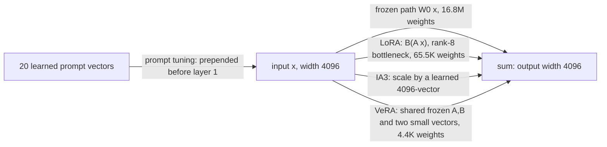
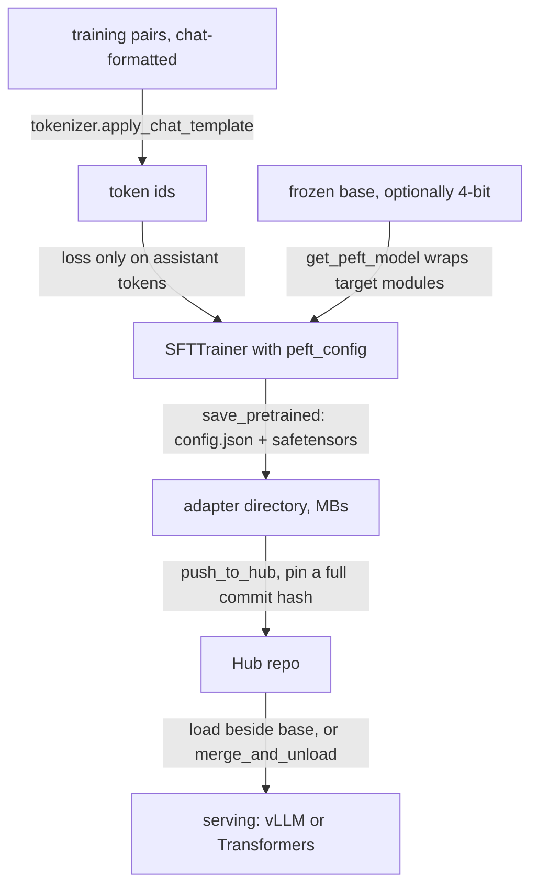
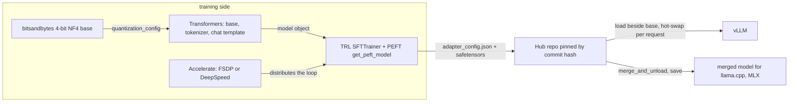

# PEFT methods beyond LoRA, and the Hugging Face stack around them

> **Key sources:** the Hugging Face [PEFT documentation](https://huggingface.co/docs/peft/main/en/methods/overview) and the method papers it points to: Liu et al., 2022, (IA)^3 - [arXiv 2205.05638](https://arxiv.org/abs/2205.05638); Kopiczko et al., 2023, VeRA - [arXiv 2310.11454](https://arxiv.org/abs/2310.11454); Zhang et al., 2023, AdaLoRA - [arXiv 2303.10512](https://arxiv.org/abs/2303.10512); Hyeon-Woo et al., 2021, FedPara (LoHa) - [arXiv 2108.06098](https://arxiv.org/abs/2108.06098); Liu et al., 2023, BOFT - [arXiv 2311.06243](https://arxiv.org/abs/2311.06243); Buehler et al., 2024, X-LoRA - [arXiv 2402.07148](https://arxiv.org/abs/2402.07148); Biderman et al., 2024, "LoRA Learns Less and Forgets Less" - [arXiv 2405.09673](https://arxiv.org/abs/2405.09673). All preprints unless stated.
>
> **Scope:** which methods the PEFT library supports, how the Hugging Face tools fit together for fine-tuning, and how to choose. LoRA, QLoRA, DoRA and soft prompts are taught in [02](./02-lora.md), [03](./03-qlora.md), [04](./04-dora.md) and [05](./05-adapters-prefix-prompt-tuning.md); they are linked, not repeated.

Written 2026-11-26. Facts come from the `main` documentation, which labels PEFT v0.22.0 as the latest stable release ([PyPI](https://pypi.org/pypi/peft/json) lists it, uploaded 2026-11-19) and TRL v1.19.0 ([TRL docs](https://huggingface.co/docs/trl/main/en/index)). `main` can describe methods newer than the release you install.

## Read this first

**The idea in one sentence.** PEFT (parameter-efficient fine-tuning) means freezing a pretrained model and training a tiny add-on, and the Hugging Face PEFT library is a catalogue of about fifty add-on designs, of which LoRA is only the best known.

**Who it is for.** A team that has used LoRA and now asks whether a better add-on exists, how the Hugging Face libraries connect so a run can be reproduced, and what comparative studies show.

**Afterwards you will be able to** name the method families and their config classes; wire Transformers, PEFT, TRL and bitsandbytes into one run; save, publish, pin, merge and combine adapters; count adapter parameters per layer for several methods; and read the library's own benchmark without over-reading it.

**Reading time:** about 45 minutes. **Read first:** [02 LoRA](./02-lora.md) and [03 QLoRA](./03-qlora.md); [04](./04-dora.md) and [05](./05-adapters-prefix-prompt-tuning.md) help; the lab's [LoRA paper guide](../../../llm-learning-repository/tutorials/02-building/09-lora.md) has the original walk-through.

**The one thing most people get wrong.** **Judgment:** they treat the method name as the main decision. In the library's benchmark two LoRA runs that differ only in rank, alpha and the scaling law score 0.474 and 0.513, a gap larger than that between plain LoRA, DoRA, OFT and full fine-tuning (all 0.47 to 0.49). Target layers, learning rate, matching the base model and chat template at serving time, and pinned publishing matter more than choosing the fortieth method in the catalogue.

## The technique in one worked example

Constructed by this guide; checkable by hand. **Assumption:** one 4,096 x 4,096 weight (a typical projection in an 8-billion-parameter model); full tuning trains 16,777,216 numbers. Each row is the trainable count one adapted layer gets, with the source of the formula.

| Method (config class) | Formula, one 4,096 x 4,096 layer | Trainable | Share of full | Formula source |
|---|---|---|---|---|
| Full fine-tuning | d x d | 16,777,216 | 100% | arithmetic |
| LoRA r = 8 (`LoraConfig`) | r x (d + d) | 65,536 | 0.391% | [LoRA paper](https://arxiv.org/abs/2106.09685) |
| rsLoRA r = 8 (`use_rslora`) | same; only the scale changes | 65,536 | 0.391% | [rsLoRA abstract](https://arxiv.org/abs/2312.03732) |
| DoRA r = 8 (`use_dora`) | LoRA plus a length-d magnitude vector | 69,632 | 0.415% | [04](./04-dora.md) |
| (IA)^3 (`IA3Config`) | one vector of length d | 4,096 | 0.024% | [source](https://github.com/huggingface/peft/blob/v0.22.0/src/peft/tuners/ia3/layer.py) |
| VeRA r = 256, default (`VeraConfig`) | r + d; frozen shared A and B not counted | 4,352 | 0.026% | [paper](https://arxiv.org/html/2310.11454); [source](https://github.com/huggingface/peft/blob/v0.22.0/src/peft/tuners/vera/layer.py) |
| LoHa r = 8 (`LoHaConfig`) | 2 x r x (d + d) | 131,072 | 0.781% | [source](https://github.com/huggingface/peft/blob/v0.22.0/src/peft/tuners/loha/layer.py) |
| LoKr r = 8 (`LoKrConfig`) | 4,096 = 64 x 64: a full 64 x 64 matrix plus a rank-8 pair, 64 x 64 + 2 x 64 x 8 | 5,120 | 0.031% | [source](https://github.com/huggingface/peft/blob/v0.22.0/src/peft/tuners/lokr/layer.py) |
| MiSS r = 64, default (`MissConfig`) | r x d | 262,144 | 1.563% | [source](https://github.com/huggingface/peft/blob/v0.22.0/src/peft/tuners/miss/layer.py) |
| Prompt tuning, 20 tokens | 20 x d once for the whole model | 81,920 | n/a | [05](./05-adapters-prefix-prompt-tuning.md) |
| Prefix tuning, 20 tokens | 20 x 2 x d per layer | 163,840 per layer | n/a | [05](./05-adapters-prefix-prompt-tuning.md) |

In plain terms: out of every 100 numbers full tuning trains here, LoRA r = 8 trains about 0.4 and (IA)^3 or VeRA about 0.025, a 4,000-fold cut. At 2 bytes per number the (IA)^3 vector is 8 KiB against 128 KiB for the LoRA pair. The count says nothing about quality.

**Cross-check against real runs.** **Assumption:** Llama-3.2-3B has width 3,072, 28 layers and key/value width 1,024 (unverified here). Then LoRA r = 32 on query and value gives (32 x 6,144 + 32 x 4,096) x 28 = 9,175,040, VeRA r = 256 gives (256 + 3,072 + 256 + 1,024) x 28 = 129,024, and LoHa r = 32 gives 18,350,080; each equals `num_trainable_params` in the library's [result files](https://github.com/huggingface/peft/tree/main/method_comparison/MetaMathQA/results).



What to notice: three adapters touch the same layer and differ in what is learned; the prompt vectors change what the model reads, not its weights.

## Words you need

| Term | Plain definition | Example from the worked example |
|---|---|---|
| PEFT | Training a small added or selected set of parameters with the base frozen | Every row but the first |
| Adapter | A trained add-on saved apart from the base, usually `adapter_config.json` plus `adapter_model.safetensors` ([quicktour](https://huggingface.co/docs/peft/main/en/quicktour)) | The 65,536 LoRA numbers |
| Rank r | Bottleneck width of a low-rank add-on | r = 8 |
| Scaling factor | Multiplier on the add-on: alpha over r, or alpha over sqrt(r) with rsLoRA ([docs](https://huggingface.co/docs/peft/main/en/package_reference/lora)) | Changes behaviour, not the count |
| Target modules | Named layers that get an add-on; `"all-linear"` means every linear layer except the output head ([docs](https://huggingface.co/docs/peft/main/en/package_reference/lora)) | One 4,096 x 4,096 layer |
| Soft prompt (virtual token) | A learned vector read like a word that matches no real word ([overview](https://huggingface.co/docs/peft/main/en/methods/overview)) | The 20 prompt vectors |
| Hadamard / Kronecker product | Entry-by-entry product / building a big matrix from two small ones (Prerequisite 2) | LoHa / LoKr |
| Merge | Adding the adapter into the base weight (`merge_and_unload`) | Folds 65,536 numbers into 16.8M |
| Forgetting (benchmark sense) | Wikipedia per-token loss after training minus before ([run.py](https://raw.githubusercontent.com/huggingface/peft/main/method_comparison/MetaMathQA/run.py)) | Tutorial 3 |

## Tutorial 1 - Intuitive understanding

### What was broken before

Teaching a large model a new job by changing all its weights needs memory for weights, gradients and optimiser bookkeeping, and leaves one full-size copy per job ([01](./01-full-fine-tuning-and-sft.md)). In the library's own benchmark on a 3-billion-parameter model, full fine-tuning peaked at 36.2 GiB and wrote a 6,425.5 MB checkpoint, against 20.8 GiB and 36.72 MB for LoRA ([full](https://raw.githubusercontent.com/huggingface/peft/main/method_comparison/MetaMathQA/results/full-finetuning--llama-3.2-3B-lr_0.00001.json), [LoRA](https://raw.githubusercontent.com/huggingface/peft/main/method_comparison/MetaMathQA/results/lora--llama-3.2-3B-rank32.json)): about 175 times larger (this guide's arithmetic). LoRA fixed the worst of this; the rest of the catalogue asks whether the add-on can be smaller, forget less, be shared by many tasks, or fit a quantized base.

### The idea

**Analogy.** The base model is a printed reference manual every employee has. LoRA is a thin tracing-paper overlay on each page with cheap-to-copy corrections. (IA)^3 is a set of volume knobs on the existing text. Prompt tuning is a briefing slip handed over before the reader opens the book. Orthogonal methods rotate the page instead of annotating it.

**Where the analogy breaks.** Overlays are readable and removable; adapter numbers are not readable, and a merged adapter cannot be cleanly separated again: for a quantized base the PEFT guide says merging dequantizes, adds and requantizes, so repeated merge and unmerge can accumulate rounding error ([quantization guide](https://huggingface.co/docs/peft/main/en/developer_guides/quantization)). An overlay also fits only the edition it was written for: the same base-model revision.

### How it works, step by step

1. **Choose a family.** The docs group methods into prompt-based, layer-tuning and adapter methods ([overview](https://huggingface.co/docs/peft/main/en/methods/overview)).
2. **Wrap the model.** `get_peft_model(base, config)` returns a `PeftModel` ([quicktour](https://huggingface.co/docs/peft/main/en/quicktour)).
3. **Train as usual.** Only the add-on has gradients, so optimiser state exists only for it.
4. **Save only the add-on.** `adapter_config.json` plus `adapter_model.safetensors`; the docs give 6.3 MB for a model whose full weights are about 700 MB ([quicktour](https://huggingface.co/docs/peft/main/en/quicktour)).
5. **Serve** merged, or beside the base so many adapters share one copy ([vLLM docs](https://docs.vllm.ai/en/latest/features/lora/)).



What to notice: the base appears at both training and serving, and the adapter is valid only for the base that trained it. Everything between "pairs" and "adapter directory" is identical whichever method you pick; the catalogue changes one box.

### What the evidence says

- **The library's benchmark** (Tutorial 3): on one maths task with a 3B model, most low-rank and rotation runs scored 0.43 to 0.51 against 0.472 for the one full fine-tuning run at 175 times the checkpoint size; soft prompts scored 0.057 to 0.234 for prompt tuning.
- **Independent study:** LoRA "substantially underperforms full finetuning" in standard code and maths settings but better maintains performance elsewhere ([abstract](https://arxiv.org/abs/2405.09673)). A [vendor blog](https://thinkingmachines.ai/blog/lora/) reports parity on small-to-medium supervised sets with a best learning rate about 10 times higher; [02](./02-lora.md) reconciles the two.
- **Method papers:** each reports gains on its own benchmarks, mostly older or smaller models (Tutorial 3).

### What this does not show

- That any catalogue method beats LoRA on an enterprise corpus; no independent study read here compares most of them on such data.
- That the benchmark's ranking is stable: one seed, one model, one task, different learning rates per method.

### Teach-back

<details>
<summary>1. Name the three method families in the PEFT docs and one example of each.</summary>

Prompt-based (prompt tuning, prefix tuning), layer tuning (LayerNorm tuning, trainable tokens) and adapter methods (LoRA and relatives, IA3, OFT, VeRA), per the [PEFT overview](https://huggingface.co/docs/peft/main/en/methods/overview).
</details>

<details>
<summary>2. An adapter trained on one base revision is loaded on a newer revision of the same model name. What can go wrong and what is the safe habit?</summary>

Behaviour can drift silently while the file still loads. Record the base model's exact commit hash with the adapter and test the pair; the Hub client supports pinning a full-length commit hash ([Hub guide](https://huggingface.co/docs/huggingface_hub/main/en/guides/download)). **Judgment:** retrain on a base change unless your test shows no loss.
</details>

<details>
<summary>3. Why do the benchmark's two LoRA rows (0.474 and 0.513) not show that rsLoRA is better?</summary>

The rsLoRA run used rank 64 with alpha 64 (scale 8 under alpha over sqrt(r)), the plain run alpha 128 (scale 2), one seed each. See Tutorial 3.
</details>

## Tutorial 2 - Practitioner understanding

### The design in concrete terms

**A. The PEFT catalogue.** The `main` documentation sidebar lists 50 method pages ([PEFT overview](https://huggingface.co/docs/peft/main/en/methods/overview)). Config classes and flags below come from each method's page under `package_reference/` (linked from the method name).

**LoRA flags** on [`LoraConfig`](https://huggingface.co/docs/peft/main/en/package_reference/lora) (defaults r = 8, lora_alpha = 8, `init_lora_weights=True`); basic LoRA is in [02](./02-lora.md).

| Flag or helper | What it does | Paper | Use when (**Judgment:** unless a doc is cited) |
|---|---|---|---|
| `use_rslora=True` | Scale alpha over sqrt(r) instead of alpha over r | [2312.03732](https://arxiv.org/abs/2312.03732) | You raise rank above about 16 and see no gain |
| `use_dora=True` | Magnitude and direction split; linear and Conv2d only; docs advise merging for inference | [2402.09353](https://arxiv.org/abs/2402.09353); [04](./04-dora.md) | Low rank, and you can merge before serving |
| `init_lora_weights="pissa"` (or `pissa_niter_N`), `"olora"`, `"loftq"` | Start from principal singular components; from a QR factor; or so as to cancel 4-bit quantization error | [PiSSA 2404.02948](https://arxiv.org/abs/2404.02948); [OLoRA 2406.01775](https://arxiv.org/abs/2406.01775); [LoftQ 2310.08659](https://arxiv.org/abs/2310.08659) | Faster convergence (PiSSA docs warn the SVD takes minutes); LoftQ for a 4-bit base |
| `create_loraplus_optimizer`, `create_lorafa_optimizer`, `create_riemannian_optimizer` | Optimizer helpers, not config flags: LoRA+ gives A and B different learning rates (docs: up to 2x speed, 1-2% performance); LoRA-FA freezes A | [LoRA+ 2402.12354](https://arxiv.org/abs/2402.12354) | You control the optimizer |
| `"eva"`, `"corda"`, `"astra"`, `"mica"`, `"nora"`, LoRA-GA; `rank_pattern`; `target_parameters` (raw MoE tensors); `trainable_token_indices`; `alora_invocation_tokens` (reuses the base KV cache, cannot be merged) | Further initialisations (several need a calibration pass), per-layer ranks and other documented options | [LoRA docs](https://huggingface.co/docs/peft/main/en/package_reference/lora) | Research-grade; tune baseline LoRA first |
| QLoRA | LoRA on a 4-bit bitsandbytes base with `target_modules="all-linear"` | [2305.14314](https://arxiv.org/abs/2305.14314); [03](./03-qlora.md) | Memory is the constraint |

**Other families.**

| Method and config | Idea; what trains | Key flags | Paper | Enterprise use |
|---|---|---|---|---|
| [AdaLoRA](https://huggingface.co/docs/peft/main/en/package_reference/adalora), `AdaLoraConfig` | SVD-form update; prune small singular values so important matrices get more rank | `init_r`, `target_r`, `tinit`, `tfinal`, `deltaT`; `update_and_allocate()` every step, so a custom loop | [2303.10512](https://arxiv.org/abs/2303.10512) | **Judgment:** rarely; extra loop code and a weak benchmark row |
| [(IA)^3](https://huggingface.co/docs/peft/main/en/package_reference/ia3), `IA3Config` | Learned vectors rescale keys, values and feed-forward activations | `target_modules`, `feedforward_modules` | [2205.05638](https://arxiv.org/abs/2205.05638) | Smallest files; docs call it the choice when size is the priority |
| [VeRA](https://huggingface.co/docs/peft/main/en/package_reference/vera), `VeraConfig` | One frozen random pair shared by all layers; per layer two vectors | `r` (default 256), `save_projection`, `d_initial`; linear only | [2310.11454](https://arxiv.org/abs/2310.11454) | Thousands of adapters on a storage budget |
| [LoHa](https://huggingface.co/docs/peft/main/en/package_reference/loha), `LoHaConfig` | Two low-rank products multiplied entry by entry | `r`, `alpha`; no embeddings | [2108.06098](https://arxiv.org/abs/2108.06098) | Docs: most used on image models; **Judgment:** research for text |
| [LoKr](https://huggingface.co/docs/peft/main/en/package_reference/lokr), `LoKrConfig` | Kronecker product of two small factors, one optionally low-rank | `r`, `decompose_both`, `decompose_factor` | [2309.14859](https://arxiv.org/abs/2309.14859) | Very small adapters; evidence is from diffusion |
| [MiSS](https://huggingface.co/docs/peft/main/en/package_reference/miss), `MissConfig` | Update shards of the weight with one shared zero-initialised matrix | `r` (default 64), `init_weights` in `True`, `'bat'`, `'mini'` | [2409.15371](https://arxiv.org/abs/2409.15371) | Fast, light runs; authors' claims only |
| [X-LoRA](https://huggingface.co/docs/peft/main/en/package_reference/xlora), `XLoraConfig` | A small network mixes frozen LoRA adapters per token and layer; base runs twice per step | `adapters`, `xlora_depth`, `top_k_lora` | [2402.07148](https://arxiv.org/abs/2402.07148) | Automatic task mixing at double base compute |
| [OFT](https://huggingface.co/docs/peft/main/en/package_reference/oft), [BOFT](https://huggingface.co/docs/peft/main/en/package_reference/boft), [HRA](https://huggingface.co/docs/peft/main/en/package_reference/hra) | Learned rotations: block-diagonal, butterfly-factored, or Householder reflections | `oft_block_size`, `boft_block_size`, `boft_n_butterfly_factor`, HRA `r` | [2306.07280](https://arxiv.org/abs/2306.07280); [2311.06243](https://arxiv.org/abs/2311.06243); [2405.17484](https://arxiv.org/abs/2405.17484) | Research; the OFT docs aim at less forgetting; BOFT's benchmark run took 115 minutes against about 16 for LoRA |
| [LayerNorm tuning](https://huggingface.co/docs/peft/main/en/package_reference/layernorm_tuning), [trainable tokens](https://huggingface.co/docs/peft/main/en/package_reference/trainable_tokens), [Poly](https://huggingface.co/docs/peft/main/en/package_reference/poly) | Train only LayerNorm; only chosen embedding rows; or route over skills by task id | `LNTuningConfig`, `token_indices`, `n_skills` | [2312.11420](https://arxiv.org/abs/2312.11420); [2202.13914](https://arxiv.org/abs/2202.13914) | Cheap probes; new control tokens; multi-task with known ids |
| Soft prompts ([guide](https://huggingface.co/docs/peft/main/en/conceptual_guides/prompting)) | Prompt tuning, prefix tuning, P-tuning, multitask prompt tuning, CPT | `num_virtual_tokens`, `prefix_projection` | [2104.08691](https://arxiv.org/abs/2104.08691); [2101.00190](https://arxiv.org/abs/2101.00190); [2103.10385](https://arxiv.org/abs/2103.10385) | [05](./05-adapters-prefix-prompt-tuning.md); weak in the benchmark |

**Listed, not examined.** About thirty further pages (for example FourierFT, GLoRA, RandLoRA, VB-LoRA, WaveFT, TinyLoRA, LLaMA-Adapter, and variants KaSA and VeLoRA) appear in the sidebar ([overview](https://huggingface.co/docs/peft/main/en/methods/overview)). This guide confirmed the pages exist, not their claims (unverified), and whether each ships in v0.22.0 rather than only `main` is unverified.

**B. How the stack fits together.**

| Layer | Role | Calls and flags to know | Source |
|---|---|---|---|
| Transformers | Loads base, tokenizer, chat template; `Trainer` | `AutoModelForCausalLM`, `apply_chat_template` | [chat templates](https://huggingface.co/docs/transformers/main/en/chat_templating) |
| PEFT | Adds, saves, loads, merges, combines adapters | `LoraConfig(task_type, target_modules="all-linear", modules_to_save)`; `get_peft_model`; `save_pretrained`; `PeftModel.from_pretrained`; `merge_and_unload`; `add_weighted_adapter(combination_type="ties")`; `load_adapter`; `set_adapter` | [quicktour](https://huggingface.co/docs/peft/main/en/quicktour); [merging](https://huggingface.co/docs/peft/main/en/developer_guides/model_merging) |
| TRL | Recipes; `SFTTrainer(peft_config=...)`; `assistant_only_loss`, `packing`; DPO with a PEFT adapter needs no reference model | Stable: AsyncGRPO, GRPO, RLOO, Reward, SFT, DPO, KTO, Distillation; experimental: CPO, ORPO | [TRL index](https://huggingface.co/docs/trl/main/en/index); [PEFT in TRL](https://huggingface.co/docs/trl/main/en/peft_integration) |
| bitsandbytes | 8-bit and 4-bit loading | `BitsAndBytesConfig(load_in_4bit=True)` | [Transformers page](https://huggingface.co/docs/transformers/main/en/quantization/bitsandbytes) |
| Accelerate | Same loop on any distributed setup; PEFT documents FSDP1, FSDP2 and DeepSpeed ZeRO-1, 2, 3 | Before PEFT v0.22, no activation checkpointing under FSDP2 | [Accelerate](https://huggingface.co/docs/accelerate/index); [FSDP](https://huggingface.co/docs/peft/main/en/accelerate/fsdp); [DeepSpeed](https://huggingface.co/docs/peft/main/en/accelerate/deepspeed) |
| Optimum | Hardware-specific optimisation packages (OpenVINO, Gaudi, Inferentia, TPUs) | An export and inference step, not a tuning method | [Optimum](https://huggingface.co/docs/optimum/index) |
| Hub, safetensors | Hosts adapters; tensors without pickle; pin a branch, tag or full 40-character hash | `push_to_hub`; `snapshot_download(revision=...)` | [safetensors](https://huggingface.co/docs/safetensors/index); [Hub guide](https://huggingface.co/docs/huggingface_hub/main/en/guides/download) |
| Serving | vLLM serves LoRA adapters per request for models with `SupportsLoRA`; TGI is in maintenance mode and its docs point to vLLM, SGLang, llama.cpp, MLX | `--enable-lora`, `--lora-modules` | [vLLM](https://docs.vllm.ai/en/latest/features/lora/); [TGI](https://huggingface.co/docs/text-generation-inference/index) |

Unsloth ([README](https://github.com/unslothai/unsloth)) lists LoRA, QLoRA, full fine-tuning, GRPO and DPO behind its own interface. **Judgment:** a convenience layer; its speed claims are vendor claims this guide did not verify.



What to notice: the adapter files are the only thing crossing from training to serving, so compatibility (base revision, quantization, target modules, server rank limits) is fixed before you train.

### A minimal version

Unrun by this guide. Input: `train.jsonl` of `{"messages": [...]}` rows. Output: an adapter directory of megabytes, and optionally a merged model. Calls from the [PEFT quicktour](https://huggingface.co/docs/peft/main/en/quicktour), [TRL PEFT guide](https://huggingface.co/docs/trl/main/en/peft_integration) and [merging guide](https://huggingface.co/docs/peft/main/en/developer_guides/model_merging).

```python
# Unrun. pip install transformers peft trl bitsandbytes datasets  (NVIDIA GPU for 4-bit)
import torch
from datasets import load_dataset
from transformers import AutoModelForCausalLM, BitsAndBytesConfig
from peft import LoraConfig, PeftModel
from trl import SFTConfig, SFTTrainer

BASE = "Qwen/Qwen3-4B-Base"                       # Assumption: any causal LM you may use
ds = load_dataset("json", data_files="train.jsonl")["train"]

bnb = BitsAndBytesConfig(load_in_4bit=True, bnb_4bit_quant_type="nf4",
                         bnb_4bit_compute_dtype=torch.bfloat16)
peft_cfg = LoraConfig(r=16, lora_alpha=32, target_modules="all-linear",
                      task_type="CAUSAL_LM")      # swap the config class to try another method
args = SFTConfig(output_dir="out", learning_rate=1e-4, num_train_epochs=2,
                 per_device_train_batch_size=4, assistant_only_loss=True,
                 model_init_kwargs={"quantization_config": bnb, "dtype": torch.bfloat16})
trainer = SFTTrainer(model=BASE, args=args, train_dataset=ds, peft_config=peft_cfg)
trainer.train()
trainer.model.save_pretrained("out/adapter")      # adapter_config.json + adapter_model.safetensors

# later: two adapters on one base, then merge (unrun)
base = AutoModelForCausalLM.from_pretrained(BASE, dtype=torch.bfloat16, device_map="auto")
m = PeftModel.from_pretrained(base, "out/adapter", adapter_name="a")
m.load_adapter("out/adapter_b", adapter_name="b")
m.add_weighted_adapter(["a", "b"], [1.0, 1.0], adapter_name="blend", combination_type="linear")
m.set_adapter("blend")
merged = m.merge_and_unload()                     # not in place: use the returned model
merged.save_pretrained("out/merged")              # full-size model again
```

Notes. Whether `model_init_kwargs` is how your TRL release takes the quantization config is unverified; the [SFTTrainer docs](https://huggingface.co/docs/trl/main/en/sft_trainer) list `quantization_config` for loading from a model identifier, so check your version. For a pinned adapter use `snapshot_download("org/adapter", revision="<40-char hash>")` ([Hub guide](https://huggingface.co/docs/huggingface_hub/main/en/guides/download)); whether `PeftModel.from_pretrained` forwards `revision=` is unverified. Merging into a 4-bit base is lossy ([quantization guide](https://huggingface.co/docs/peft/main/en/developer_guides/quantization)); merge into a 16-bit copy to ship.

### What it costs

- **Memory and size, measured.** On the library's task (Llama-3.2-3B, bfloat16, batch 4, length 768, 5,000 steps), peak accelerator memory was 36.2 GiB for full fine-tuning and 20.8 GiB for LoRA r = 32 ([result files](https://github.com/huggingface/peft/tree/main/method_comparison/MetaMathQA/results)), about 57% (this guide's arithmetic). Among adapter methods memory barely moved because the frozen base dominates.
- **Time, measured.** About 15.7 minutes for LoRA r = 32, 35.8 for full fine-tuning and 115.4 for BOFT; hardware was not stated in the files read, so treat ratios as indicative.
- **Storage for many tenants (arithmetic).** **Assumption:** 500 tenants, 36.72 MB adapters or 6,425.5 MB copies. Adapters: 18.4 GB. Copies: 3.2 TB. Smaller adapters (1 to 7 MB in the result files) trim the adapter bill but not the shared base, which dominates serving memory.
- **Calibration and people time.** PiSSA's SVD takes minutes, EVA needs a data pass, X-LoRA runs the base twice ([LoRA docs](https://huggingface.co/docs/peft/main/en/package_reference/lora)). **Judgment:** each exotic method is a code path to keep working across PEFT upgrades.

### How it fails

| Symptom | Likely cause | Mitigation |
|---|---|---|
| Adapter loads but is poor on another server | Base revision, quantization or chat template differs from training | Record base hash, dtype and template; test the real serving stack |
| vLLM rejects an adapter | Not LoRA, rank above the server limit, unsupported module ([vLLM docs](https://docs.vllm.ai/en/latest/features/lora/)) | Train LoRA-family adapters or merge first |
| Empty adapter after FSDP2 training | PEFT before v0.22 with activation checkpointing ([FSDP guide](https://huggingface.co/docs/peft/main/en/accelerate/fsdp)) | Upgrade or disable checkpointing |
| Quality drops after merging a quantized base | Requantization rounding ([quantization guide](https://huggingface.co/docs/peft/main/en/developer_guides/quantization)) | Merge into 16-bit; compare before and after |
| Exotic method scores near zero | Learning-rate and initialisation sensitivity; default prompt tuning scored 0.057 in the benchmark | Use LoRA unless you have a reason; see [05](./05-adapters-prefix-prompt-tuning.md) |

### Evaluating your version

- **Metric.** Your task metric on a held-out set, plus retention: the library measures forgetting as the change in mean per-token loss on general text ([run.py](https://raw.githubusercontent.com/huggingface/peft/main/method_comparison/MetaMathQA/run.py)); copy that with a few hundred general passages.
- **Size.** **Assumption:** about 1,319 test items (the GSM8K test set size, not checked here). At accuracy near 0.48 the standard error is about 1.4 points (Prerequisite 4), so gaps under about 3 points are noise for one seed.
- **Baselines.** Base model with a good prompt; LoRA r = 16 on all-linear with the learning rate swept; then one catalogue method.
- **Stop rule.** **Judgment:** adopt a non-LoRA method only if it beats tuned LoRA by more than noise on two seeds and passes the retention check and the serving test.

### Adopt, adapt or skip

| Goal | Choice | Evidence or label |
|---|---|---|
| Default | LoRA, all-linear, tuned learning rate | **Judgment:** widest support (vLLM, TRL, FSDP, DeepSpeed); docs call LoRA the common starting point ([overview](https://huggingface.co/docs/peft/main/en/methods/overview)) |
| Smallest checkpoint | (IA)^3, VeRA or LoKr | An (IA)^3 adapter on BERT is about 260 KB against about 420 MB ([checkpoint guide](https://huggingface.co/docs/peft/main/en/developer_guides/checkpoint)); benchmark rows of 1.2 to 9.2 MB scored lower (Tutorial 3). **Judgment:** only if storage truly binds |
| Many tenants | LoRA adapters on vLLM | [vLLM docs](https://docs.vllm.ai/en/latest/features/lora/); **Judgment:** at 36.7 MB storage is rarely the limit |
| Best quality per parameter | No independent winner | Benchmark's best scores came from 7 to 18 million parameter LoRA-family, OFT and MiSS runs, one seed. **Judgment:** spend parameters on all-linear targets first |
| Low memory | 4-bit base plus LoRA | [QLoRA abstract](https://arxiv.org/abs/2305.14314): 65B on one 48GB GPU |
| Mixing tasks | Merge adapters with `add_weighted_adapter`, or X-LoRA | [merging guide](https://huggingface.co/docs/peft/main/en/developer_guides/model_merging); X-LoRA doubles passes; **Judgment:** train one multi-task adapter first |

**Recommendation for an enterprise building a small model over private documents.** **Adopt** LoRA through TRL as the one supported path, with adapters as safetensors in a private Hub repo pinned by full commit hash. **Adapt** with DoRA ([04](./04-dora.md)), rsLoRA or a PiSSA or LoftQ initialisation as one-flag experiments judged by the stop rule. **Skip** AdaLoRA, BOFT, LoHa, X-LoRA and the 2025 to 2026 additions for production until an independent replication on text decoder models exists. **Judgment:** this keeps vLLM serving, FSDP and DeepSpeed training and every tool in the stack table on the supported path.

## Tutorial 3 - Researcher understanding

### Formal setup

A frozen weight W0 of shape (m, n) gains a structured update; r is a rank, s a scale, p the trainable count. LoRA: delta = s B A, B is m x r, A is r x n, p = r(m + n). LoHa: delta = s (B1 A1) elementwise-times (B2 A2), p = 2r(m + n). LoKr: delta = s (C kron D), m = n = a x b, C is a x a, D is b x b and optionally a rank-r pair. VeRA: delta = diag(b) B diag(d) A, B and A frozen and shared, p = m + r. (IA)^3: outputs scaled by a learned vector, p = m. Soft prompts add k x e numbers (prompt) or k x 2e per layer (prefix).

**Toy instance (this guide's arithmetic).** m = n = 4, r = 1: LoRA p = 8; LoHa p = 16; LoKr with 4 = 2 x 2 and full factors p = 8; VeRA p = 5; (IA)^3 p = 4; full p = 16. At 4,096 the order is (IA)^3 under VeRA under LoKr under LoRA under LoHa under MiSS, as in the worked example. The counts come from this pure-Python script, which retypes the PEFT `factorization` routine and the formulas above (run by this guide, output matches the table):

```python
d=4096; full=d*d
print(full, 8*2*d, 8*2*d+d, d, 256+d, 2*8*2*d, 64*64+2*64*8, 64*d)
# 16777216 65536 69632 4096 4352 131072 5120 262144
```

### The claims, stated precisely

- **(IA)^3.** The paper reports that its method plus the T-Few recipe beat few-shot in-context learning on accuracy at lower cost, reaching 75.8% on RAFT against a 73.5% human baseline ([Table 2](https://arxiv.org/html/2205.05638)). Setting: T0 encoder-decoder models, few-shot classification.
- **VeRA.** The paper reports parity with LoRA at far fewer numbers: on GPT-4-scored MT-Bench, Llama2 13B LoRA 5.77 (250.3M parameters) against VeRA 5.93 (2.4M); Llama 7B LoRA 5.03 against VeRA 4.77 ([Table 4](https://arxiv.org/html/2310.11454)). Its theoretical size table gives LoRA at r = 256 on RoBERTa-base as 9,437.1K numbers against 24.5K for VeRA (Table 1).
- **AdaLoRA.** The paper reports gains "especially in the low budget settings" ([abstract](https://arxiv.org/abs/2303.10512)), such as 87.36% on RTE at a 0.3M budget, 1.8% above the best baseline ([Section 4.1](https://arxiv.org/html/2303.10512)), on DeBERTaV3-base and BART-large.
- **LoHa and LoKr.** The PEFT LoHa page says it is most widely used on image models ([docs](https://huggingface.co/docs/peft/main/en/package_reference/loha)); [LyCORIS](https://arxiv.org/abs/2309.14859) is a Stable Diffusion library; FedPara claims 3 to 10 times lower communication cost in federated learning ([abstract](https://arxiv.org/abs/2108.06098)). X-LoRA is demonstrated on scientific-domain tasks ([abstract](https://arxiv.org/abs/2402.07148)). None of these makes a text-decoder enterprise claim.
- **LoRA versus full.** Independent: LoRA underperforms in standard settings, forgets less, and full fine-tuning learns perturbations of 10 to 100 times higher rank ([2405.09673](https://arxiv.org/abs/2405.09673)). Vendor blog: parity on small-to-medium supervised sets and on reinforcement learning ([Thinking Machines](https://thinkingmachines.ai/blog/lora/)). Also independent: LoRA creates "intruder dimensions" to which its forgetting is localised ([2410.21228](https://arxiv.org/abs/2410.21228)).

### Evidence, table by table

**The library's benchmark** ([MetaMathQA to GSM8K, Llama-3.2-3B](https://github.com/huggingface/peft/tree/main/method_comparison/MetaMathQA); the README says training uses all of MetaMathQA and testing the whole GSM8K test set). Each of 76 [result files](https://github.com/huggingface/peft/tree/main/method_comparison/MetaMathQA/results) is one run with seed 0. Values are read from the files; forgetting is the rise in Wikipedia loss (higher is worse); memory is peak GiB.

| Run | Trainable | File MB | Accuracy | Forgetting | GiB |
|---|---|---|---|---|---|
| Full fine-tuning, lr 1e-5 | 3,212,749,824 | 6,425.5 | 0.472 | 0.030 | 36.2 |
| LoRA r32 (alpha 64, q and v) | 9,175,040 | 36.72 | 0.478 | 0.050 | 20.8 |
| LoRA r64 (alpha 128) | 18,350,080 | 73.42 | 0.474 | 0.059 | 21.0 |
| LoRA r64 rsLoRA (alpha 64) | 18,350,080 | 73.42 | 0.513 | 0.111 | 21.0 |
| LoHa r32 (lr 1e-3) | 18,350,080 | 73.43 | 0.498 | 0.050 | 22.3 |
| OFT r32 | 8,171,520 | 32.69 | 0.491 | 0.041 | 20.8 |
| MiSS default | 7,340,032 | 29.37 | 0.487 | 0.197 | 18.9 |
| LoKr r32 factor 4 (lr 3e-3) | 2,294,656 | 9.20 | 0.466 | 0.105 | 22.0 |
| AdaLoRA r32 | 18,353,664 | 35.13 | 0.373 | 0.022 | 21.2 |
| (IA)^3, lr 1e-3 | 286,720 | 1.16 | 0.398 | 0.050 | 21.6 |
| VeRA r256 (lr 1e-3) | 129,024 | 6.82 | 0.354 | 0.099 | 20.1 |
| Prompt tuning, lr 1e-3 | 614,400 | 2.46 | 0.234 | 0.406 | 22.7 |
| Prefix tuning, lr 1e-3 | 11,468,800 | 45.88 | 0.186 | 1.785 | 20.4 |

In plain terms, out of every 100 test problems LoRA r32 solved about 48 and the rsLoRA run about 51, three more. The table identifies which run scored higher under one recipe per method. It does not identify an effect of the method: learning rates differ (1e-4 for LoRA and OFT; 1e-3 for LoHa, (IA)^3 and VeRA; 3e-3 for the LoKr row), as do alpha and target modules ([rsLoRA config](https://raw.githubusercontent.com/huggingface/peft/main/method_comparison/MetaMathQA/results/lora--llama-3.2-3B-rank64-rslora.json), [VeRA config](https://raw.githubusercontent.com/huggingface/peft/main/method_comparison/MetaMathQA/results/vera--llama-3.2-3B-default.json)); runs came from different PEFT development versions between 2026-07 and 2026-11; and the standard error is about 1.4 points (Assumption: about 1,319 test items). **Reading:** low-rank and orthogonal methods with several million parameters sit near full fine-tuning here, the smallest adapters and soft prompts fall clearly short, and rankings inside 0.47 to 0.51 are not established.

**Original papers.** (IA)^3 Table 2 (RAFT) is self-reported on T0 models; VeRA Table 4 uses a GPT-4 judge with no variance shown ([paper](https://arxiv.org/html/2310.11454)); AdaLoRA Tables 1 to 3 use DeBERTaV3-base and BART-large ([paper](https://arxiv.org/html/2303.10512)); LoRA Learns Less tables are in [02](./02-lora.md).

### Ablations and what they isolate

- **VeRA Table 6** removes one scaling vector at a time and varies initialisation: the paper reports that dropping either vector hurts and that `d_init` of 1.0 does worse than 0.1 or 1e-7 ([Section 4.6](https://arxiv.org/html/2310.11454)). It isolates the vectors' roles on the paper's tasks, not VeRA against LoRA on decoders.
- **AdaLoRA Table 14** shows LoRA on every weight matrix beats query and value only at a fixed 0.3M budget ([paper](https://arxiv.org/html/2303.10512)); older LoRA baselines in method papers may therefore be understated.
- **The benchmark's rsLoRA row** is not an ablation: rank, alpha and scale law all change together. A clean test holds the scale equal at one rank.

### Threats to validity

- **Self-reported on older models:** RoBERTa, DeBERTa, T0, GPT-2, BART, early Llama, with author-tuned baselines.
- **Learning-rate confound:** one shared rate flatters LoRA; per-method rates chosen by authors flatter their method. The vendor blog reports a consistent 10x LoRA-to-full ratio, so rate is a first-order variable.
- **Benchmark scope:** one 3B model, one task, one seed per run, mixed library versions; the maintainers invite more experiments ([README](https://raw.githubusercontent.com/huggingface/peft/main/method_comparison/README.md)).
- **Judge noise:** VeRA's instruction-tuning score uses a GPT-4 judge.
- **Docs drift:** `main` can describe methods newer than the release; the 2025 to 2026 additions have no paper or replication read here.

### Open problems and follow-ups

- A multi-seed, multi-model, rate-swept comparison on enterprise-style instruction data including retention and serving cost; the survey [2312.12148](https://arxiv.org/abs/2312.12148) reports memory and efficiency experiments with representative methods (abstract only read here).
- Whether adapter structure changes forgetting once learning rate is controlled; [2410.21228](https://arxiv.org/abs/2410.21228) points at spectral structure.
- **Judgment:** a per-method serving comparison is missing; only LoRA is documented on vLLM.

### What would change my mind

- A multi-seed replication on a 7B-class decoder with VeRA, (IA)^3 or LoKr within noise of tuned LoRA would move "smallest checkpoint" from "accept lower quality" to "default".
- vLLM documentation listing non-LoRA PEFT types would remove the main production objection to the rest of the catalogue.
- A matched-scale rsLoRA test would confirm or undercut the 0.513.

## Reading map for the key papers

| Paper section or page | What it contains | Read, skim or skip | Where this guide answers it |
|---|---|---|---|
| [PEFT overview](https://huggingface.co/docs/peft/main/en/methods/overview) and [LoraConfig page](https://huggingface.co/docs/peft/main/en/package_reference/lora) | Families, every LoRA flag and initialisation | Read | Tutorial 2 |
| [Benchmark README and results](https://github.com/huggingface/peft/tree/main/method_comparison/MetaMathQA) | Raw runs; open two result files | Read | Tutorial 3 |
| [VeRA Sections 3, 4](https://arxiv.org/html/2310.11454) | Parameterisation; Tables 1, 3, 4, 6 | Skim | Worked example, Tutorial 3 |
| [(IA)^3 paper](https://arxiv.org/html/2205.05638) and [AdaLoRA paper](https://arxiv.org/html/2303.10512) | Method, RAFT Table 2; budget schedule, Tables 1 to 3, 14 | Skim | Tutorial 3 claims |
| [LoRA Learns Less](https://arxiv.org/html/2405.09673) | Independent LoRA versus full study | Read | [02](./02-lora.md) |
| [TRL and PEFT page](https://huggingface.co/docs/trl/main/en/peft_integration) | PEFT inside every trainer | Read | Stack table |

## Questions readers get stuck on

**Is PEFT the same thing as LoRA?** No. PEFT names the technique family and the Hugging Face library; LoRA is one adapter method in it. The [overview](https://huggingface.co/docs/peft/main/en/methods/overview) groups methods into prompt-based, layer-tuning and adapter methods, and the sidebar has 50 method pages.

**What do rank and alpha control?** Rank is the bottleneck width, so capacity and parameter count. Alpha sets the output scale as alpha over r, or alpha over sqrt(r) with rsLoRA ([docs](https://huggingface.co/docs/peft/main/en/package_reference/lora)). Changing alpha changes effective learning speed but not the count, which is why the benchmark's rsLoRA row is not pure method.

**Why do (IA)^3 and VeRA have nearly the same count in the worked example?** (IA)^3 trains one vector of the layer width; VeRA trains that plus one of length r (4,096 + 256), with large shared matrices frozen and stored once. VeRA scales a shared random low-rank path; (IA)^3 scales activations directly.

**If VeRA stores almost nothing, why not always use it?** The benchmark's VeRA run scored 0.354 against 0.478 for LoRA r32, at a learning rate ten times higher. The paper reports parity on its own tasks ([Table 4](https://arxiv.org/html/2310.11454)), and the docs warn that shared matrices sized for the largest layer weaken the saving when layer shapes differ ([VeRA docs](https://huggingface.co/docs/peft/main/en/package_reference/vera)). Not independently replicated.

**Does `merge_and_unload` change my adapter in place?** No: it returns a merged model, and `merge_adapter` is the call if you want to unmerge later ([docs](https://huggingface.co/docs/peft/main/en/package_reference/lora)). On a quantized base both are lossy ([quantization guide](https://huggingface.co/docs/peft/main/en/developer_guides/quantization)).

**How do I serve two customers' adapters on one GPU?** With vLLM use `--enable-lora` and `--lora-modules`, or load and unload at runtime once `VLLM_ALLOW_RUNTIME_LORA_UPDATING` is set; clients pick an adapter by name ([vLLM docs](https://docs.vllm.ai/en/latest/features/lora/)). Merge adapters together only if the tasks should truly blend ([merging guide](https://huggingface.co/docs/peft/main/en/developer_guides/model_merging)).

**TGI was Hugging Face's server; should we use it?** Its docs say it is in maintenance mode and recommend vLLM, SGLang, llama.cpp or MLX going forward ([TGI docs](https://huggingface.co/docs/text-generation-inference/index)). **Judgment:** do not start a new deployment on it.

**Which TRL trainers can I build on?** The index lists AsyncGRPO, GRPO, RLOO, Reward, SFT, DPO, KTO and Distillation as stable and CPO and ORPO among the experimental ([TRL docs](https://huggingface.co/docs/trl/main/en/index)). **Judgment:** pin the TRL version either way.

## Prerequisites you actually need

### Prerequisite 1 - Counting parameters of a low-rank pair

A weight of m outputs and n inputs has m x n numbers; a rank-r pair B (m x r) and A (r x n) has r x (m + n). With m = n = 4,096 and r = 8 that is 65,536 against 16,777,216, a 256-fold cut. The worked example prices every row this way; see [02](./02-lora.md) and the lab's [LoRA guide](../../../llm-learning-repository/tutorials/02-building/09-lora.md).

### Prerequisite 2 - Hadamard and Kronecker products

Hadamard multiplies matching entries: [[1, 2], [3, 4]] with [[0, 1], [1, 0]] gives [[0, 2], [3, 0]]. Kronecker multiplies every entry of the first by the whole second: the same two matrices give a 4 x 4 matrix whose top-left 2 x 2 block is 1 x [[0, 1], [1, 0]] and top-right block is 2 x [[0, 1], [1, 0]]. LoHa uses the first and LoKr the second; the [LoHa page](https://huggingface.co/docs/peft/main/en/package_reference/loha) says the Hadamard product of two low-rank matrices spans a larger subspace than one low-rank product (a rank bound of the product of the ranks is textbook algebra, not sourced here). Pointer: [05](./05-adapters-prefix-prompt-tuning.md).

### Prerequisite 3 - Merging and weighted combination

Merging replaces W0 by W0 plus s B A, so one matrix remains and inference costs the same as the base. A linear combination of two adapters adds w1 x delta1 plus w2 x delta2; the PEFT guide adds TIES and DARE to trim conflicts ([guide](https://huggingface.co/docs/peft/main/en/developer_guides/model_merging)). With scalar deltas 0.2 and 0.4 at weights 1.0 and 0.5 the added amount is 0.2 + 0.2 = 0.4 (this guide's arithmetic). Pointer: [11 model merging](./11-model-merging.md).

### Prerequisite 4 - Noise in a test accuracy

Accuracy p on n independent items has standard error sqrt(p(1 - p) / n). With p = 0.48 and n = 1,319 (Assumption) that is sqrt(0.2496 / 1,319) = 0.0138, about 1.4 points, so two runs 0.4 points apart tell you nothing; seed variance adds more. This governs how to read Tutorial 3. Pointer: [01 options and trade-offs](../01-options-and-trade-offs.md).

## Where this sits

Read before: [01](./01-full-fine-tuning-and-sft.md), [02 LoRA](./02-lora.md), [03 QLoRA](./03-qlora.md). Read alongside: [04 DoRA](./04-dora.md) and [05 soft prompts and adapters](./05-adapters-prefix-prompt-tuning.md). Read after: [06 preference tuning](./06-preference-tuning.md) (TRL trainers beyond SFT use the same PEFT interface), [09 quantization](./09-quantization-ptq-and-qat.md), [11 model merging](./11-model-merging.md), and the lab's [build and deploy playbook](../04-build-and-deploy-playbook.md) and [tools](../02-tools.md) pages.

**Nearest techniques.** [02 LoRA](./02-lora.md) is the one method taught in depth; this explainer is the map around it. [05](./05-adapters-prefix-prompt-tuning.md) covers methods that change what the model reads, which appear here as catalogue rows. **Next:** run the stop rule on your own data, then [08 distillation](./08-distillation.md) if serving cost is the constraint.

## Checkpoint

<details>
<summary>1. Compute trainable parameters for one 4,096 x 4,096 layer under LoRA r = 16, LoHa r = 16 and VeRA r = 256; which is largest?</summary>

LoRA 16 x 8,192 = 131,072; LoHa 2 x 16 x 8,192 = 262,144; VeRA 256 + 4,096 = 4,352. LoHa is largest ([LoHa source](https://github.com/huggingface/peft/blob/v0.22.0/src/peft/tuners/loha/layer.py), [VeRA paper](https://arxiv.org/html/2310.11454)).
</details>

<details>
<summary>2. LoRA r32 scored 0.478 and LoRA r64 with `use_rslora` 0.513. A colleague says rsLoRA adds three points. Reply.</summary>

The runs also differ in rank and alpha (scale 8 against 2), there is one seed each, and the standard error is about 1.4 points under the stated assumption. It is a hypothesis for a matched-scale test, not evidence.
</details>

<details>
<summary>3. You plan to serve 200 customer adapters of type VeRA on vLLM. What do you check first?</summary>

Whether your vLLM release supports that adapter type; its LoRA page documents LoRA adapters for `SupportsLoRA` models and does not list VeRA ([vLLM docs](https://docs.vllm.ai/en/latest/features/lora/)). Fall back to LoRA adapters or merge each into its own model.
</details>

<details>
<summary>4. Name four things to record with an adapter so it can be used safely later.</summary>

The base model's full commit hash, the adapter repo's pinned commit hash, the training dtype and quantization, and the chat template ([Hub guide](https://huggingface.co/docs/huggingface_hub/main/en/guides/download), [chat templates](https://huggingface.co/docs/transformers/main/en/chat_templating)). `adapter_config.json` holds rank and target modules.
</details>

<details>
<summary>5. Critique: "PEFT lists 50 methods, so one must beat LoRA for us."</summary>

A catalogue is not a ranking. Most papers are self-reported on older or smaller models, the benchmark is one seed on one task with per-method learning rates, and the docs say fewer parameters are less expressive and not guaranteed to match full tuning ([overview](https://huggingface.co/docs/peft/main/en/methods/overview)). Apply the stop rule with two seeds.
</details>
