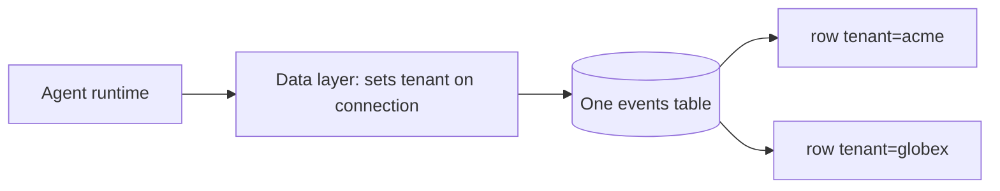
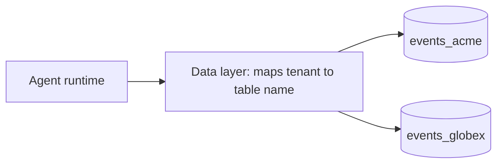
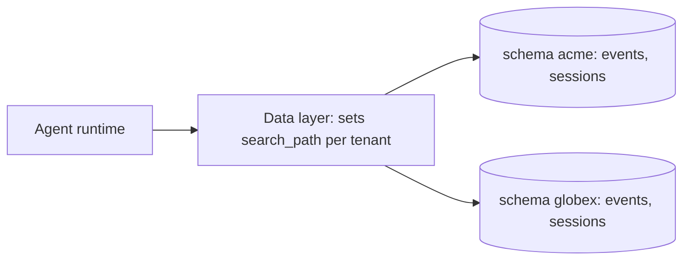
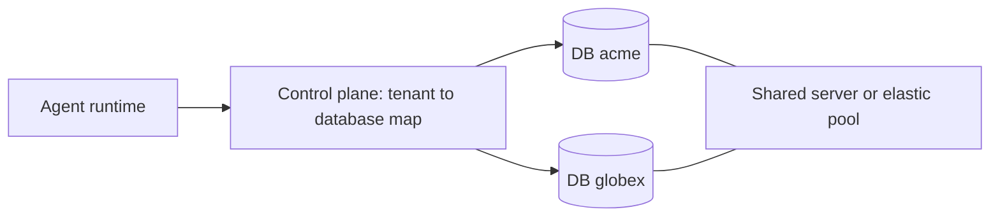
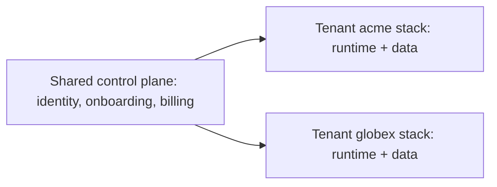
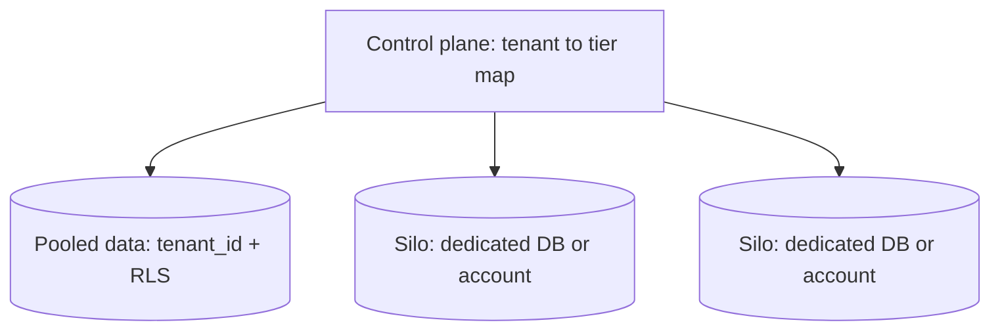

# Tenant isolation for an agent platform

A design pattern for keeping one customer's data, conversations, memory and credentials away from every other customer when many share one agent runtime. It extends the [runtime reference architecture](../runtime-architecture/README.md), where `tenant_id` first appears on the session table and the rule is "enforce isolation in the store, not only in code".

Evidence labels: **(read)** from a primary source read on 2026-11-19, listed in [standards-evidence.md](standards-evidence.md); **(not verified)** a source that could not be read; **(inference)** this document's reasoning. Diagrams are Mermaid, as requested, each followed by a plain-text twin because GitHub Mobile shows Mermaid as raw source.

## 1. The answer first

1. **No standard we could read mandates a tenancy model.** NIST SP 800-53 Rev 5 (the word "tenant" appears in no control), GDPR articles 25, 32 and 17, India's DPDP Act, and HIPAA 164.312 all set risk-based outcomes (read). SOC 2, ISO 27001/27017/27018 and the CSA Cloud Controls Matrix could not be read, so we make no claim about their text (not verified). Your auditor decides whether your design shows the outcomes. The model is a risk and cost decision.
2. **Two regimes push toward testable separation.** PCI DSS v4.0 Appendix A1 (multi-tenant service providers handling card data) requires logical separation, per-customer access limits and logs, and a penetration test of the separation at least every six months. FedRAMP expects third-party assessors to test tenant-to-tenant attacks. Both accept logical separation if you can show it works (read, with the caveats in the evidence file).
3. **Default to pooled tables with `tenant_id` and database-enforced row-level security, plus a silo tier you can sell.** It is defensible against every text we read, provided you add application checks, cross-tenant tests, and tenant-scoped caches and vector namespaces (inference). Offer a database or account per tenant for customers whose contract or regulator requires it. Both AWS and Azure describe this hybrid (read).
4. **Schema per tenant and table per tenant are the weak middle.** They cost most of the operations of separate databases and give less isolation, and no primary source we read documents their limits (not verified). Choose them only for a measured reason.
5. **Agents add leak surfaces that classic SaaS patterns miss:** shared prompt caches, vector indexes, long-term memory, tool credentials and the transcript itself. Section 6 covers them.

## 2. The five models

| Model | What it is | One-line example |
|---|---|---|
| A. Pool, `tenant_id` column | All tenants share tables; every row carries `tenant_id` | `SELECT ... WHERE tenant_id = $1` plus a row-level security policy |
| B. Table per tenant | Shared database; each tenant has its own tables | `events_t_acme`, `events_t_globex` |
| C. Schema per tenant | Shared database; one schema per tenant, same table names | `acme.events`, `globex.events` |
| D. Database per tenant | Shared server or pool; one database per tenant | `tenant_acme` database, one connection string each |
| E. Infrastructure per tenant | Dedicated account, subscription or cluster per tenant (a "silo") | One cloud account per tenant, deployed from the same code |
| Hybrid ("bridge", "cells") | A mix: most tenants pooled, some siloed; or tenants grouped into stamps | Pool by default, silo for regulated customers |

### Model A: pool with `tenant_id`



```
 runtime --> data layer (sets tenant for the connection) --> ONE events table
                                                              |- rows tenant=acme
                                                              '- rows tenant=globex
```

Enforce in the database, not only in code. A minimal PostgreSQL shape (the SQL is the standard documented form; we did not execute it here):

```sql
ALTER TABLE events ENABLE ROW LEVEL SECURITY;
ALTER TABLE events FORCE ROW LEVEL SECURITY;      -- owner is also bound
CREATE POLICY tenant_only ON events
  USING (tenant_id = current_setting('app.tenant_id')::uuid);
-- per request: SET LOCAL app.tenant_id = '<resolved tenant>';
```

Documented caveats of PostgreSQL row-level security (read): with no policy the default is deny; superusers and roles with `BYPASSRLS` always bypass; table owners bypass unless `FORCE ROW LEVEL SECURITY`; referential-integrity checks bypass it and can leak existence through a covert channel; backups can silently omit rows unless `row_security` is off. So the application role must be a plain role, never the owner or a superuser.

| Pros | Cons |
|---|---|
| Highest tenant density and lowest cost; one schema to migrate | A missing filter or a bypass role leaks everything; isolation rests on correctness |
| Cross-tenant analytics and fleet reporting are easy | Noisy neighbour: one tenant's load degrades all |
| Moving a tenant between pools is an identifier or key update | Per-tenant restore is hard (restore elsewhere, copy rows back) |
| Simple onboarding: insert a row | Per-tenant encryption keys, residency and retention need extra design |

Azure notes that many multitenant solutions skip row-level security because it is complex to design, implement and test (read). Do not skip it: it is the layer that survives an application bug.

### Model B: table per tenant



```
 runtime --> data layer (tenant -> table name) --> events_acme
                                               '-> events_globex
```

| Pros | Cons |
|---|---|
| Per-tenant drop is a table drop; per-table permissions possible | Table names built from input invite injection; catalog grows with tenants |
| No `WHERE tenant_id` to forget | Every migration fans out across all tables; ORMs fit poorly |
| Natural in some stores (a DynamoDB table per tenant is AWS's siloed example, read) | No primary source we read gives relational limits for this model (not verified) |

### Model C: schema per tenant



```
 runtime --> data layer (search_path per tenant) --> schema acme   (events, sessions)
                                                 '-> schema globex (events, sessions)
```

| Pros | Cons |
|---|---|
| Familiar; per-tenant grants on a schema; easy per-tenant export with a dump of one schema | Same migration fan-out as B, plus catalog bloat with thousands of tenants (inference; not verified) |
| Per-tenant customisation of tables is possible | A wrong `search_path` silently reads the wrong tenant; connection pooling must reset it per request |
| Slightly stronger boundary than a column | One server still shares CPU, memory, and a noisy neighbour |

Azure warns that vendors must "carefully manage schema customizations at scale" and must track each tenant's schema version when schemas differ (read).

### Model D: database per tenant



```
 runtime --> control plane (tenant -> database) --> DB acme   --.
                                                '-> DB globex --+-- shared server / elastic pool
```

Azure SQL's pattern table rates database-per-tenant at roughly 1 to 100,000s of tenants with high tenant isolation, low cost when databases share a pool, and "low to medium" operational complexity, and says elastic pools let databases share resources with per-database metrics (read; column mapping reconstructed from flattened text, so verify against the page).

| Pros | Cons |
|---|---|
| Strong isolation: a bug in a query cannot cross a database boundary | Fleet-wide migrations, monitoring and connection management |
| Per-tenant backup, point-in-time restore, encryption key, region | Cross-tenant reporting needs a separate warehouse |
| Noisy neighbour limited by pool settings | Cost and operational weight rise with tenant count |
| Straightforward deletion: drop the database | Needs a control plane that maps tenants to databases |

### Model E: infrastructure per tenant



```
 shared control plane (identity, onboarding, billing)
        |-> acme   stack: runtime + data (own account/subscription)
        '-> globex stack: runtime + data (own account/subscription)
```

Azure's guidance: benefits are reduced leakage risk, no noisy neighbour and progressive rollout; risks are that "cost efficiency is low" (100 tenants can take about 100 times the cost), maintenance is time-consuming and fleet-wide reporting is hard (read). AWS adds that a silo still shares an identity, onboarding and operations experience, which is what separates SaaS from a managed service (read).

| Pros | Cons |
|---|---|
| Strongest isolation, residency, keys and per-tenant SLAs | Highest cost and operations; releases must roll out per stack |
| Simple answer to a regulator or a large customer's security review | Quota and account limits to manage; slow onboarding unless automated |
| Per-tenant version pinning and blast-radius limits | Fleet observability needs deliberate work |

### Hybrid: pool by default, silo on demand



```
 control plane (tenant -> tier)
     |-> POOLED data (tenant_id + row-level security)   <- most tenants
     |-> SILO (dedicated database or account)           <- regulated or large tenants
     '-> SILO
```

Azure notes the cost of this model: the code must support both shapes and you need a tenant-to-deployment map; stamps (groups of tenants) also work around quota limits (read). AWS calls it a "bridge" and says a service's regulatory profile or noisy-neighbour behaviour may push it to a silo (read). Design for it from the start: put the tenant-to-tier map in the control plane and keep the data layer behind an interface that takes a tenant, not a connection string.

## 3. Choosing

| Question | Points toward |
|---|---|
| Many small tenants, cost-sensitive, no tenant-specific contract terms | A (pool) with row-level security |
| A few tenants require their own keys, region or restore | Hybrid: A plus D or E for those tenants |
| Regulator or contract demands demonstrable physical separation | E, or D with per-tenant keys |
| Tenants need different schemas or extensions | D (not B or C unless measured) |
| Hundreds of thousands of tenants | A, or sharded A in cells; avoid B, C and D (inference) |
| You must prove separation to an assessor | Whichever you choose, plus the tests in Section 7 |

Reversibility: moving a tenant from pool to silo needs an export-and-cutover path. Build it before the first customer asks, with the same copy tooling you use for backups (inference).

## 4. What the standards say

| Standard | What it says about separation | Mandates a model? |
|---|---|---|
| NIST SP 800-53 Rev 5 | SC-4 prevent unintended transfer via shared resources; SC-32 partition into separate domains; AC-4(21) separate information flows logically or physically; "tenant" appears in no control (read) | No: "logically or physically", values chosen by the organisation |
| NIST SP 800-144 | Clouds rely on "logical separation at multiple layers of the application stack"; errors can expose one consumer's data to another (read) | No: describes the risk |
| PCI DSS v4.0 Appendix A1 | Multi-tenant providers separate customer environments and data; each customer sees only its own; per-customer logs; logical separation tested at least every six months by penetration test (read, via the SAQ D document) | No model; requires tested separation |
| FedRAMP | Tenant-to-tenant attack testing by assessors; "segmentation and isolation of tenants" with strong evidence (read) | No model; requires evidence |
| GDPR | Art. 25 data protection by design and by default; art. 32 measures "appropriate to the risk"; art. 17 erasure "without undue delay" (read) | No |
| India DPDP Act 2023 and Rules 2025 | s.8(5) reasonable security safeguards including at processors; s.8(7) erase on withdrawal or when the purpose ends, and have processors erase; Rule 6 minimum safeguards (encryption or masking, access control, logs, backups, retaining logs for one year). Rule text was read from an unofficial mirror (read, with that caveat) | No |
| HIPAA Security Rule 164.312 | Access control, unique user IDs, audit controls, integrity, transmission security; nothing on tenancy in the section text (read) | No |
| SOC 2 Trust Services Criteria | Not verified: the AICPA text is behind a login | Not verified |
| ISO/IEC 27001, 27017, 27018 | Not verified: paywalled | Not verified |
| CSA Cloud Controls Matrix | Not verified: only a search summary seen | Not verified |

**What to do with this (inference).** Build to the outcomes the readable texts share, because they are what an auditor of any framework will probe:

1. **Demonstrable separation:** the tests in Section 7, rerun on every release, with the results kept as evidence.
2. **Access control and least privilege:** the application role is not an owner or superuser; people get just-in-time, logged access.
3. **Logging per tenant:** who accessed what, retrievable by tenant, and viewable by that tenant only where the contract says so (PCI A1.2.1 states this explicitly).
4. **Encryption and key management** appropriate to risk, with a tenant-scoped key where you sell a silo tier.
5. **Retention and deletion** you can execute and prove (Section 5).
6. **Written scope:** which model, for which data kind, and why. Auditors accept a reasoned choice; they punish an undocumented one.

For SOC 2 specifically, the common practice is to map a pooled design to the logical-access and confidentiality criteria with evidence of the controls above, but we could not read the criteria and make no claim about them. Get the current criteria text and ask your auditor early.

## 5. Transcripts, memory and deletion under tenancy

The event log (the conversation history) is the transcript, and compaction is a read-time view over it, so nothing is lost ([runtime architecture](../runtime-architecture/README.md)). Tenancy adds five jobs the base design leaves open:

| Job | Design |
|---|---|
| **Tenant-scoped keys** | Encrypt event payloads with a per-tenant data key (envelope encryption). Deleting the key makes the tenant's history unreadable: crypto-shredding, the practical answer to erasure in an append-only log. |
| **Retention and legal hold** | A per-tenant retention policy and a hold flag, applied by a job that deletes whole partitions or keys, never by editing events in place. |
| **Redaction before append** | Detect secrets and personal data in tool results before they are written, or store them encrypted in the artifact store with a reference in the log. Redacting afterwards breaks the append-only guarantee. |
| **Per-user erasure** | Keep a `subject_id` on events so one person's data can be found and either tombstoned or cryptographically erased without touching the rest of the tenant. GDPR art. 17 and DPDP s.8(7) require erasure when the grounds apply. |
| **Export and audit** | A per-tenant export in a portable format and an audit query by tenant, for access requests and for assessors. |

Partition the event log by tenant if you can (a partition per tenant, or tenant as the leading key), so retention, export, restore and deletion operate on whole partitions.

## 6. Agent-specific leak surfaces

| Surface | Risk | Control |
|---|---|---|
| **Prompt cache** | Shared caches leak through timing. An audit found global cache sharing across users in seven API providers (arXiv 2502.07776, abstract); another shows timing side channels in shared LLM caches (arXiv 2409.20002). Anthropic and OpenAI document cache isolation by organisation, and Anthropic by workspace on some platforms (vendor docs, read) | Within one organisation, tenant isolation of the cache is your job: separate workspaces, projects or keys for tenants that need it, or do not put one tenant's content into a prefix another tenant can match |
| **Vector index and retrieval** | One shared index returns another tenant's chunks. OWASP LLM08:2025 names multi-tenant vector-database leakage and advises permission-aware stores with strict logical partitioning (read) | A tenant filter or namespace on every query, enforced in the retrieval layer, not in the prompt. Vendors: Pinecone recommends a namespace per tenant; Qdrant says a collection per tenant is rarely efficient and caps Qdrant Cloud at 1,000 collections per cluster by default (vendor docs, read) |
| **Long-term memory and knowledge stores** | Facts learned from one tenant surface for another | Memory records carry the tenant and are read only through the same enforced path as the event log |
| **Shared model endpoints** | Azure's guidance compares a dedicated resource per tenant (high data isolation), a shared resource with dedicated deployments (medium) and a shared deployment (low to medium), and notes agent services may add state you must manage (vendor docs, read) | Match the endpoint model to the silo tier; keep tenant data out of model fine-tuning unless a tenant-specific model is the product |
| **Tool and connector credentials** | One tenant's token used for another | Per-tenant credentials in a vault, resolved after the tenant is known; no shared service account that can reach all tenants. The MCP specification's security guidance covers confused deputy and token passthrough; we did not read it in depth |
| **Self-hosted inference caches** | Prefix or KV caches shared across tenants | No official guidance read (not verified). Scope cache keys by tenant or disable sharing across tenants |
| **Logs, traces and analytics** | Prompts and results copied to a shared observability tool | Tenant tag on every record, redaction, access control and retention on the observability store too |

## 7. Tests that prove isolation

Run these in CI and keep the output as audit evidence.

1. **Cross-tenant read:** as tenant A, request tenant B's session, event, memory and artifact by ID, and by search. Expect not found or denied.
2. **Missing-filter fuzz:** run every query path with the tenant unset. Expect an error or empty result, never all rows.
3. **Bypass roles:** assert the application database role is neither owner nor superuser and has no `BYPASSRLS`.
4. **Cache and retrieval canaries:** write a unique string as tenant A, then try to retrieve or elicit it as tenant B through search, memory and a repeated prompt prefix.
5. **Erasure:** delete a tenant (and separately one user), then show the data and the keys are gone from the log, backups within the stated window, caches and indexes.
6. **Restore:** restore one tenant from backup without exposing others.
7. **Penetration test of separation** at least every six months where PCI applies, and as part of the FedRAMP assessment where it does.

## 8. What this does and does not establish

- **No standard read here mandates a tenancy model.** SOC 2, ISO 27001/27017/27018 and CSA CCM were not readable; do not treat any statement about them in this document as verified.
- **PCI DSS text came from the SAQ D document** that reproduces Appendix A1, not the full standard, and the DPDP Rules text came from an unofficial mirror. Check the official sources before relying on either.
- **Schema-per-tenant and table-per-tenant limits** (catalogue size, migration fan-out, connection counts) have no primary source here. Measure them on your own database before choosing B or C.
- **Vendor guidance is vendor-authored.** The AWS whitepaper pages are marked historical reference only.
- **The SQL snippet was not executed in this session.**
- **The defaults and choosing table are hypotheses** to test with the decision method, not findings.

## Related

- [Evidence and sources](standards-evidence.md)
- [Runtime reference architecture](../runtime-architecture/README.md) (event log, stores, tenant isolation as a store property)
- [Blueprint](../../architecture-evolution/blueprint/README.md)
- [Decision method](../../architecture-evolution/decision-method.md)
