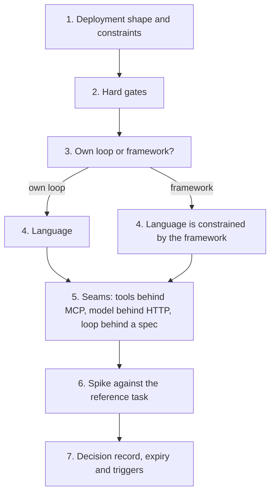

# Selecting an implementation language and agent framework

An extension of the [evidence-driven decision method](decision-method.md) for one recurring decision: **which language, and which framework (if any), to build an agentic runtime in.** It uses the method's charter, hard gates, evidence register, sensitivity test and evolution triggers, and changes three things that this decision needs.

Evidence behind it: the [language treatise](../agents/languages/README.md) and the [framework comparison](../agents/frameworks/README.md). Customer-neutral: supply your own workloads, constraints and authority.

## 1. Why this decision needs its own method

The base method sizes components with three capacity bands (scale, reliability, latency) and eliminates options that fail a band. That works for databases and compute. It does **not** separate languages or agent frameworks, for three reasons.

1. **Capacity bands do not discriminate.** An agent runtime is input/output-bound: a model call takes seconds and the runtime's own overhead is microseconds to milliseconds. Every language in the treatise can serve a pilot, a regional load or a national load for the runtime's own work. A scale band would pass them all and tell you nothing.
2. **The decisive facts are not numbers.** They are whether an official SDK exists for your model provider, which tier the protocol SDK is, whether you can ship one binary, how you sandbox, who must run it, and how often the framework breaks you.
3. **The facts expire fast.** Framework status, SDK tiers and version lines changed several times in the twelve months before this was written. Evidence here has a short shelf life (Section 7).

So the method below keeps the base method's skeleton (gates, then trade-offs, evidence with expiry, triggers) and replaces the capacity bands with **deployment shape**, a **spike**, and **reversibility seams**.

## 2. Decide in this order



The order matters. **Decide own-loop-or-framework before language**, because a framework usually fixes the language (a Python-first framework removes Rust, and a .NET framework removes Python's advantage) and because the evidence says the loop is only about a hundred lines ([Harness Engineering](../llm-learning-repository/tutorials/06-agent-systems/29-harness-engineering.md)), so a framework must justify itself by what surrounds the loop, not by the loop.

### 2.1 Deployment shape (the replacement for the capacity profile)

Name which of these you are building. They have different winners; mixing them is the commonest source of a wrong choice.

| Shape | Defining facts |
|---|---|
| A. Local agent on users' machines | Installed by users, runs commands and edits files, must enforce a sandbox, startup and footprint matter |
| B. Server-side agent gateway or orchestrator | Many concurrent sessions, you operate it, durability and observability matter |
| C. Agent embedded in an existing product | Must join an existing platform (.NET or JVM), identity and deployment already exist |
| D. Research, evaluation or open-model tuning | Iteration speed and the model and evaluation ecosystem dominate; short-lived |
| E. Edge or offline | No network, local models only, small footprint |

## 3. Hard gates

A failed gate eliminates the option unless the accountable authority approves an exception. Typical gates for this decision:

| Gate | Test |
|---|---|
| Platform and policy | The language and runtime are approved to run where the agent must run, or an approval route exists with a date |
| Model-provider fit | An official SDK exists for your provider in the language, **or** you have accepted the cost of a thin HTTP client and written down who maintains it. (At the time of writing, Anthropic's official SDK list has no Rust entry; verify yours.) |
| Protocol fit | The MCP SDK in that language is at the tier your required features need. (At the time of writing the Java SDK is Tier 2 and five others are Tier 1; verify.) |
| Open and local models | If the requirement is open or local models, the framework or client must demonstrably handle your model's tool-calling and structured-output format. **Proven in the spike, not read from a feature list** |
| Sandbox | If the runtime executes model-chosen commands or code, there is a stated isolation mechanism, and it works on every operating system you ship to |
| Maintenance and licence | The framework is not in maintenance mode or deprecated for new builds, has a licence your organisation accepts, and has more than one active maintainer or an owner who has committed to support |
| Supply chain | You can pin, audit and mirror dependencies; a plugin or extension mechanism cannot load unreviewed code with the runtime's authority |

Record each gate's evidence in the register (Section 7). A gate with only [secondary] evidence cannot pass a high-consequence decision; it can justify a spike.

## 4. Own loop or framework

Write the decision as a comparison against the **baseline of owning the loop**, never against another framework alone. The baseline is the language-neutral reference specification in the [language treatise](../agents/languages/README.md#8-a-language-neutral-reference-specification): about a hundred lines plus a conformance suite.

| What a framework can buy | What it costs |
|---|---|
| Durable state: checkpoints, pause and resume, crash recovery | Your state shape becomes the framework's types |
| Human approval gates and interrupts | Hidden prompts, defaults and retries you did not write |
| Tracing and evaluation integration | Version churn and migration work |
| Provider adapters | The adapter's limits become yours (tool-call formats on open models especially) |
| A common vocabulary for a team | An abstraction to debug through |

Rule of thumb for the gate: **a framework earns its place only for features you will use in the first release** (durability, approvals, tracing, multi-step graphs) **that cost more than the framework's integration and churn to write yourself.** If you cannot name three such features with owners and dates, own the loop and revisit at the first trigger in Section 9.

## 5. Language

With shape, gates and the own-loop-or-framework result fixed, the remaining language choice is usually narrow. The [language treatise](../agents/languages/README.md) gives the comparison and the default by shape. Use it to fill the trade-off criteria below; do not use it to skip the spike.

## 6. Trade-off criteria and how to measure each

Score these after gates pass. Each needs an observation, not an opinion.

| Criterion | Measure |
|---|---|
| Time to a working reference task | Hours from empty directory to passing the reference task (Section 6.1) |
| Code you own | Lines of application code, and count of framework types in your domain model |
| Concurrency and cancellation correctness | Conformance-suite invariants passed (treatise Section 8) under injected faults |
| Footprint and start | Cold start time, resident memory per idle and per active session, distribution size |
| Observability fit | Whether traces reach the tracing system you already run without a custom bridge |
| Local-model integration | The spike result against your target open model, not a vendor's example |
| Churn | Count of breaking changes in the last 12 months from the changelog, and the time between a protocol or provider change and support landing |
| Team fit | People who can review and operate it, and the time-to-productive for the next hire |
| Exit cost | Hours to remove the framework and keep the behaviour (Section 8) |

### 6.1 The spike

A time-boxed experiment (two to three working days per candidate) is the evidence source that matters most, because it is the only one that exposes problems with **your** model and **your** constraints.

1. Implement the reference task using the [stub model server](../agents/frameworks/stub/server.mjs) first, so the model is a controlled variable: one tool (`get_weather`), then add approval before the tool runs, persistence across a restart, streaming, a second tool with parallel calls, and an MCP tool.
2. Repeat once against your real target model (hosted or open) to expose tool-call and structured-output problems.
3. Record the Section 6 measures. Run the same task as the owned-loop baseline.
4. Write what broke, what was hidden, and what you had to read the source to learn.

A candidate that passes the stub but fails on the real open model fails the open-model gate.

## 7. Evidence register and expiry

Use the base method's record. Two additions for this decision: tag the **kind** of evidence, and set a **short validity** because facts expire.

```yaml
claim: MCP Java SDK is Tier 2 (conformance target below Tier 1)
component: agent-runtime-language
candidate: java
scenario: needs-newest-mcp-features
observed_value: Tier 2
required_value: Tier 1
method: read the official SDK list
kind: official-page
source: https://modelcontextprotocol.io/docs/sdk.md
observed_at: 2026-11-19
owner: <name>
confidence: high
valid_until: 2027-02-17      # 90 days for SDK and framework status
```

| Kind of evidence | Typical validity |
|---|---|
| Official page: SDK tier, supported languages, framework status | 90 days |
| Release history and changelog analysis | 90 days |
| Your spike results | Until the framework or model major version changes |
| Language-intrinsic properties (concurrency model, typing) | 12 months |
| Blog, aggregator, benchmark by a third party | Treat as low confidence; support a spike, not a decision |

## 8. Reversibility: which parts are cheap to change

The most useful property of this decision is that it can be made reversible, because the loop is small and three seams isolate the rest.

| Seam | Keeps the language choice reversible by | If you skip it |
|---|---|---|
| **Loop behind a specification and conformance tests** | A rewrite is a conformance exercise, not research | A rewrite means re-discovering behaviour |
| **Tools behind MCP** | Tool servers run in any language and are reused across runtimes | Tools are written against the framework's tool types and must be ported |
| **Model behind an HTTP API** | The model's serving language and the runtime's are independent | Local inference is entangled with the runtime |

Expensive to change regardless of language, so spend your care here: the **persistence format** (append-only, versioned log), the **permission policy language**, the **extension API** exposed to others, and the **sandbox boundary**. A framework's checkpoint format is a persistence format you do not control; treat adopting one as adopting that decision.

## 9. Evolution triggers for this decision

Add these to the decision record. Each reopens the decision.

- A framework you depend on enters maintenance mode, is deprecated, or breaks your build with two major versions inside twelve months.
- The MCP specification adds a feature you need and your SDK or framework does not support it within an agreed time.
- Your model provider changes its tool-calling or streaming API and the adapter lags by more than the agreed time.
- You add a deployment shape (for example a local agent after a server-only start). The default in Section 2.1 changes with shape.
- The spike's pain points recur in production: hidden retries, prompt overhead, or debugging that needs framework source.
- The team that can operate the chosen stack shrinks below an agreed minimum.
- The review date arrives. Language and framework decisions carry a **six-month scheduled review**, shorter than the base method's default, because the facts move.

## 10. Decision record template

```markdown
# ADR-nnn: Agent runtime language and framework

Status: proposed | accepted | superseded     Owner:     Approver:     Date:     Review by: <six months>

## Context
Deployment shape (A-E): ...            Expected lifetime: ...            Reversibility: ...
Workloads and scenarios (measurable): ...

## Gates and evidence
| Gate | Result | Evidence id | Confidence | Valid until |

## Options
Own loop in <language>:     Framework <name> in <language>:     Rejected: <options and reason>

## Spike results
Reference task, time, LOC, framework types touched, defects found, open-model result.

## Decision and consequences
Chosen: ...    Seams used (loop spec, MCP, model over HTTP): ...    Exit plan and cost: ...

## Triggers (from Section 9, with owners and thresholds)
```

## 11. Defaults for today

Dated **2026-11-19**. These are the defaults the evidence in this repository supports, **not decisions**: each is a starting hypothesis to test in the spike (Section 6.1) against your own gates. Review them by **2027-02-17** (90 days, because the facts behind them are framework and SDK status). Evidence is in the [language treatise](../agents/languages/README.md) and the [framework profiles](../agents/frameworks/README.md).

### 11.1 The framework default, before the language

**Own the loop, borrow the parts, unless you can name three first-release features a framework supplies that cost more to build than to adopt and pin.** All sixteen profiled frameworks leave permissions, sandboxing, context compaction, cost control and exact cancellation to you, and twelve of them were run, so this is an observed gap and not an inference. What they supply is below the loop: provider adapters, schema generation, an MCP client, tracing, and in some cases durable state. Take those as libraries and keep the loop, the session log and the permission policy yours.

The features that most often justify a framework:

| First-release need | Framework that supplied it in our runs | What it cost |
|---|---|---|
| Resumable graph with human gates | LangGraph (checkpoints, interrupts; node-level crash resume ran) | Heavy dependency tree; hard-kill durability untested |
| Typed model boundary and retries | PydanticAI | V2 removed many V1 names; fast releases |
| Conversation memory, workflows and evals in TypeScript | Mastra (workflow resume survived a process restart) | About 191 MB install; fast-moving surface |
| Claude Code's tools, permissions and compaction, Claude only | Claude Agent SDK | Closed 354 MB binary; Claude models only |
| An existing .NET or JVM platform | Microsoft Agent Framework; Spring AI or LangChain4j | Framework-shaped state; Java MCP is Tier 2 |

### 11.2 By deployment shape

| Shape (Section 2.1) | Language default | Framework default | Why, and the main thing to prove in the spike |
|---|---|---|---|
| A. Local agent on user machines | **Rust**, or **Go** if a weaker sandbox story is acceptable | Own loop. No framework unless Claude-only (then evaluate the Claude Agent SDK and its footprint) | Single binary, native sandbox calls, direct MCP SDK (Tier 1). No official Anthropic Rust SDK, so budget a thin HTTP client. Prove the sandbox on every OS you ship |
| B. Server-side gateway or orchestrator | **Go**; **C#** in a .NET shop | Own loop on the official SDKs. LangGraph only if Python and a durable graph are first-release needs | Cheap concurrency and cancellation. Prove cancellation propagates to the stream and to child processes under injected faults |
| C. Embedded in an existing product | **C#** on .NET; **Java** on the JVM | Microsoft Agent Framework (.NET) or Spring AI / LangChain4j (JVM) for the application surface; keep the loop and approvals yours when they matter | Reuse the platform's identity and operations. On the JVM accept MCP at Tier 2 and prove the protocol features you need exist |
| D. Research, evaluation, open-model tuning | **Python** | Own loop or PydanticAI / LangGraph; smolagents only with a real sandbox | Fastest iteration and the model ecosystem. Move stable parts later |
| E. Edge or offline | **Rust** or **Go** | Own loop; model over a local HTTP server | Footprint and startup dominate. Avoid framework dependency trees |

If the answer to "where does it run?" is "both on user machines and on a server", decide the **loop specification and conformance tests first**, then implement the local variant and the server variant against them; do not pick one language for both without a reason you can test.

### 11.3 What would change these defaults

- A framework above ships a release that gives you permissions, a sandbox, or step-level durability you can verify, or stops breaking its API for two consecutive majors.
- The MCP Java SDK reaches Tier 1, or Anthropic ships an official Rust SDK (the two verified gaps in the five-language comparison).
- Your spike shows a framework matches your open model's tool-call format where the owned loop does not (the open-model gate is the one most likely to flip a default).
- You change shape (Section 9).

### 11.4 Limits of this section

The defaults rest on documentation, package metadata and runs against a scripted stub model. **No profile tested real model behaviour**, so nothing here ranks frameworks by agent quality. Four of the sixteen frameworks (Spring AI, LangChain4j, Eino, rig) were not run at all. The languages treatise contains no measurements; [its Section 9](../agents/languages/README.md#9-how-to-turn-this-into-measurements) specifies the experiment that would produce them.
