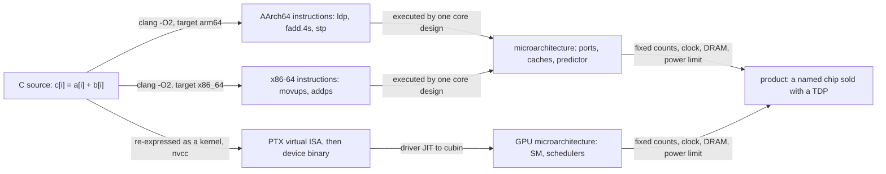
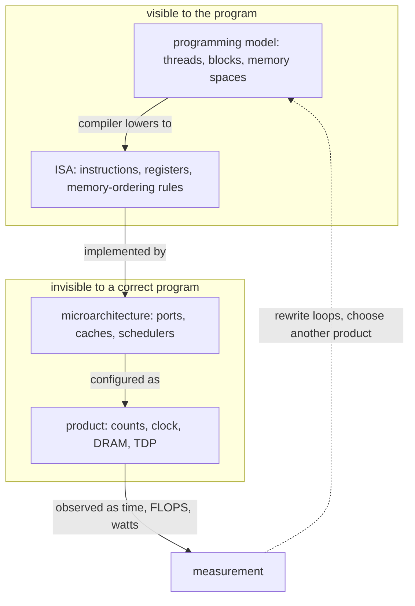

# The Map: ISA, Microarchitecture, Programming Model and Product

> **Listed source:** Sun, Agostini, Dong and Kaeli (Northeastern University), "Summarizing CPU and GPU Design Trends with Product Data", arXiv v2, 13 July 2020 - [arXiv abstract](https://arxiv.org/abs/1911.11313) - [local PDF](../sources/gpu/foundations/cpu-gpu-design-trends.pdf). Five PDF pages. Cited below as "Sun p. N" (PDF page).
>
> **Additional evidence (not listed sources for this tutorial):** the CUDA C++ Programming Guide release 13.3, the HIP documentation release 6.3.42134, the oneAPI GPU Optimization Guide, the Xe-HPG white paper, Hofmann et al. on four generations of Intel server processors, and Arm's ARMv8-A overview slides. Cited with file name and PDF page, for example "additional: cuda-programming-guide, p. 39". Every other tutorial in this track covers those in depth.
>
> **How claims are labelled.** "Sun p. N" or "the guide says (p. N)" is a source claim. "Measured on this machine" is something I compiled or ran here (Apple M5 Pro, Apple clang 21.0.0). "Constructed" is arithmetic or code I made up for teaching. "General knowledge" is not in any source I read. "Not run" is code that cannot execute on this machine.

## Read this first

**The claim in one sentence.** A statement such as "GPUs are faster than CPUs" or "Arm is more efficient than x86" is a statement about four different layers at once, and you cannot reason about performance, portability or cost until you know which layer each word in the sentence names: the instruction set architecture, the microarchitecture, the programming model, or the product.

**Who this is for.** Anyone starting this track who has to choose or explain hardware for a workload, for example a team deciding whether to run language-model inference on a laptop CPU, a workstation GPU or a rented accelerator. No prior assembly knowledge is assumed. You need to be able to read a short C function.

**Afterwards you will be able to:** define the four words precisely and place x86-64, AArch64, CUDA, HIP and Xe on them; read a real 20-line loop in two assembly languages and say which differences belong to the instruction set, which to the compiler and which are invisible; explain what a "kernel" is and why a GPU program has no loop in it; and say exactly what the Sun et al. trend paper measures, what each of its headline numbers means, and what its data cannot tell you.

**Reading time.** About 45 minutes. **Have read first:** nothing. This is the first tutorial in the track. Later ones are [memory hierarchy](02-memory-hierarchy.md), [x86-64](x86-64/03-x86-64.md), [Arm A-profile](arm/04-arm-a-profile.md), [GPU foundations](gpu/05-gpu-foundations.md), [CUDA architecture](gpu/nvidia/06-cuda-architecture.md), [NVIDIA microbenchmarking](gpu/nvidia/07-nvidia-microbenchmarking.md), [AMD CDNA and HIP](gpu/amd/08-amd-cdna-hip.md), [Intel Xe and oneAPI](gpu/intel/09-intel-xe-oneapi.md) and the [CPU or GPU decision](10-cpu-gpu-decision.md).

**The one thing most people get wrong.** The Sun paper looks like a paper about architecture, but it never studies an instruction set. Its unit of observation is the product: one row of public data per released chip (release date, process size, die size, transistor count, base clock, thermal design power). When it says "architectural solutions" (Sun p. 5) it means packaging and power-management techniques, which sit in the microarchitecture and product layers, not in the instruction set. The paper is a good map of what products did over 2000-2019 and a poor guide to why, and this tutorial uses it for the first purpose while being explicit about the second.

## The paper in one worked example

The example has three parts. Part A is a real compile of one C function for two instruction sets on this machine. Part B is the same operation as a CUDA kernel (not run). Part C ties both to one row of the kind of data Sun et al. collected.

### Part A - one C function, two instruction sets (measured on this machine)

The function is constructed by me (a loop adding two arrays). The `restrict` qualifiers promise the compiler that the three arrays do not overlap, which lets it vectorize without runtime overlap checks.

```c
void add(float *restrict c, const float *restrict a, const float *restrict b, int n) {
    for (int i = 0; i < n; i++)
        c[i] = a[i] + b[i];
}
```

Commands, run on an Apple M5 Pro with Apple clang 21.0.0 (`Target: arm64-apple-darwin25.5.0`): `clang -O2 -S add.c` for arm64 and `clang -O2 -arch x86_64 -S add.c` for x86-64. Only assembly text was emitted for x86-64 (plus an object file to count bytes); no x86-64 code was executed. Compiler comments and assembler directives are trimmed. Below is the inner vector loop of each, verbatim from the output; each full listing also has an entry check, a short-array path and a scalar remainder loop.

**arm64 (AArch64), the main vector loop (16 floats per trip):**

```asm
LBB0_6:                                 ; vector loop
	ldp	q0, q1, [x10, #-32]     ; load 2 x 128-bit from a
	ldp	q2, q3, [x10], #64      ; load 2 more, advance pointer
	ldp	q4, q5, [x11, #-32]     ; load from b
	ldp	q6, q7, [x11], #64
	fadd.4s	v0, v0, v4              ; 4 float adds at once
	fadd.4s	v1, v1, v5
	fadd.4s	v2, v2, v6
	fadd.4s	v3, v3, v7
	stp	q0, q1, [x12, #-32]     ; store to c
	stp	q2, q3, [x12], #64
	subs	x13, x13, #16           ; count down, set flags
	b.ne	LBB0_6                  ; branch if not zero
```

**x86-64 (AT&T syntax, destination last), the main vector loop (8 floats per trip):**

```asm
LBB0_4:                                 ## vector loop
	movups	(%rsi,%r9), %xmm0       ## load 4 floats from a
	movups	16(%rsi,%r9), %xmm1
	movups	(%rdx,%r9), %xmm2       ## load 4 floats from b
	addps	%xmm0, %xmm2            ## xmm2 = xmm2 + xmm0
	movups	16(%rdx,%r9), %xmm0
	addps	%xmm1, %xmm0
	movups	%xmm2, (%rdi,%r9)       ## store to c
	movups	%xmm0, 16(%rdi,%r9)
	addq	$32, %r9
	cmpq	%r9, %r8
	jne	LBB0_4
```

The x86-64 scalar remainder loop contains `addss (%rdx,%rcx,4), %xmm0`, an add that reads its second input straight from memory.

**Counts, measured on this machine** (`size -m` and `otool -tv` on `-c` object files): arm64 `__text` is 236 bytes for 59 instructions, exactly 4 each. x86-64 is 137 bytes for 38 instructions, 3.6 on average. The x86-64 listing is shorter mainly because the vector loop is unrolled less (8 floats per trip against 16), not because x86-64 does less work.

**Correctness check** (arm64 only, native): a 19-element driver with a[i]=i and b[i]=2i printed `0 15 54` for c[0], c[5], c[18], i.e. 3i, exercising the 16-wide path and the 3-element remainder. The x86-64 object was not run.

**Three more compiles to isolate causes (all assembly or object only):**

1. `-fno-vectorize -fno-slp-vectorize` on arm64 gives a six-instruction loop: `ldr s0,[x1],#4; ldr s1,[x2],#4; fadd s0,s0,s1; str s0,[x0],#4; subs x8,x8,#1; b.ne`. The plainest picture of "one add per trip".
2. `-arch x86_64 -mavx2` emits 256-bit `%ymm` registers, 32 floats per trip, three-operand `vaddps (%rdx,%r9), %ymm0, %ymm0`, and a 252-byte `__text`. Same ISA family, different extension chosen by a flag.
3. `-arch x86_64 -mavx512f` emits 512-bit `%zmm` registers (12 lines mention `zmm`). On a CPU without that extension it would fault on an illegal instruction; I did not run it.

**What is the same, what differs, what neither shows.**

| Question | Answer from the listings |
|---|---|
| What is the same? | The meaning: for every i below n, c[i] gets a[i]+b[i]. Both compilers split the loop into a wide vector path, a scalar remainder path and a guard for n <= 0. Both do loads, a float add, stores, a counter update and a conditional branch. This is the C language semantics, which neither instruction set owns. |
| What is ISA? | Register names (`x0`-`x30`, `v0`-`v31` against `%rdi`, `%xmm0`); instruction names; encoding (fixed 4 bytes against variable length); Arm separates loads and stores from arithmetic while x86 can add straight from memory; Arm's `fadd.4s v0, v0, v4` names a destination and two sources while plain SSE `addps %xmm0, %xmm2` overwrites one input. |
| What is ABI, not ISA? | Which register carries `n`: `w3` on arm64, `%ecx` on x86-64 (both the fourth argument). The x86-64 listing keeps a frame pointer (`pushq %rbp`); the arm64 leaf function has none (general knowledge: calling convention and compiler policy). |
| What is compiler choice? | Unroll factor (16 against 8 floats per trip) and vector width. Adding `-mavx2` changed the x86-64 loop more than the arm64-against-x86-64 difference did. |
| What does neither show? | How many of these instructions retire per cycle, whether loads and adds overlap, how the branch predictor handles the loop-closing branch, how big the caches are, and whether the arrays are in cache at all. These are microarchitecture and product properties. Reading the assembly will not give you a time. |

I made no timing comparison and claim nothing about which version is faster: no amount of staring at either listing gives a speed.

**Evidence that "same instruction set, different cost" is real (additional: intel-server-microarchitecture-analysis, PDF p. 4).** Hofmann et al. test four Intel Xeon server generations that share the x86 family: Sandy Bridge-EP (Xeon E5-2680, Q1/2012), Ivy Bridge-EP (E5-2690 v2, Q3/2013), Haswell-EP (E5-2695 v3, Q3/2014) and Broadwell-EP (E5-2697 v4, Q1/2016). Their Table 1 lists the load path from L1 cache to registers as 2x16 bytes per cycle on the first two and 2x32 on the last two. The text on the same page says Sandy Bridge introduced AVX (256-bit SIMD), but its L1 data paths stayed at 16 bytes per cycle, so "AVX stores requiring two cycles to retire on SNB, and AVX LOADs block both units". The instruction was in the instruction set; the hardware that executed it was half-width. That is the instruction set / microarchitecture distinction measured, on real products.

### Part B - the same operation as a CUDA kernel (not run)

NVIDIA's own first example (additional: cuda-programming-guide, PDF p. 27) is a kernel named `VecAdd`: "executed N times in parallel by N different CUDA threads, as opposed to only once like regular C++ functions". Here is the same operation in the form I would write for arbitrary n. This is constructed, and **not run**: this machine has no NVIDIA GPU and no CUDA toolchain.

```cuda
// NOT RUN. Constructed; compare with VecAdd in the CUDA guide, PDF p. 27.
__global__ void add(float *c, const float *a, const float *b, int n) {
    int i = blockIdx.x * blockDim.x + threadIdx.x;   // which element am I?
    if (i < n) c[i] = a[i] + b[i];                   // no loop
}
// host side:  add<<<(n + 255) / 256, 256>>>(c, a, b, n);
```

The loop has gone: each thread computes its own index from `blockIdx`, `blockDim` and `threadIdx` and does one addition, and `<<<blocks, threads>>>` says how many threads to create. Constructed arithmetic: with n = 1,000,000 and 256 threads per block you need ceil(1,000,000 / 256) = 3,907 blocks (3,906 blocks cover 999,936 elements; one more is needed for the remaining 64). That is 3,907 x 256 = 1,000,192 threads, of which 192 fail the `i < n` test and do nothing.

The guide calls PTX "the CUDA instruction set architecture", though "it is usually more effective to use a high-level programming language such as C++" (additional: cuda p. 39). The driver compiles PTX at load time ("just-in-time compilation", p. 40). A binary (cubin) is "architecture-specific" and runs only on devices with the same major compute capability and an equal or higher minor (p. 41; the extracted comparison sign is garbled, so that is my reading). So NVIDIA ships a portable virtual ISA (PTX) and per-generation binaries; the thread, block and grid model above is the programming model; compute capability is a generation label (p. 36).

**HIP** (additional: hip-programming-guide, PDF p. 25) uses the same `__global__` marker and the same `threadIdx.x`, `blockIdx.x`, `blockDim.x` built-in variables; the guide describes its model as "SIMT" and says the compiler "maps SIMT code ... to an inherently SIMD architecture" by "issuing the scalar instructions of multiple kernel instances to each of the SIMD engine lanes". It is "source-portable" to AMD or NVIDIA hardware but "HIP tools don't create a 'fat binary' that can run on either platform" (p. 106). **SYCL**, the language oneAPI uses for Intel GPUs (additional: oneapi-gpu-optimization-guide, PDF p. 7), writes the body as a lambda, `q.parallel_for(sycl::range<1>(n), [=](sycl::id<1> i){ c[i] = a[i] + b[i]; })` (my general-knowledge sketch; not compiled, not run).

### Part C - what one row of Sun's data looks like

The paper's data set (Sun p. 1) has 4,031 products: 2,102 CPUs and 1,929 GPUs, from Intel, AMD (including former ATI) and NVIDIA, released since 1 January 2000. For each: release date, process size, die size, transistor count, base frequency, thermal design power (TDP). Check: 2,102 + 1,929 = 4,031, so the paper's own totals are consistent. A row says nothing about the instruction set a product executes (the only instruction-set mention is SSE and AVX, p. 4) and nothing about memory. The Hofmann row for a Xeon E5-2697 v4 does: 4 channels of DDR4-2400, a theoretical 76.8 GB/s (additional: intel-server-microarchitecture-analysis, p. 4). Sun's rows have no such column, which matters for language-model serving.



The diagram shows what flows at each arrow: meaning stays constant through the compiler, instruction bytes flow into a hardware design, and the design becomes a product only when counts, clock and memory are fixed. The GPU path goes through a different source form, which is the programming-model decision.

## Words you need

| Term | Plain definition | Example from the worked example |
|---|---|---|
| Instruction set architecture (ISA) | The contract between software and a processor: instruction names and encodings, registers, addressing, exceptions and the memory-ordering rules. Anything a correct program can observe. | `fadd.4s v0, v0, v4` is AArch64; `addps %xmm0, %xmm2` is x86-64. |
| ISA extension | An optional addition to a base ISA that a given chip may or may not implement; the program must check or be built for it. | AVX2 in the x86-64 `-mavx2` build; the Hofmann table lists a "Latest SIMD Extensions" row per generation (additional: intel-server-microarchitecture-analysis, p. 4). On this Apple M5 Pro `sysctl hw.optional.arm.FEAT_SME` returned 1 (measured here). |
| Microarchitecture | How one design implements an ISA: pipeline depth, number and width of execution units, cache sizes, predictors, schedulers. Invisible to correct programs, decisive for speed. | Sandy Bridge against Haswell: same x86 family, L1 load path 16 against 32 bytes per cycle. |
| Programming model | The abstract machine a programmer writes to: what a unit of parallel work is, how work is named, what memory spaces exist, what may run concurrently. A language plus runtime, not a chip. | CUDA's thread, block, grid and `<<<blocks, threads>>>`; HIP's SIMT model (HIP p. 25). |
| Product (SKU) | One purchasable configuration: a specific chip with fixed unit counts, clocks, memory and a power limit. Every number in a datasheet belongs to a product. | Xeon E5-2697 v4: 18 cores, 2.3 GHz base, 45 MB L3. GTX-1080 at 1,733 MHz (Sun p. 5). |
| Virtual ISA | An instruction set that a driver translates before running, so it is not tied to one chip generation. | PTX, "the CUDA instruction set architecture" (CUDA p. 39); the device binary is the per-chip form. |
| SIMT (single instruction, multiple threads) | A programming style where you write scalar code for one thread, and the hardware groups many threads to run in lock step across SIMD lanes. | The CUDA kernel in Part B; the HIP guide calls it "a middle-ground" between multicore threading and SIMD (HIP p. 25). |
| Theoretical (peak) FLOPS | Floating-point operations per second if every arithmetic unit does useful work every cycle: units x operations per unit per cycle x clock. A product ceiling, not a program result. | Sun's Figure 6 plots only this (Sun p. 3). |

## Tutorial 1 - Intuitive understanding

### What was broken before

Suppose someone tells you: "Our new laptop is Arm, so it is faster at this job than the old x86 machine; and for the heavy part we should use CUDA." In one sentence three different kinds of thing were named. Arm is an instruction set (and the name of a company that licenses it). "Faster" is a property of a particular chip (a microarchitecture, in a particular configuration, with a particular memory system), which the instruction set does not determine. CUDA is a way of writing programs for one vendor's GPUs. Mixing the layers causes real errors: assuming an Arm binary runs on any Arm chip (not if it uses an optional extension), assuming CUDA "runs on a GPU" (it runs on NVIDIA GPUs; see HIP p. 106), or reading "16 TFLOPS" as program speed (Sun p. 3: real use "depends on both the hardware and software implementation").

### The idea

Think of a restaurant chain. The **menu language** is the ISA: a fixed vocabulary of dishes anyone may order. A **kitchen design** is the microarchitecture: how many stoves, how many cooks, how the pass is arranged. Two kitchens can serve the same menu at very different speeds, and a menu can be extended (a new dish needs a new tool). A **recipe style** is the programming model: how you describe work (one big recipe for one cook, or the same short card handed to 10,000 cooks and tagged with a table number). A **franchise outlet** with a stated number of stoves, an opening hour and a gas supply limit is the product.

Where the analogy breaks: in hardware the menu is a binary contract, so a program built for one menu cannot be read by another (an arm64 binary will not run on an x86-64 chip without translation). In a restaurant you can usually improvise. Also a kitchen cannot be inspected from the order slip: the assembly of Part A does not reveal how many adders the chip has.

### How it works, step by step

1. **Write source** (the C loop of Part A). It says what, not how, and can feed every later step.
2. **A compiler targets an ISA and an ABI.** `-arch x86_64` gave x86-64 instructions and that platform's argument registers; the default gave arm64. Flags such as `-mavx2` opt into an extension.
3. **The chip fetches those instructions** and its microarchitecture decides how: several per cycle, reordered, with the loop branch predicted. Correctness constrains nothing else.
4. **The product fixes the numbers**: how many cores, the clock, how large the caches are, how many memory channels, the power limit. One design ships as several products: gaming and HPC GPUs have 32:1 and 2:1 ratios of single- to double-precision units, and the ratio varies within a series (Sun p. 4).
5. **For GPUs there is an extra choice before step 2.** You re-express the program as a kernel in a programming model (Part B). CUDA's chain is source to PTX to cubin; HIP's is source to AMD's compiler, with a portability layer for NVIDIA; oneAPI "generate[s] binaries that can be executed on different accelerators" (additional: oneapi p. 7).



Notice that the boundary is between what a correct program can observe (programming model, ISA) and what only changes speed (microarchitecture, product). The dotted arrow is the engineering loop of the whole track.

### What the results say

Sun et al. have no experiment; their results are trends read off product data. Each number below is from the paper, with what it counts and what it means.

- **4,031 products, 2,102 CPUs and 1,929 GPUs** (Sun p. 1): a census of released Intel, AMD and NVIDIA products since 2000, about 52% CPUs, not a sample of all processors.
- **GPU single-precision peak "as high as 16 TFLOPS"** (Sun p. 3). A tera-FLOP is a million million floating-point operations per second, the theoretical ceiling at base clock. I read Figure 6(a) in the rendered PDF: the top point is a NVIDIA Titan-series GPU at about 16.3 TFLOPS around 2019 and a Tesla near 15.7, so the prose number is consistent with the plot.
- **"A CPU's single-precision computing capability is generally an order of magnitude lower than a GPU's"** (Sun p. 3). Reading Figure 6(a) by eye, the consumer CPU lines (Core, Ryzen) end 2019 at about 1.7 to 1.8 TFLOPS while the GPU lines end between about 10 and 16, so roughly 6 to 9 times, near the paper's "order of magnitude" for those lines (the server Xeon and EPYC lines are the exceptions). In the early years (2008-2010) the two groups overlap below 1 TFLOPS.
- **The gap narrows: Xeon Platinum 9282 is "close to" a GeForce RTX 2080 and "more than half" a Tesla V100** (Sun p. 3-4). By eye in Figure 6(a) the Xeon is at about 9.3 TFLOPS, the RTX 2080 about 10 and the V100 about 15.7 (reading error about 0.3); 9.3 / 15.7 is 59%. The paper credits "SSE and AVX" extensions, more cores and higher frequency (p. 4) without apportioning the gain.
- **GPU frequency tripled, "from around 600MHz to 1.8GHz"** (Sun p. 5): 1,800 / 600 = 3, so the arithmetic is right. The GTX-980 at 1,216 MHz to GTX-1080 at 1,733 MHz is a ratio of 1.425, meaning 42.5% more clock in one product step. Base clocks only; the paper excludes boost clocks (Sun p. 1).
- **Flagship GPU TDP rose "from around 150W to around 300W"** (Sun p. 4), doubling, then flattened, "as the TDP approaches thermal dissipation limits".
- **"FLOPS per watt doubles around every three to four years"** (Sun p. 3 and 5, Figure 5). A card at 10 GFLOPS per watt is matched by one at 20 three to four years later. Constructed: over eleven years (2008-2019) that is 2^(11/4) = 6.7 to 2^(11/3) = 12.7 times; the cloud in Figure 5 rises about 10 to 20 times by eye (roughly 2-5 to 40-100). The paper reports no fitted rate or interval. The statement "power to drive the same TFLOPS halves every three to four years" (p. 5) is the same claim from the other side, not independent evidence.

### What this does not show

- It does not show the speed of any program. Every FLOPS figure is a product ceiling at base clock (Sun p. 1, 3).
- It does not show why. Sun states what rose together (frequency, TDP, die size) and names frequency "the most important factor" (p. 5), but a scatter of 1,929 GPUs with colour for a third variable (Figure 7) is not a decomposition. No model is fitted.
- It contains no memory capacity or bandwidth for any product, nor any software or price. For serving a language model, memory is usually the binding limit (general knowledge; see Tutorial 2's arithmetic), so a reader who reads "GPUs have 10x the FLOPS" and concludes "10x the tokens per second" is misusing the paper.
- It covers Intel, AMD and NVIDIA products released 2000 to about 2019. Apple silicon, other Arm server chips, Intel GPUs and special accelerators are absent, and so is anything released after the paper's 2019 data.

### Teach-back

1. Which of ISA, microarchitecture, programming model and product is each of: AArch64, Sandy Bridge, CUDA, Xeon E5-2697 v4?
2. Name two differences between the two assemblies of Part A that belong to the compiler and not to the ISA.
3. Why can a CUDA kernel contain no loop over the array, and what replaces it?
4. Why is a peak-FLOPS figure not a prediction of runtime?

<details>
<summary>Answers</summary>

1. AArch64: ISA (additional: armv8-a p. 5). Sandy Bridge: microarchitecture. CUDA: programming model and platform with a virtual ISA (PTX). Xeon E5-2697 v4: product, built on Broadwell-EP.
2. The unroll factor (16 against 8 floats per trip), the vector width chosen, and the saved frame pointer.
3. The launch creates N threads and each computes its own index; a bounds check handles the extras.
4. It assumes every unit works every cycle at base clock; the array add moves 12 bytes per add, so memory usually limits it.

</details>

## Tutorial 2 - Practitioner understanding

### The design in concrete terms

Each layer has an owner and an artifact: the ISA owner (Arm, Intel and AMD, NVIDIA for PTX) publishes the instruction contract; the OS and compiler vendors fix the ABI; the chip designer decides the microarchitecture; the language owner defines the programming model; the vendor's SKU table fixes the product. Ignoring a layer gives a typical failure: an illegal instruction on an older chip (ISA), code fast on one generation and slow on the next (microarchitecture), a port that must be rewritten (programming model), or a peak number from one SKU compared with a measurement on another (product).

How the five names fit (derived from the cited sources plus general knowledge):

- **x86-64: an ISA.** Sandy Bridge, Haswell and Broadwell-EP are microarchitectures implementing it with different extension sets (additional: intel-server-microarchitecture-analysis, p. 4). The AMD64 and Intel 64 manuals are normative and are covered in [x86-64](x86-64/03-x86-64.md); I did not read them here.
- **Arm (AArch64): an ISA.** "Arm" is also a company; AArch64 is the 64-bit execution state of Armv8-A with the fixed-length 32-bit A64 instruction set, 31 general registers X0-X30 and 32 128-bit SIMD registers (additional: armv8-a-cpu-architecture, p. 5-6). Whose core design implements it is a separate fact.
- **CUDA: a programming model and platform** (`nvcc`, runtime, driver) with PTX as its virtual ISA and per-generation binaries beneath (additional: cuda p. 27, 39-41).
- **HIP: a programming model and runtime**, source-portable across AMD and NVIDIA, not a binary format and not an ISA; AMD GPUs have their own ISA documents ("GCN ISA", "RDNA3 ISA reference") that HIP references (additional: hip p. 11, 74, 106, 203).
- **Xe: a GPU architecture family** (Xe-LP, Xe-HPG, Xe-HPC); Intel's white paper covers "architectural and micro-architectural enhancements" (additional: xe-hpg p. 2), so "architecture" here is the design family, the microarchitecture layer of this tutorial. SYCL via oneAPI is its programming model (oneapi p. 7).

**A naming trap.** Vendors say "architecture" for a design family: NVIDIA's major compute-capability number "indicates the core GPU architecture" (Hopper, Ampere; cuda p. 36), AMD says "RDNA and CDNA architecture" (hip p. 23), Intel says "Xe architecture". Here those are microarchitecture families, and a compute capability is a version label for an instruction subset and feature set. Sun et al. call MCM packaging, DVFS (dynamic voltage and frequency scaling) and clock gating "architectural solutions" (p. 3, 5); packaging is a product decision, the other two are microarchitectural.

**Which layer a number belongs to:** the 4-byte instruction length is ISA (Arm p. 5). The L1-to-register load width (2x16 B/cycle on Sandy and Ivy Bridge-EP, 2x32 on Haswell-EP and Broadwell-EP) is microarchitecture; the E5-2697 v4's 2.3 GHz base clock, four DDR4-2400 channels and 45 MB L3 are product (Hofmann Table 1, p. 4). The Xe-HPC Xe-core with 8 vector engines is one variant's microarchitecture (oneAPI p. 12-13); "up to 32 Xe-cores" is Xe-HPG's product ceiling (white paper p. 2). The 1,024-thread block limit is a programming-model constraint set by hardware (CUDA p. 28).

### A minimal version

The minimal version of this tutorial is the experiment of Part A, packaged so you can repeat it. It runs only the arm64 half; the x86-64 half stays assembly-only.

```sh
# Constructed by this tutorial; reproduce on any Mac or Linux box with clang.
cat > add.c <<'EOF'
void add(float *restrict c, const float *restrict a, const float *restrict b, int n) {
    for (int i = 0; i < n; i++) c[i] = a[i] + b[i];
}
EOF
clang -O2 -S add.c -o add_native.s                   # your machine's ISA
clang -O2 -arch x86_64 -S add.c -o add_x86.s         # macOS clang; assembly only, do not run
clang -O2 -arch x86_64 -mavx2 -S add.c -o add_avx2.s # opt in to an ISA extension
clang -O2 -c add.c -o a.o && size -m a.o             # bytes of code (macOS)
otool -tv a.o | tail -n +3 | wc -l                   # instruction count (includes the label line)
```

On Linux replace `-arch x86_64` by `--target=x86_64-linux-gnu` and use `objdump -d`. Measured here: 59 arm64 instructions in 236 bytes; 38 x86-64 instructions in 137 bytes; 252 bytes with `-mavx2`. Your compiler version may unroll differently, so expect different counts, but the arm64 byte count will be a multiple of 4.

To check which extensions your own chip implements (measured here): on macOS arm64 `sysctl hw.optional.arm.FEAT_SME` printed `1` on the M5 Pro; the same query on a different Apple chip may print `0` or nothing. That one command is the product-versus-ISA distinction in a single line: the extension is part of the ISA specification, whether it is present is a property of the chip you bought.

### What it costs

The cost of confusing the layers shows up as wrong estimates. A worked example with stated assumptions (all constructed):

**How memory-bound is the array add?** Each add reads two floats and writes one: 3 x 4 = 12 bytes per floating-point operation. At the paper's top single-precision peak of 16 TFLOPS (Sun p. 3), keeping the arithmetic units fed would need 16 x 10^12 x 12 B = 192 x 10^12 B/s = 192 TB/s. Assume a 2019-class GPU memory system delivering about 1 TB/s (an assumption I make for the arithmetic; Sun has no memory data and I did not source this number). At 1 TB/s the loop does at most 1 x 10^12 / 12 = 83 billion adds per second, which is 0.083 TFLOPS, or about 0.5% of the 16 TFLOPS peak. The ceiling set by memory is about 190 times lower than the ceiling set by arithmetic. A peak-FLOPS comparison between the CPU (about 9.3 TFLOPS at Figure 6(a)) and the GPU (about 16) predicts a ratio below 2; a bandwidth comparison between a CPU memory system with a few tens of GB/s (Hofmann: 76.8 GB/s for one four-channel Xeon socket) and about 1 TB/s predicts a ratio over 10. Same loop, two different "speedups", depending on the layer you read.

**What it means for model serving** (this tutorial infers; general knowledge about decoding with weights streamed from memory is developed in later tutorials): generating each token of a language model reads most of the model's weights once. With the same constructed arithmetic, a 7-billion-parameter model stored in 8 bits is 7 x 10^9 bytes; at 76.8 GB/s the memory-bound ceiling is 76.8 / 7 = about 11 tokens per second per socket, and at 1 TB/s about 143. Treat both as illustrative ceilings for one stream of tokens, not measurements. The point is that the quantity that ranks the two product classes is bytes per second, a number Sun's dataset does not contain.

### How it fails

| Symptom | Likely cause | Mitigation |
|---|---|---|
| "Illegal instruction" crash when moving a binary between machines | Compiled with an extension (AVX2, AVX-512, SME) the second chip lacks | Build for the lowest common target or dispatch at run time on a feature check |
| A GPU port is slower than the CPU for double-precision work | The GPU product has a 32:1 single-to-double ratio (Sun p. 4) | Read the product's double-precision rating before porting |
| Peak numbers from different vendors cannot be compared | Different clocks (base against boost), different counting of multi-chip boards, or integrated GPUs counted differently | Use one vendor's definition; Sun's own rules were base clock, one chip of a multi-chip board, and integrated CPU-GPU counted as CPU (Sun p. 1) |
| "HIP works on both" but a binary will not move | HIP is source-portable only: "tools don't create a fat binary" (HIP p. 106) | Rebuild for each target |

### Evaluating your version

Metric: a four-column table per function: source operation, target instructions, the resource that probably limits it, a measured event. Test set: three kernels (memory-bound array add, compute-bound chain of dependent multiplies, data-dependent branch). Baseline: your own measured times, never vendor peak. Stop rule: stop when you can predict, before running, which kernel is memory-limited and all three predictions match; until then do not use your model of the product to buy hardware.

### Adopt, adapt or skip

**Adopt the four-word vocabulary** for every hardware discussion in your team: it costs nothing and prevents most mismatched comparisons. **Adapt the Sun paper** as a historical context (what products did to 2019), not as a buying guide. **Skip using any peak-FLOPS figure alone** to decide where to run language-model or agent workloads. For a team choosing between a laptop or workstation CPU and a discrete GPU for local inference, this tutorial recommends deciding on three product facts in this order: memory capacity (does the model fit), memory bandwidth (the token-rate ceiling), and which programming-model toolchain your inference stack supports on that product (CUDA, HIP or SYCL). The instruction set matters mainly for whether your software is built for it and which extensions it can use. The next tutorials develop each; [CPU or GPU decision](10-cpu-gpu-decision.md) ends the track with a worked placement.

## Tutorial 3 - Researcher understanding

### Formal setup

Let a program P be compiled by compiler C for ABI B and ISA I (including its chosen extensions), executed on microarchitecture M configured as product X in system state S. Then runtime is T = f(P, C, B, I, M, X, S). The Sun paper holds P fixed by abstraction: it replaces T with a peak rate computed from product fields only.

Notation, defined once: n is the number of arithmetic units that can issue per cycle; w is the floating-point operations each does per cycle (2 for a fused multiply-add); f is the clock in hertz; peak FLOPS = n x w x f. The paper fixes f at base clock and does not state n or w for any product in the five pages; it takes them from public specifications (footnote 1 names techpowerup.com, wikichip.org and vendor websites, Sun p. 1). I cannot reproduce its computation from the text alone.

Toy instance, constructed: a chip with 2 SIMD units, each 4 floats wide with fused multiply-add, so 2 x 4 x 2 = 16 FLOPs per cycle, at 2 GHz base clock: 32 GFLOPS. Doubling the clock doubles it; doubling the SIMD width (an ISA extension plus hardware support) doubles it; neither changes the program. Sun's three drivers of GPU growth are f, die size (more n) and TDP (permitting both).

The paper's doubling model: y(t) = y0 x 2^(t/d). Toy: y0 = 5 GFLOPS per watt, d = 3.5 years, t = 7 gives 5 x 2^2 = 20.

### The claims, stated precisely

The paper's claims, with scope: (1) transistor counts per chip keep rising on a log scale for the dataset's CPUs and GPUs, which it calls Moore's Law (stated in the paper as doubling every 18 months, p. 1, with no fitted rate; the usual figure is two years, general knowledge); (2) density rises as process size shrinks, and the largest GPU dies grow (Figures 2-3, TSMC GPUs only); (3) energy per transistor falls with node, and power per area is "between 1.2 W/mm2 to 1.8 W/mm2" in most nodes but unusually high at 7 nm, with "eight 7nm GPUs" (p. 3); (4) GPU single-precision peak leads consumer CPUs by about an order of magnitude and the gap is narrowing, with double precision market-dependent (Figure 6); (5) GPU growth is driven most by frequency, then TDP and die size, with FLOPS per watt doubling every 3 to 4 years (Figures 5, 7).

### Evidence, table by table

The paper has seven figures and no tables. For each, what is plotted and what it identifies. I rendered pages 2-4 of the PDF to images to read the plots; text extraction alone does not show them.

| Figure | What is plotted | Headline reading | Identifies causally or associates |
|---|---|---|---|
| 1 (Sun p. 2) | Transistor count (log axis, 10^7 to 10^10) against release year 2000-2020, one dot per product, coloured by process size; CPU and GPU panels | Counts rise roughly in a straight line on the log axis. CPU data are missing for Intel after about 2014 | Associates with time only; no fit |
| 4a-c (p. 3) | Box plots by node (90 nm to 7 nm): (a) W per billion transistors, log 10^0 to 10^3; (b) W per mm^2; (c) base clock in MHz | (a) falls from about 200 at 90 nm to about 10 to 20 at 16-12 nm; (c) rises from about 500 to about 1,500 MHz | Associates; node confounded with release date and market |
| 5 (p. 3) | GFLOPS per watt (log 1 to 100) against release date, colour for vendor and size for die | A rising cloud: roughly 2-5 in 2008, 40-100 by 2019 | Associates; the 3-4 year doubling is the authors' reading |
| 6a-b (p. 4) | Single and double-precision TFLOPS, line per product family | Top GPU about 16 TFLOPS single, about 7.8 double; Xeon about 9.3 and 4.7 | Product comparison of peaks, not performance |

**Figure 4(b) disagrees with the text.** The prose says power per area "generally maintains a constant value between 1.2 W/mm2 to 1.8 W/mm2 in most of the technology nodes" (Sun p. 3). The axis of Figure 4(b) runs from 0.0 to 1.0 W per mm^2, the boxes for most nodes lie between about 0.1 and 0.6, and the 7 nm box sits near 0.9. No box reaches 1.2. Either the prose uses a different unit or normalisation, or the figure's axis is mislabelled; I could not tell which. Use the figure's own scale for relative comparison between nodes, and treat the 1.2 to 1.8 range as unverified.

**Other imprecisions.** Intel's missing data is dated "since 2014", "from the years 2014 to 2017" and "since the 7th generation Core CPU" (p. 2), which the paper does not reconcile (which generation shipped when is general knowledge I did not verify). Dennard scaling is described as energy "in proportion to the size of the chip" (p. 1), while the usual statement is constant power density (general knowledge); Figure 4(b) tests the latter. The "98 percentile" claim for 7 nm rests on eight products.

### Ablations and what they isolate

There are none; the paper is descriptive. Figure 7 gives three colourings of one scatter (TDP, base clock, die size) that do not control for each other, so the ranking of frequency as "most important" (p. 5) is an eyeball ranking. An isolating analysis would regress log FLOPS on log clock, log die size and TDP jointly.

### Threats to validity specific to this paper

- **Peak, not delivered, performance.** The paper says so (p. 3); for the 12-byte-per-FLOP loop the delivered fraction can be under 1% (constructed above).
- **Base clock and TDP proxies.** Boost clocks are excluded (p. 1); Hofmann p. 5 shows Haswell can run below base clock under AVX code. The authors concede chips "can easily consume more power than their TDP" for short periods (p. 2).
- **Missing Intel data.** Die-level analyses (Figures 2-4) are GPU-only and TSMC-only (p. 2), because node names differ between foundries.
- **Vendor and counting choices.** Only Intel, AMD, NVIDIA; one chip per multi-chip board, whole package for MCM, integrated GPUs folded into CPUs (p. 1). Other rules would move points in Figure 6.
- **Window and data access.** Data end in 2019 (arXiv v2 is dated 13 July 2020). The five pages do not include the data set, so figures cannot be recomputed, and I could not tell whether it appeared at a peer-reviewed venue beyond arXiv.

### Open problems and follow-ups

A study that fixed the weaknesses above would report delivered rates for fixed kernels, add memory bandwidth and capacity per product, separate ISA-extension effects from core and clock effects (for example the same vendor before and after SSE to AVX), extend past 2019 and beyond three vendors, and give fitted doubling times with intervals. Part A suggests the extension choice alone changes vector width fourfold (128 to 512 bits) with the C source unchanged.

### What would change my mind

I would drop "GPU peak leads CPU peak by about 10x, narrowing" if the Figure 6(a) points turned out to depend on a counting rule or on a non-base clock, and I would stop using the paper for "why" if a regression on its own data showed clock and die size too collinear to separate.

## Reading map for the sources

| Source | Section or PDF pages | What it contains | First pass | Answers questions about |
|---|---|---|---|---|
| Sun et al., [arXiv 1911.11313](https://arxiv.org/abs/1911.11313) (listed) | p. 1 | Data set (4,031 products), counting rules, base clocks, TDP | Read | Words for "product"; limits |
| | p. 2 | Intel data gap, Moore's Law, Figures 1-3 | Skim | Part C; Evidence table |
| | p. 3 | Dennard scaling, Figures 4-5, start of CPUs against GPUs | Read | Results section; the W/mm^2 inconsistency |
| | p. 4-5 | Figures 6-7, double precision, GPU performance factors, conclusion | Read | Peak-FLOPS limits |
| CUDA C++ Programming Guide 13.3, [docs.nvidia.com](https://docs.nvidia.com/cuda/cuda-programming-guide/) (additional) | PDF p. 27-28, 36, 39-41 | Kernels, thread hierarchy, compute capability, PTX, binary compatibility | Skim | Part B |
| HIP documentation 6.3.42134, [rocm.docs.amd.com](https://rocm.docs.amd.com/projects/HIP/en/develop/understand/programming_model.html) (additional) | PDF p. 11, 23-26, 74, 106, 203 | Portability, SIMT, ISA references, fat-binary FAQ | Skim | Part B; naming |
| oneAPI GPU Optimization Guide, [Intel](https://www.intel.com/content/www/us/en/docs/oneapi/optimization-guide-gpu/current/overview.html), and the Xe-HPG white paper (additional) | oneAPI p. 7, 12-14; Xe-HPG p. 2 | SYCL, Xe-core, Xe-HPG ceilings | Skim | Naming |
| Hofmann et al., [arXiv 1702.07554](https://arxiv.org/abs/1702.07554), and Arm's ARMv8-A overview slides (additional) | Hofmann p. 4-5; Arm p. 4-6 | Four Xeon generations, Table 1; AArch64 registers | Read Hofmann p. 4 | Part A evidence; words |

## Questions readers get stuck on

### Is x86-64 versus Arm really CISC versus RISC?
Those labels describe design styles (complex or reduced instruction sets) that are loosely visible in Part A: Arm's separate loads, fixed 4-byte instructions and three-operand form against x86's memory operands and variable-length encoding (3.6 bytes average in my build). But modern x86 and Arm chips are both heavily pipelined and out-of-order, and what a chip does internally is microarchitecture. The labels do not predict performance. This tutorial does not rely on them; the [x86-64](x86-64/03-x86-64.md) and [Arm](arm/04-arm-a-profile.md) tutorials take up their differences with sources.

### Is CUDA an instruction set?
Not by itself. CUDA names a programming model and software platform. NVIDIA's guide does call PTX "the CUDA instruction set architecture" (CUDA p. 39), but that is a virtual instruction set the driver translates to a device binary that is specific to a compute capability (p. 40-41). So if someone asks "what ISA does an NVIDIA GPU run", the careful answer is "PTX, which is compiled to a per-generation binary form". I have not read NVIDIA's own name for that binary instruction set in the sources here.

### Why does the HIP guide call the model SIMT while GPUs are SIMD?
Because both are true at different layers. The programmer writes scalar code for one thread (SIMT, the programming model); the compiler packs many such threads onto the lanes of a SIMD engine, "one thread down each lane" (HIP p. 25). The CPU auto-vectorizer in Part A does the opposite job: it discovers SIMD inside one loop. A CPU programmer can also write SIMD by hand with intrinsics, general knowledge.

### Can the same binary run on both x86-64 and Arm?
Not unless the file carries code for both, or a translation layer converts one to the other. In Part A the two outputs are different byte sequences for different ISAs. A "universal" binary on macOS (general knowledge) bundles one copy per ISA. Running x86-64 code under translation on an Arm machine tells you nothing reliable about x86-64 microarchitecture, which is why I did not run the x86-64 output here.

### Why does the paper use base clock instead of boost clock?
The authors say devices "cannot continuously work at the boost clock frequencies" (Sun p. 1). The consequence is a conservative peak that is still not what a long run delivers, because under heavy vector load some chips fall to a lower AVX clock (Hofmann p. 5, "AVX base frequency" of 1.9 GHz on a 2.3 GHz Haswell-EP part in Table 1).

### Is the 3-to-4-year doubling of FLOPS per watt a law?
No. It is the authors' description of a scatter over 2008-2019 (Sun p. 3, 5). It uses peak FLOPS divided by TDP and has no fitted rate or interval. The paper itself notes that 7 nm has high energy density and expects manufacturers to respond (p. 3). I would use it as a rough historical rate and not extrapolate it past 2019.

### Is Xe an ISA?
Intel's white paper presents Xe as a GPU architecture family with variants (Xe-LP, Xe-HPG, Xe-HPC) and products such as the Arc A-series (additional: xe-hpg-architecture-whitepaper, p. 2), which in this tutorial's layers is a microarchitecture family. I did not find the GPU's instruction-set name in the sources I read.

### Why are FLOPS the wrong number for language-model serving?
Because the work is dominated by moving weights from memory (Tutorial 2's arithmetic gave a ceiling that is about 190 times lower than the arithmetic ceiling for the array add, and the same shape holds for token generation). FLOPS still matter for batch work such as prompt processing, where each weight is reused across many tokens (general knowledge, covered later). The Sun data contains no memory column.

## Prerequisites you actually need

### Prerequisite 1 - Reading a short piece of assembly

An instruction names an operation and its operands. Registers are the processor's tiny, fast storage (`x0`, `%xmm0`). Loads copy from memory to a register, stores copy back, a branch jumps if a flag set by a compare or subtract holds. Tiny worked example from Part A: `subs x8, x8, #1` subtracts 1 from x8 and sets the zero flag; `b.ne LBB0_13` jumps back unless it is zero. So the loop runs x8 times. Used in Part A. Reference: the Arm slides' register bank page (additional: armv8-a-cpu-architecture, PDF p. 6); the [Arm](arm/04-arm-a-profile.md) tutorial.

### Prerequisite 2 - Peak FLOPS as units x width x clock

FLOPS counts floating-point operations per second. Peak = units x flops per unit per cycle x clock. Worked: 4 FMA units, each 8 lanes wide, 2 operations per lane per cycle, at 2.5 GHz: 4 x 8 x 2 x 2.5 x 10^9 = 160 x 10^9, 160 GFLOPS. Used in Sun Figure 6 and in the Tutorial 3 toy. Reference: [GPU foundations](gpu/05-gpu-foundations.md).

### Prerequisite 3 - Bytes per operation (the first step of a roofline argument)

A kernel's arithmetic intensity is operations divided by bytes moved to and from memory. Worked: the array add does 1 FLOP per 12 bytes = 0.083 FLOP per byte. A machine delivering 1 TB/s therefore tops out at 0.083 TFLOPS on it, whatever its peak. Used in Tutorial 2's cost section. Reference: [memory hierarchy](02-memory-hierarchy.md).

## Where this sits in the curriculum

Have read nothing before it. This tutorial sorts everything in the track into four words and each later tutorial looks hard at one cell. [Memory hierarchy](02-memory-hierarchy.md) supplies the memory columns the Sun dataset lacks. [x86-64](x86-64/03-x86-64.md) and [Arm A-profile](arm/04-arm-a-profile.md) take the two CPU instruction sets and their products. [GPU foundations](gpu/05-gpu-foundations.md) returns to the Sun paper to ask what the CPU-GPU comparison means. [CUDA architecture](gpu/nvidia/06-cuda-architecture.md) and [NVIDIA microbenchmarking](gpu/nvidia/07-nvidia-microbenchmarking.md) take one vendor's model and measured hardware; [AMD CDNA and HIP](gpu/amd/08-amd-cdna-hip.md) and [Intel Xe and oneAPI](gpu/intel/09-intel-xe-oneapi.md) the others. The [CPU or GPU decision](10-cpu-gpu-decision.md) ends the track with a placement rule. The track's discipline: every number is tagged with a product and a layer, and every comparison holds the other layers fixed or says it does not. Hofmann (one ISA family, several microarchitectures) and Sun (products only) are the two ends of that spectrum.

## Checkpoint

1. **Explain.** State, in one sentence each, how an ISA differs from a microarchitecture and a programming model from a product. Give one fact from Part A that is ISA and one that is not.
2. **Compute.** A kernel is launched over n = 5,000,000 elements with 128 threads per block. How many blocks, how many threads in total, and how many idle after the bounds check?
3. **Compute.** A GPU quoted at 12 TFLOPS peak and 600 GB/s memory bandwidth runs the array add. What is the memory-bound ceiling in TFLOPS and what fraction of peak is it?
4. **Check a claim.** The Sun paper says the GPU frequency "tripled from around 600MHz to 1.8GHz". Verify the arithmetic, and say what it does and does not say about delivered performance.
5. **Critique.** A blog post cites Sun's Figure 6 to argue that "CPUs now match GPUs for language-model inference". Give two reasons the figure cannot support that.
6. **Find the inconsistency.** Name one place where a number in the Sun text does not match its figure.

<details>
<summary>Answers</summary>

1. The ISA is the software-visible contract; the microarchitecture is one hardware design implementing it. A programming model is the abstract machine a programmer targets; a product is a specific configured chip with clocks, memory and a power limit. ISA fact: arm64 instructions are fixed 4 bytes (236 bytes, 59 instructions here). Not ISA: the unroll factor, which is a compiler choice (16 against 8 floats per trip).
</details>

<details>
<summary>Answers 2-3</summary>

2. ceil(5,000,000 / 128) = 39,063 blocks (39,062 blocks cover 4,999,936; one more covers the last 64). Threads = 39,063 x 128 = 5,000,064. Idle = 64.
3. 600 x 10^9 B/s / 12 B per add = 50 x 10^9 adds per second = 0.05 TFLOPS. Fraction: 0.05 / 12 = 0.42%.
</details>

<details>
<summary>Answers 4-6</summary>

4. 1,800 / 600 = 3, so the arithmetic is right. It says base clock rose threefold; it does not say performance did (die size, unit count and TDP also changed, and delivered performance depends on memory and software). Sun says frequency was the most important factor, by eyeball.
5. The figure plots theoretical single and double-precision peaks (Sun p. 3-4), not memory bandwidth, which usually limits token generation. And it is for 2019-era Intel, AMD and NVIDIA products with a CPU point that is a very high-end server part.
6. Section III.B says W/mm^2 is 1.2 to 1.8 in most nodes, but Figure 4(b)'s axis ends at 1.0 and the boxes are mostly below 0.6. Until the data set is available, trust only the ordering of nodes.

</details>
