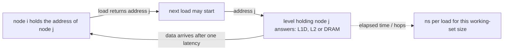
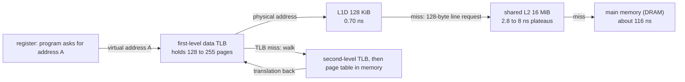

# Memory hierarchy: from registers to GPU high-bandwidth memory, measured

> **Source:** Xinxin Mei and Xiaowen Chu, "Dissecting GPU Memory Hierarchy through Microbenchmarking", arXiv 1509.02308 (version 2, 14 March 2016) - [arXiv abstract](https://arxiv.org/abs/1509.02308) - [local PDF](../sources/gpu/foundations/gpu-memory-microbenchmarking.pdf)
>
> **Measured on:** an Apple M5 Pro laptop-class chip (Arm), macOS 26.5, Apple clang 21.0.0, `clang -O2`. Page numbers below are PDF page numbers of the local file.
>
> **Prior tutorial:** [01 - Architecture map](./01-architecture-map.md). Neighbours: [Arm A-profile](./arm/04-arm-a-profile.md), [x86-64](./x86-64/03-x86-64.md), [GPU foundations](./gpu/05-gpu-foundations.md), [CUDA architecture](./gpu/nvidia/06-cuda-architecture.md), [NVIDIA microbenchmarking](./gpu/nvidia/07-nvidia-microbenchmarking.md), [CPU or GPU decision](./10-cpu-gpu-decision.md).

## Read this first

**The claim in one sentence.** The time a load takes depends mostly on which level of a stack of caches, address-translation tables and memory chips answers it, the levels are about two orders of magnitude apart, and you can find out where the levels are by chasing pointers through working sets of growing size and watching the latency step up.

**Who this is for.** Anyone who will choose hardware for model serving or other data-heavy work, or who reads GPU performance claims, and wants to know why "memory bandwidth" and "memory latency" are different numbers that must be used together. No prior hardware knowledge is assumed in Tutorial 1.

**Afterwards you will be able to** run and read a pointer-chasing benchmark; say what a 16 KiB page, a translation lookaside buffer (TLB) and a cache line each do to one load; use Little's law (bytes in flight = latency x bandwidth) to explain why one CPU core cannot use all of its memory bandwidth and why GPUs need thousands of threads; and read the GPU cache numbers of Mei and Chu without mistaking them for numbers of a current GPU.

**Reading time.** About 50 minutes plus 3 to run the benchmark. **Have read first:** [01 - Architecture map](./01-architecture-map.md), for the vocabulary of cores, threads and address spaces.

**The one thing most people get wrong.** They quote one memory number. A machine has at least four: dependent-load latency (here about 0.7 ns in the smallest cache, 116 ns in main memory), one stream's bandwidth (about 90 GB/s on one core), all cores' bandwidth (about 200 GB/s in our runs) and how many loads can be outstanding. Little's law ties them together.

**Scope.** Numbers we measured are properties of this Apple Arm machine, never of any GPU. Numbers from Mei and Chu belong to three NVIDIA GPUs of 2010-2014 (GeForce GTX 560 Ti, GTX 780, GTX 980) and must not be carried to a current GPU.

## The paper in one worked example

Two real traces are used throughout. Part A is a measurement we ran on this machine. Part B is a trace printed in the paper (its Fig. 11, PDF page 8), which shows how the same pointer-chasing idea, with every access timed individually, reveals a cache rule that an average hides.

### Part A - the latency staircase of this machine (measured)

**What was run.** The program in "A minimal version" below builds one random cycle through `n` nodes of 128 bytes each, so that every node holds the address of the next node. It then follows the chain with `p = *(void **)p`. Each load needs the result of the previous load, so loads cannot overlap, and the average time per hop is the latency of whichever level of memory holds that node. The program repeats this for working sets from 4 KiB to 724 MiB and prints nanoseconds per load. We ran it three times; the table shows the median and the range.

| Working set | Median ns per load | Range over 3 runs | What the number means |
|---|---|---|---|
| 4 KiB to 128 KiB | 0.70 | 0.68-0.71 | everything fits in the first-level data cache (L1D) |
| 181 KiB | 2.47 | 2.44-2.49 | just past L1D: most loads now miss L1D |
| 256 KiB to 724 KiB | 2.76-2.86 | 2.76-3.82 | a second plateau, about 4 times the L1D time |
| 1.0 MiB | 5.10 | 4.30-5.11 | transition |
| 1.4 MiB to 2.8 MiB | 7.77-7.87 | 7.58-8.29 | a third plateau, about 11 times the L1D time |
| 5.7 MiB to 16 MiB | 12.4-29.5 | 9.9-38.8 | ramp as the 16 MiB shared cache fills |
| 22.6 MiB | 57.2 | 56.2-60.3 | the working set no longer fits in that cache |
| 32 MiB | 88.1 | 85.3-92.6 | still ramping |
| 45 MiB to 724 MiB | 108-117 | 102-120 | main memory (DRAM, dynamic random-access memory) |



Notice that the arrow from the answering level back to the next load is the whole experiment: nothing overlaps. Three observations follow. The step from 128 KiB (0.70 ns) to 181 KiB (2.47 ns) is where the first-level cache runs out, and 128 KiB equals the 131072 bytes of `sysctl hw.perflevel0.l1dcachesize` for the "Super" cores. The curve is flat at about 112-117 ns from 90 MiB to 724 MiB; that is main-memory latency for a random access here. And between L1D and the 16 MiB shared cache there are two plateaus, not one, which this experiment cannot explain.

### Part B - an aperiodic cache, from Mei and Chu Fig. 11

The authors want to know how the Fermi-generation L1 data cache (GeForce GTX 560 Ti, 16 KB mode) decides which line to throw away. They make an array of 129 lines of 128 bytes, which is 16.125 KB, one line more than the 16 KB cache holds, and read it round and round with stride 128 bytes. Because they overflow by only one line, every miss comes from one cache set of four ways. They record, for each access, the latency (hit or miss) and the index it read. The paper prints this sequence (page 8). Each row lists the contents of the four ways after the read:

| Read of line | Contents of ways 1-4 after the read | Outcome | Way that was replaced |
|---|---|---|---|
| (start) | 3, 35, 68, 100 | | |
| 129 | 3, 129, 68, 100 | miss | way 2 (line 35 left) |
| 3 | 3, 129, 68, 100 | hit | |
| 35 | 3, 129, 35, 100 | miss | way 3 (line 68 left) |
| 68 | 3, 68, 35, 100 | miss | way 2 (line 129 left) |
| 100 | 3, 68, 35, 100 | hit | |
| 129 | 129, 68, 35, 100 | miss | way 1 (line 3 left) |
| 3 | 129, 3, 35, 100 | miss | way 2 (line 68 left) |
| 35 | 129, 3, 35, 100 | hit | |
| 68 | 129, 3, 35, 68 | miss | way 4 (line 100 left) |
| 100 | 129, 100, 35, 68 | miss | way 2 (line 3 left) |
| 129 | 129, 100, 35, 68 | hit | |
| 3 | 129, 100, 3, 68 | miss | way 3 (line 35 left) |
| 35 | 129, 35, 3, 68 | miss | way 2 (line 100 left) |

Five lines (3, 35, 68, 100, 129) compete for four ways. A cache that evicts the least recently used line (LRU) would miss on every read here, because the line needed next is always the one evicted longest ago; 4 of the 13 reads hit. The replaced ways, in order, are 2, 3, 2, 1, 2, 4, 2, 3, 2: way 2 in 5 of 9 misses. The authors conclude way 2 is replaced with probability 1/2 and the others 1/6 each (page 8). An average would only say "mostly misses"; the per-access record shows the policy is not LRU.

Every section below refers back to these two parts: Part A for what a staircase looks like and how to read it, Part B for what the per-access idea adds.

## Words you need

| Term | Plain definition | Example from the worked example |
|---|---|---|
| Latency | Time from issuing one load until its data arrives, with nothing else going on | 0.70 ns from L1D; about 116 ns from DRAM (Part A) |
| Bandwidth | Bytes delivered per second when many loads overlap (1 GB here is 10^9 bytes) | about 90 GB/s for one core reading in order |
| Cache line | The unit a cache stores and moves; one miss brings in a whole line | our nodes are 128 bytes, the value `sysctl hw.cachelinesize` reports |
| Set, way, associativity | A cache is split into sets; an address maps to one set; a set holds a few lines, one per way (the count of ways is the associativity) | Part B: one set of four ways held lines 3, 35, 68, 100 |
| Replacement policy | The rule that picks the line to evict; LRU evicts the least recently used | LRU would miss every read in Part B; the observed rule is not LRU |
| Page and TLB | Memory is mapped in pages (16 KiB here); the translation lookaside buffer (TLB) caches recent virtual-to-physical translations | one line per page, 256 pages, costs more than 128 pages |
| Pointer chasing (P-chase) | An array whose elements say which element to read next, so every load depends on the previous one | the 128-byte node chain of Part A; the array of Fig. 11 |
| Memory-level parallelism (MLP) | How many cache misses are outstanding at once | one chain gives MLP 1; 32 independent chains up to 32 |
| Little's law | In steady state, items in flight = rate x time in system; for memory, bytes in flight = bandwidth x latency | 90 GB/s x 116 ns is about 10 KB in flight |
| Coherence | The hardware rule that every core sees one agreed value per memory location | counters 32 bytes apart slow two threads 7 times |

## Tutorial 1 - Intuitive understanding

### What was broken before

A processor can multiply two numbers in well under a nanosecond, but fetching a number from main memory on the machine we measured took about 116 ns, around 165 times the time to fetch it from the closest cache (0.70 ns). A program that walks a large linked structure runs at the speed of memory, not of the arithmetic units, and the data sheet gives no hint of this. Vendors publish a clock rate and a bandwidth, not usually each cache's size, line length, associativity or latency. Mei and Chu say many such GPU details are unreleased (page 1, abstract). Programmers had to measure.

The method in use, due to Saavedra (1992) and refined for GPUs by Wong (2010) (pages 2-4), read the average latency of a pointer chase against array size or stride. It assumed that all sets are the same size, that the set-index bits sit directly above the line-offset bits, and that replacement is LRU (page 3, Assumptions 1-3). On GPUs the two published variants disagreed on the same hardware: for the Kepler texture cache (GTX 780) one gave 16 sets and the other 4, with the same 12 KB size (page 5). The authors found the assumptions fail on GPU caches, so an average cannot reveal the structure.

### The idea

Imagine a librarian who fetches books by following slips: each book names the shelf of the next one, so you cannot ask for the next book until you hold the current one. Time an afternoon and divide by the number of books: books on the desk are fast, books in the basement archive slow, and by choosing how many different books you cycle through you learn how big the desk is. That is pointer chasing. The dependence is the point: it stops the hardware overlapping fetches.

The analogy breaks in three places. A cache moves whole lines, so neighbouring items come free. Hardware guesses your next fetch (prefetching) and brings it early, which spoils the test unless the order is random. And a memory system serves many requests at once: the desk that fetches one book in 116 ns can have around twenty fetches in progress, which is why bandwidth and latency are separate numbers.

Mei and Chu's idea is to add a stopwatch at every single fetch instead of one at the end of the afternoon. They write each fetch's duration into a small fast array (GPU shared memory) so that the recording does not disturb the cache under test (page 5). Then you do not get an average but the full sequence of hits and misses, from which the hidden structure can be reconstructed (Part B).

### How it works, step by step

1. **Pick a size** from 4 KiB to 724 MiB and cut it into 128-byte nodes (Part A).
2. **Link the nodes in a random cycle** (Sattolo's shuffle, general knowledge) so that following the links visits each node once. Random order defeats the prefetcher, which would otherwise bring lines early and flatter the result.
3. **Warm up** by walking the chain twice, so the set is in the best level that can hold it.
4. **Time millions of dependent loads**, divide, keep the best of three repeats.
5. **Find the steps.** Latency is flat while the set fits a level and jumps when it does not; the size at the jump is that level's capacity.
6. **Separate translation from caching** by using one line per page, so the cache footprint stays tiny while the page count grows.
7. **Add parallelism** by running several independent chains; throughput grows until some limit is hit (Little's law, in "What it costs").

### What the results say

**Our measurements (this Apple M5 Pro, 3 runs, medians).** An L1D load takes 0.70 ns and a DRAM load about 116 ns, so main memory costs about 165 times an L1D hit. A loop that misses every cache does about 8.6 million dependent loads per second, which at 128 bytes each is 1.1 GB/s, about one eightieth of what one core reads when streaming in order (about 90 GB/s). That gap between dependent-random and independent-sequential access is the main fact about memory systems. The knee at 128 KiB matches `hw.perflevel0.l1dcachesize` for the "Super" cores, and not the plain `hw.l1dcachesize` of 64 KiB (explained in Tutorial 2).

**Mei and Chu (three NVIDIA GPUs; each figure belongs to that GPU).**

- The Kepler texture L1 cache (GeForce GTX 780) is 12 KB with 32-byte lines; the Maxwell one (GTX 980) is 24 KB (Table 5, page 8), a small fraction of one CPU core's L1D here. Translation pages are 2 MB (page 6).
- A load that hit the L2 cache took 198 clock cycles on the GTX 780; on the GTX 980 with L1 data caching on, a hit took 82 cycles. A load missing both cache and TLBs took 702 cycles on the GTX 780 and 2,439 on the GTX 980 (Fig. 14, page 10). These are GPU clock cycles, not our nanoseconds, so we do not compare them directly.
- Copy throughput reached 109.38, 215.92 and 156.25 GB/s on the GTX 560 Ti, GTX 780 and GTX 980: 81.38%, 74.87% and 69.64% of theoretical (Table 6, page 9). Of every 100 GB/s printed on the box, 19 to 30 were not obtained by the authors' best copy kernel.

### What this does not show

- **The inside of this Arm chip.** We cannot say why there are two plateaus between L1D and the 16 MiB cache. No Apple document on those structures is among our sources, and our experiment cannot tell a second cache level from a cache with non-uniform latency.
- **GPU behaviour.** Everything we measured ran on CPU cores, which run one dependent chain; a GPU runs thousands of threads.
- **Current GPUs.** The paper covers Fermi, Kepler and Maxwell (2010-2014); it calls Maxwell more conservative than Kepler (page 2). Later generations are not covered.
- **Exact values for the noisy rows.** The 5.7 to 16 MiB rows vary up to 3 times between runs (9.9 to 16.6 ns at 5.7 MiB), so they depend on page placement and other processes.

### Teach-back

1. Why must the next address depend on the previous load, and what would we measure otherwise?
2. Why is an average latency insufficient for the GPU caches Mei and Chu studied?
3. If main memory takes 116 ns and a core keeps 19 loads of 128 bytes in flight, what random-access bandwidth results?
4. Why can reading memory in order be about 80 times faster than chasing pointers through it?

<details>
<summary>Answers 1-2</summary>

1. Without the dependence the processor issues many loads at once, and we would measure throughput, not the time of one load.
2. The classical method assumes equal-sized sets, set bits next to offset bits, and LRU. The paper shows GPU caches break these (unequal TLB sets, non-LRU replacement, 2D-locality mapping, page 5), so one average fits several structures. Per-access records expose the structure.

</details>

<details>
<summary>Answers 3-4</summary>

3. 19 x 128 bytes / 116 ns = 21 GB/s, which matches our measured plateau of 21-22 GB/s.
4. In order, the hardware sees the pattern and fetches ahead, so many lines are in flight and each costs a share of the latency. In a chase, nothing is known until the load returns.

</details>

## Tutorial 2 - Practitioner understanding

### The design in concrete terms

**The path of one load on the machine we ran.** Sizes and times in the labels are our measurements or `sysctl` values for the core type we ran on.



Translation happens before the cache lookup, so a TLB miss adds time even when the data is cached, and a miss moves a whole 128-byte line.

**What `sysctl` says on this machine, and what it means.** The chip has 18 cores of two kinds:

| `sysctl` key | Value | Reading |
|---|---|---|
| `hw.pagesize` | 16384 | pages are 16 KiB (x86-64 commonly uses 4 KiB; general knowledge) |
| `hw.cachelinesize` | 128 | line length reported to software |
| `hw.l1dcachesize`, `hw.l2cachesize` | 65536, 8388608 | the values for the second kind of core only |
| `hw.perflevel0.*` "Super", 6 cores | L1D 131072, L1I 196608, L2 16777216, `cpusperl2` 6 | 128 KiB L1D per core; one 16 MiB L2 shared by the 6 cores |
| `hw.perflevel1.*` "Performance", 12 cores | L1D 65536, L1I 131072, L2 8388608, `cpusperl2` 6 | 64 KiB L1D per core; an 8 MiB L2 per group of 6 cores |
| `hw.memsize` | 51539607552 | 48 GiB of memory |

The plain keys report one number, and here it is the Performance-core number. Our benchmark landed on a Super core and its knee was at 128 KiB. We cannot pin threads on macOS. Rerunning under `taskpolicy -b` (background class) moved the knee to 64 KiB (1.48 ns at 64 KiB, 11.9 ns at 90 KiB) with absolute times several times slower, which suggests a lower clock; it is evidence of capacity only. Consequences: a cache size is per core and per core type, so read the `perflevelN` keys; an L2 is shared by `cpusperl2` cores, so one thread sees less of it when others run; and sysctl gives capacity but not latency, associativity or any cache below L2, which we found in no source.

**The TLB with 16 KiB pages.** Each node sits in a different page, at staggered line offsets so every cache set is used evenly, compared with the same number of lines packed together. Ranges are over 3 runs:

| Pages touched | Address range covered | One line per page (ns) | Same lines packed (ns) | Gap (ns) |
|---|---|---|---|---|
| 16 to 128 | 0.25-2 MiB | 0.70-0.75 | 0.69-0.71 | 0 |
| 256 to 1024 | 4-16 MiB | 2.13-2.39 | 0.71-0.75 | +1.4 to +1.6 |
| 2048 | 32 MiB | 4.5-14.6 | 2.75-2.88 | +1.7 to +11.7 |
| 4096 | 64 MiB | 8.9-13.2 | 2.82-2.94 | +6 to +10 |
| 16384 | 256 MiB | 14.2-25.4 | 7.2-7.7 | +7 to +18 |
| 32768 | 512 MiB | 16.5-31.9 | 7.9-8.5 | +8 to +24 |

Up to 128 pages (2 MiB) translation costs nothing visible. At 256 pages (4 MiB) every load gains 1.4 ns, which we read as a first-level TLB miss served by a second TLB, so the first-level data TLB holds between 128 and 256 entries (a bracket, since sizes double). From 2048 pages the time rises again and varies a lot between runs, which we read as second-level TLB misses and page-table walks whose cost depends on whether the table entries are cached. An early version reported 0.14 ns at 8 pages (a cycle equal to our 8-fold unroll), so rows below 16 pages were dropped. A TLB of E entries reaches E x page size: a 4 MiB set needs 256 entries with 16 KiB pages and would need 1024 with 4 KiB pages.

**The GPU analogue (Mei and Chu).** Their GPUs use 2 MB pages. The first-level TLB is 16-way fully associative with 16 entries (32 MB); the second level covers 130 MB, with 7 sets, one of 17 entries and six of 8 (Figs. 8-9, Table 5). The TLBs are off-chip and shared by all multiprocessors: on the GTX 560 Ti a first-level TLB miss cost 288 cycles when the data was in L1 (384 - 96) but 27 cycles when it was in L2 (378 - 351), so they infer that the TLB and L2 are physically close (Fig. 14, page 10).

**Sequential bandwidth.** A NEON loop (Arm vector instructions) reading 64 bytes per iteration with four accumulators, one thread, random data, best of three, GB/s (second of two runs; the first agreed within 3%):

| Buffer | 16 KiB | 256 KiB | 1 MiB | 4 MiB | 16 MiB | 64 MiB | 256 MiB | 1 GiB |
|---|---|---|---|---|---|---|---|---|
| GB/s | 138.7 | 136.2 | 134.7 | 115.2 | 107.5 | 95.1 | 91.1 | 90.7 |

With T threads each on its own 256 MiB slice, total bytes over wall time (threads released together; min-max of 3 runs):

| Threads | 1 | 2 | 3 | 4 | 6 | 8 | 12 | 18 |
|---|---|---|---|---|---|---|---|---|
| GB/s | 85-94 | 136-143 | 154-175 | 191-207 | 142-197 | 159-224 | 185-210 | 196-219 |

Two threads gave about 1.6 times one thread, four about 2.3 times; beyond that results are noisy (6 threads is sometimes below 4; we do not know why, and placement across core types is not ours to control). We state the whole-chip read rate as "about 190-220 GB/s in our runs", not a peak. We found no vendor peak in our sources, so no efficiency percentage is given for this machine; Mei and Chu report 69.64-81.38% for three GPUs (Table 6).

**Coherence granule.** Two threads each incremented an 8-byte atomic counter, the counters `gap` bytes apart (50 million increments each, best of 5; a second run agreed within 0.1 ns):

| Gap (bytes) | 8 | 16 | 32 | 64 | 128 | 256 | 512 |
|---|---|---|---|---|---|---|---|
| ns per increment per thread | 11.16 | 11.24 | 11.17 | 1.57 | 1.58 | 1.59 | 1.59 |

Within 32 bytes the counters share a unit that the two cores pass back and forth, and the loop is 7 times slower (false sharing; Mei and Chu cite P-ray, which used false sharing to find coherence block sizes on multicore CPUs, page 2). The unit here is 64 bytes, although `hw.cachelinesize` says 128, so that key is not the coherence granule. The test does not say which cores ran the threads. The coherence protocol itself (caches agree on one value per address by invalidating or updating other copies) is general knowledge; the paper says nothing on it, only that L1 is per multiprocessor and L2 shared (page 3).

### A minimal version

This is the program that produced Part A (53 lines; `clang -O2 -o pchase pchase.c`; about 60 seconds). Input: none. Output: one line per working-set size, bytes and ns per load.

```c
// pchase.c - pointer-chasing latency vs working-set size
#include <stdio.h>
#include <stdlib.h>
#include <stdint.h>
#include <time.h>
#include <sys/mman.h>
#define NODE 128                       /* bytes per node = one cache line on this machine */

static double now(void) {              /* seconds, monotonic */
  struct timespec t; clock_gettime(CLOCK_MONOTONIC_RAW, &t);
  return t.tv_sec + t.tv_nsec * 1e-9;
}
static uint64_t rng = 88172645463325252ull;
static uint64_t xr(void) { rng ^= rng << 13; rng ^= rng >> 7; rng ^= rng << 17; return rng; }

/* One random cycle through n nodes (Sattolo shuffle); link them via the first 8 bytes of each node. */
static void *build(char *buf, size_t n) {
  uint32_t *perm = malloc(n * sizeof *perm);
  for (size_t i = 0; i < n; i++) perm[i] = (uint32_t)i;
  for (size_t i = n - 1; i > 0; i--) { size_t j = xr() % i; uint32_t t = perm[i]; perm[i] = perm[j]; perm[j] = t; }
  for (size_t i = 0; i < n; i++)       /* node perm[i] points to node perm[i+1] */
    *(void **)(buf + (size_t)perm[i] * NODE) = buf + (size_t)perm[(i + 1) % n] * NODE;
  void *start = buf + (size_t)perm[0] * NODE;
  free(perm);
  return start;
}
static double chase_ns(void *p, size_t hops) {   /* average ns per dependent load */
  double best = 1e9;
  for (int rep = 0; rep < 3; rep++) {
    double t0 = now();
    for (size_t i = 0; i < hops; i += 8) {       /* 8 dependent loads per iteration */
      p = *(void **)p; p = *(void **)p; p = *(void **)p; p = *(void **)p;
      p = *(void **)p; p = *(void **)p; p = *(void **)p; p = *(void **)p;
    }
    double dt = (now() - t0) / hops * 1e9;
    if (dt < best) best = dt;
  }
  __asm__ volatile("" : : "r"(p));               /* keep the chain alive */
  return best;
}
int main(void) {
  size_t max = 1024ul << 20;                     /* 1 GiB */
  char *buf = mmap(0, max, PROT_READ | PROT_WRITE, MAP_ANON | MAP_PRIVATE, -1, 0);
  printf("%12s %10s\n", "bytes", "ns/load");
  for (double kb = 4; kb * 1024 <= max; kb *= 1.4142135624) {
    size_t n = (size_t)(kb * 1024) / NODE;
    void *p = build(buf, n);
    for (size_t i = 0; i < 2 * n && i < 20000000; i++) p = *(void **)p;   /* warm up */
    size_t hops = n < 1000000 ? 20000000 : 8000000;
    printf("%12zu %10.2f\n", n * NODE, chase_ns(p, hops));
  }
  return 0;
}
```

Choices that matter: `__asm__ volatile` stops the compiler deleting an unused chain; the unroll by 8 makes chains under 9 nodes meaningless; random order defeats the prefetcher; and the core type is not controlled, so read the knee to see which core you landed on.

**Independent chains.** The same loop with `k` chains advanced round-robin (`for c<k: p[c] = *(void**)p[c]`), each over its own slice of a 512 MiB region, measures how throughput grows when `k` loads can overlap. It ran on the CPU only. Two runs agreed within about 5% (run 1 shown):

| k (independent chains) | 1 | 2 | 4 | 8 | 16 | 32 | 64 |
|---|---|---|---|---|---|---|---|
| ns per load, aggregate | 116.45 | 57.32 | 30.10 | 15.39 | 7.98 | 6.01 | 6.10 |
| GB/s of 128-byte lines | 1.1 | 2.2 | 4.3 | 8.3 | 16.0 | 21.3 | 21.0 |

Throughput doubles each time `k` doubles up to 16, then stops near 21-22 GB/s.

### What it costs

**Little's law with our numbers.** Bytes in flight = bandwidth x latency. Take L = 116 ns (single chain over 512 MiB; both runs gave 116-117 ns) and 128-byte lines:

| Case | Bandwidth | x 116 ns | Lines of 128 B in flight |
|---|---|---|---|
| One dependent chain (k=1) | 1.10 GB/s | 128 B | 1 |
| 16 chains | 16.0 GB/s | 1.86 KB | 14.5 |
| Plateau of independent loads (k = 32 to 64) | 21.2-22.0 GB/s | 2.5 KB | 19-20 |
| One core streaming in order | 86-94 GB/s | 10.4 KB | about 82 |
| Whole chip, 4+ threads | about 190-220 GB/s | about 24 KB | about 190 |

This is arithmetic on our measurements; "in flight" is inferred, not read from a counter, and is a lower bound when latency rises under load (with 32 chains the time between loads of one chain was 32 x 6.0 = 193 ns). Our inferences: (a) a core that needs 82 lines in flight for 90 GB/s is not getting them from ordinary loads, whose limit looks like 19-20 outstanding misses; the difference is most plausibly the hardware prefetcher, which no source here confirms; (b) the whole chip needs about 190 lines, so several cores must stream at once; (c) more bandwidth without lower latency demands more parallelism from the program.

**Little's law for the GPU in the paper.** Mei and Chu say that, per Little's law, bandwidth needs as many requests in flight as possible (page 9), and work a shared-memory case (pages 11-12): active warps x ILP = latency (cycles) x throughput. A warp is a group of 32 GPU threads; ILP (instruction-level parallelism) is the number of 4-byte words each thread loads at once (page 9). For the GTX 780, latency is 47 cycles (page 12) and the peak is 8 bytes per bank per cycle over 32 banks, 256 bytes per cycle (Table 7: Wbank = 8, W_SM = f_core x Wbank x 32). A warp-wide load of 4-byte words moves 128 bytes, so that is 2 warp-loads per cycle and 47 x 2 = 94 warps are needed at ILP = 1. The paper says "about 94" and that Kepler allows at most 64 warps; it gives that gap as the main reason for 83.81 of 257.54 GB/s (32.5%, Table 7). We checked and reproduced the 94.

**A constructed estimate for global memory (not in the paper).** Take the GTX 780 best copy rate, 215.92 GB/s (Table 6), and the 339-cycle pattern P4 (cache miss, first-level TLB hit; Fig. 14). The paper does not convert cycles to time. If the 1.006 GHz listed for this GPU (Table 7) applies, 339 cycles is about 337 ns and 215.92 GB/s x 337 ns is about 73 KB in flight over the GPU, about 6.1 KB for each of its 12 multiprocessors, or 47 warp-loads of 128 bytes, a large share of the 64 warps allowed. Caveats: the copy counts reads and writes (2 x data size / time, page 9), writes do not wait for a return, and the clock assumption is ours. It is an order of magnitude: GPUs need tens of thousands of loads in flight where the Arm core above needs 82 to 190 lines.

**The bridge to a CPU or GPU decision.** A CPU core hides latency with caches, out-of-order execution and prefetching, so a few threads nearly saturate memory. A GPU switches among many warps and needs a very large number of independent loads. A dependent chain runs at one latency on either. See [CPU or GPU decision](./10-cpu-gpu-decision.md).

### How it fails

| Symptom | Likely cause | Mitigation |
|---|---|---|
| L1D plateau ends at 64 KiB, not 128 KiB | The thread ran on the other core type (`perflevel1`) | Rerun; compare knees; report only the core type you can verify |
| Latency at 2-8 MiB far above the packed run | TLB reach exceeded (256+ pages of 16 KiB) | Keep hot data together; use larger pages where the OS allows |
| Rows from 5 to 16 MiB differ 3x between runs | Physical page placement and other processes | Repeat at least 3 times; report the range |
| Bandwidth stops growing after 4 threads and varies 20% | Thread placement across core types, shared memory controllers (our inference) | Report a range, not a peak |
| Cache parameters from average latency disagree between methods | Cache breaks the equal-sets, bit-mapped, LRU assumptions (pages 5-6) | Record each access, as in Part B |
| Sysctl says 64 KiB, knee says 128 KiB | Plain keys report one core type | Read the `hw.perflevel*` keys |

### Evaluating your version

- **Metric and test set.** Median ns per load over at least 3 runs, with min-max, at 36 sizes from 4 KiB to 724 MiB (steps of the square root of 2); for bandwidth, GB/s of 10^9 bytes and the thread count. Trust a knee only if it recurs at the same size.
- **Baseline.** An in-order sequential read of the same buffer, and a one-line-per-page run against a packed run, so cache and translation effects are not mixed.
- **Stop rule.** Stop when three runs agree on every plateau to within 10% and every knee sits at the same size. If the L1D knee moves, identify the core type first. Claim a level only where a flat plateau of at least two sizes exists, not where a ramp exists.

### Adopt, adapt or skip

**Adopt** the pointer chase, the one-line-per-page test and the multi-chain test as the first run on any machine you consider for local model inference or data processing. It takes under 5 minutes and yields main-memory latency, single-thread bandwidth and whole-chip bandwidth, which no data sheet gives together. For language-model inference the arithmetic is this: when a model produces one token at a time, every weight is read once per token, so tokens per second are at most memory bandwidth divided by weight bytes (general knowledge). Constructed example: a model whose weights take 4 GB, read at the 190-220 GB/s we measured across CPU cores, allows at most about 47 to 55 tokens per second; one thread at 90 GB/s allows about 22. These are upper bounds that ignore compute, the key-value cache and this chip's GPU, which we did not measure.

**Adapt** the paper's per-access recording only where you can read a fine clock. The user-space counter here runs at 24 MHz (`hw.tbfrequency`), about 41.7 ns a tick, too coarse for one load of 0.7 to 116 ns, so we averaged. A GPU clock register has cycle resolution, which let the authors record each access.

**Skip** the paper's cache numbers when choosing a current GPU: they describe three generations from 2010-2014. Use the method (see [NVIDIA microbenchmarking](./gpu/nvidia/07-nvidia-microbenchmarking.md)) on the GPU you will run. Also skip unified-memory speed claims based on another machine's table; measure the CPU-to-GPU path on your own hardware.

## Tutorial 3 - Researcher understanding

### Formal setup

The paper's notation (page 4, Table 4): C cache size, b line size, a associativity, T number of sets, N array size, s stride, k iterations, r miss rate; with three classical assumptions T x a x b = C. The average latency is t_avg = t_0 + t_m x r, where t_0 is the hit time and t_m the miss penalty (page 5). Classical predictions: varying s gives r in {0, s/b, 1} for N much larger than C (Eq. 1); varying N at s = b gives r in {0, 1/T, ..., 1} for N between C and C + T x b (Eq. 2).

**The paper's two-stage procedure (page 6).** (1) With one-element stride, grow N until the first miss: that N is C. (2) With N just above C, grow N one element at a time; the miss count jumps at C + b + 1, which gives b. (3) With s = b, grow N from C in steps of b until all sets miss, which gives T. (4) With N = C + b and many iterations, record the miss sequence; periodic means LRU. Then a = C / (T x b).

**Numeric instance from the paper.** Kepler texture L1 (GTX 780): C = 12 KB = 12,288 bytes, b = 32, T = 4, so a = 12,288 / (4 x 32) = 96 lines per set and 384 lines (Fig. 7, Table 5). Maxwell: 768 lines x 32 bytes = 24,576 bytes, a = 192 (our arithmetic). Fermi L1D, 16 KB mode: 16,384 / (32 x 128) = 4 ways. L2 TLB: 17 + 6 x 8 = 65 entries x 2 MB = 130 MB.

**Numeric instance from our data.** On the Super core t_0 = 0.70 ns and the next plateau is 2.8 ns, so t_m is about 2.1 ns. At 256 KiB (twice the L1D) all loads miss and t_avg = 2.8 ns; we measured 2.76. At 181 KiB (1.41 times capacity) a strict-LRU cyclic walk would also miss every time and give 2.8 ns, but we measured 2.47, so r = (2.47 - 0.70) / 2.1 = 0.84. This tutorial infers that the L1D is not strictly LRU or that random-node conflicts differ from the model; the experiment cannot decide, since TLB and other effects mix in. It is the ambiguity the paper says an average cannot resolve.

### The claims, stated precisely

1. For the three GPUs, the texture L1 (12 KB on Fermi and Kepler, 24 KB on Maxwell), the Fermi L1D (16 KB mode), the L1 TLB (16 entries, 2 MB pages) and the L2 TLB (130 MB, unequal sets) have the parameters of Table 5 (page 8).
2. No GPU cache uses the bit-defined set mapping of Assumption 2; the Fermi L1D and the L2 are not LRU (pages 7-8).
3. The classical P-chase methods give contradictory parameters on one GPU cache (Figs. 4-5, page 5); the fine-grained version gives a consistent picture.
4. Global-memory copy reaches 69.64-81.38% of theoretical bandwidth (Table 6), limited by active warps and ILP (pages 9-10).
5. Peak shared-memory throughput is 57.4%, 32.5% and 83.9% of theoretical (Table 7), and bank conflicts raise latency nearly linearly on Fermi and Kepler but mildly on Maxwell (Table 8, page 12).

**Our claims (this machine only).** The Super core has a 128 KiB L1D at 0.70 ns; a first-level data-TLB miss adds about 1.4 ns; random main-memory latency is about 116 ns; one core streams about 90 GB/s from DRAM; the coherence unit is 64 bytes, not the 128 bytes the OS reports.

### Evidence, table by table

| Item | What it is | Headline numbers | Causal or associative |
|---|---|---|---|
| Figs. 4-5 (p. 5) | Kepler texture L1, latency against stride and against size | one method gives 16 sets, the other 4, same 12 KB | Shows the disagreement; the cause is argued afterwards from violated assumptions |
| Fig. 7 (p. 7) | texture L1 structure | 4 sets, 96 lines of 32 bytes per set | Inferred from miss patterns as N passes C |
| Figs. 8-9 (p. 7) | L2 TLB miss rate, 2 MB stride | 17 entries missed at 132 MB, 8 more per step | Set sizes follow only if sets fill in order and replacement is LRU, which the authors deduce from equal counts |
| Figs. 10-11 (pp. 7-8) | Fermi L1D structure and trace | 128 lines, 4 ways, replacement probabilities 1/6, 1/2, 1/6, 1/6 | The trace shows non-LRU directly; the probabilities are estimated from a short trace |
| Table 5 (p. 8) | parameter summary | C = 16 KB, b = 128 B, T = 32 for Fermi L1D | Summary; the extracted header is garbled, so we matched columns by values |
| Table 6, Fig. 12 (p. 9) | theoretical and achieved bandwidth | 134.40 / 288.38 / 224.38 theoretical; 109.38 / 215.92 / 156.25 achieved GB/s | Throughput varied with CTA count, size and ILP; Fig. 12 axes were unreadable in our text |
| Fig. 14 (p. 10) | patterns P1-P6, cycles | GTX 780: 198, 204, 257, 339, 702, 968 | Patterns force each hit/miss combination, so differences between patterns identify the cost of a level |
| Tables 7-8 (pp. 11-12) | shared-memory throughput, bank-conflict latency | 34.90, 83.81, 137.41 GB/s; 32-way conflict 1209, 484, 90 cycles (560 Ti, 780, 980) | Conflict level set by stride, so cause is identified |

We re-derived Table 6 (1050 MHz x 256 bits / 8 x 4 = 134.4 GB/s; efficiencies 81.38%, 74.87%, 69.64% follow) and Table 7 (0.950 x 2 x 32 = 60.8). Table 7 prints 163.84 for the GTX 980 where the printed 1.279 GHz gives 163.7, so the clock is rounded.

**Inconsistencies inside the paper.** (1) Page 11 says the GTX 560 Ti peak of 34.90 GB/s is "about 58.7%" of theoretical; Table 7 prints 57.4% and 34.90 / 60.80 is 57.4%. We use 57.4%. (2) Table 3 gives bank widths of 4, 8 and 4 bytes while Table 7 gives Wbank as 2, 8 and 4 bytes per cycle for Fermi, Kepler and Maxwell; the paper does not reconcile them. (3) On page 5 the two classical methods give b = 128 B, T = 4 and b = 32 B, T = 16; both multiply to 12,288 bytes, so they are consistent with C but not with each other, which is the paper's point and not an error.

### Ablations and what they isolate

The paper has no ablation table. Its controlled variations are stride against array size (line size against capacity); GTX 980 and GTX 560 Ti with L1 on and off (Fig. 14: 82 against 214 cycles, 96 against 351); CTA count, CTA size and ILP (how much parallelism is needed for bandwidth); and shared-memory stride and the Kepler 4-byte against 8-byte bank mode (pages 12-13). Page size and the TLB are separated from the cache only through P2 and P3 against P1 in Fig. 14. Ours: one line per page against packed isolates the TLB from the cache; one chain against k chains isolates parallelism from latency. We could not disable the prefetcher.

### Threats to validity specific to this paper

- **Units.** Latencies are in cycles of each GPU's `clock()`, with measured overheads subtracted (14, 16, 6 cycles, page 6). Cycles of different generations are not times.
- **L2 is preliminary.** Per-access records need shared memory; the smallest Fermi L2 round needs at least 64 KB, more than the devices offered (page 8). The L2 mapping is called irregular, not found.
- **Short traces.** The 1/6, 1/2, 1/6, 1/6 probabilities come from one short trace.
- **One thread, one block.** Contention between multiprocessors is not studied.
- **Age and review.** Consumer cards of 2010-2014; the text we read does not state peer review.

**Threats to our measurements.** Core type, clock frequency and page placement are not controlled; no performance counters are readable here; one machine only; "in flight" counts are inferred.

### Open problems and follow-ups

1. Explain the two plateaus (2.8 and 7.8 ns) between L1D and the 16 MiB cache; it needs a finer clock or a batch-based statistical method.
2. Measure what serves the 22.6 to 32 MiB rows (57 to 88 ns) before DRAM; we have no source and no separating experiment.
3. Repeat Mei and Chu's method on a current GPU ([NVIDIA microbenchmarking](./gpu/nvidia/07-nvidia-microbenchmarking.md)).

### What would change my mind

- A run pinned to a Performance core showing a 128 KiB knee would break the two-core-type reading.
- A different line-offset layout removing the 1.4 ns step at 256 pages would move the blame from the TLB to L1D conflicts.
- Sequential bandwidth falling to near 21 GB/s with the prefetcher disabled would confirm the prefetcher account of the 82-line figure; no fall would refute it.
- A second source giving a different line size would make us report the 64-byte coherence unit and the 128-byte line as separate structures.

## Reading map for the sources

| Source and section (PDF pages) | What it contains | First pass | Answered in this tutorial |
|---|---|---|---|
| [Mei and Chu](https://arxiv.org/abs/1509.02308), pp. 1-2 | motivation, three GPUs, earlier methods (Table 1) | read | Tutorial 1, "What was broken before" |
| pp. 3-4 (Section 3, Tables 2-3) | GPU memory spaces; per-multiprocessor L1, shared L2; four generations compared | read | "The design in concrete terms" |
| pp. 3-5 (Section 4.1, Figs. 2-5) | the three assumptions, P-chase listings, contradictory results | read | Tutorial 3, "Formal setup" |
| pp. 5-7 (Section 4.2, Fig. 6) | fine-grained P-chase and the two-stage procedure | read | Part B |
| pp. 6-8 (Sections 4.3-4.6, Figs. 7-11, Table 5) | texture cache, TLB, L1D, L2, parameter table | read Fig. 11 and Table 5, skim the rest | Part B, TLB section |
| pp. 8-10 (Section 5.1, Table 6, Fig. 12) | global-memory throughput | read Table 6 | "What it costs" |
| pp. 10-11 (Section 5.2, Figs. 13-14) | latency patterns P1-P6 | read | Tutorial 1 results, Tutorial 3 evidence |
| pp. 11-13 (Section 6, Tables 7-8) | shared memory, bank conflicts | skim | the 94-warp case |
| pp. 13-14 (Section 7) | conclusion | skim | Tutorial 3 |

The text extraction lost the curves and axes of Figs. 4, 5, 8, 12, 15, 16 and 19, so no number is quoted from them.

## Questions readers get stuck on

### Why is a pointer chase a latency test and a sequential read a bandwidth test?

In a chase the address of the next load is the value of the last, so the hardware cannot start it early and each hop costs one full latency. In a sequential read the addresses are known ahead, many loads and prefetches overlap, and the time per byte depends on how fast the memory system delivers. Same memory; the difference is whether loads depend on each other.

### Why is latency 116 ns here but the GPU paper talks in hundreds of cycles?

They are different units on different machines. If the paper's listed 1.006 GHz applies, 339 cycles is about 337 ns, but the paper never states that conversion, so we treat it as an illustration. The comparison is not "Arm against GPU": one is a CPU core with prefetching, the other a 2013 GPU measured by a different method.

### What does a 16 KiB page do to my program?

Each page needs one TLB entry, so E entries reach E x 16 KiB. On this machine the first-level cost appeared between 128 and 256 pages (2 to 4 MiB). Many small objects spread over many pages pay it on every load even when cached; keep related objects together. The paper's 2 MB pages make an entry cover 128 times as much.

### Why does `sysctl` show 64 KiB L1D when my benchmark shows 128 KiB?

The chip has 6 "Super" cores with 128 KiB L1D and 12 "Performance" cores with 64 KiB (`hw.perflevel0.*`, `hw.perflevel1.*`). The plain key reports the second kind and the scheduler gave us a Super core. Cache size is a property of a core, not of a chip.

### Is the cache line 128 bytes or 64 bytes on this machine?

The OS reports 128, and our nodes were 128 bytes. In the false-sharing test counters 64 bytes apart did not interfere and counters 32 bytes apart did, so the coherence unit is at most 64 bytes. We did not test whether data moves between cache levels in 128- or 64-byte pieces. Do not use one number for both.

### Why are Mei and Chu's numbers not usable for today's GPUs?

They tested a GTX 560 Ti (compute capability 2.1), GTX 780 (3.5) and GTX 980 (5.2) (Table 3, page 4). Their own comparison shows shared-memory size and bank width changing across those three (for example 48/16 KB, 48/32/16 KB, 96 KB of shared memory). Later generations change things again. The method transfers; the numbers do not.

### Why does the paper record every access when a CPU benchmark averages?

On a GPU the authors store each latency in shared memory without disturbing the caches; on a CPU they call that hard to do (page 5). On our machine the user-space timer ticks every 41.7 ns, longer than the hit time we want to see. So we average, and that is why the two plateaus stay unexplained.

### Is Little's law exact here?

For steady-state averages it is exact. Our use is approximate because the latency in the formula is the loaded latency, which was higher than the unloaded 116 ns we multiplied by (193 ns per chain at 32 chains). Our in-flight figures are therefore lower bounds.

### Where does coherence enter the numbers?

When more than one core touches one line, ownership must move between caches; in our test that took the loop from 1.6 to 11.2 ns per increment. A single-thread chase never meets it. For GPUs the paper says only that L1 is per multiprocessor and L2 shared (page 3); how GPU caches stay consistent across multiprocessors is not in this source.

## Prerequisites you actually need

### Prerequisite 1 - Cache lines, sets and ways

An address splits into offset (position in the line), set index and tag. A line may sit in any way of its set. A 64 KiB, 8-way cache with 128-byte lines has 64 x 1024 / 128 = 512 lines in 512 / 8 = 64 sets, so addresses 64 x 128 = 8,192 bytes apart share a set. Used in Part B and in T x a x b = C (page 3). See [Arm A-profile](./arm/04-arm-a-profile.md).

### Prerequisite 2 - Address translation and the TLB

A virtual address is a page number plus an offset. The page table maps page numbers to physical pages and the TLB caches recent lookups. With 16 KiB pages the offset is 14 bits, and 4 MiB is 4 MiB / 16 KiB = 256 pages, so 256 entries avoid walks. Touching one byte in each of 300 pages needs 300 entries, though the bytes would fit in one cache line. Used in the TLB table and Table 5. See [x86-64](./x86-64/03-x86-64.md) for its 4 KiB default page.

### Prerequisite 3 - Little's law and memory-level parallelism

If items arrive at rate lambda and each stays W seconds, the average number inside is lambda x W. For memory, bytes in flight = bandwidth x latency. Toy: 100 ns and 64 GB/s need 6,400 bytes in flight, 100 lines of 64 bytes; a core that can hold 20 gets 20 x 64 / 100 ns = 12.8 GB/s. Independent loads (or prefetches) raise the number in flight; dependent loads cannot. The GPU analogue is warps and ILP ([GPU foundations](./gpu/05-gpu-foundations.md)). Used in "What it costs" and page 11.

## Where this sits in the curriculum

Read [01 - Architecture map](./01-architecture-map.md) first for cores, instruction sets and address spaces. This tutorial adds measurement and the timing relations between memory levels and does not cover instruction sets: for those, [x86-64](./x86-64/03-x86-64.md) and [Arm A-profile](./arm/04-arm-a-profile.md). On the GPU side, [GPU foundations](./gpu/05-gpu-foundations.md) introduces warps and blocks, [CUDA architecture](./gpu/nvidia/06-cuda-architecture.md) gives the vendor's own limits, and [NVIDIA microbenchmarking](./gpu/nvidia/07-nvidia-microbenchmarking.md) extends this paper's method to later hardware; read it next if you will measure a GPU. [CPU or GPU decision](./10-cpu-gpu-decision.md) then uses the Little's law relation from here. The architecture map names the parts and this tutorial measures them.

## Checkpoint

1. **Explain.** Why does a random cycle measure latency better than a strided walk?
2. **Compute.** With 116 ns main-memory latency and 20 outstanding 128-byte lines, what random-access bandwidth results?
3. **Compute.** From 47 cycles, 256 bytes per cycle and 128 bytes per warp-wide load, how many warps at ILP = 1 does the GTX 780 shared memory need, and how does the paper use that?
4. **Critique.** Our TLB table shows a 1.4 ns step at 256 pages. Give one other explanation and an experiment that separates it from a TLB miss.
5. **Critique.** A colleague says "sysctl says 64 KiB L1D, so the 128 KiB knee is a bug". What do you check?
6. **Explain.** In the paper's Fermi trace 9 of 13 reads miss. Why does that show the cache is not LRU?
7. **Compute.** The GPU L2 TLB has 17 + 6 x 8 entries of 2 MB. What does it cover, and how many 16 KiB-page entries cover the same range?
8. **Critique.** Someone cites "GPU L2 latency is 198 cycles" for a new GPU. What is wrong?

<details>
<summary>Answers 1-4</summary>

1. A stride is a pattern a prefetcher can follow, which hides latency, and it fixes which sets are used. A random cycle gives the prefetcher nothing and spreads nodes over sets, so each hop costs the latency of the level holding the set.
2. 20 x 128 B / 116 ns = 22 GB/s, the plateau we measured (21.2-22.0).
3. 47 x 2 warp-loads per cycle = 94 warps, above the 64 the multiprocessor allows. The paper gives that gap as the main reason the GTX 780 reaches only 32.5% of theoretical (pages 11-12); it is their explanation, not a separate measurement of cause.
4. Conflict misses in L1D, since page-aligned addresses can crowd sets. Change the line offsets within pages: a TLB effect should not move, a conflict effect should.

</details>

<details>
<summary>Answers 5-8</summary>

5. Compare `hw.perflevel0.l1dcachesize` (131072) with `hw.perflevel1.l1dcachesize` (65536), and rerun under another quality-of-service class to see whether the knee moves (ours moved to 64 KiB under `taskpolicy -b`). The plain key reports the Performance-core value.
6. Five lines cycle through a four-way set. Under LRU the line needed next is always the one evicted longest ago, so every read would miss. 4 of 13 hit, and way 2 is replaced in 5 of 9 misses (page 8).
7. 17 + 48 = 65 entries x 2 MB = 130 MB. With 16 KiB pages, 130 MB / 16 KiB = 8,320 entries (MB taken as 2^20 bytes).
8. It is a GTX 780 (Kepler) L2 hit with L1 not caching global data (Fig. 14), in that GPU's clock cycles, from 2013-era hardware. None of that carries to another generation.

</details>
