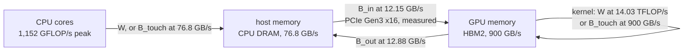
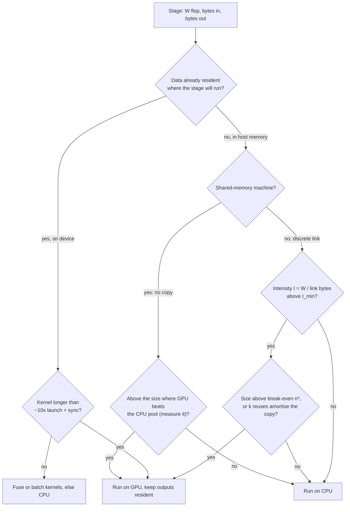
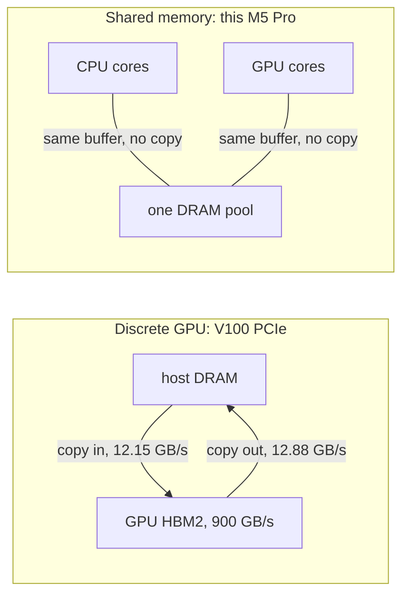

# Choosing CPU, GPU and Memory Placement: When Acceleration Pays

> **Listed source:** Yifan Sun, Nicolas Bohm Agostini, Shi Dong and David Kaeli, "Summarizing CPU and GPU Design Trends with Product Data", arXiv 1911.11313v2, 2020, five pages. Abstract: [https://arxiv.org/abs/1911.11313](https://arxiv.org/abs/1911.11313). Local PDF: [cpu-gpu-design-trends.pdf](../sources/gpu/foundations/cpu-gpu-design-trends.pdf).
>
> **Additional evidence (not a listed source here), PDF page numbers from text extracted from the local files:** [CUDA C++ Programming Guide, Release 13.3](../sources/gpu/nvidia/cuda-programming-guide.pdf); [AMD HIP manual, Release 6.3.42134](../sources/gpu/amd/hip-programming-guide.pdf); [Intel oneAPI GPU Optimization Guide](../sources/gpu/intel/oneapi-gpu-optimization-guide.pdf); [Intel Xe-HPG white paper](../sources/gpu/intel/xe-hpg-architecture-whitepaper.pdf); [Jia et al., Volta microbenchmarking](../sources/gpu/nvidia/volta-microbenchmarking.pdf); [Mei and Chu, GPU memory](../sources/gpu/foundations/gpu-memory-microbenchmarking.pdf); [Hofmann et al., Intel server CPUs](../sources/x86-64/intel-server-microarchitecture-analysis.pdf).
>
> **Measured here:** "measured on this machine" means an Apple M5 Pro (18 CPU cores, 48 GiB memory shared with the GPU), Apple clang 21.0.0, `-O2`, run on 2026-11-19.

## Read this first

**The claim.** A GPU beats a CPU on a job only when the job has enough arithmetic per byte moved that the faster arithmetic pays for the trip, plus the fixed cost of starting and waiting. Below a computable threshold of arithmetic per byte, no problem size makes the GPU win.

**What the listed source gives.** Sun et al. collected public specifications of 4,031 Intel, AMD and NVIDIA products and compared theoretical peaks. That gives the ceiling (how much faster a GPU can be if everything goes right) and a warning that CPUs are closing the gap. It says nothing about transfer, launch or synchronization costs. The break-even model here is this tutorial's own, built from vendor documents and measurements, and is labelled wherever it appears.

**Who it is for.** Someone deciding where to run a data step, a matrix product or a local language-model server. No GPU programming is needed.

**Afterwards you can** write both times as formulas and solve for the break-even size; compute the intensity below which a GPU can never win; say what a shared-memory machine changes; and turn tokens per second and "does it fit" into bandwidth and capacity arithmetic.

**Reading time:** about 45 minutes.

**Read first:** [GPU foundations](./gpu/05-gpu-foundations.md) and [the memory hierarchy](./02-memory-hierarchy.md). Product detail lives in [CUDA](./gpu/nvidia/06-cuda-architecture.md), [AMD CDNA and HIP](./gpu/amd/08-amd-cdna-hip.md) and [Intel Xe and oneAPI](./gpu/intel/09-intel-xe-oneapi.md); the [architecture map](./01-architecture-map.md) places them.

**The one thing most people get wrong.** They compare peak arithmetic rates. For many everyday jobs the deciding quantity is the bandwidth of the link between the two memories, which is far below the bandwidth of the GPU's own memory (74 times lower for the measured V100 below).

## The paper in one worked example

The listed paper has no trace to follow, so this is a **constructed calculation from documented and measured numbers**. Each input is tied to a product and page; two are assumptions and marked. The 41-line script in Tutorial 2 reproduces it.

| Quantity | Value | Product and source |
|---|---|---|
| CPU peak, single precision | 1,152 GFLOP/s | Intel Xeon E5-2697 v4 (Broadwell-EP, Q1 2016): 18 cores x 2.0 GHz AVX base (Hofmann et al., Table 1, p. 4) x 32 flop per cycle. The 32 is derived: the paper says two AVX fused multiply-add units (p. 4); 8 lanes and 2 flop per fused multiply-add are general knowledge. Peak is an upper bound that favours the CPU |
| CPU memory bandwidth | 76.8 GB/s | Same chip, theoretical, 4 channels DDR4-2400 (Hofmann, Table 1, p. 4) |
| GPU single-precision rate | 14.03 TFLOP/s | Tesla V100 PCIe, best cuBLAS matrix multiply over sizes 32 to 8,192 (Jia et al., Table 5.3, p. 55) |
| GPU memory bandwidth | 900 GB/s | V100 HBM2 (high-bandwidth memory) as published by NVIDIA, quoted by Jia et al., p. 19 |
| Host-to-device, device-to-host copy | 12.1524 and 12.8811 GB/s | V100 over PCIe Gen3 x16, measured (Jia et al., Table 5.2, p. 54; printed as 12,152.4 and 12,881.1 MB/s) |
| Launch and synchronization | 5 and 10 microseconds | **Assumptions.** None of the CUDA, HIP or oneAPI documents gives a launch time; a search for microsecond units found none |

The 2016 CPU and 2017 GPU pairing is this tutorial's choice.

**Formulas.** W is the floating-point operations, B_in and B_out the bytes copied each way, B_touch the bytes read and written in a processor's own memory.

- T_cpu = max(W / 1,152 GFLOP/s, B_touch / 76.8 GB/s). A processor is limited by the slower of arithmetic and memory.
- T_gpu = B_in / 12.1524 GB/s + launch + sync + max(W / 14.03 TFLOP/s, B_touch / 900 GB/s) + B_out / 12.8811 GB/s.

**Job A, where the GPU loses: SAXPY, y = a x + y, n single-precision numbers.** W = 2n, B_in = 8n (x and y), B_out = 4n, B_touch = 12n.

- CPU at n = 10^9: memory-bound, 12 GB / 76.8 GB/s = **156.25 ms**. The arithmetic alone is 1.7 ms, about 1% of the time.
- GPU: copy in 658.3 ms, copy out 310.5 ms, kernel max(0.14 ms, 13.3 ms) = 13.3 ms, launch and sync 0.015 ms. Total **982.2 ms**, which is 0.159 times as fast: for every 100 seconds the CPU takes, the GPU needs about 629.
- Zero launch and sync save 0.015 ms; an infinitely fast GPU saves 13 ms. Only a faster link or residency would help.
- Size does not rescue it: at n = 1,000 the ratio is 0.010 (CPU 0.16 us, GPU 15.98 us), at 10^7 it is 0.159, and the script finds no winning n below 10^6.
- **Same job, data already in GPU memory:** the link terms vanish, GPU 13.3 ms against CPU 156.25 ms, **11.7 times as fast**, which is exactly the memory-bandwidth ratio 900 / 76.8. Only where the bytes live changed.

**Job B, where the GPU wins: single-precision matrix multiply (SGEMM), n x n.** W = 2n^3, B_in = 8n^2, B_out = 4n^2, B_touch = 12n^2 (each matrix touched once, a best case for both sides).

| n | CPU | GPU | GPU relative speed | Winner |
|---|---|---|---|---|
| 16 | 0.04 us | 15.25 us | 0.003x | CPU |
| 64 | 0.64 us | 19.02 us | 0.034x | CPU |
| 512 | 233.02 us | 288.11 us | 0.809x | CPU |
| 1,024 | 1,864 us | 1,184 us | 1.574x | GPU |
| 4,096 | 119.3 ms | 26.07 ms | 4.577x | GPU |
| 8,192 | 954 ms | 143.4 ms | 6.656x | GPU |

Trace n = 4,096: copy in 134.2 MB / 12.1524 GB/s = 11.04 ms; kernel 137.4 GFLOP / 14.03 TFLOP/s = 9.80 ms; copy out 67.1 MB / 12.8811 GB/s = 5.21 ms; launch and sync 0.015 ms; sum 26.07 ms. The CPU takes 119.3 ms. So 62% of the GPU's time is moving data even in a case it wins by 4.6x.

**Break-even.** The smallest winning n is **632** with the assumed 5 and 10 microseconds, 608 with zero, 768 with 150 microseconds combined (a round trip measured on this machine's own GPU, a pessimistic stand-in and not a CUDA figure). It barely moves because at the break-even the copies, not the launch, are the large term: at n = 512 copies take 254 microseconds against 15 for launch and sync.

**The threshold below which the GPU never wins.** Ignoring launch, the GPU wins when I x (1/R_cpu - 1/R_gpu) > 1/BW_link, where I is flop per link byte. So I_min = (1/BW_link) / (1/R_cpu - 1/R_gpu). With a 12.51 GB/s link (harmonic mean of the two measured directions), **I_min = 100.4 flop per byte, or 0.00996 link bytes per flop**: about one byte may cross the link per hundred operations. SAXPY has 2/12 = 0.17, 600 times too low. SGEMM has n/6, which clears 100.4 at n = 602, matching the 632 found by search. If the CPU reaches only 70% of its peak, I_min is 68.4 and the SGEMM break-even n = 447; at 50%, 48.0 and n = 332.



Notice that the GPU path crosses a link 74 times slower than the memory beyond it (900 / 12.15), twice, while the CPU path crosses nothing. In Job A the kernel in the middle is the smallest of the three terms.

## Words you need

| Term | Plain definition | Example from the worked example |
|---|---|---|
| Arithmetic intensity | Floating-point operations per byte moved; say which bytes (link, GPU memory or CPU DRAM) | SAXPY: 2 flop per 12 bytes touched = 0.17; SGEMM at n = 4,096: 683 |
| Link | The connection between host and device memory (PCIe or NVLink), which carries explicit copies | PCIe Gen3 x16, 12.15 GB/s measured host to device |
| Launch overhead | Host time to prepare and submit a kernel (a function that runs on the GPU) | Assumed 5 microseconds; on this machine's GPU the submit-and-wait round trip measured 154 |
| Synchronization | Waiting until the device reports completion so the host can use the result | Assumed 10 microseconds |
| Roofline | Time is the larger of compute time and memory time | The `max(...)` terms in both formulas |
| Machine balance | Peak flop/s over memory bytes/s: the intensity where the two limits meet | V100: 14.03 TFLOP/s / 900 GB/s = 15.6; the Xeon: 15.0 |
| Shared-memory machine | CPU and GPU use one physical DRAM pool, so giving the GPU a buffer needs no copy | This M5 Pro: Metal reports `hasUnifiedMemory = 1` |
| Pinned memory | Host memory the operating system will not move, so devices can copy from it asynchronously | `cudaHostAlloc` (CUDA guide p. 60), `hipHostMalloc` (HIP manual p. 37) |
| Resident data | Data already in the memory of the processor that will use it | Job A with x and y on the GPU |
| Break-even size | Smallest size at which the accelerator's total time is lower | n = 632 for SGEMM |

## Tutorial 1 - Intuitive understanding

### What was broken before

"The GPU has 12 times the arithmetic, so move the work and it runs 12 times faster." In the worked example this fails completely. Job A runs 6.3 times slower on the faster chip when its data starts on the host, and growing the job does not help. Job B at n = 64 runs about 30 times slower (0.64 us against 19.02). The opposite error also occurs: a team sees a job is memory-bound on the CPU and concludes GPUs do not help, when the same job with resident data runs 11.7 times faster.

### The idea

A kitchen and a distant bakery that bakes twelve times faster, with a narrow lane between them. One loaf: bake it yourself. Ten thousand loaves from one bag of flour: drive. A pinch of salt on each of ten thousand loaves: never worth the drive, because every loaf needs a full trip for almost no work.

The analogy breaks in two places. On a shared-memory machine there is no lane, and the question becomes whether one DRAM is wide enough for both. And a GPU can keep its results, so what you pay depends on how many steps you chain before data returns.

### How it works, step by step

Job B at n = 512, just below the break-even:

1. Work: 2 x 512^3 = 268 MFLOP; the CPU at peak needs 233 microseconds.
2. Bytes crossing: 2.1 MB in, 1.0 MB out.
3. Link: 173 microseconds in plus 81 out = 254, already more than the whole CPU time.
4. Device arithmetic: 268 MFLOP at 14.03 TFLOP/s = 19 microseconds; the memory term is 3.5.
5. Launch and sync: 15. Total 288 against 233, a 19% loss.
6. At n = 1,024 work grows 8-fold and bytes 4-fold, and the GPU wins by 1.57x. Work growing as n^3 and bytes as n^2 is why large matrix products suit GPUs.
7. If the matrices stay on the device for ten multiplications, the 254 microseconds are paid once: CPU 2.33 ms against GPU 0.595 ms, 3.9x in the GPU's favour.

### What the results say

**The listed paper (p. 1, 4,031 products: 2,102 CPUs, 1,929 GPUs).** Its figures are theoretical peaks ("only considers the theoretical computing capabilities", p. 3).

- The most powerful GPUs reach 16 TFLOPS single precision, and a CPU's is "generally an order of magnitude lower" (p. 3). The worked example's 14,030 / 1,152 = 12.2 is consistent.
- A server CPU (Xeon Platinum 9282) is theoretically close to a high-end gaming GPU (RTX 2080) and above half of a V100 (pp. 3 to 4), so the abstract says the gap is "moving closer to parity" and CPU power should not be ignored (p. 4). The text gives no figure for the Xeon; Figure 6 shows it and was not digitised here.
- Double precision differs: gaming GPUs typically have 32 single-precision units per double-precision unit, high-performance GPUs 2 to 1, and the ratio varies inside a product family (p. 4).

**Measured on this machine** (details in Tutorial 2): starting and joining 18 threads costs 118 microseconds. A persistent 18-thread pool needs 262,144 elements to beat one thread on a 2-flop-per-element loop, but about 4,096 on a 128-flop-per-element loop. The GPU here took 154 microseconds for an empty kernel and only matched the 18 cores on the light loop near 16 million elements.

### What this does not show

Not that any GPU is slow at small sizes in general: launch and sync are an assumption for CUDA and a measurement for Apple's Metal, a different software stack. Not an application result: every job is one kernel on idealised data. Not that CPUs have caught up: peaks are theoretical. Not a ranking of products.

### Teach-back

1. Why does SAXPY never win on the GPU when its data starts on the host?
2. SGEMM breaks even at n = 632 and SAXPY never does. What property differs?
3. Keeping SAXPY's data on the GPU turned a loss into an 11.7x win. What does 11.7 equal?
4. The pool broke even at 4,096 elements for the heavy loop but 262,144 for the light one. Why?

<details>
<summary>Answers</summary>

1. Its intensity is 0.17 flop per link byte against a threshold near 100. The round trip over the link costs 0.97 ns per element while the CPU finishes the element in 0.16 ns.
2. Work grows as n cubed and bytes as n squared, so intensity grows as n/6; SAXPY's stays at 0.17.
3. The memory-bandwidth ratio 900 / 76.8, because with no link both sides are memory-bound.
4. Each element carries 64 times more arithmetic, so the fixed start cost is covered after about 64 times fewer elements.
</details>

## Tutorial 2 - Practitioner understanding

### The design in concrete terms

**Cost model.** T_cpu = max(W / R_cpu, B_touch / BW_cpu). T_gpu = B_in / BW_h2d + L + S + max(W / R_gpu, B_touch / BW_gpu) + B_out / BW_d2h. Repeated k times with data kept on the device: link terms once, plus k x (L + S + kernel).

**What the documents say, by claim.**

| Claim | Source | Meaning for the model |
|---|---|---|
| PCIe lane rates 0.985, 1.969, 3.938 GB/s for generations 3, 4, 5 | oneAPI guide p. 127 | Times 16 lanes: 15.8, 31.5, 63.0 GB/s. The table does not say "per lane"; the x16 figures are derived here and agree with Xe-HPG's 32 GB/s each way for PCIe 4.0 x16 (p. 3) |
| Accelerator local bandwidth is an order of magnitude above the host link: HBM up to 900 GB/s against 63 GB/s for x16 PCIe | oneAPI guide p. 127 | Keep intermediates on the device even if some kernels run poorly there |
| Measured PCIe Gen3 x16 copies 12.15 GB/s in, 12.88 GB/s out | Jia et al. Table 5.2, p. 54 | 77% and 82% of the derived 15.76 GB/s |
| NVLink 2.0: up to 6 sub-links of 25 GB/s per direction, "up to 300 GB/s" | Jia et al. p. 53 | 150 GB/s each way, 12x a PCIe Gen3 direction, measured only between GPUs (Table 5.1: 47.99 GB/s over two sub-links) |
| Per-kernel launch is an overhead that can be a significant fraction of a short kernel; CUDA graphs cut CPU launch cost | CUDA guide p. 73 | Qualitative; no number |
| Move more computation to the device even if kernels under-use parallelism; batch small transfers | HIP manual p. 82 | Place the whole pipeline, not the heaviest kernel |
| Page-locked memory allows copies concurrent with kernels on some devices and can be mapped into the device's address space | CUDA guide pp. 60 to 61 | Overlap copy and compute when dependencies allow |
| Where host and device memory are physically the same, copies are unnecessary | HIP manual p. 83 | The shared-memory case |
| On hardware-coherent NVLink systems the host reaches GPU memory without page faults or migration; mapping over the link "can sometimes be faster than migration" | CUDA guide pp. 572, 576 | Moving data is not always the policy even with a link |

Two cautions. Mei and Chu measured global-memory copy at 81.4%, 74.9% and 69.6% of theoretical bandwidth on three NVIDIA GPUs (Table 6, p. 9), so 900 GB/s is a ceiling. And every figure here belongs to one product; re-measure for another generation.

**Decision procedure.** Apply it to each pipeline stage, not just the heaviest kernel.



Notice that the first two questions concern where the data is, not arithmetic. Arithmetic enters at the intensity test, once a copy is known to be needed.

**Shared memory: what changes.** The copy terms and the threshold I_min disappear (set both link rates to infinity). The sources support only this much: the HIP manual says copies are unnecessary on such systems (p. 83); the CUDA guide describes mapping rather than migrating (p. 576); Sun et al. count integrated CPU-GPU chips as CPUs and use only their CPU peak (p. 1). What stays is launch, the wait, and both processors drawing on one DRAM. The sources do not quantify that contention; below, a CPU pool and a GPU kernel each streamed alone at about 196 and 245 GB/s on this machine.



In the shared case the link and its threshold are gone, but both sets of cores still use one DRAM.

**Language-model arithmetic (constructed 7-billion-parameter dense model, no product named).** General knowledge, not in the sources: generating a token needs about 2 operations per parameter and reads every weight once.

- **Weight bytes set one stream's speed.** The model is 14 GB at 16-bit, 7 GB at 8-bit, 3.5 GB at 4-bit, so one stream is capped at bandwidth / weight bytes. On the V100's 900 GB/s: 64.3, 128.6, 257.1 tokens per second. With this machine's measured 245 GB/s (GPU kernel): 17.5, 35.0, 70.0; with 196 GB/s (CPU pool): 14.0, 28.0, 56.0. These are ceilings from bandwidth arithmetic; no language model was run.
- **Batch size is the lever.** The weights are read once for b streams, so intensity is b flop per byte at 16-bit. Compute binds at machine balance: 15.6 flop per byte for the V100 at its 14.03 TFLOP/s, about b = 16; at the 83.03 TFLOP/s half-precision tensor-core rate (Jia, Table 5.3, p. 55) balance is 92.3, about b = 92 at 16-bit weights and 46 at 8-bit. Below that batch, extra streams cost almost no time.
- **Capacity binds first.** 7 billion parameters at 16-bit is 13.0 GiB; the V100's memory is labelled about 16 GiB (Jia, p. 20). Attention state per token, for a constructed 32 layers, 8 key-value heads, head dimension 128, 16-bit, is 128 KiB, so 32 requests of 4,096 tokens need 16.0 GiB more: weights plus cache overflow the 16 GiB card but fit in this machine's 48 GiB. Metal reports a recommended GPU working set of 38,338 MB (about 37 GiB), the planning figure here.
- **Training** (general knowledge): about 16 bytes per parameter for mixed-precision Adam, so 112 GB for 7 billion before activations; capacity and inter-GPU links decide feasibility.

### A minimal version

This is the calculator used above. It needs plain Python 3 and ran in under a second on this machine; the output is what it printed.

```python
# placement.py -- run with: python3 placement.py
from dataclasses import dataclass

@dataclass
class Machine:
    cpu_flops: float; cpu_bw: float    # flop/s and bytes/s of CPU DRAM
    gpu_flops: float; gpu_bw: float    # flop/s and bytes/s of GPU memory
    h2d: float; d2h: float             # link bytes/s each way (use 1e30 for shared memory)
    launch: float; sync: float         # seconds, per kernel

@dataclass
class Job:
    flops: float; b_in: float; b_out: float; b_touch: float  # link bytes in/out; bytes read+written

def t_cpu(m, j):
    return max(j.flops / m.cpu_flops, j.b_touch / m.cpu_bw)

def t_gpu(m, j, resident=False):
    link = 0 if resident else j.b_in / m.h2d + j.b_out / m.d2h
    return link + m.launch + m.sync + max(j.flops / m.gpu_flops, j.b_touch / m.gpu_bw)

def i_min(m):
    """flop per link byte below which the GPU never wins at any size (launch ignored)."""
    link = 2 / (1 / m.h2d + 1 / m.d2h)
    return (1 / link) / (1 / m.cpu_flops - 1 / m.gpu_flops)

def first_win(m, make_job, hi=10**7):
    return next((n for n in range(1, hi)
                 if t_gpu(m, make_job(n)) < t_cpu(m, make_job(n))), None)

V100 = Machine(1152e9, 76.8e9, 14.03e12, 900e9, 12.1524e9, 12.8811e9, 5e-6, 10e-6)
saxpy = lambda n: Job(2 * n, 8 * n, 4 * n, 12 * n)
sgemm = lambda n: Job(2 * n**3, 8 * n * n, 4 * n * n, 12 * n * n)

print("Imin flop/link-byte:", round(i_min(V100), 1))
print("SGEMM first n where GPU wins:", first_win(V100, sgemm))
print("SAXPY first n where GPU wins:", first_win(V100, saxpy, hi=10**6))
big = saxpy(10**9)
print("SAXPY n=1e9 CPU ms:", round(t_cpu(V100, big) * 1e3, 1),
      " GPU ms:", round(t_gpu(V100, big) * 1e3, 1),
      " GPU ms if resident:", round(t_gpu(V100, big, True) * 1e3, 1))
```

```
Imin flop/link-byte: 100.4
SGEMM first n where GPU wins: 632
SAXPY first n where GPU wins: None
SAXPY n=1e9 CPU ms: 156.2  GPU ms: 982.2  GPU ms if resident: 13.3
```

To use it, replace the `V100` line with figures you measured: a copy benchmark for the link (the HIP manual names `hipBusBandwidth`, p. 37), a streaming loop for the memories, a library matrix multiply for the peak rates. For a shared-memory machine set both link rates to 1e30. The model has no overlap term; with pinned memory and streams GPU time falls toward max(link, kernel) instead of their sum, so add that only after measuring it.

### What it costs

Everything here was measured on this machine (Apple M5 Pro, 18 cores in two performance levels of 6 and 12, 48 GiB, clang 21.0.0 `-O2`, nanosecond timer `clock_gettime_nsec_np`, idle but not isolated, clocks not pinned). These are properties of this machine, not of the V100 or any source's hardware. Repeat GPU runs differed by up to about 17% (213 against 249 microseconds at 1,048,576 elements), so read them to about 20%.

**Copy bandwidth, one thread** (`memcpy` of the first `size` bytes of two 1 GiB buffers, best of 9, counting bytes copied; traffic is about twice that).

<details>
<summary>Table: single-thread memcpy and read bandwidth by buffer size</summary>

| Buffer | memcpy GB/s | read-sum GB/s |
|---|---|---|
| 4 KiB | 113.1 | 89.0 |
| 64 KiB | 130.9 | 90.8 |
| 256 KiB | 74.5 | 91.3 |
| 16 MiB | 72.5 | 90.7 |
| 64 MiB | 64.9 | 81.0 |
| 1 GiB | 62.9 | 80.6 |
</details>

Copy bandwidth falls between 64 KiB and 256 KiB (consistent with leaving the nearest cache; cache sizes were not probed, see [the memory hierarchy](./02-memory-hierarchy.md)) and settles at 60 to 65 GB/s for DRAM-sized buffers. A 1 GiB copy costs about 17 ms here.

**Thread spawn and join, the CPU-side analogue of launch.** Median of 200 `pthread_create` plus `pthread_join` of empty threads: 1 thread 18.2 microseconds, 4 threads 41.4, 8 threads 65.9, 18 threads 118.2. Summing n floats inline against 8 fresh threads (median of 10 to 200 repeats):

| n floats | Inline (us) | 8 fresh threads (us) | Threads / inline |
|---|---|---|---|
| 256 | 0.13 | 52.67 | 421x |
| 4,096 | 2.04 | 64.79 | 31.7x |
| 65,536 | 32.54 | 63.13 | 1.94x |
| 262,144 | 130.79 | 87.62 | 0.67x |
| 67,108,864 | 33,639.54 | 4,921.13 | 0.146x |

Break-even is about 130,000 floats, where inline takes roughly 65 microseconds, the cost of starting 8 threads: break-even work equals fixed cost times rate. The loop is a dependent chain of additions (about 0.5 ns per element inline), and 8 threads reach 6.8x at the largest size, not 8x.

**Parallel loop with a persistent pool.** Threads are created once and woken per run through a condition variable (spawn excluded, wake and wait included). Each element does K chained multiply-adds, reading 4 bytes and writing 4. K=1 is 2 flop per element; K=64 is 128. Median of 10 to 2,000 runs, 18 threads.

| n | K=1 serial (us) | K=1 pool (us) | speedup | K=64 serial (us) | K=64 pool (us) | speedup |
|---|---|---|---|---|---|---|
| 1,024 | 0.38 | 50.96 | 0.01x | 22.71 | 57.17 | 0.40x |
| 4,096 | 1.37 | 51.33 | 0.03x | 90.33 | 65.46 | 1.38x |
| 65,536 | 20.67 | 55.58 | 0.37x | 1,437.79 | 234.04 | 6.14x |
| 262,144 | 85.12 | 58.71 | 1.45x | 5,776.96 | 689.83 | 8.37x |
| 16,777,216 | 5,294.71 | 713.54 | 7.42x | 351,303.00 | 33,128.33 | 10.60x |
| 67,108,864 | 21,375.92 | 2,733.21 | 7.82x | 1,406,621.29 | 116,353.08 | 12.09x |

The fixed cost of waking and waiting is 50 to 60 microseconds in both columns, and K=64 has 64 times more work per element, so it breaks even about 64 times sooner (4,096 against 262,144 elements). At the top K=1 reaches 7.8x because it is memory-bound: 8 bytes x 67 million in 2.73 ms is 196 GB/s of counted traffic against one thread's 25 GB/s. K=64 is arithmetic-bound and reaches 12.1x. The K=64 loop is a dependent chain without hand vectorisation; its nominal 74 GFLOP/s is far below any peak of this chip, so it shows where the curve bends and not how fast the hardware can go.

**This machine's GPU** (Metal, `MTLResourceStorageModeShared` buffers so the CPU wrote the inputs directly; time is encode, commit and `waitUntilCompleted`, median after warm-up, kernels compiled beforehand).

- An empty one-thread kernel: **154.3 microseconds** (10th to 90th percentile 130.3 to 193.6). It combines launch, start and wait, which the oneAPI guide defines separately (p. 83); we did not separate them.
- One hundred empty dispatches in one command buffer: 393.5 microseconds total, 3.9 per dispatch. Batching removed most per-kernel cost, the Metal analogue of what the CUDA guide says graphs do (p. 73); it is not a measurement of CUDA.
- Same loops as the pool, GPU against the 18-thread CPU pool (separate runs, same arithmetic and byte counts):

| n | K=1 pool (us) | K=1 GPU (us) | K=64 pool (us) | K=64 GPU (us) |
|---|---|---|---|---|
| 4,096 | 51.33 | 164.1 | 65.46 | 142.7 |
| 65,536 | 55.58 | 166.8 | 234.04 | 148.4 |
| 1,048,576 | 94.08 | 249.2 | 2,613.17 | 161.5 |
| 16,777,216 | 713.54 | 789.0 | 33,128.33 | 649.0 |
| 67,108,864 | 2,733.21 | 2,189.0 | 116,353.08 | 2,159.5 |

With no copy at all, the GPU only reached parity on the low-intensity loop near 16 million elements (about 134 MB per array) and was 1.25x faster at 67 million, because both draw on the same DRAM (the GPU's 245 GB/s counted traffic against the pool's 196) and the GPU still pays about 150 microseconds to start and wait. On the arithmetic-heavy loop it won from roughly 30,000 to 60,000 elements and by 54x at 67 million. That 54x compares two plain implementations; a tuned CPU kernel (explicit vector instructions, independent chains) would narrow it by a factor not measured, so read the shape, not the size.

### How it fails

| Symptom | Likely cause | Mitigation |
|---|---|---|
| GPU port slower than CPU at every size | Intensity below I_min; the link is the bottleneck, as in SAXPY | Stay on the CPU, or move neighbouring stages onto the device |
| GPU wins the microbenchmark, loses the application | Benchmark kept data resident; the application copies each call | Time the full path including copies |
| Speedup disappears for small inputs | Fixed launch, sync and wake-up cost | Batch requests, use graphs or command-buffer batching, set a size threshold |
| Huge speedup over a "CPU baseline" | Baseline was scalar single-thread code, far from the 1,152 GFLOP/s peak | Compare with a library on all cores; report fraction of peak |
| Double-precision job no faster | Many GPUs have 32 single-precision units per double-precision unit (Sun et al., p. 4) | Check the product's double-precision rate first |
| Throughput below quoted memory bandwidth | Achieved is 70 to 81% of theoretical on three GPUs (Mei and Chu, Table 6, p. 9) | Plan on a measured streaming rate |
| Shared memory: CPU and GPU together are no faster | Both draw on one DRAM | Measure each alone and together; do not add rates |
| First iteration slow with managed memory on a discrete GPU | Pages migrate on first touch (CUDA guide p. 576) | Prefetch or place explicitly |

### Evaluating your version

1. Measure the inputs on your hardware: two memory bandwidths, two link bandwidths with pinned memory, two peak rates from a library matrix multiply, the empty-kernel round trip, the CPU pool wake cost.
2. Predict, then run: use the calculator for three real sizes of your workload, then time both sides end to end. Metric: whether the winner is predicted correctly and the ratio is within 30%. If not, find the missing term (overlap, fused stages) before trusting the break-even.
3. Baseline: a tuned library on all CPU cores, with its fraction of peak; at least 30 timed repeats per size after warm-up, reporting median and 10th to 90th percentile.
4. Stop rule: stop when the prediction holds on three sizes and your real sizes are at least a factor of 2 from the break-even. Within a factor of 2 the decision is unstable; reduce fixed costs or measure at the real size on the real path.

### Adopt, adapt or skip

**Adopt** the break-even calculation for any decision to move work between processors. It costs a page and prevents both errors above: moving bandwidth-bound work to a discrete GPU, and refusing to move arithmetic-heavy work because a small test lost.

**Adapt** it by replacing every number with a measured one and adding overlap and host preprocessing. Do not carry the V100 or Xeon figures; the structure is the point.

**For a team running language-model and agent workloads:**

- On a **discrete GPU**, steady state transfers no weights, so the link matters at load time and for per-request data. Capacity (weights plus cache) and memory bandwidth set users and tokens per second. Pick quantization and batch from the Tutorial 2 formulas, then measure.
- On a **shared-memory laptop or workstation** like this one, expect a memory-bound step to tie the CPU cores and gain mostly from fewer bytes per weight. The 48 GiB lets a model run that would not fit a 16 GiB card: a capacity gain, not a speed gain.
- For **short, latency-sensitive agent steps**, fixed costs matter: batch requests, avoid per-token host-device synchronization, keep attention state on the device.
- **Skip** the CPU-versus-GPU question for parsing, orchestration and retrieval over small indexes: small, branchy working sets belong on the CPU.

## Tutorial 3 - Researcher understanding

### Formal setup

A job has W flop, link bytes B_in and B_out, touched bytes B_t. Processor p has peak rate R_p and memory bandwidth M_p. The link has rates H (host to device) and D (device to host); L and S are launch and synchronization.

- T_cpu = max(W / R_c, B_t / M_c); T_gpu = B_in / H + L + S + max(W / R_g, B_t / M_g) + B_out / D (no overlap).
- Link intensity I = W / (B_in + B_out). Machine balance beta_p = R_p / M_p.
- With L = S = 0 and equal bytes each way, the GPU can win only if I > I_min = (1/B_L) / (1/R_c - 1/R_g), with B_L the harmonic mean of H and D. For R_g much greater than R_c this tends to R_c / B_L.
- If intensity grows as n/c, the break-even n* is about c x I_min.

**Numeric toy instance.** 1/R_c - 1/R_g = 7.97e-13 s per flop; 1/B_L = 7.99e-11 s per byte; I_min = 100.4. For SGEMM c = 6, so n* is about 602; the search with launch gives 632. Since 7.13e-14 is under 9% of 8.68e-13, **a faster GPU cannot rescue a job below R_c / B_L; only a faster link, residency or a less byte-hungry algorithm can.** A shared-memory machine corresponds to B_L going to infinity and I_min to zero.

### The claims, stated precisely

1. (This tutorial's model.) The GPU wins iff T_gpu < T_cpu; the never-wins threshold depends on R_c, R_g and the link, not on launch or size.
2. (Sun et al., p. 3, theoretical peaks.) The strongest GPUs reach 16 TFLOPS single precision, a CPU's is generally an order of magnitude lower, and some server CPUs approach a high-end consumer GPU.
3. (Sun et al., p. 4.) Single-to-double unit ratios are usually 32:1 for gaming GPUs and 2:1 for high-performance GPUs; CPUs can beat many GPUs in double precision.
4. (oneAPI p. 127; Jia et al. Table 5.2.) Device memory is one to two orders of magnitude faster than the host link: 900 GB/s against 12 to 63 GB/s.
5. (Measured here, one machine.) The GPU-versus-18-core break-even is near 16 million elements for a bandwidth-bound loop and 30,000 to 60,000 for an arithmetic-heavy one.

Not claimed: a vendor ranking, an end-to-end speedup, or any CUDA, HIP or oneAPI launch time.

### Evidence, table by table

**Sun et al., Figure 6 (p. 4): single- and double-precision peak against release date.** Product families on axes of year and theoretical TFLOPS. It identifies a trend in specifications and nothing about delivered performance or cost (p. 3 says real applications cannot use all resources). Marker values were not digitised.

**Sun et al., Figure 7 and p. 5.** GPU single-precision FLOPS against TDP, base clock and die size. Clock tripled from about 600 MHz to 1.8 GHz (GTX 980 at 1,216 MHz to GTX 1080 at 1,733 MHz); flagship TDP rose from about 150 W to about 300 W and then slowed; die size grew. This is association across products; no factor is isolated by intervention.

**Jia et al., Tables 5.1 to 5.3 (pp. 54 to 55).** Rows: V100 PCIe, P100 NVLink, V100 NVLink. Host-to-device copies are 12,152.4, 12,135.9 and 12,147.8 MB/s: identical because in all cases the host connection was PCIe Gen3 x16 through one switch (p. 54), so NVLink improved only GPU-to-GPU bandwidth (10.63, 36.72, 47.99 GB/s). Single-precision cuBLAS: 14.03 against 15.53 TFLOPS, attributed by the authors to the higher peak graphics clock (1,530 against 1,380 MHz, p. 55). Direct measurements of one board each.

**Mei and Chu, Table 6 (p. 9) and p. 1.** Theoretical against maximum measured global-memory throughput: GTX 560 Ti 134.40 against 109.38, GTX 780 288.38 against 215.92, GTX 980 224.38 against 156.25 GB/s. The introduction gives the GTX 980 as 4,612 GFlop/s against 224 GB/s, a balance of 20.6 flop per byte, against the V100's 15.6.

**Hofmann et al., Table 1 (p. 4).** Data-sheet specifications of four Xeon generations; theoretical memory bandwidth 51.2 to 76.8 GB/s. Their sustained-bandwidth Figure 6 could not be read as numbers from the extracted text, so the theoretical 76.8 GB/s is used, which flatters the CPU.

**Measured here.** The pool tables vary one parameter (K) and show the break-even scaling with it. The GPU tables show the crossover on one shared-memory machine. They do not isolate launch alone (154 microseconds includes the wait), CUDA behaviour, or any other product.

### Ablations and what they isolate

<details>
<summary>Table: sensitivity of the worked example (calculator and measured runs)</summary>

| Variation | Result | What it isolates |
|---|---|---|
| Launch and sync 15 microseconds to 0 | SGEMM n* 632 to 608 | Launch is minor at break-even when the link is slow |
| Launch and sync 150 microseconds | n* 768 (+21%) | A Metal-scale cost shifts break-even moderately |
| CPU at 100%, 70%, 50%, 30% of peak | n*: 632, 447, 332, 225; I_min: 100.4, 68.4, 48.0, 28.3 | Baseline quality moves the threshold more than launch |
| Same, SGEMM n = 4,096 | GPU 4.6x at 100%, 6.5x at 70% | Reported speedups depend on the CPU baseline |
| n = 512, data kept for k = 1, 2, 5, 10, 50 multiplications | GPU 0.81x, 1.45x, 2.74x, 3.91x, 5.94x | A loss becomes a win from the second use |
| SAXPY over link against resident | 0.159x against 11.7x | Placement of bytes decides |
| K=1 against K=64, CPU pool | break-even 262,144 against 4,096 | Break-even scales inversely with work per element |
| Pool of 6 against 18 threads (K=1) | 4.6x against 7.8x at 67 M elements | Threads raise streaming bandwidth until DRAM saturates; the 6-thread figure is one earlier run, not repeated |
</details>

### Threats to validity specific to this paper

- **Peak against delivered.** Sun et al.'s ratios assume every unit busy and are not expected speedups.
- **Coverage.** Only Intel, AMD and NVIDIA products from 2000 on; integrated chips count as CPUs (p. 1) and Intel's die sizes after the 7th-generation Core are missing (p. 2). Apple silicon is outside the data.
- **The worked example mixes eras and sources.** A 2016 data-sheet CPU against a 2017 measured GPU; the flop-per-cycle count is not in the sources.
- **Launch and sync are assumed.** The SGEMM break-even is insensitive to them; small kernels are highly sensitive. Our one measured value is for Metal.
- **Omitted effects.** Scheduling, power states, throttling and CPU-GPU contention; our timings were not isolated, and only streaming loops and square matrix products were studied.

### Open problems and follow-ups

- Measure launch, submission and synchronization separately on CUDA, HIP and oneAPI per device generation; none of the local sources publishes them.
- Quantify CPU-GPU contention on shared memory, and add overlap (streams, pinned memory) to the model, validating on a real device.

### What would change my mind

- A steady-state launch plus sync above about 100 microseconds on a discrete GPU would push small-kernel work toward the CPU at far larger sizes.
- Evidence that CPU and GPU slow each other on one DRAM by much more than additively would turn "shared memory removes the threshold" into "shared memory moves the bottleneck".
- Tuned CPU matrix code routinely above 90% of peak would justify the 100% baseline and shrink the GPU's range.

## Reading map for the sources

| Source | Where | What it contains | First pass | Answers |
|---|---|---|---|---|
| Sun et al. (listed), [PDF](../sources/gpu/foundations/cpu-gpu-design-trends.pdf), [abstract](https://arxiv.org/abs/1911.11313) | pp. 1 to 2; p. 3 section III.C and p. 4 Figure 6 | Method; CPU against GPU peaks and double-precision ratios | Read | What the ceilings are and are not |
| CUDA guide (additional), [PDF](../sources/gpu/nvidia/cuda-programming-guide.pdf), [site](https://docs.nvidia.com/cuda/cuda-programming-guide/) | pp. 60 to 61, 71, 73, 572 to 576 | Pinned memory, concurrent launch, graphs, unified memory | Skim | Launch qualitatively; coherent systems |
| HIP manual (additional), [PDF](../sources/gpu/amd/hip-programming-guide.pdf) | pp. 37, 82 to 83 | Pinned host memory, minimizing transfers, integrated systems | Skim | Zero-copy; shared memory |
| oneAPI guide (additional), [PDF](../sources/gpu/intel/oneapi-gpu-optimization-guide.pdf) | pp. 5, 83, 85, 127 | Sync rule, launch timeline, PCIe table | Read p. 127 | Link bandwidth by generation |
| Xe-HPG white paper (additional), [PDF](../sources/gpu/intel/xe-hpg-architecture-whitepaper.pdf) | p. 3 | 32 GB/s each way for x16 PCIe 4.0 | Skim | Link cross-check |
| Jia et al. (additional), [PDF](../sources/gpu/nvidia/volta-microbenchmarking.pdf) | pp. 19, 53 to 55 | HBM2; NVLink; copies; cuBLAS rates | Read | The worked example's GPU numbers |
| Mei and Chu (additional), [PDF](../sources/gpu/foundations/gpu-memory-microbenchmarking.pdf) | pp. 1, 9 | Compute against bandwidth; achieved efficiency | Skim | Why peak bandwidth is a ceiling |
| Hofmann et al. (additional), [PDF](../sources/x86-64/intel-server-microarchitecture-analysis.pdf) | p. 4 | Table 1, Xeon specifications | Skim | The CPU numbers |

Sun et al. pp. 2 to 5 (Moore's Law, Dennard scaling, die size) can be skipped for this decision. All sources used have local PDFs; no live specification was needed.

## Questions readers get stuck on

### Why does the paper's order-of-magnitude ratio not appear as a 10x speedup in the worked example?

The paper compares peak arithmetic assuming every unit is busy. SAXPY has 0.17 flop per byte, so both processors wait on memory, and the winner is whoever has the faster path to the data, which for host-resident data is the CPU. Only the kernel term sees the 12x arithmetic advantage, and for SAXPY it is the smallest term.

### What does "bytes per flop at which a GPU stops helping" mean as a number?

For the V100 and Xeon pair, about 0.00996 link bytes per flop (I_min = 100.4 flop per byte). If more than one byte crosses the link per hundred operations, the link takes longer than the CPU would take to do the whole job at peak. The threshold drops as the CPU baseline weakens: 68 at 70% of peak, 48 at 50%.

### Why does the SGEMM break-even barely move when launch cost changes?

At the break-even the copies (about 250 microseconds at n = 512) are an order of magnitude larger than the assumed 15. Launch dominates only tiny jobs (at n = 16 the GPU total is 15.25 microseconds, nearly all launch and sync). The baseline's quality moves the answer more than launch does.

### If a machine has shared memory, is the GPU always the right place?

No. The copy disappears but the roughly 150 microsecond start and wait does not, and both processors read one DRAM. On the 8-byte-per-element loop the GPU tied an 18-core pool near 16 million elements and was only 1.25x faster at 67 million. With 64 operations per element it won from about 30,000 elements.

### Why use the CPU's theoretical peak when real code never reaches it?

It makes the test conservative for the GPU: a GPU that wins against 100% of CPU peak wins against any real CPU code. The sensitivity table shows n* falling from 632 to 225 at 30% of peak. For a real decision, use your CPU code's measured rate.

### Why is launch overhead not a number in the vendor guides?

The CUDA guide describes it qualitatively (p. 73), the oneAPI guide separates submission, launch and completion times (p. 83), and the HIP manual gives no figure. It varies with driver, device and queue depth, so measure it. Our 154 microseconds is Metal on this machine and must not be read across.

### Does NVLink or a coherent link change the answer?

It changes the link term. Jia et al. measured NVLink only between GPUs; their host copies were over PCIe in all three cases (Table 5.2). The CUDA guide describes coherent systems where the host reaches GPU memory without page faults (p. 572). If a host link ran at 150 GB/s each way (6 x 25, theoretical), SAXPY's link time for a billion elements would fall from 969 ms to 80 ms and the GPU total to about 93 ms against the CPU's 156 ms, a 1.7x win. That is arithmetic on a theoretical figure, not a measurement, but it shows the link decides Job A.

### For language models, why is batch size the lever?

A decode step reads every weight once whatever the batch, so memory time is fixed while arithmetic grows with batch. Below the batch where the two are equal (about 16 at the V100's fp32 rate, about 92 at its tensor-core half-precision rate with 16-bit weights), extra requests are almost free; above it each costs compute. It is the SAXPY-versus-SGEMM threshold applied to weights.

### Is memory capacity or bandwidth the binding constraint?

For one user at small batch, bandwidth sets the speed and capacity decides whether it runs. For many users and long contexts, capacity binds first: in the constructed configuration 32 requests of 4,096 tokens need 16 GiB beyond 13 GiB of weights.

### Can I trust the 54x GPU advantage on this machine's arithmetic loop?

Treat it as direction and shape. Both loops are plain, unvectorised dependent chains, so the ratio compares two naive implementations, and a tuned CPU would narrow it by an unmeasured factor. What is robust is the crossover moving from about 16 million elements to 30,000 to 60,000 as arithmetic per byte rises.

## Prerequisites you actually need

### Prerequisite 1 - Arithmetic intensity and the roofline

Intensity is operations per byte; attainable rate is min(peak flop/s, intensity x bandwidth). SAXPY at 0.17 flop per byte on 76.8 GB/s attains 0.17 x 76.8 = 12.8 GFLOP/s, about 1% of the Xeon's 1,152. Both time formulas use it in their `max`. See [the memory hierarchy](./02-memory-hierarchy.md); Hofmann et al. also analyse the Xeons against a roofline.

### Prerequisite 2 - Time to move bytes: size over bandwidth plus a fixed cost

A copy takes size / bandwidth + fixed. 134.2 MB at 12.1524 GB/s is 11.04 ms; a 100-byte copy is nearly all fixed cost. Jia et al., Tables 5.1 and 5.2, report latency and bandwidth separately.

### Prerequisite 3 - Fixed overhead and break-even

If a fixed cost F buys a per-item saving s, it pays off after F / s items. For the measured pool, F is about 55 microseconds. With 64 operations per element the serial loop costs 22.2 ns per element and 18 threads would ideally save 22.2 x 17/18 = 21 ns, so break-even is near 2,600 elements; measured speedup was 0.40x at 1,024 and 1.38x at 4,096. At 2 operations per element the saving is about 0.30 ns, giving about 183,000; measured 0.37x at 65,536 and 1.45x at 262,144. General knowledge; no source in this track develops it.

### Prerequisite 4 - Bytes per parameter and capacity

A weight at 16 bits takes 2 bytes, so P parameters take 2P bytes: 7 x 10^9 x 2 = 14 GB (13.0 GiB). Attention state per token is 2 (keys and values) x layers x key-value heads x head dimension x bytes per value: 2 x 32 x 8 x 128 x 2 = 131,072 bytes in the constructed configuration. See [GPU foundations](./gpu/05-gpu-foundations.md) for device memory limits.

## Where this sits in the curriculum

**Before this:** [the architecture map](./01-architecture-map.md), [GPU foundations](./gpu/05-gpu-foundations.md) and [the memory hierarchy](./02-memory-hierarchy.md). [x86-64](./x86-64/03-x86-64.md) and [Arm](./arm/04-arm-a-profile.md) explain where CPU peaks come from.

**How it differs from its neighbours.** The architecture map and GPU foundations use the same five-page paper to explain the hardware. This tutorial uses its ceiling comparison as the start of a cost model. The [CUDA](./gpu/nvidia/06-cuda-architecture.md), [AMD](./gpu/amd/08-amd-cdna-hip.md) and [Intel](./gpu/intel/09-intel-xe-oneapi.md) tutorials cover one vendor's model each; here they supply link, pinned-memory and launch statements.

**Next:** [NVIDIA microbenchmarking](./gpu/nvidia/07-nvidia-microbenchmarking.md) for how latency and bandwidth figures like these are measured, then measure your own hardware with Tutorial 2's method.

## Checkpoint

1. **Compute.** On the V100 and Xeon pair, a job has 3 GFLOP, moves 200 MB in and 100 MB out, and touches 600 MB. Which side is faster and by how much (launch and sync 15 microseconds)?
2. **Compute.** A job moves 1 link byte per 50 flop. Can the GPU win at any size? What if the CPU reaches only 50% of peak?
3. **Explain.** Why does "keep the data on the GPU" recur in recommendations, and which number here quantifies it?
4. **Compute.** For a 7-billion-parameter model with 8-bit weights on memory streaming 245 GB/s, what is the single-stream token ceiling, and at what batch does the V100's tensor-core rate (83.03 TFLOP/s, 900 GB/s) bind?
5. **Critique.** A team reports "GPU 40 times faster than CPU" for a data-cleaning step. List three questions before believing it.
6. **Explain.** What does a shared-memory machine remove from T_gpu, and what does it leave?
7. **Critique.** Why is it wrong to compare the measured 154 microseconds with the assumed 5 plus 10?

<details>
<summary>Answers</summary>

1. CPU: arithmetic 2.6 ms, memory 600 MB / 76.8 GB/s = 7.8 ms, so 7.8 ms. GPU: 16.5 ms in, 7.8 ms out, kernel max(0.21, 0.67) = 0.67 ms, plus 0.015: about 24.9 ms. The CPU wins by about 3.2x; intensity is 3 GFLOP / 300 MB = 10, below 100.4.
2. At 50 flop per byte, below I_min = 100.4, no size wins. At 50% of peak I_min is 48.0, so 50 clears it narrowly and large sizes can win, barely.
3. Residency removes the link terms, the largest ones for low-intensity jobs: SAXPY 0.159x over the link against 11.7x resident; SGEMM at n = 512 from 0.81x for one use to 3.91x for ten.
4. 7 GB weights, so 245 / 7 = 35 tokens per second. Balance is 83.03e12 / 900e9 = 92.3; intensity at 8-bit is 2b flop per byte, so b is about 46.
5. Was the baseline a tuned library on all cores or a scalar loop? Did the timing include copies, launch and non-resident data? What size, and is it above break-even? (Also precision and fraction of peak.)
6. It removes the copy terms and the link threshold. It leaves launch, synchronization, the device memory term and contention for one DRAM.
7. Different stacks and devices (Metal on an Apple GPU against an assumed CUDA submit); the measurement includes a wait round trip and the assumption was never measured.
</details>
