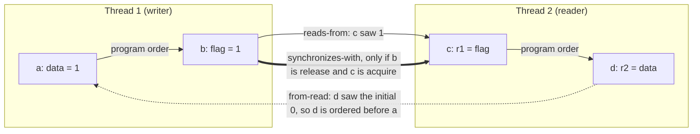
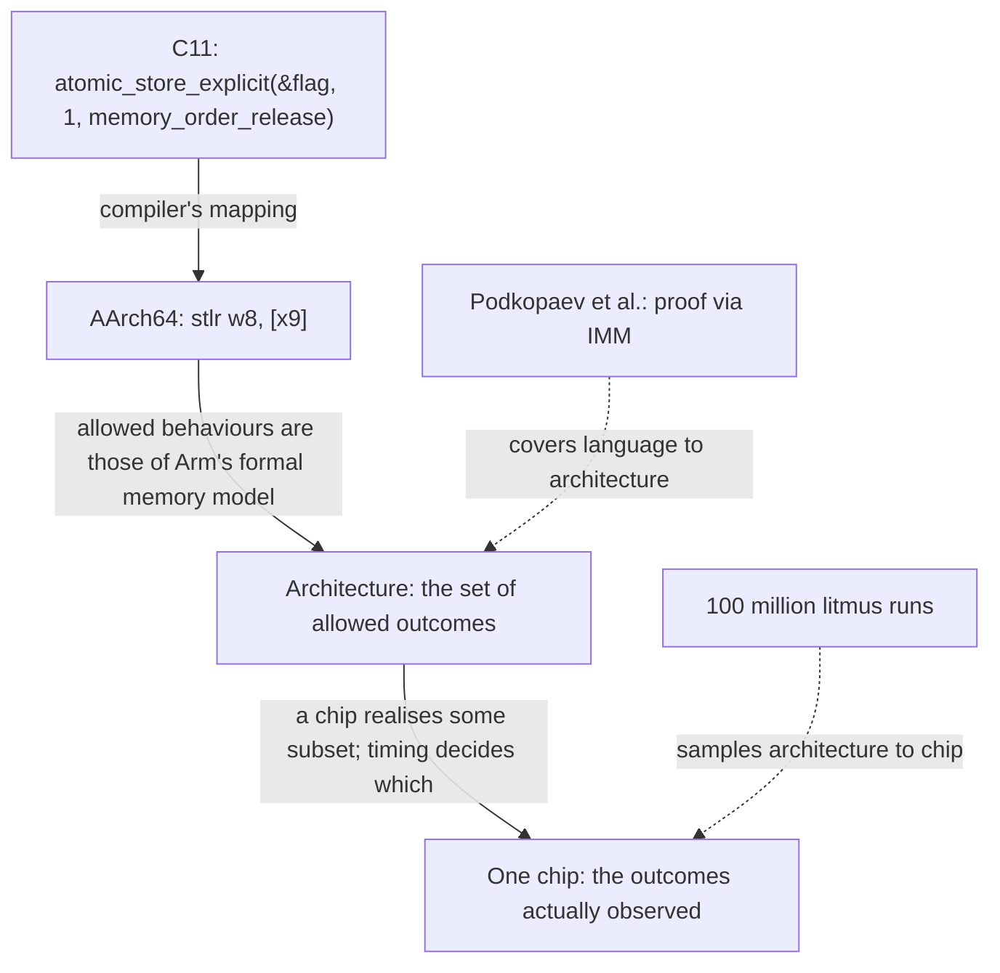

# Arm A-profile: AArch64, Neon, weak memory, and what the architecture leaves to the chip

> **Sources:**
> 1. Chris Shore (Arm), *ARMv8-A CPU Architecture Overview*, slides dated 03/12/2015 on the title slide, 30 PDF pages - [canonical URL](https://developer.arm.com/-/media/Files/pdf/graphics-and-multimedia/ARM_CPU_Architecture.pdf) - [local PDF](../../sources/arm/armv8-a-cpu-architecture.pdf).
> 2. Arm, *Neon Programmer Guide for Armv8-A*, version 4.0, issue 03 (document 102159_0400_03_en, last change 14 June 2023), 48 pages - [canonical URL](https://documentation-service.arm.com/static/6530e5163f12c06bc0f740ef) - [local PDF](../../sources/arm/neon-programmer-guide-armv8-a.pdf).
> 3. Podkopaev, Lahav and Vafeiadis, *Bridging the Gap between Programming Languages and Hardware Weak Memory Models*, POPL 2019 (article 69), arXiv 1807.07892 v3 of 9 November 2018 - [arXiv abstract](https://arxiv.org/abs/1807.07892) - [local PDF](../../sources/arm/weak-memory-models.pdf).
>
> **What I could and could not read.** Source 1's text extracted, but its diagrams (pipeline stages on p. 13, register pictures on pp. 6 and 20, scheduler pictures on pp. 14 and 15) did not, so I can quote only the words around them. I read all of source 2. In source 3 I read the abstract, introduction, Sections 2 to 5, the theorem statements of Sections 6 and 7, and Sections 8 and 9; I did not read the proofs (about pp. 18 to 28) or the appendices. None of the three sources mentions SVE (the Scalable Vector Extension).
>
> **Measurements.** Anything labelled "measured" ran on one Apple M5 Pro laptop (macOS 26.5, Apple clang 21.0.0, target `arm64-apple-darwin25.5.0`, `-O2` unless stated). `sysctl` reports 18 cores: 6 "Super" and 12 "Performance" (`hw.perflevel0/1`). The numbers describe that chip and compiler, not Arm in general.

## Read this first

**The claim in one sentence.** An Arm A-profile program depends on three separable contracts (a fixed-width instruction set with 31 general registers, vector instructions beside it, and a memory model that lets chips reorder memory accesses), so every speed or correctness fact is a fact about the contract, a compiler, or one chip, never about "Arm" as one thing.

**Who this is for.** Anyone who will read AArch64 assembly, call a vector library, or write threaded code on an Arm laptop or server, including people running language models locally on Apple silicon. No architecture course is assumed.

**Afterwards you will be able to** read a short compiler listing and say why every instruction is four bytes; say what Neon vectorisation did and did not buy on this chip, and why a plain `float` sum resists vectorising; explain the message-passing litmus test and read the counts below, where relaxed atomics broke it 89,735 times in 99,999,744 runs and release/acquire never did; say what the Podkopaev et al. paper proves and what it cannot say about a chip; and say what this machine reports about SVE.

**Reading time.** About 50 minutes plus 10 to run the programs. **Have read first:** [Architecture map](../01-architecture-map.md) and [Memory hierarchy](../02-memory-hierarchy.md). Read next [x86-64](../x86-64/03-x86-64.md) (a stronger memory model, variable-length instructions), then [GPU foundations](../gpu/05-gpu-foundations.md) and the [CPU versus GPU decision](../10-cpu-gpu-decision.md).

**The one thing most people get wrong.** They read "the architecture allows X" as "the chip does X", or "my test never showed X" as "the architecture forbids X". The architecture fixes the allowed set; a chip realises some subset; a test samples that subset on one day.

## The paper in one worked example

Part A is a four-line C function compiled to AArch64 and compared with Arm's slides. Part B is the message-passing litmus test, the paper's Example 3.1 (p. 8), run 100 million times.

### Part A - `add_int`, from the slides (pp. 23 to 27) to AArch64 here

The slides' function (p. 23), which I compiled unchanged:

```c
void add_int(int *pa, int *pb, unsigned int n, int x)
{ for (unsigned int i = 0; i < n; i++) pa[i] = pb[i] + x; }
```

The slides use Arm's `armcc` for a Cortex-A15, a 32-bit core, so their listings are the older A32 set, not A64. Their scalar loop (p. 23) is six instructions (`LDR`, `ADD`, `STR`, `ADD`, `CMP`, `BCC`). With `--vectorize` (p. 26) it becomes `VLD1.32`, `VADD.I32`, `VST1.32`, `SUBS`, `BNE`, guarded by a check named "Overlap?" that falls back to scalar code. Page 27 shows `restrict` (a promise the pointers do not overlap) deleting the check.

Measured here, `clang -O2 -fno-vectorize -fno-unroll-loops -S` gives eight instructions, five in the loop:

```asm
_add_int:
	cbz	w2, LBB0_3            ; n == 0: return
	mov	w8, w2                ; zero-extend n
LBB0_2:
	ldr	w9, [x1], #4          ; load pb[i], then pb += 4 (post-index)
	add	w9, w9, w3            ; + x
	str	w9, [x0], #4          ; store pa[i], then pa += 4
	subs	x8, x8, #1            ; n--, set flags
	b.ne	LBB0_2
LBB0_3:
	ret
```

Plain `-O2` gives 54 instructions. The core of it, as emitted, with my comments:

```asm
	sub	x10, x0, x1           ; pa - pb
	cmp	x10, #63 ; b.ls LBB0_12 ; closer than 64 bytes (unsigned): scalar fallback
	dup.4s	v0, w3                ; copy x into all four 32-bit lanes of v0
LBB0_6:                               ; 16 ints per trip
	ldp	q1, q2, [x10, #-32]   ; load 2 x 16 bytes
	ldp	q3, q4, [x10], #64    ; load 2 x 16 bytes, advance 64
	add.4s	v1, v1, v0 ; add.4s v2, v2, v0 ; add.4s v3, v3, v0 ; add.4s v4, v4, v0
	stp	q1, q2, [x11, #-32]   ; store 32 bytes
	stp	q3, q4, [x11], #64    ; store 32 bytes, advance 64
	subs	x12, x12, #16 ; b.ne LBB0_6
```

Apple's assembler writes the arrangement as a suffix (`add.4s`) where Arm's documents write `ADD V1.4S, V1.4S, V0.4S`; same instruction. `otool -tv` shows addresses `0x0, 0x4, 0x8, 0xc, ...` and `size` reports 216 bytes of code, which is 54 times 4: the fixed 32-bit instruction length the slides state (pp. 5, 8), seen rather than quoted. Notice the overlap check is the one the slides name, clang unrolled four times (the 2015 listing did not), and the vector code is hard-wired to four 32-bit lanes because Neon registers are 128 bits.

### Part B - message passing

The paper (Example 3.1, p. 8) writes it with `rlx`, `rel`, `acq` for relaxed, release, acquire:

```text
Thread 1                      Thread 2
[x]rlx := 1                   a := [y]acq   // reads 1
[y]rel := 1                   b := [x]rlx   // reads 0 ?
```

Thread 1 writes data (`x`) then raises a flag (`y`); thread 2 reads the flag then the data. Under sequential consistency (one global order that keeps each thread's order) the pairs (flag seen, data seen) over the six interleavings are (1,1) once, (0,1) four times and (0,0) once; (1,0) never. In my C version data and flag sit in separate 128-byte slots. What clang emitted, measured:

| Variant (C11 orders) | Writer | Reader |
|---|---|---|
| relaxed, relaxed | `str`; `str w8,[x0,#128]` | `ldr w8,[x0,#128]`; `ldr w8,[x0]` |
| release store, acquire load | `str`; `stlr w8,[x9]` | `ldapr w8,[x8]`; `ldr w8,[x0]` |
| seq_cst everywhere | `stlr`; `stlr` | `ldar`; `ldar` |
| relaxed plus fences | `str`; `dmb ish`; `str` | `ldr`; `dmb ishld`; `ldr` |

The relaxed version is two plain stores and two plain loads in source order, so the compiler reordered nothing; any weak outcome comes from the hardware.



Notice that the dotted edge closes a loop (a, b, c, d, back to a). Release/acquire makes the program-order arrows binding across threads and so forbids that loop; relaxed accesses do not.

## Words you need

| Term | Plain definition | Example from the worked example |
|---|---|---|
| AArch64 / A64 | The 64-bit execution state of Armv8-A and its instruction set, all instructions 32 bits (slides pp. 5, 8) | `ldr w9, [x1], #4` is one 4-byte instruction |
| Load/store architecture | Arithmetic uses registers only; memory is touched only by loads and stores | `ldr`, then `add`, then `str` |
| General registers | 31 registers `x0` to `x30` (64-bit) with 32-bit views `w0` to `w30` (slides p. 6) | `w3` holds `x`; `x30` is the return address (slides p. 7) |
| Neon (Advanced SIMD) | Vector instructions on 32 registers of 128 bits (slides p. 20; guide p. 6) | `add.4s` adds four 32-bit lanes at once |
| Lane, arrangement | One element slot of a vector; `.4S` is four 32-bit lanes, `.16B` sixteen byte lanes (guide p. 10) | `dup.4s v0, w3` fills four lanes with `x` |
| SVE | Scalable Vector Extension: vector width chosen by the chip, not the code (general knowledge) | Not used in Part A |
| Litmus test | A tiny multi-thread program whose possible outcomes expose a memory model | Message passing |
| Sequential consistency (SC) | All accesses fall in one global order respecting each thread's order | Forbids (flag 1, data 0) |
| Relaxed, release, acquire | C11 strengths: relaxed orders nothing across variables; release orders earlier accesses before the store; acquire orders the load before later accesses | `stlr` release; `ldapr`, `ldar` acquire |
| Synchronizes-with, happens-before | An acquire that reads a release's value synchronizes with it; with program order this builds happens-before (paper p. 8) | Edge b to c |
| IMM | The paper's "intermediate memory model", between C11-like languages and POWER, Arm, x86, RISC-V (p. 2) | The middle of the paper's Fig. 1 |
| Implementation freedom | The architecture fixes what code may rely on; timing and reordering within the allowed set are each chip's | Whether the weak outcome occurs at all |

## Tutorial 1 - Intuitive understanding

### What was broken before

Concurrent code that works on a tidy machine often fails when moved. Plain words: thread 1 writes a report and then sets a "ready" sign; thread 2 waits for the sign and reads the report. In C:

```c
// Thread 1                                   // Thread 2
atomic_store_explicit(&data, 1, relaxed);     while (atomic_load_explicit(&flag, relaxed) == 0) ;
atomic_store_explicit(&flag, 1, relaxed);     r = atomic_load_explicit(&data, relaxed);   // can be 0
```

On this M5 Pro, a version of exactly this reached "flag 1, data 0" in 89,735 of 99,999,744 runs (a second batch: 90,287). The paper opens (p. 1) by recording that earlier published mappings of C11 to POWER and 32-bit Arm "were subsequently found to be incorrect" for mixing sequentially consistent and weaker accesses, so even experts misjudged the rulebook between language and hardware.

The second broken idea is that "Arm" is one speed. The slides contrast a Cortex-A53 (8 to 11 stages, in order, limited dual issue) with a Cortex-A57 (15 or more stages, out of order, register renaming) and say the A57 gives an "average 40-60% performance boost over Cortex-A9 in general purpose code" (p. 13), while the A53 is "~20% greater perf than Cortex-A9" (p. 16). One architecture, different chips.

### The idea

The architecture is a building code and each chip a building. The code says what must hold (exits on each floor) and what may vary (floors, materials). A program written to the code works in every building; one written to one building's quirks may not. Three parts matter:

1. **Instruction set** (AArch64): fixed four-byte instructions, 31 general registers, memory touched only by loads and stores.
2. **Vector extensions** (Neon, which the slides say can be implemented on all Cortex-A processors, p. 19; SVE and others on some chips).
3. **Memory model**: which orders of reads and writes other threads may see. Arm's is weak: it allows more reordering than x86-64's, so code must say where order matters.

Where the analogy breaks: an inspector can see everything a building does, but a test samples only the timings that happen. A chip that never reorders two accesses today may do so in the next generation without breaking the code, because the code allowed it all along.

### How it works, step by step

1. **Decode is simple because instructions are 32 bits** (slides p. 8): every boundary is known, as the addresses stepping by 4 show.
2. **Data moves through registers.** `ldr` loads, `add` computes, `str` stores; post-indexed forms (`ldr w9,[x1],#4`) also advance the pointer.
3. **Vector code does the same on four values at once.** `ldr q1,[x12],#16` loads 16 bytes, `add.4s` adds four lanes. The guide's RGB example (pp. 7 and 8) shows the strength: `LD3 {V0.16B, V1.16B, V2.16B}, [x0], #48` loads 48 bytes and splits red, green and blue into three registers, so swapping channels is register moves.
4. **Order is requested per instruction.** Plain `ldr`/`str` promise nothing between different addresses; `stlr` (store-release) and `ldar`/`ldapr` (load-acquire) do; `dmb` barriers order everything around them (paper Fig. 5, p. 15).
5. **A language model sits on top.** C11 offers relaxed, release, acquire, seq_cst; the compiler maps each to step 4's instructions; the paper proves such a mapping correct against Arm's formal model for part of C11 (Tutorial 3).



The proof and the experiment answer different questions. The proof says compilation adds no behaviour the language forbids; the experiment says what one chip did.

### What the results say

All numbers are measured on this machine unless a page is cited.

**Compiler output.** One four-line function became 8 scalar instructions or 54 vectorised ones, each 4 bytes. The slides' 31 general registers, fixed 32-bit instructions and 32 vector registers (pp. 4 to 6) match every listing here.

**Vectorisation.** `saxpy` is `y[i] = a*x[i] + y[i]` on 32-bit floats; `dot` sums `x[i]*y[i]`. Sizes count each of two arrays: 4096 floats (32 KiB total, fits a first-level data cache; `hw.l1dcachesize` is 65,536 bytes, `hw.perflevel0` reports 131,072), 262,144 floats (2 MiB) and 16,777,216 floats (128 MiB, beyond every cache here). Each time is the best of nine; a second whole run agreed within about 4 percent. The thread requests the top quality-of-service class so it tends to land on a fast core; macOS cannot pin threads, so I do not know which core ran it.

| Kernel | 4096 floats | 262,144 floats | 16,777,216 floats |
|---|---|---|---|
| saxpy, scalar (vectorisation pragma-disabled) | 0.939 us, 4.36 G elem/s | 60.4 us, 4.34 | 3,988 us, 4.21 |
| saxpy, compiler-vectorised | 0.179 us, 22.9 | 19.8 us, 13.2 | 1,360 us, 12.3 |
| saxpy, Neon intrinsics | 0.243 us, 16.8 | 19.9 us, 13.2 | 1,375 us, 12.2 |
| dot, scalar | 3.03 us, 1.35 | 199 us, 1.32 | 13,125 us, 1.28 |
| dot, compiler-vectorised, no fast-math | 1.98 us, 2.07 | 131 us, 2.00 | 8,475 us, 1.98 |
| dot, Neon, one accumulator | 0.711 us, 5.76 | 50.7 us, 5.17 | 3,285 us, 5.11 |
| dot, Neon, four accumulators | 0.200 us, 20.4 | 16.6 us, 15.8 | 1,232 us, 13.6 |

- Compiler-vectorised `saxpy` ran 5.2 times faster than scalar in cache, 3.0 times at 2 MiB and 2.9 times at 128 MiB: even from main memory it did about three elements for each one the scalar loop did. This tutorial infers the scalar loop (about 50 GB/s counted) is limited by issuing one load and store at a time, not by memory. At 128 MiB both vector versions reach about 146 GB/s counted (12 bytes per element), which looks like a one-thread limit; a multi-threaded run was not tried.
- My intrinsics `saxpy` lost to the compiler at 4096 floats (0.243 versus 0.179 us). The assembly shows why: the compiler did 16 floats per trip with `ldp`/`stp` pairs, mine did four. Hand-written is not automatically faster.
- The sum is the instructive case. Without `-ffast-math` C requires additions in source order, so clang vectorised the multiplies, then added the products one at a time (a chain of 16 scalar `fadd` per trip): only 1.5 times faster than scalar. My version keeps 16 partial sums and is 15.1 times faster at 4096 floats and 10.7 times at 128 MiB. Recompiling with `-ffast-math` made the compiler match mine (0.204 us, 16.6 us, 1,218 us).
- The price is a different answer. A double-precision reference for the 16,777,216-element dot product is 12,582,911.2. Strict float order gave 12,168,090.0 (3.3 percent low); the 16-partial-sum version gave 12,582,911.0 (2 parts in 100 million). Here the faster order was also the more accurate, because one running float sum stops registering small addends once it is large. That depends on this data and float's 24-bit significand.

**Memory ordering.** Two batches of 99,999,744 runs per variant. "Flag seen" is runs where the reader saw the flag raised.

| Variant | Flag seen (batch 1 / 2) | Weak outcome (batch 1 / 2) | Rate per run |
|---|---|---|---|
| relaxed store, relaxed load | 49,123,606 / 49,079,570 | 89,735 / 90,287 | about 1 in 1,110 |
| release store, acquire load | 29,753,877 / 32,544,910 | 0 / 0 | none seen |
| seq_cst, seq_cst | 34,204,609 / 32,576,472 | 0 / 0 | none seen |
| relaxed plus release and acquire fences | 25,427,605 / 8,978,337 | 0 / 0 | none seen |
| release store only, relaxed load (one batch) | 29,713,128 | 33,293 | about 1 in 3,000 |
| acquire load only, relaxed store (one batch) | 49,996,618 | 5,463 | about 1 in 18,300 |

Without ordering, about one run in 1,110 broke the sequentially consistent rule: a handshake done a million times a second would fail about 900 times a second. With release on the writer and acquire on the reader, none in 199,999,488 runs (a third batch of the release/acquire variant, run for timing, also gave 0). Guarding only one side leaves failures, so both sides must say it. This tutorial infers from 33,293 versus 5,463 that reader-side load reordering was about six times as frequent as writer-side store reordering under this harness.

**SVE, as this machine reports it.** `sysctl hw.optional` lists `AdvSIMD: 1`, `neon: 1`, `FEAT_DotProd: 1`, `FEAT_FP16: 1`, `FEAT_BF16: 1`, `FEAT_LSE: 1`, `FEAT_LRCPC: 1`, and many SME (Scalable Matrix Extension) keys including `FEAT_SME2` and `sme_max_svl_b: 64`. Asking for `hw.optional.arm.FEAT_SVE` and `FEAT_SVE2` returns "unknown oid". A key `FEAT_SVE_B16B16: 1` is also listed; the sources do not explain it. So macOS here does not advertise ordinary SVE, and does advertise SME. I did not read Apple's documentation or try to execute an SVE instruction, so I claim nothing about the silicon. General knowledge, not in the sources: SVE code does not hard-code a vector width, so one binary can run on chips of different widths.

### What this does not show

- Nothing ran on x86-64, so nothing here compares Arm with x86.
- Intrinsics did not beat the compiler on `saxpy`; they won on `dot` only by changing the arithmetic order, which `-ffast-math` also does.
- The counts show relaxed atomics break the handshake on this chip; they do not prove the other variants safe on every chip. The architecture rules and the paper do that.
- The rate depends on my harness (random 0 to 63 iteration delays, a spin barrier). The 52-line version below, without the quality-of-service setting, gave about 1 in 2,370.

### Teach-back

**1. Why does every `add.4s` in Part A touch exactly four values, and what would SVE change?**

<details>
<summary>Answer</summary>
Neon registers are 128 bits and `.4s` names four 32-bit lanes (slides p. 22, guide p. 10). An SVE version (general knowledge) would not fix the width, so the same code would use however many lanes the chip has, with predicates replacing the padding, overlap or single-element tails of the guide's pp. 15 to 19.
</details>

**2. The compiler's vectorised `dot` gained 1.5 times; mine gained 15. Why, and what did it cost?**

<details>
<summary>Answer</summary>
Floating-point addition depends on order, so without `-ffast-math` the compiler must keep a chain of dependent adds. Sixteen independent partial sums let the chip overlap them. The cost is a different summation order, so results differ in low digits (here nearer the double-precision reference, but that is data-dependent).
</details>

**3. Release-only and acquire-only variants both still failed. What does that tell you?**

<details>
<summary>Answer</summary>
The weak outcome can arise on the writer (stores becoming visible out of order) or on the reader (loads executing out of order). Release fixes the first and acquire the second; one alone leaves the other, so failures fell (33,293 and 5,463 against 89,735) without vanishing.
</details>

**4. You see zero weak outcomes in a relaxed test. Is the pattern safe?**

<details>
<summary>Answer</summary>
No. The architecture allows the outcome; a chip, core type or harness may simply not show it. With zero events in N independent runs the 95 percent upper bound is about 3/N (a general statistics rule), and it says nothing about other chips.
</details>

## Tutorial 2 - Practitioner understanding

### The design in concrete terms

**Registers and calls (slides pp. 5 to 7, 20).** 31 general registers `x0` to `x30` with 32-bit views, plus 32 vector registers `v0` to `v31` of 128 bits viewable as `b`, `h`, `s`, `d`, `q`. The Procedure Call Standard (p. 7): a callee must preserve `x19` to `x29`, may overwrite `x0` to `x18`, and returns to the address in `x30`. Measured, `int bar(int b,int c){ return foo(b,c)+1; }` compiles to:

```asm
_bar:
	stp	x29, x30, [sp, #-16]!   ; save frame pointer and return address
	mov	x29, sp
	bl	_foo                    ; call; return address goes into x30
	add	w0, w0, #1
	ldp	x29, x30, [sp], #16     ; restore
	ret                             ; jump to x30
```

General knowledge, not in the sources: encoding 31 means the stack pointer or the zero register depending on the instruction, and Apple's platforms reserve `x18`, which "can corrupt X0-X18" would not tell you.

**Neon (guide pp. 6 to 14).** `V0.4S` is four 32-bit lanes, `V0.8H` eight 16-bit, `V0.16B` sixteen bytes, `V0.2D` two 64-bit; writing a 64-bit form clears the top half of the register (slides p. 22). `LD1` loads without deinterleaving, `LD2` splits even and odd (stereo audio), `LD3` three ways (RGB), `LD4` four ways (ARGB) (p. 10). Addressing is `[Xn]`, `[Xn], #imm` (the immediate equals the bytes moved, 48 for three 16-byte registers) or `[Xn], Xm` (pp. 13 and 14).

**Leftovers (guide pp. 15 to 19).** With 21 16-bit elements and eight lanes, two trips cover 16 and five remain. Three methods, fastest first: pad the array to 24 (the padding must not change the result: zero for sums, the maximum value for minima, and nothing works for a range); overlap by reprocessing elements 5 to 12 (only for idempotent operations such as a maximum, not a sum); or process single elements with `LD1 {V0.H}[0]` in a second loop (slower, larger). Page 21 warns that writing one cache line from both ordinary and Neon instructions can delay the ordinary writes.

**A kernel (pp. 35 to 40).** The 4x4 float matrix multiply loads each matrix into four registers, then computes each result column with one `FMUL V8.4S, V0.4S, V4.S[0]` and three `FMLA` instructions. The listing has 4 `FMUL` and 12 `FMLA`: 16 vector instructions for 16 x 4 = 64 multiply-adds, matching the 4 x 4 x 4 the mathematics needs. The 16-bit fixed-point version (`SMULL`/`SMLAL`, `SQSHRN`, p. 39) halves the bytes moved. Page 40 notes that consecutive multiplies into the same accumulator `V12` make the pipeline wait, so the code interleaves columns, the effect my one-versus-four-accumulator timings show.

**Memory-ordering mapping (paper Fig. 5, p. 15, against clang here).**

| C11 / IMM operation | Paper's AArch64 mapping | Clang 21 here |
|---|---|---|
| relaxed load, store | `ldr`, `str` | `ldr`, `str` |
| acquire load | `ldar` | `ldapr` (release/acquire); `ldar` (seq_cst) |
| release store | `stlr` | `stlr` |
| acquire fence | `dmb.ld` | `dmb ishld` |
| release or stronger fence | `dmb.sy` | `dmb ish` |
| read-modify-write | `ldaxr`/`stlxr` loop, `dmb.ld` after "strong" ones | not examined |

Two notes. The paper's table says `ldar`, but its formal Arm labels (Definition 4.4, p. 16) call an acquire read `Q`, and footnote 8 says the fragment excludes "sequentially consistent reads". General knowledge, not in these sources: Arm has two acquire loads, `ldar` and the weaker `ldapr`, the latter from `FEAT_LRCPC`, reported present here. From the pages read I cannot tell whether `Q` is the weaker one, so I cannot say if the theorem formally covers `ldapr`. And clang's `dmb ish` is a narrower barrier domain than the paper's `dmb.sy`; I do not claim a difference in effect for this test.

### A minimal version

This 52-line program is the message-passing test, using the same algorithm as the larger program behind the 100-million-run counts (which also sets the quality-of-service class and builds four variants from a macro). Each run uses a fresh variable pair from a pool of 1,024, both threads pass a spin barrier, each waits a random 0 to 63 iterations, and the reader counts the forbidden pair. Data and flag are in different 128-byte lines because `hw.cachelinesize` is 128 here.

```c
// clang -O2 -pthread -DSTORE_MO=memory_order_relaxed -DLOAD_MO=memory_order_relaxed mp_min.c -o mp_min
#include <pthread.h>
#include <stdatomic.h>
#include <stdint.h>
#include <stdio.h>
#include <stdlib.h>
#define R 1024                                   // instances reused per round
typedef struct { _Alignas(128) atomic_int data; _Alignas(128) atomic_int flag; } inst_t;
static inst_t inst[R];
static atomic_long arrive;                       // spin barrier counter
static atomic_int rounds_done;
static long iters, seen, weak;
static uint32_t rnd(uint32_t *s){ *s^=*s<<13; *s^=*s>>17; *s^=*s<<5; return *s; }
static void pause_n(uint32_t n){ while(n--) __asm__ volatile(""); }
static void barrier(long target){
  atomic_fetch_add(&arrive,1);
  while(atomic_load_explicit(&arrive,memory_order_acquire) < target) ;
}
static void *writer(void *_){                    // T1: data = 1; flag = 1
  uint32_t s=2463534242u;
  for(long i=0;i<iters;i++){
    if(i%R==0){
      while(atomic_load(&rounds_done) < i/R) ;
      for(int k=0;k<R;k++){ atomic_store_explicit(&inst[k].data,0,memory_order_relaxed);
                            atomic_store_explicit(&inst[k].flag,0,memory_order_relaxed); }
      atomic_thread_fence(memory_order_seq_cst);
    }
    barrier(2*(i+1)); pause_n(rnd(&s)&63);
    inst_t *p=&inst[i%R];
    atomic_store_explicit(&p->data,1,memory_order_relaxed);
    atomic_store_explicit(&p->flag,1,STORE_MO);
  }
  return 0;
}
static void *reader(void *_){                    // T2: r1 = flag; r2 = data
  uint32_t s=88172645u;
  for(long i=0;i<iters;i++){
    barrier(2*(i+1)); pause_n(rnd(&s)&63);
    inst_t *p=&inst[i%R];
    int r1=atomic_load_explicit(&p->flag,LOAD_MO);
    int r2=atomic_load_explicit(&p->data,memory_order_relaxed);
    if(r1==1){ seen++; if(r2==0) weak++; }       // r1==1 && r2==0 is impossible under SC
    if(i%R==R-1) atomic_store(&rounds_done,(int)(i/R)+1);
  }
  return 0;
}
int main(int argc,char**argv){
  iters=(argc>1?atol(argv[1]):10000000); iters-=iters%R;
  pthread_t a,b; pthread_create(&a,0,writer,0); pthread_create(&b,0,reader,0);
  pthread_join(a,0); pthread_join(b,0);
  printf("runs=%ld flag_seen_1=%ld weak=%ld\n",iters,seen,weak);
}
```

Run it a second time with `-DSTORE_MO=memory_order_release -DLOAD_MO=memory_order_acquire`. Measured with 20,000,000 requested runs (rounded down to a multiple of 1,024):

```text
relaxed / relaxed        : runs=19999744 flag_seen_1=9912703 weak=8444
release store / acquire  : runs=19999744 flag_seen_1=5757041 weak=0
```

At 100,000,000 runs the larger program took 12.5 seconds of wall time and 23.6 seconds of CPU across its two spinning threads. The vector side is short; this four-accumulator dot product produced the 10 to 15 times speedups:

```c
#include <arm_neon.h>
float dot_neon4(const float*x, const float*y, size_t n){
  float32x4_t a0=vdupq_n_f32(0), a1=a0, a2=a0, a3=a0; size_t i=0;
  for(; i+16<=n; i+=16){
    a0=vfmaq_f32(a0, vld1q_f32(x+i),    vld1q_f32(y+i));
    a1=vfmaq_f32(a1, vld1q_f32(x+i+4),  vld1q_f32(y+i+4));
    a2=vfmaq_f32(a2, vld1q_f32(x+i+8),  vld1q_f32(y+i+8));
    a3=vfmaq_f32(a3, vld1q_f32(x+i+12), vld1q_f32(y+i+12));
  }
  float s = vaddvq_f32(vaddq_f32(vaddq_f32(a0,a1), vaddq_f32(a2,a3)));  // 16 partial sums
  for(; i<n; i++) s += x[i]*y[i];                                        // leftovers
  return s;
}
```

Inputs are two float arrays of `n` elements; output is one float; `vfmaq_f32` is the four-lane fused multiply-add (`FMLA`, guide p. 38). One trap I hit: my first benchmark called a pure function with the same arguments each time, the compiler hoisted the call out of the loop, and it reported terabytes per second. I fixed it with an empty `asm volatile` that takes the pointers and clobbers memory. A result above plausible bandwidth is a benchmark bug.

### What it costs

- **Code size.** Vectorising `add_int` grew it from 8 instructions (32 bytes) to 54 (216 bytes), 6.75 times, buying speed on long inputs while staying correct for short and overlapping ones (the slides' p. 24 "penalty of code size increase").
- **Instructions per element.** Scalar: 5 per element. Vector main loop: 10 instructions per 16 elements (2 `ldp`, 4 `add`, 2 `stp`, `subs`, `b.ne`), 0.625 per element, an 8 times reduction. The best measured `saxpy` speedup was 5.2 times, so instruction count is not the only limit; the guide itself sends you to each core's cycle tables (p. 14).
- **Bytes.** `dot` reads 8 bytes per element; its best 128 MiB result, 13.6 G elem/s, is about 109 GB/s read by one thread. `saxpy` counted 12 bytes per element at 12.2 G elem/s is about 146 GB/s. Neither is the chip's peak.
- **Constructed example for local inference (not measured).** A model with 7 billion weights in 4 bits is about 3.5 GB read per generated token if nothing is cached. At 109 GB/s the ceiling is about 31 tokens per second per thread; at 16-bit weights (14 GB) about 7.8. This is the guide's p. 39 point (narrower formats need less bandwidth) as arithmetic. It ignores the key-value cache, dequantisation arithmetic and multiple threads.
- **Ordering.** I did not time `stlr`/`ldar` against plain accesses; the harness is dominated by its spin barrier (about 125 ns per run).

### How it fails

| Symptom | Likely cause | Mitigation |
|---|---|---|
| Handshake works on x86 and loses data on Arm | Relaxed or plain accesses where release/acquire is needed; x86-TSO is stronger than IMM (paper p. 13) so it hid the bug | Release on the publishing store, acquire on the consuming load; test on Arm |
| Zero weak outcomes, code declared safe | Too few runs, a regular harness, or a core type that does not show it | Random delays, several machines, trust the model not the sample |
| Vector loop no faster than scalar | One dependency chain; memory-bound; a failed overlap check (pointers within 64 bytes in `add_int`) | Several accumulators; check bytes counted; `restrict` where true (slides p. 27) |
| Vector sum differs from scalar | Summation order changed | Set a tolerance; compare with a double reference |
| Reads past the end of an array | Leftovers unhandled (guide p. 15) | Padding, overlap, or a single-element tail |
| Impossibly fast benchmark | Work hoisted or removed | Make inputs opaque to the optimiser |
| Run-to-run drift | No thread pinning on macOS; mixed core types | Repeat; record `hw.perflevel` classes |

### Evaluating your version

- **Vector kernel.** Metric: time per call and elements per second, best of at least nine. Baselines: scalar with vectorisation disabled, and the compiler's own vectorised build. Sizes: in first-level cache, in second-level, and far above caches. Stop rule: two whole runs agree within about 5 percent (mine within about 4) and the result matches a double-precision reference to a tolerance set in advance.
- **Ordering test.** Metric: forbidden outcomes per run, alongside runs where the reader had a chance to fail. The relaxed variant must show the outcome, or the harness is uninformative and the other zeros mean nothing. At least 10 million runs per variant; 200 million runs with zero events bound the rate near 1.5 per 100 million (the 3/N rule), if runs were independent, which barrier-driven runs only roughly are. Stop when the relaxed rate is stable across two batches (89,735 and 90,287) and the repaired variants stay at zero.

### Adopt, adapt or skip

**Adopt** reading compiler output: ten minutes, and it turns the Arm overview's claims into things you can check. **Adopt** release/acquire atomics, never plain flags, for any cross-thread handshake that may run on Arm, and test on Arm hardware; a 1-in-1,110 failure shows how cheap it is to be wrong.

**Adapt** Neon: write intrinsics only for kernels no library provides, after reading and measuring the compiler's `-O2` output. Here the compiler tied or beat my `saxpy`, and my `dot` won only by reordering the sum. For teams running language models on Arm laptops or workstations, the deciding resources are memory bandwidth and capacity (the constructed arithmetic above) and the quantisation format, not the intrinsic; use maintained inference libraries and read their kernels.

**Skip** SVE unless you target a specific Arm server: this machine reports SME but not SVE through the interface checked, so SVE code cannot be tested on it. For CPU versus GPU on model workloads continue to the [CPU versus GPU decision](../10-cpu-gpu-decision.md).

## Tutorial 3 - Researcher understanding

### Formal setup

The paper uses the declarative style: a program maps to a set of executions (event graphs), and a consistency predicate keeps the allowed ones (p. 3). Notation, defined once:

- Events are reads `R`, writes `W`, fences `F`, each with a thread id and serial number (Def. 2.1 and 2.2, p. 5); initialisation writes 0 to each location.
- `po` is program order within a thread; `rf` links a write to a read that observes it; `co` totally orders the writes to one location; `fr` (from-read) is `rf` inverted then `co`: a read precedes every write that overwrites what it read (p. 8).
- `sw` (synchronizes-with): a release write, with its release sequence, read by an acquire; `hb` (happens-before) is `(po union sw)` closed transitively; `eco` combines `rf`, `co`, `fr` (p. 8).
- Coherence: `hb ; eco?` is irreflexive (p. 8). IMM-consistency (Def. 3.11, p. 13) adds coherence of atomic updates and acyclicity of a relation `ar` of barrier and dependency orderings.

**Toy instance (message passing).** Events: `a` = `W(data,1)`, `b` = `W_rel(flag,1)`, `c` = `R_acq(flag)` reading 1, `d` = `R(data)` reading 0 from the initial write `i`. Edges: `a po b`, `c po d`, `b rf c`, `i rf d`, `i co a`, hence `d fr a`. Release read by acquire gives `b sw c`, so `a hb d`, and `d fr a` closes the cycle: inconsistent, outcome forbidden (Example 3.1, p. 8). If `b` is relaxed, there is no `sw`, no `a hb d`, no cycle: consistent, allowed.

### The claims, stated precisely

1. **IMM is a sound abstraction of the hardware models.** Theorem 4.3 (POWER, p. 15) and Theorem 4.5 (Arm's declarative model, p. 16): if the compiled program's execution is hardware-consistent, the source execution is IMM-consistent. x86-TSO follows because IMM is "straightforwardly" weaker, and RISC-V because it is "stronger than ARMv8" (p. 13).
2. **A fragment of C11 and RC11 maps to IMM by the identity**, excluding non-atomic and SC accesses (Section 5, pp. 16 and 17).
3. **The promising semantics maps to IMM**: relaxed-only programs (Theorem 6.10, p. 22), and the general case if all read-modify-writes are strong (Theorem 7.1, p. 22).
4. **Composition.** N language proofs plus M architecture proofs, not N times M (p. 2). The abstract claims results "mechanized in Coq" and, "to the best of our knowledge," the first machine-verified compilation correctness results for models weaker than x86-TSO.
5. **A bug found:** the conjectured compilation of read-modify-writes to ARMv8 and RISC-V fails because exclusive load/store pairs there are weaker than on POWER and ARMv7; the proven mapping adds `dmb.ld` after strong RMWs (pp. 3, 12, 15).

**What it does not claim.** Nothing about a physical chip: "ARM" means the declarative model of Deacon (2017) and Pulte et al. (2018). The Arm-specific instructions for SC accesses are "left for future work" (p. 17). The introduction (p. 3) says the barrier follows "every RMW", while Section 4.2 and Fig. 5 place it only after strong ones; the latter is the precise statement.

### Evidence, table by table

The evidence is proof, not measurement.

| Item | Content | Identifies causally? |
|---|---|---|
| Fig. 4, 5 (pp. 13, 15) | IMM to POWER and IMM to ARMv8 instruction mappings | Defines the compiled programs the theorems cover |
| Theorems 4.3, 4.5 | Hardware-consistent implies IMM-consistent | Yes, as proofs about the models |
| Example 3.10 (p. 12) | An RMW program where the intended mapping allows a behaviour the promising semantics forbids | A counterexample, so exact |
| Coq development (p. 3) | About 33,000 lines | Soundness relative to the models as written |
| This tutorial's litmus table | One outcome on one chip: 89,735 and 90,287 per 99,999,744 relaxed; 0 otherwise | Variants differ by one qualifier, so ordering is the cause here, on this chip only |

### Ablations and what they isolate

- **Strong versus normal RMW (paper).** Normal RMWs compile with no barrier; strong ones add `dmb.ld`. This isolates the one property the promising semantics needs that ARMv8 lacks (p. 12).
- **IMM's `sw` versus RC11's (Remark 2, pp. 8 and 9).** IMM synchronizes more generously so a release write can be split into a fence and a relaxed write; the paper shows that split unsound in (R)C11 for an RMW case.
- **Which side, and accumulators (this tutorial).** Release-only failed 0.033 percent of runs, acquire-only 0.0055, neither 0.090, both 0 (one batch each for the halves). One versus four chains: 5.76 versus 20.4 G elem/s at 4096 floats, ratio 3.5 against an ideal 4. The chain ratio is about 89 percent of ideal.

### Threats to validity specific to this paper

- **Model versus silicon.** The proof relates formal models. The paper notes that the operational Arm model it replaced, ARMv8-POP, "was later abandoned by ARM" (p. 29): hardware models move.
- **Fragment.** Excluding SC accesses leaves out C11's default `seq_cst`; the paper says their "right semantics" is "still under discussion" (p. 17). My seq_cst measurements fall outside the theorems.
- **IMM is weaker than ARMv8** (p. 29: not multi-copy atomic, allows 2+2W and "write subsumption"), so a proof to IMM can use less than ARMv8 guarantees.
- **Instruction drift and my measurements.** The paper writes `ldar`; current compilers emit `ldapr` here, and I could not tell whether label `Q` covers it. My runs: one machine, two batches, my own delay distribution, no pinning, one compiler.

### Open problems and follow-ups

Full C11 including non-atomic and SC accesses on Arm's own instructions (p. 17); mixed-size accesses and hardware transactions (p. 29); whether IMM's extra weakness permits better optimisation (p. 29); the performance cost of the extra `dmb.ld`, "beyond the scope" (p. 3); a promising-semantics variant that recovers barrier-free RMWs (p. 3).

### What would change my mind

- A relaxed message-passing test staying at zero over billions of runs and several harnesses would move me from "this chip realises the reordering" to "this chip happens not to" (the architecture-level statement would stand).
- Evidence that `ldapr` is inside or outside label `Q` would settle the acquire-load question above.

## Reading map for the sources

| Source and pages | What it contains | First pass | Questions it answers |
|---|---|---|---|
| Slides pp. 3 to 8 | History, AArch64 summary, AArch32 versus AArch64, registers, call standard, A64 | Read | What AArch64 is; register counts |
| Slides pp. 9 to 18 | Clusters, interconnect, A53 versus A57, big.LITTLE | Skim (diagrams lost) | Why cores differ |
| Slides pp. 19 to 22 | Neon, register views, lane syntax | Read | Neon basics |
| Slides pp. 23 to 27 | Five `add_int` builds in A32 with `armcc` | Read, compare with Part A | What vectorising and `restrict` change |
| Neon guide pp. 6 to 14 | Overview, RGB example, structure loads, addressing | Read | `LD3 {V0.16B,...}, [x0], #48` |
| Neon guide pp. 15 to 21 | Three leftover methods; one-cache-line warning | Read | Tails and padding |
| Neon guide pp. 22 to 34 | Moves, reverses, extract, transpose, interleave, table lookup | Skim | Rearranging lanes |
| Neon guide pp. 35 to 41 | 4x4 matrix multiply, float and fixed point | Read | A real kernel; accumulator waits |
| Neon guide pp. 42 to 47 | Shifts, image-format conversion | Skip first time | Shifts and narrowing |
| Paper pp. 1 to 3 | Abstract, introduction, Fig. 1 | Read | What is claimed |
| Paper pp. 4 to 8 | Language, executions, coherence, Example 3.1 | Read p. 8 | Why release/acquire forbids the outcome |
| Paper pp. 8 to 13 | IMM ordering rules, Examples 3.2 to 3.10 | Skim | What a model must rule out |
| Paper pp. 13 to 17 | Mappings to POWER, ARMv7, ARMv8; C11 to IMM | Read pp. 15, 16 | Instruction mappings |
| Paper pp. 18 to 28 | Promising semantics to IMM, proofs | Skip (not read in detail) | Proof technique |
| Paper pp. 29 to 30 | Related work, conclusion | Read | Limits and future work |

## Questions readers get stuck on

### Is the weak outcome I measured a chip bug?

No. The architecture permits it, so a conforming chip may produce it. The bug is in the program that relied on an order it did not request. Example 3.1 (p. 8) is the formal version: forbidden with release and acquire, allowed when relaxed.

### Why did release/acquire and seq_cst both show zero; are they the same on Arm?

For this two-variable test both suffice. Clang compiled seq_cst to `stlr`/`ldar` and release/acquire to `stlr`/`ldapr`. They differ in general: seq_cst adds one global order over many variables. The paper's Example 3.8 (pp. 11 and 12) shows the four-thread IRIW test, where release/acquire alone still allows a weak outcome in IMM and SC fences are needed.

### Why 31 registers and not 32?

The slides say 31 general registers `x0` to `x30` (p. 6). General knowledge, not in the sources: encoding number 31 means the stack pointer or the zero register depending on the instruction.

### Is the Neon guide consistent about 64-bit versus 128-bit registers?

Not obviously. It calls Neon "64-bit or 128-bit" (p. 6) and says structure loads read "into 64-bit Neon registers" (pp. 9 and 10), yet its examples use `V0.16B`, a 128-bit arrangement. This tutorial reads the 64-bit remarks as covering the 64-bit forms (`.8B`, `.4H`, `.2S`) and uses the 128-bit register width of slide p. 20. The source leaves it unresolved.

### Does vectorising 32-bit floats always give four times?

No. Measured: compiler-vectorised `saxpy` was 5.2 times faster in cache (more than four because the scalar loop was also less efficient than the unrolled vector loop), 2.9 times from memory, and strict-order `dot` 1.5 times. The lane count bounds a single instruction, not a result.

### Why does the Neon `dot` differ from the scalar one?

Float addition depends on order. Scalar adds left to right; mine adds 16 partial sums then combines them. Neither is "the" answer; against the double-precision reference the strict order was 3.3 percent off on that data.

### Does this show Arm has SVE?

For this machine's operating-system report, no SVE keys appear and SME keys do. The three sources never mention SVE. General knowledge: some Arm server and mobile cores offer SVE and code for it adapts to vector width; check your target's documentation or feature registers.

### Why does the paper matter if I only write C?

Because your compiler's mapping from `memory_order_release` to `stlr` is what the paper verifies. A wrong mapping would break correct C only on Arm, and p. 1 records that published mappings were found wrong after the fact.

## Prerequisites you actually need

### Prerequisite 1 - Fixed-width instructions and addresses

With fixed-width instructions, each address is a multiple of the width. The `add_int` object code has 54 instructions of 4 bytes, 54 x 4 = 216 bytes, the size `size` reports; the instruction at index 10 is at byte 40 (0x28). Used in Part A; the slides contrast this with variable-length sets (p. 8), and [x86-64](../x86-64/03-x86-64.md) covers the other side.

### Prerequisite 2 - Lanes, and why floating-point addition has an order

A 128-bit register holds four 32-bit floats; one vector add does four additions. Floating-point addition is not associative: in 32-bit float, (100,000,000 + 1) - 100,000,000 is 0, since float spacing near 100,000,000 is 8 and adding 1 changes nothing, whereas (100,000,000 - 100,000,000) + 1 is 1. Used for the `dot` results; the guide's lane diagrams are on p. 37.

### Prerequisite 3 - Dependency chains and how many independent chains you need

An operation of latency L cycles that depends on the previous one can start once every L cycles; keeping a unit that can start one per cycle busy needs about L independent chains (Little's law: concurrency equals latency times rate). Measured: one accumulator ran 5.76 G elem/s, which is 1.44 G vector multiply-adds per second, about 0.69 ns per dependent step. Four independent chains would ideally give 4 x 5.76 = 23.0 G elem/s; measured 20.4, 89 percent. Used in the accumulator ablation and in the guide's p. 40 note.

### Prerequisite 4 - Enumerating interleavings

Label the writer's steps `a` (data) then `b` (flag), the reader's `c` (flag) then `d` (data). Orders keeping `a` before `b` and `c` before `d` number 4!/(2!2!) = 6: `abcd`, `acbd`, `acdb`, `cabd`, `cadb`, `cdab`. The reader sees (flag, data) = (1,1) in `abcd`; (0,1) in `acbd`, `acdb`, `cabd`, `cadb`; (0,0) in `cdab`. (1,0) needs `b` before `c` and `d` before `a`, which with `a` before `b` before `c` before `d` is a contradiction. Used in Part B; the paper's Example 3.1 formalises it as a cycle.

## Where this sits in the curriculum

Read [Architecture map](../01-architecture-map.md) first (instruction set versus chip) and [Memory hierarchy](../02-memory-hierarchy.md) (the bandwidth ceilings seen in the `saxpy` and `dot` results). Against [x86-64](../x86-64/03-x86-64.md), the subject here has fixed-width instructions and a weaker memory model, so the reorderings measured here are the kind an x86-64 programmer is largely shielded from. Against [GPU foundations](../gpu/05-gpu-foundations.md), Neon is four lanes in one core's instruction stream; a GPU is thousands of lanes under another execution model. Finish with the [CPU versus GPU decision](../10-cpu-gpu-decision.md).

## Checkpoint

**1. Explain.** Name the three layers an Arm program depends on, and say what a measurement on one chip can and cannot tell you about each.

<details>
<summary>Answer</summary>
Instruction set (fixed 4-byte instructions, 31 registers), vector extension (Neon fixed at 128 bits; SVE chooses width per chip), memory model (allowed reordering). One chip can disprove "the architecture always does this" but cannot prove "the architecture never does that".
</details>

**2. Compute.** A function compiles to 40 AArch64 instructions. How many bytes, and at what offset is the 11th instruction?

<details>
<summary>Answer</summary>
40 x 4 = 160 bytes; the 11th instruction is index 10, at offset 40 (0x28).
</details>

**3. Compute.** The relaxed run gave 89,735 weak outcomes in 99,999,744 runs. What is the rate, and how many failures in a minute at 5 million handshakes per second if it carried over?

<details>
<summary>Answer</summary>
89,735 / 99,999,744 is 0.0897 percent, about 1 in 1,114. A minute is 300 million handshakes, so about 269,000 failures. The rate need not carry over: a real program's timing differs from the harness.
</details>

**4. Critique.** "I ran the relaxed test ten million times on my x86 desktop and saw nothing, so the flag pattern is safe on Arm." What is wrong?

<details>
<summary>Answer</summary>
Different architecture: x86-64 is stronger, so the outcome is rare or absent there, while Arm allows it. And zero events in a finite sample does not prove zero probability. The pattern needs a release store and an acquire load.
</details>

**5. Critique.** What can the Podkopaev et al. theorems not tell you about your Apple laptop?

<details>
<summary>Answer</summary>
They relate formal models (Arm's declarative model, IMM, a fragment of C11 without non-atomic or SC accesses). They say nothing about what a physical chip does, whether it realises a weak behaviour, or whether newer instructions such as `ldapr` are in the mapping (not determinable from the pages read).
</details>

**6. Explain.** What does "this machine does not advertise SVE" mean and not mean?

<details>
<summary>Answer</summary>
`sysctl hw.optional` listed SME keys and no SVE or SVE2 keys, so the operating system does not report ordinary SVE here. It does not mean the silicon lacks it, and none of the three sources discusses SVE.
</details>
