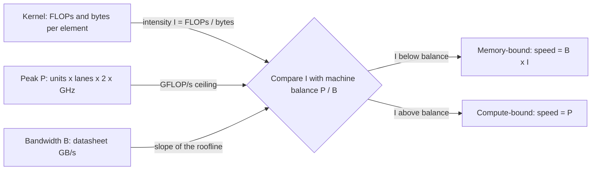
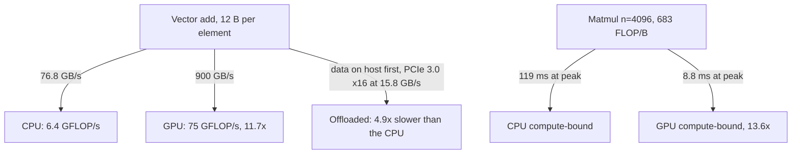

# GPU Foundations: Why Trade Single-Thread Latency for Throughput

> **Source:** Sun, Agostini, Dong and Kaeli (Northeastern University), "Summarizing CPU and GPU Design Trends with Product Data", arXiv 1911.11313v2, 13 July 2020 - [arXiv abstract](https://arxiv.org/abs/1911.11313) - [local PDF](../../sources/gpu/foundations/cpu-gpu-design-trends.pdf)
>
> **Additional evidence (not listed sources for this tutorial):** the CUDA C++ Programming Guide Release 13.3 (legacy chapters), the HIP Documentation Release 6.3.42134 and the oneAPI GPU Optimization Guide, plus two arXiv reports used only for numbers the main source lacks: Jia et al. on the Volta GPU (arXiv 1804.06826) and Hofmann et al. on four Intel Xeon generations (arXiv 1702.07554). Page numbers are PDF page numbers of the local files.
>
> **Question this tutorial answers:** why do GPUs trade single-thread latency for throughput?

## Read this first

**The claim in one sentence.** A graphics processing unit (GPU) spends its silicon on thousands of simple arithmetic lanes and on storage for the state of thousands of waiting threads, instead of on the machinery (branch prediction, speculation, large per-core caches) that makes one thread finish quickly; this pays off only when there is enough independent work to keep memory requests in flight, and the gain is bounded by memory bandwidth and arithmetic per byte, not by a general "GPU is faster" factor.

**What the listed source does and does not say.** Sun et al. collect public specifications of 4,031 central processing unit (CPU) and GPU products released since 2000 (p. 1) and report theoretical floating-point rates, power, clocks and die sizes. They never tabulate memory bandwidth or latency, and never run a program. The trade-off in the title is therefore argued here from their FLOP/s and power trends plus vendor documentation for the mechanism and two measurement reports for bandwidth and latency; every number says which.

**Afterwards you will be able to** compute the machine balance (floating-point operations per byte) of a CPU and a GPU from documented figures; place a vector add and a matrix multiply on a roofline with the arithmetic shown; use Little's law to say how many memory requests a GPU needs in flight; explain divergence in a warp (a group of 32 lock-step threads on NVIDIA hardware); and write the arithmetic that makes single-stream language-model decoding memory-bandwidth-bound.

**Reading time.** About 50 minutes, plus 10 to run the small programs. **Have read first:** [the architecture map](../01-architecture-map.md) and [the memory hierarchy](../02-memory-hierarchy.md). **Read next:** [NVIDIA CUDA architecture](./nvidia/06-cuda-architecture.md), [AMD CDNA and HIP](./amd/08-amd-cdna-hip.md), [Intel Xe and oneAPI](./intel/09-intel-xe-oneapi.md), then [the CPU versus GPU decision](../10-cpu-gpu-decision.md).

**The one thing most people get wrong.** They compare peak FLOP/s and conclude the GPU is "about 14 times faster". For the pair documented below the peak ratio is 13.6, the bandwidth ratio is 11.7, and for a memory-bound kernel the achievable ratio is the second number. If the data must first cross the PCI Express (PCIe) link, the same kernel runs about five times slower on the GPU than on the CPU that already holds the data.

## The paper in one worked example

The example is a roofline calculation built from documented figures for two real products. It is a calculation, not a measurement. Inputs not found in the sources are marked "general knowledge".

### Step 1 - Pick one CPU and one GPU and write down their documented limits

| Quantity | Intel Xeon E5-2697 v4 (Broadwell-EP, Q1 2016) | NVIDIA Tesla V100, NVLink board (Volta; 2017 is general knowledge) |
|---|---|---|
| Compute units | 18 cores (Hofmann Table 1, p. 4) | 80 streaming multiprocessors, "Processors per chip" (Jia Table 3.1, p. 21) |
| fp32 lanes that fuse multiply-add | 2 FMA units per core, 8 lanes each (Hofmann p. 4; throughput 0.5 cycles per FMA, p. 8) | 64 FP32 cores per SM, compute capability 7.x (CUDA p. 511) |
| Clock used | 2.0 GHz, the "AVX base frequency" (Hofmann Table 1) | 1,530 MHz, NVLink board (Jia p. 55) |
| Memory | 4 channels DDR4-2400, 76.8 GB/s theoretical (Hofmann Table 1) | HBM2, 900 GB/s theoretical (Jia p. 19; Table 3.1 prints "900 GiB/s", see the inconsistency list) |
| Power limit | 145 W thermal design power, TDP (Hofmann p. 6) | 300 W, the common flagship figure Sun et al. report (p. 5); the V100's own rating is general knowledge |

FMA is a fused multiply-add: one instruction, counted as 2 floating-point operations (FLOPs).

### Step 2 - Peak FLOP/s (every lane does one FMA every cycle, nothing else)

- CPU: 18 cores x 2 units x 8 lanes x 2 FLOP = 576 FLOP per cycle, times 2.0 GHz = **1,152 GFLOP/s**. At the 2.7 GHz AVX all-core turbo clock the chip reaches 1,555 GFLOP/s (Hofmann Table 1). Base clocks are used because Sun et al. also use base, not boost, clocks (p. 1).
- GPU: 80 SMs x 64 lanes x 2 FLOP = 10,240 FLOP per cycle, times 1.53 GHz = **15,667 GFLOP/s**. Sun et al. say the best GPUs reach "as high as 16 TFLOPS" single precision (p. 3). Jia et al. measured 15.53 TFLOP/s on this board with the cuBLAS matrix library (Table 5.3, p. 55), 99% of the computed peak; the PCIe card at 1,380 MHz computes to 14.13 against a measured 14.03.

### Step 3 - Machine balance (peak FLOP/s divided by peak bytes/s)

- CPU: 1,152 / 76.8 = **15.0 FLOP per byte**.
- GPU: 15,667 / 900 = **17.4 FLOP per byte**. With Jia's measured 750 GiB/s (about 805 GB/s) and 15.53 TFLOP/s it is 19.3.

Machine balance is the arithmetic intensity (FLOPs per byte moved to or from main memory) a kernel needs before arithmetic, not memory, is the limit. The surprise is how similar the two are. The GPU does not have more arithmetic per byte; it has 13.6x the arithmetic (15,667 / 1,152) and 11.7x the bandwidth (900 / 76.8).

### Step 4 - Two kernels, derived

**Vector add**, `c[i] = a[i] + b[i]` in 32-bit floats (fp32): 1 FLOP per element; traffic is 4 B read of `a`, 4 B of `b`, 4 B written = 12 B. Intensity = 1/12 = 0.083 FLOP/B. Attainable rate = min(peak, bandwidth x intensity):

- CPU: 76.8 x 0.083 = **6.4 GFLOP/s**, 0.56% of peak.
- GPU: 900 x 0.083 = **75 GFLOP/s**, 0.48% of peak.

Both intensities sit far below the balances (15.0 and 17.4), so the kernel is **memory-bound** on both, and the GPU's win is 75 / 6.4 = 11.7x, exactly the bandwidth ratio.

**Matrix multiply**, C = A x B with n x n fp32 matrices: 2n^3 FLOPs (n multiplies and n adds for each of n^2 outputs). If each matrix crossed the memory interface once (read A, read B, write C) traffic is 3 x n^2 x 4 B = 12n^2 bytes, so intensity is 2n^3 / 12n^2 = n/6. For n = 4,096: 137.4 GFLOP over 201.3 MB = **683 FLOP/B**. At peak the GPU needs 8.8 ms for the arithmetic against 0.22 ms to move the bytes; the CPU needs 119 ms against 2.6 ms. Both are **compute-bound** by a wide margin.

That n/6 is an upper bound that needs reuse from on-chip storage. The CUDA guide's shared-memory sample (p. 54-55) has each thread block compute one T x T tile of C and, per step along k, load one T x T tile of A and one of B from global memory, so A is read B.width / T times. Per step the block loads 2T^2 x 4 B = 8T^2 bytes and does 2T^3 FLOPs: intensity **T/4 FLOP/B** (this tutorial's derivation from the sample's structure); untiled (T = 1) it is 0.25.

| Tile T | Intensity (FLOP/B) | CPU attainable (% of peak) | GPU attainable (% of peak) | Verdict |
|---|---|---|---|---|
| 1 (naive) | 0.25 | 19 GFLOP/s (1.7%) | 225 (1.4%) | memory-bound on both |
| 16 | 4 | 307 (26.7%) | 3,600 (23.0%) | memory-bound on both |
| 32 | 8 | 614 (53.3%) | 7,200 (46.0%) | memory-bound on both |
| 64 | 16 | 1,152 (100%) | 14,400 (91.9%) | CPU compute-bound, GPU just short |
| 128 | 32 | 1,152 | 15,667 | compute-bound on both |

The table comes from the script in Tutorial 2 and matches the hand arithmetic. The sample exposes a limit: a block holds at most 1,024 threads (CUDA Table 27, p. 504) and the sample uses one thread per tile element, so T cannot exceed 32, where intensity is 8 and the kernel is still memory-bound against 17.4. Production kernels give each thread several outputs held in registers, and the 6,144 KiB L2 cache (Jia Table 3.1) absorbs some reuse, so this table bounds the sample's design; it does not predict cuBLAS.



Notice that the verdict depends on the kernel and on the ratio P/B; a faster arithmetic unit does nothing on the left branch.



Notice that one pair of machines gives a 4.9x slowdown, an 11.7x gain and a 13.6x gain on three workloads. Every later section refers back to these numbers: peak ratio 13.6, bandwidth ratio 11.7, balance 15 to 17.

## Words you need

| Term | Plain definition | Example from the worked example |
|---|---|---|
| Latency | Time from issuing one operation to its result. | 405 cycles for a V100 global load (Jia p. 55). |
| Arithmetic intensity | FLOPs per byte moved to or from main memory by a kernel. | Vector add 1/12; matmul T/4 with tiles. |
| Machine balance | Peak FLOP/s over peak bytes/s: the intensity where a machine changes from memory-bound to compute-bound. | 15.0 (Xeon), 17.4 (V100). |
| Roofline | The bound: performance <= min(peak FLOP/s, bandwidth x intensity). | Step 4. |
| Little's law | Items in flight = arrival rate x time in the system; for memory, bytes in flight = bandwidth x latency. | 238 KB for the V100. |
| Warp, wavefront, sub-group | The fixed-size group of threads issuing one instruction together: 32 on NVIDIA, commonly 64 on AMD, 8/16/32 chosen by the compiler on Intel. | CUDA p. 157; HIP p. 31; oneAPI p. 22. |
| SIMT / SIMD | Single instruction, multiple threads: scalar-thread code run in lock-step groups. Single instruction, multiple data: one instruction on a vector with the width visible to the programmer. | CUDA p. 158. |
| Divergence | Threads of one warp taking different branch paths, so both paths run with some lanes disabled. | Tutorial 1, step 6. |
| Occupancy | Resident warps divided by the maximum a multiprocessor supports. | At most 64 warps per SM at compute capability 8.0 (CUDA p. 504). |
| Coalescing | Merging the loads of neighbouring threads into one wide memory transaction. | 32 consecutive 4-byte floats make one 128-byte span. |

## Tutorial 1 - Intuitive understanding

### What was broken before

The broken idea is the one in the question: "the GPU is just faster". On the worked pair, adding two long lists is 11.7x faster on the GPU if both lists are already in its memory and 4.9x slower if they must first be sent over PCIe (arithmetic in Tutorial 2). A calculation whose each step needs the previous result gains nothing from thousands of lanes. Multiplying large matrices is about 14 times faster. One idea ("more parallel hardware") predicts none of the three; the memory system and the amount of independent work do.

There is a reason people believed it. Sun et al. report GPU single-precision performance generally an order of magnitude above consumer CPUs (p. 3), a statement about peak arithmetic on paper. They add (p. 3-4) that the gap is closing: the Xeon Platinum 9282 offers theoretical power close to a GeForce RTX 2080 and more than half of the Tesla V100.

### The idea

Picture a restaurant with one master chef and a kitchen of 5,000 junior cooks. The chef finishes one dish fast: a big pantry beside the stove (caches), a guess at the next order (branch prediction), and starting before the order is confirmed (speculation). Each junior cook is slow, but supplies come from a distant warehouse, so when one cook waits another has her ingredients. For 5,000 identical dishes the kitchen wins by far. For one elaborate order whose every step needs the previous one, the chef wins.

The documents say the same. The CUDA guide says instructions are "issued in order and there is no branch prediction or speculative execution" (p. 157, shortened). The HIP guide says GPUs rely on "massive hardware multithreading to hide latency" instead of complex caches and control logic (p. 31, shortened).

Where the analogy breaks. The cooks are not independent: they work in lock-step teams of 32 (NVIDIA) or commonly 64 (AMD), and if one needs a different recipe step the whole team does both. The warehouse has a fixed delivery rate, so the limit is often bandwidth, not cook count. And the kitchen is in a different building from the dining room: moving orders in over PCIe can cost more than the cooking.

### How it works, step by step

Each step is shown on the vector add running on the V100.

1. **Write scalar code for one element.** Thread i computes `c[i] = a[i] + b[i]`; launch 2^26 = 67,108,864 threads.
2. **Threads are grouped into warps of 32.** A multiprocessor "creates, manages, schedules, and executes threads in groups of 32 parallel threads called warps" (CUDA p. 157).
3. **Many warps are resident.** The registers of every resident warp stay on-chip, so switching costs nothing (CUDA p. 159). At compute capability 8.0 an SM holds up to 64 warps (2,048 threads) and has 64K 32-bit registers (Table 27, p. 504): 32 registers per thread at full residency (this tutorial's division).
4. **A warp issues a load and waits.** Jia et al. measured 405 cycles for a global-memory access on the NVLink V100 (p. 55): 405 / 1.53 GHz = 264.7 ns (the report prints "26.5 ns"; see inconsistencies). The scheduler issues from another ready warp.
5. **Latency is hidden when enough warps have work.** Full utilization is reached when every scheduler has an instruction to issue during the latency period, "in other words, when latency is completely hidden" (CUDA p. 162, shortened). Arithmetic latency of about 4 cycles needs 16 active warps per SM at compute capability 7.x; off-chip latency of "hundreds of clock cycles" needs more (p. 163).
6. **A split warp runs both sides.** On a data-dependent branch the warp "executes each branch path taken, disabling threads that are not on that path" (CUDA p. 158). With paths of 10 and 30 instructions and an even split, the warp spends 40 issue slots; useful lane-instructions are 16 x 10 + 16 x 30 = 640 of 40 x 32 = 1,280, or 50% (constructed example).
7. **Result: a throughput machine.** A load finishes later than on a CPU (265 ns against about 90 ns, general knowledge), but about 59,000 loads are in flight at once (Tutorial 2).

### What the results say

These are the computed figures of the worked example, supported by published numbers.

- **Peak single-precision is 13.6x** (15,667 vs 1,152 GFLOP/s). Counted: theoretical FLOP/s at fixed clocks. It means that for perfectly parallel, arithmetic-bound work already on the device, one V100 does what about 14 Broadwell sockets would. Sun et al. report the same order of magnitude for consumer CPUs (p. 3).
- **Bandwidth is 11.7x** (900 vs 76.8 GB/s). For memory-bound kernels the on-device gain is at best about 12, not 14.
- **FLOP/s per watt: 52 against 7.9.** 15,667 / 300 W = 52 GFLOP/s per watt for the V100 and 1,152 / 145 W = 7.9 for the Broadwell, a ratio of 6.6: for the same power the GPU does about 6.6 times the arithmetic. Sun et al. report FLOPS per watt doubling every three to four years (p. 3, 5) and flagship GPU power flattening near 300 W because of cooling limits (p. 4-5).
- **The CPU gap is closing.** Sun et al. credit SIMD extensions (SSE, AVX), core count and clock (p. 3-4). On paper a server CPU is then within a factor of two of the best GPU for regular compute-bound work; the paper does not examine the bandwidth gap.
- **Double precision.** Gaming GPUs have 32 single-precision units per double-precision unit, HPC GPUs 2 to 1 (Sun p. 4). The V100 SM has 64 FP32 and 32 FP64 cores (CUDA p. 511), and Jia measured 7.83 TFLOP/s double against 15.53 single (p. 55). On a 32:1 part double precision runs at one thirty-second of the single-precision peak, so some GPUs struggle to beat CPUs (Sun p. 4).

### What this does not show

- Sun et al. report theoretical rates and say real applications cannot use all resources (p. 3). Nothing in the paper measures a kernel.
- They report no memory bandwidth, latency or cache size, which is where the trade is paid; those come from Jia (V100) and Hofmann (Broadwell).
- This pair was chosen because its numbers are documented; other pairs give other ratios, and the method carries over while the numbers do not.
- Offload cost, serial fraction and software quality are outside the paper; Tutorial 2 and Amdahl's law in Tutorial 3 cover them.

### Teach-back

1. Why can a GPU keep its arithmetic units busy during a 265 ns memory wait, while a CPU core cannot without deep caches?
2. A friend says "14 times the FLOP/s, so everything runs 14 times faster". Give counterexamples with numbers.
3. What does divergence cost, and why does it matter inside a warp but not between warps?
4. What is the V100 balance here, and what does it say about a kernel at 0.083 FLOP/B?

<details>
<summary>Answer 1</summary>

Up to 64 warps per multiprocessor keep their registers on-chip, so the scheduler issues from another at no switching cost (CUDA p. 159, 162). A CPU core has few threads and instead predicts and reorders. The GPU's price is storage: 64K registers x 4 B = 256 KiB per SM, about 20 MiB over 80 SMs, against 6 MiB of L2 (this tutorial's arithmetic from CUDA p. 504 and Jia p. 21).

</details>

<details>
<summary>Answer 2</summary>

Vector add: 11.7x on-device, 4.9x slower with a PCIe 3.0 x16 transfer. A dependent chain: 4 cycles per FMA on the GPU (2.6 ns) against 5 on Broadwell (1.9 to 2.5 ns), so 5,120 lanes do not help. Double precision on a 32:1 gaming part: one thirty-second of peak.

</details>

<details>
<summary>Answer 3</summary>

A warp issues one instruction at a time for all lanes, so a split branch runs both sides with lanes masked: 40 slots for paths of 10 and 30, 50% lane use. Warps are scheduled independently, so branching between warps is free (CUDA p. 158).

</details>

<details>
<summary>Answer 4</summary>

17.4 FLOP/B. A kernel at 0.083 is 209 times below it, so it is memory-bound and runs at 0.083 x 900 = 75 GFLOP/s.

</details>

## Tutorial 2 - Practitioner understanding

### The design in concrete terms

The three vendor documents describe one design in different words.

| Idea | NVIDIA (CUDA guide) | AMD (HIP guide) | Intel (oneAPI guide) |
|---|---|---|---|
| Unit holding resident groups | Streaming multiprocessor (SM) | Compute unit (CU), "SM on NVIDIA" (p. 31) | Execution Unit (EU) on Xe-LP; Vector Engine (VE) in later text (p. 9, 22) |
| Lock-step group | Warp of 32 (p. 157) | Warp or wavefront, commonly 64; RDNA parts 32 or 64 (p. 31) | Sub-group of 8, 16 or 32 work-items, compiler-chosen (p. 22, 37) |
| Hardware multithreading | Up to 64 warps per SM at compute capability 8.0 (p. 504) | "Up to thousands of threads can reside on a CU" (p. 31) | Xe-LP EU is "simultaneously multithreaded (SMT) with seven threads", 128 registers each (p. 9) |
| Switch cost | None; context on-chip (p. 159) | None; context stored on the CU (p. 31) | Switches between resident hardware threads (p. 9) |
| Divergence | Run each taken path, disable others (p. 158) | Mask results, run both branches (p. 32) | Run both paths, merge by mask (p. 22) |
| SIMD datapath width | 64 FP32 lanes per SM at 7.x (p. 511) | VALU width 16 on GCN, a warp issues every 4 cycles, 4 SIMDs per CU (p. 32) | 8-wide ALU per Xe-LP EU (p. 9) |

SIMT against SIMD, in the documents' words. CUDA (p. 158): SIMD exposes the width to software, whereas SIMT instructions specify "the execution and branching behavior of a single thread" (shortened); warp size is to performance what cache-line size is to a CPU. HIP (p. 30) calls SIMT a middle ground between CPU multithreading and SIMD instruction sets (SSE, AVX, Neon): its compiler scalarizes the kernel and issues scalar instructions of many instances to the lanes. oneAPI (p. 22) goes the other way: the compiler packs work-items into one SIMD hardware thread. All three run SIMD hardware; they differ in who maps threads to lanes.

**Little's law for the V100.** Latency 405 cycles / 1.53 GHz = 264.7 ns (Jia p. 55); bandwidth 900 GB/s (Jia p. 19).

- Bytes in flight = 900e9 x 264.7e-9 = **238,000 B**. As 4-byte loads: 59,600 chip-wide, 745 per SM over 80 SMs. As coalesced 128-byte warp-loads: 1,861 chip-wide, **23.3 per SM**.
- Of at most 64 resident warps per SM (the 8.0 value from the CUDA table; the table starts at 7.5, so 2,048 resident threads for the V100's own 7.0 is general knowledge), at least 36% must be waiting on a load at any moment. A vector-add thread issues two independent loads (`a[i]`, `b[i]`) before needing either, so about 12 warps per SM suffice.
- At the measured 750 GiB/s (805 GB/s) the need is 213 KB. Full residency is 80 x 2,048 = 163,840 threads (this tutorial's product), a margin over the roughly 60,000 loads that must be outstanding.

**The same for the CPU.** Broadwell: 76.8e9 x 90e-9 = 6,912 B (90 ns main-memory latency is an assumption, general knowledge) = 108 lines of 64 B, or 6 per core. One out-of-order core with about ten outstanding misses (general knowledge) can supply that. The GPU needs 34.5 times more bytes in flight (238,235 / 6,912): 11.7x the bandwidth times about 2.9x the latency. The CPU buys latency tolerance with area per thread; the GPU buys it with thread count.

**Arithmetic latency is similar.** A dependent FMA is 4 cycles on compute capability 7.x (CUDA p. 163), or 2.6 ns at 1.53 GHz; a Broadwell AVX FMA is 5 cycles (Hofmann p. 8), 2.5 ns at 2.0 GHz or 1.9 ns at 2.7 GHz. One dependent chain makes about 0.77 GFLOP/s on a GPU thread and 0.8 to 1.1 on a CPU thread. The difference lies in memory, branches, lock-step and the independent chains needed: a Broadwell core needs 5 cycles x 2 FMA/cycle = 10 independent FMAs in flight, the whole V100 needs 5,120 lanes x 4 cycles = 20,480 lane-operations. The guide's 16 warps per SM (p. 163) is an issue-slot count; a lane count for FMA on 16-lane partitions gives 8 (this tutorial's inference).

**Offload cost for vector add** (n = 2^26, 805 MB moved):

| Case | Rate | Time |
|---|---|---|
| Broadwell, data in DRAM | 76.8 GB/s | 10.5 ms |
| V100, data already on device | 900 GB/s | 0.90 ms |
| V100, data on host first, PCIe 3.0 x16 | 15.76 GB/s | 51 ms |
| Apple M5 Pro, measured here, 1 thread / 18 chunks | 119 / 244 GB/s | 7 ms / 3 ms |

The PCIe rate is 16 lanes x 0.985 GB/s (oneAPI p. 127 table, PCIe 3.0) = 15.76 GB/s. The guide's prose says "an x16 PCIe, which can get 63 GB/s"; that equals the PCIe 5.0 row (3.938 x 16), not the 3.0 link a V100 uses. The 4.9x slowdown is 12 B / 15.76 GB/s against 12 B / 76.8 GB/s.

### A minimal version

Two programs ran on the authoring machine, an **Apple M5 Pro (Arm), clang -O2 and -O3 -mcpu=native, macOS**. They are CPU programs; the CUDA kernel is `not run` (no NVIDIA GPU here). The measurements describe this laptop, not the worked-example products.

**Program 1 - Little's law with dependent loads (measured).** One random cycle through 512 MiB in 128-byte nodes (the `hw.cachelinesize` reported); k independent chains are walked together.

```c
// k independent pointer chains over one random cycle, one thread
uint32_t *a = aligned_alloc(4096, N*LINE);            // N = 4M nodes, LINE = 128 B
/* Sattolo shuffle gives a single random cycle: a[perm[i]*W] = perm[i+1] */
for (int k : {1,2,4,8,16,32,64}) {
  uint32_t p[64];
  for (int c = 0; c < k; c++) p[c] = perm[(size_t)c*(N/k)];  // chains start far apart
  double t0 = now();
  for (size_t s = 0; s < steps; s++)
    for (int c = 0; c < k; c++) p[c] = a[(size_t)p[c]*W];    // each load depends only on its own chain
  double t = now() - t0;
  printf("k=%2d ns/load=%.2f\n", k, t/(steps*k)*1e9);
}
```

| k chains | ns per step | ns per load | GB/s moved |
|---|---|---|---|
| 1 | 116.5 | 116.54 | 1.10 |
| 2 | 115.2 | 57.62 | 2.22 |
| 4 | 121.1 | 30.27 | 4.23 |
| 8 | 123.8 | 15.47 | 8.27 |
| 16 | 127.9 | 7.99 | 16.02 |
| 32 | 201.7 | 6.30 | 20.31 |
| 64 | 411.2 | 6.42 | 19.92 |

Reading it. With one chain nothing overlaps: 128 B / 116.5 ns = 1.1 GB/s. Up to k = 16 the time per step barely moves (115 to 128 ns) while loads per step double, so throughput doubles. Past k = 32 the time per step grows, so the memory system is saturated at about 20 GB/s for one thread of random 128-byte loads. Little's law check: 20.31 GB/s x 116.5 ns = 2,366 B = 18.5 lines in flight, matching the knee between 16 and 32. The 116 ns includes address-translation misses on a 512 MiB footprint (not isolated). A GPU uses the same mechanism, with requests supplied by warps.

**Program 2 - roofline measurements (measured; `clang -O3 -mcpu=native -framework Accelerate`).**

| Kernel on this machine | Result | Reading |
|---|---|---|
| Vector add, 2^26 floats, 1 thread, best of 8 | 9.9 GFLOP/s, 118.9 GB/s at 12 B/element | one thread already moves 1.5 Broadwell sockets' bandwidth |
| Vector add over 18 chunks (18 logical CPUs) | 20.3 GFLOP/s, 243.6 GB/s | bandwidth saturates; GFLOP/s = GB/s / 12 |
| Naive triple-loop matmul, n = 512, 1 thread | 1.98 GFLOP/s | strided reads of B make it latency-bound |
| Accelerate `cblas_sgemm`, n = 2,048 | 1,546 and 1,584 GFLOP/s (two runs) | about 800x the naive loop; whether it used matrix hardware was not checked |

The 12 B/element count ignores any write-allocate read of `c`, so true DRAM traffic may be higher. The best sgemm rate over the vector-add bandwidth gives this machine's balance: 1,584 / 243.6 = 6.5 FLOP/B. At n/6 = 341 FLOP/B the matrix multiply is compute-bound here, and the 800x gap to the naive loop is the cost of ignoring reuse. `sysctl hw.ncpu` reports 18 logical CPUs (6 and 12 across two performance levels).

**Program 3 - the roofline table (computed output of a 20-line Python script, `python3 -I roofline.py`).** It multiplies units x lanes x 2 x GHz, divides by bandwidth, and prints min(peak, bandwidth x intensity) for each kernel; its output reproduced the worked example (balance 15.0 and 17.4; vector add 6.4 and 75.0 GFLOP/s; the tile table above).

**Program 4 - CUDA vector add (`not run`).** Run it on an NVIDIA GPU and compare the achieved GB/s with the datasheet:

```cuda
__global__ void vadd(const float* a, const float* b, float* c, size_t n) {
  size_t i = blockIdx.x * (size_t)blockDim.x + threadIdx.x;
  if (i < n) c[i] = a[i] + b[i];            // 12 bytes of traffic, 1 FLOP
}
// vadd<<<(n + 255) / 256, 256>>>(a, b, c, n);  time with cudaEvent; report 12*n / seconds
```

Jia et al. measured 750 of 900 GiB/s (83.3%) on the V100 (Table 3.1, p. 21); half of datasheet or less suggests too few elements or an uncoalesced pattern.

### What it costs

- **Divergence.** Paths of 10 and 30 instructions. If the choice depends on the warp index (for example `(threadIdx.x / warpSize) % 2`), no warp diverges (HIP p. 84 gives the same advice) and warps cost 10 or 30, average 20. If each thread picks a side at random with probability 0.5, a 32-thread warp is uniform with probability 2 x 0.5^32 = 4.7e-10, so every warp costs 40: twice the average.
- **Residency.** A kernel using 64 registers per thread holds 1,024 of 2,048 threads (50% occupancy). The CUDA guide shows the cliff for compute capability 6.x: 64 registers allow 32 warps, 65 allow 16 (p. 163).
- **Too little parallelism.** 4,096 threads each with one 4-byte load in flight hold 16 KB, which is 6.9% of the 238 KB needed, so about 62 GB/s of 900 before launch overhead.

### How it fails

| Symptom | Likely cause | Mitigation |
|---|---|---|
| GPU slower than the CPU with a small kernel time | Transfer dominates: 15.76 GB/s over PCIe against 900 on device | Keep data resident, fuse steps, time end to end (oneAPI p. 127) |
| Few percent of peak FLOP/s but near-peak GB/s | Memory-bound (intensity below 17.4) | Raise reuse (tiling, fusion) or accept the bandwidth-limited rate |
| Low bandwidth and low occupancy | Too little work in flight; registers or shared memory limit residency | Occupancy calculator (CUDA p. 163-164), fewer registers, larger launch |
| Speed depends on input layout | Divergence from a data-dependent branch | Sort or bin so a warp takes one path (HIP p. 84) |
| Double-precision job disappointing | 32:1 gaming GPU | Check the FP64 rate of the exact part (Sun p. 4) |
| Gain far below 13.6x on arithmetic-bound code | Serial fraction, imperfect utilization, lower clock | Amdahl's law (Tutorial 3); compare with the library's rate |

### Evaluating your version

Metric: achieved fraction of min(peak FLOP/s, bandwidth x intensity), not seconds alone.

1. Count FLOPs and bytes per element by hand and state the intensity.
2. Measure bandwidth with a copy or add kernel, and your kernel, at 2^24, 2^26 and 2^28 elements, five repetitions, median, with transfers timed separately and together.
3. Baselines: the vendor library routine and the best CPU version on the same data.
4. Stop rule: stop when within 10% of the lower ceiling, or when two consecutive changes each gain under 3% (about the noise you should report). If under 5% of both ceilings with high occupancy, suspect divergence or uncoalesced access first.

Report machine, clock policy, flags, repetitions and spread.

### Adopt, adapt or skip

**Adopt** the roofline check before any purchase or port: it takes ten minutes from a datasheet and gives a bound no tuning can beat. **Adopt** stating, for every performance claim, which product and generation it comes from.

**Adapt** the GPU decision for language-model and agent workloads, using arithmetic only. The figures are constructed to show the method; they are not measurements of any product or serving stack.

- A decoder-only model producing one token for one sequence reads each weight once and does 2 FLOPs per weight. A 7-billion-parameter model in 16-bit numbers (2 bytes) reads 14 GB and does 14 GFLOP per token: **1 FLOP per byte**, 17 times below the V100 balance (17.4) and 6.5 times below this laptop's measured 6.5 FLOP/B. It is bandwidth-bound by a wide margin.
- Ceiling on tokens per second = bandwidth / weight bytes: 900 / 14 = 64 for a 900 GB/s device, 244 / 14 = 17 at this laptop's measured 244 GB/s, 76.8 / 14 = 5.5 for the Broadwell socket. These ignore the attention key-value cache, activations and software overhead; they show which resource sets the ceiling, not what any product delivers.
- Batching changes intensity: with b sequences decoded together each weight read serves b sequences, so intensity is b FLOP/B. It reaches 17.4 near b = 17. Matrix-multiply units raise the peak: Jia measured 87.4 TFLOP/s half precision on the NVLink V100 (Table 5.3), a balance of 87,420 / 900 = 97, so b near 97 before arithmetic limits. Many concurrent users put a GPU's arithmetic to use; one user's chat session is a bandwidth workload.
- Capacity comes first. The V100 has 16,152 MiB (Table 3.1), so 13.0 GiB of weights leaves about 2.7 GiB; a CPU host can hold far more at lower bandwidth. The trade is bandwidth against capacity.

**Recommendation for a team choosing what to run or learn.** (1) Dense batch work with high reuse (matrix work, embedding a large corpus): use a GPU and a vendor library; expect a gain near 13.6x only when compute-bound. (2) Interactive single-stream decoding of a model that fits in device memory: compare machines on measured memory bandwidth first and FLOP/s second; a laptop or workstation with high bandwidth can be the right answer. (3) Models larger than device memory: price the PCIe traffic before assuming a GPU wins; the vector-add arithmetic applies to streamed weights. (4) Treat vendor numbers as ceilings and run Program 1 and the vector add on your hardware. **Skip** hand-written GPU kernels until a profiler shows that a library call cannot do the job.

## Tutorial 3 - Researcher understanding

### Formal setup

- P: peak arithmetic rate, FLOP/s = (units) x (lanes per unit) x (FLOP per lane per cycle) x (clock in Hz). B: peak memory bandwidth, bytes/s. I: arithmetic intensity, FLOPs per byte moved to and from main memory. R(I): attainable performance.
- Roofline: R(I) = min(P, B x I); balance I* = P / B.
- Little's law: L = lambda x W (items in system = arrival rate x time each stays). For memory, L is bytes in flight, lambda is B, W is latency.
- Amdahl's law: S = 1 / ((1 - p) + p / s), p the fraction of time accelerated by factor s.
- Divergence: a warp whose lanes take m distinct paths with costs c_1..c_m costs the sum of the c_j instead of one c_j.

Toy instance: P = 100 GFLOP/s, B = 10 GB/s, so I* = 10; I = 2 gives R = 20 and I = 40 gives 100. Latency 200 ns needs L = 2,000 B. If p = 0.9 is accelerated 20 times, S = 6.9. This tutorial's instance: I* = 15.0 and 17.4; L = 238 KB (V100) and 6.9 KB (Broadwell, assumed 90 ns); with s = 13.6, p = 0.9 gives S = 6.0 and p = 0.99 gives 12.1; with s = 11.7 (bandwidth-limited), p = 0.9 gives 5.7.

### The claims, stated precisely

1. **(Source, Sun p. 3-4)** In their product data the best GPUs exceed consumer CPUs in single-precision peak by about an order of magnitude, and server CPUs narrow the gap (the Xeon Platinum 9282 exceeds half the V100). Theoretical peaks, base clocks (p. 1).
2. **(Source, Sun p. 3-5)** GPU FLOPS per watt doubles every three to four years; flagship TDP levelled near 300 W; GPU clocks tripled from about 600 MHz to 1.8 GHz, the largest single factor in performance growth.
3. **(Vendor documentation, CUDA p. 157-159, HIP p. 31)** GPU multiprocessors omit branch prediction and speculation and hide latency by resident-warp multithreading at zero switch cost.
4. **(This tutorial's inference from claims 1 and 3 plus Jia and Hofmann)** The trade is paid in register storage (about 20 MiB over 80 SMs against 6 MiB of L2) and in required concurrency (34.5 times more bytes in flight than the CPU of the pair). It buys 13.6x peak FLOP/s, 11.7x bandwidth and about 6.6x peak FLOP/s per watt, for work with enough parallelism and reuse.
5. **(This tutorial's inference)** For a memory-bound kernel the speed-up ceiling is the bandwidth ratio, and a PCIe transfer can reverse it.

### Evidence, table by table

| Item | What it is | Headline numbers | Causal or associational |
|---|---|---|---|
| Sun Fig. 1-4 (p. 2-3) | Transistors, density, watts per transistor and per mm^2, clock, by process node | Moore's Law still holds; 1.2 to 1.8 W/mm^2 in most nodes | Associational; Intel counts missing from 2014 (p. 2) |
| Sun Fig. 5 (p. 3) | GPU FLOPS per watt against release date | doubles every three to four years | Associational; theoretical FLOPS over TDP |
| Sun Fig. 6 (p. 4) | Single- and double-precision TFLOPS by family, 2008-2020 | GPU up to 16 TFLOPS; CPUs an order lower; gap narrowing | Associational; points unreadable from extracted text, prose used |
| Sun Fig. 7 (p. 4-5) | GPU FLOPS against TDP, base clock, die size | TDP about 150 to 300 W; GTX 980 1,216 MHz to GTX 1080 1,733 MHz | Factors co-vary with process node; not isolated |
| Jia Table 3.1 (p. 21) | Measured memory hierarchy, Volta to Kepler PCIe cards | V100: 80 SMs, 6,144 KiB L2, 750 of 900 GiB/s (83.3%) | One specimen per card |
| Jia Table 5.3 and text (p. 55) | cuBLAS rates and latency, V100 PCIe and NVLink | single 14.03 / 15.53, double 7.07 / 7.83, half 83.03 / 87.42 TFLOP/s; 391 / 405 cycles | Best over matrix sizes 32 to 8,192, cuBLAS 9.0 |
| Hofmann Table 1 (p. 4) | Datasheet specifications, four Xeon generations | E5-2697 v4: 18 cores, 76.8 GB/s, AVX base 2.0 GHz | Datasheet, not measured |
| CUDA Table 27 (p. 503-504) | Limits per compute capability | 64K registers, 1,024 threads per block, 64 warps per SM at 8.0 | Specification |

No source here measures one workload on a CPU and a GPU. The design claim comes from vendor documentation and the numbers from different reports on different products, so none of this identifies the trade as the cause of any speed-up.

### Ablations and what they isolate

Sun et al. run no ablations. Their Fig. 7 separates frequency, TDP and die size by plotting each against FLOPS, but the factors move together with process node. What this tutorial's own arithmetic isolates:

- **Bandwidth against FLOP/s.** Vector add isolates bandwidth (11.7x, the bandwidth ratio); large matmul isolates arithmetic (13.6x).
- **Request concurrency.** Program 1 varies k at fixed memory and one thread; throughput scaling up to the knee is the effect of in-flight requests alone.
- **Not isolated.** Cache size, prefetchers and memory-controller scheduling. This laptop moved 118.9 GB/s on one thread against 20 GB/s for random-line loads; this tutorial infers that prefetching and sequential streaming explain it, a pattern Little's law with demand loads does not describe.

### Threats to validity specific to this paper

- **Theoretical peaks.** Peak assumes every lane does an FMA every cycle. cuBLAS reached 99% of computed peak on large matrices (Jia p. 55), which is exceptional.
- **Base clocks (Sun p. 1).** The Broadwell peak is 1,152 at AVX base and 1,555 GFLOP/s at AVX all-core turbo (35% apart), which would lower the 13.6x ratio to 10.1x. "About an order of magnitude" survives; the exact ratio does not.
- **Power and data gaps (Sun p. 2).** TDP is not measured power, as the authors note; Intel transistor counts are missing after the 7th-generation Core, so density studies use only TSMC GPUs.
- **Specimens and review.** Broadwell (2016) and Volta (2017) were chosen for documentation, not fairness; newer parts differ. The paper is a 2019 preprint (v2, 2020) and whether it was peer reviewed was not checked.

### Open problems and follow-ups

- Measure vector add, a reduction, a tiled matmul and a dependent chain on one CPU and one GPU, with and without transfers, and fit the roofline to measured ceilings ([NVIDIA microbenchmarking](./nvidia/07-nvidia-microbenchmarking.md)).
- Extend product data with bandwidth, capacity and matrix-unit rates, which Sun et al. omit.
- Study unified-memory systems, which remove the PCIe row but not the bandwidth question ([the CPU versus GPU decision](../10-cpu-gpu-decision.md)).
- Compare how [AMD](./amd/08-amd-cdna-hip.md) and [Intel](./intel/09-intel-xe-oneapi.md) hardware map the same kernel.

### What would change my mind

- A V100 vector add far below 83% of 900 GB/s with no transfer or launch overhead: the ceiling here would not be reachable.
- Evidence that a CPU without out-of-order execution matches a GPU's in-flight-bytes requirement: the area trade would not be what separates them.
- A measurement showing the V100 holds fewer than 2,048 resident threads per SM (the CUDA 13.3 table omits compute capability 7.0, so this rests on general knowledge).

## Reading map for the sources

| Source and section | What it contains | First pass | Guide section that answers its questions |
|---|---|---|---|
| Sun et al. p. 1 (abstract, introduction, methodology) | 4,031 products; base clocks; TDP as power | Read | Worked example step 1; Threats to validity |
| Sun et al. p. 2-3 (Fig. 1-5) | Transistor and power trends | Skim | Tutorial 3 evidence table |
| Sun et al. p. 3-5 (III.C-D, Fig. 6-7) | CPU against GPU rates; GPU performance drivers | Read | Tutorial 1 results; claim 2 |
| CUDA guide p. 157-159 (7.1, 7.2) | Warps, divergence, zero-cost switching, SIMD comparison | Read | Tutorial 1 steps 2-6 |
| CUDA guide p. 161-164 (8.2) | Latency hiding, 16 warps, register example | Read | Tutorial 2 Little's law |
| CUDA guide p. 54-55, 503-504, 511 | Tiled matmul; per-SM limits; FP32 cores | Read, then look up | Worked example step 4 |
| HIP guide p. 27-32 | Warp or wavefront, SIMT mapping, divergence | Read | Tutorial 2 table |
| oneAPI guide p. 9, 22, 37, 127 | EU threads, sub-groups, divergence, PCIe table | Skim | Tutorial 2 offload row |
| Jia et al. p. 19, 21, 55 | V100 bandwidth, latency, cuBLAS | Look up | Worked example steps 1-3 |
| Hofmann et al. p. 4, 6, 8 | Broadwell specifications, FMA latency | Look up | Worked example steps 1-3 |

The listed source is five PDF pages, about 20 minutes. Its figures are plots whose values the extracted text lacks, so values here come from the prose.

## Questions readers get stuck on

### Does the GPU really have no cache?

It has caches, but little per thread. The V100 has 6,144 KiB of L2 and up to 128 KiB of combined L1 and shared memory per SM (Jia p. 21; CUDA p. 511): 6,291,456 B / 163,840 threads is about 38 B of L2 per resident thread (this tutorial's division). The HIP guide says the cache mainly coalesces accesses and shares data between resident warps (p. 32). A Broadwell core has 256 KiB of L2 for one or two threads (Hofmann Table 1).

### If memory latency is 265 ns on the GPU and about 90 ns on a CPU, why use a GPU?

Latency does not set throughput; requests in flight do. By Little's law the GPU holds 238 KB in flight against the CPU's roughly 7 KB, and 900 GB/s at 265 ns needs the former. Latency costs only the work that cannot be overlapped.

### Why does a vector add lose on a GPU when the data starts on the host?

Each element crosses PCIe: 8 B in and 4 B out at 15.76 GB/s takes 0.76 ns, while the CPU needs 0.156 ns from DRAM at 76.8 GB/s and the V100 kernel 0.013 ns. The transfer is 57 times the kernel time. Keeping data resident, or unified memory, removes that row.

### Is SIMT just SIMD with a different name?

The hardware is SIMD; the contract differs. In SIMD the width is in the program and the programmer manages masks and coalescing; in SIMT each thread is scalar code with its own branches and hardware groups them (CUDA p. 158; HIP p. 30). What you feel is divergence: SIMT lets you write a branch freely and charges you for it.

### Why do GPUs need thousands of threads when a V100 has 5,120 lanes?

Each instruction has latency: 4 cycles for arithmetic, hundreds for memory. Threads must cover lanes x latency: 5,120 x 4 = 20,480 for arithmetic and about 59,600 outstanding loads for memory. The 163,840-thread maximum is margin above those minimums.

### Why is the GPU balance (17.4) so close to the CPU's (15.0)?

Designers scale arithmetic and bandwidth together, since a balance of 1,000 would suit almost no kernel. The GPU is a scale-up on both axes (13.6x and 11.7x), not a different ratio; what differs is how much parallelism must be exposed to reach peak.

### Why not add more CPU cores or wider SIMD instead?

CPUs have done that: SIMD extensions, cores and clocks closed part of the gap (Sun p. 4). The remaining gap is bandwidth: wider vectors raise P without raising B, so the balance rises and more kernels become memory-bound.

### Is decoding a language model bandwidth-bound on every machine?

At batch 1 with 16-bit weights, intensity is about 1 FLOP/B, below every balance in this tutorial (15.0, 17.4, 6.5), so yes. It stops when b FLOP/B exceeds the balance; machines with large matrix-unit peaks need larger batches. This is arithmetic, not a statement about any serving product.

## Prerequisites you actually need

### Prerequisite 1 - Little's law

In a steady state, items in flight = arrival rate x time in the system. A memory system giving 10 GB/s at 200 ns latency holds 10e9 x 200e-9 = 2,000 B in flight. Used in: Tutorial 2 and Program 1. Reference: [the memory hierarchy](../02-memory-hierarchy.md); CUDA p. 162 states the same idea in cycles.

### Prerequisite 2 - Roofline

R = min(P, B x I). With P = 100 GFLOP/s and B = 10 GB/s, I = 2 gives 20 and I = 40 gives 100; the crossover P/B = 10. Used in: the worked example. Reference: the oneAPI guide's GPU Roofline chapter (p. 258).

### Prerequisite 3 - Amdahl's law

If a fraction p of time is sped up by s, the total gain is 1 / ((1 - p) + p / s). With p = 0.9 and s = 10: 1 / (0.1 + 0.09) = 5.3, not 10. Used in: Tutorial 3; even at s = 13.6 and p = 0.9 the gain is 6.0. Reference: the CUDA guide's advice to give serial work to the host and parallel work to the device (p. 162).

### Prerequisite 4 - Counting peak FLOP/s from a datasheet

Peak = units x lanes x FLOP per lane per cycle x clock. Example: 4 cores x 8 lanes x 2 x 3 GHz = 192 GFLOP/s. Check which clock (base, AVX base, boost), which precision and whether the instruction is fused. Bandwidth: channels x bytes x transfer rate, 4 x 8 B x 2.4 GT/s = 76.8 GB/s. Used in: worked example steps 2-3. Reference: Hofmann Table 1.

## Where this sits in the curriculum

**Before this:** [the architecture map](../01-architecture-map.md) and [the memory hierarchy](../02-memory-hierarchy.md); the CPU side is in [x86-64](../x86-64/03-x86-64.md) and [Arm A-profile](../arm/04-arm-a-profile.md).

**How it differs from its neighbours.** The architecture map gives vocabulary; the CPU tutorials describe latency-optimized cores; this one gives the quantitative argument for why both designs exist; the vendor tutorials take one family each.

**Read next.** [CUDA architecture](./nvidia/06-cuda-architecture.md) applies the SM, warp and occupancy numbers to one generation; [NVIDIA microbenchmarking](./nvidia/07-nvidia-microbenchmarking.md) shows how latency and bandwidth are measured; [AMD](./amd/08-amd-cdna-hip.md) and [Intel](./intel/09-intel-xe-oneapi.md) show the 64-wide and sub-group variants; [the decision tutorial](../10-cpu-gpu-decision.md) turns roofline and offload arithmetic into a placement rule.

## Checkpoint

1. **Compute.** A CPU has 8 cores, 2 FMA units of 8 fp32 lanes, 3.0 GHz and 40 GB/s. Give peak FLOP/s, balance and the vector-add rate.
2. **Explain.** Why does tiling multiply intensity by T, and why is T = 32 not enough on the V100 here?
3. **Compute.** Latency 405 cycles at 1.53 GHz, bandwidth 900 GB/s: bytes in flight, and 128-byte warp-loads per SM over 80 SMs?
4. **Critique.** A post says "14x faster on a GPU" and gives only the peak FLOP/s ratio. List three questions.
5. **Compute.** 90% of a job's time is accelerated 13.6x. Whole-job gain?
6. **Explain.** Why is single-stream decoding bandwidth-bound? Do the arithmetic for a 7-billion-parameter model with 16-bit weights.
7. **Critique.** In Program 1, ns per step is flat from k = 1 to 16 and rises at 32 and 64. What does each part say?

<details>
<summary>Answers</summary>

1. Peak = 8 x 2 x 8 x 2 x 3.0 = 768 GFLOP/s; balance 768 / 40 = 19.2 FLOP/B; vector add 40 / 12 = 3.3 GFLOP/s, 0.43% of peak, memory-bound.
2. A T x T tile of C needs 2T^2 elements of A and B per step and does 2T^3 FLOPs: intensity 2T^3 / 8T^2 = T/4, T times the untiled 0.25. T = 32 gives 8, below 17.4; T = 64 gives 16 and T = 128 gives 32. One thread per tile element and at most 1,024 threads per block (CUDA p. 504) cap T at 32.
3. 900e9 x 264.7e-9 = 238,235 B; per SM 2,978 B, divided by 128 B = 23.3.
4. Which precision and kernel? Did the comparison include host-to-device transfer, and use all CPU threads and vector units? Was the kernel memory-bound or compute-bound, and was the rate compared with the right ceiling? Which clocks and batch size?
5. 1 / (0.1 + 0.9 / 13.6) = 6.0.
6. Each token reads every weight once: 7e9 x 2 B = 14 GB for 7e9 x 2 = 14 GFLOP, 1 FLOP/B against balances of 15 to 17. Ceilings: 64 tokens/s at 900 GB/s, 5.5 at 76.8 GB/s, ignoring the key-value cache and overheads.
7. Flat time with doubling k means the requests overlap fully, so the system is latency-bound with spare capacity. The rise means saturation near 18.5 lines in flight (20.3 GB/s x 116.5 ns); more concurrency no longer helps.

</details>

## Inconsistencies and unverifiable facts found while writing

- **Jia et al. p. 55:** latency of 405 cycles (NVLink) is printed as "26.5 ns" and 391 cycles (PCIe) as "28.3 ns"; at 1,530 and 1,380 MHz they are 264.7 and 283 ns. Cycles were used.
- **Jia et al. p. 19 and 21:** prose says 900 GB/s; Table 3.1 prints 900 and 750 GiB/s. 900 GiB/s is 966 GB/s, while a 4,096-bit bus at 877 MHz double data rate (general knowledge) gives about 897 GB/s, so the table's unit is probably wrong. 900 GB/s was used for peak and 750 GiB/s was converted (805 GB/s).
- **oneAPI guide p. 127:** the 63 GB/s x16 PCIe figure matches the PCIe 5.0 row, not 3.0 or 4.0; the 900 GB/s HBM figure is not tied to a product.
- **CUDA guide Release 13.3:** the hardware chapter is marked legacy, and Table 27 starts at compute capability 7.5, so Volta (7.0) limits were unavailable and the 8.0 column was used. Text extraction merges the column values (for example "32 64 48 64 48" for resident warps); column assignment is this tutorial's reading of the header.
- **Sun et al.:** the abstract says GPUs "consistently deliver higher performance" while the findings say the gap narrows and that CPUs can beat many GPUs in double precision (p. 4). Fig. 6 data points could not be read from the text; the 16 TFLOPS maximum and the 9282 comparison are from prose. The 9282's own FLOP/s and bandwidth are not in the paper and are not used.
- **Not in any source:** the 90 ns CPU latency, line-fill-buffer counts, the V100 power rating and release year, and 2,048 resident threads at compute capability 7.0; each is marked where used.
- **Measured here:** only the M5 Pro numbers in Programs 1 and 2.

## Sources followed

- Sun, Agostini, Dong, Kaeli, arXiv 1911.11313v2 (13 July 2020): [https://arxiv.org/abs/1911.11313](https://arxiv.org/abs/1911.11313), read in full.
