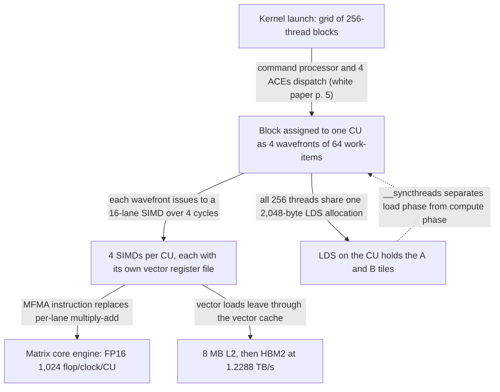
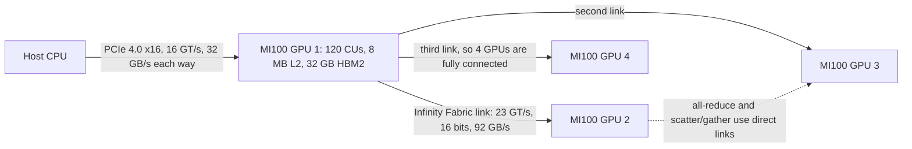

# AMD CDNA and HIP: compute units, wavefronts, LDS, HBM, Infinity Fabric, and how HIP maps onto CUDA

> **Sources.** (1) "Introducing AMD CDNA Architecture", AMD white paper, undated (11 pages; copyright 2020; endnotes carry test dates from 18 September to 12 November 2020): [canonical URL](https://www.amd.com/content/dam/amd/en/documents/instinct-business-docs/white-papers/amd-cdna-white-paper.pdf). Fetched with `curl` and read in full; AMD did not block the download. It is not in `compute/sources/`, so page numbers are the PDF's own (equal to the printed ones). (2) "HIP Documentation", Release 6.3.42134, 13 March 2025 (226 pages): [local PDF](../../../sources/gpu/amd/hip-programming-guide.pdf); manifest page [HIP programming model](https://rocm.docs.amd.com/projects/HIP/en/develop/understand/programming_model.html), a moving "develop" page that this tutorial did not fetch. Every HIP figure below is from the local 6.3 PDF, cited by PDF page.
>
> **Contrast:** [CUDA architecture and programming model](../nvidia/06-cuda-architecture.md) is the NVIDIA side of every comparison.

## Read this first

**The claim in one sentence.** AMD's compute GPUs (the CDNA family, first shipped as the Instinct MI100) keep the older Graphics Core Next (GCN) design of 64-wide thread groups called wavefronts, add matrix-multiply hardware to every compute unit, and are programmed in HIP, a C++ dialect close enough to CUDA that source can be translated mechanically, though AMD's own guide says performance still needs per-platform tuning.

**Who this is for.** Anyone who has read the CUDA tutorial and now asks "can we run this on AMD, what changes, and what do the hardware numbers let us expect?", for example a team choosing hardware for model serving or weighing a CUDA port.

**Afterwards you will be able to**
- translate a CUDA vector add and tiled matrix multiply to HIP and say which lines change;
- compute how many wavefronts and blocks fit on one CDNA compute unit from register, LDS and wave-slot limits, with the arithmetic shown;
- re-derive the white paper's MI100 peak numbers from its per-compute-unit table and say what each does and does not promise;
- name the places where "same source" stops meaning "same behaviour".

**Reading time.** About 50 minutes. **Have read first:** [GPU foundations](../05-gpu-foundations.md) (SIMT, latency hiding), [CUDA architecture](../nvidia/06-cuda-architecture.md) (the model being mapped), [memory hierarchy](../../02-memory-hierarchy.md) (bandwidth, arithmetic intensity). Afterwards: [Intel Xe and oneAPI](../intel/09-intel-xe-oneapi.md) for a third vendor, [CPU or GPU decision](../../10-cpu-gpu-decision.md) for the buying question.

**The one thing most people get wrong.** They treat a wavefront as "a warp with 64 instead of 32". The HIP guide (p. 32) says the AMD vector unit is 16 lanes wide, so a 64-thread wavefront is pushed through it over four cycles, and the white paper says each compute unit has four such units (p. 5). What changes your kernel is not "64 threads move together" but how many wavefronts can be resident to cover memory latency, which depends on registers and local data share (LDS).

**A second trap is the date.** The white paper covers only the first CDNA product (MI100, 2020). Later Instinct generations exist and the HIP guide names MI300 once (p. 218), but neither source gives their CU counts, register files or bandwidths. 

## The paper in one worked example

The material is two vendor documents, so the example is a calculation in three parts: (A) rebuild the MI100's headline peaks from the white paper's per-compute-unit table; (B) take a tiled matrix-multiply kernel and compute how many wavefronts fit on one MI100 compute unit; (C) translate the kernel from CUDA and find where translation stops being mechanical. Parts A and B were computed with Python 3 (standard library) on an Apple M5 Pro and the output is quoted. No HIP code was compiled or run.

### Part A - from per-CU numbers to the MI100 headline

The white paper's Table 1 (p. 6) lists floating-point operations per clock per compute unit (CU). Footnote 1 (p. 10) gives the MI100 peak boost clock, 1,502 MHz, and the text gives 120 CUs (p. 4). Multiplying:

| Row (Table 1, p. 6) | MI100 flop/clock/CU | x 120 CUs x 1.502 GHz | Table prints | MI50 per CU | MI50 peak | Table's ratio |
|---|---|---|---|---|---|---|
| Matrix FP16 | 1,024 | 184.57 TFLOP/s | 184.6 | 256 | 26.5 | 6.97x |
| Matrix bf16 | 512 | 92.28 | 92.3 (footnote 3: 92.28) | N/A | N/A | N/A |
| Matrix FP32 | 256 | 46.14 | 46.1 | 128 | 13.3 | 3.46x |
| Vector FP32 | 128 | 23.07 | 23.1 | 128 | 13.3 | 1.74x |
| Vector FP64 | 64 | 11.54 | 11.5 | 64 | 6.6 | 1.74x |

"TFLOP/s" is 10^12 floating-point operations per second, a multiply-add counted as two. The MI50 column reproduces only if the MI50 has 60 CUs (general knowledge, not in either source) and a 1,725 MHz clock (footnote 4, p. 11): 256 x 60 x 1.725 GHz = 26.50. The whole-GPU ratio 6.97x (184.6 / 26.5) exceeds the per-CU gain of 4x (1,024 / 256) because the MI100 has twice the CUs at a lower clock: (120 x 1.502) / (60 x 1.725) = 1.74, and 4 x 1.74 = 6.97. The vector rows show that factor alone, 1.74x, with no per-CU change.

Two inconsistencies inside the white paper. First, the prose on p. 6 says the matrix instructions "double the peak FLOP/s for FP32 data, and quadruple the throughput for FP16"; that is the per-CU ratio (256/128, 1,024/256), whereas the table's speedup column (3.46x, 6.97x) is per GPU. Both are right; neither says which denominator it uses. Second, 46.14 / 13.25 = 3.48 by the script while the table prints 3.46x, a rounding difference.

Memory and links use the same discipline. The text says HBM2 (second-generation high bandwidth memory) runs at 2.4 GT/s for 1.23 TB/s (p. 4); footnote 2 (p. 10) prints 1.2288 and labels it "TFLOPS", a unit error for terabytes per second. Working backwards, 2.4 GT/s x 4,096 bits / 8 = 1.2288 TB/s, so the bus is 4,096 bits wide; that width is this tutorial's inference, not a printed fact. The L2 claim of "over 3TB/s" (p. 4) checks: 32 slices x 64 B/clock x 1.502 GHz = 3.08 TB/s.

### Part B - one tiled kernel on one CU

The kernel is the standard tiled matrix multiply (full listing in Tutorial 2). With a 16 x 16 tile a block has 256 threads and declares two 16 x 16 float arrays in shared memory (AMD: local data share, LDS): 2 x 256 x 4 = 2,048 bytes. Registers per thread are unknown until compile time, so 32, 64, 96 and 128 are tried. The kernel is **constructed**; the hardware limits come from the sources or are marked as inference:

| Limit | Value | Source |
|---|---|---|
| Wavefront width | 64 work-items | White paper p. 5; HIP guide p. 31 ("commonly 64"), p. 119 (gfx9 returns 64) |
| Vector SIMD units per CU | 4, each 16 lanes; a wavefront issues over 4 cycles | White paper p. 5; HIP guide p. 31-32 |
| Wavefront slots per SIMD | 10 | Figure 5 label "Arb 10 Wave Cntrs" (p. 6); a figure label from text extraction, probable not certain |
| Vector register file | 128 KB per SIMD = 512 four-byte registers for each of 64 lanes | Figure 5 label "Vector Register File 128KB" (p. 6); "per SIMD" is this tutorial's reading |
| LDS | 64 KB per CU | Not printed for CDNA in either source. The HIP guide's sample device listings (p. 97, 99) print `sharedMemPerBlock: 64.00 KB` for two non-CDNA GPUs; the MI100 value is general knowledge |
| Threads per block | up to 1,024 | HIP guide p. 97 sample listing |
| Resident threads per CU | 2,560 | HIP guide p. 97, 99 (two non-CDNA devices); 40 slots x 64 = 2,560 agrees with the figure label |

The rule, which the guide states in words (p. 31: occupancy "is determined by the warp's resource usage of registers and shared memory"): wavefronts per SIMD = min(10, floor(512 / registers per thread)); blocks per CU = the smallest of the register, LDS and slot limits. Output of a short Python script implementing the rule exactly as written in Tutorial 3 (the script is in the authoring scratch directory, not the repository):

| Threads/block | Regs/thread | LDS bytes/block | Wavefronts/block | Blocks by regs | by LDS | by slots | Resident blocks | Resident wavefronts | Occupancy |
|---|---|---|---|---|---|---|---|---|---|
| 256 | 32 | 2,048 | 4 | 10 | 32 | 10 | 10 | 40 | 100% |
| 256 | 96 | 2,048 | 4 | 5 | 32 | 10 | 5 | 20 | 50% |
| 256 | 128 | 2,048 | 4 | 4 | 32 | 10 | 4 | 16 | 40% |
| 1,024 | 32 | 8,192 | 16 | 2 | 8 | 2 | 2 | 32 | 80% |
| 256 | 64 | 32,768 | 4 | 8 | 2 | 10 | 2 | 8 | 20% |

Worked row 2: 512 / 96 = 5.33, floor 5 wavefronts per SIMD, times 4 SIMDs = 20 per CU; 20 / 4 wavefronts per block = 5 blocks; 5 x 4 = 20 of 40 slots = 50%. Row 4 shows granularity: a block is 16 wavefronts, 40 / 16 = 2.5, so only 2 blocks fit and 8 slots idle. Row 5 shows LDS as the limiter: a 32 KB tile leaves room for 2 blocks in 64 KB.

In practice: a kernel that compiles to 96 vector registers per thread leaves half the wavefront slots empty. Whether that hurts depends on whether the remaining wavefronts cover memory latency (Prerequisite 1); occupancy is a means, not a goal. The model ignores register allocation granularity and the split of the register file into ordinary and matrix-accumulation registers (general knowledge: 256 + 256 on MI100; not in the sources), so a compiler's report can differ.

### Part C - the same kernel in CUDA, and where the mechanical translation stops

The kernel body is identical in both dialects: `__global__`, `__shared__`, `__syncthreads()`, `threadIdx`, `blockIdx`, `blockDim` have the same spelling in the CUDA and HIP columns of the guide's syntax table (p. 205). Only host API names change (`cudaMalloc` becomes `hipMalloc`). Mechanical translation stops at code that assumes 32 lanes, such as warp reductions and ballots: the guide warns (p. 148) that such code "can run on a wave-64 machine, but it only utilizes half of the machine's resources", and that ballot results and masks widen to 64 bits.



Notice that the LDS edge never leaves the CU: tile data comes from HBM once per block, which is the point of the tile. The limits that bind in Part B (registers, LDS, slots) all sit on the block-to-CU assignment, not on the peak numbers of Part A.



Notice the three links per GPU. The white paper's point (p. 4) is that the MI50 could only form a ring, while three links give each of four GPUs a direct path to the other three, which helps all-reduce.

## Words you need

| Term | Plain definition | Example from the worked example |
|---|---|---|
| Compute unit (CU) | AMD's block of vector, scalar and (in CDNA) matrix units with registers, caches and LDS; counterpart of an NVIDIA streaming multiprocessor (SM). A block runs on one CU. | MI100 has 120 (p. 4); Part B is per CU. |
| Wavefront / warp | The threads that execute one instruction together. AMD's ISA term is wavefront, HIP source says warp. 64 on CDNA, 32 on NVIDIA. | A 256-thread block is 4 wavefronts here, 8 warps on NVIDIA. |
| SIMD unit | One vector execution unit (single instruction, multiple data); a CDNA CU has four, each 16 lanes wide. | A 64-wide wavefront takes 4 cycles. |
| LDS (local data share) | On-CU memory shared by the threads of one block; CUDA calls it shared memory; HIP spells it `__shared__`. | The two 16 x 16 tiles, 2,048 bytes. |
| MFMA (matrix fused multiply-add) | Wavefront-level instructions that drive the matrix core engines. Inputs INT8, FP16, bf16, FP32; outputs INT32 or FP32 (p. 5). | The 1,024 flop/clock/CU FP16 row. |
| ACE (asynchronous compute engine) | Hardware queue processor with an independent command stream that dispatches wavefronts to CUs; MI100 has four (p. 5). | Why streams can overlap on one GPU. |
| HBM2 | Memory stacked and packaged beside the GPU for far higher bandwidth than board DRAM. | 32 GB, 1.2288 TB/s on MI100. |
| Infinity Fabric | AMD's coherent interconnect; unlike PCIe it lets GPUs share an address space (p. 4). Labelled XGMI in Figure 2 (p. 3). | Three 92 GB/s links per MI100. |
| Occupancy | Resident wavefronts as a share of the maximum, set by registers, LDS and slots (HIP p. 31). | 50% for 96 registers/thread. |
| `gfx` target | The compiler's name for a GPU ISA generation, e.g. `gfx908` (listed on p. 52), `gfx942` (p. 217). Binaries are per target; there is no cross-vendor fat binary (p. 106). gfx908 = MI100 is general knowledge. | `--offload-arch=gfx908`. |
| HIPIFY | Tools that rewrite CUDA source as HIP source (`hipify-perl`, `hipify-clang`; p. 103-104). | `cudaMalloc` to `hipMalloc`. |
| Source vs performance portability | The same source gives correct results on both vendors, versus the same source also runs fast on both. The sources promise the first and hedge on the second. | Part C. |

## Tutorial 1 - Intuitive understanding

### What was broken before

AMD's earlier GPUs served both games and data centres. The white paper (p. 2) describes the split it then made: RDNA for gaming "to maximize frames per second", CDNA for computing "to push the limits of flops per second". CDNA removes rasterization, tessellation, blending and the display engine (p. 4) and spends the area and power on more compute units.

The second problem was software. The dominant way to program GPUs, CUDA, runs only on NVIDIA hardware, so a team with a large CUDA codebase could not cheaply try another vendor. HIP exists to remove that cost; the guide says its tools do "most of the work" (p. 102), not all of it.

### The idea

**Analogy.** A factory floor of workshops (compute units). Each workshop has four assembly lines (SIMD units), each 16 stations wide. A crew of 64 (a wavefront) does the same step together, in four rounds of 16 because the line is only 16 wide. Each workshop has one shared workbench (LDS) and the lockers (vector registers) are split among the crews on a line. New in CDNA: a press (matrix core) that does a small matrix multiply in one operation.

**Where the analogy breaks.** Crew members cannot do different things: if lanes take different sides of an if-statement, the hardware runs both sides in turn with lanes switched off (HIP p. 32). The workbench is not free: it has banks, and two lanes hitting one bank are serialised (p. 83). And not every workshop can be filled: a kernel using many registers per thread fits fewer crews (Part B).

### How it works, step by step

1. **Launch.** The host gives a grid and block size, in CUDA triple-chevron form or `hipLaunchKernelGGL` (p. 116). In the example, 4,096 x 4,096 outputs in 16 x 16 tiles is a 256 x 256 grid, 65,536 blocks of 256 threads.
2. **Dispatch.** The command processor turns API commands into tasks and four ACEs dispatch wavefronts to CUs (white paper p. 5). Each block goes to exactly one CU, and a CU holds several blocks (HIP p. 31); a block never splits across CUs, which is why LDS is private to it.
3. **Issue.** One wavefront instruction takes four cycles on one 16-lane SIMD; four SIMDs give about one wavefront instruction per cycle per CU (HIP p. 32). Divergent lanes are masked, not skipped.
4. **Matrix instructions.** If the compiler or a library emits MFMA, a wavefront drives a matrix engine. The white paper (p. 6) says this cuts register-file reads because matrix inputs are reused, and that narrower types save energy. Ordinary source like the tiled kernel does not become MFMA by itself; use libraries such as rocBLAS or MIOpen (p. 9).
5. **Memory.** Loads pass the vector cache, the 8 MB 16-way L2 (32 slices, 64 bytes/cycle each, p. 4) and HBM2. Device memory is read in naturally aligned 32-, 64- or 128-byte transactions (HIP p. 83), so 64 lanes reading consecutive floats cover 256 contiguous bytes in few transactions, while strided access multiplies traffic.

### What the results say

The white paper reports specifications and vendor-run benchmarks, not independent measurements.

- **11.5 TFLOP/s FP64, "the first processor to break the 10TFLOP/s barrier" (p. 4).** This is the vector FP64 row of Table 1, reachable only if every lane of every CU issues a 64-bit fused multiply-add every clock. Footnote 1 (p. 10) compares with the A100's published 9.7 TFLOP/s, so on paper the MI100 is 11.54 / 9.7 = 1.19 times higher, about 19%. Both are vendor peaks.
- **184.6 TFLOP/s FP16 matrix against 26.5 for MI50, "nearly 7X" (p. 10).** If a kernel is all FP16 matrix multiplication and feeds the matrix cores without stalling, the MI100 could do about seven times what an MI50 could. The MI50 has no matrix hardware (p. 6 note), so the old figure is its vector rate. Footnote 1 also quotes 78 TFLOP/s FP16 for the A100; from general knowledge, not in the sources, that is the A100 without tensor cores, so a like-for-like comparison needs NVIDIA's tensor-core figure. Check before quoting 184.6 against 78.
- **HBM2 1.23 TB/s, "20% faster than the prior generation" (p. 4).** 1.2288 / 1.024 = 1.20, so correct. A kernel that only streams data gains at most 20% over MI50, far below the 7x matrix peak; Tutorial 2 builds on that gap.
- **Infinity Fabric 27%, 44%, 42% faster (Figure 4, p. 5).** AMD's eight-GPU MI100 servers with links on versus off (falling back to PCIe 4.0) on ResNeXt101, BERT and DLRM, all FP32 (footnotes 8-10, p. 11). The extracted text lists the percentages in panel order, which this tutorial assumes matches benchmark order. Per 100 units of work an 8-GPU PCIe system finishes, the fabric system finishes about 127, 144 and 142. The comparison isolates the interconnect but is AMD-run ("Results may vary").
- **Oak Ridge National Laboratory: 1.4x to 3x faster than a V100 node; CHOLLA ported "in just an afternoon" (p. 7).** An AMD summary of ORNL tests whose configurations differ per application. It is an anecdote about one astrophysics code, not evidence about porting effort in general.
- **Migration "in a matter of days" with "virtually no performance degradation" (p. 10).** It cites a Figure 8 bar chart whose values did not survive text extraction, and the label Figure 8 is reused for the library table on p. 9. Unverified here.

### What this does not show

- Real kernel speed: every throughput figure is a peak at boost clock; the white paper reports no measured TFLOP/s for any kernel.
- Anything after MI100. The HIP guide has CDNA2 and CDNA3 block diagrams (p. 23-24) but their content is not extractable and carries no numbers.
- That HIP matches CUDA speed. The FAQ says HIP "provides the same performance as native CUDA code" (p. 102) while another answer says "developers should always expect to perform some platform-specific tuning" (p. 104). Both are in one document; the second is the safer reading.
- Inference or LLM performance: the white paper's machine-learning examples are 2020 FP32 training benchmarks.

### Teach-back

1. A CU has four 16-lane SIMDs and 64-wide wavefronts. How many cycles does one wavefront instruction take on one SIMD, and how many can the CU start per cycle?
2. Why is the matrix FP16 speedup 6.97x for the GPU but 4x per CU?
3. A kernel needs 128 vector registers per thread with 256-thread blocks. How many wavefronts are resident per CU on Part B's limits?
4. Name one change a CUDA warp reduction needs in HIP.

<details>
<summary>Answers to 1 and 2</summary>

1. Four cycles (64 / 16); with four SIMDs, about one wavefront instruction per cycle per CU (HIP p. 32).
2. The MI100 has 120 CUs against the MI50's 60 at a lower clock: 4 x (120 x 1.502) / (60 x 1.725) = 4 x 1.74 = 6.97. The MI50 CU count is general knowledge.

</details>

<details>
<summary>Answers to 3 and 4</summary>

3. 512 / 128 = 4 per SIMD, 16 per CU, i.e. 4 blocks: 40% of 40 slots.
4. Replace a hard-coded 32 with `warpSize`, use 64-bit masks, and note the `__sync` variants are off by default in ROCm 6.2 (p. 148).

</details>

## Tutorial 2 - Practitioner understanding

### The design in concrete terms

**Vocabulary and limits, both vendors** (HIP guide syntax table p. 205; CUDA guide Table 27, PDF p. 504, whose compute-capability columns were garbled in extraction):

| Concept | CUDA | HIP | Number for a named product |
|---|---|---|---|
| Group sharing fast memory | thread block | block (OpenCL: work-group) | up to 1,024 threads (HIP p. 97 listing; CUDA p. 504) |
| Lock-step group | warp, 32 | warp or wavefront: 64 on gfx9, 32 on gfx10+ (p. 119) | MI100: 64 |
| Fast shared memory | shared memory, 64 to 228 KB per SM depending on compute capability | `__shared__` (LDS) | CDNA LDS 64 KB per CU is general knowledge |
| Compute block | streaming multiprocessor | compute unit | MI100: 120 CUs |
| Registers | 64 K 32-bit per SM, 255 per thread (CUDA p. 504) | 4 SIMDs x 128 KB (figure label) | CU 512 KB (inference) against SM 256 KB |
| Launch | `<<<grid, block>>>` | same, or `hipLaunchKernelGGL` | p. 116 |
| Libraries | cuBLAS, cuFFT, cuDNN, NCCL | hipBLAS, hipFFT, RCCL; no cuDNN marshalling layer (MIOpen) (p. 47) | DNN code needs rewriting |

The register comparison is worth reading twice. By inference the MI100 CU holds 4 x 128 KB = 512 KB of vector registers, twice an SM's 64 K x 4 bytes = 256 KB, but they are shared by up to 40 resident wavefronts of 64 lanes: at full wave-slot occupancy each thread gets floor(512 / 10) = 51 registers, whereas an SM with 2,048 resident threads allows 65,536 / 2,048 = 32 (a thread may use up to 255). These are different design points, so a register budget comfortable on one is not automatically comfortable on the other.

**Inside an MI100 CU (white paper p. 5-6).** A scalar register file (Figure 5 label 3.2 KB), scalar unit and 16 KB scalar data cache; four vector register files; four vector units; a vector data cache; a matrix core engine; an instruction cache (label 32 KB, owner ambiguous in extraction); and LDS. The labels "DPx8 SPx16 HPx32 SFUx4" fit Table 1: 8 FP64 lanes x 4 SIMDs x 2 flop = 64 flop/clock/CU and 16 FP32 lanes x 4 x 2 = 128.

**Numeric formats (p. 5).** FP32: 8-bit exponent, 23-bit mantissa; FP16: 5 and 10; bf16: 8 and 7. MFMA takes INT8, FP16, bf16 or FP32 and writes INT32 or FP32. FP8 appears only in the HIP guide (p. 217-218), on gfx940-942 (called MI300 there) and gfx1200/1201, not MI100.

**Host-device memory (HIP p. 37-40).** `hipHostMalloc` pins host memory the GPU can read directly, but each access over the interconnect "can be tens of times slower" than local device memory; coherent host memory is not cached by the GPU (p. 38). `hipMallocManaged` gives one pointer through Linux heterogeneous memory management and is Linux-only in this release (p. 40).

### A minimal version

All code is `not run`: it needs `hipcc` and an AMD GPU (or `hipcc` with the CUDA path on NVIDIA hardware, p. 52; build recipe p. 18-19), and this machine has neither. The kernels are constructed. (The guide's own launch example, p. 116-117, does not compile as printed: it passes a deprecated `hipLaunchParm lp` and uses undeclared `gridDim`, `groupDim`, `n`.)

**Vector add, HIP** (the CUDA original differs only on the lines noted in comments).

```cpp
// not run: HIP, constructed.  hipcc --offload-arch=gfx908 vadd.hip.cpp
#include <hip/hip_runtime.h>                       // CUDA: #include <cuda_runtime.h>
#define HIP_CHECK(x) do { hipError_t e = (x); if (e != hipSuccess) abort(); } while (0)
__global__ void vadd(const float* a, const float* b, float* c, int n) {
    int i = blockIdx.x * blockDim.x + threadIdx.x;  // identical in CUDA
    if (i < n) c[i] = a[i] + b[i];
}
int main() {
    int n = 1 << 26;  size_t bytes = n * sizeof(float);
    float *da, *db, *dc;
    HIP_CHECK(hipMalloc(&da, bytes));              // CUDA: cudaMalloc(&da, bytes)
    HIP_CHECK(hipMalloc(&db, bytes)); HIP_CHECK(hipMalloc(&dc, bytes));
    /* host arrays a, b, c allocated and filled; omitted */
    HIP_CHECK(hipMemcpy(da, a, bytes, hipMemcpyHostToDevice));  // CUDA: cudaMemcpy(..., cudaMemcpyHostToDevice)
    HIP_CHECK(hipMemcpy(db, b, bytes, hipMemcpyHostToDevice));
    hipLaunchKernelGGL(vadd, dim3((n + 255) / 256), dim3(256), 0, 0, da, db, dc, n);  // or vadd<<<...>>>
    HIP_CHECK(hipMemcpy(c, dc, bytes, hipMemcpyDeviceToHost));
    hipFree(da); hipFree(db); hipFree(dc);        // CUDA: cudaFree
}
```

The mapping is what `hipify-perl` does: include, `cuda*` to `hip*` calls and enum names; the launch may stay as triple chevrons (p. 116). The guide says it converts `cuda_runtime.h` automatically but "may miss nested headers or macros", and that HIP adds no default headers, so a missing include shows up as `identifier hipSetDevice is undefined` (p. 54).

**Tiled matrix multiply, identical text in both dialects.**

```cpp
// not run: HIP, and the same text compiles as CUDA; constructed.  C = A * B, N x N row-major floats.
#define TILE 16
__global__ void matmul_tiled(const float* __restrict__ A, const float* __restrict__ B,
                             float* __restrict__ C, int N) {
    __shared__ float sA[TILE][TILE];     // 1 KB; LDS on AMD, shared memory on NVIDIA
    __shared__ float sB[TILE][TILE];     // 1 KB
    int row = blockIdx.y * TILE + threadIdx.y;
    int col = blockIdx.x * TILE + threadIdx.x;
    float acc = 0.0f;
    for (int t = 0; t < (N + TILE - 1) / TILE; ++t) {
        int ak = t * TILE + threadIdx.x, bk = t * TILE + threadIdx.y;
        sA[threadIdx.y][threadIdx.x] = (row < N && ak < N) ? A[row * N + ak] : 0.0f;
        sB[threadIdx.y][threadIdx.x] = (bk < N && col < N) ? B[bk * N + col] : 0.0f;
        __syncthreads();                 // all loads visible to the whole block
        for (int k = 0; k < TILE; ++k) acc += sA[threadIdx.y][k] * sB[k][threadIdx.x];
        __syncthreads();                 // before the next phase overwrites the tiles
    }
    if (row < N && col < N) C[row * N + col] = acc;
}
// launch: dim3 block(TILE, TILE), grid((N + TILE - 1) / TILE, (N + TILE - 1) / TILE);
```

**Where the dialects differ: a wave-aware reduction.**

```cpp
// not run. CUDA, assuming 32 lanes:
//   for (int off = 16; off > 0; off >>= 1) v += __shfl_down_sync(0xffffffffu, v, off);
// HIP, portable across wave32 and wave64 (HIP p. 147-149):
for (int off = warpSize / 2; off > 0; off >>= 1) v += __shfl_down(v, off);  // warpSize is not a compile-time constant
// __ballot returns unsigned long long in HIP, unsigned int in CUDA (p. 148).
```

**What was actually run.** Not HIP, only the index arithmetic of the two kernels: a plain C program (clang 21.0.0, `-O2`, Apple M5 Pro) that loops over blocks and threads with the same index formulas and splits each `__syncthreads()` phase into two loops. Measured on this machine: vector add with n = 1,000,003, block 256, grid 3,907, 1,000,192 threads launched, 0 mismatches against the host sum; tiled multiply with N = 100 (not a multiple of the tile, to exercise the bounds checks), 7 x 7 blocks, maximum absolute error 0 against a naive triple loop. This checks the guards and tile arithmetic; it says nothing about HIP, wavefronts or speed and is not a property of AMD hardware.

### What it costs

MI100 documented peaks, theoretical bounds, constructed workloads.

**Vector add, n = 100,000,000 floats.** Two reads and a write of 4 bytes each: 12 bytes per element, 1.2 x 10^9 bytes. At 1.2288 TB/s the floor is 1.2e9 / 1.2288e12 = 0.98 ms. The work is 0.1 GFLOP, 4 microseconds at 23.1 TFLOP/s. The machine balance (peak flop per byte) is 23.1e12 / 1.2288e12 = 18.8, and this kernel does 1/12 = 0.083, 226 times lower. A streaming kernel is limited by HBM and the 7x matrix headline is irrelevant to it.

**Tiled matmul, N = 4,096, FP32, 16 x 16 tiles.** Work 2N^3 = 1.374e11 flop, 5.95 ms at 23.1 TFLOP/s. Global traffic with no cache help: each tile pair is loaded N / 16 = 256 times, giving 2 x N^3 / 16 = 8.59e9 floats = 34.4 GB, 28.0 ms at 1.2288 TB/s. So a 16-wide tile is DRAM-bound by 4.7x (intensity 2 x TILE / 8 = 4 flop/byte, below 18.8) unless the 8 MB L2 and vector cache absorb most re-reads, which the sources do not quantify. The guide's advice (p. 82: stage data in shared memory, "maximizing the use of on-chip memory") means larger tiles, and a larger tile needs more LDS: a 64 x 64 tile pair is 2 x 64 x 64 x 4 = 32 KB, exactly Part B's 2-blocks-per-CU row. Bigger tiles raise reuse and lower occupancy.

**Matrix FP16.** Balance rises to 184.6e12 / 1.2288e12 = 150 flop/byte. FP16 operands are 2 bytes, so a tile of size T gives T / 2 flop/byte from HBM; reaching 150 needs a tile near 300 or reuse through L2, which is why the matrix peak is realistic only through tuned libraries.

**Decoding a language model, constructed.** Generating one token at batch size 1 reads every weight once (general knowledge). A 7-billion-parameter FP16 model is 14 GB, fits the MI100's 32 GB and leaves 18 GB for the key-value cache; the upper bound is 1.2288e12 / 14e9 = 87.8 tokens/s per sequence. A 13-billion model is 26 GB (barely fits); a 70-billion model is 140 GB, over four MI100s' capacity, with all-reduce traffic over the fabric. The bound scales with the bandwidth of the product you actually buy; the sources give none for later Instinct parts.

**Porting effort.** The white paper says days for production applications (p. 10, unverified chart) and an afternoon for one code (p. 7). The guide gives the shape of the work: run hipify, fix unsupported features (textures partly, dynamic parallelism, CUDA IPC, device-side `new`/`delete`, PTX assembly; p. 101-102), then re-tune.

### How it fails

| Symptom | Likely cause | Mitigation |
|---|---|---|
| Correct output, about half the speed | Code assumes warp = 32, so half of each wavefront idles (p. 148) | Use `warpSize`; block sizes in multiples of 64 |
| Ballot result truncated or wrong | CUDA returns 32-bit masks, HIP 64-bit (p. 148) | `unsigned long long`; header static asserts catch some cases |
| `__shfl_sync` unresolved | In ROCm 6.2 the `_sync` variants are disabled by default (p. 148) | Set `HIP_ENABLE_WARP_SYNC_BUILTINS` or use the non-sync forms |
| Launch fails for blocks over 256 | Compiler assumed a default maximum | `__launch_bounds__` or `amdgpu_flat_work_group_size` (p. 55, 152) |
| Occupancy lower than expected | Different register file, 64-wide waves; no `--maxregcount` in HIP-Clang (p. 154) | `__launch_bounds__(MAX_THREADS, MIN_WARPS_PER_EXECUTION_UNIT)` |
| Ported `__launch_bounds__` misbehaves | CUDA's second argument is blocks per SM, HIP's is warps per execution unit; the guide's conversion divides by 32 (p. 153) in a guide that says gfx9 waves are 64 | Compute the wave count yourself |
| Compile error on a CUDA feature | Unsupported: dynamic parallelism, CUDA arrays, graphics interop, RTTI, try/catch (p. 101-102, 203) | Redesign or keep a CUDA path |
| Device properties read 0 | The guide's sample shows `regsPerBlock: 0`, `l2CacheSize: 0`, `memoryBusWidth: 0` (p. 97) | Do not size occupancy from those fields; use compiler resource reports |
| Zero-copy host memory is slow | Each access crosses the interconnect (p. 37) and coherent mappings are uncached (p. 38) | Copy once, or use non-coherent allocation |
| Binary will not run on the other vendor | No fat binary (p. 106) | Build two binaries from one source |

### Evaluating your version

Metrics: (a) correctness: maximum absolute error against a reference on at least three sizes including one not a multiple of the tile; (b) kernel time with `hipEvent` pairs, median of 20 runs after 5 warm-ups, with the `gfx` target, ROCm version and clock mode recorded; (c) fraction of the bound: bytes moved / time / peak bandwidth for streaming kernels. Baselines: the CUDA original on its own hardware and the vendor library for the same operation (hipBLAS or rocBLAS for matrix multiply). Stop rule: stop hand-tuning at 80% of the library on the shapes you run, or when the gap is explained by a counted bound as in the 28 ms versus 5.95 ms example. Never compare vendors unless precision, matrix versus vector hardware and clock mode match; footnote 1's FP16 comparison does not meet that test.

### Adopt, adapt or skip

- **Adopt HIP** if you maintain your own CUDA kernels, are not tied to NVIDIA-only libraries, and have a reason to run Instinct hardware (supply, price per token, a customer requirement). Hipify, keep one source tree with `__HIP_PLATFORM_AMD__` guards (p. 47-48), and budget tuning per target.
- **Adapt** (the usual case for LLM and agent workloads): do not write kernels; run models through a framework whose support matrix names your exact `gfx` target. The white paper (p. 9) says ROCm support was upstreamed into TensorFlow and PyTorch in ROCm 3.0, a 2019 statement about a 2020 product; current support is not in the sources and must be checked before purchase. For serving, the decisive numbers are memory capacity and bandwidth (decode arithmetic above), not peak TFLOP/s; for a newer part take them from the vendor's current data sheet.
- **Skip** HIP if your workload is a few library calls on NVIDIA that already meets cost and latency goals, or if the target is a laptop: Apple silicon does not run HIP, so use its own stack (see [CPU or GPU decision](../../10-cpu-gpu-decision.md)). A team of one to three engineers should not carry a dual-vendor kernel codebase unless a customer demands it.

## Tutorial 3 - Researcher understanding

### Formal setup

A compute unit has S SIMD units, W lanes per wavefront (64), M wave slots per SIMD, R registers per lane per SIMD (register file 4 R W bytes), and L bytes of LDS. A launch has T threads per block, r registers per thread and l LDS bytes per block. Then:

- wavefronts per block: w = ceil(T / W);
- wavefronts per SIMD allowed by registers: n = min(M, floor(R / r));
- blocks per CU: B = min( floor(S n / w), floor(L / l), floor(S M / w) );
- occupancy: O = B w / (S M).

Numeric instance (constructed; MI100 inputs from Part B): S = 4, W = 64, M = 10, R = 512, L = 65,536; T = 256, r = 96, l = 2,048. Then w = 4, n = min(10, floor(512 / 96)) = 5, B = min(floor(20 / 4), floor(65,536 / 2,048), floor(40 / 4)) = min(5, 32, 10) = 5, so O = 5 x 4 / 40 = 0.5. For a 32-thread-warp SM with 64 K registers, the same block is 8 warps using 96 x 256 = 24,576 registers, so floor(65,536 / 24,576) = 2 blocks by registers.

Time bound: t >= max(F / P, D / BW), with F flops, D DRAM bytes, P the relevant Table 1 peak and BW the HBM bandwidth; the crossing is the balance P / BW (18.8 flop/byte vector FP32, 150 matrix FP16 on MI100).

### The claims, stated precisely

1. A CDNA CU is a GCN CU (four 16-lane SIMDs, 64-wide wavefronts) plus matrix core engines driven by MFMA (white paper p. 5).
2. MI100: 120 CUs, 8 MB 16-way L2 in 32 slices, 32 GB HBM2 at 2.4 GT/s (1.23 TB/s), three Infinity Fabric links at 23 GT/s x 16 bits, PCIe 4.0 to the host (p. 3-4).
3. Peaks at 1,502 MHz: 11.54 TFLOP/s FP64 vector, 23.1 FP32 vector, 46.1 FP32 matrix, 92.3 bf16 matrix, 184.6 FP16 matrix (Table 1 and footnotes).
4. Infinity Fabric improves 8-GPU FP32 training by 27% to 44% over PCIe in AMD's tests (p. 5).
5. HIP is source-portable, not binary portable (HIP p. 106), not a drop-in CUDA replacement (p. 102), and needs tuning (p. 104).
6. Performance portability comes "through a combination of highly tuned libraries and code generators" (white paper p. 8); no cross-vendor benchmark is given.

### Evidence, table by table

- **Table 1 (white paper p. 6).** Rows: five numeric formats. Columns: flop/clock/CU and peak TFLOP/s for MI100 and MI50, plus ratio. Headline 184.6 TFLOP/s, 6.97x. It is arithmetic from design parameters, exact for the stated clock, and says nothing causal about workloads. Every entry reproduced (Part A) except the MI50 CU count, which comes from outside.
- **Figure 4 (p. 5).** Three panels of "Relative performance to PCIe system", 8 MI100s: 27%, 44%, 42%. This is an intervention (link on or off, same machine), so it is causal about the interconnect for these three FP32 benchmarks; iterations, variance and batch sizes other than ResNeXt's 128 (footnote 8) are not given. The panel-to-percentage link was assumed from extraction order.
- **Figure 5 labels (p. 6).** Scalar cache 16 KB, scalar registers 3.2 KB, vector registers 128 KB, instruction cache 32 KB, 10 wave counters. Descriptive; positions were lost, so ownership is partly inferred.
- **Footnote 5 (p. 11).** 92 GB/s per link x 3 = 276 GB/s per GPU; plus 64 GB/s PCIe = 340 GB/s I/O; "four GPU hives" 552 GB/s peer-to-peer; two hives 1.1 TB/s; 256 GB/s over PCIe 4.0. 92 matches 23 GT/s x 16 bits x 2 directions, but 552 = 2 x 276 is not derived, and 64 GB/s PCIe is a both-directions figure (the body says 32 GB/s each way, p. 3). The conventions for aggregate figures are unstated.
- **HIP `hipinfo` samples (p. 97-99).** One listing has `warpSize: 32`, `gcnArch: 1012`; the other `gcnArchName: gfx90c:xnack-` with `warpSize` elided; both show 64 KB shared memory and 2,560 threads per multiprocessor. Neither is CDNA (gfx1012 is RDNA 1, gfx90c a Vega-generation integrated part; general knowledge). They show the same API returning 32 on one AMD target, and p. 119 says gfx9 returns 64.
- **HIP FAQ (p. 101-106).** Design statements ("a strong subset of CUDA", p. 104) and unsupported-feature lists whose currency is unclear: the compiler option table (p. 52) lists targets only to gfx1031, while p. 217 discusses gfx942 and gfx1200.

### Ablations and what they isolate

The sources contain one: Figure 4 turns Infinity Fabric off on the same eight-GPU system, which isolates the interconnect for those benchmarks. Table 1's MI50 column removes nothing; MI100 changes CU count, clock, matrix hardware, memory speed and links at once, so no speedup there belongs to one feature. The per-CU versus per-GPU split in Part A does separate the architectural gain (4x per CU for FP16) from scale and clock (1.74x).

### Threats to validity specific to this paper

- **Vendor-chosen comparisons.** Footnote 1's FP16 comparison pairs matrix hardware with a figure that, from general knowledge, excludes NVIDIA tensor cores.
- **Peak versus sustained.** All Table 1 numbers are peaks at boost clock; real matrix kernels may run at lower clocks under power limits, which the sources do not quantify.
- **Age.** One product (MI100, ROCm 4.0) against a 2025 guide (ROCm 6.3); the PyTorch statement of 2019 says nothing about 2026 support.
- **Contradictions in the HIP guide.** "Same performance" against "expect tuning"; a launch-bounds conversion dividing by 32 (p. 153); a stale target list (p. 52); a non-compiling launch example (p. 116-117).
- **Extraction.** Figures 2, 3, 5 and 8 of the white paper are images; their labels came out unordered and Figure 8's values are missing. Part B depends on three labels (10 slots, 128 KB, 64 KB LDS) that are partly inferred.

### Open problems and follow-ups

1. Replace the constructed occupancy model with measured data: compile the tiled kernel on a real MI100-class part and compare the compiler's resource report with Part B (the exact option is not in the sources).
2. Measure vector-add bandwidth against 1.2288 TB/s; this tutorial predicts a 0.98 ms floor for n = 10^8.
3. Repeat Part A for MI200 and MI300 from their own white papers (not in the sources).
4. Run one HIP source, tuned once, on both vendors against each vendor's library, to test performance portability directly.

### What would change my mind

- A measured MI100 run of the 16-tile kernel above 60% of 23.1 TFLOP/s would mean caches absorb the 34.4 GB of traffic, and "DRAM-bound by 4.7x" would be wrong.
- A register file of 64 KB per SIMD would halve every register-limited row in Part B.
- A broad published HIP-versus-CUDA comparison with a consistently small gap would favour the guide's "same performance" over its "expect tuning".
- An LLM-serving stack on a newer Instinct part reaching its bandwidth bound within a few percent would make the decode arithmetic a good planning tool.

## Reading map for the sources

| Source and location | What it contains | First pass | Guide section answering its questions |
|---|---|---|---|
| CDNA white paper, p. 2 | RDNA versus CDNA split | read | Tutorial 1, What was broken before |
| p. 3 | MI100 block diagram (Figure 2), PCIe, command processor | read | Worked example, second diagram |
| p. 4 | L2, HBM2, Infinity Fabric, 120 CUs, graphics hardware removed | read | Part A, Tutorial 1 results |
| p. 5 | ACEs, wavefront 64, 16-wide SIMD, MFMA, formats, Figure 4 | read | Tutorial 1 steps 3-4, Tutorial 3 evidence |
| p. 6 | Figure 5 (CU diagram), Table 1 | read closely | Part A, Part B inputs |
| p. 7-10 | ORNL results, ROCm stack, HIP philosophy, libraries, migration claim | skim; read the HIP paragraph on p. 8 | Tutorial 3 claim 6 |
| p. 10-11 | Conclusion; endnotes with clocks and bandwidth arithmetic | read the endnotes | Part A, footnote 5 |
| HIP guide (local PDF), p. 23-26 | Hierarchy, SIMT, host and device | read | Words, Tutorial 1 |
| p. 27-30 | Thread model (warp = wavefront), memory model, streams | read | Tutorial 2 design table |
| p. 31-34 | CU, SIMD, LDS, scalar unit, CDNA and RDNA | read closely | Part B |
| p. 37-40 | Host memory, coherency, managed memory | skim | How it fails |
| p. 47-52 | Library equivalents, compiler defines, `hipcc` options | read p. 47-49 | Part C, Adopt/adapt |
| p. 54-56, 81-85 | Headers, `warpSize` workaround; performance guidelines (transactions, banks) | read | How it fails, What it costs |
| p. 97-99 | Sample `hipinfo` output | skim | Part B limits |
| p. 101-106 | FAQ: unsupported features, hipify coverage | read | Adopt, threats |
| p. 116-119, 147-149, 152-154 | Launch, `__shared__`, `warpSize`, cross-lane functions, launch bounds | read | Part C, How it fails |
| p. 205 | CUDA / HIP / OpenCL syntax table | read | Design table |
| p. 217-218 | FP8 and `gfx` targets | skip unless using FP8 | Design |
| All other pages | Install, build, runtime compiler, debugging, API reference | skip | not covered |

## Questions readers get stuck on

### Is a wavefront just a warp of 64?

Functionally yes: it is the lock-step group, and HIP source calls it a warp (p. 27). Physically on CDNA the 64 threads move through a 16-lane SIMD over four cycles (p. 32), and code that depends on the group size must use `warpSize` and 64-bit masks (p. 148). RDNA uses 32 (p. 33) with a wave64 compatibility mode, so "AMD means 64" is wrong for the gaming line.

### Is LDS the same as CUDA shared memory?

The role is the same: on-CU memory visible to one block, software managed, spelled `__shared__`. Size and banking differ by product. The only quantitative statement in the HIP guide is that its "latency and bandwidth is comparable to that of the vector cache" (p. 32), weaker than "much faster than global memory".

### Why does the prose say "double" and "quadruple" but the table 3.46x and 6.97x?

The prose is per CU, the table per GPU. The MI100 has twice the CUs at a lower clock, a combined factor of 1.74, reproduced in Part A.

### Does 184.6 TFLOP/s mean my model trains seven times faster?

No. It means the matrix cores could do that many FP16 operations per second if fed perfectly. Memory bandwidth rose only 20% (p. 4), so anything limited by HBM gains at most that. Real layers mix matrix multiplies, elementwise operations and communication.

### What is the difference between Infinity Fabric and PCIe?

PCIe 4.0 links GPU and host at 32 GB/s each way (p. 3). Infinity Fabric links join GPUs at 92 GB/s per link and, unlike PCIe, support coherent GPU memory so GPUs can share an address space (p. 4). Three links make four GPUs fully connected; the MI50 allowed only a ring.

### Does hipify give me a working AMD port?

Often most of it: runtime calls convert automatically and most device code needs no change (p. 104). The guide also lists exceptions, warns that headers or macros can be missed (p. 54), and says to expect tuning. A sound plan: hipify, compile, fix errors, remove every wave-size assumption, then profile.

### Why can't I ship one binary for both vendors?

HIP is source-portable only; the tools "don't create a fat binary" (p. 106). `hipcc` calls HIP-Clang on one platform and NVCC on the other, producing different objects, so build two and pick at install time.

### Is 64 KB of LDS enough for a good tile?

It sets how many blocks coexist: a pair of 64 x 64 FP32 tiles is 32 KB, leaving two blocks per CU (Part B). Whether 8 resident wavefronts cover latency depends on the instruction mix; if not, use 32 x 32 tiles or register blocking. The 64 KB figure for CDNA is general knowledge, not printed in either source.

### How should I read "performance portability" here?

As a goal, not a result. The white paper claims one HIP codebase "will produce high-performance code for GPUs from AMD and other companies" through tuned libraries (p. 8); the HIP FAQ says to expect tuning (p. 104). Neither source has a cross-vendor benchmark, so source portability is established and performance portability is not.

## Prerequisites you actually need

### Prerequisite 1 - Little's law and latency hiding

To keep a unit busy every cycle you need about (latency x throughput) independent operations in flight. Example: loads take 400 cycles and a SIMD issues one wavefront instruction per 4 cycles, so it needs 400 / 4 = 100 cycles of other work per load, say 5 wavefronts each with 20 cycles of independent arithmetic. The HIP guide calls this "massive hardware multithreading" with free switching between resident wavefronts (p. 31). Used in Part B. See [GPU foundations](../05-gpu-foundations.md).

### Prerequisite 2 - Roofline and arithmetic intensity

Intensity is flops per byte moved from main memory; attainable speed is min(peak flops, intensity x bandwidth). Vector add has 1 flop per 12 bytes, 0.083, so at 1.2288 TB/s it is capped at 0.083 x 1.2288e12 = 1.0e11 flop/s, 0.44% of the 23.1 TFLOP/s peak. Used in "What it costs". See [memory hierarchy](../../02-memory-hierarchy.md).

### Prerequisite 3 - Occupancy as resource packing

A CU has fixed pools (registers, LDS, wave slots); each block takes a share of each and the resident count is the smallest quotient. With 64 KB of LDS and 24 KB blocks, floor(64 / 24) = 2 blocks even if registers would allow 5. NVIDIA's version of the rule is on CUDA guide PDF p. 159 and its limits on p. 504 ([CUDA architecture](../nvidia/06-cuda-architecture.md)).

## Where this sits in the curriculum

Read before: [GPU foundations](../05-gpu-foundations.md) and [CUDA architecture](../nvidia/06-cuda-architecture.md). This tutorial is the AMD instance of the same model: different words, different resource limits, the same occupancy calculation.

Against [NVIDIA microbenchmarking](../nvidia/07-nvidia-microbenchmarking.md): that tutorial measures latencies and bandwidths on real silicon, while this one has only vendor-declared peaks, so it is the example of what a "declared" number is worth. Against [Intel Xe and oneAPI](../intel/09-intel-xe-oneapi.md): both are non-NVIDIA stacks aimed at moving CUDA-style code, but Intel's route is the SYCL language and AMD's is a CUDA-near dialect. Read next [CPU or GPU decision](../../10-cpu-gpu-decision.md), which asks when any of this is worth buying, and [architecture map](../../01-architecture-map.md) for where GPUs sit among CPUs.

## Checkpoint

1. Explain why a 256-thread block is four wavefronts on an MI100 and eight warps on NVIDIA, and what that does to a reduction written for 32 lanes.
2. Compute the MI100 matrix bf16 peak from the per-CU number and clock; compare it with the footnote.
3. A kernel uses 80 registers per thread, 512-thread blocks and 4 KB LDS per block. Find blocks per CU and occupancy on Part B's limits.
4. At 1.2288 TB/s, how long does copying 8 GB within MI100 memory take (read plus write)?
5. Critique: "MI100 is 2.4 times faster than an A100 at FP16, so choose AMD." Give two flaws.
6. Quote the two guide statements about HIP performance that cannot both be the whole truth.

<details>
<summary>Answers to 1 to 3</summary>

1. 256 / 64 = 4 wavefronts; 256 / 32 = 8 warps. A reduction starting at offset 16 with a 32-bit mask combines only half a wavefront; use `warpSize / 2` and 64-bit masks (p. 148).
2. 512 x 120 x 1.502 GHz = 92.28 TFLOP/s; the table prints 92.3, footnote 3 prints 92.28.
3. 512 threads = 8 wavefronts. Registers: floor(512 / 80) = 6 per SIMD, 24 per CU, 24 / 8 = 3 blocks. LDS: 65,536 / 4,096 = 16. Slots: 40 / 8 = 5. B = 3, 24 wavefronts, 60%.

</details>

<details>
<summary>Answers to 4 to 6</summary>

4. 16 GB / 1.2288e12 = 13.0 ms theoretical minimum; real copies are slower.
5. 184.6 against 78 compares matrix hardware with a figure that, from general knowledge, leaves out tensor cores; peak flops do not decide memory-bound steps (bandwidth rose only 20% over MI50); and neither source covers current products.
6. "HIP code provides the same performance as native CUDA code" (p. 102) and "developers should always expect to perform some platform-specific tuning and optimization" (p. 104).

</details>
