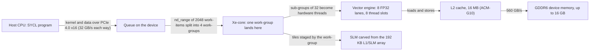
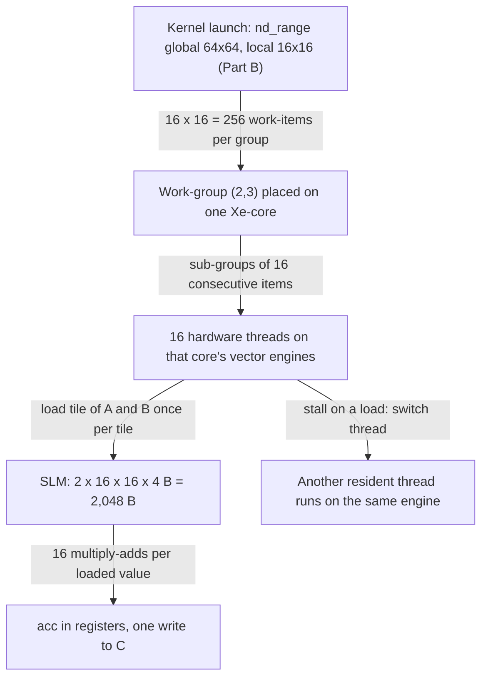

# Intel Xe-HPG and oneAPI: Xe-cores, SIMD, SLM, XMX and SYCL

> **Sources:** (1) Intel, *Introduction to the Xe-HPG Architecture* white paper, 12 pages, undated in its text (footer code "1122", probably November 2022: this guide's inference) - [canonical page](https://www.intel.com/content/www/us/en/developer/articles/technical/introduction-to-the-xe-hpg-architecture.html) - [local PDF](../../../sources/gpu/intel/xe-hpg-architecture-whitepaper.pdf). (2) Intel, *oneAPI GPU Optimization Guide*, 302 pages, no version printed, code samples copyright 2022 - [canonical page](https://www.intel.com/content/www/us/en/docs/oneapi/optimization-guide-gpu/current/overview.html) - [local PDF](../../../sources/gpu/intel/oneapi-gpu-optimization-guide.pdf).
>
> "WP p. 4" means PDF page 4 of the white paper; "OG p. 22" means PDF page 22 of the optimization guide. Both describe Intel hardware of about 2020-2022 (Xe-LP, Xe-HPG, Xe-HPC); nothing here carries to later Intel generations.

## Read this first

**The claim in one sentence.** On an Intel Xe-HPG GPU a SYCL kernel is a grid of work-items that the compiler packs into SIMD groups of 8, 16 or 32 (sub-groups), each sub-group runs as one hardware thread on a vector engine, one work-group lives on one Xe-core and shares that core's on-chip shared local memory (SLM), and the matrix engines (XMX) are a separate systolic unit that vector-engine code does not use unless it issues matrix instructions or calls a library that does.

**Who this is for.** Readers of the CUDA material who must read Intel documentation or SYCL code without guessing at every noun, and anyone weighing an Intel discrete GPU for local inference.

**Afterwards you will be able to** trace one SYCL work-item through its work-group, sub-group and lane; translate the vocabulary to CUDA and HIP; compute the theoretical peak of one named product (the Arc A770, built on the ACM-G10 chip) and say why a real kernel will not reach it; and spot where the two Intel documents contradict each other.

**Reading time.** About 50 minutes. **Have read first:** [GPU foundations](../05-gpu-foundations.md) (lockstep, occupancy) and [CUDA architecture](../nvidia/06-cuda-architecture.md), because the comparison column of every table here is CUDA. Skim [AMD CDNA and HIP](../amd/08-amd-cdna-hip.md) for the third column and [memory hierarchy](../../02-memory-hierarchy.md) for the cache sections.

**The one thing most people get wrong.** Intel's word "thread" does not mean a CUDA thread. In Intel documents a *hardware thread* is a SIMD instruction stream that carries 8, 16 or 32 work-items at once, so it behaves like a warp. The word "core" is also unstable: an Xe-core holds 16 vector engines (VE), and each vector engine holds 8 floating-point lanes, so the lane count of the flagship chip (4096) is eight times the "vector engine" count (512).

## The paper in one worked example

Three pieces, all built from the two sources and one small program run on this machine. Every later section refers back to them by letter.

### Part A - a SYCL vector add, traced for one work-item

The guide's `VectorAdd2` kernel (OG pp. 26-28) fixes the work-group size at 512 and requests sub-group size 32. Its kernel body, abridged from OG p. 27:

```cpp
// not run (SYCL cannot be compiled on this machine); abridged from OG p. 27
h.parallel_for(sycl::nd_range<1>(num_groups * wg_size, wg_size),
  [=](sycl::nd_item<1> index) [[intel::reqd_sub_group_size(32)]] {
    size_t grp_id = index.get_group()[0];
    size_t loc_id = index.get_local_id();
    size_t start = grp_id * mysize;          // mysize is not defined in the snippet
    size_t end   = start + mysize;
    for (size_t i = start + loc_id; i < end; i += wg_size)
      sum_acc[i] = a_acc[i] + b_acc[i];
  });
```

The snippet uses `mysize` and `groups` without defining them. This tutorial assumes `mysize = N / groups` with N = 65,536 and `groups = 4` (constructed), giving a global range of 4 x 512 = 2048 work-items.

Trace work-item with global id 1000, computed by hand and confirmed by the C program in Tutorial 2 (measured on this machine):

| Quantity | Calculation | Value |
|---|---|---|
| work-group id | 1000 div 512 | 1 |
| local id | 1000 - 512 | 488 |
| sub-group id inside the group (size 32) | 488 div 32 | 15 |
| lane inside the sub-group | 488 mod 32 | 8 |
| first element | start = 1 x 16,384 = 16,384; plus local id 488 | 16,872 |
| iterations | mysize / 512 = 16,384 / 512 | 32 |
| last element | 16,872 + 31 x 512 | 32,744 |
| hardware threads per work-group | 512 / 32 | 16 |

The guide's own occupancy table (OG pp. 28-29) lists `VectorAdd2<4>` as 4 groups x 16 threads = 64 threads, "64/672 = 9.5%" of the thread slots of the Tiger Lake Xe-LP GPU it uses; the same arithmetic here reproduces that row. `VectorAdd2<42>` needs 42 x 16 = 672 threads and reaches 100%.

The guide's second trace (OG pp. 34-36, device "Intel(R) Gen12HP", `nd_range(range{32}, range{32})`) prints, for global id 21 at the default sub-group size 16, `sgGroupId = 1 sgId = 5`, matching 21 div 16 and 21 mod 16. With `reqd_sub_group_size(32)` every id has `sgGroupId = 0`. Its lines appear out of id order (0-7, 16-23, then 8-15): there is no ordering between lanes' output.

**The same work-item in other vocabularies** (CUDA and HIP columns are general knowledge, not from these two sources; see the linked tutorials for sourced detail):

| Thing | SYCL / Intel (this guide) | CUDA | HIP on AMD |
|---|---|---|---|
| one parallel instance | work-item (global id 1000) | thread (blockIdx.x x blockDim.x + threadIdx.x = 1 x 512 + 488) | thread (same formula) |
| group sharing fast memory and barriers | work-group (id 1, local id 488) | thread block | workgroup / block |
| lockstep SIMD group | sub-group of 8, 16 or 32, chosen by compiler; here 32, id 15, lane 8 | warp, fixed at 32; here warp 15, lane 8 | wavefront, commonly 64 on CDNA; here wave 7, lane 40 |
| unit that runs a work-group | Xe-core | streaming multiprocessor (SM) | compute unit (CU) |
| on-chip scratchpad | SLM | shared memory | local data share (LDS) |
| matrix unit | XMX (vector-engine sibling) | tensor core | matrix core |

With a wavefront of 64 the same work-item is lane 488 mod 64 = 40 of wave 488 div 64 = 7, so code that assumes a lane count must query it. On Intel the query is `sub_group_sizes` (OG p. 36), which printed "8 16 32" on the guide's example device.

### Part B - the guide's tiled matrix multiply, traced for one output element

The guide shows a basic SYCL matrix multiply that reads global memory in the innermost loop and reports 10.98 GFLOPS (OG pp. 253-254, 260), then a version with two 16 x 16 tiles in SLM that reports 19.985 GFLOPS (OG pp. 261-262). Core of the tiled kernel, abridged from OG p. 262:

```cpp
// not run; abridged from OG p. 262 (NUM and MATRIXTILESIZE are not given; the text says the tile is 16x16)
h.parallel_for(sycl::nd_range<2>(matrix_range, tile_range), [=](sycl::nd_item<2> it) {
  const int row = it.get_local_id(0), col = it.get_local_id(1);
  const int globalRow = MATRIXTILESIZE * it.get_group(0) + row;
  const int globalCol = MATRIXTILESIZE * it.get_group(1) + col;
  TYPE acc = 0.0;
  for (int t = 0; t < NUM / MATRIXTILESIZE; t++) {
    aTile[row][col] = accessorA[globalRow][MATRIXTILESIZE * t + col];
    bTile[row][col] = accessorB[MATRIXTILESIZE * t + row][globalCol];
    it.barrier(sycl::access::fence_space::local_space);
    for (int k = 0; k < MATRIXTILESIZE; k++) acc += aTile[row][k] * bTile[k][col];
    it.barrier(sycl::access::fence_space::local_space);
  }
  accessorC[globalRow][globalCol] = acc;
});
```

Take the constructed size NUM = 64 and the 16 x 16 tile. Trace the work-item that computes C[37][50]:

| Quantity | Calculation | Value |
|---|---|---|
| work-group id (dim 0, dim 1) | (37 div 16, 50 div 16) | (2, 3) |
| local id (row, col) | (37 mod 16, 50 mod 16) | (5, 2) |
| number of tiles to walk | 64 / 16 | 4 |
| tile t=2, element it loads from A | A[37][16 x 2 + 2] | A[37][34] |
| tile t=2, element it loads from B | B[16 x 2 + 5][50] | B[37][50] |
| work-items in the group | 16 x 16 | 256 |
| linear local id, sub-group of 16 (this tutorial's inference) | 5 x 16 + 2 = 82; sub-group 82 div 16; lane 82 mod 16 | sub-group 5, lane 2 |

The last row is an inference: the guide says a sub-group is a run of consecutive work-items (OG p. 34), and the usual SYCL rule (general knowledge) is that the last dimension varies fastest, so a sub-group of 16 would be one row of the tile. Per tile, each work-item makes two global loads for 16 multiply-adds; the untiled kernel makes two per multiply-add.

### Part C - theoretical peak of one named product

**Which product.** The white paper names two chips, ACM-G10 and ACM-G11 ("formerly code-named Alchemist", sold as Intel Arc A-series, WP p. 1), and prints no card names. The guide's configuration table (OG p. 19) has a column "Xe-HPG (Arc A770)" with 8 slices, 32 Xe-cores, 512 vector engines, 8 threads per engine and 8192 FP32 FLOPs per clock, equal to the white paper's ACM-G10 column (WP p. 9, Table 3). This tutorial therefore treats the A770 as the full ACM-G10; the mapping is the guide's.

**Which clock.** The white paper says Xe-HPG can "run up to 2.1 GHz in its most performant configuration" (WP p. 4) without naming the card. This tutorial uses 2.1 GHz as an upper bound for the full ACM-G10. Neither source gives a sustained clock under load.

| Step | Source for the factor | Calculation | Result |
|---|---|---|---|
| FP32 FLOPs per clock per vector engine | WP p. 6 Table 1: 16; OG p. 17: 8 lanes with fused multiply-add (this tutorial infers 16 = 8 x 2) | 8 lanes x 2 | 16 |
| per Xe-core | 16 vector engines per Xe-core (WP p. 4) | 16 x 16 | 256 (OG p. 17 also says 256) |
| whole chip | 32 Xe-cores (WP p. 9 Table 3) | 32 x 256 | 8,192 per clock (matches Table 3) |
| FP32 peak | clock 2.1 GHz (WP p. 4) | 8,192 x 2.1 x 10^9 | 17.2032 x 10^12 = **17.2 TFLOPS** (WP p. 4: 17.2) |
| XMX FP16 per vector engine | WP p. 6 Table 1: 128 | | 128 |
| XMX FP16 whole chip | 512 engines | 512 x 128 = 65,536 per clock; x 2.1 x 10^9 | 137.6256 x 10^12 = **137.6 TOPS** (WP p. 4: 137.6) |
| XMX INT8 | WP p. 6: 256 per engine | 512 x 256 = 131,072 per clock; x 2.1 x 10^9 | 275.2512 x 10^12 (WP p. 4 prints 275.2, truncated; p. 2 prints 275) |
| vector-engine FP16 | WP p. 6: 32 per engine | 512 x 32 = 16,384 per clock; x 2.1 x 10^9 | 34.4064 x 10^12 = 34.4 TFLOPS |
| device memory bandwidth | WP p. 3: 8 channels of 2 x 16 bits = 256 bits at 17.5 gigatransfers per second | 256 x 17.5 / 8 | **560 GB/s** (matches p. 3 and Table 3) |
| host link | WP p. 3: PCI Express 4.0 x16 | | 32 GB/s each way (the white paper's figure) |

"TFLOPS" means 10^12 floating-point operations per second; "TOPS" is the same count for integer or matrix operations. Ratios computed by this tutorial: XMX FP16 is 128 / 32 = 4x the vector-engine FP16 rate per clock, and 137.6 / 17.2 = 8x the FP32 peak per second. The ridge point (peak operations divided by peak bandwidth) is 17.2032 x 10^12 / 560 x 10^9 = 30.72 FLOPs per byte for FP32 and 137.6256 x 10^12 / 560 x 10^9 = 245.8 operations per byte for XMX FP16: a kernel must do at least that much arithmetic per byte read before arithmetic, rather than memory, limits it. The other chip, ACM-G11 (8 Xe-cores, 96-bit memory at 15.5 GT/s, 186 GB/s, WP pp. 9-10), has 2,048 FP32 FLOPs per clock, but no clock is given for it, so no peak is computed (constructed: at 2.1 GHz it would be 4.3 TFLOPS).



Follow the arrows: the work-group goes to one Xe-core, its sub-groups become threads on that core's vector engines, the only fast sharing path between them is the SLM, and everything leaving the core meets the 16 MB L2 and then 560 GB/s memory.

## Words you need

| Term | Plain definition | Example from the worked example |
|---|---|---|
| work-item | One instance of the kernel function; SYCL's name for a CUDA thread. | Global id 1000 in Part A. |
| work-group | A set of work-items that can synchronise with a barrier and share SLM; always placed on one Xe-core. | Group 1 of 4 in Part A; a 16 x 16 tile in Part B. |
| sub-group | Consecutive work-items of one work-group executed together as one SIMD vector on one hardware thread; size 8, 16 or 32 (OG p. 22). | Sub-group 15, lane 8 for item 488. |
| SIMD (single instruction, multiple data) | One instruction applied to several lanes; lanes that branch apart run both paths under a mask (OG p. 22). | Eight FP32 lanes per vector engine (OG p. 17). |
| XVE (Xe vector engine) | The block that executes instructions; formerly "execution unit" (EU) (WP p. 5, OG p. 19). | 16 per Xe-core, 512 on the A770. |
| hardware thread | One instruction stream resident in a vector engine's register file; 7 per engine on Xe-LP, 8 on Xe-HPG (WP p. 6 Table 1). | One sub-group of 32 = one thread. |
| Xe-core | The compute tile that contains vector engines, matrix engines, the L1/SLM array and a data port; Xe-LP's "dual subslice" renamed (OG p. 12, p. 19). | 32 on the A770. |
| XMX (Xe Matrix eXtension) | A systolic array of multiply-accumulate units per vector engine, driven by the DPAS instruction (WP p. 5). | 16 per Xe-core. |
| DPAS (Dot Product Accumulate Systolic) | The instruction that feeds the XMX; supports FP16, BF16, INT8, INT4 and INT2 with 16- or 32-bit accumulate (WP p. 6). | Not visible in any SYCL code in the sources. |
| SLM (shared local memory) | On-chip memory private to one Xe-core and one work-group, managed by the program and invalid after the group ends (OG pp. 51-52). | Two 16 x 16 float tiles = 2,048 bytes in Part B. |

## Tutorial 1 - Intuitive understanding

### What was broken before

Two failures appear in the guide itself.

First, programs that do not fill the machine. The guide's `VectorAdd2<1>` runs one work-group of 16 hardware threads on the Tiger Lake GPU, which has 672 thread slots: 2.4% occupancy (OG p. 28), 97.6% of the slots empty.

Second, code that reads memory badly. The guide's naive SYCL matrix multiply takes 19.2 s for a 4000 x 4000 operand on a Gen9 integrated GPU, against 0.9 s for the oneMKL routine `gemm` (OG p. 96); the guide says offloading badly written code makes things "worse". The failure is data movement: each multiply-add fetches two numbers from far memory.

### The idea

Think of the GPU as a building of **kitchens** (Xe-cores). Each kitchen has 16 **stations** (vector engines). A station can have 8 **orders** (hardware threads) in progress, and works on whichever order is not waiting for ingredients. An order is a **tray of 16 or 32 identical dishes** handled in lockstep: the tray is a sub-group and the dishes are work-items. A **team** (work-group) is assigned to one kitchen and shares a **counter** (SLM) where its trays leave half-prepared food for each other. Each station also owns a **press** (the XMX unit) that stamps out a fixed-size block of multiply-and-add in one go, but only for a block that is already loaded onto it.

Where the analogy breaks:

- The chefs on a tray cannot skip a step the others take. If half the lanes take a branch, the thread executes both paths and masks results (OG p. 22), which costs the same as everyone doing both.
- The counter is wiped when the team leaves. SLM data is "gone and invalid" after the work-group finishes (OG p. 52), so it is a scratchpad you fill yourself, not a cache that remembers.
- Teams never talk to each other inside a kernel. SYCL has no global barrier across the whole grid (OG p. 23); the only barrier is inside one team.
- The "press" is not a faster station: it does one operation type (matrix multiply-accumulate) at fixed block sizes and low precision, on operands arranged for it.

### How it works, step by step

1. **The host submits a kernel** to a queue with an index space (OG p. 21). In Part A: 2048 work-items in groups of 512.
2. **The compiler decides the SIMD width** (8, 16 or 32) by heuristic; the example kernel has low register pressure and gets 32 (OG p. 27). The programmer may override it with `reqd_sub_group_size` (OG pp. 22, 35).
3. **Each group of 512 goes to one Xe-core**, because members may use a barrier and SLM (OG p. 33). It needs 512 / 32 = 16 thread slots; an Xe-HPG Xe-core has 16 engines x 8 slots = 128 (WP p. 6), so up to 8 such groups could share a core by slot count alone.
4. **Threads alternate on a vector engine.** When one thread waits for a load, the engine switches to another (OG pp. 290-291, Intel GPA appendix). Eight slots per engine is the latency hiding budget.
5. **Tiles go through SLM** (Part B). The team loads two 16 x 16 tiles from global memory, waits at a barrier, multiplies out of SLM, waits again, and moves to the next tile (OG p. 262).
6. **Matrix-heavy layers go to XMX** through libraries rather than hand-written vector code. The white paper names OpenVINO, Microsoft WinML and Intel's compute-library kernels as the ways XMX is exposed (WP p. 2).



Notice that the SLM sits between the two global loads and the sixteen multiply-adds: the point of the tile is that each loaded value is used 16 times before it is dropped.

### What the results say

Each figure below names its document and product; "counted" says what is measured.

- **17.2 TFLOPS, ACM-G10, at up to 2.1 GHz (WP p. 4).** Counted: FP32 multiply-adds as two operations, every engine issuing one per clock: a ceiling, not a measured speed (Part C reproduces it).
- **5x over Xe-LP (WP p. 2).** Per clock, Table 3 gives 8,192 / 1,536 = 5.33, and engines are 512 / 96 = 5.33, while Table 1 shows 16 FP32 FLOPs per clock per engine in both generations: the gain is replication, not faster engines. Footnote 1 (WP p. 12) says the comparison is at each product's own highest clock, which the white paper does not give for Xe-LP.
- **Occupancy 2.4% to 100% as groups go from 1 to 42 (OG pp. 28-29, Tiger Lake).** Each group of 16 threads adds 16/672 = 2.4 points. This is occupancy of slots, not utilisation of arithmetic.
- **Tiled matmul: 10.98 to 19.985 GFLOPS (OG pp. 260, 262).** About 1.82x: for every 100 operations per second the untiled kernel achieved, the tiled one achieved about 182. The guide names no GPU, matrix size or tile beyond "16x16".
- **Library versus naive: 19.2 s versus 0.9 s (OG p. 96, Gen9).** A factor of 21.3. This tutorial infers, if both operands are 4000 x 4000, about 6.7 GFLOPS (2 x 4000^3 / 19.2) versus 142 GFLOPS; the guide prints no rates.

### What this does not show

- It does not show that a hand-written SYCL kernel can approach 17.2 TFLOPS. The guide's best hand-written matmul figure is 19.985 GFLOPS on an unnamed device; the library figures are on integrated Gen9 hardware.
- It does not measure any Xe-HPG card. The white paper is a specification; the guide's measurements are mostly on Tiger Lake (Xe-LP) and Gen9.
- It does not show how SYCL code reaches the XMX engines. The guide mentions XMX only in a terminology table and in the product descriptions.

### Teach-back

1. In Part A, which of these is the hardware thread: work-item 488, sub-group 15, or work-group 1?

<details>
<summary>Answer</summary>

Sub-group 15: a sub-group executes as one hardware thread (OG p. 34). Work-item 488 is one lane of it; work-group 1 is 16 such threads.

</details>

2. Why must the work-group of Part B stay on one Xe-core?

<details>
<summary>Answer</summary>

Its work-items share SLM and use barriers, and SLM is a structure inside one Xe-core (OG pp. 33, 51). A group split across cores could not share it.

</details>

3. Why is "512 vector engines" a different statement from "512 shader cores"?

<details>
<summary>Answer</summary>

A vector engine has 8 FP32 lanes (OG p. 17), so 512 engines carry 4,096 lanes. The guide itself says 4,096 FP32 "ALU units/shader cores" (OG p. 17). "Core" in a marketing count may mean lanes; "Xe-core" means a 16-engine tile.

</details>

4. What does 2.4% occupancy mean, and what does it not mean?

<details>
<summary>Answer</summary>

It means 16 of 672 thread slots hold a thread, so the machine can hide latency for only 2.4% of the threads it could hold. It does not say how well each busy slot uses its arithmetic units.

</details>

## Tutorial 2 - Practitioner understanding

### The design in concrete terms

**The hardware stack (WP pp. 4-9; OG pp. 17, 19).** The ACM-G10 has 8 render slices of up to 4 Xe-cores; each Xe-core has 16 vector engines, 16 matrix engines, a data port and a shared L1/SLM array; each engine has 8 threads and 32 KB of registers. A 16 MB L2 sits in front of 256-bit GDDR6 (WP p. 10). Ray-tracing and sampler blocks matter for graphics, not for these compute questions.


| Metric | Xe-LP, Tiger Lake (OG p. 19) | Xe-HPG ACM-G10, "Arc A770" (OG p. 19; WP p. 9) | Xe-HPG ACM-G11 (WP pp. 9-10) | Xe-HPC, Ponte Vecchio one stack (OG pp. 12-19) |
|---|---|---|---|---|
| Xe-cores or subslices | 6 | 32 | 8 | 64 |
| vector engines per Xe-core | 16 | 16 | 16 | 8 |
| total vector engines | 96 | 512 | 128 | 512 |
| threads per engine | 7 | 8 | 8 (WP Table 1) | 8 |
| FP32 FLOPs per clock, whole chip | 1,536 | 8,192 | 2,048 | 16,384 |
| last-level cache | 3.84 MB (OG) | 16 MB | 4 MB | up to 204 MB |
| L1/SLM array per Xe-core | SLM 128 KB, separate L1 (WP Fig. 6) | 192 KB shared array | 192 KB | 512 KB (OG p. 12) |

Two cautions. An "engine" is not constant across Intel products: Xe-HPC has 512-bit engines (16 FP32 lanes), Xe-HPG 256-bit (8 lanes) (OG pp. 12, 17). The L1/SLM array is one physical pool: WP p. 7 allows "up to 192 KB of L1 cache or up to 128 KB of SLM", so the totals in WP Table 3 (L1 6,144 KB = 32 x 192; SLM 4,096 KB = 32 x 128) are two upper bounds on one pool and must not be summed.

**What you tune in SYCL.** Four numbers set most behaviour: global range (the guide's examples run from tens of thousands to 27.5 million work-items, OG p. 28), work-group size (128, 224, 320 or 512), sub-group size (8, 16 or 32) and tile size (16 x 16). They are tied by one rule (OG p. 24): work-group size = threads x sub-group size.

**Memory models.** SYCL offers buffers with accessors, and unified shared memory (USM), which uses ordinary pointers in device, host or shared allocations (OG pp. 108-111). The guide says reads through a `host_accessor` are "significantly slower" than native array references and can block kernel launch; shared allocations move data by page fault on first host touch. It adds that implementations may change.

**The portability stack, and what the sources do and do not support.**

- *SYCL as a standard.* oneAPI is "a cross-industry, open, standards-based, unified programming model" with parallelism expressed "through the SYCL language" (OG pp. 4, 7); the guide cites the SYCL 2020 and Level Zero specifications (OG p. 302). That SYCL is a Khronos Group standard is general knowledge.
- *DPC++ as Intel's compiler.* The "Intel oneAPI DPC++ Compiler converts a SYCL program into an intermediate language called SPIR-V", translated to device code at run time (JIT) (OG p. 134); the commands use `icpx -fsycl` (OG pp. 97-98, 136).
- *Ahead of time (AOT) versus run time.* With `-fsycl-targets=spir64_gen ... "-device skl"` the binary holds code for one platform: no start-up JIT cost, but it "cannot run anywhere other than the platform for which it was compiled" (OG p. 136). A new queue with a new implicit context re-triggers JIT (OG p. 91).
- *Level Zero and OpenCL as backends.* The guide selects `sycl::backend::ext_oneapi_level_zero` (OG pp. 150-151), traces the "Level Zero backend" with `ze_tracer` (OG pp. 186, 285), says the OpenMP offload plugin defaults to Level Zero (OG p. 158), and says the host CPU is a device using "the same openCL/Level0 runtime mechanisms" (OG p. 132).
- *Not supported by these sources.* The guide says "Productive Performance Not Performance Portability": code must be specialised per accelerator to be fast (OG p. 4). Nothing here shows SYCL running on an NVIDIA or AMD GPU. General knowledge, unverified here: open-source DPC++ builds can target those GPUs.

### A minimal version

**Measured on this machine.** This program emulates the index arithmetic and counts loads for Parts A and B; it touches no GPU. Machine: Apple M5 Pro; compiler: Apple clang 21.0.0, `clang -O2 -Wall`; one deterministic run. The same file also prints the Part C arithmetic (shown in Part C). The numbers are properties of the arithmetic, not of Intel hardware.

```c
// ndrange_trace.c - emulates SYCL nd_range indexing on the CPU (no GPU involved)
#include <stdio.h>
#include <stdlib.h>
#define NUM 64
#define T 16
static long gl_naive=0, gl_tiled=0;
int main(void) {
  const int N=65536, groups=4, wg=512, sg=32, mysize=N/groups;
  int gid=1000, grp=gid/wg, loc=gid%wg;
  printf("A: gid=%d group=%d local=%d sg_id=%d lane=%d\n", gid, grp, loc, loc/sg, loc%sg);
  printf("A: as wave64: wave=%d lane=%d\n", loc/64, loc%64);
  int start=grp*mysize, end=start+mysize, first=start+loc, n=0, last=0;
  for (int i=first; i<end; i+=wg) { n++; last=i; }
  printf("A: first=%d last=%d count=%d threads/group=%d occ(672)=%.1f%%\n",
         first, last, n, wg/sg, 100.0*groups*(wg/sg)/672);
  int gr=37, gc=50, row=gr%T, col=gc%T;
  printf("B: group=(%d,%d) local=(%d,%d) lin=%d sg16=%d lane=%d\n", gr/T, gc/T, row, col,
         row*T+col, (row*T+col)/16, (row*T+col)%16);
  float *A=malloc(NUM*NUM*4), *B=malloc(NUM*NUM*4), *C=malloc(NUM*NUM*4), *R=malloc(NUM*NUM*4);
  for (int i=0; i<NUM*NUM; i++) { A[i]=(i%7)-3; B[i]=(i%5)-2; }
  for (int i=0; i<NUM; i++) for (int j=0; j<NUM; j++) {
    float acc=0; for (int k=0; k<NUM; k++) { acc+=A[i*NUM+k]*B[k*NUM+j]; gl_naive+=2; } R[i*NUM+j]=acc; }
  for (int GR=0; GR<NUM/T; GR++) for (int GC=0; GC<NUM/T; GC++) {
    float acc[T][T]={{0}}, at[T][T], bt[T][T];
    for (int t=0; t<NUM/T; t++) {
      for (int r=0; r<T; r++) for (int c=0; c<T; c++) {
        at[r][c]=A[(T*GR+r)*NUM+T*t+c]; bt[r][c]=B[(T*t+r)*NUM+T*GC+c]; gl_tiled+=2; }
      for (int r=0; r<T; r++) for (int c=0; c<T; c++) for (int k=0; k<T; k++) {
        acc[r][c]+=at[r][k]*bt[k][c]; }
    }
    for (int r=0; r<T; r++) for (int c=0; c<T; c++) C[(T*GR+r)*NUM+T*GC+c]=acc[r][c];
  }
  int bad=0; for (int i=0; i<NUM*NUM; i++) if (C[i]!=R[i]) bad++;
  long items=(long)NUM*NUM;
  printf("B: mismatches=%d global loads naive=%ld (%ld/item) tiled=%ld (%ld/item) ratio=%.1f\n",
         bad, gl_naive, gl_naive/items, gl_tiled, gl_tiled/items, (double)gl_naive/gl_tiled);
  return 0;
}
```

Output measured on this machine (the lines for Part C, which the file also prints, are in the table in Part C):

```text
A: gid=1000 group=1 local=488 sg_id=15 lane=8
A: as wave64: wave=7 lane=40
A: first=16872 last=32744 count=32 threads/group=16 occ(672)=9.5%
B: group=(2,3) local=(5,2) lin=82 sg16=5 lane=2
B: mismatches=0 global loads naive=524288 (128/item) tiled=32768 (8/item) ratio=16.0
```

**What the output shows.** Every value in the Part A and Part B tables comes out as computed by hand. The tiled loop, which stages 16 x 16 tiles like the guide's kernel, makes 16 times fewer global loads than the naive loop (8 versus 128 per output at NUM = 64, that is 2 x 64 / 16 versus 2 x 64) and has 0 mismatches against it. The factor is the tile edge because each loaded value is reused across a tile edge of multiply-adds. It says nothing about speed.

**A SYCL version of the tiled kernel is not run here.** No SYCL compiler or Intel GPU is on this machine. To run the guide's kernel (Part B), a reader needs Intel oneAPI DPC++ on a machine with an Intel GPU, `icpx -fsycl`, and the queries the guide prints first: `max_work_group_size`, `sub_group_sizes` and `local_mem_size` (OG pp. 24, 36, 52). Expected result: the same values as a CPU triple loop to float rounding, and a speed well below `oneapi::mkl::blas::gemm` (OG p. 96).

### What it costs

**Compute side, the A770.** A perfect kernel at 2.1 GHz gives 17.2 TFLOPS FP32, 34.4 TFLOPS FP16 on the vector engines and 137.6 TOPS FP16 on XMX (Part C). Filling all 4,096 thread slots (OG p. 19) with 16-thread groups (512 items at SIMD 32) takes 4,096 / 16 = 256 groups, at least 256 x 512 = 131,072 work-items; the guide says large accelerators may need "millions of parallel activities" (OG p. 7).

**Memory side.** Everything else is bandwidth.

| Quantity | Calculation | Result |
|---|---|---|
| time to read 8 GB once (constructed: a model whose weights occupy 8 GB) | 8 / 560 | 14.3 ms |
| upper bound on tokens per second, one stream, weights read once per token | 560 / 8 | 70 tokens per second |
| same 8 GB if streamed over PCIe each token | 8 GB / 32 GB/s | 0.25 s, i.e. 4 tokens per second |
| arithmetic intensity of one token for an FP16 weight matrix, one stream | 2 FLOPs per 2-byte weight | 1 FLOP per byte |
| attainable FP32 rate at that intensity | 560 GB/s x 1 FLOP/B | 0.56 TFLOPS, 3.3% of 17.2 |
| batch needed to reach the FP32 ridge | 30.72 FLOP/B at 1 FLOP/B per stream | about 31 concurrent sequences |
| batch needed to reach the XMX FP16 ridge | 245.8 | about 246 |

These rows are this tutorial's constructed roofline illustration, not measurements: they ignore the key-value cache, activations, quantisation and any achieved-bandwidth fraction below 100%. At 1 FLOP per byte the 0.56 TFLOPS is 0.4% of the 137.6 TOPS XMX peak. Practical reading: single-stream decoding is limited by the memory interface, and XMX matters once many sequences are batched or a long prompt is processed.


### How it fails

| Symptom | Likely cause | Mitigation |
|---|---|---|
| Occupancy of 2-10% (OG pp. 28-29) | too few work-groups, or groups too small | launch far more groups than Xe-cores; use the guide's occupancy calculator (OG p. 34) |
| 57% occupancy, 43% wasted (OG p. 25) | work-group size leaves unusable thread slots per Xe-core | choose a group size whose thread count divides the per-core slot count (112 on Tiger Lake, 128 on Xe-HPG) |
| 1/16 of SLM bandwidth (OG p. 52) | all lanes address the same bank (stride 16 ints = 64 bytes) | change strides so lanes hit different 4-byte banks |
| Scattered stores (OG p. 37) | each work-item writes 16 contiguous ints, so lanes are 64 bytes apart | let each lane take every sub-group-size-th element so one instruction writes contiguous memory |
| JIT cost every loop iteration (OG p. 91) | a queue created inside the loop makes a new context | create one queue and reuse it |

### Evaluating your version

**Metric.** GFLOPS = 2 x M x N x K / seconds, as a fraction of the library result, timed with the queue's profiling events rather than wall-clock around `submit`; also report occupancy and SLM bytes per group.

**Baseline.** `oneapi::mkl::blas::gemm` on the same device and shapes. The guide's naive-to-library time ratios are 21.3, 29.3 and 12.3 for three shapes (19.2 / 0.9, 38.1 / 1.3, 9.8 / 0.8; OG p. 96).

**Test set.** At least five sizes, including one not divisible by the tile (the guide's kernel assumes it is) and one small enough to stay in cache; 10 or more runs after discarding the first (JIT) run; report median and spread.

**Stop rule.** Stop hand-tuning when the next change gains under 10% of the median or you are within 30% of `gemm`, then use the library: "Unless you're an expert studying a particular mathematical operation, it's usually a bad idea to write your own version" (OG p. 95).

### Adopt, adapt or skip

**Recommendation for a team deciding what to run or learn.**

- **Adopt the vocabulary and the arithmetic now.** Part C teaches how to read any GPU data sheet: count units, multiply by per-unit rate and clock, compute bytes per second, divide for a ridge point. The method is the same on NVIDIA and AMD parts.
- **Skip hand-written SYCL kernels** unless nothing in a library covers your operation; the sources show gemm 21 times faster than a naive kernel and a tuned-by-hand matmul at 19.985 GFLOPS on an unnamed device.
- **Adapt: evaluate an Intel GPU only as a target for existing inference software.** The white paper names OpenVINO and Microsoft WinML as the paths to XMX (WP p. 2), and neither source reports a language-model result, so measure your own model. The constructed bound for an 8 GB weight set is about 70 tokens per second at best; If the model does not fit in the 4 to 16 GB of device memory (WP p. 3), speed falls to the PCIe rate, a 17.5-fold drop in this arithmetic.
- **Compare against CPU and unified-memory systems** with [the CPU-versus-GPU decision tutorial](../../10-cpu-gpu-decision.md); the integrated Xe-LP case shares system DRAM with the CPU (OG p. 263), a different trade-off from the discrete card.

## Tutorial 3 - Researcher understanding

### Formal setup

Symbols, defined once.

- **X** number of Xe-cores; **E** vector engines per Xe-core; **L** FP32 lanes per vector engine; **f** clock in hertz; **m** operations per lane per clock for the instruction mix (2 for a multiply-add).
- **Peak vector rate:** P_vec = X x E x L x m x f.
- **Matrix rate:** P_xmx = X x E x r x f, where r is the XMX operations per clock per engine for the data type (128 for FP16, 256 for INT8, 512 for INT4 or INT2; WP p. 6).
- **Memory rate:** B = (bus width in bits / 8) x data rate per pin.
- **Ridge point:** I* = P / B.
- **Thread slots:** S = X x E x Q, with Q = 8 threads per engine; **occupancy** O = (resident threads) / S.
- **Attainable rate:** P_att = min(P, B x I), with I the arithmetic intensity in operations per byte.

Numeric instance (the A770, constructed from documented factors): X = 32, E = 16, L = 8, m = 2, f = 2.1 x 10^9 gives P_vec = 17.2032 x 10^12; with r = 128, P_xmx = 32 x 16 x 128 x 2.1 x 10^9 = 137.6256 x 10^12; B = (256 / 8) x 17.5 x 10^9 = 560 x 10^9; I*_vec = 30.72; S = 32 x 16 x 8 = 4,096 (matches OG p. 19). For I = 1 operation per byte, P_att = min(17.2 x 10^12, 560 x 10^9) = 0.56 x 10^12.

### The claims, stated precisely

1. WP p. 4: at up to 2.1 GHz, Xe-HPG delivers up to 17.2 TFLOPS FP32, 137.6 TOPS FP16 and 275.2 TOPS INT8 with XMX. Status: arithmetic identity with Table 3 and the clock; no measurement.
2. WP p. 2: peak FP32 is "5x" Xe-LP's. Status: per clock 5.33x from engine count; per second it depends on the unstated Xe-LP clock.
3. WP p. 7: each Xe-core's L1/SLM storage can be partitioned into up to 192 KB L1 or up to 128 KB SLM. Status: a design statement, no measurement; the partition granularity is not given.
4. OG p. 33: a work-group is typically dispatched to one Xe-core, sharing its SLM and barriers. Status: stated as typical; the guide admits its per-core schedule is "a guess".
5. OG pp. 260-262: tiling raises a basic matmul from 10.98 to 19.985 GFLOPS. Status: one measurement, device unnamed, two changes bundled (see Ablations).

### Evidence, table by table

| Item | Rows and columns | Headline numbers | What it supports |
|---|---|---|---|
| WP p. 6 Table 1 | per-engine rates, Xe-LP versus Xe-HPG | FP32 MAD 16 in both; XMX FP16 128, INT8 256, INT4 or INT2 512; threads 7 to 8; register file 28 KB to 32 KB | Associational: lists documented rates. The same FP32 rate in both columns is why the 5x is replication. |
| WP p. 9-10 Table 3 | chip totals for Xe-LP (DG1), ACM-G11, ACM-G10 | ACM-G10: 32 Xe-cores, 512 engines, 8,192 FP32 FLOPs per clock, 16 MB L2, 560 GB/s | The per-clock products are internally consistent: 512 x 16 = 8,192; 512 x 128 = 65,536; 512 x 32 KB = 16,384 KB; 32 x 192 = 6,144 KB L1; 32 x 128 = 4,096 KB SLM. |
| OG pp. 19-20 Xe Configurations | four products: Tiger Lake, Arc A770, Flex 170, one Ponte Vecchio stack | A770: 512 engines, 4,096 threads, 8,192 FLOPs per clock, 16 MB | Consistent with WP for A770. Inconsistent for Flex 170 (see Threats). |
| OG pp. 28-29 | `VectorAdd1` and `VectorAdd2<groups>` | occupancy rises linearly, 16 slots per group, to 100% at 42 groups | A prediction from counting; VTune "confirms the accuracy" with averages that "vary slightly" (OG p. 29). |
| OG pp. 260-262 | roofline snapshot of two matmul kernels | 10.98 and 19.985 GFLOPS | Associates tiling with a 1.82x gain; the device and sizes are unspecified. |

### Ablations and what they isolate

The sources contain no ablation study in the research-paper sense; the closest controlled comparisons are these.

- **`VectorAdd3` versus `VectorAdd4` (OG pp. 30-33).** Only a barrier at start and end differs. Occupancy phases are 33.3% and 14.3% without it, 45.3%, 39.3% and 11.9% with it, isolating the barrier's effect on placement; the guide infers placement from aggregate occupancy ("a guess").
- **`multiply1` to `multiply1_2` (OG pp. 253-262).** Bundles two changes: replacing the repeated `accessorC` update with a local accumulator (`multiply1_1`) and adding tiling (`multiply1_2`). The guide reports only the original and the final, so the share of each change is not identified.

### Threats to validity specific to this paper

- **Peak is not performance.** Part C assumes every engine issues a multiply-add every clock at 2.1 GHz; neither source reports a measured rate, achieved bandwidth or sustained clock for any Arc card.
- **Mixed generations in one guide.** Occupancy examples use Tiger Lake (112 slots per core, group limit 512); Arc has 128 slots per core. The limit 512 is a device and driver value to query.
- **Flex 170 row is inconsistent (OG pp. 17-19).** It lists 256 engines and 16 Xe-cores but 8,192 FLOPs per clock and 4,096 threads; 256 engines would give 4,096 and 2,048. OG p. 17 says the 150 W option has 32 Xe-cores. General knowledge, unverified here: Flex 170 has 32 Xe-cores, which would make the engine count the error.
- **Xe-core described two ways.** OG p. 287 (the Intel GPA appendix) says that in Xe-HPG and Xe-HPC "each Xe-core consists of ... 8 vector engines (XVE) and 8 matrix extensions (XMX)". That is the Xe-HPC description; for Xe-HPG both the white paper and OG p. 17 say 16 and 16.
- **Unlabelled units and truncations.** WP Table 3 labels the half-precision row "FP16 (SP)", which reads as single-precision; the numbers are half-precision. The INT8 peak is printed as 275.2 (truncated from 275.2512). The text extraction of WP p. 2 shows "greater than 51" for what is probably "greater than 5x" with a footnote marker (this tutorial's inference).
- **Probable mislabel (OG p. 20).** The row "FLOPs / clk - FP16 DP4AS" holds 65,536 for the A770, equal to the white paper's XMX FP16 total, not a vector-engine rate; the SLM-size row of that table is empty in the extracted text.

### Open problems and follow-ups

- **How a SYCL author reaches XMX.** A text search of the guide for `joint_matrix`, `DPAS` and `XMX` finds only terminology and product text. General knowledge, unverified here: SYCL has a matrix extension; read current Intel documentation.
- **Measured throughput of an Arc card.** Microbenchmarks in the style of [NVIDIA microbenchmarking](../nvidia/07-nvidia-microbenchmarking.md) would give a sustained clock, FMA rate and achieved bandwidth to set against 17.2 TFLOPS and 560 GB/s.
- **Language-model workloads.** Neither source covers token generation, quantisation formats or attention kernels.

### What would change my mind

- A microbenchmark on an A770 showing a sustained clock well below 2.1 GHz: Part C's peaks would need scaling by the measured clock and would stop being a useful bound.
- A measured Arc result with single-stream decoding of an 8 GB weight set far above 70 tokens per second: the weights would then be reused from cache or compressed, and the bandwidth model would need a term for that.

## Reading map for the sources

| Source and pages (PDF page numbers) | What it contains | First pass | Guide section that answers its questions |
|---|---|---|---|
| WP pp. 1-3 (Overview, Highlights) | product names, 17 TFLOPS and 275 TOPS headline, graphics features, GDDR6, PCIe 4.0 | read p. 2-3 for compute, skim rest | Part C; Tutorial 2 "What it costs" |
| WP p. 4 (architecture, slices, clock) | slice and Xe-core counts, 2.1 GHz, three peak figures | read | Part C |
| WP pp. 5-6 (Xe-core, Table 1, DPAS) | vector engine, XMX, per-engine rates | read; the figures on p. 5-6 are garbled in text extraction | Words you need; Tutorial 3 evidence |
| WP p. 7 (fixed function, L1 and SLM) | sampler, ray-tracing unit, L1/SLM 192 KB vs 128 KB | read the last section, skip the rest | Tutorial 2 design |
| WP pp. 9-10 (Table 3) | per-chip totals | read | Part C; Tutorial 3 |
| OG pp. 4-7 (introduction, three big ideas) | productive performance, Amdahl, locality, rightsizing | read | Tutorial 2 portability |
| OG pp. 8-20 (Xe architecture family) | EU to Xe-core renaming, Xe-LP, Xe-HPG, Xe-HPC, Flex, configuration tables | read pp. 12, 17, 19-20; skim the rest | Tutorial 2 table; Tutorial 3 |
| OG pp. 20-23 (execution model) | host and device, work-item, sub-group, nd_range, barrier | read | Part A; Words you need |
| OG pp. 24-34 (thread mapping, occupancy) | occupancy arithmetic, VectorAdd1-4 | read | Part A; How it fails |
| OG pp. 34-40 (sub-groups) | sub-group printouts, block load/store, shuffle, tails | read pp. 34-37, skim the rest | Part A |
| OG pp. 51-55 (SLM) | SLM size, banks, histogram | read | Tutorial 1 and 2 |
| OG pp. 95-96 (libraries) | naive matmul versus gemm | read | Tutorial 1 results |
| OG pp. 107-111, 133-136 | USM versus buffers, JIT versus AOT | skim | Tutorial 2 portability |
| OG pp. 253-265 (profiling, matmul roofline) | VTune, Advisor, GPU roofline, tiled matmul | read pp. 260-265 | Part B |
| OG pp. 287-291 (GPA appendix, EU stall) | thread switching to hide latency | skim; note the p. 287 inconsistency | Tutorial 1 |

## Questions readers get stuck on

### Is an Xe-core the same as a CUDA core?

No. A CUDA core (NVIDIA's term, general knowledge) is one arithmetic lane; an Xe-core has 16 vector engines of 8 lanes, 128 lanes (WP p. 4, OG p. 17). The closer analogue is an SM (NVIDIA) or CU (AMD), loosely; counts differ, so check the other tutorials before comparing sizes.

### Why does one source say each vector engine has 8 lanes and another says 16 FLOPs per clock?

Both are right. Eight FP32 lanes (OG p. 17) each perform a fused multiply-add per clock, and peak-rate tables count that as two FLOPs, giving 16 (WP p. 6 Table 1). When you read a peak figure from any vendor, check whether multiply-add is counted as one operation or two; the factor of two is the commonest misreading.

### Is a sub-group a warp?

Same role, not fixed size. A warp is 32 NVIDIA threads (general knowledge); a sub-group is 8, 16 or 32 work-items chosen by the compiler and overridable (OG pp. 22, 35), so query it. The last sub-group may have fewer lanes (OG p. 40).

### Why does the guide say 8 vector engines and 8 matrix engines per Xe-core in one place and 16 and 16 in another?

Because it mixes two products. Xe-HPC (Ponte Vecchio) has 8 and 8, with 512-bit vector engines (OG p. 12); Xe-HPG (Arc) has 16 and 16 with 256-bit engines (WP p. 4, OG p. 17). The Intel GPA appendix (OG p. 287) applies the Xe-HPC count to both and is the one to distrust for Arc.

### Why can't I add the L1 total and the SLM total in the white paper's Table 3?

The table lists the maximum each could be if the whole array went to it (192 KB L1 or 128 KB SLM per Xe-core, WP p. 7). With one shared array the chip has 6,144 KB for both, not 10,240 KB. The carve-out granularity is not in the sources.

### Does 275 TOPS mean my model gets 275 trillion useful operations per second?

No. That is the INT8 XMX peak (WP p. 4), reachable only with supported low-precision formats, suitably laid-out operands and enough data supply. At 1 operation per byte memory limits this chip to 0.56 trillion per second (Tutorial 2).

### Is SYCL only for Intel GPUs?

The sources demonstrate only Intel GPUs and the host CPU (OG pp. 4, 132). They describe one source language with "device-specific variants" tuned per accelerator, not one source that is fast everywhere (OG p. 4). SYCL on non-Intel GPUs is general knowledge here, not shown.

### Can I use the XMX engines from SYCL?

These sources do not show how. The white paper lists OpenVINO, Microsoft WinML and Intel-optimised kernels as exposed paths (WP p. 2). Plain SYCL float arithmetic runs on the vector engines; check current Intel documentation for matrix extensions.

## Prerequisites you actually need

### Prerequisite 1 - Peak throughput as a product of counts

A peak rate is units x per-unit rate x clock, with every factor from the same product. Example: 4 engines x 8 lanes x 2 FLOPs x 1 GHz = 64 GFLOPS. Used in Part C. Reference: [GPU foundations](../05-gpu-foundations.md).

### Prerequisite 2 - Occupancy and latency hiding

Other threads can run while one waits for memory; Little's law (concurrency = throughput x latency) gives how many. Constructed example: a 400-cycle load and 50 cycles of compute between loads need 400 / 50 = 8 threads per engine, exactly the 8 slots of an Xe-HPG engine (WP p. 6). Used in Tutorial 1 step 4 and OG pp. 28-33. Reference: [GPU foundations](../05-gpu-foundations.md) and [memory hierarchy](../../02-memory-hierarchy.md).

### Prerequisite 3 - Roofline and arithmetic intensity

Attainable rate is the smaller of the compute peak and bandwidth times operations per byte. Example: compute peak 10 TFLOPS, bandwidth 500 GB/s, kernel intensity 4 FLOPs per byte: 500 x 4 = 2,000 GFLOPS, which is below 10,000, so the kernel is memory-bound at 2 TFLOPS. Used in Part C, the cost table and OG pp. 263-265. Reference: [CUDA architecture](../nvidia/06-cuda-architecture.md).

### Prerequisite 4 - Tiling and data reuse

Splitting a matrix product into T x T blocks lets each value fetched from slow memory be used T times. Example: T = 16 gives 2n / 16 loads per output instead of 2n; for n = 64, 8 instead of 128, as the program in Tutorial 2 prints. Used in Part B (OG pp. 261-262). Reference: [memory hierarchy](../../02-memory-hierarchy.md).

## Where this sits in the curriculum

**Have read before this:** [GPU foundations](../05-gpu-foundations.md) and [CUDA architecture](../nvidia/06-cuda-architecture.md), whose vocabulary this tutorial maps to. **Compare with:** [AMD CDNA and HIP](../amd/08-amd-cdna-hip.md), which also has a lockstep lane group (wavefront), a scratchpad (LDS) and matrix units, but a CUDA-like language (HIP) instead of a standard language plus its own compiler. Against CUDA, the differences visible in these sources are that Intel's SIMD width is a compile-time choice and that on Xe-HPG the L1 cache and the scratchpad share one array.

**Read next:** [NVIDIA microbenchmarking](../nvidia/07-nvidia-microbenchmarking.md) for how a number like 17.2 TFLOPS gets tested, then [CPU versus GPU decision](../../10-cpu-gpu-decision.md) to place a 16 GB, 560 GB/s card against CPU and unified-memory systems for your own workload.

## Checkpoint

1. Explain why the Xe-HPG peak is 5.33 times Xe-LP's per clock although each engine has the same FP32 rate.
2. Compute the FP32 peak of ACM-G10 at 1.9 GHz and say which input you changed.
3. Using the Part A rule, find group, local id, sub-group and lane for global id 1500 with work-group 512 and sub-group 32.
4. How many work-groups of the Part B kernel fit in one Xe-core of an A770 by thread slots, and what SLM do they use?
5. Critique: "The A770 does 137.6 TOPS, so a language model's per-token latency is 1/137.6 of the FP32 time."
6. Name two places where the two sources disagree about the Xe-core.

<details>
<summary>Answers</summary>

1. Table 3 gives 8,192 / 1,536 = 5.33; engines 512 / 96 = 5.33; Table 1 lists 16 FP32 FLOPs per clock per engine for both. The gain is replication.
2. 8,192 x 1.9 x 10^9 = 15.5648 x 10^12, so 15.6 TFLOPS. The clock changed; nothing else.
3. Group 1500 div 512 = 2; local 1500 - 1024 = 476; sub-group 476 div 32 = 14; lane 476 mod 32 = 28 (14 x 32 = 448; 476 - 448 = 28).
4. 256 work-items at sub-group 16 is 16 threads; 128 slots / 16 = 8 groups, using 8 x 2,048 B = 16 KB of SLM, far below 128 KB. The kernel is limited by thread slots, not SLM.
5. It treats a matrix-engine peak as the speed of a token step. One-stream decoding has about 1 FLOP per byte, so 560 GB/s allows 0.56 TFLOPS, 0.4% of 137.6; the peak applies to batched matrix products in supported formats.
6. OG p. 287 says 8 and 8 for Xe-HPG while OG p. 17 and WP p. 4 say 16 and 16; the Flex 170 row (OG p. 19) says 256 engines but 8,192 FLOPs per clock, which fits 512.

</details>
