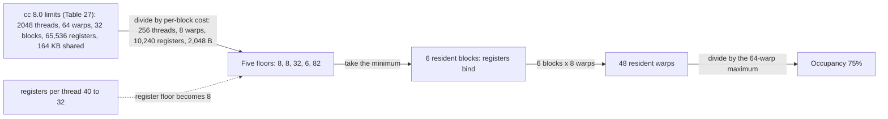
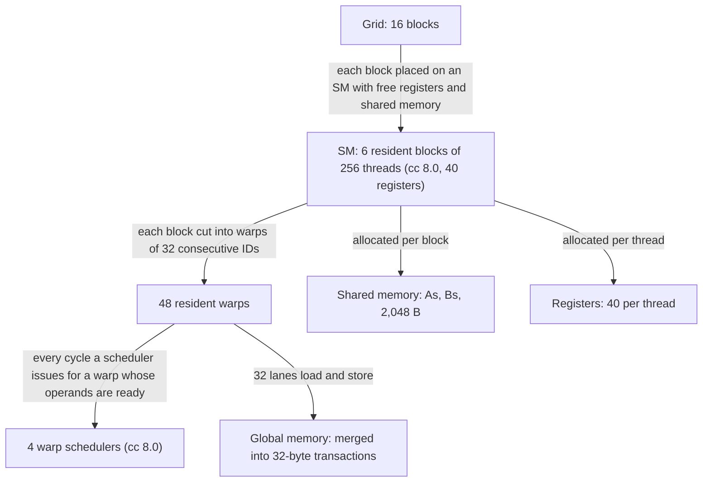

# CUDA grids, blocks, warps and memory: how the programming model maps to NVIDIA hardware

> **Source:** *CUDA C++ Programming Guide*, NVIDIA, Release 13.3 dated 25 June 2026 (title page, PDF p. 1) - [canonical URL](https://docs.nvidia.com/cuda/cuda-programming-guide/) - [local PDF](../../../sources/gpu/nvidia/cuda-programming-guide.pdf)
>
> **Version note.** The local PDF is the *legacy* guide: most chapters open with "This document has been replaced by a new CUDA Programming Guide ... no longer being updated as of CUDA 13.0" (for example p. 17, 27, 157). The canonical URL now serves the replacement (its pages say "Last updated on Oct 31, 2026"; read on 19 November 2026). Page numbers below are **PDF page numbers** (printed page = PDF page minus 16). Where the live pages differ from the PDF, the text says so.
>
> **What kind of document this is.** A programming guide: the contract between your code and any NVIDIA GPU, plus per-generation limits. It is not a hardware specification: no clock rates, cache latencies, memory bandwidths or die layouts. For measured numbers see [NVIDIA microbenchmarking](./07-nvidia-microbenchmarking.md).

## Read this first

**The claim in one sentence.** You write a function (a kernel) for one thread, launch it as a grid of independent blocks, and the hardware gives whole blocks to streaming multiprocessors (SMs), slices each block into 32-thread warps, and keeps many warps resident so that a wait on memory in one warp is covered by running another.

**Who this is for.** Engineers sizing a serving or fine-tuning machine, reviewers of code that calls GPU libraries, and learners who need the vocabulary (grid, block, warp, occupancy, coalescing) before reading profiler output.

**Afterwards you will be able to** compute how many blocks of a kernel fit on an SM for four named compute capabilities using the guide's limit table; say which resource binds and what changing one number does; trace a thread index in a vector add and a tiled matrix multiply to a warp, lane and memory address; count a warp's memory transactions for unit, offset and strided access; and say what unified memory, streams and cooperative groups add and leave unspecified.

**Reading time.** About 50 minutes. **Have read first:** [Architecture map](../../01-architecture-map.md), [Memory hierarchy](../../02-memory-hierarchy.md) (cache lines, bandwidth) and [GPU foundations](../05-gpu-foundations.md). Next: [NVIDIA microbenchmarking](./07-nvidia-microbenchmarking.md); the same ideas under other names in [AMD CDNA and HIP](../amd/08-amd-cdna-hip.md) and [Intel Xe and oneAPI](../intel/09-intel-xe-oneapi.md); the decision in [CPU or GPU](../../10-cpu-gpu-decision.md).

**The one thing most people get wrong.** They read "occupancy 75%" as "the GPU is 75% busy". Occupancy is resident warps divided by the most warps the SM can hold (p. 164): a latency-hiding budget, not a utilisation figure. The same kernel can give different percentages on different compute capabilities with the same absolute number of resident warps (below: 48 warps on three capabilities, shown as 75%, 100% and 75%).

## The paper in one worked example

The source is a manual, so the example is a calculation with the manual's own limits and code. All CUDA code here is **not run** (this machine, an Apple M5 Pro, has no NVIDIA GPU). The arithmetic was checked by script and the index maths by a CPU emulator (Tutorial 2).

### Part A - the limits

Table 27, "Technical Specifications per Compute Capability" (PDF p. 503-505), lists per-SM limits. Compute capability (cc) is the guide's version number for a GPU's feature set and limits; Table 2 maps major number 7 to Volta, 8 to Ampere, 9 to Hopper, and Table 3 maps 7.5 to Turing (p. 36-37). The text extraction of Table 27 merges equal neighbouring cells, so the column mapping was cross-checked against the live compute-capabilities page, whose HTML marks merged cells. Which product has which number is general knowledge, not in the guide: cc 8.0 is the A100 class, cc 9.0 the H100 class.

| Limit | cc 7.5 | cc 8.0 | cc 8.6 | cc 9.0 |
|---|---|---|---|---|
| Max resident threads per SM | 1024 | 2048 | 1536 | 2048 |
| Max resident warps per SM | 32 | 64 | 48 | 64 |
| Max resident blocks per SM | 16 | 32 | 16 | 32 |
| 32-bit registers per SM | 65,536 | 65,536 | 65,536 | 65,536 |
| Shared memory per SM | 64 KB | 164 KB | 100 KB | 228 KB |
| Shared memory per block | 64 KB | 163 KB | 99 KB | 227 KB |

All values from Table 27, p. 504. Identical on all four: 1024 threads per block, 65,536 registers per block, 255 registers per thread, warp size 32. "KB" means 1024 bytes (p. 503). Above 48 KB per block needs dynamic shared memory and an opt-in (footnote, p. 505). The per-block figure is 1 KB below the per-SM figure because "1 KB of shared memory not made available to a thread block is reserved for system use" (p. 517). The live occupancy page, for cc 10.0, lists `sharedMemPerBlock` as 49,152 and `sharedMemPerMultiprocessor` as 233,472 bytes (228 KB).

### Part B - occupancy of the guide's tiled matrix multiply

The kernel is the shared-memory `MatMulKernel` (p. 56-57) with `BLOCK_SIZE` 16:

- A block is 16 x 16 = 256 threads = ceil(256 / 32) = 8 warps (formula on p. 159; its extracted text is garbled, its meaning is "round up to whole warps").
- Static shared memory is `As[16][16]` plus `Bs[16][16]` floats: 2 x 256 x 4 = 2,048 bytes.
- Registers per thread depend on the compiler (read them from `--ptxas-options=-v`, p. 163). **Constructed assumption: 40**, so a block needs 256 x 40 = 10,240 registers.

Resident blocks are the minimum of five floors. The guide states the resources but not this formula (this tutorial's synthesis of p. 159 and 163; the live guide reasons the same way).

| Resource | cc 7.5 | cc 8.0 | cc 8.6 | cc 9.0 |
|---|---|---|---|---|
| Threads: floor(max / 256) | 4 | 8 | 6 | 8 |
| Warps: floor(max / 8) | 4 | 8 | 6 | 8 |
| Block cap | 16 | 32 | 16 | 32 |
| Registers: floor(65,536 / 10,240) | 6 | 6 | 6 | 6 |
| Shared: floor(per-SM bytes / 2,048) | 32 | 82 | 50 | 114 |
| **Resident blocks** | **4** | **6** | **6** | **6** |
| Binding resource | threads, warps | registers | threads, warps, registers (tie) | registers |
| Resident warps | 32 | 48 | 48 | 48 |
| **Occupancy** | **32/32 = 100%** | **48/64 = 75%** | **48/48 = 100%** | **48/64 = 75%** |

On cc 8.0 registers allow 6.4 blocks, so 6. Six blocks use 61,440 of 65,536 registers (93.75%); the 4,096 left over are fewer than one block needs.

### Part C - change one parameter

Vary registers per thread on cc 8.0 only (computed):

| Registers per thread | Per block | Blocks | Warps | Occupancy |
|---|---|---|---|---|
| 32 | 8,192 | 8 | 64 | 100% (ties with threads) |
| 40 (baseline) | 10,240 | 6 | 48 | 75% |
| 42 | 10,752 | 6 | 48 | 75% (last value allowing 6) |
| 43 | 11,008 | 5 | 40 | 62.5% |
| 64 | 16,384 | 4 | 32 | 50% |

Going from 40 to 42 registers costs nothing; 42 to 43 loses a block of 8 warps (12.5 points). Occupancy is a step function because blocks are indivisible. The guide shows the same cliff for cc 6.x: 64 registers and 512 threads fit two blocks (2 x 512 x 64 = 65,536, exact), and one more register leaves one (p. 163).

Now change the capability and keep 40 registers: 100%, 75%, 100%, 75% for cc 7.5, 8.0, 8.6, 9.0. At 48 registers cc 8.6 falls to floor(65,536 / 12,288) = 5 blocks = 40/48 = 83.3%.

### Part D - other binding resources

**Shared memory binds (constructed).** 128 threads (4 warps), 24 registers (3,072 per block), 48 KB = 49,152 bytes static shared memory, the most allowed without opt-in. Registers allow 21 blocks and threads 16 or 12, so shared memory decides:

| Capability | floor(per-SM bytes / 49,152) | Occupancy | At 32 KB per block |
|---|---|---|---|
| cc 8.0 (167,936 B) | 3 | 12/64 = 18.75% | 5 blocks, 31.25% |
| cc 8.6 (102,400 B) | 2 | 8/48 = 16.7% | 3 blocks, 25% |
| cc 9.0 (233,472 B) | 4 | 16/64 = 25% | 7 blocks, 43.75% |

One unverified edge: if the reserved 1 KB is charged per block, cc 8.0 at 32 KB fits floor(167,936 / 33,792) = 4 blocks (25%), not 5. The guide does not say how the reservation is counted.

**Block size (constructed).** 1024 threads (32 warps), 40 registers. On cc 8.0 registers allow floor(65,536 / 40,960) = 1 block: 32/64 = 50%; at 32 registers two fit: 100%. On cc 8.6 threads allow floor(1536 / 1024) = 1 block whatever the registers: 32/48 = 66.7%. At 65 registers, 1024 x 65 = 66,560 exceeds the per-block 65,536 and "the kernel will fail to launch" (p. 159).

### Part E - thread-index traces

**Vector add.** The guide's first kernel is `VecAdd<<<1, N>>>` with `i = threadIdx.x` (p. 27), limited to 1024 threads (p. 28). The multi-block form uses the `MatAdd` indexing of p. 29 and the live guide's `vecAdd`: `i = threadIdx.x + blockIdx.x * blockDim.x` guarded by `if (i < N)`. Constructed launch: N = 1000, 256 threads per block, ceil(1000 / 256) = 4 blocks, 1024 threads.

- Block 2, thread 3: i = 2 x 256 + 3 = 515; warp 0, lane 3 (warps take consecutive thread IDs, p. 157).
- Block 3 covers i = 768 to 1023; the 24 threads with i >= 1000 fail the guard. They are the top lanes of warp 7 (thread IDs 224-255 cover i = 992-1023), which runs 8 of 32 lanes active.
- Per warp the kernel moves 3 x 128 bytes for 32 adds, 12 bytes per add: memory-bound by construction (this tutorial's arithmetic).

**Tiled multiply, one thread (constructed sizes).** 64 x 64 matrices, grid (4, 4), block (16, 16). Take block (x 2, y 1), thread (x 5, y 3).

- Thread ID = x + y x Dx = 5 + 3 x 16 = 53 (p. 28): warp 1, lane 21. Warp 1 holds IDs 32-63, rows 2 and 3 of the tile.
- Output: row 1 x 16 + 3 = 19, column 2 x 16 + 5 = 37, C index 19 x 64 + 37 = 1253.
- Loop `m` runs 64 / 16 = 4 times. At `m = 0` it loads `As[3][5]` from A index 19 x 64 + 5 = 1221 and `Bs[3][5]` from B index 3 x 64 + 32 + 5 = 229; each `m` adds 16 to the A index and 1,024 to the B index.
- Global loads for this thread: 2 x 4 = 8, against 2 x 64 = 128 in the plain kernel (p. 53). The ratio, 16, is `BLOCK_SIZE`; the guide says A is read `B.width / block_size` times instead of `B.width` (p. 55).
- Banks (32, successive 32-bit words in successive banks, p. 508): reading `As[ty][e]` the warp touches two rows, words 16 ty + e, in banks e and 16 + e, with 16 lanes sharing each word (broadcast, no conflict, p. 508); `Bs[e][tx]` touches 16 consecutive banks. This tutorial finds no conflict.



Notice that the dotted edge changes one input and everything downstream re-evaluates: the answer is a step function of registers.

## Words you need

| Term | Plain definition | Example from the worked example |
|---|---|---|
| Thread | One instance of the kernel, with its own indices and registers (p. 27). | Block 2, thread 3 computes i = 515. |
| Thread block | Up to 1024 threads placed on one SM, sharing shared memory and `__syncthreads()` barriers (p. 28-29). | The 256-thread block of the tiled multiply. |
| Grid | All blocks of one launch, in 1 to 3 dimensions; blocks must be able to run in any order (p. 29). | 4 x 4 = 16 blocks. |
| Streaming multiprocessor (SM) | The hardware unit holding resident blocks, with registers, shared memory and four warp schedulers (p. 157, 516). | 6 blocks resident on a cc 8.0 SM. |
| Warp | 32 threads with consecutive IDs, issued together (p. 157). | Thread 53 is lane 21 of warp 1. |
| SIMT (single instruction, multiple threads) | Threads keep their own state and may branch; the SM runs one instruction at a time for the warp, switching off threads on the other path (p. 158). | Warp 7 of block 3 runs 8 of 32 lanes. |
| Compute capability | Version X.Y of a GPU's features and limits; major number = architecture (p. 36-37). | cc 7.5, 8.0, 8.6, 9.0. |
| Resident, occupancy | Resident: registers and shared memory allocated on an SM now. Occupancy: resident warps over the maximum (p. 159, 164). | 48/64 = 75%. |
| Coalescing, transaction | The hardware merging a warp's 32 requests into aligned memory transactions (p. 168). | Unit stride: 4 transactions; stride 32 words: 32. |
| Shared memory, bank | On-chip memory per block, in 32 banks; two lanes on one bank at different words are serialised (p. 170). | `As` and `Bs`. |

## Tutorial 1 - Intuitive understanding

### What was broken before

Picture a program for a machine with eight cores: it starts eight workers and splits data eight ways. On 80 cores, 72 sit idle. GPUs differ enormously in SM count within one family, so the guide states the design goal as software that "transparently scales its parallelism" with the core count (p. 22).

The rule that makes this work is also the failure to avoid. Suppose block 1 spins on a flag that block 0 sets. With room for both blocks it works; on a smaller GPU, or one busy with other work, block 1 can be resident while block 0 has not started, and the program hangs. The guide's rule: "thread blocks are required to execute independently ... in any order, in parallel or in series" (p. 29). Correct code works on one SM and on a thousand.

A second burden was data movement. The model treats the GPU as a separate coprocessor with its own memory, so programs allocate on the device, copy in, run, and copy out (p. 34). Unified memory is the guide's answer.

### The idea

**Analogy.** A dispatcher hands numbered work orders (blocks) to workshops (SMs). Each order goes to one workshop and stays until done. Inside, workers (threads) form squads of 32 (warps) who move in step, share one workbench (shared memory) and each hold a tool belt (registers). The warehouse (global memory) is far away, so while one squad waits for a delivery the foreman switches to another that is ready, at no cost, because every squad's tool belt stays in the workshop (p. 159).

**Where it breaks.** A squad cannot split: if some of its 32 workers take an `if` and others do not, the squad runs both paths in turn with part of it switched off (p. 158). The dispatcher promises no order and no placement (the live guide says assignment cannot be controlled or queried). And the tool belts are a fixed budget: 65,536 registers per SM on every capability in Table 27, so a block with big tool belts leaves room for fewer squads.

### How it works, step by step

1. **Write one thread's job.** A `__global__` function launched with `<<<blocks, threadsPerBlock>>>` runs once per thread, each with its own `threadIdx` (p. 27).
2. **Arrange threads in a hierarchy.** Threads form blocks, blocks form a grid, each in 1 to 3 dimensions (p. 28-29). A 2D index (5, 3) becomes thread ID 53.
3. **Hardware distributes blocks.** Blocks go to SMs "with available execution capacity"; as one finishes, a new block takes its place (p. 157).
4. **Each SM slices blocks into warps** of consecutive thread IDs, always the same way (p. 157).
5. **Warps stay resident; a scheduler picks a ready one.** Registers are partitioned among warps and shared memory among blocks; switching warps "has no cost" (p. 159). Unlike CPU cores, instructions issue in order with no branch prediction or speculation (p. 157).
6. **Threads in a block cooperate** through shared memory and `__syncthreads()`: in the tiled multiply each of 256 threads loads one element of each tile, the barrier waits for all, then each reads 16 elements (p. 56-57).
7. **Memory has levels:** registers and local memory per thread, shared memory per block, global memory per grid, plus read-only constant and texture spaces; global, constant and texture persist across launches (p. 32).



Notice that the block is the unit the SM admits or refuses; registers are charged per thread, shared memory per block.

### What the results say

The guide contains no benchmark results; its numbers are limits and accounting rules. What they mean:

- **1024 threads per block, 255 registers per thread** (Table 27, p. 504), the same on every listed capability. A full block is 32 warps.
- **Resident threads: 1024 (cc 7.5), 2048 (8.0, 9.0), 1536 (8.6)** (p. 504). This ceiling bounds how many warps can wait on memory while others compute. With four schedulers per SM (p. 516), 64 warps is 16 per scheduler.
- **65,536 registers divided by 2,048 threads is 32 registers per thread** (this tutorial's division of p. 504 values): a kernel using more than 32 cannot reach full residency on cc 8.0 or 9.0.
- **Shared memory per SM: 64, 164, 100, 228 KB** (cc 7.5, 8.0, 8.6, 9.0). It is carved from a unified data cache: on cc 8.0 the cache is 192 KB and shared memory may be set to 0, 8, 16, 32, 64, 100, 132 or 164 KB (p. 516); on cc 9.0, 256 KB with sizes up to 228 KB (p. 517-518).
- **Transactions.** The legacy text: a 32-byte transaction per 4-byte access means "throughput is divided by 8" (p. 168). The live guide gives the extremes: 32 consecutive 4-byte words need four 32-byte transactions (100% used); threads 32 bytes or more apart need 32 transactions, moving 1,024 bytes to use 128 (12.5%). A transaction is one fixed-size aligned chunk of device memory moved per request. By the same rule (this tutorial's arithmetic, 32-byte-aligned array): starting one float late spans 5 sectors (160 B, 80%); stride 2 floats spans 8 (256 B, 50%).
- **Data reuse** (p. 55): tiling by 16 cuts global loads 16-fold. The CPU emulator below counts 524,288 loads for the plain kernel and 32,768 for the tiled one at N = 64 (ratio 16.0; measured on this machine, not on a GPU).

A 16-fold cut matters only if the kernel was limited by global memory traffic, which the guide asserts in general terms ("low compared to available on-chip bandwidths", p. 167) without a figure.

### What this does not show

- Any kernel's speed. The only latencies are "typically 4 clock cycles" for arithmetic on cc 7.x and "hundreds of clock cycles" off-chip (p. 163).
- The SM count of any product; it is queried at run time (`multiProcessorCount`, p. 322).
- A scheduling policy: which block goes to which SM, and which ready warp issues, is unspecified.
- Register allocation granularity: the guide defers to the toolkit's occupancy calculator (p. 159), which may round per warp, so plain division can differ from a profiler by a block.
- That occupancy predicts speed: independent instructions inside a warp reduce the warps needed (p. 163).

### Teach-back

**1. Why does the same kernel at the same register count give 75% on cc 8.0 and 100% on cc 8.6?**

<details>
<summary>Answer</summary>
cc 8.0 holds up to 64 warps and registers cap the kernel at 6 blocks = 48 warps, 75%. cc 8.6 holds at most 48 warps, and 6 blocks = 48 warps fills it. Both SMs hold 48 warps of this kernel; only the ceiling differs.
</details>

**2. Blocks wait on each other through a flag in global memory. Why is that a bug even if it works on your GPU?**

<details>
<summary>Answer</summary>
Blocks must run in any order, in parallel or in series (p. 29). On a smaller GPU the waiting block can be resident while the one it waits for is not. The legal route is a cooperative launch that guarantees co-residency (p. 322).
</details>

## Tutorial 2 - Practitioner understanding

### The design in concrete terms

**The SM model.** An SM has a register file, a shared-memory partition, caps on resident threads, warps and blocks, and four warp schedulers on every capability from 7.x to 12.0 (p. 506-521). The architecture subsections give unit counts (lanes, not performance):

| Capability | FP32 cores | FP64 cores | Tensor Cores | Unified data cache | Page |
|---|---|---|---|---|---|
| 7.x | 64 | 32 (2 on 7.5) | 8 | 128 KB (7.0), 96 KB (7.5) | 511 |
| 8.0 | 64 | 32 | 4 | 192 KB | 515-516 |
| 8.6, 8.9 | 128 | 2 | 4 | 128 KB | 515-516 |
| 9.0 | 128 | 64 | 4 | 256 KB | 517 |
| 12.0 | 128 | 2 | count not stated | 100 KB (PDF); live page 128 KB | 520 |

FP32 means 32-bit floating point; "CUDA core" is the guide's name for one such lane. This tutorial infers by division that 128 FP32 lanes over four schedulers is 32 per scheduler, one warp instruction per cycle, while 64 lanes is half that; the guide points to the Best Practices Guide for throughputs (p. 506) and says only that an SM issues "one instruction per warp over one clock cycle for four warps at a time" (p. 162).

**Launch rules.** At most 1024 threads per block (block dimensions up to 1024, 1024, 64); grid x up to 2^31 - 1, y and z up to 65,535; 128 resident grids per device (p. 504). If not even one block's registers or shared memory fit, the kernel fails to launch (p. 159).

**Reading cost.** `--ptxas-options=-v` reports registers and shared memory (p. 163); the live guide adds `--resource-usage`. `cudaOccupancyMaxActiveBlocksPerMultiprocessor` returns resident blocks; multiply by warps per block, divide by `maxThreadsPerMultiProcessor / warpSize` (p. 164-165). Cap registers with `--maxrregcount`, `__launch_bounds__()` or `__maxnreg__()` (p. 163).

**Clusters.** On cc 9.0 and later, up to 8 blocks are co-scheduled on one GPU Processing Cluster and can use each other's shared memory ("distributed shared memory"), launched with `__cluster_dims__` or `cudaLaunchKernelEx` (p. 30-32). Table 26 says clusters, distributed shared memory and the Tensor Memory Accelerator (introduced on cc 9.0 to copy multi-dimensional tiles from global to shared memory, with the address arithmetic done in hardware) are "No" on 7.x and 8.x and "Yes" from 9.0; hardware `memcpy_async` and asynchronous barriers are "Yes" from 8.x (p. 501-503, matched with the live table).

**Asynchrony and streams.** Kernel launches, copies within one device, host-to-device copies of 64 KB or less and `*Async` copies return to the host before the device finishes (p. 65). A stream is an in-order queue; between streams, order is "not guaranteed and should therefore not be relied upon for correctness" (p. 66). Overlapping a copy with a kernel needs page-locked host memory (p. 66-67), and a legacy default-stream call between two launches blocks their overlap (p. 68). Issue order matters: the guide's two-stream example does not overlap on a device without concurrent copies until the copies and kernels are issued breadth-first (p. 68-69).

**Unified memory (UM).** One pointer valid on CPU and GPU (p. 551). Table 31 (p. 553) lists four support levels: full (`pageableMemoryAccess` = 1, any `malloc` memory works), managed-only (`concurrentManagedAccess` = 1, use `cudaMallocManaged`), partial, and none. Full-support examples include Grace Hopper, IBM Power9 with Volta, and "modern Linux systems with HMM" (heterogeneous memory management), which needs Linux kernel 6.1.24, 6.2.11 or 6.3 or later, cc 7.5 or higher and driver 535 or newer with Open Kernel Modules (p. 553). Code changes little: `cudaMemcpy` is replaced by `cudaDeviceSynchronize()` before the host reads (p. 554). The performance claim is guarded: "data movement still takes place, and hints may improve performance" (p. 552).

**Cooperative groups.** Before them, blocks could synchronise only at a kernel boundary (p. 322). Groups make a set of threads (block, cluster, tile of up to 32 or larger, currently active threads) an object so a function states who must reach its barrier (p. 297-300). `grid.sync()` needs `cudaLaunchCooperativeKernel` and a grid small enough that all blocks are resident: SM count times blocks per SM from the occupancy call (p. 322), on cc 6.0 or higher (p. 323). Here occupancy is a correctness input.

### A minimal version

The CUDA kernels cannot run here, so the minimal version is a CPU emulator that runs the same index arithmetic and counts global loads. It does not model GPU timing or caches. Compiled with `clang -O2 -std=c11 -Wall` (Apple clang 21.0.0, arm64) on an Apple M5 Pro, run 19 November 2026.

```c
// Emulates CUDA grid/block/thread index arithmetic on the CPU and counts global loads (no GPU involved).
#include <stdio.h>
#include <stdlib.h>
#include <math.h>
#define BS 16
static long loads;                                   // counts 4-byte global-memory loads
static float G(const float *p, int i) { loads++; return p[i]; }

static void naive(const float *A, const float *B, float *C, int N) {
  for (int by = 0; by < N/BS; by++) for (int bx = 0; bx < N/BS; bx++)      // blockIdx.y, .x
    for (int ty = 0; ty < BS; ty++) for (int tx = 0; tx < BS; tx++) {      // threadIdx.y, .x
      int row = by*BS + ty, col = bx*BS + tx; float acc = 0;
      for (int e = 0; e < N; e++) acc += G(A, row*N + e) * G(B, e*N + col);
      C[row*N + col] = acc; }
}
static void tiled(const float *A, const float *B, float *C, int N) {
  for (int by = 0; by < N/BS; by++) for (int bx = 0; bx < N/BS; bx++) {
    float As[BS][BS], Bs[BS][BS], acc[BS][BS] = {{0}};                     // As, Bs play __shared__
    for (int m = 0; m < N/BS; m++) {
      for (int ty = 0; ty < BS; ty++) for (int tx = 0; tx < BS; tx++) {    // each thread loads 1+1 words
        As[ty][tx] = G(A, (by*BS + ty)*N + m*BS + tx);
        Bs[ty][tx] = G(B, (m*BS + ty)*N + bx*BS + tx); }
      /* __syncthreads(): every load is done before any thread computes */
      for (int ty = 0; ty < BS; ty++) for (int tx = 0; tx < BS; tx++)
        for (int e = 0; e < BS; e++) acc[ty][tx] += As[ty][e] * Bs[e][tx];
      /* __syncthreads(): every read is done before the next tile overwrites As, Bs */
    }
    for (int ty = 0; ty < BS; ty++) for (int tx = 0; tx < BS; tx++) C[(by*BS + ty)*N + bx*BS + tx] = acc[ty][tx];
  }
}
int main(void) {
  int N = 64; float *A = malloc(N*N*4), *B = malloc(N*N*4), *C1 = malloc(N*N*4), *C2 = malloc(N*N*4);
  for (int i = 0; i < N*N; i++) { A[i] = (i*7 % 13) - 6; B[i] = (i*5 % 11) - 5; }
  loads = 0; naive(A, B, C1, N); long ln = loads; loads = 0; tiled(A, B, C2, N); long lt = loads;
  float d = 0; for (int i = 0; i < N*N; i++) d = fmaxf(d, fabsf(C1[i] - C2[i]));
  printf("N=%d naive loads=%ld tiled loads=%ld ratio=%.1f max|diff|=%g\n", N, ln, lt, (double)ln/lt, d);
  int bx = 2, by = 1, tx = 5, ty = 3, tid = tx + ty*BS, row = by*BS + ty, col = bx*BS + tx;
  printf("block(%d,%d) thread(%d,%d): tid=%d warp=%d lane=%d row=%d col=%d A(m=0)=%d B(m=0)=%d C=%d value=%g\n",
         bx, by, tx, ty, tid, tid/32, tid%32, row, col, row*N + tx, ty*N + bx*BS + tx, row*N + col, C2[row*N + col]);
  int n = 1000, b = 256, g = (n + b - 1)/b;
  printf("vecadd n=%d block=%d grid=%d launched=%d guarded-off=%d i(block2,thread3)=%d\n", n, b, g, g*b, g*b - n, 2*b + 3);
  return 0; }
```

Output, measured on this machine:

```
N=64 naive loads=524288 tiled loads=32768 ratio=16.0 max|diff|=0
block(2,1) thread(5,3): tid=53 warp=1 lane=21 row=19 col=37 A(m=0)=1221 B(m=0)=229 C=1253 value=-77
vecadd n=1000 block=256 grid=4 launched=1024 guarded-off=24 i(block2,thread3)=515
```

Reading it: 2 x 64^3 = 524,288 loads for the plain kernel against 2 x 64^2 x (64 / 16) = 32,768 for the tiled one, ratio 16.0, with identical results (inputs are small integers, so the float sums are exact). The trace matches Part E (53, warp 1, lane 21, 1221, 229, 1253). On a real GPU the plain kernel's repeated reads would often hit the L1 cache, so DRAM traffic is lower than this request count.

**Running the real kernels (not run).** Paste `MatMulKernel` from p. 56-57 into a `.cu` file, compile with `nvcc -arch=sm_80 --ptxas-options=-v` (use the target's capability), launch at N = 1024 with `dim3(16,16)` blocks, and compare against the plain kernel (p. 53) and cuBLAS. The vector add launches as `vecAdd<<<(N+255)/256, 256>>>(A, B, C, N)`.

### What it costs

The guide gives no times; these are quantities from its rules.

- **Global-load traffic, tiled multiply at N = 1024** (floats, 16 x 16 tiles): plain 2 x 1024^3 = 2,147,483,648 loads = 8.59 GB requested; tiled 2 x 1024^2 x 64 = 134,217,728 loads = 0.54 GB. These are requests before caches. Divided by a memory bandwidth of 4 TB/s (a placeholder to show the division, not a figure from the sources) the lower bounds are about 2.1 ms and 0.13 ms.
- **Rounding up.** Vector add at N = 1000: 24 of 1024 threads idle (2.3%); at N = 100,000 with 256-thread blocks, 391 blocks give 100,096 threads and 96 idle (0.1%).
- **Register overshoot.** 43 instead of 42 registers per thread costs 12.5 points of occupancy (Part C); check `-v` after every source change.
- **Spilling.** Local memory is device memory with "the same high latency and low bandwidth as global memory" (p. 169). The live guide notes that spilling can still pay if the extra blocks hide more latency than the spills cost: measure.
- **Strided access.** Stride of 32 words moves 1,024 bytes to use 128, 8 times the traffic. A 12-byte struct is not a 1, 2, 4, 8 or 16 byte type, so access compiles to several interleaved instructions (p. 168); align it to 16.
- **Engineering.** For Hopper and Blackwell matrix hardware the guide says the feature set is "only available ... through inline PTX" (parallel thread execution, the GPU's virtual instruction set) and strongly recommends libraries (cuBLAS) or CUTLASS (p. 518, 520).

### How it fails

| Symptom | Likely cause | Mitigation |
|---|---|---|
| Launch error, nothing runs | A block needs more registers or shared memory than an SM has, or over 1024 threads (p. 159, 504) | Smaller blocks; check `-v`; dynamic shared memory with opt-in above 48 KB |
| Correct on Pascal, wrong or hung on Volta and later | Warp-synchronous code assuming lock-step; barriers relying on exited threads (p. 158, 512-514) | `*_sync` intrinsics, `__syncwarp()`, all non-exited threads reach barriers |
| `grid.sync()` hangs or is rejected | More blocks than can be co-resident, or not a cooperative launch (p. 322) | Size the grid with the occupancy call times SM count |
| Kernel up to 8x slower than expected | Uncoalesced global access (p. 168) | Consecutive threads touch consecutive words; stage through shared memory |
| Shared-memory kernel slow | Bank conflicts: column access of a 32 x 32 float array is a 32-way conflict (live 2.3.4.2.2; p. 170) | Pad to 33 columns or swap indices |
| Occupancy dropped after a small edit | Registers or shared memory crossed a block boundary (Part C) | Re-read `-v`; `__launch_bounds__` |
| Streams do not overlap | Pageable host memory, default-stream call between launches, copy-kernel issue order (p. 66-69) | `cudaMallocHost`, non-blocking streams, breadth-first issue |
| Managed pointer crashes on one machine | No `pageableMemoryAccess` (Table 31, p. 553) | Query properties; `cudaMallocManaged` or explicit copies |

### Evaluating your version

Report per kernel: theoretical occupancy from the occupancy API on the exact GPU, time measured with events, and a correctness check (maximum absolute difference, as in the emulator). Baselines: the plain kernel and a vendor library call for the same problem. Test set: three block sizes by three register caps, at two sizes of N where one is not a multiple of the block size, so the guard and the ragged warp run. Time each configuration at least 10 times after a warm-up and report the median and spread. Stop rule (this tutorial's suggestion): stop tuning occupancy when one more resident block changes the median by less than the spread; stop hand-writing when the library is within the spread of your kernel.

### Adopt, adapt or skip

**Adopt the vocabulary and the resource arithmetic, everyone sizing or reviewing GPU work.** Computing resident blocks from Table 27 takes two minutes and removes the belief that more threads is always better and the habit of comparing occupancy percentages across generations.

**Adapt: write three kernels once on a rented NVIDIA GPU, then stop.** For a team running LLM and agent workloads, one afternoon with the vector add, the plain and tiled multiply, the occupancy API and a profiler is enough. Then serve through an engine that calls tuned libraries, as the guide itself advises for the newest matrix hardware. Token-by-token decoding is dominated by streaming weights from memory (general knowledge, not in the guide), which makes the coalescing and traffic arithmetic here more relevant than occupancy tricks. What to measure for purchasing is memory capacity and bandwidth: [CPU or GPU](../../10-cpu-gpu-decision.md) and [NVIDIA microbenchmarking](./07-nvidia-microbenchmarking.md).

**Skip hand-written CUDA for production inference or training unless a profiler shows a gap the libraries leave, and skip unified-memory oversubscription as a serving plan.** The guide says UM lets programs work on data larger than GPU memory (p. 552) but gives no performance figure.

**On a Mac, or an AMD or Intel GPU,** CUDA does not run; see [AMD CDNA and HIP](../amd/08-amd-cdna-hip.md) and [Intel Xe and oneAPI](../intel/09-intel-xe-oneapi.md) for the same ideas.

## Tutorial 3 - Researcher understanding

### Formal setup

Per-SM limits of a compute capability (Table 27): T_max resident threads, W_max resident warps, B_max resident blocks, R_SM registers, S_SM shared-memory bytes. Per-block limits: 1024 threads, 65,536 registers, S_blk bytes of shared memory (48 KB default, more with opt-in). Kernel parameters: B threads per block, R registers per thread, S shared bytes per block; w = ceil(B / 32) warps per block (p. 159). Then

n = min( floor(T_max / B), floor(W_max / w), B_max, floor(R_SM / (B x R)), floor(S_SM / S) ),  occupancy = n x w / W_max.

A launch is infeasible if B > 1024, B x R > 65,536 or S > S_blk. In Table 27 T_max = 32 x W_max for every listed capability, so the first two terms coincide. **Toy instance** (cc 8.0, B = 256, R = 40, S = 2,048): n = min(8, 8, 32, 6, 82) = 6, occupancy = 6 x 8 / 64 = 0.75. The formula is this tutorial's synthesis; it ignores allocation granularity, so treat n as an upper bound.

**Latency hiding as the guide states it** (p. 162-163): at maximum instruction throughput one needs about 4L instructions in flight across the SM's warps for a latency of L cycles on cc 5.x, 6.1, 6.2, 7.x and 8.x (four schedulers, each issuing one instruction per cycle), and 2L on cc 6.0. With the typical 4-cycle arithmetic latency on cc 7.x that is 16 warps (4 x 4). The guide gives no latency for 8.x or 9.0, and its 4L rule stops at 8.x although cc 9.0 to 12.0 also have four schedulers (p. 517-520).

### The claims, stated precisely

1. **Scaling** (p. 22-24, 29): a compiled program runs on any number of multiprocessors because blocks are independent; only the runtime needs the SM count. A contract on the programmer, not a measured result.
2. **Mapping** (p. 157): a block's threads execute concurrently on one multiprocessor; several blocks may be resident; finished blocks free capacity.
3. **Warps** (p. 157-158): warps are formed from consecutive increasing thread IDs; divergence costs only within a warp; since Volta each thread has its own program counter and call stack.
4. **Residency** (p. 159): registers are partitioned among warps, shared memory among blocks; resident limits depend on compute capability; switching warps is free.
5. **Coalescing** (p. 168): global accesses use naturally aligned 32-, 64- or 128-byte transactions (PDF), 32-byte (live guide); a warp's accesses are merged into as few as the address distribution allows.
6. **Memory** (p. 32, 34, 552): per-thread, per-block and per-grid spaces; host and device memory separate unless unified; unified memory gives one coherent address space with data movement still taking place.
7. **Streams** (p. 66): in-order within a stream, unordered between streams.

### Evidence, table by table

| Item (PDF page) | Rows and columns | Headline | Establishes, and does not |
|---|---|---|---|
| Tables 2 and 3 (p. 36-37) | Major number to architecture; 7.5 as Turing based on Volta | 9 Hopper, 8 Ampere, 7 Volta, 6 Pascal, 5 Maxwell, 3 Kepler | Names generations; stale, stops at 9 though the appendix covers 10.0 and 12.0 (Blackwell, p. 520) |
| Table 26 (p. 501-503) | Features by capability group 7.x to 12.0 | Clusters, distributed shared memory, TMA: from 9.0 | Availability, not speed; architecture-specific features run only on the exact capability compiled for (p. 499) |
| Table 27 (p. 503-505) | 9 capability columns by about 30 limits | Part A | The only inputs the occupancy formula needs; caps, not typical usage |
| Subsections 20.4 to 20.10 (p. 506-521) | Unit counts, cache sizes, shared-memory sizes | e.g. 8.0: 64 FP32 cores | Counts only; no latency or throughput |
| Table 31 (p. 553) | Four unified-memory support levels and the properties that identify them | `pageableMemoryAccess`, `concurrentManagedAccess` | A capability matrix; no migration cost |
| Matrix multiply (p. 52-57) | Plain versus tiled kernels | A read `B.width` versus `B.width / block_size` times | Load accounting, true by construction; no timings |

None of these identifies a causal effect on runtime. The claims are definitions (what the hardware must do) or accounting identities; the performance statements ("divided by 8", p. 168) follow from transaction counting.

### Ablations and what they isolate

- **Registers per thread (Part C)** isolates the register file, since the other four floors do not change. Breakpoints for 256-thread blocks on cc 8.0: 8 blocks to 32 registers, 6 to 42, 5 to 51, 4 to 64 (floor(65,536 / 256 / n)).
- **Capability at fixed kernel (Part B)** isolates the denominator: absolute warps 32, 48, 48, 48; occupancy 100, 75, 100, 75%.
- **Shared memory per block (Part D)** isolates the shared floor; the per-block 1 KB reserve is a nuisance factor the guide does not pin down.
- **Block size (Part D)** isolates granularity: a 32-warp block on cc 8.6 leaves 16 of 48 warps unused whatever the registers do.
- **Stride** isolates transaction count: 4, 5, 8 and 32 sectors for unit, offset-by-one, stride-2 and stride-8-or-more access (guide's extremes plus this tutorial's arithmetic).

None was timed on a GPU; they identify limits, not speed.

### Threats to validity specific to this paper

- **The PDF is legacy.** The live Table 27 has columns for 10.3 and 10.7 that the PDF lacks (10.7: 32 warps, 1024 threads, 328 KB shared memory per SM on the live page). The PDF gives cc 12.0 a 100 KB unified data cache (p. 520); the live table lists 128 KB with shared memory up to 100 KB. The PDF describes 32-, 64- and 128-byte transactions (p. 168); the live text says 32-byte.
- **Merged cells in extracted tables.** Table 27's blocks, warps and shared-memory rows have fewer values than columns. The mapping was confirmed by the live page's colspans; 11.0 and 12.0 are least certain because the live page labels the last column 12.x.
- **Internal staleness.** Chapter 7 promises specifics for 5.x to 7.x only (p. 157); the 4L rule stops at 8.x (p. 162); Table 27 has an 11.0 column but chapter 20 has no 11.0 section; one surface row reads "32768 x 32768 x 1048" where the texture row says 2048 (p. 505), probably a typo.
- **Per-SM numbers hide SM count and clocks.** **Occupancy is a proxy:** instruction-level parallelism lowers the warps needed (p. 163). **Capability is not a product:** the map to purchasable GPUs and their memory is outside the guide.

### Open problems and follow-ups

- Measure what the guide omits: instruction latencies, L1 and L2 sizes, DRAM bandwidth per generation ([NVIDIA microbenchmarking](./07-nvidia-microbenchmarking.md)).
- Compare the toolkit's occupancy calculator with the plain formula over many (B, R, S) triples to find how often they differ by a block.
- Determine by experiment whether the 1 KB reserve is per block or per SM.
- Measure unified-memory fault, migration and prefetch costs on full-support versus managed-only systems for working sets beyond GPU memory.

### What would change my mind

- Evidence that kernels with equal resident warps on different capabilities behave very differently would make occupancy a worse predictor than this tutorial's framing allows.
- A documented per-warp register rounding rule would change the 40-register block counts.
- If the live guide's 32-byte-only wording is wrong for cc 7.5, the 5-sector figure for offset access changes for that capability.

## Reading map for the sources

| Source and section | PDF pages or live page | First pass | What it answers |
|---|---|---|---|
| Title, version, legacy warning | p. 1, 17, 21 | read | Which release; that it is legacy |
| Introduction, scalable model | p. 21-24 | read | Why blocks are independent |
| Kernels, thread hierarchy | p. 27-29 | read | Indices, 1024 limit, barriers |
| Clusters; memory hierarchy; heterogeneous model; compute capability | p. 30-37 | read | Memory spaces, host and device, Tables 2-3 |
| Shared-memory matrix multiply | p. 52-57 | read | The tiled kernel of the worked example |
| Asynchronous execution, streams | p. 64-69 | skim | Overlap rules |
| Hardware implementation | p. 157-159 | read | Warps, divergence, residency |
| Performance guidelines | p. 161-170 | read | Latency hiding, occupancy API, transactions, banks |
| Cooperative groups, grid synchronisation | p. 297-300, 322-323 | skim | Groups, co-residency |
| Compute capabilities, Tables 25-27 | p. 499-505 | read | The limits |
| Capability subsections 5.x to 12.0 | p. 506-521 | skim | Unit counts, caches |
| Unified memory | p. 551-554 | skim | Support levels, allocation |
| Live [compute capabilities](https://docs.nvidia.com/cuda/cuda-programming-guide/05-appendices/compute-capabilities.html) | section 5.1 | read | Current limits including 10.3, 10.7 |
| Live [writing CUDA kernels](https://docs.nvidia.com/cuda/cuda-programming-guide/02-basics/writing-cuda-kernels.html) | sections 2.3.4, 2.3.7 | read | 32-byte coalescing, occupancy example |
| Texture fetching, driver API, graphs, memory pools, C++ support | rest of the 598 pages | skip | Not needed here |

## Questions readers get stuck on

### Is a "CUDA core" a core in the CPU sense?

No. The guide counts one arithmetic lane: "128 CUDA cores" per SM on cc 5.x (p. 506), "64 FP32 cores" on cc 8.0 (p. 515). A CPU core fetches its own instruction stream; an SM has four warp schedulers (p. 516) driving those lanes. See [GPU foundations](../05-gpu-foundations.md).

### Does a block run on one SM or spread across several?

On one: "the threads of a thread block execute concurrently on one multiprocessor" (p. 157), which is why 1024 threads is a limit (all threads "reside on the same streaming multiprocessor core", p. 28). A cluster of up to 8 blocks on cc 9.0 is co-scheduled on one GPU Processing Cluster, but each block is still on one SM (p. 30-32).

### What if my block is not a multiple of 32 threads?

A 100-thread block occupies ceil(100 / 32) = 4 warps; the last has 4 active lanes and 28 inactive ones that still take issue slots (p. 158). The guide advises multiples of the warp size (p. 164). Real hardware also allocates registers per warp in chunks; that is general knowledge, not in the guide.

### Is higher occupancy always better?

No. Independent instructions within a warp reduce the warps needed, fewer registers per thread can force spills, and "experimentation is therefore recommended" (p. 163).

### Does coalescing still matter on new GPUs?

Yes. The live guide calls it "one of the most important performance considerations". For cc 6.x to 12.0 the legacy guide says global memory "behaves the same way as for devices of compute capability 5.x" (p. 511, 514, 516, 517, 519, 521). Newer caches soften the cost of reuse; they do not turn a stride-32 pattern into a unit-stride one.

### Why does the tiled kernel use `threadIdx.x` as the column?

Thread ID is x + y x Dx (p. 28), so x varies fastest across a warp. Using x as the column makes lanes read consecutive addresses of a row-major matrix, which coalesces. The live guide's transpose example shows the opposite choice in shared memory causing a 32-way bank conflict.

### Does unified memory mean CPU and GPU share physical memory?

No. "The physical location of data is invisible to a program and may be changed at any time", while its virtual address stays valid and coherent (p. 552), and data movement "still takes place". Only on integrated systems where device and host memory are physically one are copies superfluous (p. 167). See [Memory hierarchy](../../02-memory-hierarchy.md).

### Why not one giant block, or blocks of one thread?

A block is capped at 1024 threads and sits on one SM, so a single block leaves other SMs idle (p. 28, 157). A one-thread block uses one lane of 32 and wastes 97% of the issue slot, because full efficiency needs all 32 threads to agree (p. 158). The guide calls 16 x 16 blocks "a common choice" (p. 29).

## Prerequisites you actually need

### Prerequisite 1 - Latency, throughput and Little's law

**Explanation.** Work in flight = throughput x latency. If a request takes L cycles and you want one finished per cycle, you need about L in flight. A GPU keeps many warps each with an outstanding instruction.

**Example.** A 4-cycle instruction on an SM with 4 schedulers issuing one warp instruction per cycle each needs 4 x 4 = 16 warps in flight (the guide's cc 7.x figure, p. 163). A 400-cycle load (placeholder) at the same issue rate needs 1,600 instructions in flight.

**Used in** occupancy and latency hiding (p. 162-163). **Reference:** [GPU foundations](../05-gpu-foundations.md).

### Prerequisite 2 - Row-major layout and linear indexing

**Explanation.** A 2D array is stored row after row: element (row, col) of width W is at row x W + col. Row neighbours are adjacent in memory; column neighbours are W apart.

**Example.** In a 64-wide matrix, (19, 37) is at 19 x 64 + 37 = 1253; the element below, (20, 37), is at 1317, 256 bytes of floats away.

**Used in** Part E and coalescing (p. 169: "BaseAddress + width * ty + tx"). **Reference:** [Memory hierarchy](../../02-memory-hierarchy.md).

### Prerequisite 3 - Cache lines, sectors and alignment

**Explanation.** Memory moves in fixed aligned chunks; asking for 4 bytes moves the whole chunk. A warp is efficient when it uses every byte of each chunk it touches.

**Example.** 32 lanes x 4 B = 128 B. With 32-byte chunks and aligned unit stride: 4 chunks, 100%. Starting 4 B late: 5 chunks, 128/160 = 80%. Stride of 128 B: 32 chunks, 128/1,024 = 12.5%.

**Used in** coalescing (p. 168). **Reference:** [Memory hierarchy](../../02-memory-hierarchy.md).

## Where this sits in the curriculum

Read [GPU foundations](../05-gpu-foundations.md) first for why a GPU trades latency for throughput. This tutorial is the NVIDIA-specific contract: names, limit table and memory spaces. It differs from [NVIDIA microbenchmarking](./07-nvidia-microbenchmarking.md) in kind: this is what NVIDIA documents; that is what experiments measured, including latencies this guide omits. It differs from [AMD CDNA and HIP](../amd/08-amd-cdna-hip.md) in constants and vocabulary: the model is similar, the warp (wavefront) size and limits are not.

## Checkpoint

1. **Compute.** A kernel uses 128 threads per block, 64 registers per thread and no shared memory. Resident blocks and occupancy on cc 8.0?

<details>
<summary>Answer</summary>
Threads floor(2048/128) = 16; warps 4 per block, floor(64/4) = 16; cap 32; registers 128 x 64 = 8,192 per block, floor(65,536/8,192) = 8. Minimum 8 (registers), 32 warps, 32/64 = 50%.
</details>

2. **Compute.** The same kernel on cc 8.6?

<details>
<summary>Answer</summary>
Threads floor(1536/128) = 12; warps 12; cap 16; registers 8. Minimum 8 (registers), 32 warps of 48 = 66.7%: the same 32 resident warps as cc 8.0 with a higher percentage.
</details>

3. **Trace.** Vector add, N = 1000, 256 threads per block. Which block, warp and lane handles element 515? What does block 3, thread 232 do?

<details>
<summary>Answer</summary>
515: block 2, thread 3, warp 0, lane 3. Block 3, thread 232: i = 768 + 232 = 1000 fails `i < 1000` and is guarded off (warp 7, lane 8).
</details>

4. **Explain.** Why two `__syncthreads()` per tile iteration?

<details>
<summary>Answer</summary>
The first guarantees all 256 threads have written `As` and `Bs` before any thread reads other threads' elements; the second guarantees all reads are finished before the next iteration overwrites the tiles (p. 57). Without it a fast warp could overwrite data a slow warp still needs.
</details>

5. **Critique.** A colleague says "our kernel has 100% occupancy, so it is optimal", and a post says unified memory runs a 200 GB model on a 40 GB GPU "at no cost". What do you ask, and what does the guide support?

<details>
<summary>Answer</summary>
Ask for the profiler's limiter (memory throughput versus peak, issue rate, stall reasons): occupancy only bounds latency hiding (p. 164), and 100% means 48 warps on cc 8.6 but 64 on cc 8.0. On unified memory the guide supports only that it "enables GPU programs to work on data that exceeds the GPU memory's capacity" and that data movement still takes place (p. 552); "no cost" has no support and depends on how much migrates per pass.
</details>
