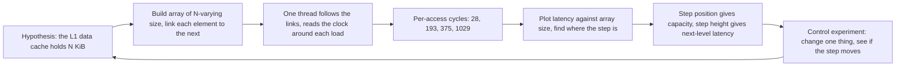
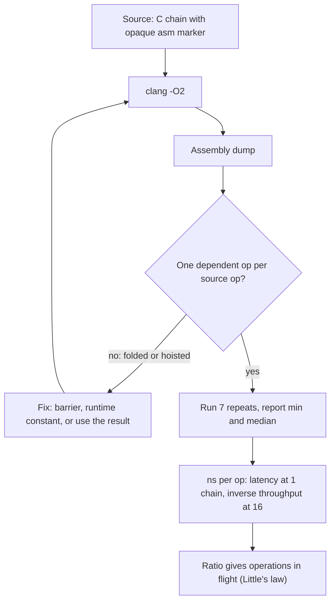

# NVIDIA Microbenchmarking: Measuring What the Datasheet Does Not Say

> **Source:** Jia, Maggioni, Staiger and Scarpazza (Citadel High Performance Computing R&D team), "Dissecting the NVIDIA Volta GPU Architecture via Microbenchmarking", technical report, first edition, 18 April 2018 - [arXiv abstract](https://arxiv.org/abs/1804.06826) - [local PDF](../../../sources/gpu/nvidia/volta-microbenchmarking.pdf)
>
> **Scope:** every hardware number below belongs to the NVIDIA Tesla V100 (Volta generation, chip GV100) or to the other named boards the report compares it with (Pascal P100 and P4, Maxwell M60, Kepler K80). Page numbers are PDF page numbers of the local file, which are two higher than the printed page numbers. The report is a company technical report posted to arXiv, not a peer-reviewed paper.

## Read this first

**The claim in one sentence.** By timing carefully built tiny programs with the GPU's own clock counter, and by reading the machine code the compiler produces, outsiders can recover cache sizes, line sizes, latencies and scheduling rules that NVIDIA did not publish, and the Volta V100 turns out to differ from its predecessors in ways that change how fast code can run.

**Who this is for.** Anyone who has to decide whether a hardware number can be trusted, anyone sizing memory-bound work (such as language-model inference) on a GPU, and anyone who wants to learn how to design a measurement so that it measures the hardware and not the compiler.

**Afterwards you will be able to** explain how a pointer chase and a dependent-instruction chain each isolate one property; read the report's main tables with the right units and the right product attached to each number; run the CPU version of the same idea on a laptop and show that the compiler did not delete your experiment; and say why a measured number is evidence about one board under one set of conditions and not a datasheet value.

**Reading time.** About 50 minutes, plus 10 to run the benchmark. **Have read first:** [GPU foundations](../05-gpu-foundations.md) (warps, streaming multiprocessors, the memory spaces), [CUDA architecture](./06-cuda-architecture.md) (what NVIDIA documents), and [the memory hierarchy](../../02-memory-hierarchy.md), where the same pointer-chase idea is measured on a CPU.

**The one thing most people get wrong.** They read the report's tables as a specification of "NVIDIA GPUs". They are measurements of five specific boards, taken in 2017-2018 with CUDA 9.0 tooling, and several are properties of the SASS (the GPU's native machine code, defined below) that one compiler version emitted. The report itself says its optimisations "will not port to future GPU architectures" (PDF p. 8). A second common error: the report does not time long chains of dependent instructions to get its instruction latencies. It uses a cleverer trick with scheduler control bits (explained below), and long chains are the technique of the CPU analogue in this guide.

## The paper in one worked example

Three small experiments are traced here. Part A and Part B come from the report; Part C is a measurement run for this guide on an Apple M5 Pro.

### Part A - how the report measured the latency of one Volta instruction (PDF p. 39-40)

The report wants the dependent-issue latency of an instruction A, meaning: how many clock cycles after A is issued may an instruction B that reads A's result be issued and still get the correct value. The report describes two cases.

1. **A has fixed latency** (most integer and floating-point arithmetic). Pick a B that consumes A's output. The Volta instruction word carries a 4-bit stall field that tells the scheduler how many cycles to wait before issuing the next instruction (PDF p. 15). The authors lower A's stall count, one step at a time, until B reads a stale value and the result is wrong. The last stall value that still gave the right answer is A's latency.
2. **A has variable latency** (memory instructions, atomics). Pick a B of known latency, force a dependency between them through the scoreboard-style "barrier" fields, bracket the pair with two reads of the cycle counter (the instruction CS2R reads it), and subtract B's known latency.

Result for the single-precision fused multiply-add FFMA (compute a x b + c): 4 cycles on Volta (Table 4.1, PDF p. 40), against 6 cycles on Pascal. On the V100 at its maximum graphics clock of 1,380 MHz (Table 3.1, PDF p. 21) 4 cycles last 4 / 1.380 GHz = 2.9 ns. This tutorial computes that conversion; the report quotes cycles.

### Part B - how the report found the cache levels (PDF p. 22, Figure 3.2, and p. 27, Figure 3.3)

**Data-cache latency staircase.** A single thread runs a fine-grained pointer chase (the technique of Mei and Chu, a reference the report cites as [12]): each loaded value is the address of the next load, and each load is timed on its own. Figure 3.2 plots the per-access latency for a run of consecutive accesses within 256 bytes. The caption reads out four distinct values:

| Cycles | What the caption says it is | Converted at 1,380 MHz (this tutorial) |
|---|---|---|
| 1029 | first access: miss in the L2 cache and miss in the translation look-aside buffer (TLB, a cache of address translations) | 746 ns |
| 375 | L2 cache miss with a TLB hit, so the data comes from the HBM2 memory (stacked high-bandwidth memory) | 272 ns |
| 193 | L1 data cache miss, L2 cache hit | 140 ns |
| 28 | L1 data cache hit, the later accesses to the same cache line | 20 ns |

**Instruction-cache plateaus.** For instruction caches there are no loads to chase, so the report runs a long straight-line sequence of independent FFMA instructions twice and times only the second pass (Figure 3.3 caption, PDF p. 27). Each instruction is 128 bits, which is 16 bytes (PDF p. 13). A sequence that fits in a cache level runs at that level's speed; a longer one spills to the next level and the average cycles per instruction step up. The step positions give the sizes. This tutorial's arithmetic: 12 KiB of FFMAs is 768 instructions and 128 KiB is 8,192. The report's text says the plateau widths locate three levels (L0 about 12 KiB, L1 128 KiB, L2 6,144 KiB) and then, by "increasing the resolution", reads associativity from the number of small stages: 16 stages for L0 and 32 for L1 (Figure 3.4, PDF p. 29).

### Part C - the same two ideas on this machine

On an Apple M5 Pro the dependent-chain idea gives a clean result: a chain of 64-bit integer adds, each needing the previous result, runs at 0.2229 ns per add, while sixteen independent chains run at 0.0483 ns per add, about 4.6 times as fast. A chain of double-precision multiplies is 0.7027 ns per multiply when dependent and 0.0590 ns when independent, about 11.9 times as fast. The full table, the compiler flags and the proof that the compiler did not remove the chain are in Tutorial 2. These numbers describe this one machine; they are not properties of any GPU.



Notice that the loop closes: the control experiment (change the stride, the warp or the SM) is what turns a latency graph into a statement about structure.

## Words you need

| Term | Plain definition | Example from this guide |
|---|---|---|
| SASS | The GPU's native machine code, the instructions the hardware executes. PTX (Parallel Thread Execution) is NVIDIA's portable intermediate language, which a tool called ptxas turns into SASS. | FFMA, IADD3 and HMMA are SASS opcodes (Table 4.1, PDF p. 40) |
| Microbenchmark | A tiny program built to stress exactly one hardware mechanism and report one number. | The FFMA sequence of Part B |
| Dependent chain | A sequence where each operation needs the previous result, so the hardware cannot overlap them. Time per step equals latency. | The 0.2229 ns integer add chain of Part C |
| Pointer chase (p-chase) | A dependent chain made of loads, where each loaded value is the next address. | Figure 3.2, PDF p. 22 |
| Latency versus inverse throughput | Latency is how long one operation takes from start to result. Inverse throughput is the average time per operation when many are in flight. | FFMA latency 4 cycles; the paper's Figure 3.3 plots inverse throughput |
| Streaming multiprocessor (SM) | One of the GPU's replicated compute blocks; the V100 has 80 (Table 3.1). The report also writes SMX, the Kepler-era name. | Volta SM is split into 4 processing blocks (PDF p. 16) |
| Cache line, set, way | A line is the unit a cache stores. Sets group lines; ways (associativity) say how many lines in one set can hold different addresses that collide. | L0 instruction cache: 3-way, 16 sets, 256 B line (PDF p. 28) |
| Little's law | Operations in flight = throughput x latency. It tells you how many independent operations hide a latency. | Part C: about 5 in flight for integer add, about 12 for floating-point multiply |

## Tutorial 1 - Intuitive understanding

### What was broken before

A programmer who wants a GPU program near the chip's peak speed needs facts the vendor does not publish: cache sizes, how the scheduler picks instructions, which register layouts stall. The report's first chapter shows the cost of not knowing. It compiles a small matrix-multiply kernel (an 8 x 8 tile accumulated in registers over 512 steps) with the NVIDIA compiler NVCC 9.0 and finds register bank conflicts that the programmer cannot see from CUDA C. Rewriting the SASS by hand with a better register mapping raises performance from 132.05 to 152.43 GFlops/s per SM at 128 threads, +15.4% (PDF p. 8-10): for every 100 operations the original code completed, the patched code completed about 115. The report adds its own limits: the work needs "substantial human effort", is Volta-specific and "will not port to future GPU architectures", and ordinary users of the libraries already get "an excellent combination of portability and efficiency" (PDF p. 7-8).

### The idea

Treat the chip as a sealed factory. You post letters in a slot and time the replies. A letter that needs the answer to the previous letter measures the length of one assembly line. Many unrelated letters measure how many lines run side by side. Letters about ever more filing cabinets get slower when the cabinets no longer fit in the small nearby room; the cabinet count at the jump is the room's size.

The analogy breaks in two places. A factory room does not change when you look, but a cache does: reading a line moves it, so every benchmark warms up first, and the answer depends on the replacement policy (which line is evicted) as well as the size. And the factory has one owner, whereas here a compiler, a driver and a variable-speed clock sit between you and the hardware and can fake a result.

### How it works, step by step

1. **State a hypothesis the vendor leaves open.** Example: the V100 L1 data cache is 128 KiB with no shared memory configured. The whitepaper gives only a range of 32 to 128 KiB (PDF p. 24).
2. **Build a program where only that mechanism limits speed.** A pointer chase makes loads depend on each other, so time per load is latency. A run of independent FFMAs that touch only registers puts no load on data memory, so any step in its speed comes from instruction fetch (Figure 3.3 caption, PDF p. 27).
3. **Read the cycle counter around the timed region.** In PTX it is `%clock` (Listing 3.1, PDF p. 23). It counts cycles of the clock the SM is running at, so results are in cycles.
4. **Vary one knob.** Array size, stride, sequence length, which warp, which SM.
5. **Find the steps.** "Each plateau in the inverse throughput reveals a cache level" (Figure 3.3 caption); the plateau edge is the size.
6. **Run a control.** To show the L0 instruction cache is private to a scheduler and L1 is not, two warps share one SM and one thrashes while the other measures; the measurer slows at the L0 size or at the L1 size depending on what it shares (Figure 3.5, PDF p. 30).
7. **Compare with whatever the vendor did publish**, as the report does for the 6,144 KiB L2 and the 900 GB/s memory figure (PDF p. 19).

### What the results say

Each number is for the V100 (PCIe card) against the Pascal P100, from Table 3.1 (PDF p. 21) unless stated; conversions to nanoseconds use each chip's maximum graphics clock, 1,380 and 1,328 MHz, and are this tutorial's arithmetic.

| Quantity | V100 | P100 | Meaning |
|---|---|---|---|
| L1 data hit latency | 28 cycles | 82 cycles | 66% fewer cycles; about 20 ns against 62 ns, three times faster in real time |
| L2 hit latency | about 193 | about 234 | 18% fewer cycles; about 140 ns against 176 ns |
| L2 size | 6,144 KiB | 4,096 KiB | 50% more on-chip space for a working set |
| Dependent FFMA latency (Table 4.1) | 4 cycles | 6 cycles | a chain of dependent multiply-adds finishes one third sooner |
| Global memory bandwidth, measured | 750 GiB/s | 510 GiB/s | 47% more |
| Measured as share of theoretical | 83.3% | 69.6% | of each 100 bytes per second promised, about 83 versus 70 delivered |

L1 load bandwidth rises from 31.3 to 109.1 bytes per cycle per SM, "more than 3 times higher" (PDF p. 23), yet only about 42% of the 256 bytes per cycle bound in Table 3.2. Structural findings: an instruction and its control bits share one 128-bit word where Pascal used 64-bit words with a separate control word per three instructions (PDF p. 13-14); registers moved from four 32-bit banks to two 64-bit banks (PDF p. 32); each of the four processing blocks in an SM has its own L0 instruction cache of about 12 KiB (PDF p. 28); and warp w runs on scheduler `w mod 4` (PDF p. 16).

### What this does not show

- Nothing about GPUs after Volta; the authors say the work "needs to be repeated anew on each future architecture" (PDF p. 8).
- No explanation for the L1 data cache being detected at 121, 57 and 25 KiB where 128, 64 and 32 were expected; the authors "are unable to explain" the 7 KiB gap and conjecture the replacement policy (PDF p. 24).
- No run-to-run spread or confidence intervals; tables hold single averages from one board per model.

### Teach-back

1. Why does a chain of dependent loads measure latency while independent loads do not?
<details><summary>Answer</summary>Each load's address comes from the previous load, so the hardware cannot overlap them and time per load is latency. Independent loads overlap, and time per load falls to the inverse throughput.</details>

2. The V100's L1 hit is 28 cycles and the P100's is 82. Is the V100 three times faster in seconds?
<details><summary>Answer</summary>About yes here, but only after converting: 28 / 1.380 GHz = 20.3 ns against 82 / 1.328 GHz = 61.7 ns, a ratio of 3.0. Cycle counts from chips with different clocks cannot be compared directly.</details>

3. Why does the report time only the second pass of an FFMA sequence?
<details><summary>Answer</summary>The first pass fills the instruction caches and measures misses. The second measures the level the whole sequence now fits in (Figure 3.3 caption, PDF p. 27).</details>

## Tutorial 2 - Practitioner understanding

### The design in concrete terms

**The instruction word (PDF p. 13-15).** One Volta instruction plus its control information fills 128 bits: at least 91 for the instruction, at least 23 for control, and 14 that looked unused (91 + 23 + 14 = 128). The control section holds six fields of 21 bits in total, plus two leading zero bits, which accounts for the 23.

| Field | Bits | Role |
|---|---|---|
| Reuse flags | 4 | keep a source register in one of 4 reuse caches for the next instruction |
| Wait barrier mask | 6 | stall until the listed variable-latency results arrive |
| Read barrier index | 3 | protect a register that a store is still reading |
| Write barrier index | 3 | barrier this instruction signals when its result lands |
| Yield flag | 1 | stay on this warp; cleared means switch warp, costing one cycle |
| Stall cycles | 4 | wait 0 to 15 cycles before the next issue |

**Memory hierarchy as measured (Table 3.1, PDF p. 21; V100 PCIe).**

| Level | Size and geometry | Latency (cycles) |
|---|---|---|
| L1 data cache (shared with shared memory, 128 KiB total) | 32 B line, 4 sets, virtually indexed (PDF p. 36); non-LRU: when full it evicts the same four lines from four sets first (PDF p. 25) | 28 |
| Shared memory | up to 96 KiB per SM, 32 banks of 4 B | 19 with no conflict |
| L1 constant cache | 2 KiB, 64 B line, 8 sets, 4-way | about 27 |
| L1.5 constant cache | at least 64 KiB, 256 B line; same hardware as the L1 instruction cache (PDF p. 31) | about 89 |
| L2 (data, constant, instruction) | 6,144 KiB, 16-way, 64 B line, physically indexed | about 193 (constant: about 245) |
| Global memory (HBM2) | 16,152 MiB measured | 375 with a TLB hit (Figure 3.2); 391 average (PDF p. 55) |
| L0 / L1 / L2 instruction cache | 12 KiB, 3-way, 16 sets, 256 B line / 128 KiB, 8-way, 32 sets, 512 B line / shared L2 | - |

The geometry multiplies out: 3 x 16 x 256 B = 12 KiB, 8 x 32 x 512 B = 128 KiB, 4 x 8 x 64 B = 2 KiB. Volta has the lowest shared-memory latency of the boards tested (PDF p. 33).

**Instruction latencies, Volta (Table 4.1, PDF p. 40).**

| Cycles | Instructions |
|---|---|
| 4 | IADD3, SHF, LOP3, SEL, MOV, FADD, FFMA, FMUL, ISETP, FSET, FSETP |
| 5 | IMAD, FMNMX, DSET, DSETP |
| 6 | HADD2, HMUL2, HFMA2 (half precision) |
| 8 | DADD, DMUL, DFMA (double precision) |
| 10 | POPC |
| 14 | FLO, BREV, MUFU (special function unit) |

On Pascal, most integer and single-precision instructions take 6 cycles, double precision 8, the set-predicate group 12, the special-function group 14, and IMUL and IMAD about 86 because they are emulated (PDF p. 40). That last row is the largest relative change in the table (about 86 to 5).

**Other V100 results.** Shared-memory atomics cost 6 cycles uncontended against 15 on the P100 (Table 4.2, PDF p. 41), but global atomics do not improve: 36 against 26 cycles uncontended and 76 against 50 at 32 contending threads. cuBLAS 9.0 matrix multiplication on the PCIe V100 at 1,380 MHz peaks at 83.03 TFLOPS in half precision (tensor cores), 14.03 in single and 7.07 in double; the NVLink board at 1,530 MHz reaches 87.42, 15.53 and 7.83 (Table 5.3, PDF p. 55).

### A minimal version

The report's method needs an NVIDIA GPU, which this machine lacks. What can run here is the dependent-chain idea, in C for the Arm64 CPU. The C below was compiled and run; the CUDA kernel after it was not.

**Machine for every measurement in this guide:** Apple M5 Pro (model Mac17,8), 18 cores in two performance levels that macOS names Super (6) and Performance (12), macOS 26.5 on Darwin 25.5.0, Apple clang 21.0.0 (target arm64-apple-darwin25.5.0), on AC power, 19 November 2026. The program is single-threaded and not pinned (macOS offers no core pinning), so the scheduler chose the core.

```c
// depchain.c - dependent-chain vs independent-chain probe. Build: clang -O2 -o depchain depchain.c
#include <stdio.h>
#include <stdint.h>
#include <stdlib.h>
#include <time.h>
#define KEEP_I(x) __asm__ volatile("" : "+r"(x))   // opaque to the optimiser, emits no instruction
#define KEEP_D(x) __asm__ volatile("" : "+w"(x))   // same for a double in an Arm64 FP register
static double now(void) { struct timespec t; clock_gettime(CLOCK_MONOTONIC, &t); return t.tv_sec + 1e-9 * t.tv_nsec; }
// K independent chains; each loop iteration does one operation per chain, 4 times.
#define DEFINE(NAME, T, KEEP, EXPR, K)                                         \
  __attribute__((noinline)) T NAME##_##K(uint64_t iters, T c) {                \
    T a[K];                                                                    \
    for (int j = 0; j < K; j++) a[j] = (T)(j + 1);                             \
    for (uint64_t i = 0; i < iters; i++)                                       \
      for (int u = 0; u < 4; u++)                                              \
        for (int j = 0; j < K; j++) { a[j] = EXPR(a[j], c); KEEP(a[j]); }      \
    T s = 0; for (int j = 0; j < K; j++) s += a[j];                            \
    return s;                                                                  \
  }
#define ADD(a, c) ((a) + (c))
#define MUL(a, c) ((a) * (c))
#define FMA(a, c) __builtin_fma((a), (c), (c))
// ... instantiate K = 1,2,4,8,16 for iadd, imul (uint64_t) and fadd, fmul, ffma (double);
// main() times each with clock_gettime, 7 repeats of iters = 20,000,000, divides by iters*4*K.
// The constants c come from argv so the compiler cannot fold them. The compiled file is 60 lines.
```

The listing abbreviates the driver macro; the numbers below come from the full 60-line file, run as `./depchain 3 1.0000001`.

**Measured on this machine (clang -O2, minimum of 7 repeats, nanoseconds per operation):**

| Chains | 64-bit integer add | integer multiply | double add | double multiply | double fused multiply-add |
|---|---|---|---|---|---|
| 1 (fully dependent) | 0.2229 | 0.6701 | 0.4918 | 0.7027 | 0.7073 |
| 2 | 0.1176 | 0.3396 | 0.2595 | 0.3424 | 0.3746 |
| 4 | 0.0699 | 0.1770 | 0.1393 | 0.1757 | 0.1927 |
| 8 | 0.0514 | 0.0895 | 0.0891 | 0.0991 | 0.1127 |
| 16 | 0.0483 | 0.0783 | 0.0586 | 0.0590 | 0.0639 |

**Repeatability.** In this run the median of 7 was within 3.5% of the minimum in every one-chain cell, but the worst single repeat of the integer add chain was 22% above its minimum (0.2717 against 0.2229), a sign of scheduling or clock noise. A second full run (integer constant 5) gave 0.2265 for one chain and 0.0499 for sixteen, differences of 1.6% and 3.3%. Treat the third significant digit as noise.

**How to read it.** With one chain each operation waits for the last, so time per operation is the latency on this core. With 16 chains it is the inverse throughput. Their ratio is the number of operations in flight (Little's law): 4.6 for integer add, 8.6 for integer multiply, 8.4 for double add, 11.9 for double multiply and 11.1 for fused multiply-add. At 16 chains the throughput is 20.7, 12.8, 17.1, 16.9 and 15.6 operations per nanosecond, so one thread sustains about 31 billion floating-point operations per second in the fused case (2 per operation).

**Cycles.** This guide stays in nanoseconds because it has no trustworthy clock source for the run. `sysctl` on this machine returns no `hw.cpufrequency`; `hw.tbfrequency` is 24 MHz, a fixed timestamp counter and not the core clock; the live core clock needs `powermetrics` with root, which was not used. Relative to the integer add chain, integer multiply is 3.0 times, double add 2.2, double multiply 3.2 and fused multiply-add 3.2. If a dependent integer add takes 1 cycle, an assumption not verified for this chip, the implied clock is 1 / 0.2229 ns = 4.49 GHz; do not cite the resulting cycle counts as measured.

**How the compiler was checked.** Three checks, all done:
1. The assembly (`clang -O2 -S`) was read. `iadd_1` has four `add x8, x8, x1` per iteration, each reading the previous result; `imul_1` four `mul x8, x8, x1`; `fadd_1` four `fadd d1, d0, d1`; `ffma_1` four `fmadd d1, d1, d0, d0`; each with the empty inline-assembly marker between them and `subs`/`b.ne` as loop control. For every chain count the arithmetic instruction count was 4 x K for K up to 8, and 16 per inner pass for K = 16, where the inner four-times loop was not unrolled, so about 2 loop instructions share each 16 operations and the 16-chain throughputs are slightly conservative.
2. The empty `asm volatile` with a register operand makes each result unknown to the optimiser and emits no instruction.
3. A control build with the barrier removed shows what the compiler does when unblocked. `iadd_1` became `mul x8, x1, x0` plus an `orr` (n additions of the same value are one multiplication) and printed 0.0000 ns per operation. `imul_1` ran at 0.0446 ns because the compiler squared the constant twice instead of chaining four multiplies. The floating-point chains survived (0.4872 ns add, 0.6931 ns multiply) because without `-ffast-math` the compiler may not reassociate floating-point operations. A dependent operation reported at under one cycle means the compiler removed the work.

Checking this is the CPU form of the report's remark that its `double sink` is "a register to avoid compiler optimization" (Listing 3.1, PDF p. 23).

**The CUDA pointer chase (not run; constructed from the method the report cites, not copied from it).** The report prints bandwidth kernels (Listings 3.1 and 3.2) but not its chase source; it names the technique as Mei and Chu's fine-grained pointer chase (PDF p. 22). Running this needs `nvcc` and an NVIDIA board such as a V100; nothing here has been run.

```cuda
// pchase.cu - NOT RUN. One thread chases pointers and records per-access cycles.
// host fills next[i] = (i + stride_in_elements) % n and cudaMemcpy's it to the device.
__global__ void pchase(const uint32_t *next, uint32_t *idx_out, uint32_t *lat_out, int n_steps)
{
    __shared__ uint32_t s_idx[2048];     // visited index per step
    __shared__ uint32_t s_lat[2048];     // cycles per step
    uint32_t j = 0;
    for (int w = 0; w < n_steps; w++)    // warm-up pass: fills L1/L2 and the TLBs
        asm volatile("ld.global.ca.u32 %0, [%1];" : "=r"(j) : "l"(next + j) : "memory");
    for (int i = 0; i < n_steps; i++) {
        uint32_t t0, t1;
        asm volatile("mov.u32 %0, %%clock;" : "=r"(t0) :: "memory");
        asm volatile("ld.global.ca.u32 %0, [%1];" : "=r"(j) : "l"(next + j) : "memory");
        s_idx[i] = j;                    // consumes j, so the clock read below waits for the load
        asm volatile("mov.u32 %0, %%clock;" : "=r"(t1) :: "memory");
        s_lat[i] = t1 - t0;
    }
    for (int i = 0; i < n_steps; i++) { idx_out[i] = s_idx[i]; lat_out[i] = s_lat[i]; }
}
// launch <<<1, 1>>>. Sweep array size n and stride over many launches; plot mean s_lat against size.
```

`ld.global.ca` caches at L1 and L2 (the `.cg` form skips L1, PDF p. 26). Storing `j` to shared memory before the second clock read forces the timestamp to wait for the load, since a clock read alone does not depend on it. A real experiment would also read the SASS to confirm that one load sits between the two clock reads, and repeat across at least five launches.



Notice that numbers count only after the assembly check passes; the left-hand loop is the step most beginners skip.

### What it costs

**A GPU chase sweep (constructed arithmetic).** Assume 40 array sizes with 100,000 timed accesses each. At the worst latency in Figure 3.2 (1,029 cycles) and the V100's 1,380 MHz, one access takes 0.75 microseconds, so 100,000 accesses take 75 ms and the sweep takes 3 seconds of device time. The real cost is analysis, controls and repeats. The report's Chapter 4 method also needs a binary patcher or hand assembler, and its authors say such effort "may not, in general, be worth the gains it produces, except for tight computational kernels" (PDF p. 7).

**The CPU benchmark.** 25 configurations x 7 repeats = 175 timed runs, each between about 18 ms (80 million dependent integer adds) and about 100 ms (1.28 billion operations at 16 chains), a few seconds in total.

**What the numbers buy for model serving (constructed example).** Generating text at batch size 1 reads every weight once per token, so bandwidth bounds tokens per second. Take a hypothetical 7-billion-parameter model in 16-bit numbers: 14 GB, or 13.0 GiB. At the V100's measured 750 GiB/s (805 GB/s) the weights alone allow at most about 57 tokens per second; at the 900 theoretical figure, about 64. The 16 GiB board (16,152 MiB measured) leaves about 2.7 GiB for the key-value cache and activations. The report says nothing about language models; the model size is chosen for illustration.

### How it fails

| Symptom | Likely cause | Mitigation |
|---|---|---|
| Dependent operation under one cycle | Compiler folded the chain | Read the assembly; opaque barrier; runtime constants; the control build above |
| Step at 121 KiB for a 128 KiB cache | Non-LRU policy or a structure sharing the cache | Repeat with a second stride; add a control with a different access pattern (PDF p. 24) |
| Latency differs between runs | Clock changed, or a different core ran the thread | Lock the clock where possible; report spread; repeat |
| First access far slower (1029 against 28 cycles) | Cold cache and TLB | Warm up; time only the second pass |
| Throughput below expectation | Register bank conflicts or instruction fetch, not the unit under test | Inspect SASS; avoid same-bank sources (PDF p. 9) |

### Evaluating your version

**Metric:** minimum and median of at least 7 repeats, per operation, in nanoseconds, with spread (maximum minus minimum over median). **Test set:** the five operation families here; on a GPU, the Table 4.1 instructions. **Baseline:** a case with a known answer, for the CPU the no-barrier build (which must read nonsense) and the 16-chain case (which must sit at the throughput limit), for a V100 the report's FFMA and L1 numbers (4 and 28 cycles). **Stop rule:** stop when two sessions agree within 5% and the assembly shows one dependent operation per source operation; if sessions disagree by more, you are measuring a clock or scheduling effect.

### Adopt, adapt or skip

**Adopt the method.** Before choosing a machine for local inference, spend an afternoon on the dependent-chain and memory-sweep benchmarks on that machine; the cost is low and it replaces guesses about latency and cache size with numbers. The CPU pointer chase is in [the memory hierarchy](../../02-memory-hierarchy.md).

**Adapt the bandwidth lesson.** The V100 delivered 83.3% of its theoretical global bandwidth and the P100 69.6% (Table 3.1). When sizing a model-serving box, multiply datasheet bandwidth by roughly 0.7 to 0.85 until you have measured, then divide the weights in bytes by that bandwidth for a tokens-per-second ceiling. Measure with a plain streaming copy before buying more hardware.

**Skip instruction-level reverse engineering** unless you write kernels or assemblers. It took a four-person team a technical report per architecture, it does not port, and vendor profilers and library kernels cover most needs. The sensible order for a team shipping an assistant on GPUs: read the documented limits ([CUDA architecture](./06-cuda-architecture.md)), run the vendor profiler, and microbenchmark only to settle a question the documentation leaves open. For the platform choice see [CPU or GPU](../../10-cpu-gpu-decision.md); for AMD's equivalent see [AMD CDNA and HIP](../amd/08-amd-cdna-hip.md).

## Tutorial 3 - Researcher understanding

### Formal setup

A benchmark times a region containing the target operation n times and records T clock ticks. Let L be the latency in cycles (the unknown), H the fixed overhead of the measuring code (two clock reads, loop control), E interference (instruction-fetch misses, other warps, clock changes), f the clock frequency during the run, and R the sustainable rate in operations per cycle. For a dependent chain T = nL + H + E; for independent work T = n/R + H + E. The estimate (T - H)/n is valid only when E is small, and a time is L/f. Little's law gives the independent operations needed to saturate a unit: N = R x L.

**Toy instance (constructed from the report's numbers).** FFMA has L = 4 cycles (Table 4.1). The report gives a scheduler-to-core ratio of 1:16 (PDF p. 57), so one scheduler drives 16 single-precision lanes and a 32-thread warp occupies them for 2 cycles: R = 0.5 warp-instructions per cycle, which this tutorial infers and which fits the "2-cycle stalls" NVCC generates (PDF p. 28). Then N = 0.5 x 4 = 2 independent FFMA warp-instructions per scheduler. With 4 schedulers of 16 lanes, each of the 80 SMs has 64 single-precision cores, so peak is 80 x 64 x 2 x 1.380 GHz = 14.13 TFLOPS against 14.03 measured with cuBLAS (Table 5.3), 99.3%.

### The claims, stated precisely

1. An instruction and its control bits occupy one 128-bit word, at least 91 bits of instruction and 23 of control (PDF p. 13).
2. The V100 L1 data hit latency is 28 cycles against 82 on the P100 (Table 3.1; the text says 84).
3. The V100 has a 12 KiB L0 instruction cache (3-way, 16 sets, 256 B line), a 128 KiB L1 instruction cache (8-way, 32 sets, 512 B line) that is the same hardware as the L1.5 constant cache, and a unified 6,144 KiB L2 (PDF p. 28-31).
4. Dependent issue latency of core integer and single-precision instructions is 4 cycles on Volta, 6 on Pascal (Table 4.1).
5. Measured global memory bandwidth is 750 of 900 GiB/s (83.3%) on the V100 and 69.6% on the P100 (Table 3.1).
6. The scheduler for warp w is `w mod 4` (PDF p. 16), and register bank is register index mod 2 (PDF p. 32).

### Evidence, table by table

**Table 3.1 (PDF p. 21): geometry and latency, five boards.** Rows are structural properties; columns are V100, P100, P4, M60 and K80. It identifies sizes and latencies of one PCIe board per model. It associates the V100's higher L1 bandwidth with combining L1 and shared memory (PDF p. 23) but runs no experiment that isolates that cause.

**Table 2.1 (PDF p. 16): FFMA throughput against warp placement.** Two of 8 warps issue; when both sit on the same processing block (indices equal mod 4) throughput is about 42 GFLOPS (42.27, 41.98, 42.06, 42.08), otherwise about 66 (66.05 and similar, with one 65.29). Only placement changes, so this is causal evidence for `warp id mod 4`. This tutorial adds that one block's 16 lanes x 2 FLOP x 1.380 GHz is 44.2 GFLOPS, so the same-block figure is 96% of one block's peak, while two blocks give only 1.5 times that, not 2 times; the report does not explain the factor.

**Table 3.3 (PDF p. 24): detectable L1 size.** Shared memory configured at 0, 64, 96 KiB; expected L1 128, 64, 32; detected 121, 57, 25. A constant 7 KiB shortfall, associated with but not shown to be caused by the replacement policy.

**Figures 3.3 to 3.5 (PDF p. 27-30): instruction cache plateaus, associativity and privacy.** The extraction gave axis ranges, not plateau heights, so they cannot be quoted. Figure 3.5 is the cleanest causal evidence in the report: each panel changes one thing (which warp, which SM) and predicts which curve moves.

**Table 4.1 (PDF p. 40): latencies.** Strong for fixed-latency instructions, since lowering the stall count tests the property directly. Variable-latency instructions rely on subtracting a known partner latency (PDF p. 39), a weaker inference.

**Tables 5.1 to 5.3 (PDF p. 54-55): NVLink and PCIe V100.** One-way peer bandwidth is 10.63 GB/s for V100 PCIe, 36.72 for P100 NVLink and 47.99 for V100 NVLink. The report attributes the NVLink board's higher L1 bandwidth to its 1,530 against 1,380 MHz clock, a checkable claim: the text's 109.1 B/cycle x 1.380 GHz = 150.56 GB/s matches Table 5.3, and scaling to 1.530 GHz gives 166.9 against 160.85 measured.

### Ablations and what they isolate

The report has no ablation tables; its controls play that role. Warp placement (Table 2.1) isolates the scheduler rule. Thrash-length sweeps (Figure 3.5) isolate which instruction cache levels are private. Varying one source register in a chain of FFMAs (Figure 3.8) isolates bank conflicts from all else, since the instruction stream is otherwise identical. Page-sized strides (Figure 3.12) isolate TLB reach: 2 MiB page entries with 32 MiB L1 TLB coverage and 32 MiB entries with about 8,192 MiB L2 coverage on the V100 (PDF p. 36-37), which this tutorial reads as 16 and 256 entries.

### Threats to validity specific to this paper

**Compiler optimisation.** The report's latency method patches SASS directly, avoiding the compiler; its bandwidth listings guard with `asm volatile` and a sink (PDF p. 23). A chase compiled from plain CUDA C can have its clock reads reordered against the load, which is why the kernel in Tutorial 2 consumes the loaded value first. The CPU check above shows how far a compiler can go: a dependent add chain collapsed to one multiply.

**Clock frequency changes.** `%clock` counts SM-clock cycles, so cycle counts largely survive a clock change, but any conversion to seconds or any bandwidth does not. The main chapters never say the clock was locked, and Table 3.1 lists only maximum clocks (1,380 MHz graphics, 877 MHz memory). The memory clock is separate, so a core-clock change does not scale bandwidth the same way. On the CPU side, this guide could not read the core clock at all.

**Instruction-cache and warm-up effects.** The first pass of any code is cold; the report runs sequences twice and times the second. A long benchmark loop can evict itself from the instruction cache and add misses to every iteration, and the compiler's 2-cycle stalls inflate the apparent per-scheduler L0 inverse throughput (PDF p. 28). The report measures one board per model, so binning, firmware and driver variation are not examined.

**SASS versus PTX.** PTX is a virtual instruction set; the hardware runs SASS after ptxas translates, reorders or fuses it. Table 4.1 is a property of SASS opcodes (FFMA, IADD3) on Volta. A PTX `add` is not guaranteed to become an IADD3, so a latency measured from PTX source can describe the translation as much as the silicon.

**Why a microbenchmark number is not a datasheet.** A datasheet value is a vendor statement of a peak or guarantee for a product line. A microbenchmark value is an observation of one board, one clock, one driver, one compiler and one access pattern. The report's own numbers show the gap: 750 of 900 GiB/s global bandwidth, about 42% of the L1 bound, and a detected L1 7 KiB below the configured one. Neither is wrong; one says what is allowed, the other what happened. A measurement needs its conditions written beside it.

### Open problems and follow-ups

- Repeat on later architectures; the manifest for this track holds no later microbenchmarking report, so this guide cannot say how Volta's findings carried over.
- Explain the 7 KiB L1 gap and the 1.5 factor in Table 2.1.
- Re-measure at a locked clock with spread and confidence intervals, and publish the chase source and the stall-count assembler, which the report does not.

### What would change my mind

- A re-run of the Table 3.1 latencies at a locked clock that differs by more than a few percent would mean cycle counts depend on clock state.
- Disassembly of the L1 bandwidth kernel showing dropped or vectorised loads would undermine the 109 bytes per cycle figure.
- A different latency on a second V100 would show the numbers describe boards, not the model.
- A peak for the 90.2% half-precision efficiency claim that differs from the one implied by Table 5.3 would change how the half-precision results should be read (see inconsistencies).

## Reading map for the sources

| Source part | PDF pages | Contains | First pass | Answered in |
|---|---|---|---|---|
| Summary, Chapter 1 | 5-11 | Motivation; register bank example; +15.4% | Read | Tutorial 1 |
| Chapter 2 Instructions | 13-17 | 128-bit word, control fields, scheduler rule (Table 2.1) | Read 2.1-2.2, skim 2.3 | Tutorial 2 design |
| Chapter 3 intro, Table 3.1 | 19-21 | Geometry table for five boards | Read closely | Tutorial 2 hierarchy table |
| 3.1 L1 data and 3.2 L2 | 22-26 | Latency staircase, bandwidth, 7 KiB gap, replacement policy | Read | Worked example Part B |
| 3.3 Instruction caches | 27-30 | Plateau method, associativity, privacy | Read text, skim plots | Part B, Tutorial 3 |
| 3.4 to 3.6 | 30-34 | Constant caches, register banks, shared memory | Skim | Tutorial 2 |
| 3.7, 3.8 Global memory, TLBs | 34-37 | Bandwidth, TLB reach | Read 3.7, skim 3.8 | Tutorial 3 ablations |
| Chapter 4 | 39-51 | Latency method, Table 4.1, atomics, tensor cores, cuBLAS | Read 4.1-4.2, skim 4.3 | Part A |
| Chapter 5 | 53-56 | NVLink and PCIe V100 | Skim | Tutorial 3 evidence |
| Chapter 6, Appendix | 57-61 | Conclusions; opcode tables | Conclusions only | - |

The full source is the [local PDF](../../../sources/gpu/nvidia/volta-microbenchmarking.pdf), also at [arXiv 1804.06826](https://arxiv.org/abs/1804.06826). The PDF text was extracted for this guide and the figures were not viewed, so plotted values not stated in a caption or table (Figures 3.3 and 3.8 to 3.12, 4.1) could not be read.

## Questions readers get stuck on

### Is a clock cycle the same on every chip I compare?

No. A cycle is one tick of the clock that unit runs on, and its length depends on the chip and its current clock rate. The V100's 28-cycle L1 hit and the P100's 82 cannot be compared as times until each is divided by its own clock (1,380 and 1,328 MHz maxima, Table 3.1), and the real clock during a run may have been lower.

### Why does the report find latency with an instruction pair instead of a timed chain?

Fixed-latency instructions are scheduled statically, with the latency encoded as a stall count. Lowering that field until the result breaks reads the latency directly, with no timing noise (PDF p. 39). A timed dependent chain also works and is what the CPU benchmark here uses; the report's route needs the ability to write SASS.

### Where does the 7 KiB L1 gap come from?

Nobody has shown. With 96 KiB of shared memory the L1 should be 32 KiB, but the chase sees misses beyond 25 KiB, and the same 7 KiB shortfall appears in all three configurations (Table 3.3). The authors rule out error-correction overhead and conjecture the new replacement policy (PDF p. 24).

### Why do the report's prose and tables give different numbers?

They do in several places; the Checkpoint lists them. The Pascal L1 latency is 82 in Table 3.1 and 84 in the text, and the V100 L1 bandwidth is 108.3 bytes per cycle in Table 3.2 and 109.1 in the text. Only 109.1 matches Table 5.3 (109.1 x 1.380 GHz = 150.56 GB/s), so the table value is probably stale, which is this guide's inference.

### Why not just read NVIDIA's documentation?

For supported behaviour you should: [CUDA architecture](./06-cuda-architecture.md) covers it. The vendor documents what code may rely on, not details such as associativity or scheduler assignment, which can change between revisions and still affect speed.

### Can I carry a Volta number to a newer GPU?

No. The five boards in Table 3.1 differ on nearly every row (bank width, L1 line size, L1 latency, replacement policy). This track's rule is that every number belongs to a named product.

### How could the CPU benchmark here mislead me?

The clock may have changed, the thread may have moved between Super and Performance cores, and operand values can matter. General knowledge, not tested here: some cores run multiplies faster for special operands, so the integer constants used (3 and 5, odd, so the product never reaches zero) were chosen to avoid that.

### How does the CPU pointer chase differ from the GPU one?

The idea is the same: link each element to the next so loads cannot overlap. On a CPU the prefetcher and out-of-order engine can defeat a regular stride, so a random permutation is used; see [the memory hierarchy](../../02-memory-hierarchy.md).

## Prerequisites you actually need

### Prerequisite 1 - Latency, throughput and Little's law

Latency is the time for one operation; throughput is how many finish per unit time; operations in flight equal throughput times latency. **Worked example (measured above):** a dependent double multiply takes 0.7027 ns and 16 independent chains finish one per 0.0590 ns, so 0.7027 / 0.0590 = 11.9 multiplies are in flight. Used in Part C, Figure 3.3 and Tutorial 3. Reference: [the memory hierarchy](../../02-memory-hierarchy.md), [GPU foundations](../05-gpu-foundations.md).

### Prerequisite 2 - Cache geometry

A cache of line size B and associativity A holds C = sets x A x B bytes. **Worked example (the report's numbers):** the V100's L0 instruction cache is 3-way with 16 sets and 256 B lines, so C = 3 x 16 x 256 = 12 KiB; the L1 is 8 x 32 x 512 = 128 KiB. Figures 3.3 and 3.4 (PDF p. 27-29) read the set count from the number of stages in the plateau. Reference: [the memory hierarchy](../../02-memory-hierarchy.md).

### Prerequisite 3 - Cycle counters and converting to time

A counter such as `%clock` counts ticks of a clock whose frequency can change. **Worked example:** 391 cycles at 1,380 MHz is 391 / 1.380 GHz = 283 ns, and 405 cycles at 1,530 MHz is 265 ns. The report prints 28.3 and 26.5 ns (PDF p. 55), ten times too small, apparently a decimal slip. Used in Chapter 5 of the report and in the CPU section, where no clock source was readable.

### Prerequisite 4 - Compiler optimisation of benchmark code

At -O2 a compiler may fold, hoist, vectorise or delete code whose result is unused. **Worked example (measured above):** n integer adds of the same value become one multiply, so the timed loop printed 0.0000 ns per add; an empty `asm volatile` with a register operand blocks the rewrite and emits nothing. Used in Tutorial 2 and in the report's Listing 3.1 (PDF p. 23). Reference: the clang manual on inline-assembly constraints.

## Where this sits in the curriculum

**Read before:** [Architecture map](../../01-architecture-map.md), [GPU foundations](../05-gpu-foundations.md) (warps, memory spaces) and [CUDA architecture](./06-cuda-architecture.md) (what NVIDIA documents).

**Versus its neighbours.** CUDA architecture is the vendor's view: supported behaviour with no inferred hardware detail. This tutorial is the opposite: inferred detail with no guarantee. [The memory hierarchy](../../02-memory-hierarchy.md) measures the same idea (dependent loads, strides) on a CPU. **Read next:** [AMD CDNA and HIP](../amd/08-amd-cdna-hip.md) to see another vendor's documented model, then [CPU or GPU](../../10-cpu-gpu-decision.md) for the decision that numbers like these feed. For the Arm CPU this benchmark ran on, see [Arm A-profile](../../arm/04-arm-a-profile.md).

## Checkpoint

1. **Explain.** Why does lowering the stall-cycle field until the result breaks measure latency?
<details><summary>Answer</summary>The stall field says how long to wait before the next issue. If B reads A's result too early it reads a stale value, so the smallest stall count that still gives the right answer is A's dependent-issue latency (PDF p. 39).</details>

2. **Compute.** Convert the V100 L2 hit latency (about 193 cycles at 1,380 MHz) and the P100's (about 234 at 1,328 MHz) to nanoseconds. Which is faster in real time?
<details><summary>Answer</summary>193 / 1.380 = 139.9 ns and 234 / 1.328 = 176.2 ns; the V100 is about 21% faster in time. The cycle ratio is 0.82 and the time ratio 0.79.</details>

3. **Compute.** What share of theoretical global bandwidth do the V100 and K80 reach?
<details><summary>Answer</summary>V100: 750 / 900 = 83.3%. K80: 191 / 240 = 79.6%, but Table 3.1 prints 77.5%.</details>

4. **Critique.** The report says half-precision cuBLAS reaches 90.2% of theoretical throughput (PDF p. 50), and Table 5.3 lists 83.03 TFLOPS for the 1,380 MHz card. What do you check?
<details><summary>Answer</summary>That both use the same peak. 83.03 / 0.902 implies a peak near 92 TFLOPS. General knowledge, not in the source: the V100 tensor-core peak is about 125 TFLOPS at 1,530 MHz, about 113 at 1,380 MHz, which would make 83.03 about 74%. The Figure 4.8 values were unreadable, so this guide cannot settle it.</details>

5. **Apply.** A CPU integer add chain measures 0.01 ns per add. What do you do?
<details><summary>Answer</summary>Suspect the compiler. Read the assembly for one dependent add per source add, add an opaque barrier or runtime constants, and re-run. A dependent chain cannot beat one result per latency.</details>

6. **Apply.** A colleague sizes a serving GPU from the 900 GB/s datasheet bandwidth. What is the safer rule?
<details><summary>Answer</summary>Plan with measured bandwidth, or about 70% to 85% of the datasheet until measured (P100 69.6%, V100 83.3%), and divide the weights in bytes by it for a tokens-per-second ceiling at batch size 1.</details>

**Inconsistencies found in the source (by checking numbers against each other; none silently corrected):**
- Pascal L1 hit latency is 82 in Table 3.1 and 84 in the text (PDF p. 22); Kepler is 35 in the table and 32 in the text.
- V100 L1 bandwidth is 108.3 bytes per cycle in Table 3.2 and 109.1 in the text (PDF p. 23); Table 5.3 agrees with 109.1.
- Global memory latency in nanoseconds (PDF p. 55): 26.5 and 28.3 ns are ten times too small for 405 cycles at 1,530 MHz (265 ns) and 391 cycles at 1,380 MHz (283 ns).
- K80 bandwidth ratio: 77.5% in Table 3.1 against 79.6% from its own figures; P100 (69.6) and M60 (79.3) differ from the arithmetic (69.7, 79.4) by rounding.
- Units: bandwidth is GiB/s in Table 3.1 but 900 GB/s in the text (PDF p. 19); the 13,800 "GiB/s" theoretical shared-memory figure equals 80 x 32 x 4 B x 1,380 MHz divided by 1,024 once, about 14.1 TB/s in plain bytes.
- The text says global atomics show "no obvious improvement" on Volta; Table 4.2 shows the V100 slower than the P100 in several rows.
- The 90.2% half-precision efficiency (PDF p. 50) cannot be reconciled with Table 5.3 without the plotted peak.

**Not verified:** plotted values in Figures 3.3, 3.8 to 3.12 and 4.1 (axis labels only in the extraction); the GPU clock during the report's runs (only maxima are stated); the M5 Pro core frequency (not exposed without root).

**Sources followed:** Jia et al., arXiv 1804.06826 v1 (18 April 2018), local PDF read in full text. The CPU measurements are this guide's own, run on 19 November 2026.
