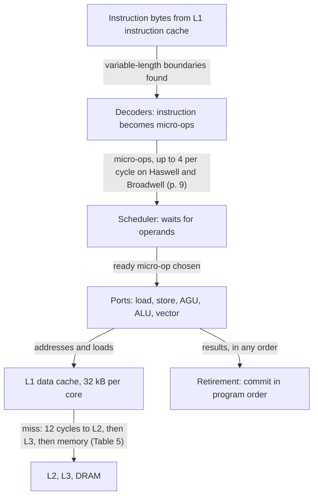

# x86-64: from a compatibility-rich instruction set to fast modern execution

> **Sources:**
> 1. AMD64 Architecture Programmer's Manual, Volume 1 (AMD, document 24592, version 3.24 in the URL) - [canonical URL](https://docs.amd.com/v/u/en-US/24592_3.24). **Not read.** See the access note below.
> 2. Intel 64 and IA-32 Architectures Software Developer's Manual, Volume 1 (Intel) - [canonical URL](https://www.intel.com/content/www/us/en/content-details/851056/intel-64-and-ia-32-architectures-software-developer-s-manual-volume-1-basic-architecture.html). **Not read.** See the access note below.
> 3. Hofmann, Hager, Wellein and Fey (Erlangen), *An analysis of core- and chip-level architectural features in four generations of Intel server processors*, arXiv 1702.07554v1, February 2017 - [arXiv abstract](https://arxiv.org/abs/1702.07554) - [local PDF](../../sources/x86-64/intel-server-microarchitecture-analysis.pdf). **Read in full (19 pages).** Page numbers below are PDF page numbers.
>
> **Access note (tried 2026-11-19, plain `curl`).** The AMD URL answered HTTP 200 but returned only a JavaScript shell ("Loading application..."), and a guessed content endpoint returned 404. The Intel URL answered HTTP 403 "Access Denied". So **no sentence here is quoted from either manual**; statements about what the manuals define are labelled "general knowledge, not checked against the manuals here" and are leads to verify.
>
> **Machine note.** This tutorial was written on an Apple M5 Pro, which is an Arm machine. Nothing here measures x86 timing. The x86-64 assembly was produced by cross-compiling with the machine's `clang` and only disassembled; it was never executed.

## Read this first

**The claim in one sentence.** The x86-64 instruction set is a long-lived contract about *results*: it fixes what registers, flags, memory addressing and byte encodings mean, while every processor generation is free to translate those instructions into private internal work, overlap that work out of order, and finish with the same architectural answer; so the speed you see is a property of a named processor generation, never of "x86" itself.

**Afterwards you will be able to** read a real x86-64 function (registers, flags, address formula, byte lengths); say what a micro-operation is and why the front end can be a bottleneck; use latency and inverse throughput to work out how much independent work a core needs; and quote Hofmann et al.'s numbers for the right generation (Sandy Bridge, Ivy Bridge, Haswell or Broadwell, and no other).

**Reading time.** About 50 minutes. **Have read first:** [Architecture map](../01-architecture-map.md) and [Memory hierarchy](../02-memory-hierarchy.md). **Read next:** [Arm A-profile](../arm/04-arm-a-profile.md) for the same questions answered by a fixed-width instruction set.

**The one thing most people get wrong.** They treat a cache size, a latency or an instructions-per-cycle figure as a fact about x86. Every number here belongs to one Intel Xeon generation and configuration. The paper does not cover AMD at all, and its newest chip (Broadwell-EP, Q1 2016, Table 1, p. 4) is far older than anything a team would buy today.

## The paper in one worked example

Parts A to C are a function this tutorial compiled for x86-64 (**measured on this machine**: Apple clang 21.0.0, build clang-2100.1.1.101, cross-compiling with `-arch x86_64`; assembly only, **not run**). Part D uses Hofmann et al.'s numbers (arXiv 1702.07554) and arithmetic on them, marked "this tutorial computes". Part E is a small experiment that *was* run, on Arm.

### Part A - two small C functions

```c
long dot_scaled(const int *a, const int *b, long n, int k) {
    long s = 0;
    for (long i = 0; i < n; i++)
        s += (long)a[i] * b[i] + k;
    return s;
}
int pick(const int *t, long i, long j) {
    return t[i * 4 + j] + t[j + 8];
}
```

Commands used (compile and disassemble only):

```
clang -O2 -arch x86_64 -S f.c -o f.s          # assembly
clang -O2 -arch x86_64 -c f.c -o f.o          # object file
objdump -d f.o                                 # bytes plus disassembly (Apple's LLVM objdump)
clang -O2 -arch x86_64 -mavx2 -c f.c -o f2.o  # same source, AVX2 allowed
```

`clang -arch x86_64 -dM -E` defines `__SSE4_1__` but not `__AVX__` (measured), so Apple's default x86-64 target already allows SSE up to 4.1. That is a compiler configuration, not a property of x86-64.

### Part B - the smaller function, instruction by instruction

`pick` compiles to this (columns: offset within the function, encoded bytes, instruction; AT&T syntax, so the destination is on the right):

| Offset | Bytes | Instruction | Length |
|---|---|---|---|
| 0 | `55` | `pushq %rbp` | 1 |
| 1 | `48 89 e5` | `movq %rsp, %rbp` | 3 |
| 4 | `48 c1 e6 04` | `shlq $4, %rsi` | 4 |
| 8 | `48 8d 0c 97` | `leaq (%rdi,%rdx,4), %rcx` | 4 |
| c | `8b 44 97 20` | `movl 0x20(%rdi,%rdx,4), %eax` | 4 |
| 10 | `03 04 0e` | `addl (%rsi,%rcx), %eax` | 3 |
| 13 | `5d` | `popq %rbp` | 1 |
| 14 | `c3` | `retq` | 1 |

Eight instructions, 21 bytes (0xb0 to 0xc5 in the object file). The System V calling convention (general knowledge) puts `t` in `%rdi`, `i` in `%rsi`, `j` in `%rdx` and the result in `%eax`. `shlq $4, %rsi` computes `i * 16` bytes, which is `i * 4` ints. The `leaq` computes the address `t + 4*j` bytes into `%rcx` without touching memory. The `movl` loads `t[j + 8]`: the displacement `0x20` is 32 bytes, which is 8 ints, added to the same `rdi + 4*rdx` base. The final `addl` has a **memory operand**: it loads `t[4i + j]` from address `%rsi + %rcx` and adds it to `%eax` in one instruction. So the C `+` became one instruction that reads memory and adds; a load-store instruction set writes two.

For comparison, `clang -O2 -arch arm64` (measured) gives six instructions of 4 bytes, 24 bytes: `lsl`, `add x9, x0, x2, lsl #2`, two `ldr`, `add`, `ret`. The x86-64 version is shorter in bytes (21 versus 24) but has more instructions (8 versus 6), mostly because it keeps a frame pointer (`push`, `mov`, `pop`) in a leaf function. One function proves nothing about code density.

Decoding three encodings by hand (field layouts are general knowledge; the disassembly confirms them):

- `48 8d 0c 97`: `48` is a REX prefix (the W bit selects 64-bit operands); `8d` is `lea`; `0c` is a ModRM byte (00 001 100: register 001 = `rcx`, rm 100 = "a SIB byte follows"); `97` is the SIB byte (10 010 111: scale factor 4, index 010 = `rdx`, base 111 = `rdi`). So `rcx = rdi + rdx * 4`.
- `8b 44 97 20`: `8b` is a load; ModRM `44` (01 000 100: 8-bit displacement, register `eax`, SIB follows); same SIB `97`; displacement `20`.
- `03 04 0e`: `03` is add-from-memory; ModRM `04`; SIB `0e` (00 001 110: factor 1, index `rcx`, base `rsi`). So `eax += *(rsi + rcx)`.

### Part C - the larger function: a loop the compiler vectorized

At `-O2` the compiler turned `dot_scaled` into 46 instructions (0x00 to 0xad, with a scalar fallback loop for leftovers). The hot loop (offsets 0x40 to 0x7d) is thirteen instructions, 61 bytes, average 4.7 bytes:

| Bytes | Instruction | What it does |
|---|---|---|
| `66 0f 38 35 1c 87` (6) | `pmovzxdq (%rdi,%rax,4), %xmm3` | load two 32-bit ints from `a`, widen to two 64-bit lanes |
| `66 0f 38 35 64 87 08` (7) | `pmovzxdq 0x8(%rdi,%rax,4), %xmm4` | the next two ints of `a` |
| `66 0f 38 35 2c 86` (6) | `pmovzxdq (%rsi,%rax,4), %xmm5` | two ints of `b` |
| `66 0f 38 35 74 86 08` (7) | `pmovzxdq 0x8(%rsi,%rax,4), %xmm6` | the next two of `b` |
| `66 0f 38 28 eb` (5) | `pmuldq %xmm3, %xmm5` | two signed 32x32 to 64-bit multiplies |
| `66 0f 38 28 f4` (5) | `pmuldq %xmm4, %xmm6` | two more |
| `66 0f d4 c1`, `c5`, `d1`, `d6` (4 each) | four `paddq` | add the broadcast `k` and the products to two accumulators (`xmm0`, `xmm2`) |
| `48 83 c0 04` (4) | `addq $4, %rax` | advance the index by four elements |
| `49 39 c0` (3) | `cmpq %rax, %r8` | set flags: compare index to the rounded-down count |
| `75 c3` (2) | `jne 0x40` | branch back if not equal; `c3` is -61 as a signed byte |

Things to notice (measured output): lengths run from 2 to 7 bytes in the loop and up to 10 elsewhere (`movabsq` with a 64-bit immediate). Two accumulators (`xmm0`, `xmm2`) give two independent addition chains. The `66` and `0f 38` bytes are a legacy prefix and an opcode escape (general knowledge). `cmpq` writes the flags and `jne` reads them. One iteration handles four elements.

Recompiling with `-mavx2` gives a 23-instruction, 115-byte loop (average 5.0) handling 16 elements per iteration with `ymm` registers, four accumulators and `c4` or `c5` (VEX) prefixes. Per element that is 1.4 instructions versus 3.3 for the SSE4.1 build (23 / 16 and 13 / 4).

### Part D - what Hofmann et al. add: how the machine consumes such a loop

The paper never analyses this function; it supplies measured numbers (Table 2, p. 8, "worst-case measured latency and inverse throughput", floating point only) for reasoning about loops like it. **Inverse throughput** is the cycles between starts of independent instances of the same instruction; **latency** is the cycles from start to result.

| Instruction (generation) | Latency (cycles) | Inverse throughput (cycles per instruction) | Independent instructions in flight (this tutorial computes: latency / inverse throughput) |
|---|---|---|---|
| AVX add (Broadwell) | 3 | 1 | 3 |
| multiply (Broadwell) | 3 | 0.5 | 6 |
| multiply (Haswell) | 5 | 0.5 | 10 |
| AVX fused multiply-add (Broadwell and Haswell) | 5 | 0.5 | 10 |
| AVX double-precision divide (Broadwell) | 24 | 16 | 1.5 |

A loop that sums into one running total can start only one add per latency period, not one per cycle. Keeping both Haswell multiply pipes busy needs about ten independent multiplies in flight, which is why Part C has two accumulators and the AVX2 variant four.

### Part E - the same principle measured on Arm

**Measured on this machine (Apple M5 Pro, Arm; not x86):** a C program (listed under "A minimal version") sums 2,048 doubles (16 KiB, inside the L1 data cache, reported by `sysctl` as 131,072 bytes) with 1, 2, 4, 8 or 16 independent running sums; best of 7 trials; two runs identical to three decimals.

| Independent sums | ns per add |
|---|---|
| 1 | 0.566 |
| 2 | 0.287 |
| 4 | 0.136 |
| 8 | 0.062 |
| 16 | 0.058 |

Doubling the chains roughly halves the time until it flattens at 8 to 16: one chain is latency-bound, the plateau is throughput-bound, and 0.566 / 0.058 is about 9.8 adds in flight. Same effect as Part D on a different processor family; no x86 timing.

```mermaid
flowchart LR
  C["C source: pick, dot_scaled"] -->|"clang -O2 -arch x86_64"| ASM["Assembly: registers, flags, address formulas"]
  ASM -->|"assembler"| BYTES["Bytes: 1 to 10 bytes per instruction"]
  BYTES -->|"fetch and decode (per generation)"| UOPS["Micro-operations: private internal steps"]
  UOPS -->|"scheduler picks ready work"| PORTS["Execution ports: loads, stores, ALU, vector"]
  PORTS -->|"retire in program order"| RES["Architectural result: same on every x86-64 chip"]
```



Notice that the left three arrows are fixed by the contract and compiler, and the two on the right are chosen by each processor generation, where Hofmann's numbers live.

## Words you need

| Term | Plain definition | Example from the worked example |
|---|---|---|
| ISA (instruction set architecture) | The contract: instruction meanings, registers, flags, addressing, encodings. It says what must happen, not how long it takes. | `addl (%rsi,%rcx), %eax` means load, add, set flags, whatever the chip. |
| Microarchitecture | One processor design that implements an ISA: caches, ports, predictors. Names here are Intel's: Sandy Bridge, Ivy Bridge, Haswell, Broadwell. | Table 2 differs by generation for the same instruction. |
| Micro-operation (micro-op, uop) | A simple internal step an instruction is translated into. One instruction may become one or several; some pairs are fused into one. The paper uses the term for fusion and retirement limits (p. 9). | The store-plus-address pair fused "into a single micro-op" on Haswell (p. 9). |
| Addressing mode | The rule that forms a memory address. On x86-64 the general form is base + index * scale + displacement, with scale 1, 2, 4 or 8 (general knowledge). | `0x20(%rdi,%rdx,4)` = `rdi + 4*rdx + 32`. |
| REX / VEX prefix | Extra leading bytes that widen registers to 64 bits and reach 16 registers (REX), or encode AVX vector forms (VEX) (general knowledge). | `48` on `leaq`; `c5` and `c4` in the AVX2 build. |
| SIMD, SSE, AVX, AVX2, FMA | SIMD (single instruction, multiple data) is one instruction on several values packed in a wide register. The paper: SSE is 128 bits, AVX 256 bits, AVX2 extends 256-bit width from floating point to integers, FMA is fused multiply-add (p. 4). | `pmuldq` on `xmm` does two multiplies; `vpmuldq` on `ymm` does four. |
| Out-of-order execution | Executing instructions as their inputs become ready instead of strictly in program order, then retiring them in order. The paper calls the unit that feeds work to ports "the out-of-order engine" (p. 7). | The two accumulators in Part C. |
| Latency / inverse throughput | Cycles until a result exists / cycles between starts of independent copies. | Table 2, p. 8. |
| AGU (address generation unit) | Hardware that computes memory addresses. Haswell added a third AGU that handles only simple store addresses (p. 8-9). | Why `base + index + offset` loads are limited to two per cycle on Haswell and Broadwell. |
| CoD (Cluster on Die) | Haswell and later option that splits one chip into two NUMA (non-uniform memory access) domains (p. 4-5, 11). | Lowers L3 latency from 47 to 41 cycles on Broadwell (p. 11). |

## Tutorial 1 - Intuitive understanding

### What was broken before

Instruction sets that grow for decades collect baggage. x86 (general knowledge) started as a 16-bit design, was extended to 32 and then 64 bits, and still accepts older encodings; Part C showed 2-byte instructions beside 10-byte ones, so a decoder starting several instructions per cycle cannot know where instruction five begins until it has measured the first four. Executing literally and in order would also stall behind memory: the paper measures main-memory access at 178 to 280 core cycles on Broadwell-EP depending on a boot-time coherence setting (Table 5, p. 13), against 3 or 4 cycles for an add (Table 2, p. 8).

### The idea

Think of the ISA as a decades-old contract: it fixes what a request means, not how the firm fulfils it. A modern x86 core is a translating front desk (the decoders) feeding a busy back office (schedulers and execution ports) that works on whatever is ready, plus a records clerk (the retirement stage) who makes sure the outcome is filed in the original order.

Where the analogy breaks: the x86 contract is enforced only on *results*, never timing, so two chips can differ greatly in speed and both be correct. And the back office is not free: each internal step uses a limited resource (a port, an address generator, a retirement slot), and the paper's method is finding out which saturates first.

### How it works, step by step

Trace `pick` from Part B. The numbering below is the order a processor sees work; the paper's pieces are marked, and the rest is general knowledge.

1. **Fetch and decode.** The core splits the 21 bytes into eight instructions and translates each into micro-ops. The paper says little here: it names "decoder/retirement throughput" and "L1I bandwidth" as limits (p. 7) and a "four micro-op per cycle front end retirement constraint" on Haswell and Broadwell (p. 9). Whether `addl (%rsi,%rcx), %eax` is one fused micro-op or two is not stated.
2. **Rename (general knowledge).** The sixteen architectural registers map onto a larger internal pool, so unrelated uses of `%rax` do not wait for each other.
3. **Schedule.** The `shlq`, `leaq` and `movl` do not depend on each other. The paper's lowest-order model: instructions "can be executed independently and are dynamically fed to the execution ports" (p. 7).
4. **Execute.** The paper reports two load units and one store unit on all four generations (p. 8). Addresses come first: two AGUs up to Ivy Bridge, each sharing a port with a load unit; Haswell added a third on port 7 for simple store addresses only (p. 8).
5. **Retire in order.** The `addl` cannot retire before its load completes, and nothing retires out of order, so an interrupt sees clean sequential state.



Notice that the sources describe the back half of this pipeline (ports, caches, memory) in measured detail and the front half (decode, rename, reorder buffer) hardly at all; anything more about those stages here is general knowledge.

### What the results say

Each number below is from Hofmann et al. and belongs to the named generation. "Cycles" are core cycles; where the paper measures at base frequency it says so.

**1. Divide got much faster across generations (Table 2, p. 8).** A double-precision AVX divide (`vdivpd`) has latency 45 cycles on Sandy Bridge and 24 on Broadwell, and an inverse throughput of 44 cycles versus 16. Sandy Bridge could start one such divide every 44 cycles and Broadwell every 16: about 2.75 times as many per cycle (this tutorial computes 44 / 16; the text says "almost three-fold", p. 7). A Broadwell divide still costs 16 cycles of throughput against 1 for an add.

**2. Multiply and add in the same table.** Haswell's FMA hardware also allows two plain multiplies per cycle (inverse throughput 0.5, p. 8). On Broadwell multiply latency dropped from 5 to 3 cycles while scalar and SSE add latency rose from 3 to 4, a change the paper says Intel did not document for Broadwell (p. 8). So a chain of dependent SSE adds is slower on the newer chip.

**3. Gather became useful on Broadwell (Table 3, p. 10).** A gather instruction loads several non-contiguous values into one vector register. With all data in L1 cache, one gather took 12.3 cycles on Haswell-EP and 7.3 on Broadwell-EP. The paper says "40% faster" (p. 10); 7.3 is 41% less than 12.3, which is 40% less time and a 1.68 times higher rate, not 40% more work per second. For data in memory spread over 8 cache lines the two are about equal (89.3 versus 94.4 cycles), because moving eight lines dominates.

**4. The L2 cache did not deliver its advertised doubling (Table 4, p. 10-11).** Intel's documentation says the L1-L2 path doubled from 32 to 64 bytes per cycle on Haswell (Table 1, p. 4). The paper measured 43 bytes per cycle for a load-only dot product and 32 for the STREAM triad on both Haswell and Broadwell, against 28 and 29 on Sandy Bridge and 27 and 29 on Ivy Bridge. A kernel planned at 64 bytes per cycle would be off by 1.5 to 2 times.

**5. Latency of each level (Table 5, p. 13).** Measured in base-frequency cycles, prefetchers off, pointer chasing: L1 is 4 and L2 is 12 on all four; L3 is 40 (Sandy Bridge), 40 (Ivy Bridge), 37 (Haswell; reading explained in the FAQ) and 47 or 41 on Broadwell with Cluster on Die off or on; main memory is 230, 208, 168 and, on Broadwell, 248, 280, 190 or 178 depending on snoop mode (how coherence checks are sent between sockets). At the Broadwell base frequency of 2.3 GHz (Table 1), 178 to 280 cycles is about 77 to 122 nanoseconds (this tutorial computes).

### What this does not show

- It covers only "four generations of Intel server processors" (p. 1-2): no AMD, nothing after Broadwell-EP (2016), no consumer cores, no other ISA.
- It uses floating-point microbenchmarks in hand-written assembly plus LINPACK, HPCG (High Performance Conjugate Gradient) and Graph500 (p. 5). It does not measure decoders, branch predictors, rename or integer-heavy code, and it never compares x86 with another ISA, so it shows no cost of x86's compatibility baggage.

### Teach-back

**Q1.** Why can two correct x86-64 processors run the same binary at very different speeds?

<details><summary>Answer</summary>
The ISA fixes results, not timing. Table 2 (p. 8) shows the same divide at 24 cycles latency on Broadwell and 45 on Sandy Bridge.
</details>

**Q2.** In Part C, why two accumulators when one gives the same answer?

<details><summary>Answer</summary>
One accumulator is a dependency chain: each add waits for the last. Two chains overlap and hide latency; Part D gives the arithmetic and Part E the measured effect.
</details>

**Q3.** The paper says Broadwell's gather is "40% faster". Is that 40% more gathers per second?

<details><summary>Answer</summary>
No: 12.3 versus 7.3 cycles in L1 (Table 3) is about 41% less time, a rate about 1.68 times higher.
</details>

## Tutorial 2 - Practitioner understanding

### The design in concrete terms

**What the contract contains (general knowledge, not checked against the manuals here).** x86-64 "long mode" has sixteen 64-bit general-purpose registers (`rax` to `r15`), an instruction pointer `rip`, a flags register `rflags`, and sixteen 128-bit `xmm` vector registers that AVX widens to 256-bit `ymm`. Addresses are `base + index * scale + displacement` with scale 1, 2, 4 or 8, plus `rip`-relative addressing. Writing a 32-bit register name such as `%eax` zeroes the upper half of `%rax`, which is why `xorl %eax, %eax` zeroes the whole register (offset 0x15 in Part C). Instructions are 1 to 15 bytes: optional prefixes, opcode, optional ModRM and SIB bytes, displacement, immediate. The 15-byte maximum and field layouts are from memory; verify in Intel SDM Volume 2 or AMD APM Volume 3 (not manifest sources).

**What an analysis needs (p. 7).** Per-instruction latency and throughput, "decoder/retirement throughput, L1I bandwidth, and the number and types of address generation units"; the Intel Architecture Code Analyzer (IACA) helps but "does not always yield accurate predictions".

**Per-generation structures the paper reports** (Table 1, p. 4; text p. 8-9). None of these are in the ISA:

| Property | Sandy Bridge-EP | Ivy Bridge-EP | Haswell-EP | Broadwell-EP |
|---|---|---|---|---|
| Chip model | Xeon E5-2680 | Xeon E5-2690 v2 | Xeon E5-2695 v3 | Xeon E5-2697 v4 |
| Base frequency | 2.7 GHz | 3.0 GHz | 2.3 GHz | 2.3 GHz |
| Newest SIMD | AVX | AVX | AVX2, FMA3 | AVX2, FMA3 |
| Memory | 4 ch. DDR3-1600 | 4 ch. DDR3-1866 | 4 ch. DDR4-2133 | 4 ch. DDR4-2400 |
| Theoretical memory bandwidth | 51.2 GB/s | 59.7 GB/s | 68.2 GB/s | 76.8 GB/s |
| L1 / L2 per core | 32 kB / 256 kB | 32 kB / 256 kB | 32 kB / 256 kB | 32 kB / 256 kB |
| L3 total | 20 MB | 25 MB | 35 MB | 45 MB |
| L1 to register bandwidth | 2 x 16 B/cy | 2 x 16 B/cy | 2 x 32 B/cy | 2 x 32 B/cy |
| L1 to L2 | 32 B/cy | 32 B/cy | 64 B/cy | 64 B/cy |

"B/cy" is bytes per core cycle. Table 1 says its numbers are "taken from data sheets", so they are vendor claims; Table 4 shows the L2 claim failing. The memory column is checkable: 4 channels x 8 bytes x 2400 million transfers per second = 76.8 GB/s for Broadwell (this tutorial computes; the other three also reproduce). L1: two 32-byte loads plus one 32-byte store is 96 B/cy on Haswell and Broadwell, 48 on the older two.

**Address-generation detail that links to your assembly (p. 9).** The paper explains that on Haswell and Broadwell only two of the three AGUs can compute the general form `base + scaled index + offset`; the third "can only perform offset computations" for stores. Result: "only two addresses per cycle can be calculated", which limits an AVX STREAM triad (two loads, one FMA, one store per four elements) to 64 B/cy of the 96 B/cy peak. The paper's workaround is to use one of the "fast LEA" units, which does indexed addressing without an offset, to precompute an address so the simple AGU can finish the job. Relevance to Part C: every load there uses the indexed form (`(%rdi,%rax,4)`), and two of the four use a displacement as well.

**SIMD, in terms of what the sources support.**

- The paper: SSE vectors are 128 bits, AVX is 256 (p. 4); AVX2 extends 256-bit vectorization from floating point to integers; FMA adds fused multiply-add on two new execution units; gather arrived on Haswell (p. 4, 9).
- On Sandy Bridge the L1 data paths stayed at 16 B/cy, so "AVX stores requiring two cycles to retire on SNB, and AVX LOADs block both units" (p. 4). Gather is "a microcode solution" (p. 9): a short internal program, not one hardware lookup.
- Wide vectors carry a frequency cost on Haswell and later: the Xeon E5-2695 v3 has base 2.3 GHz but AVX base 1.9 GHz, the E5-2697 v4 2.3 versus 2.0 GHz (Table 1); under all-core LINPACK the Haswell chip dropped below its 2.3 GHz base yet stayed above the AVX base (p. 5-6). AVX-512 is only anticipated (p. 17), never measured.
- This tutorial's compile shows SIMD is not automatic: for 32-bit inputs summed into a 64-bit total the compiler widened inputs to 64-bit lanes (`pmovzxdq`), so a 128-bit register did only two multiplies per instruction.

**Bridge to Arm.** [Arm A-profile](../arm/04-arm-a-profile.md) covers the fixed 4-byte, load-store alternative (general knowledge: arithmetic only on registers, 31 general registers, NEON vectors). At concept level both converge on decode, rename, schedule, execute out of order, retire in order, and both obey the same latency, throughput and memory arithmetic. Practical differences are x86's decode complexity and stronger memory ordering (general knowledge).

### A minimal version

The Part E program, **compiled and run on this Apple M5 Pro (Arm)**, not on x86:

```c
// chains.c - dependent vs independent floating-point adds. Compile:
//   clang -O2 -fno-vectorize -fno-slp-vectorize -ffp-contract=off -o chains chains.c
#include <stdio.h>
#include <time.h>
#define N 2048                      /* 2048 doubles = 16 KiB, fits in L1D */
static double a[N];
static double now(void){struct timespec t;clock_gettime(CLOCK_MONOTONIC,&t);
  return t.tv_sec+t.tv_nsec*1e-9;}
#define KERNEL(NAME, ACC) \
__attribute__((noinline)) double NAME(int reps){ double s[ACC]={0}; \
  for(int r=0;r<reps;r++) for(int i=0;i<N;i+=ACC) for(int k=0;k<ACC;k++) s[k]+=a[i+k]; \
  double t=0; for(int k=0;k<ACC;k++) t+=s[k]; return t; }
KERNEL(c1,1) KERNEL(c2,2) KERNEL(c4,4) KERNEL(c8,8) KERNEL(c16,16)
typedef double (*fn)(int);
int main(void){
  for(int i=0;i<N;i++) a[i]=1.0+i*1e-6;
  fn f[]={c1,c2,c4,c8,c16}; int accs[]={1,2,4,8,16}; int reps=20000; double sink=0;
  for(int j=0;j<5;j++){
    f[j](200); double best=1e9;                       /* warm-up, then best of 7 */
    for(int trial=0;trial<7;trial++){ double t0=now(); sink+=f[j](reps);
      double dt=now()-t0; if(dt<best)best=dt; }
    printf("accumulators=%2d  %.3f ns per add\n",accs[j],best/((double)reps*N)*1e9);
  }
  fprintf(stderr,"sink=%g\n",sink); return 0; }
```

Output as measured: see the Part E table (0.566 ns per add with one sum down to 0.058 with sixteen). The `c1` assembly has one `fadd d0, d0, d1` per iteration; `c8` has sixteen `fadd`s in its body. Caveats: macOS has no core pinning, so I do not know whether the run used a performance core; the clock was not read, so no cycle conversion; the compiler cannot reorder one floating-point sum (addition is not associative, general knowledge), so the program writes separate sums by hand.

**To get an x86 answer** (`not run`): compile the same file on an x86-64 machine you control and use `perf stat -e cycles,instructions ./chains` (Linux), Intel VTune or AMD uProf. Expect the one-sum figure to equal that chip's add latency and the plateau to reflect its FP pipes; these are predictions. The paper suggests 3 to 4 cycles per dependent add on Broadwell and 3 on Haswell, and measures nothing newer.

**To reproduce the assembly and bytes:** the four commands in Part A (run; compile and disassemble only). Instruction length is the difference between consecutive offsets.

### What it costs

Assumptions are stated each time; none is an x86 measurement.

**1. Front-end bound for the SSE4.1 loop on a Haswell- or Broadwell-class core (constructed).** Assume each of the 13 instructions is at least one micro-op and the paper's "four micro-op per cycle" limit (p. 9) applies as the binding limit: 13 / 4 = 3.25 cycles per iteration, so about 0.8 cycles per element. If the `cmpq` and `jne` pair fuse into one micro-op (general knowledge about Intel cores, not stated in the paper) it is 12 / 4 = 3.0. This is a lower bound from one assumed limit, not a prediction.

**2. Load bound for the same loop (constructed).** Four loads per iteration over two load units (p. 8) is at least 2 cycles. So under these assumptions the front end (3.0 to 3.25) would bind before the load units (2). Whether the real chip reaches either is untested.

**3. Memory time in nanoseconds.** The paper's base-frequency cycles convert directly: Broadwell DRAM at 178 cycles (directory mode) is 178 / 2.3 GHz = 77 ns and at 280 cycles (home snoop) 122 ns; Sandy Bridge at 230 cycles and 2.7 GHz is 85 ns; Haswell at 168 cycles and 2.3 GHz is 73 ns (this tutorial computes; Haswell's cycle count rests on the table reading in the FAQ). Memory latency barely moved in nanoseconds over four generations while core resources grew, which is the quantitative case for out-of-order machinery.

**4. Token generation (constructed, for orientation).** One token from a dense model reads roughly all the weights once, so tokens per second is at most bandwidth divided by model bytes. Assume a 7-billion-parameter model at 4 bits, about 3.5 GB (assumption, not from any source). On Broadwell-EP's theoretical 76.8 GB/s (Table 1) one socket allows at most 76.8 / 3.5 = 21.9 tokens per second; sustained bandwidth is lower, but the paper's Figures 5-6 axis values were unreadable in the text extraction, so I use no sustained figure. The point is the form of the calculation.

### How it fails

| Symptom | Likely cause | Mitigation | Grounding |
|---|---|---|---|
| Loop far slower than "peak" despite vector code | One accumulator (dependency chain), or micro-op throughput | Independent accumulators; unroll | Table 2; p. 7, 9 |
| AVX kernel runs at a lower clock than scalar code | Chip drops to AVX frequency on Haswell and later | Measure the attained frequency under your real mix | p. 5-7, Fig. 1 |
| Predicted L1-L2 bandwidth is 64 B/cy but you measure about 32-43 | The documented figure is a peak; the paper measured much less | Use measured values in your model | Table 4, p. 10-11 |
| Graph or pointer-heavy code is slow on a two-socket Xeon in the lowest-latency coherence mode | Directory mode on a non-NUMA-aware program: shared data exceed the directory cache | Choose home snoop with opportunistic broadcast; the paper reports up to 50% better Graph500 on Broadwell | p. 3, 13-14, 17 |

### Evaluating your version

- **Metric.** Cycles per element, with the clock read at run time and the hardware counters for retired instructions where available.
- **Repeats.** At least 7 timed runs after a warm-up (the Part E program does this); the paper's variation study used 1,456 chips (Fig. 1c).
- **Stop rule.** Stop when measured cycles per iteration are within about 10% of the largest of the dependency, port, front-end and memory bounds (the 10% is this tutorial's rule of thumb). A measurement below your bound means the bound is wrong.
- **Control.** Record the frequency (the paper used `likwid-setFrequencies`, p. 5) and report compiler and flags.

### Adopt, adapt or skip

**Recommendation for a team deciding what to learn or run, especially for model and agent workloads.**

- **Adopt** the method: bound a loop by dependency chains, port throughput, front-end width and memory bandwidth, then measure which binds. It carries to Arm and to GPUs ([GPU foundations](../gpu/05-gpu-foundations.md)).
- **Adapt** the numbers: use Hofmann's tables as worked examples tied to their generation; re-measure latency, bandwidth and AVX frequency on any chip you actually buy.
- **Skip** memorizing encodings unless you write compilers or debuggers.
- **For local or CPU inference**, pick hardware by memory capacity and measured bandwidth first (tokens per second is capped by bandwidth divided by model bytes) and vector or matrix instruction support second; x86-64 versus Arm is a weak predictor of either. See [CPU versus GPU decision](../10-cpu-gpu-decision.md).
- **Do not** conclude Arm beats x86 or the reverse; no source here compares them.

## Tutorial 3 - Researcher understanding

### Formal setup

**Notation.** For a loop body in steady state with all data in L1:

- *L_i* = latency of instruction type *i* (cycles); *R_i* = inverse throughput (cycles per instruction, the paper's "inverse throughput", Table 2).
- *n_i* = how many instructions of type *i* execute per iteration.
- *W* = front-end and retirement width in micro-ops per cycle (the paper's 4 for Haswell and Broadwell, p. 9).
- *C_dep* = length of the longest loop-carried dependency chain, in cycles per iteration.
- *T_iter* = cycles per iteration; *T_mem* = cycles per iteration needed to move the loop's data from beyond L1.

**In-core bounds.** The paper: "the pipeline that takes the largest number of cycles to execute all its instructions determines the runtime", while the opposite limit is "the critical path through the code, heeding all dependencies"; actual time lies between them unless other bottlenecks apply (p. 7). So T_throughput = max over classes of (sum of n_i * R_i) and T_critical = C_dep. This tutorial adds T_fe = (total micro-ops) / W and writes T_iter >= max(T_throughput, T_critical, T_fe, T_mem); that combined form is the tutorial's, not the paper's. The number of independent instances needed to saturate a unit is L_i / R_i (Little's law, Prerequisite 2).

**ECM (Execution-Cache-Memory) model.** The paper does not derive it, but says it "drops the assumption of a single bottleneck" of Roofline and, on Intel x86 server chips, adds all data-transfer contributions including L1 loads and stores; Power8 shows "almost perfect overlap" (p. 2).

**Numeric toy instance (constructed, Haswell-EP numbers).** An AVX triad updates four doubles with 2 loads, 1 FMA and 1 store. With two full AGUs, three addresses take 1.5 cycles per iteration, moving 96 bytes (3 x 32) in 1.5 cycles: 64 B/cy, matching the paper's limit (p. 9). With the fast-LEA workaround the ideal is 96 B/cy; Figure 2a's measured curves stayed lower, and the paper blames micro-op throughput: removing the FMA raised bandwidth, but why is unresolved. Figure 2's values could not be read from the extraction.

### The claims, stated precisely

1. Documented instruction latency and throughput fit the measurements on the four generations, with deviations for scalar double divide throughput on Broadwell (4.5 versus the documented 5, p. 7) and SSE or scalar add and FMA latency on Broadwell (3 to 4, 5 to 6, p. 8, 16).
2. Haswell and Broadwell L1 bandwidth of 96 B/cy needs instruction sequences meeting the address-generation constraints, and micro-op throughput still keeps it lower (p. 9).
3. Haswell and Broadwell L2 bandwidth is 32 to 43 B/cy, not 64 (Table 4; p. 17).
4. Broadwell gather beats hand-crafted loading (p. 17).
5. L3 parallel efficiency with CoD is 98% (Haswell) and above 95% (Broadwell); without CoD 92% and 86% (p. 11).
6. Directory mode gives the lowest Broadwell memory latency (178 cycles) but the worst Graph500; home snoop with opportunistic broadcast gains up to 50% (p. 3, 14, 17).
7. Uncore at 2.0 GHz instead of the automatic 2.8 GHz on Haswell gives 87.2 versus 64.7 GFLOP/s per watt on HPCG at nearly equal performance (p. 15); on Broadwell LINPACK the automatic setting loses 3% performance and 6% efficiency (p. 16).

Not claimed: anything about the ISA's design, decoders, or chips outside the four.

### Evidence, table by table

| Item | What it is | Headline numbers | Causal or associative |
|---|---|---|---|
| Fig. 1 (p. 6) | Attained frequency during LINPACK; 1,456 Xeon E5-2630 v4 chips | Broadwell 144.8 W of 145 W TDP; Haswell 119.4 W of 120 W TDP with AVX | Associates power limit with frequency; the specimen study shows chip-to-chip variation |
| Table 2 (p. 8) | Worst-case latency and inverse throughput, 14+ FP instruction forms, four generations | `vdivpd` 24/16 (Broadwell) vs 45/44 (Sandy Bridge) | Direct microbenchmark, per instruction |
| Fig. 2 (p. 9) | L1 bandwidth for STREAM triad with different AGU strategies and across chips | 64 and 96 B/cy lines; micro-op throughput blamed | Associative: the cause is the authors' inference from removing the FMA |
| Table 3 (p. 10) | Cycles per gather by data location and number of cache lines | L1: 12.3 (Haswell) vs 7.3 (Broadwell) | Direct |
| Table 4 (p. 10) | L1-L2 bandwidth | 43 and 32 B/cy (Haswell, Broadwell) vs 28 and 29 (Sandy Bridge) | Direct; attribution to latency is a conjecture (p. 11) |
| Table 5 (p. 13) | Latency per cache level in base-frequency cycles | L1 4, L2 12, memory 168 to 280 | Direct, prefetchers off |
| Fig. 4-7 (p. 14-16) | Graph500 versus snoop mode; HPCG and LINPACK versus Uncore frequency | Up to 50%; 64.7 to 87.2 GFLOP/s/W; 4.94 to 4.65 | Direct sweeps, one chip each |

### Ablations and what they isolate

- **AGU strategies (Fig. 2a)** separate address generation from micro-op throughput: removing the FMA raised bandwidth, evidence for a micro-op limit, but the four-per-cycle explanation is not proven.
- **CoD and four snoop modes (Fig. 3a, 4a, 5; Table 5)** isolate the interconnect and coherence protocol. In directory mode shared data exceed the 14 kB directory cache and the mode degrades to home snoop (p. 13-14).
- **Uncore sweep (Fig. 4c, 7)** isolates Uncore versus core clock under a fixed power budget: on Broadwell LINPACK the core rises from 2,479 MHz (Uncore 2.8 GHz) to 2,595 MHz (1.8 GHz) and 2,720 MHz (1.2 GHz) until the Uncore starves the cores (p. 16).
- **Not ablated:** decoders, reorder buffer, branch prediction, port count.

### Threats to validity specific to this paper

- Low-level benchmarks are hand-written assembly (p. 5): attainable limits, not compiler output.
- Table 2 is "worst-case measured" (p. 8); real loops can do better.
- One model per generation; Fig. 1c shows chip-to-chip frequency and power variation.
- Latency used prefetchers off and a pointer chase (p. 5): the worst case.
- Ten-year-old chips; the paper itself anticipates an L3 victim cache on Skylake (p. 17).
- arXiv v1 (24 February 2017, cs.PF); I did not confirm peer review. Several typos (see the FAQ) lower confidence in uncheckable details.

### Open problems and follow-ups

- Why the L2 falls short of 64 B/cy: the authors suggest a latency penalty that overlaps for far data and say "further experiments are needed" (p. 11).
- Why micro-op throughput still limits the L1 test: unexplained (p. 9).
- Skylake and later, which the authors expect to pose "challenges of their own" (p. 17).
- How much x86 cost lives in decode: no source here answers it; it would need matched Arm and x86 chips and memory, and even then isolating the ISA from the rest of the design is doubtful.

### What would change my mind

- Evidence that decode width dominates on current x86 cores would shift the emphasis from back-end ports to the front end.
- A newer core achieving 64 B/cy L2 would confirm that the L2 finding is generation-specific.
- Manual text contradicting the general-knowledge statements in Tutorial 2 (15-byte limit, zero-extension, scale factors) would require corrections.

## Reading map for the sources

| Source and section | What it contains | First pass | Answered in |
|---|---|---|---|
| Hofmann et al., p. 1-3 (abstract, introduction, ECM model, contributions) | Aim; Roofline versus ECM; five contributions | Read | Formal setup; claims |
| Hofmann, p. 4-5 (Table 1, Section 2) | Four chips; tick-tock; AVX, FMA, gather introduction; CoD; software used | Read, then use Table 1 as a reference | Tutorial 2 design table |
| Hofmann, p. 5-7 (Section 3.1) | Frequency nomenclature, Fig. 1 | Read | Tutorial 2 SIMD bullets |
| Hofmann, p. 7-8 (Section 3.2, Table 2) | Instruction latency and throughput | Read closely | Worked example Part D |
| Hofmann, p. 8-9 (Section 3.3, Fig. 2) | L1, AGUs, micro-op fusion | Read closely | Tutorial 2 AGU detail |
| Hofmann, p. 9-11 (Sections 3.4 and 4, Tables 3-4) | Gather; L2 bandwidth | Read | Results items 3 and 4 |
| Hofmann, p. 11-15 (Section 5, Tables 5, Fig. 3-6) | L3, CoD, snoop modes, memory | Skim unless you run multi-socket servers | Results item 5; claims 5-6 |
| Hofmann, p. 15-17 (Section 5.3, Fig. 4c, 7; conclusions) | Uncore frequency; conclusions | Skim, then read conclusions | Claim 7 |
| Hofmann, p. 17-19 | References | Skip | - |
| AMD64 APM Volume 1 ([URL](https://docs.amd.com/v/u/en-US/24592_3.24)) | Not read: the site returned an application shell with no text | Read register, data type and addressing chapters in a browser (chapter list unverified) | Tutorial 2 contract paragraph (general knowledge) |
| Intel SDM Volume 1 ([URL](https://www.intel.com/content/www/us/en/content-details/851056/intel-64-and-ia-32-architectures-software-developer-s-manual-volume-1-basic-architecture.html)) | Not read: HTTP 403 | Same as above; for encodings, also Volume 2 | Same |

## Questions readers get stuck on

### Is x86-64 a "CISC machine" inside?

Not in the sense of executing complex instructions directly. The paper speaks of instructions fed to ports as micro-ops, including fusion of "both micro-ops ... into a single micro-op" (p. 9), but never reports how a given instruction splits; that decode-into-simple-steps picture is general knowledge. `addl (%rsi,%rcx), %eax` in Part B needs a load and an add whatever the internal form.

### Why do Table 2's latencies for add differ between AVX and SSE on Broadwell?

The table lists add as "3,4" with a footnote: AVX add is 3 cycles; SSE and scalar add 4 cycles. The text says the scalar and SSE add latency "has increased from three to four cycles" on Broadwell, which Intel did not document for Broadwell but had announced for AVX code on Skylake (p. 8). FMA shows the same split (5 for AVX, 6 for SSE and scalar).

### Why is the Broadwell L3 latency written 47 or 41, and Haswell's 37?

Table 5 (p. 13) has superscript footnote markers that the text extraction flattened into digits ("471, 412" for Broadwell L3, "372" for Haswell, "1686" for Haswell memory). Read with the footnote key (1 CoD disabled, 2 CoD enabled, 3 early snoop, 4 home snoop, 5 home snoop plus opportunistic broadcast, 6 directory), Broadwell L3 is 47 without CoD and 41 with it, which matches the prose (p. 11). By the same reading Haswell is 37 with CoD and 168 with directory mode. The prose of p. 13 confirms only the Broadwell memory values (178, 190, 248, 280). The Haswell values rest on my reading of the table; check the PDF image.

### Is the dot-product row in Table 4 a typo?

As printed, it reads `dot+=A[i]+B[i]` (p. 10), which is a sum, not a dot product (which multiplies). The benchmark is described as load-only, and Table 4's numbers are consistent with that either way. I read it as a typo, but the paper does not say.

### Does Table 1 or the text have the right Haswell turbo frequency?

They disagree. Table 1 gives "Max All Core Turbo Freq." as 2.8 GHz for both Haswell and Broadwell, but the SSE LINPACK paragraph (p. 6) says Haswell's attained frequency of 2.6 GHz is "slightly below the max all core turbo frequency of 2.7 GHz". The data sheet would settle it.

### Why does the front-end limit appear in Section 3.3 as both "should not be a problem" and "still seems to be the bottleneck"?

Because the authors first reason that fusion keeps the loop within the four micro-ops per cycle, then observe in Figure 2a that removing the FMA still raises bandwidth, concluding that micro-op throughput is apparently the limit (p. 9). The two statements are a prediction followed by a result that contradicts it, and the paper does not reconcile them.

### Why not just look up each instruction in a table and add the cycles?

Because instructions overlap. The paper's lowest-order model assumes full throughput and the highest-order one the critical path; the truth lies between (p. 7), and L2 and beyond add transfer times, which for Intel server chips must be *added* rather than overlapped (p. 2). The tutorial's Part E shows the overlap factor directly: one running sum took 0.566 ns per add and sixteen took 0.058 ns on Arm.

### Is variable-length x86 encoding worse than Arm's fixed 4 bytes for performance?

The sources here do not answer it. The measured Part B result shows x86 smaller by 3 bytes for one function and the AVX2 loop averaging 5.0 bytes per instruction versus Arm's 4. What matters for speed is decode throughput and fetch bandwidth, which the paper does not measure. Claims that fixed width is inherently faster are outside these sources.

## Prerequisites you actually need

### Prerequisite 1 - The address formula and register encodings

A memory operand is `base + index * scale + displacement`. Example from Part B: with `rdi = 0x1000` and `rdx = 3`, `0x20(%rdi,%rdx,4)` is 0x1000 + 3 x 4 + 0x20 = 0x1000 + 12 + 32 = 0x102C. Used in: every memory instruction in Parts B and C and the paper's AGU discussion (p. 9). Reference: the two manuals (not read here); [Architecture map](../01-architecture-map.md).

### Prerequisite 2 - Latency, throughput and Little's law

If an operation has latency *L* cycles and the unit can start one every *R* cycles, you need *L / R* independent operations in flight to keep the unit busy. Example: Broadwell AVX FMA has L = 5 and R = 0.5, so you need 10 independent FMAs in flight (Table 2, p. 8; this tutorial computes). With one running sum you get one result per 5 cycles, 10 times fewer than the unit can do. Used in: Parts D and E and the paper's remark that throughput needs no loop-carried dependency (p. 7). Reference: [Memory hierarchy](../02-memory-hierarchy.md) for the memory version.

### Prerequisite 3 - Bytes per cycle, GB/s and nanoseconds

A bandwidth of *B* bytes per cycle at *f* GHz is *B x f* GB/s; a latency of *c* cycles is *c / f* ns. Example: 64 B/cy at 2.3 GHz is 147.2 GB/s per core for the advertised Haswell L1-L2 link; the measured 32 B/cy is 73.6 GB/s; 178 cycles at 2.3 GHz is 77 ns. (This tutorial computes; Table 5 is in base-frequency cycles, so 2.3 GHz is the divisor only for Haswell and Broadwell, and actual frequency varies, p. 5-7.) Used in: What it costs, items 3 and 4. Reference: [Memory hierarchy](../02-memory-hierarchy.md).

## Where this sits in the curriculum

**Before this.** [Architecture map](../01-architecture-map.md) places ISAs among cores and accelerators; [Memory hierarchy](../02-memory-hierarchy.md) gives cache lines and latency in cycles, used for Tables 4 and 5.

**Nearest tutorials.** [Arm A-profile](../arm/04-arm-a-profile.md) asks the same question for a fixed-width load-store ISA from Arm's own documents; here the only microarchitecture data are Intel's, from a third-party paper. [GPU foundations](../gpu/05-gpu-foundations.md) hides latency with parallelism instead of reordering; Prerequisite 2 is the bridge.

**Read next.** Arm A-profile, then GPU foundations, then [CPU versus GPU decision](../10-cpu-gpu-decision.md), which turns these bounds into a hardware choice for model workloads.

## Checkpoint

1. **Explain.** Say what the x86-64 contract fixes and what each processor generation decides, two examples each.

<details><summary>Answer</summary>
Fixed: instruction meanings, register and flag semantics, address formation, encodings (general knowledge). Free: latency and throughput (Table 2), cache sizes and bandwidth (Table 1), ports and address units (p. 8), micro-op fusion, frequency under AVX (p. 5-6).
</details>

2. **Compute.** Broadwell AVX multiply: latency 3, inverse throughput 0.5 (Table 2). How many independent multiplies keep it busy, and how many cycles for 100 chained versus 100 independent ones?

<details><summary>Answer</summary>
3 / 0.5 = 6 in flight. Chained: 100 x 3 = 300 cycles. Independent: 100 x 0.5 = 50 cycles. Six times faster, which equals the in-flight count.
</details>

3. **Decode.** `8b 44 97 20` is `movl 0x20(%rdi,%rdx,4), %eax`. Which byte is the displacement, which is the SIB, and what is the effective address if `rdi = 0x2000` and `rdx = 5`?

<details><summary>Answer</summary>
Displacement is the last byte `20`; SIB is `97` (scale factor 4, index `rdx`, base `rdi`). Address = 0x2000 + 5 x 4 + 0x20 = 0x2000 + 20 + 32 = 0x2034. The field layout is general knowledge, consistent with the disassembly shown.
</details>

4. **Critique.** A colleague says "x86 CPUs reach 64 bytes per cycle between L1 and L2, so our blocked kernel will run at that rate." What do you say?

<details><summary>Answer</summary>
64 B/cy is the documented peak for Haswell and Broadwell (Table 1); the paper measured 43 at best and 32 for the triad (Table 4). It is also two Xeon generations, not their chip: measure it.
</details>

5. **Apply.** You are choosing a machine for local 4-bit inference of a 7-billion-parameter model (about 3.5 GB of weights, an assumption). What two numbers do you measure first, and what upper bound do they give?

<details><summary>Answer</summary>
Memory capacity (over 3.5 GB plus working memory) and sustained memory bandwidth. Tokens per second is bounded by bandwidth divided by 3.5 GB: 70 GB/s gives about 20 for a dense model.
</details>
