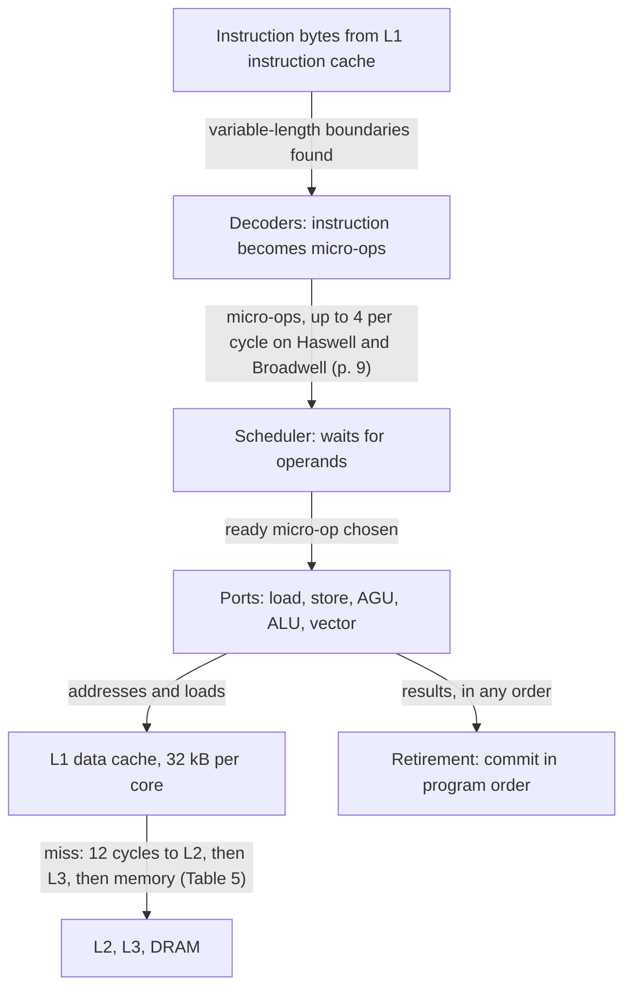

```mermaid
flowchart LR
  C["C source: pick, dot_scaled"] -->|"clang -O2 -arch x86_64"| ASM["Assembly: registers, flags, address formulas"]
  ASM -->|"assembler"| BYTES["Bytes: 1 to 10 bytes per instruction"]
  BYTES -->|"fetch and decode (per generation)"| UOPS["Micro-operations: private internal steps"]
  UOPS -->|"scheduler picks ready work"| PORTS["Execution ports: loads, stores, ALU, vector"]
  PORTS -->|"retire in program order"| RES["Architectural result: same on every x86-64 chip"]
```

# x86-64: from a compatibility-rich instruction set to fast modern execution

> **Sources:**
> 1. AMD64 Architecture Programmer's Manual, Volume 1 (AMD, document 24592, version 3.24 in the URL) - [canonical URL](https://docs.amd.com/v/u/en-US/24592_3.24). **Not read.** See the access note below.
> 2. Intel 64 and IA-32 Architectures Software Developer's Manual, Volume 1 (Intel) - [canonical URL](https://www.intel.com/content/www/us/en/content-details/851056/intel-64-and-ia-32-architectures-software-developer-s-manual-volume-1-basic-architecture.html). **Not read.** See the access note below.
> 3. Hofmann, Hager, Wellein and Fey (Erlangen), *An analysis of core- and chip-level architectural features in four generations of Intel server processors*, arXiv 1702.07554v1, February 2017 - [arXiv abstract](https://arxiv.org/abs/1702.07554) - [local PDF](../../sources/x86-64/intel-server-microarchitecture-analysis.pdf). **Read in full (19 pages).** Page numbers below are PDF page numbers.
>
> **Access note (tried 2026-11-19, with a plain `curl` and a generic client name).** The AMD URL answered HTTP 200 but returned a 2,575-byte JavaScript shell whose only text is "Loading application..."; the manual's text is not reachable without running a browser. A second guess at a content endpoint returned HTTP 404. The Intel URL answered HTTP 403 "Access Denied". So **no sentence in this tutorial is quoted from either manual.** Every statement about what the manuals define is labelled "general knowledge, not checked against the manuals here". Treat those as leads to verify, not citations.
>
> **Machine note.** This tutorial was written on an Apple M5 Pro, which is an Arm machine. Nothing here measures x86 timing. The x86-64 assembly was produced by cross-compiling with the machine's `clang` and only disassembled; it was never executed.

## Read this first

**The claim in one sentence.** The x86-64 instruction set is a long-lived contract about *results*: it fixes what registers, flags, memory addressing and byte encodings mean, while every processor generation is free to translate those instructions into private internal work, overlap that work out of order, and finish with the same architectural answer; so the speed you see is a property of a named processor generation, never of "x86" itself.

**Who this is for.** Someone who will read compiler output or a profile, choose between x86 servers and other hardware for running models, or compare x86-64 with Arm. You do not need to have read an x86 manual.

**Afterwards you will be able to** read a real x86-64 function (registers, flags, the address formula, byte encodings and lengths); say what a micro-operation (a processor's private internal step, defined below) is and why the front end is a plausible bottleneck; use latency and inverse throughput numbers to work out how much independent work a core needs; quote Hofmann et al.'s numbers for the right generation (Sandy Bridge, Ivy Bridge, Haswell or Broadwell, and no other); and explain why those 2012-2016 server numbers must not be carried to a current chip.

**Reading time.** About 55 minutes. **Have read first:** [Architecture map](../01-architecture-map.md) (what an ISA is versus an implementation) and [Memory hierarchy](../02-memory-hierarchy.md) (cache lines, latency in cycles). **Read next:** [Arm A-profile](../arm/04-arm-a-profile.md) for the same questions answered by a fixed-width instruction set.

**The one thing most people get wrong.** They treat a cache size, a latency or an "instructions per cycle" figure as a fact about x86. Every such number in this tutorial belongs to one Intel Xeon generation and one configuration. The Hofmann paper does not even cover AMD processors, and its newest generation (Broadwell-EP, released Q1 2016 per Table 1, p. 4) is far older than the laptops and servers a team would buy today.

## The paper in one worked example

The material here is real but split in two. Parts A to C are a function that this tutorial compiled for x86-64 on the authoring machine (**measured on this machine**: Apple clang 21.0.0, build clang-2100.1.1.101, host target arm64-apple-darwin25.5.0, cross-compiling with `-arch x86_64`; assembly only, **not run**). Part D uses numbers from Hofmann et al. (arXiv 1702.07554) and arithmetic done on them, marked "this tutorial computes". Part E is a small experiment that *was* run, on Arm.

### Part A - two small C functions

```c
long dot_scaled(const int *a, const int *b, long n, int k) {
    long s = 0;
    for (long i = 0; i < n; i++)
        s += (long)a[i] * b[i] + k;
    return s;
}
int pick(const int *t, long i, long j) {
    return t[i * 4 + j] + t[j + 8];
}
```

Commands used (compile and disassemble only):

```
clang -O2 -arch x86_64 -S f.c -o f.s          # assembly text
clang -O2 -arch x86_64 -c f.c -o f.o          # object file
objdump -d f.o                                 # bytes plus disassembly (Apple's LLVM objdump)
clang -O2 -arch x86_64 -mavx2 -c f.c -o f2.o  # same source, AVX2 allowed
```

`clang -arch x86_64 -dM -E` on this machine defines `__SSE4_1__` but not `__AVX__`, so the compiler's default x86-64 target here already allows SSE up to 4.1 (measured on this machine). That is a property of Apple's compiler configuration, not of x86-64.

### Part B - the smaller function, instruction by instruction

`pick` compiles to this (columns: offset within the function, encoded bytes, instruction; AT&T syntax, so the destination is on the right):

| Offset | Bytes | Instruction | Length |
|---|---|---|---|
| 0 | `55` | `pushq %rbp` | 1 |
| 1 | `48 89 e5` | `movq %rsp, %rbp` | 3 |
| 4 | `48 c1 e6 04` | `shlq $4, %rsi` | 4 |
| 8 | `48 8d 0c 97` | `leaq (%rdi,%rdx,4), %rcx` | 4 |
| c | `8b 44 97 20` | `movl 0x20(%rdi,%rdx,4), %eax` | 4 |
| 10 | `03 04 0e` | `addl (%rsi,%rcx), %eax` | 3 |
| 13 | `5d` | `popq %rbp` | 1 |
| 14 | `c3` | `retq` | 1 |

Eight instructions, 21 bytes (0xb0 to 0xc5 in the object file). Reading it against the C: the System V calling convention (the rule for which register carries which argument; general knowledge) puts `t` in `%rdi`, `i` in `%rsi` and `j` in `%rdx`, and the result in `%eax`. `shlq $4, %rsi` computes `i * 16` bytes, which is `i * 4` ints. The `leaq` computes the address `t + 4*j` bytes into `%rcx` without touching memory. The `movl` loads `t[j + 8]`: the displacement `0x20` is 32 bytes, which is 8 ints, added to the same `rdi + 4*rdx` base. The final `addl` has a **memory operand**: it loads `t[4i + j]` from address `%rsi + %rcx` and adds it to `%eax` in one instruction. So the `+` in the C source became one instruction that both reads memory and does arithmetic, something a load-store instruction set would write as two.

For comparison, the same function compiled for Arm with `clang -O2 -arch arm64` (measured on this machine) is six instructions of 4 bytes each, 24 bytes: `lsl`, `add x9, x0, x2, lsl #2`, two `ldr`, `add`, `ret`. The x86-64 version is *shorter* in bytes (21 versus 24) but has *more* instructions (8 versus 6), mostly because this build keeps a frame pointer (`push`, `mov`, `pop`: 5 bytes of the 21) in a leaf function. Do not conclude from one function that variable-length encoding saves space; the point is only that lengths here range from 1 to 4 bytes while Arm's are always 4.

Decoding three of those encodings by hand, using field layouts that are general knowledge (not checked against the manuals here) but that you can confirm against the disassembler's output above:

- `48 8d 0c 97`: `48` is a REX prefix (0100 1000; the W bit selects 64-bit operand size); `8d` is the opcode for `lea`; `0c` is a ModRM byte (00 001 100: no displacement, register field 001 = `rcx`, and rm field 100 meaning "a SIB byte follows"); `97` is the SIB byte (10 010 111: scale 2 bits = 2 so a factor of 4, index 010 = `rdx`, base 111 = `rdi`). Result: `rcx = rdi + rdx * 4`.
- `8b 44 97 20`: no REX prefix because the operation is 32-bit and uses only low registers; `8b` is a load opcode; ModRM `44` (01 000 100: an 8-bit displacement follows, register 000 = `eax`, SIB follows); the same SIB `97`; displacement byte `20`.
- `03 04 0e`: `03` is an add-from-memory opcode; ModRM `04` (00 000 100); SIB `0e` (00 001 110: factor 1, index 001 = `rcx`, base 110 = `rsi`). Result: `eax += *(rsi + rcx)`.

### Part C - the larger function: a loop the compiler vectorized

At `-O2` the compiler turned `dot_scaled` into 46 instructions (0x00 to 0xad, with a scalar fallback loop for leftovers). The hot loop (offsets 0x40 to 0x7d) is thirteen instructions, 61 bytes, average 4.7 bytes:

| Bytes | Instruction | What it does |
|---|---|---|
| `66 0f 38 35 1c 87` (6) | `pmovzxdq (%rdi,%rax,4), %xmm3` | load two 32-bit ints from `a`, widen to two 64-bit lanes |
| `66 0f 38 35 64 87 08` (7) | `pmovzxdq 0x8(%rdi,%rax,4), %xmm4` | the next two ints of `a` |
| `66 0f 38 35 2c 86` (6) | `pmovzxdq (%rsi,%rax,4), %xmm5` | two ints of `b` |
| `66 0f 38 35 74 86 08` (7) | `pmovzxdq 0x8(%rsi,%rax,4), %xmm6` | the next two of `b` |
| `66 0f 38 28 eb` (5) | `pmuldq %xmm3, %xmm5` | two signed 32x32 to 64-bit multiplies |
| `66 0f 38 28 f4` (5) | `pmuldq %xmm4, %xmm6` | two more |
| `66 0f d4 c1` (4) | `paddq %xmm1, %xmm0` | add the broadcast `k` to accumulator 0 |
| `66 0f d4 c5` (4) | `paddq %xmm5, %xmm0` | add products to accumulator 0 |
| `66 0f d4 d1` (4) | `paddq %xmm1, %xmm2` | add `k` to accumulator 1 |
| `66 0f d4 d6` (4) | `paddq %xmm6, %xmm2` | add products to accumulator 1 |
| `48 83 c0 04` (4) | `addq $4, %rax` | advance the index by four elements |
| `49 39 c0` (3) | `cmpq %rax, %r8` | set flags: compare index to the rounded-down count |
| `75 c3` (2) | `jne 0x40` | branch back if not equal; `c3` is -61 as a signed byte |

Things to notice, all measured on this machine's output. The lengths run from 2 to 7 bytes in the loop and up to 10 elsewhere (`movabsq` with a 64-bit immediate, 10 bytes). The loop uses two accumulators (`xmm0`, `xmm2`) so that two chains of additions can proceed independently. The `66` byte at the front of the vector instructions is a legacy prefix that is part of those opcodes; the `0f 38` bytes are an opcode-escape sequence (both general knowledge). The `cmpq` writes the flags register and the `jne` immediately reads it. One iteration handles four elements, so 61 bytes and 13 instructions per four elements.

Recompiling the same source with `-mavx2` gives a loop of 23 instructions and 115 bytes (average 5.0) that handles 16 elements per iteration, using `ymm` registers and four accumulators, with encodings that start `c4` or `c5` (VEX prefixes, general knowledge). Per element that is 1.4 instructions versus 3.3 for the SSE4.1 build: 23 divided by 16, and 13 divided by 4.

### Part D - what Hofmann et al. add: how the machine consumes such a loop

The paper never analyses this function. It supplies measured numbers for four Intel Xeon generations that let you reason about loops *like* it. Quoted from Table 2 (p. 8) are the paper's "worst-case measured latency and inverse throughput" for floating-point instructions. **Inverse throughput** is the cycles between starts of independent instances of the same instruction; **latency** is the cycles from start to result.

| Instruction (generation) | Latency (cycles) | Inverse throughput (cycles per instruction) | Independent instructions in flight (this tutorial computes: latency / inverse throughput) |
|---|---|---|---|
| AVX add (Broadwell) | 3 | 1 | 3 |
| SSE or scalar add (Broadwell) | 4 | 1 | 4 |
| multiply (Broadwell) | 3 | 0.5 | 6 |
| multiply (Haswell) | 5 | 0.5 | 10 |
| multiply (Sandy Bridge) | 5 | 1 | 5 |
| AVX fused multiply-add (Broadwell and Haswell) | 5 | 0.5 | 10 |
| AVX double-precision divide (Broadwell) | 24 | 16 | 1.5 |

So on Haswell a loop that sums products into a single running total, where each add needs the previous add's result, would use one add every 3 cycles at best, not one per cycle. To keep both multiply pipes busy you need about ten independent multiplies in flight. That is why Part C's compiler output has two accumulators and the AVX2 variant has four.

### Part E - the same principle measured on Arm

**Measured on this machine (Apple M5 Pro, Arm; not x86):** a C program sums 2,048 doubles (16 KiB, inside the L1 data cache, which `sysctl` reports as 131,072 bytes for the performance cores) with 1, 2, 4, 8 or 16 independent running sums. Compiled with `clang -O2 -fno-vectorize -fno-slp-vectorize -ffp-contract=off`; best of 7 trials of 20,000 passes; two full runs gave identical figures to three decimals:

| Independent sums | ns per add |
|---|---|
| 1 | 0.566 |
| 2 | 0.287 |
| 4 | 0.136 |
| 8 | 0.062 |
| 16 | 0.058 |

Doubling the chains roughly halves the time until it flattens at 8 to 16: the single chain is latency-bound, the plateau is throughput-bound, and the ratio 0.566 / 0.058 is about 9.8 adds in flight. This is the same latency-times-throughput effect as in Part D on a different processor family. It says nothing about any x86 timing; the full program is in "A minimal version".



Notice the label on each arrow: the left three arrows are fixed by the contract and the compiler; the two on the right are chosen by the processor generation, which is where Hofmann's numbers live.

## Words you need

| Term | Plain definition | Example from the worked example |
|---|---|---|
| ISA (instruction set architecture) | The contract: instruction meanings, registers, flags, addressing, encodings. It says what must happen, not how long it takes. | `addl (%rsi,%rcx), %eax` means load, add, set flags, whatever the chip. |
| Microarchitecture | One processor design that implements an ISA: caches, ports, predictors. Names here are Intel's: Sandy Bridge, Ivy Bridge, Haswell, Broadwell. | Table 2 differs by generation for the same instruction. |
| Micro-operation (micro-op, uop) | A simple internal step an instruction is translated into. One instruction may become one or several; some pairs are fused into one. The paper uses the term for fusion and retirement limits (p. 9). | The store-plus-address pair fused "into a single micro-op" on Haswell (p. 9). |
| Addressing mode | The rule that forms a memory address. On x86-64 the general form is base + index * scale + displacement, with scale 1, 2, 4 or 8 (general knowledge). | `0x20(%rdi,%rdx,4)` = `rdi + 4*rdx + 32`. |
| Flags | Status bits an instruction may set (zero, sign, carry, overflow) and a later branch reads. | `cmpq` then `jne`. |
| Variable-length encoding | Instructions occupy different numbers of bytes, so the decoder must find boundaries. | 1 byte (`pushq`) to 10 bytes (`movabsq`). |
| REX / VEX prefix | Extra leading bytes that widen registers to 64 bits and reach 16 registers (REX), or encode AVX vector forms (VEX) (general knowledge). | `48` on `leaq`; `c5` and `c4` in the AVX2 build. |
| SIMD (single instruction, multiple data) | One instruction operating on several values packed in a wide register. | `pmuldq` does two multiplies; `vpmuldq` on `ymm` does four. |
| SSE / AVX / AVX2 / FMA | Successive x86 vector extensions. The paper: SSE is 128 bits, AVX is 256 bits, AVX2 extends the 256-bit width from floating point to integers, FMA is fused multiply-add (p. 4). | `xmm` (128-bit) versus `ymm` (256-bit) registers. |
| Out-of-order execution | Executing instructions as their inputs become ready instead of strictly in program order, then retiring them in order. The paper calls the unit that feeds work to ports "the out-of-order engine" (p. 7). | The two accumulators in Part C. |
| Latency / inverse throughput | Cycles until a result exists / cycles between starts of independent copies. | Table 2, p. 8. |
| AGU (address generation unit) | Hardware that computes memory addresses. Haswell added a third AGU that handles only simple store addresses (p. 8-9). | Why `base + index + offset` loads are limited to two per cycle on Haswell and Broadwell. |
| Uncore | The parts of the chip outside the cores: the L3 cache and the memory controllers (p. 2). | Clocked separately from the cores starting with Haswell (p. 15). |
| CoD (Cluster on Die) | Haswell and later option that splits one chip into two NUMA (non-uniform memory access) domains (p. 4-5, 11). | Lowers L3 latency from 47 to 41 cycles on Broadwell (p. 11). |

## Tutorial 1 - Intuitive understanding

### What was broken before

Instruction sets that grow for decades collect baggage. x86 started as a 16-bit design and was extended to 32 bits and then 64 bits without breaking old programs, which means a modern chip must still accept encodings from earlier eras. Concretely, Part C showed instructions that are 2 bytes long next to ones that are 10 bytes long. A processor that wants to start several instructions per cycle must first know where each begins, and with variable lengths the start of instruction number five depends on the lengths of the first four.

If a chip executed such instructions literally and in order, a memory-reading add would stall everything behind it until the data arrived. The Hofmann paper puts a number on how slow memory is relative to the core: on Broadwell-EP, a main-memory access costs between 178 and 280 core cycles depending on a boot-time coherence setting (Table 5, p. 13), while an add costs 3 or 4 cycles (Table 2, p. 8). A design that waits for memory in program order would spend most of its time idle.

### The idea

Think of the ISA as a legal contract written decades ago and still binding: it fixes what a request means, not how the firm fulfils it. Behind the front desk, the firm has remodelled many times. A modern x86 core is a translating front desk (the decoders) feeding a busy back office (schedulers and execution ports) that works on whatever is ready, plus a records clerk (the retirement stage) who makes sure the outcome is filed in the original order.

Where the analogy breaks: a real contract is enforced by a court, whereas the x86 contract is enforced only on *results*. Timing is not part of it, so two chips can differ by 10 times on the same program and both be correct. The analogy also hides that the back office is not free. Each internal step uses a limited resource (a port, an address generator, a retirement slot), and the paper's whole method is finding out which resource saturates first.

### How it works, step by step

Trace `pick` from Part B. The numbering below is the order a processor sees work; the paper's pieces are marked, and the rest is general knowledge.

1. **Fetch and decode.** The core reads the 21 bytes, splits them into the eight instructions, and translates each into micro-ops. The paper says little about this stage; it mentions "decoder/retirement throughput" and "L1I bandwidth" as general limits an analysis must know (p. 7) and a "four micro-op per cycle front end retirement constraint" on Haswell and Broadwell (p. 9). Whether `addl (%rsi,%rcx), %eax` becomes one fused micro-op or two is not stated in the paper.
2. **Rename (general knowledge, not in the paper).** The sixteen architectural general-purpose registers are mapped onto a larger pool of internal registers, so that two uses of `%rax` that have nothing to do with each other do not wait for each other.
3. **Schedule.** The `shlq`, the `leaq` and the `movl` do not depend on each other (the `leaq` and `movl` both read `rdi` and `rdx`). The paper's lowest-order model: "all instructions can be executed independently and are dynamically fed to the execution ports" by the out-of-order engine (p. 7).
4. **Execute.** Loads go to load units. The paper reports two load units and one store unit on all four generations (p. 8). Each memory access first needs an address: up to Ivy Bridge two AGUs, each sharing a port with a load unit; Haswell added a third on a new port 7 but it handles only simple store addresses (p. 8).
5. **Retire in order.** The `addl` cannot retire before the `movl` it depends on has its data, and nothing retires out of order, so a debugger or an interrupt sees a clean sequential state.



Notice that two arrows carry numbers from the paper while the front half carries mostly labels: the sources here describe the *back* half of the pipeline (ports, caches, memory) in measured detail and the front half (decode, rename, reorder buffer) hardly at all. Anything more about those stages in this tutorial is general knowledge.

### What the results say

Each number below is from Hofmann et al. and belongs to the named generation. "Cycles" are core cycles; where the paper measures at base frequency it says so.

**1. Divide got much faster across generations (Table 2, p. 8).** A double-precision AVX divide (`vdivpd`) has latency 45 cycles on Sandy Bridge and 24 on Broadwell, and an inverse throughput of 44 cycles versus 16. In plain terms, Sandy Bridge could start one such divide every 44 cycles and Broadwell one every 16, about 2.75 times as many divides per cycle (this tutorial computes 44 / 16). The paper's text calls it "almost three-fold" (p. 7). Even so, a Broadwell divide costs 16 cycles of throughput while an add costs 1, so a loop dominated by divides is still slow.

**2. Multiply and fused multiply-add in the same table.** Haswell introduced FMA hardware, and the paper notes it also made two plain multiplies per cycle possible (p. 8: inverse throughput 0.5). On Broadwell multiply latency dropped from 5 to 3 cycles, while the latency of scalar and SSE add rose from 3 to 4. The paper notes this change is not documented by Intel for Broadwell (p. 8). A practical consequence: a chain of dependent adds is slower on Broadwell than on Haswell (4 versus 3 cycles per add for SSE or scalar code), even though the chip is newer.

**3. Gather became useful on Broadwell (Table 3, p. 10).** A gather instruction loads several non-contiguous values into one vector register. With all data in L1 cache, one gather took 12.3 cycles on Haswell-EP and 7.3 on Broadwell-EP. The paper says "40% faster" (p. 10); 7.3 is 41% less than 12.3, so that means 40% less time, which is a 1.68 times higher rate, not 40% more work per second. In practice: in a loop that fetches indexed elements from L1-resident data, Broadwell spends about 7 cycles where Haswell spent about 12. Once the data comes from memory spread over 8 cache lines, the two are equal within noise (89.3 versus 94.4 cycles), because moving eight cache lines dominates.

**4. The L2 cache did not deliver its advertised doubling (Table 4, p. 10-11).** Intel's documentation says the L1-L2 path doubled from 32 to 64 bytes per cycle on Haswell (Table 1, p. 4). The paper measured 43 bytes per cycle for a load-only dot product and 32 for the STREAM triad on both Haswell and Broadwell, against 28 and 29 on Sandy Bridge and 27 and 29 on Ivy Bridge. Meaning: if you plan a cache-blocked kernel using 64 bytes per cycle you will be off by a factor of 1.5 to 2.

**5. Latency of each level (Table 5, p. 13).** Measured in cycles at base frequency, with prefetchers off and pointer chasing: L1 is 4 cycles and L2 is 12 on all four generations; L3 is 40 (Sandy Bridge), 40 (Ivy Bridge), 37 (Haswell, reading explained in the inconsistency note below) and 47 or 41 on Broadwell with Cluster on Die off or on; main memory is 230, 208, 168 and, on Broadwell, 248, 280, 190 or 178 depending on snoop mode (the setting for how coherence checks are sent between sockets). At the Broadwell base frequency of 2.3 GHz (Table 1), 178 to 280 cycles is about 77 to 122 nanoseconds (this tutorial computes).

**6. The AVX frequency cost (p. 5-6).** Starting with Haswell, a chip advertises a base frequency for scalar and SSE code and a lower AVX base frequency: 2.3 versus 1.9 GHz on the Xeon E5-2695 v3 and 2.3 versus 2.0 GHz on the E5-2697 v4 (Table 1). Wide vector code can therefore lower the clock, and the paper reports that on Haswell a single core running AVX code restricts the whole chip to the AVX maximum all-core turbo frequency, while on Broadwell cores running scalar or SSE code are allowed to float independently (p. 6; the sentence is garbled by a typo, discussed in the inconsistencies).

### What this does not show

- It does not show anything about AMD processors, any chip after Broadwell-EP (2016), consumer cores, or any ISA other than x86 (its introduction says this is a study of "four generations of Intel server processors", p. 1-2).
- It measures floating-point microbenchmarks written in hand-tuned assembly plus LINPACK, HPCG (High Performance Conjugate Gradient) and Graph500 (p. 5). It says nothing about integer-heavy or branchy code such as a compiler or a database, and it does not measure decoders, the micro-op cache, branch predictors or rename at all.
- It does not show the cost of the *compatibility* features of x86: it never compares to a clean-sheet ISA, and it measures no instruction-decode overhead. The idea that variable-length decode costs energy or area is general knowledge in this tutorial and is not supported by any number from these sources.
- It does not measure large language model work. The memory latency and bandwidth numbers are the closest thing to relevant, and they are for 2016 hardware with DDR4-2400 memory (Table 1).

### Teach-back

**Q1.** Why can two correct x86-64 processors run the same binary at very different speeds?

<details><summary>Answer</summary>
Because the ISA specifies results (register, flag and memory contents after each instruction) and not timing. Each generation chooses its own decoders, ports, caches and prediction. Table 2 (p. 8) shows the same divide instruction at 24 cycles latency on Broadwell and 45 on Sandy Bridge.
</details>

**Q2.** In Part C, why does the compiler use two accumulators (`xmm0` and `xmm2`) when one would give the same answer?

<details><summary>Answer</summary>
One accumulator forms a dependency chain: each add waits for the last. Two accumulators give two independent chains that can overlap, hiding latency. The latency-over-throughput arithmetic in Part D shows how many are needed; the measured Arm run in Part E shows the effect.
</details>

**Q3.** The paper says Broadwell's gather is "40% faster" than Haswell's. Do you read that as 40% more gathers per second?

<details><summary>Answer</summary>
No. Table 3 gives 12.3 versus 7.3 cycles per gather in L1, which is about 41% less time, or a rate about 1.68 times higher. When the data are far away the two are about equal.
</details>

**Q4.** Name one number in this tutorial that you may not carry from the Intel server chips to a laptop.

<details><summary>Answer</summary>
Any of them: memory latency of 178 to 280 cycles, the 64 versus 32-43 bytes per cycle L2 result, the 16-cycle divide. All are specific to Xeon Broadwell-EP (or the named generation) in the paper's configuration.
</details>

## Tutorial 2 - Practitioner understanding

### The design in concrete terms

**What the contract contains (general knowledge, not checked against the manuals here).** x86-64 "long mode" provides sixteen 64-bit general-purpose registers (`rax` to `r15`), a 64-bit instruction pointer `rip`, a flags register `rflags`, and vector registers: sixteen 128-bit `xmm` registers that SSE uses, widened to 256-bit `ymm` by AVX. Addresses are formed as `base + index * scale + displacement`, with scale 1, 2, 4 or 8, and `rip`-relative addressing exists for position-independent code. Writing to a 32-bit register name such as `%eax` zeroes the upper 32 bits of `%rax`; that is why `movl` is used for 32-bit loads and `xorl %eax, %eax` zeroes the whole register (visible at offset 0x15 in Part C). Instructions are 1 to 15 bytes long, built from optional prefixes, an opcode, an optional ModRM byte, an optional SIB byte, a displacement and an immediate. The maximum of 15 bytes and the field layouts are from memory; verify them in Intel SDM Volume 2 and AMD APM Volume 3 when you can reach them (neither is among the manifest sources).

**How a profile sees it.** The paper gives a working list of what you need to predict a loop's speed in a steady state with data in L1 (p. 7): per-instruction latency and throughput, "decoder/retirement throughput, L1I bandwidth, and the number and types of address generation units". It also names the tool the community used, the Intel Architecture Code Analyzer (IACA), and warns that it is "proprietary software with an unclear future development path" and "does not always yield accurate predictions" (p. 7).

**Per-generation structures the paper reports** (Table 1, p. 4; text p. 8-9). None of these are in the ISA:

| Property | Sandy Bridge-EP | Ivy Bridge-EP | Haswell-EP | Broadwell-EP |
|---|---|---|---|---|
| Chip model | Xeon E5-2680 | Xeon E5-2690 v2 | Xeon E5-2695 v3 | Xeon E5-2697 v4 |
| Release | Q1/2012 | Q3/2013 | Q3/2014 | Q1/2016 |
| Base frequency | 2.7 GHz | 3.0 GHz | 2.3 GHz | 2.3 GHz |
| Cores / threads | 8 / 16 | 10 / 20 | 14 / 28 | 18 / 36 |
| Newest SIMD | AVX | AVX | AVX2, FMA3 | AVX2, FMA3 |
| Memory | 4 ch. DDR3-1600 | 4 ch. DDR3-1866 | 4 ch. DDR4-2133 | 4 ch. DDR4-2400 |
| Theoretical memory bandwidth | 51.2 GB/s | 59.7 GB/s | 68.2 GB/s | 76.8 GB/s |
| L1 / L2 per core | 32 kB / 256 kB | 32 kB / 256 kB | 32 kB / 256 kB | 32 kB / 256 kB |
| L3 total | 20 MB | 25 MB | 35 MB | 45 MB |
| L1 to register bandwidth | 2 x 16 B/cy | 2 x 16 B/cy | 2 x 32 B/cy | 2 x 32 B/cy |
| Register to L1 bandwidth | 1 x 16 B/cy | 1 x 16 B/cy | 1 x 32 B/cy | 1 x 32 B/cy |
| L1 to L2 | 32 B/cy | 32 B/cy | 64 B/cy | 64 B/cy |
| L2 to L3 | 32 B/cy | 32 B/cy | 32 B/cy | 32 B/cy |

"B/cy" is bytes per core cycle. The paper's own Table 1 caption says all of these "numbers [are] taken from data sheets", so they are the vendor's claims; Table 4 shows the L2 claim failing. The memory bandwidth column is checkable arithmetic: 4 channels x 8 bytes x 2400 million transfers per second = 76.8 GB/s for Broadwell (this tutorial computes; the other three columns also reproduce: 51.2, 59.7, 68.2). Likewise the L1 totals: two 32-byte loads plus one 32-byte store is 96 bytes per cycle on Haswell and Broadwell, and 48 on the older two.

**Address-generation detail that links to your assembly (p. 9).** The paper explains that on Haswell and Broadwell only two of the three AGUs can compute the general form `base + scaled index + offset`; the third "can only perform offset computations" for stores. Result: "only two addresses per cycle can be calculated", which limits an AVX STREAM triad (two loads, one FMA, one store per four elements) to 64 B/cy of the 96 B/cy peak. The paper's workaround is to use one of the "fast LEA" units, which does indexed addressing without an offset, to precompute an address so the simple AGU can finish the job. Relevance to Part C: every load there uses the indexed form (`(%rdi,%rax,4)`), and two of the four use a displacement as well.

**Fusion and the four micro-op limit (p. 9).** When a store is paired with address generation on the new store AGU "both micro-ops are fused into a single micro-op". With sufficient unrolling "the bandwidth should approach 96 B/cy", yet Figure 2 shows the measured value stays below it, because "bandwidth can be further increased by removing the FMA instructions from the loop body", so micro-op throughput "still seems to be the bottleneck". The authors do not resolve the cause; it is an open point (see Tutorial 3).

**SIMD, in terms of what the sources support.**

- The paper says SSE vectors are 128 bits and AVX doubled that to 256 (p. 4); AVX2 extended 256-bit vectorization from floating point to integer data (p. 4); the FMA extension adds fused multiply-add handled by two new AVX-capable execution units (p. 4); a vector gather instruction was introduced on Haswell to load non-contiguous data (p. 4, 9).
- On Sandy Bridge the registers doubled in width but the data paths between L1 and the load and store units stayed at 16 B/cy, so "AVX stores requiring two cycles to retire on SNB, and AVX LOADs block both units" (p. 4; the sentence is the paper's, with its grammar).
- Gather is described as "a microcode solution" (p. 9): a short internal program, not a single hardware lookup.
- Wide vectors carry a frequency cost on Haswell and later (p. 5-6), and the authors expect AVX-512 on selected Skylake models (p. 17). The paper does not measure AVX-512.
- This tutorial's own compile shows that SIMD is not automatic or free: for 32-bit inputs summed into a 64-bit total, the compiler widened each input to 64-bit lanes (`pmovzxdq`), so a 128-bit register did only two multiplies per instruction. Whether a different source form would be faster is not tested.

**Bridge to Arm.** Both sides of the comparison are covered in [Arm A-profile](../arm/04-arm-a-profile.md): fixed 4-byte instructions, a load-store design (arithmetic works on registers; only loads and stores touch memory), 31 general registers, and NEON vectors. At conceptual level the two converge on the same internal shape: decode, rename, schedule, execute out of order, retire in order, and both are bounded by the same latency, throughput and memory arithmetic. The differences that matter in practice are decode complexity on x86 and the memory-ordering rules, which are stronger on x86 (general knowledge; see the Arm tutorial for what the Arm sources say). For the broader map see [Architecture map](../01-architecture-map.md).

### A minimal version

This is the program from Part E. It **was compiled and run on this Apple M5 Pro (Arm)**, not on x86; it demonstrates latency-bound versus throughput-bound execution with plain C.

```c
// chains.c - dependent vs independent floating-point adds. Compile:
//   clang -O2 -fno-vectorize -fno-slp-vectorize -ffp-contract=off -o chains chains.c
#include <stdio.h>
#include <time.h>
#define N 2048                      /* 2048 doubles = 16 KiB, fits in L1D */
static double a[N];
static double now(void){struct timespec t;clock_gettime(CLOCK_MONOTONIC,&t);
  return t.tv_sec+t.tv_nsec*1e-9;}
#define KERNEL(NAME, ACC) \
__attribute__((noinline)) double NAME(int reps){ double s[ACC]={0}; \
  for(int r=0;r<reps;r++) for(int i=0;i<N;i+=ACC) for(int k=0;k<ACC;k++) s[k]+=a[i+k]; \
  double t=0; for(int k=0;k<ACC;k++) t+=s[k]; return t; }
KERNEL(c1,1) KERNEL(c2,2) KERNEL(c4,4) KERNEL(c8,8) KERNEL(c16,16)
typedef double (*fn)(int);
int main(void){
  for(int i=0;i<N;i++) a[i]=1.0+i*1e-6;
  fn f[]={c1,c2,c4,c8,c16}; int accs[]={1,2,4,8,16}; int reps=20000; double sink=0;
  for(int j=0;j<5;j++){
    f[j](200); double best=1e9;                       /* warm-up, then best of 7 */
    for(int trial=0;trial<7;trial++){ double t0=now(); sink+=f[j](reps);
      double dt=now()-t0; if(dt<best)best=dt; }
    printf("accumulators=%2d  %.3f ns per add\n",accs[j],best/((double)reps*N)*1e9);
  }
  fprintf(stderr,"sink=%g\n",sink); return 0; }
```

Output as measured (two runs identical): `accumulators= 1  0.566`, `2  0.287`, `4  0.136`, `8  0.062`, `16  0.058` nanoseconds per add. The assembly for `c1` has one `fadd d0, d0, d1` per loop iteration; `c8` has sixteen `fadd`s in its body (the compiler unrolled by two). Caveats: macOS offers no core pinning, so I did not control whether the run landed on a performance or efficiency core (the numbers were the same on both runs); the clock frequency was not read, so I do not convert nanoseconds into cycles; the plain-C single sum cannot be reordered by the compiler because floating-point addition is not associative (general knowledge), which is why the program writes the separate sums out by hand.

**To get an x86 answer** (`not run` here; do this on an x86-64 machine you control): compile the same file, then use `perf stat -e cycles,instructions ./chains` on Linux, or Intel VTune or AMD uProf, and divide. Expect the single-chain figure to equal the add latency of that chip and the plateau to reflect its FP add pipes, but those are predictions, not results: the paper's table suggests 3 to 4 cycles per dependent add on Broadwell and 3 on Haswell, and it measures nothing newer.

**To reproduce the assembly and the byte encodings** (these were run, compile and disassemble only): the four commands in Part A. On macOS, `otool -tv f.o` also prints the instructions with their offsets; Apple's `objdump -d` additionally prints the raw bytes, which is how the byte columns in this tutorial were obtained.

**Shape of the data.** Input: a C file. Output of `-S`: about 89 lines of assembly for the two functions at `-O2` for x86-64, which includes directives. Output of `objdump -d`: lines of `offset: bytes instruction`, from which you can compute instruction lengths by subtracting consecutive offsets. For instance, 0x3d bytes (61) between 0x40 and 0x7d for the thirteen-instruction loop.

### What it costs

Worked arithmetic on the numbers in this tutorial. Assumptions are stated each time; none is a measurement of an x86 chip.

**1. Instruction fetch pressure.** The SSE4.1 loop is 61 bytes for 4 elements, the AVX2 loop 115 bytes for 16 elements (measured on this machine's compiler output). Per element that is 15.3 bytes versus 7.2 bytes of code to fetch. The paper does not measure instruction fetch, so how much this matters is not established by the sources.

**2. Front-end bound for the SSE4.1 loop on a Haswell- or Broadwell-class core (constructed).** Assume each of the 13 instructions is at least one micro-op and the paper's "four micro-op per cycle" limit (p. 9) applies as the binding limit: 13 / 4 = 3.25 cycles per iteration, so about 0.8 cycles per element. If the `cmpq` and `jne` pair fuse into one micro-op (general knowledge about Intel cores, not stated in the paper) it is 12 / 4 = 3.0. This is a lower bound from one assumed limit, not a prediction.

**3. Load bound for the same loop (constructed).** Four loads per iteration over two load units (p. 8) is at least 2 cycles. So under these assumptions the front end (3.0 to 3.25) would bind before the load units (2). Whether the real chip reaches either is untested.

**4. Dependency bound.** Each accumulator is touched by two `paddq` per iteration, in series. The sources give no integer vector add latency (Table 2 is floating point only), so I will not put a number on it. If it were 1 cycle, two chained adds give a 2-cycle bound per iteration, below the front-end bound, which would explain why a compiler chose two accumulators; that is an inference.

**5. Memory time in nanoseconds.** The paper's cycles at base frequency convert directly: Broadwell DRAM at 178 cycles (directory mode) is 178 / 2.3 GHz = 77 ns, and at 280 cycles (home snoop) is 122 ns; Sandy Bridge at 230 cycles and 2.7 GHz is 85 ns; Haswell at 168 cycles and 2.3 GHz is 73 ns (this tutorial computes; the Haswell cycle count rests on the table reading discussed under inconsistencies). Main memory latency barely moved in nanoseconds over four generations, while core resources grew; that is the quantitative reason for out-of-order machinery.

**6. Token generation on such a machine (constructed, for orientation).** Generating one token with a dense language model reads roughly all the weights once, so tokens per second is at most bandwidth divided by model bytes. Assume a 7-billion-parameter model quantized to 4 bits, about 3.5 GB (an assumption, not from any source). On Broadwell-EP's theoretical 76.8 GB/s (Table 1) one socket gives at most 76.8 / 3.5 = 21.9 tokens per second; real sustained bandwidth is lower (the paper's Figure 5-6 plot sustained bandwidth for several access patterns, but the numbers on the axes could not be read reliably in this text extraction, so I use no sustained figure). With two sockets, a program that is not NUMA-aware pays the cross-socket costs the paper shows. The point is the form of the calculation, not the answer.

### How it fails

| Symptom | Likely cause | Mitigation | Grounding |
|---|---|---|---|
| Loop is far slower than "peak" despite vector code | Dependency chain through one accumulator; or micro-op throughput | Independent accumulators; unroll; remove needless instructions | Table 2; p. 7, p. 9 |
| AVX kernel runs at a lower clock than scalar code | Chip drops to AVX frequency on Haswell and later | Measure the attained frequency under the real instruction mix; do not assume the advertised one | p. 5-7, Fig. 1 |
| Predicted L1-L2 bandwidth is 64 B/cy but you measure about 32-43 | The documented figure is a peak; the paper measured much less | Use measured values in your model | Table 4, p. 10-11 |
| Gather is slower than hand-written loads | Haswell's first gather; or data spread over many cache lines | Prefer gather only on Broadwell or later and when data are in cache | Table 3, p. 10 |
| Graph or pointer-heavy code is slow on a two-socket Xeon in the lowest-latency coherence mode | Directory mode on a non-NUMA-aware program: shared data exceed the directory cache | Choose home snoop with opportunistic broadcast; the paper reports up to 50% better Graph500 on Broadwell | p. 3, 13-14, 17 |
| Two chips with the same model number differ in speed or power | Silicon variation | Benchmark your own parts | Fig. 1c, p. 6-7: 1,456 Xeon E5-2630 v4 chips |
| Assembly looks bigger than the C suggests | Compiler vectorization added setup, remainder and fallback loops | Read the loop body, not the function length | Part C: 46 instructions for a 4-line function |
| Compiler output changes between machines | Different default target (Apple's default includes SSE4.1) | Pin `-march` or `-mcpu` explicitly | measured: `__SSE4_1__` defined, `__AVX__` not |

### Evaluating your version

- **Metric.** Cycles per element (or per iteration) for each kernel, with the processor frequency read at run time, and the hardware's own counters for retired instructions and micro-ops where the tool provides them.
- **What to compare to.** (a) A cycle bound from the instruction mix using the vendor's numbers for your exact chip, and (b) the same loop compiled for another target if you are comparing architectures. For model-serving questions, a STREAM-style bandwidth measurement on the actual machine.
- **Test set size.** At least 7 timed repetitions per configuration after a warm-up (the Part E program does this), repeating on several parts if you are buying many; the paper's single-model variation study used 1,456 chips (Fig. 1c).
- **Stop rule.** Stop optimizing when the measured cycles per iteration are within about 10% of the largest of your four bounds (dependency, port or throughput, front end, memory). That 10% is this tutorial's rule of thumb, not from the sources. If a measured value is below your bound, your bound was wrong; fix the model, not the measurement.
- **Control.** Pin the frequency or record it (the paper used `likwid-setFrequencies`, p. 5), turn prefetchers off for latency tests (the paper did, p. 5), and report the compiler and flags.

### Adopt, adapt or skip

**Recommendation for a team deciding what to learn or run (especially for language model and agent workloads).**

- **Adopt** the *method*: bound a loop by dependency chains, port or issue throughput, front-end width and memory bandwidth, and measure which one binds. It works the same on x86, Arm and GPUs ([GPU foundations](../gpu/05-gpu-foundations.md)).
- **Adapt** the *numbers*: use Hofmann's tables only as worked examples of what to measure on your own chip, and keep each tied to its generation. If you run on current Xeon or AMD servers, re-measure latency, bandwidth and AVX frequency behaviour; do not copy 2016 values.
- **Skip** memorizing x86 encodings, unless you write compilers, debuggers or binary tools. Reading the assembly well enough to see registers, flags, addressing and loop structure is enough for most engineering work.
- **For local or CPU inference**, choose hardware by memory capacity and measured memory bandwidth first (Part D's arithmetic: tokens per second is capped by bandwidth divided by model bytes) and by available vector or matrix instruction support second; ISA family (x86-64 or Arm) is a weak predictor of either. See [CPU versus GPU decision](../10-cpu-gpu-decision.md) for when accelerators change the answer.
- **Do not** conclude from this tutorial that Arm is faster or slower than x86, or that x86 is "inefficient". No source here compares them.

## Tutorial 3 - Researcher understanding

### Formal setup

**Notation.** For a loop body in steady state with all data in L1:

- *L_i* = latency of instruction type *i* (cycles); *R_i* = inverse throughput (cycles per instruction, the paper's "inverse throughput", Table 2).
- *n_i* = how many instructions of type *i* execute per iteration; *p* = number of execution ports able to run a given class.
- *W* = front-end and retirement width in micro-ops per cycle (the paper's 4 for Haswell and Broadwell, p. 9).
- *C_dep* = length of the longest loop-carried dependency chain, in cycles per iteration.
- *T_iter* = cycles per iteration.

**The in-core bounds** in the paper's words: "the pipeline that takes the largest number of cycles to execute all its instructions determines the runtime", with the opposite limit set by "the critical path through the code, heeding all dependencies" (p. 7). Formally, the optimistic and pessimistic bounds are

T_throughput = max over classes of ( sum of n_i * R_i for instructions on that class ), T_critical = C_dep,

and the paper says the actual time lies between them "unless other bottlenecks apply" such as transfers from beyond L1 or instruction cache misses (p. 7). This tutorial adds the front-end term T_fe = (total micro-ops) / *W* and writes T_iter >= max(T_throughput, T_critical, T_fe, T_mem); that combined form is the tutorial's, not the paper's.

**Latency hiding.** The number of independent instances needed to saturate a unit is *L_i* / *R_i* (Little's law, defined in the prerequisites).

**The ECM (Execution-Cache-Memory) model.** The paper does not derive it but states its key difference from Roofline: it "drops the assumption of a single bottleneck" and adds in-core time and data-transfer times according to the processor's overlap properties; on Intel x86 server chips "all time contributions from data transfers including LOADs and STOREs in the L1 cache must be added" (p. 2), while the IBM Power8 shows "almost perfect overlap" (p. 2).

**Numeric toy instance (constructed, using Haswell-EP numbers from the paper).** An AVX double-precision STREAM triad updates four elements with 2 loads, 1 FMA and 1 store. Each memory instruction needs an address. With two full AGUs, three addresses take 1.5 cycles per iteration, so the 96 bytes moved (3 x 32) take 1.5 cycles: 96 / 1.5 = 64 B/cy, matching the paper's stated 64 B/cy limit (p. 9). With the paper's fast-LEA workaround all three addresses could be produced in one cycle, giving 96 B/cy as the ideal and, per Figure 2a, a lower measured value. The arithmetic agrees with the paper's text; the measured Figure 2 curves could not be read as numbers in the extraction.

### The claims, stated precisely

1. *Instruction latency and throughput.* On the four named Xeon-EP generations the documented numbers fit the measurements, with deviations in scalar double divide throughput on Broadwell (4.5 versus the documented limit of 5 cycles, p. 7) and SSE or scalar add and FMA latency on Broadwell (increased from 3 to 4 and 5 to 6, p. 8, p. 16).
2. *L1 bandwidth.* Peak 96 B/cy on Haswell and Broadwell (Table 1) is reachable only by instruction sequences that satisfy the address-generation constraints, and in the paper's tests micro-op throughput also keeps it below the limit (p. 9).
3. *L2 bandwidth.* Haswell and Broadwell achieve 32 to 43 B/cy, not the documented 64 (Table 4; p. 17).
4. *Gather.* On Broadwell the gather is faster than hand-crafted loading (p. 17); on Haswell it was not always (p. 10).
5. *Scalable L3.* With CoD, parallel efficiency of the L3 for streaming code is 98% on Haswell and above 95% on Broadwell; without CoD it is 92% and 86%, and "never worse than 85%" overall (p. 11, 17).
6. *Memory latency and snoop mode.* Directory mode gives the lowest Broadwell memory latency (178 cycles) but the worst Graph500 performance; home snoop with opportunistic broadcast reaches up to 50% better Graph500 (p. 3, 14, 17).
7. *Uncore frequency.* On Haswell, running HPCG with the Uncore at 2.0 GHz instead of the automatic 2.8 GHz raised energy efficiency from 64.7 to 87.2 GFLOP/s per watt (26% lower for the automatic setting) at almost the same performance (p. 15). For LINPACK on Broadwell, the automatic setting loses 3% performance and 6% energy efficiency against the best Uncore choice (p. 16).

What the paper does *not* claim: any conclusion about the ISA's design, decoders, or any chip family outside the four.

### Evidence, table by table

| Item | What it is | Headline numbers | Causal or associative |
|---|---|---|---|
| Table 1 (p. 4) | Specs of the four chips, from data sheets | See Tutorial 2 table | Vendor claims, not measurements |
| Fig. 1 (p. 6) | Attained frequency during LINPACK on Broadwell and Haswell; and 1,456 Xeon E5-2630 v4 chips | Broadwell at 144.8 W of 145 W TDP; Haswell at 119.4 W of 120 W TDP running AVX; SSE LINPACK 141.8 W on Broadwell (2.8 GHz) and 119.7 W on Haswell (2.6 GHz) | Associates power limit with frequency; the specimen study shows variation among chips |
| Table 2 (p. 8) | Worst-case latency and inverse throughput, 14+ FP instruction forms, four generations | `vdivpd` 24/16 (Broadwell) vs 45/44 (Sandy Bridge) | Direct microbenchmark, per instruction |
| Fig. 2 (p. 9) | L1 bandwidth for STREAM triad with different AGU strategies and across chips | 64 and 96 B/cy lines; micro-op throughput blamed | Associative: the cause is the authors' inference from removing the FMA |
| Table 3 (p. 10) | Cycles per gather by data location and number of cache lines | L1: 12.3 (Haswell) vs 7.3 (Broadwell) | Direct |
| Table 4 (p. 10) | L1-L2 bandwidth | 43 and 32 B/cy (Haswell, Broadwell) vs 28 and 29 (Sandy Bridge) | Direct; attribution to latency is a conjecture (p. 11) |
| Fig. 3 (p. 12) | L3 scalability by core count and CoD | 92 to 98% (Haswell), 86 to above 95% (Broadwell) | Direct comparison of two modes |
| Table 5 (p. 13) | Latency per cache level in base-frequency cycles | L1 4, L2 12, memory 168 to 280 | Direct, prefetchers off |
| Fig. 4a-b (p. 14) | Graph500 versus snoop mode and across chips | Up to 50% | Direct for this benchmark only |
| Fig. 4c, Fig. 7 (p. 14, 16) | HPCG and LINPACK versus Uncore frequency | 64.7 to 87.2 GFLOP/s/W; 4.94 to 4.65 | Direct sweep, one chip each |
| Fig. 5-6 (p. 14-15) | Sustained memory bandwidth by access pattern | Numbers on axes unreadable in the text extraction | Not reported here |

### Ablations and what they isolate

- **AGU strategies (Fig. 2a).** Two AGUs, three AGUs, three AGUs without arithmetic. Isolates address generation and micro-op throughput as separate causes: removing FMA raised bandwidth, which is evidence for a micro-op limit, but the "four micro-op" explanation is not proven.
- **CoD on or off, four snoop modes (Fig. 3a, 4a, 5; Table 5).** Isolates the interconnect and coherence protocol from the core. The Graph500 result isolates the effect of how much data are shared across the two cluster domains: in directory mode, the paper says shared data exceed the directory cache of 14 kB per home agent and the mode degrades to home snoop (p. 13-14).
- **Uncore frequency sweep (Fig. 4c, 7).** Isolates how the Uncore clock trades with core clock under a fixed power budget: on LINPACK a lower Uncore clock lets the core clock rise from 2,479 MHz (Uncore 2.8 GHz) to 2,595 MHz (1.8 GHz), 2,617 MHz (1.7 GHz) and 2,720 MHz (1.2 GHz), until performance degrades because the Uncore becomes a data bottleneck (p. 16).
- **Not ablated.** The paper does not vary decoders, the reorder buffer, branch prediction or the number of ports, because these are fixed in silicon.

### Threats to validity specific to this paper

- **Hand-written assembly.** Low-level benchmarks are hand-written assembly (p. 5), so they show attainable limits, not what a compiler such as the one used here produces from C.
- **Worst-case latency table.** Table 2 reports "worst-case measured" numbers (p. 8); a real loop's effective numbers can be better.
- **One or two chips per generation.** Table 1 names one model per generation; the specimen study (Fig. 1c) shows chip-to-chip variation in frequency and power, so a single measured chip is one sample.
- **Prefetchers off for latency.** Latency was measured with prefetchers off and a pointer chase (p. 5), which is the worst case and not representative of streaming code.
- **Ten-year-old chips.** Intel's tick-tock cadence (p. 4) ended; newer chips changed caches (the paper itself anticipates an L3 victim cache on Skylake, p. 17).
- **Preprint.** arXiv v1 of 24 February 2017, listed as cs.PF; I did not confirm a peer-reviewed version.
- **Typos.** Several slips in the text and tables (see the FAQ) lower confidence in details that cannot be cross-checked.

### Open problems and follow-ups

- Why does the L2 fall short of 64 B/cy? The authors suggest a latency penalty "which can be overlapped when the data is further out" but say "further experiments are needed" (p. 11).
- Why does micro-op throughput still limit the L1 test? The paper does not say.
- Whether the numbers change on Skylake and later, which the authors flag as "challenges of their own" (p. 17).
- For this tutorial's own subject: how much of x86's cost lives in decode? None of the sources here answers that, and Hofmann et al. were not trying to. A study that measured the same kernels on an Arm chip and an x86 chip with matched memory would be needed, and whether that isolates the ISA from the rest of the design is doubtful.

### What would change my mind

- Evidence that decode width is the dominant limit on current x86 cores for typical code would shift the emphasis from back-end ports to the front end in this tutorial.
- A reproduction on a newer x86 core showing the 64 B/cy L2 result is achieved would tell us the paper's L2 finding was generation-specific, as this tutorial already assumes.
- Official manual text (once reachable) contradicting the general-knowledge statements in Tutorial 2 (the 15-byte limit, the 32-bit zero-extension rule, scale factors) would require corrections here.

## Reading map for the sources

| Source and section | What it contains | First pass | Answered in |
|---|---|---|---|
| Hofmann et al., p. 1-3 (abstract, introduction, ECM model, contributions) | Aim; Roofline versus ECM; five contributions | Read | Formal setup; claims |
| Hofmann, p. 4-5 (Table 1, Section 2) | Four chips; tick-tock; AVX, FMA, gather introduction; CoD; software used | Read, then use Table 1 as a reference | Tutorial 2 design table |
| Hofmann, p. 5-7 (Section 3.1) | Frequency nomenclature, Fig. 1 | Read | Results item 6 |
| Hofmann, p. 7-8 (Section 3.2, Table 2) | Instruction latency and throughput | Read closely | Worked example Part D |
| Hofmann, p. 8-9 (Section 3.3, Fig. 2) | L1, AGUs, micro-op fusion | Read closely | Tutorial 2 AGU detail |
| Hofmann, p. 9-10 (Section 3.4, Table 3) | Gather | Read | Results item 3 |
| Hofmann, p. 10-11 (Section 4, Table 4) | L2 bandwidth | Read | Results item 4 |
| Hofmann, p. 11-15 (Section 5, Tables 5, Fig. 3-6) | L3, CoD, snoop modes, memory | Skim unless you run multi-socket servers | Results item 5; claims 5-6 |
| Hofmann, p. 15-16 (Section 5.3, Fig. 4c, 7) | Uncore frequency | Skim | Claim 7 |
| Hofmann, p. 16-17 (Section 6) | Conclusions | Read | Claims |
| Hofmann, p. 17-19 | References | Skip | - |
| AMD64 APM Volume 1 ([URL](https://docs.amd.com/v/u/en-US/24592_3.24)) | Not read: the site returned an application shell with no text | Read the register, data type and addressing chapters when you can open it in a browser; the chapter list is not verified here | Tutorial 2 contract paragraph (general knowledge) |
| Intel SDM Volume 1 ([URL](https://www.intel.com/content/www/us/en/content-details/851056/intel-64-and-ia-32-architectures-software-developer-s-manual-volume-1-basic-architecture.html)) | Not read: HTTP 403 | Same as above; for encodings, also Volume 2 | Same |

## Questions readers get stuck on

### Is x86-64 a "CISC machine" inside?

Not in the sense of executing complex instructions directly. The paper's vocabulary is of instructions that are fed to ports as micro-ops, and fusion of "both micro-ops ... into a single micro-op" (p. 9); this implies internal steps that differ from the instruction stream. How a given instruction splits into micro-ops is not reported in the paper. The usual description (decode into simple internal operations) is general knowledge. The `addl (%rsi,%rcx), %eax` in Part B is a good test case: it needs a load and an add, whatever the internal form.

### Why do Table 2's latencies for add differ between AVX and SSE on Broadwell?

The table lists add as "3,4" with a footnote: AVX add is 3 cycles; SSE and scalar add 4 cycles. The text says the scalar and SSE add latency "has increased from three to four cycles" on Broadwell, which Intel did not document for Broadwell but had announced for AVX code on Skylake (p. 8). The paper does not explain why. FMA shows the same split: 5 cycles for AVX, 6 for SSE and scalar.

### What does "worst-case measured" mean in Table 2?

The caption says "measured worst-case latency and inverse throughput" (p. 8), where lower is better. This tutorial reads it as the largest values observed across the operand cases they tested, but the paper does not define the operand cases, so that reading is an inference.

### Why is the Broadwell L3 latency written 47 or 41, and Haswell's 37?

Table 5 (p. 13) has superscript footnote markers that the text extraction flattened into digits ("471, 412" for Broadwell L3, "372" for Haswell, "1686" for Haswell memory). Read with the footnote key (1 CoD disabled, 2 CoD enabled, 3 early snoop, 4 home snoop, 5 home snoop plus opportunistic broadcast, 6 directory), Broadwell L3 is 47 without CoD and 41 with it, which matches the prose (p. 11). By the same reading Haswell is 37 with CoD and 168 with directory mode. The prose of p. 13 confirms only the Broadwell memory values (178, 190, 248, 280). The Haswell values rest on my reading of the table; check the PDF image.

### Is the dot-product row in Table 4 a typo?

As printed, it reads `dot+=A[i]+B[i]` (p. 10), which is a sum, not a dot product (which multiplies). The benchmark is described as load-only, and Table 4's numbers are consistent with that either way. I treat it as a typo in the printed expression, not a different benchmark, but the paper does not say.

### Does Table 1 or the text have the right Haswell turbo frequency?

They disagree. Table 1 gives "Max All Core Turbo Freq." as 2.8 GHz for both Haswell and Broadwell, but the SSE LINPACK paragraph (p. 6) says Haswell's attained frequency of 2.6 GHz is "slightly below the max all core turbo frequency of 2.7 GHz". I do not know which is right; the data-sheet value would settle it.

### Why does the front-end limit appear in Section 3.3 as both "should not be a problem" and "still seems to be the bottleneck"?

Because the authors first reason that fusion keeps the loop within the four micro-ops per cycle, then observe in Figure 2a that removing the FMA still raises bandwidth, concluding that micro-op throughput is apparently the limit (p. 9). The two statements are a prediction followed by a result that contradicts it, and the paper does not reconcile them.

### Why not just look up each instruction in a table and add the cycles?

Because instructions overlap. The paper's lowest-order model assumes full throughput and the highest-order one the critical path; the truth lies between (p. 7), and L2 and beyond add transfer times, which for Intel server chips must be *added* rather than overlapped (p. 2). The tutorial's Part E shows the overlap factor directly: one running sum took 0.566 ns per add and sixteen took 0.058 ns on Arm.

### Does the AMD manual describe the same thing as Intel's?

Both manuals describe the same 64-bit architecture and, for software, their behaviour agrees on the basics. Beyond the basics, vendors differ in extensions and some corner cases, and each microarchitecture differs in predictors, caches and ports. I could not read either manual, so I cannot list what differs. The Hofmann paper is Intel only.

### Is variable-length x86 encoding worse than Arm's fixed 4 bytes for performance?

The sources here do not answer it. The measured Part B result shows x86 smaller by 3 bytes for one function and the AVX2 loop averaging 5.0 bytes per instruction versus Arm's 4. What matters for speed is decode throughput and fetch bandwidth, which the paper does not measure. Any claim that fixed width is inherently faster or more efficient is outside these sources.

## Prerequisites you actually need

### Prerequisite 1 - The address formula and register encodings

A memory operand is `base + index * scale + displacement`. Example from Part B: with `rdi = 0x1000` and `rdx = 3`, `0x20(%rdi,%rdx,4)` is 0x1000 + 3 x 4 + 0x20 = 0x1000 + 12 + 32 = 0x102C. Used in: every memory instruction in Parts B and C, and the paper's AGU discussion (p. 9), which says the general form needs a full-capability address unit. Reference: Intel SDM Volume 1 and AMD APM Volume 1 (not read here); the [Architecture map](../01-architecture-map.md) for where addressing sits in the stack.

### Prerequisite 2 - Latency, throughput and Little's law

If an operation has latency *L* cycles and the unit can start one every *R* cycles, you need *L / R* independent operations in flight to keep the unit busy. Example: Broadwell AVX FMA has L = 5 and R = 0.5, so you need 10 independent FMAs in flight (Table 2, p. 8; this tutorial computes). With one running sum you get one result per 5 cycles, 10 times fewer than the unit can do. Used in: Part D, Part E, and the paper's remark that throughput assumes no loop-carried dependency (p. 7). Reference: the same idea appears for memory in [Memory hierarchy](../02-memory-hierarchy.md).

### Prerequisite 3 - Bytes per cycle, GB/s and nanoseconds

A bandwidth of *B* bytes per cycle at *f* GHz is *B x f* GB/s; a latency of *c* cycles is *c / f* ns. Example: 64 B/cy at 2.3 GHz is 147.2 GB/s per core for the advertised Haswell L1-L2 link; the measured 32 B/cy is 73.6 GB/s; 178 cycles at 2.3 GHz is 77 ns. (This tutorial computes; the paper measures latency in "base frequency core cycles", Table 5, so 2.3 GHz is the right divisor only for Haswell and Broadwell here. Actual frequency varies, p. 5-7.) Used in: What it costs, items 5 and 6. Reference: [Memory hierarchy](../02-memory-hierarchy.md).

### Prerequisite 4 - Critical path versus throughput

A loop's time per iteration is at least the longest loop-carried dependency chain and at least the busiest resource's total demand. Example (constructed): body of 3 adds, each depending on the previous, add latency 4: critical path 12 cycles per iteration, whatever the ports can do; if the same 3 adds were independent with inverse throughput 1, the bound is 3 cycles. Used in: the paper's in-core model (p. 7) and Part C's two accumulators. Reference: [Arm A-profile](../arm/04-arm-a-profile.md) applies the same bound to a fixed-width ISA.

## Where this sits in the curriculum

**Before this.** [Architecture map](../01-architecture-map.md) places ISAs among cores, caches and accelerators; [Memory hierarchy](../02-memory-hierarchy.md) gives cache lines, latency in cycles and bandwidth, which this tutorial uses for Table 5 and Table 4.

**How it differs from the nearest tutorials.** [Arm A-profile](../arm/04-arm-a-profile.md) asks the same question for a fixed-width load-store ISA and its sources are Arm's own vendor documents; this tutorial's only measured microarchitecture data are Intel's, from a third-party paper. [GPU foundations](../gpu/05-gpu-foundations.md) trades the large out-of-order core for many simple lanes and hides latency with parallelism instead of reordering; the Little's law arithmetic in Prerequisite 2 is the bridge.

**Read next.** [Arm A-profile](../arm/04-arm-a-profile.md) to see the contrast in encoding, registers and memory ordering; then [GPU foundations](../gpu/05-gpu-foundations.md); finish with [CPU versus GPU decision](../10-cpu-gpu-decision.md), which turns these bounds into a hardware choice for model workloads.

## Checkpoint

1. **Explain.** In one paragraph, say what the x86-64 contract fixes and what it leaves to each processor generation. Give two examples of each.

<details><summary>Answer</summary>
Fixed: instruction meanings, register and flag semantics, address formation, byte encodings (general knowledge, not checked against manuals here). Left free: latency and throughput (Table 2 differs by generation), cache sizes and bandwidth (Table 1), number of ports and address units (p. 8), micro-op fusion, and frequency behaviour with AVX (p. 5-6).
</details>

2. **Compute.** Broadwell AVX multiply has latency 3 cycles and inverse throughput 0.5 (Table 2). How many independent multiplies must be in flight to keep it busy, and how many cycles does a loop of 100 chained multiplies take versus 100 independent ones (ignore overhead)?

<details><summary>Answer</summary>
3 / 0.5 = 6 in flight. Chained: 100 x 3 = 300 cycles. Independent: 100 x 0.5 = 50 cycles. Six times faster, which equals the in-flight count.
</details>

3. **Compute.** Using Table 5, how long in nanoseconds is a Broadwell DRAM access in directory mode and in home snoop mode at the 2.3 GHz base frequency?

<details><summary>Answer</summary>
178 / 2.3 = 77.4 ns and 280 / 2.3 = 121.7 ns. The 44-nanosecond gap comes from the coherence setting alone (p. 13).
</details>

4. **Decode.** `8b 44 97 20` is `movl 0x20(%rdi,%rdx,4), %eax`. Which byte is the displacement, which is the SIB, and what is the effective address if `rdi = 0x2000` and `rdx = 5`?

<details><summary>Answer</summary>
Displacement is the last byte `20`; SIB is `97` (scale factor 4, index `rdx`, base `rdi`). Address = 0x2000 + 5 x 4 + 0x20 = 0x2000 + 20 + 32 = 0x2034. The field layout is general knowledge, consistent with the disassembly shown.
</details>

5. **Critique.** A colleague says "x86 CPUs reach 64 bytes per cycle between L1 and L2, so our blocked kernel will run at that rate." What do you say?

<details><summary>Answer</summary>
That 64 B/cy is the documented peak for Haswell and Broadwell (Table 1). The paper measured 43 B/cy at best (dot product) and 32 for the triad (Table 4), and the paper's ECM model assumes no cache lines move between L2 and L1 in cycles when a load retires (p. 10). Also it is two generations of Xeon, not their chip; measure it.
</details>

6. **Critique.** "The paper shows that x86's complexity costs performance." Is that supported?

<details><summary>Answer</summary>
No. It does not compare against another ISA, and it measures no decode or compatibility overhead. It measures back-end resources and memory behaviour of four Intel Xeon generations on floating-point and memory benchmarks (p. 1-2, 17).
</details>

7. **Apply.** You are choosing a machine for local 4-bit inference of a 7-billion-parameter model (about 3.5 GB of weights, an assumption). What two numbers do you measure first, and what upper bound do they give?

<details><summary>Answer</summary>
Memory capacity (must exceed 3.5 GB plus working memory) and sustained memory bandwidth; tokens per second is bounded by bandwidth divided by 3.5 GB. A machine sustaining 70 GB/s tops out near 20 tokens per second for a dense model; compute throughput and instruction set matter only once bandwidth stops being the limit.
</details>
