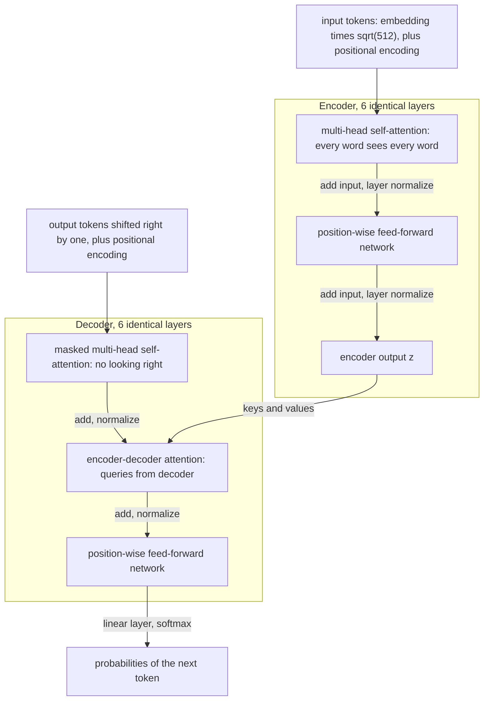

# Attention Is All You Need

> **Paper:** Vaswani, Shazeer, Parmar, Uszkoreit, Jones, Gomez, Kaiser and Polosukhin (Google Brain, Google Research and the University of Toronto), 2017 - [arXiv abstract](https://arxiv.org/abs/1706.03762) - [local PDF](../../papers/1706.03762.pdf)
>
> **Short name:** the Transformer paper. Numbers, section numbers, table numbers and figure numbers follow the arXiv HTML rendering of **v7 (dated 02 Aug 2023)**. The first version appeared in June 2017; the paper was presented at the NIPS 2017 conference (this guide's background knowledge, not stated in the arXiv text), so it is peer reviewed. The conclusion points to public training code (tensor2tensor).

## Read this first

**The claim in one sentence.** A translation model built only from "attention" layers, with no recurrence (reading words one after another) and no convolutions (sliding local windows), translated better than the best earlier systems on two standard benchmarks at a fraction of the training compute, because all words can be processed at the same time.

**Who this is for.** Anyone who will use, buy or reason about modern language models and has never seen inside one. No computer-science background is needed, only comfort with small tables of numbers; the prerequisites at the end teach exactly the arithmetic used.

**Afterwards you will be able to** compute self-attention by hand on a three-word sentence; say where multi-head attention, positional encoding, residual connections and layer normalization sit in the paper's Figure 1; explain with numbers why dot products are divided by the square root of the key size; and state what each headline number (28.4, 41.8, 27.3, 38.1, 65 million, 213 million, 3.5 days) counts and what it was compared with.

**Reading time.** About 55 minutes; Tutorial 1 alone is about 20. **Have read first:** nothing; this is guide 1. Keep [the glossary](../../references/glossary.md) open and see [the math bridge](../../references/math-bridge.md) if tables of numbers make you nervous.

**The one thing most people get wrong.** Attention was not the new idea. The paper's Sections 1 and 2 say attention was already "an integral part" of translation models, but always alongside a recurrent network. The new move is deleting the recurrent network and letting attention, including attention within the input sentence itself, do all the work. Also, this paper is an **encoder-decoder** translation model; most chat assistants today use only the decoder half (background knowledge; see [BERT](./02-bert.md) and [GPT-3](./03-gpt3.md), which use one half each).

## The paper in one worked example

The paper has no single numeric example, so this guide **constructs** one. Every number in Parts A to F is invented by this guide ("constructed"), was computed by a script, and was re-derived by hand. Part G ties the toy to the paper's real sizes; Part H uses a real example from the paper's appendix.

The sentence is **the cat sat**. We run one encoder self-attention layer with the vector size shrunk from the paper's 512 to 4 and the heads shrunk from 8 to 2 (each head's keys have size d_k = 2).

### Part A - words become vectors (constructed)

A **vector** is a short list of numbers. A lookup table turns each word into one (Section 3.4: "learned embeddings"). Suppose the three words, already including position information (Part B), are the rows of **X**:

| Word | Vector |
|---|---|
| the | [1, 0, 1, 0] |
| cat | [0, 1, 0, 1] |
| sat | [1, 1, 0, 0] |

Real embeddings are learned decimals; these 0/1 values make every multiplication doable in your head.

### Part B - position information (formula from Section 3.5)

Attention treats its input as an unordered bag, so the paper adds a position pattern: PE(pos, 2i) = sin(pos / 10000^(2i/d_model)) and PE(pos, 2i+1) = cos(pos / 10000^(2i/d_model)). With d_model = 4 the divisor is 1 for the first pair of numbers and 10000^(1/2) = 100 for the second pair. Counting from position 0:

| Position | Word | PE |
|---|---|---|
| 0 | the | [0, 1, 0, 1] |
| 1 | cat | [0.8415, 0.5403, 0.0100, 1.0000] |
| 2 | sat | [0.9093, -0.4161, 0.0200, 0.9998] |

The first pair cycles every 6.28 positions, the second 100 times slower, like the hands of a clock. For readable arithmetic, the X of Part A is treated as already containing this addition (a simplification of this guide).

### Part C - queries, keys and values (constructed matrices)

Three learned tables (W^Q, W^K, W^V, Section 3.2.2) turn each word vector into three roles. Head 1 uses these constructed 4-by-2 tables: W^Q has rows [1,0], [0,1], [1,0], [0,1] (query = first number + third, second + fourth); W^K has rows [1,0], [0,1], [0,0], [0,0] (key = first two numbers); W^V has rows [0,1], [1,0], [1,1], [0,0]. The results:

| Word | Query q | Key k | Value v |
|---|---|---|---|
| the | [2, 0] | [1, 0] | [1, 2] |
| cat | [0, 2] | [0, 1] | [1, 0] |
| sat | [1, 1] | [1, 1] | [1, 1] |

Check one: "the" = [1,0,1,0], so its value is row 1 plus row 3 of W^V: [0,1] + [1,1] = [1,2]. In Section 3.2's terms, the query is what a word looks for, the key is what it advertises, and the value is what it hands over if chosen.

### Part D - scores, scaling, softmax (formula 1)

Attention(Q, K, V) = softmax(Q K^T / sqrt(d_k)) V. Here d_k = 2, so sqrt(d_k) = 1.4142.

**Step 1 - raw scores Q K^T.** Each cell is the dot product (multiply matching numbers, add) of the row word's query with the column word's key.

| asking word | the | cat | sat |
|---|---|---|---|
| the, q=[2,0] | 2 | 0 | 2 |
| cat, q=[0,2] | 0 | 2 | 2 |
| sat, q=[1,1] | 1 | 1 | 2 |

**Step 2 - divide by 1.4142.** Row "the" becomes [1.4142, 0, 1.4142]; "cat" [0, 1.4142, 1.4142]; "sat" [0.7071, 0.7071, 1.4142].

**Step 3 - softmax each row** (exponentiate, divide by the row total). For row "the": e^1.4142 = 4.1133, e^0 = 1, 4.1133; total 9.2266.

| asking word | on the | on cat | on sat |
|---|---|---|---|
| the | 0.4458 | 0.1084 | 0.4458 |
| cat | 0.1084 | 0.4458 | 0.4458 |
| sat | 0.2483 | 0.2483 | 0.5035 |

**Step 4 - weighted sum of values.** "cat" gets 0.1084 x [1,2] + 0.4458 x [1,0] + 0.4458 x [1,1] = [1.0000, 0.6626]. Head 1 outputs: the [1.0000, 1.3374], cat [1.0000, 0.6626], sat [1.0000, 1.0000]. "Cat" spent 45% of its attention on itself, 45% on "sat" and 11% on "the". Nothing is looked up and copied; every word receives a smoothly weighted mixture.

### Part E - second head and concatenation (constructed)

Head 2 has its own constructed tables (W^Q2 rows [0,1], [1,0], [0,0], [0,0]; W^K2 rows [0,0], [0,0], [1,0], [0,1]; W^V2 rows [1,0], [0,0], [0,0], [0,1]), so it asks different questions of the same words. Its outputs: the [0.4965, 0.5035], cat [0.7517, 0.2483], sat [0.5989, 0.4011]. Section 3.2.2 concatenates the heads side by side (2 + 2 = 4 numbers, matching d_model) and multiplies by W^O; we take W^O as the identity. The row for "cat" is [1.0000, 0.6626, 0.7517, 0.2483].

### Part F - residual connection, layer normalization, masking

Section 3.1: each sub-layer's output is LayerNorm(x + Sublayer(x)). For "cat", x = [0, 1, 0, 1] plus the attention output gives [1.0000, 1.6626, 0.7517, 1.2483]. Layer normalization subtracts the mean (1.1656) and divides by the standard deviation (0.3363, from variance 0.1131), giving [-0.4925, 1.4774, -1.2305, 0.2456]. A feed-forward network follows with its own residual and normalization; this guide skips its arithmetic. (The paper cites another paper for layer normalization's details.)

**Decoder masking (Section 3.2.3).** A decoder word may not see later words, so those scores are set to minus infinity before the softmax and their weights become exactly 0. For head 1, row "cat" keeps only [0, 1.4142]: exponentiated [1, 4.1133], weights [0.1956, 0.8044, 0]. Row "the" becomes [1, 0, 0]. Row "sat" is unchanged.

### Part G - from the toy to the paper's sizes

Base model (Section 3.2.2): d_model = 512, h = 8, d_k = d_v = 64. For n tokens, X is n by 512; each head's Q and K are n by 64; the score table is n by n per head; the eight head outputs concatenate to n by 512; W^O is 512 by 512. One attention block holds 8 x 3 x (512 x 64) + 512 x 512 = 1,048,576 numbers (this guide's arithmetic). The paper stacks N = 6 encoder and 6 decoder layers.

### Part H - one real example from the appendix

Figure 3 shows encoder layer 5 of 6. For the word "making", the caption says many heads attend to a distant word, completing the phrase "making...more difficult". Figure 4 shows two heads in the same layer "apparently involved in anaphora resolution" (working out what "its" refers to), with very sharp attention. They are hand-picked illustrations; the paper does not count how many heads behave this way.

```mermaid
flowchart LR
    X["Word vectors X (3 words x 4 numbers) with position added"] -->|"times W^Q, W^K, W^V per head"| QKV["Q, K, V per head (3 x 2 each)"]
    QKV -->|"Q times K transpose: who matches whom"| S["Raw score table 3 x 3"]
    S -->|"divide by sqrt(d_k) = 1.4142"| SS["Scaled scores"]
    SS -->|"softmax per row: weights sum to 1"| W["Weight table, row cat: 0.1084, 0.4458, 0.4458"]
    W -->|"weights times V: blend the values"| O["Head output 3 x 2"]
    O -->|"concatenate heads, times W^O"| C["Attention output 3 x 4"]
    C -->|"add input x, then layer normalize"| N["Layer output 3 x 4"]
```



Notice that the weight table is the only place where words interact; every step before and after it treats each word on its own.



Notice that residual-plus-normalization repeats after every sub-layer, and that the encoder output enters the decoder only as the keys and values of the middle attention.

## Words you need

| Term | Plain definition | Example from the worked example |
|---|---|---|
| Sequence transduction | Turning one sequence into another, such as a sentence into its translation. | English in, German or French out. |
| Token | The unit the model reads: a word or word piece. The paper uses byte-pair encoding (frequent character groups merged) for German and word pieces for French. | "the", "cat", "sat". |
| Encoder / decoder | The encoder reads the whole input into one vector per token; the decoder writes the output one token at a time. | Left and right halves of Figure 1. |
| Auto-regressive | Generating one item at a time and feeding earlier outputs back in. | The decoder masking in Part F. |
| Query, key, value | Three vectors per token: what it looks for, what it offers, what it hands over. | Part C table. |
| Self-attention | Attention where queries, keys and values come from the same sequence. | Parts C to D. |
| Scaled dot-product attention | Formula (1): softmax of Q K^T divided by sqrt(d_k), times V. | Part D. |
| Multi-head attention | h attention operations in parallel with different learned projections, concatenated and mixed. | Part E. |
| d_model, d_k, d_v, d_ff, h | Token vector size (512), key size (64), value size (64), feed-forward inner size (2048), heads (8), in the base model. | Toy: 4, 2, 2, none, 2. |
| Positional encoding | Fixed sine and cosine patterns added to token vectors. | Part B. |
| Residual connection | Adding a layer's input to its output. | x + Sublayer(x), Part F. |
| Layer normalization | Rescaling one token vector to mean 0 and variance 1. | [1, 1.66, 0.75, 1.25] becomes [-0.49, 1.48, -1.23, 0.25]. |
| Mask | Setting forbidden scores to minus infinity so softmax gives weight 0. | Row "cat" in Part F. |
| BLEU (bilingual evaluation understudy) | A 0 to 100 score of how many word sequences of the machine translation appear in a human reference, with a penalty for short outputs. | Prerequisite 6; Table 2. |
| WMT 2014 (Workshop on Machine Translation) | The shared test; the paper uses English-to-German (EN-DE) and English-to-French (EN-FR). | newstest2014 in Table 2; newstest2013 in Table 3. |
| FLOPs (floating-point operations) | Count of additions and multiplications. Table 2's cost column estimates the total used in training. | 3.3 x 10^18 for the base model. |
| Perplexity (PPL) | How surprised the model is by the correct next token; lower is better. | Table 3, per word piece. |

## Tutorial 1 - Intuitive understanding

### What was broken before

The leading translation systems read a sentence like a person following a line with a finger. A recurrent neural network (Section 1 names long short-term memory and gated recurrent networks) keeps a running summary called the hidden state and updates it one word at a time. Two problems follow.

1. **No parallelism within a sentence.** Word 7 waits for word 6. The paper says this "precludes parallelization within training examples", which bites hardest at long lengths because memory limits how many examples can be batched. Chips that do thousands of calculations at once sit mostly idle.
2. **Long-distance links are weak.** For word 1 to influence word 50, its signal passes through about 49 updates, each able to dilute it. Section 4 calls this the path length; Table 1 lists it as O(n) for recurrent layers, with n the sentence length.

Convolutional models (ConvS2S, ByteNet; Section 2) fixed parallelism, but distant words still connect only through a stack of layers: steps grow linearly with distance for ConvS2S and logarithmically for ByteNet.

### The idea

**Analogy.** A meeting where nobody passes notes down a line. Everyone reads everyone else's name badge at once, decides how much to listen to each colleague (the weight table), and writes down a blend of what those colleagues know (the weighted sum). All do this simultaneously, so the two ends of the table hear each other in one round.

**Where it breaks.** People listen using judgement; here "judgement" is a dot product between learned vectors, with no reasoning. The weights must sum to 1, so a token cannot ignore everyone, only redistribute attention. A room of badge-readers also has no idea who sat where, which is why position patterns are added. And real tokens do this in 6 stacked rounds with 8 parallel "conversations" each.

### How it works, step by step

1. **Look up a vector per token** (Part A). Section 3.4 multiplies the embeddings by sqrt(512), about 22.6 (this guide's arithmetic), and shares the table with the output layer.
2. **Add position patterns** (Part B). Otherwise "dog bites man" and "man bites dog" yield the same set of vectors.
3. **Make query, key and value** (Part C).
4. **Score every pair** (Part D, Step 1): a large dot product means the pair matches.
5. **Calm the scores** (Step 2) by dividing by sqrt(d_k); Tutorial 3 shows why with numbers.
6. **Softmax** (Step 3) so each row is a set of percentages.
7. **Blend the values** (Step 4).
8. **Repeat in parallel** with several heads (Part E); the paper says a single head's "averaging inhibits" attending to different information at once (Section 3.2.2).
9. **Add the input back and normalize** (Part F), so information survives 6 layers.
10. **Feed-forward network** (Section 3.3): two linear maps with a rectifier between, inner size 2048, applied to each token separately.
11. **Decoder:** the same blocks plus masking and a middle attention over the encoder output; a final linear layer and softmax give next-token probabilities.
12. **Generate with beam search:** keep the 4 best partial translations at each step, with length penalty 0.6 (Section 6.1).

### What the results say

**Translation, Table 2 (newstest2014).** BLEU counts overlap between machine output and a human reference; 100 is the maximum and a one-point gain is modest but real.

| Model | EN-DE BLEU | EN-FR BLEU | Training cost (FLOPs, DE; FR) |
|---|---|---|---|
| ConvS2S (single) | 25.16 | 40.46 | 9.6 x 10^18; 1.5 x 10^20 |
| MoE (mixture of experts, single) | 26.03 | 40.56 | 2.0 x 10^19; 1.2 x 10^20 |
| ConvS2S ensemble | 26.36 | 41.29 | 7.7 x 10^19; 1.2 x 10^21 |
| GNMT + RL ensemble | 26.30 | 41.16 | 1.8 x 10^20; 1.1 x 10^21 |
| **Transformer (base)** | **27.3** | **38.1** | **3.3 x 10^18** |
| **Transformer (big)** | **28.4** | **41.8** | **2.3 x 10^19** |

In practice: on English-to-German the big model's 28.4 is 2.04 points above the best earlier system, an ensemble (several models averaged), 26.36; the paper says "more than 2.0". Even the base model's 27.3 is 0.94 above that ensemble at about a third of the cheapest baseline's cost (3.3 against 9.6 x 10^18; this guide's division). On English-to-French the big model's 41.8 is 1.24 above the best single model (MoE, 40.56) and 0.51 above the best ensemble (41.29), at about one fifth of MoE's compute (2.3 x 10^19 against 1.2 x 10^20), consistent with the paper's "less than 1/4". The base model's EN-FR 38.1 is below every baseline.

**Time (Section 5.2).** Base: 100,000 steps at about 0.4 s, reported as 12 hours on 8 NVIDIA P100 graphics processors. Big: 300,000 steps at 1.0 s, reported as 3.5 days (this guide recomputes 11.1 hours and 3.47 days).

**Ablations, Table 3 (development set, EN-DE).** One change at a time from the base (25.8 BLEU, 65 million parameters): a single head loses 0.9 BLEU; removing dropout loses 1.2 (24.6) while the paper calls dropout "very helpful" against over-fitting (memorizing training sentences); 2 layers instead of 6 lose 2.1 (23.7); learned position embeddings instead of sinusoids score 25.7, "nearly identical". The full table is in Tutorial 3.

**Parsing, Table 4.** Building a sentence's grammar tree, a 4-layer Transformer scores 91.3 F1 (harmonic mean of precision and recall) from about 40,000 training sentences and 92.7 with about 17 million extra sentences; the best listed scores are 93.0 and 93.3. Competitive, not the best.

### What this does not show

- It does not show attention beats recurrence on every task; it shows it on two translation tasks with 4.5 million (EN-DE) and 36 million (EN-FR) training pairs (Section 5.1).
- It does not test whether attention weights explain the model. Figures 3 to 5 are chosen heads.
- It does not test long inputs; restricted attention is future work (Section 4), and extrapolation to longer sequences is only something sinusoids "may" allow.
- It never removes residual connections, layer normalization, the feed-forward network, masking or warm-up to see what they contribute.
- It says nothing about chat assistants; see [BERT](./02-bert.md) and [GPT-3](./03-gpt3.md) for what happened when the design was repurposed.

### Teach-back

**1. In the toy, why does row "cat" put 0.4458 on "cat" and "sat" but 0.1084 on "the"?**

<details>
<summary>Answer</summary>

Cat's query [0,2] has dot product 2 with the keys of "cat" [0,1] and "sat" [1,1] but 0 with the key of "the" [1,0]. After dividing by 1.4142, softmax compares e^1.4142 = 4.11 with e^0 = 1.

</details>

**2. Why would the model treat "dog bites man" and "man bites dog" identically without positional encoding?**

<details>
<summary>Answer</summary>

Each output is a weighted sum over all tokens, and a sum ignores the order of its terms, so the same vectors in a different order give the same set of outputs.

</details>

**3. How does the decoder's middle attention differ from the encoder's self-attention?**

<details>
<summary>Answer</summary>

In encoder self-attention, queries, keys and values all come from the previous encoder layer. In the decoder's middle layer, queries come from the decoder and keys and values from the encoder output, so each output position can look at the whole input (Section 3.2.3).

</details>

## Tutorial 2 - Practitioner understanding

### The design in concrete terms

| Setting | Base | Big | Where stated |
|---|---|---|---|
| Layers N (each side) | 6 | 6 | 3.1, Table 3 |
| d_model | 512 | 1024 | 3.1, Table 3 |
| d_ff | 2048 | 4096 | 3.3, Table 3 |
| Heads h | 8 | 16 | 3.2.2, Table 3 |
| d_k = d_v | 64 | blank in the table; 64 is this guide's inference (1024 / 16) | 3.2.2 |
| Dropout | 0.1 | 0.3 for EN-DE, 0.1 for EN-FR | 5.4, 6.1 |
| Label smoothing | 0.1 | 0.1 | 5.4 |
| Steps; time | 100,000; 12 h | 300,000; 3.5 days | 5.2 |
| Parameters | 65 million | 213 million | Table 3 |
| Checkpoints averaged | last 5 (10 minutes apart) | last 20 | 6.1 |

**Data (Section 5.1).** EN-DE: about 4.5 million sentence pairs, byte-pair encoding, shared vocabulary of about 37,000. EN-FR: 36 million pairs, 32,000 word pieces. Batches grouped by length hold about 25,000 source and 25,000 target tokens.

**Optimizer (Section 5.3).** Adam with beta1 0.9, beta2 0.98, epsilon 10^-9. Learning rate (formula 3) = d_model^-0.5 x min(step^-0.5, step x 4000^-1.5): linear rise for 4000 steps, then decay with the inverse square root of the step. This guide computes about 0.0007 at step 4000 and about 0.00014 at step 100,000 for the base model.

**Regularization (Section 5.4).** Dropout on each sub-layer output before the residual add, and on embeddings plus positions. Label smoothing 0.1 spreads some target probability over other tokens; the paper says it "hurts perplexity" but improves accuracy and BLEU.

**Recounting parameters.** Per encoder layer, 4 x 512 x 512 (attention) + 2 x 512 x 2048 (feed-forward) is about 3.15 million; per decoder layer about 4.2 million. Six of each is about 44.1 million, and a 37,000 x 512 shared embedding adds 18.9 million, leaving roughly 2 million of the reported 65 million unexplained by this simple count (biases, norms and exact vocabulary size are not recoverable from the text). Table 3's layer-count rows (36, 50, 80 million for N = 2, 4, 8) and the d_k rows (58, 60 million) do match this per-layer arithmetic.

### A minimal version

Plain numpy; X is (n, d_model); heads is a list of (W_Q, W_K, W_V) of shapes (d_model, d_k), (d_model, d_k), (d_model, d_v); W_O is (h x d_v, d_model).

```python
import numpy as np

def softmax(a):                                   # each row sums to 1
    e = np.exp(a - a.max(axis=-1, keepdims=True)) # subtract max for numerical safety
    return e / e.sum(axis=-1, keepdims=True)

def attention(Q, K, V, causal=False):             # Q,K: (n, d_k)  V: (n, d_v)
    scores = Q @ K.T / np.sqrt(K.shape[-1])       # (n, n)
    if causal:                                    # decoder: forbid looking right
        scores = scores + np.triu(np.full(scores.shape, -1e9), k=1)
    w = softmax(scores)
    return w @ V, w                               # (n, d_v), (n, n)

def multi_head(X, heads, W_O, causal=False):      # returns (n, d_model)
    outs = [attention(X @ Wq, X @ Wk, X @ Wv, causal)[0] for Wq, Wk, Wv in heads]
    return np.concatenate(outs, axis=-1) @ W_O

def layer_norm(x, eps=1e-5):                      # per token: mean 0, variance 1
    return (x - x.mean(-1, keepdims=True)) / np.sqrt(x.var(-1, keepdims=True) + eps)

def sinusoid(n, d_model):                         # Section 3.5
    pe = np.zeros((n, d_model))
    for pos in range(n):
        for i in range(d_model // 2):
            ang = pos / 10000 ** (2 * i / d_model)
            pe[pos, 2 * i], pe[pos, 2 * i + 1] = np.sin(ang), np.cos(ang)
    return pe

def encoder_layer(x, heads, W_O, W1, b1, W2, b2): # one of the N = 6 layers
    x = layer_norm(x + multi_head(x, heads, W_O))
    return layer_norm(x + np.maximum(0, x @ W1 + b1) @ W2 + b2)
```

Run on the constructed numbers (X as the 3 x 4 table, two heads, W_O the identity), it prints the weight table of Part D and the normalized "cat" row [-0.4925, 1.4774, -1.2305, 0.2456]; this guide ran it. With random weights at the paper's size (n = 10, 512, 8 heads of 64) the output shape is (10, 512). Two free tests catch most bugs: every weight row sums to 1; and with `causal=True`, changing the last token leaves all earlier outputs unchanged (both passed). Missing for a trainable model: embeddings with a tied output layer, encoder-decoder attention, dropout, label smoothing, the Adam schedule, batching and beam search.

### What it costs

**Training (the paper's figures).** 8 GPUs x 12 hours = 96 GPU-hours (base); 8 x 84 hours = 672 (big). At an assumed 1 dollar per GPU-hour (illustration only) that is about 96 and 672 dollars. The paper's FLOP estimates recompute: 302,400 s x 8 GPUs x 9.5 x 10^12 operations per second = 2.30 x 10^19 (Table 2: 2.3 x 10^19), and 12 hours gives 3.28 x 10^18 (3.3 x 10^18).

**Per-layer scaling (Table 1).** Self-attention costs O(n^2 x d), a recurrent layer O(n x d^2) (constants ignored). At d = 512 and n = 50: 1,280,000 against 13,107,200, about 10 times less for attention. The paper notes the advantage holds "when the sequence length n is smaller than the representation dimensionality d". At n = 4,096 the same formulas give 8.6 billion against 1.07 billion, so attention costs about 8 times more; this is the guide's extension, not a claim of the paper.

**Memory.** One n by n table per head per layer: at n = 4,096, 8 heads, 2 bytes per number, 4,096^2 x 8 x 2 is about 268 MB per layer if stored in full; doubling to 8,192 tokens quadruples it to about 1.07 GB (this guide's arithmetic; real systems avoid storing the table).

**For a buyer.** Compute per layer grows with the square of the prompt length, one reason long prompts are costly and why the agent stage of this curriculum cares about context management.

### How it fails

The paper has no error analysis. Rows marked P rest on the paper's tables or text; rows marked G are this guide's engineering knowledge.

| Symptom | Likely cause | Mitigation |
|---|---|---|
| Output ignores word order (P) | No positional information | Add sinusoids or learned positions; Table 3 row E shows both work |
| Perfect training loss, useless generation (G) | Future-token leak, mask missing | Causal mask; run the "change the last token" test |
| Attention weights near one-hot, learning stalls (P: the authors "suspect") | Large dot products saturate softmax | Divide by sqrt(d_k) |
| Quality drops with many heads or tiny keys (P: rows A, B) | Each head too narrow | Keep d_k near 64; 8 to 16 heads at d_model 512 |
| Over-fitting on small data (P: no dropout 24.6 against 25.8) | No regularization | Dropout 0.1 |
| Divergence early in training (G; warm-up used but not ablated) | Learning rate too high at start | Keep the 4000-step warm-up |
| Out of memory on long inputs (G, from Table 1) | n by n table per head per layer | Chunk the input; restricted attention (Section 4, future work) |

### Evaluating your version

1. **Before training:** weight rows sum to 1; the causal test passes; shapes match Part G.
2. **Sanity task:** a 2-layer, d_model 64 encoder-decoder on reversing random digit strings of length 5 to 20; target at least 99% exact match on 1,000 held-out strings. If it fails, check mask and positions first.
3. **Metric:** BLEU on at least 1,000 held-out sentence pairs, stating the tool and tokenization (the paper does not).
4. **Baseline:** a small recurrent model with matched parameters and data.
5. **Stop rule:** stop when development BLEU gains under 0.1 for 5 evaluations, then average the last 5 checkpoints as the paper does. Use 3 or more seeds; treat gaps under about 0.3 BLEU as noise until you have measured seed variance (the paper reports single runs).

### Adopt, adapt or skip

**For a team building an assistant over private business documents: adopt the understanding, skip the implementation.** You will choose a pretrained model, usually decoder-only and derived from this design (background; see [GPT-3](./03-gpt3.md)). What to take:

- **Quadratic context cost.** Stuffing 50 pages into every prompt is a cost and quality problem; it is why retrieval exists ([RAG](../02-building/06-rag.md)).
- **Left-to-right reading.** Under masking, a token sees only earlier tokens, so where an instruction or fact sits in a prompt can matter; test placement rather than assume (guide's inference).
- **Attention is soft averaging.** Section 2 itself concedes "reduced effective resolution". With many near-duplicate passages, details can blur (guide's inference).
- **Smaller or open models** use essentially the same architecture, so your leverage is context, instructions and memory, not architecture. This fits the curriculum's through-line, though the paper does not test it.

**Skip** this paper for questions about tool choice or agent runtimes; it does not bear on them.

## Tutorial 3 - Researcher understanding

### Formal setup

n = number of tokens; d_model = 512 the width of every token vector. X in R^(n x d_model) holds one sequence, one row per token. Head i has W^Q_i, W^K_i in R^(d_model x d_k) and W^V_i in R^(d_model x d_v); Q = X W^Q_i, K = X W^K_i, V = X W^V_i. Formula (1): Attention(Q, K, V) = softmax(Q K^T / sqrt(d_k)) V, with softmax applied per row. MultiHead = Concat(head_1, ..., head_h) W^O, with W^O in R^(h d_v x d_model). Sub-layer: LayerNorm(x + Sublayer(x)). Formula (2): FFN(x) = max(0, x W_1 + b_1) W_2 + b_2. The sinusoids and formula (3) are in Part B and Tutorial 2. The loss is not printed; Section 5.4 names label smoothing 0.1.

**Toy instance.** With d_model = 4, d_k = d_v = 2, n = 3, h = 2, each head holds 3 x (4 x 2) = 24 numbers; two heads plus W^O (16) give 64 numbers; head 1's weight table is Part D's.

**The variance claim (footnote to Section 3.2.1).** If q and k have independent components with mean 0 and variance 1, then q . k, a sum of d_k products, has mean 0 and variance d_k. For d_k = 64 the standard deviation is 8. This guide simulated 100,000 random pairs: standard deviation 7.999 before scaling, 0.9998 after dividing by 8.

**Why it matters, in numbers.** Unscaled scores of [8, 0, -8] give softmax [0.99966, 0.00034, 0.0000001], nearly one-hot; the largest entry of softmax's derivative table is p(1-p) = 0.00034. Scaled to [1, 0, -1], softmax is [0.665, 0.245, 0.090] and the largest entry is 0.223, about 660 times larger, so the model still receives a learning signal. The paper only says it "suspects" saturation with "extremely small gradients" explains why unscaled dot-product attention lost to additive attention at larger d_k (citing reference 3); it runs no experiment on the scaling.

### The claims, stated precisely

1. **C1 (quality).** Big model: 28.4 BLEU EN-DE, more than 2.0 above every previous model including ensembles; 41.8 EN-FR, a new single-model state of the art (abstract, Section 6.1, Table 2).
2. **C2 (cost).** Base 3.3 x 10^18 estimated FLOPs, big 2.3 x 10^19; on EN-FR, under a quarter of the previous best's cost.
3. **C3 (structure).** A self-attention layer links all positions with O(1) sequential operations and O(1) path length; recurrent needs O(n) of each (Table 1).
4. **C4 (components).** Heads, key size, depth and dropout help; learned positions match sinusoids (Table 3; dev set, single runs).
5. **C5 (generalization).** A 4-layer Transformer reaches 91.3 F1 (WSJ only) and 92.7 (semi-supervised) on WSJ section 23 with little tuning (Table 4).
6. **C6 (interpretability, weak).** Heads "appear to exhibit behavior related to the syntactic and semantic structure" (Section 4, Figures 3 to 5): an observation, not a measurement.

### Evidence, table by table

**Table 1.** Rows are layer types; columns are per-layer complexity, sequential operations, maximum path length. Self-attention: O(n^2 d), O(1), O(1); recurrent: O(n d^2), O(n), O(n); convolutional: O(k n d^2), O(1), O(log_k n); restricted self-attention: O(r n d), O(1), O(n/r). Theoretical counts only; no speed is measured.

**Table 2.** Systems against BLEU (EN-DE, EN-FR) and estimated training FLOPs. It associates the architecture with higher BLEU at lower estimated cost. It cannot isolate the cause: systems differ in vocabulary, data handling, length of training, regularization, checkpoint averaging and tuning effort. Costs use the authors' assumed sustained speeds (2.8, 3.7, 6.0, 9.5 TFLOPS for K80, K40, M40, P100), and rival numbers are those the rival authors reported.

**Table 3.** Rows are changes from the base; columns are N, d_model, d_ff, h, d_k, d_v, P_drop, label smoothing, steps, development PPL, development BLEU, parameters (millions). Base: 4.92, 25.8, 65. Blank parameter cells in unchanged-size rows are read here as 65.

| Group | Setting | PPL | BLEU | Params (M) |
|---|---|---|---|---|
| A | h=1, d_k=d_v=512 | 5.29 | 24.9 | 65 |
| A | h=4, 128 | 5.00 | 25.5 | 65 |
| A | h=16, 32 | 4.91 | 25.8 | 65 |
| A | h=32, 16 | 5.01 | 25.4 | 65 |
| B | d_k=16 | 5.16 | 25.1 | 58 |
| B | d_k=32 | 5.01 | 25.4 | 60 |
| C | N=2 | 6.11 | 23.7 | 36 |
| C | N=4 | 5.19 | 25.3 | 50 |
| C | N=8 | 4.88 | 25.5 | 80 |
| C | d_model=256 | 5.75 | 24.5 | 28 |
| C | d_model=1024 | 4.66 | 26.0 | 168 |
| C | d_ff=1024 | 5.12 | 25.4 | 53 |
| C | d_ff=4096 | 4.75 | 26.2 | 90 |
| D | P_drop=0.0 | 5.77 | 24.6 | 65 |
| D | P_drop=0.2 | 4.95 | 25.5 | 65 |
| D | label smoothing 0.0 | 4.67 | 25.3 | 65 |
| D | label smoothing 0.2 | 5.47 | 25.7 | 65 |
| E | learned positions | 4.92 | 25.7 | 65 |
| big | 1024, 4096, h=16, P_drop 0.3, 300K | 4.33 | 26.4 | 213 |

These are single-run associations with one factor changed at a time. The parameter column recomputes where checked (Tutorial 2).

**Table 4.** Parsers grouped by training regime, with F1 on WSJ section 23; see inconsistency 4 below. **Figures 3 to 5.** Layer-5 attention maps; they associate heads with behaviour but no head was removed to test importance.

### Ablations and what they isolate

- **Rows A (heads at fixed compute).** Isolate head count, since h x d_k stays 512. One head costs 0.9 BLEU; 4 to 16 heads are within 0.4; 32 loses 0.4. Not isolated: whether heads or per-head width matter.
- **Rows B (d_k alone).** Smaller keys cost 0.4 to 0.7 BLEU and also remove parameters, confounding capacity with compatibility quality. "Determining compatibility is not easy" is the authors' interpretation.
- **Rows C.** Depth, width and feed-forward size move with parameter count; the clean reading is more parameters, better development BLEU, with d_ff = 4096 (26.2 at 90M) beating d_model = 1024 (26.0 at 168M).
- **Rows D.** Label smoothing worsens perplexity (4.67, 4.92, 5.47 at 0.0, 0.1, 0.2) while BLEU is 25.3, 25.8, 25.7, so loss and metric disagree, as the paper notes.
- **Row E.** A 0.1 BLEU difference, well inside plausible noise.
- **Never ablated:** residuals, layer normalization, masking, the feed-forward network, embedding scaling, weight tying, warm-up, and the sqrt(d_k) scaling.

### Threats to validity specific to this paper

- **Development against test.** Table 3 uses newstest2013 without checkpoint averaging; its 25.8 is not comparable with Table 2's 27.3.
- **Single runs.** No seeds or intervals; gaps under about 0.3 BLEU are uninterpretable.
- **Metric details.** The text does not state the BLEU script or tokenization, and different scripts give different scores.
- **Cost proxy.** FLOPs are time x GPUs x assumed speed, not measured.
- **Baselines.** Numbers come from other papers with their own data handling; ensembles and reinforcement-learning-tuned systems sit beside single models.
- **Tuned inference.** Beam size, length penalty and checkpoint averaging were chosen on the development set (Section 6.1); parsing settings come from few experiments (Section 6.3).
- **Scope.** Two language pairs from one shared task, English-centric, plus one parsing set.

**Inconsistencies found in v7 (none silently fixed).**

1. **EN-FR BLEU: 41.0 in the body, 41.8 elsewhere.** Section 6.1 says the big model "achieves a BLEU score of 41.0"; the abstract and Table 2 say 41.8. This guide follows the two agreeing sources and treats 41.0 as a slip.
2. **Which task took 3.5 days.** The abstract ties 3.5 days to EN-FR; Section 6.1 ties it to EN-DE; Section 5.2 gives it for the big models without naming a pair. Table 2 prints one cost per Transformer row, so it seems to cover both columns, but the text does not say.
3. **"Even our base model surpasses all previously published models and ensembles."** True for EN-DE (27.3 against 26.36); on EN-FR the base 38.1 is below every baseline listed from 39.2 up.
4. **Parsing prose against Table 4.** Section 6.3 says only the Recurrent Neural Network Grammar beats the model, but Table 4 also lists Luong et al. at 93.0 above the 92.7 semi-supervised Transformer, and Dyer et al.'s WSJ-only discriminative 91.7 is above the Transformer's 91.3.
5. **Rounding.** 100,000 steps at 0.4 s is 11.1 hours; the paper says 12.
6. **Blank cells.** Table 3's big row leaves d_k, d_v blank (this guide infers 64), and unchanged-size rows leave parameters blank.

### Open problems and follow-ups

- **Long inputs:** the authors name restricted attention (Sections 4, 7); this curriculum does not survey that literature.
- **Less sequential generation:** named in the conclusion; decoding is still one token at a time.
- **Other modalities:** images, audio, video (Section 7).
- **Scale:** [GPT-3](./03-gpt3.md), [scaling laws](./04-scaling-laws.md) and [Chinchilla](./05-chinchilla.md).
- **Encoder-only use for understanding:** [BERT](./02-bert.md).
- **Attention as cause:** whether a head's visible pattern drives the behaviour is untested here.

### What would change my mind

- A recurrent model with the same data pipeline, vocabulary, regularization, checkpoint averaging and tuning budget matching 27.3 EN-DE BLEU at equal compute would shrink C1 to a speed claim.
- Seed-to-seed variation above 0.5 dev BLEU would make rows A, B and E noise.
- Removing residuals or layer normalization changing BLEU by under 0.3 would undercut my belief, drawn from the later literature, that they are essential at 12 sub-layer depth.
- If 41.0 were the true EN-FR score, the gain over the best single model (40.56) would be 0.44 and the result would trail the ConvS2S ensemble's 41.29.

## Reading map for the PDF

| Section or figure | What it contains | First pass | Guide section that answers the questions it raises |
|---|---|---|---|
| Abstract, Section 1 | Claim, headline BLEU, motivation | Read | Read this first; Tutorial 1 |
| Section 2 | Convolutional models, self-attention, memory networks | Skim | FAQ "why not convolutions" |
| Section 3.1, Figure 1 | Encoder and decoder stacks, residuals, normalization | Read | Part F; second diagram |
| Section 3.2, Figure 2 | Scaled dot-product and multi-head attention | Read twice | Parts C to E; Prerequisites 1, 2 |
| Section 3.2.1 footnote | Variance argument for sqrt(d_k) | Read | Tutorial 3; Prerequisite 3 |
| Sections 3.3, 3.4 | Feed-forward network, embeddings, weight sharing | Skim | Tutorial 2 design |
| Section 3.5 | Positional encoding | Read | Part B; Prerequisite 5 |
| Section 4, Table 1 | Complexity, parallelism, path length | Read | Tutorial 2 "What it costs" |
| Section 5 | Data, hardware, optimizer, regularization | Skim | Tutorial 2 design |
| Section 6.1, Table 2 | Translation results and cost | Read | Tutorial 1; inconsistencies 1 to 3 |
| Section 6.2, Table 3 | Ablations | Read | Tutorial 3 ablations |
| Section 6.3, Table 4 | Parsing | Skim | Inconsistency 4 |
| Figures 3 to 5 (appendix) | Attention visualizations | Skim | Part H |

## Questions readers get stuck on

### What exactly are query, key and value, and who decides them?

They are three vectors computed from the same token by three learned tables. Nobody decides their meaning; training adjusts the tables so useful query-key matches score high. The names come from database lookup, except that the match here is a smooth percentage, not an exact hit.

### Why divide by the square root of d_k, not by d_k or by nothing?

A dot product of two random vectors with d_k components has standard deviation sqrt(d_k), so dividing by sqrt(d_k) restores a spread of about 1. At d_k = 64 unscaled scores are around plus or minus 8 and softmax nearly saturates (Tutorial 3). Dividing by d_k itself would shrink the spread to about 0.125. The paper offers the argument, not an experiment.

### If attention only averages, how does the model compute anything?

Which vectors are averaged depends on the content, so the averaging changes with the input. The feed-forward network then applies a nonlinear step to every token, and six such blocks are stacked. Several heads let different averages coexist.

### Why positional encodings, and why sine and cosine?

Attention is order-blind (Teach-back 2). The authors hypothesized that a shift by k positions is a linear function of the pattern (Prerequisite 5) and that sinusoids may extrapolate to longer sentences. Learned positions gave nearly identical BLEU (Table 3 row E), so on this task the choice was not critical.

### What do "Add & Norm" in Figure 1 do?

"Add" is x + Sublayer(x): the input is carried around the layer and added to its output, so the layer only learns a change. "Norm" re-centres each token vector. Together they help deep stacks train; the paper cites earlier work and does not ablate either.

### Which is "the Transformer", the encoder or the decoder?

Both, in this paper: the encoder reads the English sentence and the decoder writes the translation with masking. Later models used one half ([BERT](./02-bert.md), [GPT-3](./03-gpt3.md)). A modern chat model is usually a decoder-only stack (background knowledge).

### What does a BLEU point mean, and is 28.4 good?

BLEU is not the percentage of correct sentences; it counts matching word groups against a reference, and many valid translations differ from any one reference. Only differences on the same test set are informative: 2 points over the best earlier result is a clear gain; 0.1 to 0.3 on a development set is not.

### "Cheaper" than what, and how was it counted?

Cheaper in estimated training FLOPs against other published systems (Table 2), computed from time, GPU count and an assumed speed per GPU model. Such estimates could be off by a factor of two, but the base model's 3.3 x 10^18 against 10^19 to 10^21 for baselines is a gap of several times to hundreds (guide's reading).

### Why not just use convolutions, which are also parallel?

Path length (Sections 2 and 4): in a convolutional stack distant words connect only through several layers, whereas one attention layer connects any two positions. The price is cost growing with the square of the length (Table 1). The paper runs no controlled convolution-versus-attention experiment.

### Why do heads peak at 8 to 16 in Table 3?

Total width is held fixed, so more heads means narrower keys (16 numbers at 32 heads), and rows B show narrow keys hurt. That is this guide's reading; the paper says only that quality "drops off with too many heads".

## Prerequisites you actually need

### Prerequisite 1 - Dot products and matrix multiplication

A **dot product** multiplies matching entries and adds: [2,0] . [1,0] = 2x1 + 0x0 = 2. **Matrix multiplication** is a table of dot products; shapes (n, d) times (d, m) give (n, m), and the inner d must match. In the toy, Q is (3, 2) and K^T is (2, 3), so Q K^T is (3, 3), Part D's score table. Used in formula (1) and Section 3.2.2.

### Prerequisite 2 - Softmax

Softmax exponentiates each number and divides by the total: [1, 0, 1] gives 2.718, 1, 2.718; total 6.437; weights 0.422, 0.155, 0.422. A much larger input takes weight near 1 (saturation), and an input of minus infinity takes weight 0, which is how masking works. Used in formula (1) and Section 3.4.

### Prerequisite 3 - Variance of a sum

Variance measures spread. Independent numbers each of variance 1 add to variance equal to their count: 64 of them give variance 64, standard deviation 8. So scores near plus or minus 8 are routine, and e^8 = 2,981 against e^0 = 1 makes softmax nearly one-hot. Used in the footnote of Section 3.2.1.

### Prerequisite 4 - Residual connection and normalization

A residual connection is addition: input [0, 1, 0, 1] plus layer output [1, 0.66, 0.75, 0.25] gives [1, 1.66, 0.75, 1.25]. Normalization subtracts the mean and divides by the standard deviation: [1, 3] has mean 2 and standard deviation 1, giving [-1, 1]. Used in Section 3.1 and Figure 1 ("Add & Norm").

### Prerequisite 5 - Sine, cosine and shifts as rotations

sin and cos of an angle are the coordinates of a point on a circle; adding k to the angle rotates the point by a fixed rotation, a linear operation. In Part B's first pair, [sin(pos+1), cos(pos+1)] = [[cos 1, sin 1], [-sin 1, cos 1]] times [sin pos, cos pos]. At pos = 0, [0, 1] maps to [0.8415, 0.5403], the row for position 1. This is the paper's stated reason in Section 3.5.

### Prerequisite 6 - BLEU and n-gram precision

An n-gram is n consecutive words. BLEU counts the share of the output's n-grams found in the reference (each reference n-gram used at most as often as it occurs), takes a geometric mean over n = 1 to 4, and multiplies by a brevity penalty exp(1 - reference length / output length) for short outputs. Illustration with n = 1, 2 only: reference "the cat sat on the mat", output "the cat sat on mat". One-word precision 5/5; two-word precision 3/4 ("on mat" is absent); geometric mean 0.866; brevity penalty exp(1 - 6/5) = 0.819; score 0.709, or 70.9 on the 0 to 100 scale. Used in Tables 2 and 3; the paper does not define BLEU.

## Where this sits in the curriculum

**Before this:** nothing; the arithmetic is in the six prerequisites above.

**The two nearest papers.** [BERT](./02-bert.md) keeps only the encoder and trains it by predicting hidden words so each token sees both sides. [GPT-3](./03-gpt3.md) keeps only the decoder, with masking, and scales it so one model can be steered by instructions and examples in its context window. These two descriptions are background that the linked guides check against their own papers.

**Read next.** BERT, to see how much survives when the decoder is removed; then GPT-3, the decoder-only line behind the assistants of the agent stage; then [scaling laws](./04-scaling-laws.md) for why bigger worked predictably. Later, [LoRA](../02-building/09-lora.md) adapts attention projection tables like Part C's cheaply, and [RAG](../02-building/06-rag.md) responds to the quadratic cost of putting everything in context. The agent-stage question, whether a thin runtime around a model with a few tools is the right architecture, does not depend on this paper, but the cost of long contexts it implies is an input.

## Checkpoint

1. **Compute.** From Part C's values, find the raw and scaled score between the query of "sat" ([1, 1]) and the key of "the" ([1, 0]), and say which weight in row "sat" is largest.

<details>
<summary>Answer</summary>

The dot product is 1; divided by 1.4142 it is 0.7071. The largest weight is on "sat" itself (0.5035), because its raw score is 2 against 1 for each other word; the weights are 0.2483, 0.2483, 0.5035.

</details>

2. **Compute.** With d_k = 64, give softmax of [8, 0, -8] before and after dividing by 8, and say which learns more easily.

<details>
<summary>Answer</summary>

Before: about [0.9997, 0.0003, 0.0000]. After: [0.665, 0.245, 0.090]. The scaled version has a far larger derivative (0.223 against 0.00034), so it still learns which positions matter.

</details>

3. **Explain.** Name the three uses of attention in Figure 1 and where each one's queries, keys and values come from.

<details>
<summary>Answer</summary>

Encoder self-attention: all from the previous encoder layer. Decoder masked self-attention: all from the previous decoder layer, with later positions masked. Encoder-decoder attention: queries from the decoder, keys and values from the encoder output (Section 3.2.3).

</details>

4. **Critique.** Table 3 shows h = 16 tying the base's 25.8 BLEU. Does that show 16 heads are as good as 8?

<details>
<summary>Answer</summary>

No. Each row is one development-set run and the paper reports no seed variance, so differences under about 0.3 BLEU are indistinguishable from noise. I would want several seeds and a test-set evaluation.

</details>

5. **Compute.** Recompute the big model's training FLOPs from 3.5 days, 8 P100 GPUs and 9.5 TFLOPS.

<details>
<summary>Answer</summary>

3.5 x 86,400 = 302,400 s; times 8; times 9.5 x 10^12 is 2.30 x 10^19, matching Table 2's 2.3 x 10^19. The base model's 12 hours gives 3.28 x 10^18, matching 3.3 x 10^18.

</details>

6. **Critique.** Find two places where the paper's prose disagrees with its own numbers, and say which source you trust.

<details>
<summary>Answer</summary>

Section 6.1's EN-FR 41.0 against 41.8 in Table 2 and the abstract; I trust the two agreeing sources. Section 6.3's claim that only one parser beats the Transformer against Table 4's 93.0 and 93.3 entries; I trust the table, which can be read directly.

</details>

7. **Explain.** A teammate says "attention connects every word to every word, so long documents are free." Answer using Table 1.

<details>
<summary>Answer</summary>

Path length is O(1), but per-layer cost is O(n^2 d): doubling the length quadruples the score-table work and memory. The paper's own cost advantage over recurrence applies when n is below d, and it proposes restricted attention as future work for long inputs.

</details>
