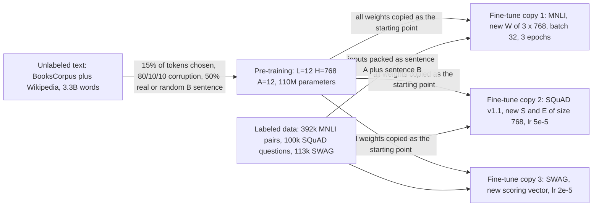
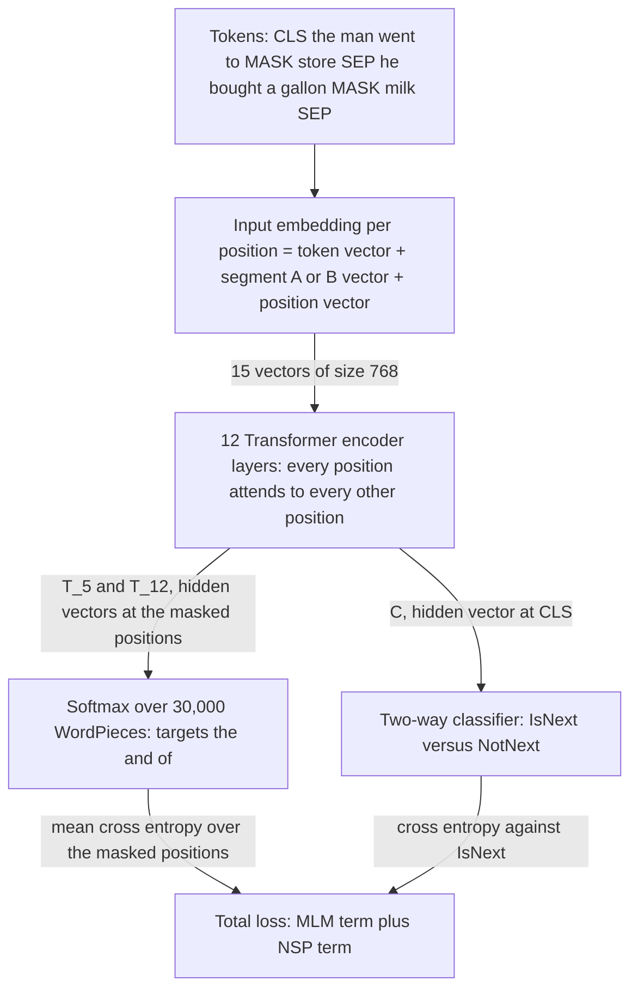

# BERT: Pre-training of Deep Bidirectional Transformers for Language Understanding

> **Paper:** Devlin, Chang, Lee and Toutanova (Google AI Language), 2018 (arXiv v2, 24 May 2019 rendering) - [arXiv abstract](https://arxiv.org/abs/1810.04805) - [local PDF](../../papers/1810.04805.pdf)
>
> **Short name:** BERT (Bidirectional Encoder Representations from Transformers). Section, table and figure numbers follow the arXiv v2 HTML rendering, which this guide read in full including Appendices A to C. The arXiv text does not name a venue; from outside the paper, this guide knows it was presented at a peer-reviewed conference (NAACL 2019), but the numbers below come only from the arXiv text.

## Read this first

**The claim in one sentence.** Train one Transformer encoder on unlabeled text by hiding some words and asking it to fill them in from both sides, then copy it and add one small output layer per task, and you beat carefully engineered task-specific systems on eleven language benchmarks (eight GLUE tasks, two SQuAD versions and SWAG).

**Who this is for.** Anyone who wants to know why "pre-train once, fine-tune many times" became the default recipe, what separates an encoder (BERT) from a generator (the GPT line), or how to build a small classifier over business documents.

**Afterwards you will be able to** apply the 15% masking rule with its 80/10/10 split by hand; build a next-sentence pair with segment ids and the [CLS] and [SEP] markers; say which parameters are new in fine-tuning (a few thousand, against 110 million inherited); read the ablation tables; and say what BERT cannot do.

**Reading time.** About 45 minutes. **Have read first:** [Attention Is All You Need](./01-transformer.md), since BERT is that paper's encoder stack used alone. **Read next:** [GPT-3](./03-gpt3.md), the opposite bet (left-to-right, no fine-tuning).

**The one thing most people get wrong.** BERT is not a chat-style language model that reads both ways to write text. It never writes anything. "Bidirectional" means every layer may use words to the left and right when forming one word's representation. That works only because the training game changed from "guess the next word" (which would leak the answer) to "guess the hidden words". The price is that BERT cannot generate; footnote 4 of Section 3 says the left-context-only variant is the one that "can be used for text generation".

## The paper in one worked example

The paper's Appendix A.1 gives the masking and pair examples, and Section 4 describes fine-tuning. This guide chains them into one running story. The strings in Parts A and B are the paper's own; Part C is **constructed by this guide** (the paper gives no fine-tuning trace), and every number in Part C is labelled as invented.

### Part A - masking one sentence (Appendix A.1 and Section 3.1)

The paper's example sentence is "my dog is hairy". Suppose the random procedure chose the 4th token, "hairy". The paper then says the training data generator does one of three things to the chosen position:

| Draw | Probability | What the input becomes | What the model must still predict |
|---|---|---|---|
| (1) mask symbol | 80% | my dog is [MASK] | hairy |
| (2) random token | 10% | my dog is apple | hairy |
| (3) unchanged | 10% | my dog is hairy | hairy |

In all three cases the target is the original word, "hairy". The model is never told which of the three situations it is in: a position that holds the real word might be a target, and a position that holds "apple" might also be a target. The paper's reason (Appendix A.1): the encoder must keep "a distributional contextual representation of every input token".

How many positions are chosen? 15% of all WordPiece tokens in each sequence (Section 3.1); WordPiece is the sub-word tokenizer with a 30,000-token vocabulary (Section 3). For a 512-token sequence that is 512 x 0.15 = 76.8, about 77 targets, of which in expectation 61.4 become [MASK], 7.7 random and 7.7 unchanged (guide's arithmetic). The paper itself notes random replacement touches only "1.5% of all tokens (i.e., 10% of 15%)".

### Part B - a next-sentence pair (Appendix A.1, Sections 3 and 3.1)

The paper's IsNext example, reproduced exactly as printed (note that two words are already masked, because masking and pair-building happen together):

```
Input = [CLS] the man went to [MASK] store [SEP] he bought a gallon [MASK] milk [SEP]
Label = IsNext
```

Its NotNext example is `[CLS] the man [MASK] to the store [SEP] penguin [MASK] are flight ##less birds [SEP]`. The "##" prefix marks a continuation piece: "flight ##less" is "flightless".

Reading the IsNext input position by position (the position numbers and segment ids are this guide's layout, following Section 3 and Figure 2 of the paper):

| Position | 0 | 1 | 2 | 3 | 4 | 5 | 6 | 7 | 8 | 9 | 10 | 11 | 12 | 13 | 14 |
|---|---|---|---|---|---|---|---|---|---|---|---|---|---|---|---|
| Token | [CLS] | the | man | went | to | [MASK] | store | [SEP] | he | bought | a | gallon | [MASK] | milk | [SEP] |
| Segment | A | A | A | A | A | A | A | A | B | B | B | B | B | B | B |

The original words under the masks are not printed; "the" and "of" are this guide's inference. Two targets out of 12 real word tokens is 16.7%, near the 15% rule. The paper says each token's input representation "is constructed by summing the corresponding token, segment, and position embeddings" (Section 3, Figure 2), so position 5 enters the network as embedding("[MASK]") + embedding(segment A) + embedding(position 5). Putting the second [SEP] in segment B is this guide's reading of Figure 2.

What the network is trained on, for this one input (Section 3.1, Appendix A.2):

1. At positions 5 and 12, the final hidden vectors T_5 and T_12 (H = 768 numbers each for BERT-BASE) go through a softmax over the 30,000-token vocabulary; the loss is cross entropy against "the" and "of".
2. At position 0, the final hidden vector C (the paper's name for the [CLS] output) feeds a two-way classifier whose correct answer here is IsNext.
3. The training loss is "the sum of the mean masked LM likelihood and the mean next sentence prediction likelihood" (Appendix A.2).

### Part C - one fine-tuning step, constructed by this guide

Fine-tuning means: copy the pre-trained weights, add a small output layer, and keep training all weights on a labeled task (Section 3.2). Take MNLI (Multi-Genre Natural Language Inference): given a premise and a hypothesis, predict entailment, contradiction or neutral (Appendix B.1). We reuse the Part B sentences with an invented label.

- **Input (constructed):** premise "the man went to the store", hypothesis "he bought a gallon of milk", gold label neutral, packed as `[CLS] the man went to the store [SEP] he bought a gallon of milk [SEP]`. Nothing is masked, because [MASK] never appears at fine-tuning time (the mismatch Section 3.1 worries about).
- **New parameters:** the paper says the only new ones are "classification layer weights W in R^(K x H)" (Section 4.1). With K = 3 and H = 768 that is 3 x 768 = 2,304 numbers (guide's arithmetic; the paper mentions no bias). The 110 million pre-trained parameters are the starting point and also get updated.
- **Forward pass (invented numbers):** C times W^T gives scores 0.3 (entailment), -1.2 (contradiction), 1.1 (neutral). Softmax gives 0.290, 0.065, 0.645, and the loss for the gold label is -ln(0.645) = 0.438.
- **Recipe (paper, Section 4.1):** batch 32, 3 epochs, learning rate picked on dev; the full table is in Tutorial 2.

A span-answering variant (SQuAD, Section 4.2) swaps the classifier for two vectors S and E of size H, so 1,536 new numbers; Prerequisite 4 scores a tiny example.



Notice that the expensive step is done once and every task gets its own full copy of the weights; the arrows into F1, F2 and F3 carry parameters, not a shared model.



Notice that one forward pass yields two training signals: masked positions teach word-level context, and [CLS] teaches a relation between the segments. Later sections refer back to Parts A, B and C.

## Words you need

| Term | Plain definition | Example from the worked example |
|---|---|---|
| Pre-training / fine-tuning | Pre-training: learn from unlabeled text with a self-made task. Fine-tuning: continue training the same weights on a small labeled task with a new output layer. | Parts A and B are pre-training; Part C is fine-tuning on MNLI. |
| Bidirectional | When a position's representation is computed, each layer may use words on both its left and its right. | Predicting the masked "the" at position 5 uses "went to" (left) and "store" (right). |
| Masked LM (MLM) | The training game: hide some tokens, predict the originals from the rest, loss only on the chosen positions. Also called a Cloze task. | Targets "hairy", "the" and "of". |
| 80/10/10 rule | Of the chosen positions, 80% show [MASK], 10% show a random token, 10% show the true token. | The three rows of the Part A table. |
| NSP (next sentence prediction) | A yes/no pre-training task: is segment B the real continuation of segment A (IsNext) or a random one (NotNext)? | The penguin example in Part B. |
| [CLS], [SEP] | Special tokens. [CLS] is always first; its final vector C summarises the sequence. [SEP] separates or ends segments. | Positions 0, 7 and 14 in the Part B table. |
| Segment embedding | A learned vector added to every token saying whether it belongs to sentence A or B. | The "Segment" row of the Part B table. |
| WordPiece | Sub-word tokenization with a 30,000-entry vocabulary; "##" marks a continuation piece. | "flight ##less". |
| Feature-based versus fine-tuning approach | Feature-based: freeze the pre-trained network and feed its outputs into a separate task model. Fine-tuning: update all pre-trained weights. | Table 7 compares both on named-entity recognition. |
| BERT-BASE and BERT-LARGE | The two sizes: L=12, H=768, A=12, 110M parameters; and L=24, H=1024, A=16, 340M parameters (L layers, H hidden size, A attention heads). | The mermaid diagram shows BASE. |

## Tutorial 1 - Intuitive understanding

### What was broken before

Before BERT there were two ways to reuse unlabeled text, and each had a weakness (Sections 1 and 2).

Feature-based, as in ELMo (Embeddings from Language Models): train a left-to-right and a separate right-to-left language model, concatenate their outputs, and feed them to a custom model per task. The paper calls this "shallow": the two readings never mix inside the network.

Fine-tuning, as in OpenAI GPT (Generative Pre-trained Transformer): train one left-to-right Transformer, then fine-tune it. Less custom machinery, but each word sees only the words before it. On the Part B pair, the representation of "store" in "the man went to the store" cannot know that the next sentence mentions a gallon of milk, which says what kind of store it is. The paper argues such restrictions "could be very harmful" for token-level tasks like question answering (Section 1).

The obvious fix, let every word look both ways, breaks the usual training game. If the game is "predict the next word" and the word is visible through the other direction, the answer leaks: bidirectional conditioning "would allow each word to indirectly 'see itself'" (Section 3.1).

### The idea

**Analogy.** A teacher gives students a paragraph with a few words blacked out, and the students fill in the blanks. To fill a blank well, a student must read the text on both sides of it. Do this with millions of paragraphs and the students become good general readers. Later, a short extra lesson (fine-tuning) teaches them one specific job: sorting emails, answering quiz questions, spotting contradictions.

**Where the analogy breaks.** Three places. A student knows which words are blacked out; BERT is not told, since 10% of chosen words are swapped for a wrong word and 10% left alone, so visible words cannot be trusted. The extra lesson changes the whole brain, not a small corner: every weight is updated (Section 3.2). And a student could eventually write a story, while BERT's training never asked it to produce a sentence left to right.

The second game, next sentence prediction, asks "did the second snippet follow the first in the book, or come from elsewhere?", to teach how sentences relate, which question answering and inference need (Section 3.1).

### How it works, step by step

1. **Chop text into WordPieces and pack a pair** as `[CLS] A [SEP] B [SEP]` (Part B). A "sentence" can be any span of contiguous text, and the combined length is at most 512 tokens (Section 3, Appendix A.2).
2. **Label the pair:** half the time B really follows A (IsNext), half the time B is random (NotNext) (Section 3.1).
3. **Corrupt 15% of tokens with the 80/10/10 rule** (Part A). Only those positions carry a word-prediction loss.
4. **Embed each position** as token plus segment plus position vectors (Figure 2).
5. **Run the encoder stack.** Each layer lets every position gather information from all others; nothing is hidden by an attention mask, the only architectural difference from GPT (Section 3).
6. **Read two outputs:** hidden vectors at corrupted positions predict the original words; C at [CLS] predicts IsNext or NotNext. The final model reaches 97% to 98% on NSP (footnote 5).
7. **Repeat for 1,000,000 steps** of 256 sequences (Appendix A.2); costs are in Tutorial 2.
8. **Fine-tune per task:** copy weights, add the small head (Part C), train 2 to 4 epochs. The paper says runs take "at most 1 hour on a single Cloud TPU, or a few hours on a GPU" (Section 3.2).

Task wiring (Section 3.2, Figure 4): sentence pairs go in A and B; single-sentence tasks use A with an empty B; question answering puts the question in A and the passage in B; token-level tasks read each position's hidden vector.

### What the results say

All numbers are the paper's; "points" means percentage points on a 0 to 100 scale.

**GLUE test set (Table 1, Section 4.1).** Counted: eight tasks scored by the official server with each task's own metric (accuracy mostly, F1 for QQP and MRPC, Spearman correlation for STS-B). The "Average" is the plain mean of nine columns (MNLI matched and mismatched count separately; this guide recomputed 79.6 and 82.1), excluding the problematic WNLI set.

- **Average:** OpenAI GPT 75.1, BERT-BASE 79.6, BERT-LARGE 82.1; the earlier best-of-class row ("Pre-OpenAI SOTA") is 74.0.
- The text says BASE and LARGE gain 4.5 and 7.0 points "over the prior state of the art". Those are 79.6 - 75.1 and 82.1 - 75.1, so the baseline is GPT, not the 74.0 row.
- The abstract's 7.7 is a different pair: 80.5 for BERT-LARGE on the official leaderboard against 72.8 for GPT (Section 4.1). The 80.5 and the 82.1 are different aggregates (WNLI handling); do not mix them.
- **MNLI:** 86.7 against GPT's 82.1 is 4.6 points, meaning about 4.6 more correct three-way labels out of every 100 test pairs.
- **RTE** (2.5k training examples): 70.1 against GPT's 56.0, about 14 more correct per 100 pairs.
- **CoLA:** 60.5 against 45.4 is a correlation, not a percent of sentences. The caption calls the remaining tasks accuracy; from outside the paper, GLUE scores CoLA with the Matthews correlation coefficient, so the caption is imprecise.

**SQuAD v1.1 (Table 2).** SQuAD (Stanford Question Answering Dataset) gives a question and a Wikipedia passage; the answer is a span. Counted: Exact Match (EM) and F1. BERT-LARGE single model, dev: EM 84.1, F1 90.9. Seven-model ensemble plus extra TriviaQA fine-tuning data, test: EM 87.4, F1 93.2, against the best listed leaderboard entry (nlnet ensemble) at 86.0 and 91.7, and a human row at 82.3 and 91.2. The "+1.5 F1" recomputes (93.2 - 91.7). F1 is partial-credit overlap, so 1.5 points does not mean 1.5 more exact answers per hundred.

**SQuAD v2.0 (Table 3).** Some questions have no answer, so the model must also say "none". BERT-LARGE single: test EM 80.0, F1 83.1 against 78.0 for the best prior single system, the paper's "+5.1 F1" (83.1 - 78.0). Human is 86.9 and 89.5, so BERT is 6.4 F1 points below humans here, unlike v1.1.

**SWAG (Table 4).** Situations With Adversarial Generations: choose the most plausible continuation among four. BERT-LARGE test accuracy 86.3 against ESIM+ELMo 59.2 (+27.1) and GPT 78.0 (+8.3), both recomputing. Human figures (85.0 expert, 88.0 five annotations) come from 100 samples, so they are noisy.

**Pre-training task ablation (Table 5).** Same data and hyper-parameters at BERT-BASE size. Removing next sentence prediction costs 3.5 points on QNLI (88.4 to 84.9) and 1 point or less elsewhere; making the model left-to-right costs a further 9.0 on MRPC and 10.1 on SQuAD F1. Meaning: the bidirectional game matters most where right-hand context decides the answer.

**Model size (Table 6).** MNLI-matched dev accuracy rises from 77.9 (3 layers) to 86.6 (24 layers) while masked-LM perplexity falls from 5.84 to 3.23, and every size step helps all three listed tasks.

### What this does not show

- That bidirectionality alone explains the gain over GPT. BERT also used more text (BooksCorpus 800M plus Wikipedia 2,500M words), a 4x larger batch (128,000 versus 32,000 words) and task-specific learning rates (Appendix A.4). Only Table 5's "LTR & No NSP" row is controlled, and it has no reported variance.
- That BERT can write text or handle inputs beyond 512 tokens (Appendix A.2); every task is classification, span selection, choice or tagging.
- That pre-training text does not overlap the test text. English Wikipedia is in the corpus and SQuAD (and QNLI, built from it) uses Wikipedia passages; the paper does not discuss this. This guide flags it as an open question.
- That next sentence prediction is the best sentence-level objective; only that removing it hurts some tasks in one setting.

### Teach-back

1. In "my dog is hairy" with "hairy" chosen, which three inputs might the network see, and what is the target in each?
2. Why can a left-to-right language model not simply be made bidirectional?
3. How many brand-new parameters does a 3-way MNLI classifier add, and how many does it inherit?
4. Name one thing BERT cannot do and why.

<details>
<summary>Answers 1 to 3</summary>

1. "my dog is [MASK]" (80%), "my dog is apple" or another random word (10%), "my dog is hairy" (10%); the target is "hairy" every time (Appendix A.1).
2. Over several layers, information about word i reaches word i+1 and returns, so the network could copy the answer from itself. Hiding the word at the input removes the leak (Section 3.1).
3. W has 3 x 768 = 2,304 new numbers (guide's arithmetic from Section 4.1); it inherits about 110 million from BERT-BASE (Section 3), all of which are updated.

</details>

<details>
<summary>Answer 4</summary>

4. Generate text. Training only fills hidden tokens and classifies a sentence pair; nothing trains it to emit a continuation, and attention reads the whole sequence at once.

</details>

## Tutorial 2 - Practitioner understanding

### The design in concrete terms

**Model sizes (Section 3, footnote 3).** Feed-forward size is always 4H. BERT-BASE: L=12 layers, H=768, A=12 heads, feed-forward 3072, 110M parameters. BERT-LARGE: L=24, H=1024, A=16, feed-forward 4096, 340M. The paper does not itemise parameters; this guide's count (Prerequisite 3) gives about 108M and 333M.

**Input (Section 3, Figure 2).** WordPiece vocabulary of 30,000; sequence `[CLS] A [SEP] B [SEP]`; each position is token plus segment plus position embedding; up to 512 positions.

**Pre-training data (Section 3.1).** BooksCorpus (800M words) and English Wikipedia (2,500M words), passages only, with a document-level corpus stressed to get long contiguous sequences.

**Pre-training hyper-parameters (Appendix A.2).** Batch 256 sequences ("256 sequences * 512 tokens = 128,000 tokens/batch"); 1,000,000 steps, "approximately 40 epochs over the 3.3 billion word corpus"; Adam with learning rate 1e-4, beta1 0.9, beta2 0.999, L2 weight decay 0.01; warm-up over 10,000 steps then linear decay; dropout 0.1 on all layers; gelu (Gaussian error linear unit) activation; sequence length 128 for 90% of steps and 512 for the last 10% "to learn the positional embeddings".

**Fine-tuning recipes (Sections 4.1 to 4.4).**

| Task | Head added | Batch | Epochs | Learning rate |
|---|---|---|---|---|
| GLUE | W of K x H on C | 32 | 3 | best of 5e-5, 4e-5, 3e-5, 2e-5 on dev |
| SQuAD v1.1 | vectors S and E | 32 | 3 | 5e-5 |
| SQuAD v2.0 | same, null span at [CLS], threshold tau | 48 | 2 | 5e-5 |
| SWAG | one scoring vector on C, softmax over 4 | 16 | 3 | 2e-5 |

Appendix A.3's general range (batch 16 or 32, learning rate 5e-5, 3e-5, 2e-5, epochs 2 to 4) is out of sync with the sections: Section 4.1 adds 4e-5, and SQuAD v2.0 uses batch 48.

**Restarts (Section 4.1).** Because BERT-LARGE was unstable on small data, several restarts (same checkpoint, different shuffling and head initialisation) were run and the best on dev kept; GLUE test got one server submission per model.

**SQuAD v2.0 rule (Section 4.3).** Span score is S.T_i + E.T_j with j at least i; the no-answer score is S.C + E.C. Answer only if the best span exceeds the no-answer score plus tau, with tau tuned on dev for F1.

### A minimal version

The two pieces worth writing yourself are the corruption function and the pair builder. This code was run by this guide: over about 30,000 chosen positions the shares for mask, random and unchanged came out as 0.800, 0.099 and 0.101.

```python
import random
SPECIAL = {"[CLS]", "[SEP]", "[MASK]"}

def mask_tokens(tokens, vocab, rate=0.15, rng=random):
    """tokens: list[str]. Returns (corrupted, labels); labels[i] is the original
    token at chosen positions, None elsewhere (None means: no loss here)."""
    out, labels = list(tokens), [None] * len(tokens)
    for i, tok in enumerate(tokens):
        if tok in SPECIAL or rng.random() >= rate:
            continue
        labels[i] = tok                      # the target is always the ORIGINAL token
        r = rng.random()
        if r < 0.8:   out[i] = "[MASK]"      # 80%
        elif r < 0.9: out[i] = rng.choice(vocab)  # 10% random token
        # remaining 10%: leave the token unchanged
    return out, labels

def make_pair(docs, rng=random):
    """docs: list of documents; a document is a list of sentences (token lists)."""
    d = rng.choice(docs); i = rng.randrange(len(d) - 1); a = d[i]
    if rng.random() < 0.5:
        b, label = d[i + 1], "IsNext"
    else:
        b, label = rng.choice(rng.choice(docs)), "NotNext"   # may rarely hit same doc
    tokens   = ["[CLS]"] + a + ["[SEP]"] + b + ["[SEP]"]
    segments = [0] * (len(a) + 2) + [1] * (len(b) + 1)
    return tokens, segments, label

# Example output shapes (tokens, segments are equal length; label is a string):
#  ['[CLS]','penguins','are','flight','##less','birds','[SEP]','they','swim','well','[SEP]']
#  [0,0,0,0,0,0,0,1,1,1,1]   'IsNext'
```

Deviation to know about: the paper masks "after WordPiece tokenization with a uniform masking rate of 15%, and no special consideration given to partial word pieces" (Appendix A.2). Skipping [CLS] and [SEP] here is this guide's implementation choice.

### What it costs

Paper figures unless marked as this guide's arithmetic or assumption.

**Pre-training (Appendix A.2).** BERT-BASE: 16 chips for 4 days = 64 chip-days. BERT-LARGE: 64 chips for 4 days = 256 chip-days. At an assumed price of 1.50 dollars per chip-hour (not from the paper) that is 64 x 24 x 1.5 = about 2,300 dollars and 256 x 24 x 1.5 = about 9,200 dollars. The ratio of 4 is the point, not the dollars.

**Length caveat (guide's arithmetic).** "About 40 epochs" follows from 1,000,000 steps x 128,000 tokens = 128 billion tokens over 3.3 billion words. But 90% of steps used length 128; if the batch stayed at 256 sequences, tokens seen would be 900,000 x 256 x 128 + 100,000 x 256 x 512 = 42.6 billion, about 13 passes. The paper does not say the batch grew, so read 40 as an upper estimate. Tokens and words also differ.

**Quadratic attention (Appendix A.2).** A 512-token sequence needs 512 x 512 = 262,144 pairwise scores per head per layer, 16 times the 16,384 of a 128-token one, which is why most steps use 128.

**Fine-tuning (Section 3.2).** At most one hour on one Cloud TPU. SQuAD takes about 30 minutes for "a Dev F1 score of 91.0%" (footnote 7; Table 2's single BERT-LARGE dev row says 90.9, so a nearby but different run). MNLI: 392,000 x 3 / 32 = 36,750 steps. A private set of 2,000 labeled examples: 2,000 x 3 / 32 = about 188 steps, minutes on one GPU.

**Serving.** One forward pass per input, no token-by-token loop. Weights are about 440 MB (BASE) and 1.36 GB (LARGE) in 32-bit floats (assumption). Each task needs its own copy (Section 3), so ten tasks is ten copies unless you use methods such as [LoRA](../02-building/09-lora.md) (outside this paper).

### How it fails

| Symptom | Likely cause | Mitigation |
|---|---|---|
| Accuracy jumps between runs on a small dataset | BERT-LARGE fine-tuning "was sometimes unstable on small datasets" (Section 4.1) | Several restarts; report median and spread; select on a separate dev set |
| Good score on masked words, poor sentence-level behaviour | The vector C was trained for NSP and "is not a meaningful sentence representation without fine-tuning" (footnote 6) | Fine-tune before using C; do not use raw C as a similarity embedding |
| Frozen features far below fine-tuning | Embedding layer only gives 91.0 NER dev F1 versus 96.4 fine-tuned (Table 7) | Concatenate the last four layers (96.1) or fine-tune |
| Long documents truncated | Positions stop at 512 (Appendix A.2) | Chunk with overlap and combine outputs; this guide's suggestion, not the paper's |
| No-answer questions answered anyway | Threshold tau (Section 4.3) is fit on dev and may not transfer | Re-tune tau on your own data |
| Task needs generated text | BERT has no decoding mechanism | Use a decoder model, see [GPT-3](./03-gpt3.md) |

### Evaluating your version

**Metric.** Match the task: accuracy or macro-F1 for classification, EM and F1 for extraction. Fix it before looking at results.

**Test set size.** With 300 test items and 85% accuracy, the standard error is sqrt(0.85 x 0.15 / 300) = 0.0206, so a 95% interval is about plus or minus 4 points (guide's arithmetic); smaller gaps are indistinguishable. Use at least 1,000 items to detect a 2-point gap.

**Baseline.** Keyword rules and a TF-IDF logistic regression, which train in seconds.

**Stop rule.** Fine-tune with five seeds. Move up a model size only if the median gain over the baseline exceeds your test-set interval; stop if BASE-size gains are under 2 points. Table 6 says larger models helped even on about 3,600 labeled examples, so try one size up before collecting more data.

### Adopt, adapt or skip

For a team building an assistant over private business documents: **adapt**, and use the lessons rather than the 2018 checkpoint.

- **Adopt the pattern for small, cheap jobs.** A 110M-parameter encoder fine-tuned on a few thousand labeled examples can classify document types, route a question, label clauses or tag fields. It runs on a CPU or one small GPU and can stay inside your network, which fits the curriculum's open and smaller model direction.
- **Do not expect it to talk.** An assistant that answers in sentences needs a generator; BERT can only sit beside it, for example as a classifier that decides whether to call a tool, which pipeline to run or whether a retrieved passage is relevant. This guide infers that role from the paper's task list; the paper does not discuss assistants or tools.
- **Skip the original checkpoint for new builds.** Later encoders and sentence-embedding models are better for retrieval and long inputs (this guide's knowledge from outside the paper, unverified here). Keep BERT as the concept and a baseline.
- **Mind the 512-token ceiling and the raw [CLS] warning** (footnote 6) before using it for retrieval; see [RAG](../02-building/06-rag.md).

## Tutorial 3 - Researcher understanding

### Formal setup

Notation (Sections 3 and 4 unless noted).

- Token sequence x = (x_0, ..., x_(n-1)), x_0 = [CLS], n at most 512, vocabulary size V = 30,000. Segment ids s_i in {A, B}.
- Input embedding E_i = tok(x_i) + seg(s_i) + pos(i), in R^H. An L-layer encoder maps E to hidden vectors T_i in R^H; C = T_0.
- M: the positions chosen for corruption (about 15% of the WordPieces); x~ is the corrupted sequence.
- L_MLM = -(1/|M|) sum over i in M of log P(x_i | x~), with P a softmax over V computed from T_i; the paper says "as in a standard LM" and does not detail the output matrix.
- L_NSP = -log P(y | C), y in {IsNext, NotNext}. Pre-training loss L = L_MLM + L_NSP (Appendix A.2).
- Classification: -log softmax(C W^T)_y, W in R^(K x H). Span: P_i^start = exp(S.T_i) / sum_j exp(S.T_j), likewise for end with E; maximise the summed log-likelihood of the gold start and end (Section 4.2).

**Numeric toy instance (constructed).** For Part B, M = {5, 12}. If the model gives 0.60 to "the" and 0.25 to "of", L_MLM = (0.511 + 1.386) / 2 = 0.949. With P(IsNext) = 0.90, L_NSP = 0.105, so L = 1.054. A perfect model has L = 0.

**Why masking is needed (guide's expansion of two sentences in Section 3.1).** In a bidirectional stack, after one layer position i+1 has absorbed x_i, and in layer two position i reads position i+1, so a two-hop path carries x_i back. Masking removes x_i from the input. The attention-mask view of bidirectional versus left-to-right is worked in Prerequisite 1.

### The claims, stated precisely

1. **C1 (bidirectionality).** With data, tokenizer, input format and fine-tuning fixed, a deep bidirectional masked-LM model beats a left-to-right one on all five tested tasks, with large drops on MRPC and SQuAD (Table 5).
2. **C2 (unified architecture).** One pre-trained model plus one added output layer reaches state of the art on eleven tasks (Tables 1 to 4).
3. **C3 (NSP helps).** Removing next sentence prediction hurts QNLI, MNLI and SQuAD v1.1 (Table 5); the effect is large only on QNLI.
4. **C4 (scale).** Larger models improve every tested task, even very small ones, "provided that the model has been sufficiently pre-trained" (Table 6). The explanation is a hypothesis the authors label as such.
5. **C5 (feature-based works too).** Concatenating the top four layers as frozen features is within 0.3 F1 of fine-tuning on NER dev (Table 7).
6. **C6 (masking mix).** Fine-tuning is robust to the mix; 80/10/10 helps mainly the feature-based setting (Table 8).

### Evidence, table by table

**Table 1 (GLUE test).** Rows are systems; columns are eight tasks plus average; training sizes are MNLI 392k, QQP 363k, QNLI 108k, SST-2 67k, CoLA 8.5k, STS-B 5.7k, MRPC 3.5k, RTE 2.5k. Headline: BASE 79.6, LARGE 82.1, GPT 75.1. BASE versus GPT identifies only "the sum of all differences" in the BERT recipe (Appendix A.4 lists four), not bidirectionality. LARGE over BASE is biggest on CoLA (+8.4) and RTE (+3.7), but MRPC (+0.4) and STS-B (+0.7) are also small, so "especially those with very little training data" is only a tendency. Inconsistencies: the HTML text and Appendix B.1 say "Table 9" for what is printed as Table 1, and the BiLSTM+ELMo+Attn average recomputes to 70.9 against the printed 71.0.

**Table 2 (SQuAD v1.1).** Dev and test EM and F1 for leaderboard, published and BERT systems; the ensemble is 7 models with "different pre-training checkpoints and fine-tuning seeds". The headline 93.2 F1 needs the ensemble plus TriviaQA; single BERT-LARGE without extra data is 90.9 dev F1. The paper says dropping TriviaQA loses "0.1-0.4 F1"; the dev rows give 0.2 (single, 91.1 versus 90.9) and 0.4 (ensemble, 92.2 versus 91.8), and this guide cannot reproduce 0.1. Leaderboard comparisons are observational: those systems differ in everything, and some lacked public descriptions.

**Tables 3 and 4 (SQuAD v2.0, SWAG).** Table 3: BERT-LARGE single, test 80.0 EM and 83.1 F1 (dev 78.7 and 81.9), tau tuned on dev; observational against the leaderboard. Table 4: BERT-LARGE dev 86.6, test 86.3; BERT-BASE dev 81.6, no test entry; GPT test only. Human rows come from the SWAG paper.

**Table 5 (pre-training tasks, dev).** Columns MNLI-m, QNLI, MRPC, SST-2, SQuAD F1. BERT-BASE: 84.4, 88.4, 86.7, 92.7, 88.5. No NSP: 83.9, 84.9, 86.5, 92.6, 87.9. LTR & No NSP: 82.1, 84.3, 77.5, 92.1, 77.8. Plus BiLSTM: 82.1, 84.1, 75.7, 91.6, 84.9. Differences (guide's arithmetic): No NSP versus BASE -0.5, -3.5, -0.2, -0.1, -0.6; LTR versus No NSP -1.8, -0.6, -9.0, -0.5, -10.1; BiLSTM versus LTR 0.0, -0.2, -1.8, -0.5, +7.1. This is the nearest thing to a causal test of bidirectionality, since only objective and attention direction change. It is one run per row, so 0.5-point gaps are uninterpretable. The BiLSTM rescues only SQuAD, to 3.6 below the full model.

**Table 6 (size, dev, mean of 5 restarts).** Shapes (L, H, A) from (3, 768, 12) to (24, 1024, 16); columns perplexity, MNLI-m, MRPC, SST-2; smallest (77.9, 79.8, 88.4) to largest (86.6, 87.8, 93.7). Size and compute are confounded. Inconsistencies: BERT-BASE SST-2 is 92.7 in Table 5 but 92.9 in Table 6 (likely different run sets), and Section 5.2 says MRPC has "3,600" examples while Table 1 says 3.5k.

**Table 7 (CoNLL-2003 NER).** Fine-tuning: BERT-LARGE 96.6 dev and 92.8 test; BASE 96.4 and 92.4. Feature-based (BASE, dev F1): embeddings only 91.0, last hidden 94.9, concat last four 96.1, weighted sum of all 12 layers 95.5. CSE has 93.1 test, above BERT-LARGE, so "competitive" is right and "best" is not. The feature-based head is a randomly initialised two-layer 768-dimensional BiLSTM, not a linear layer.

**Table 8 (masking mix, dev; Appendix C.2).** Columns MNLI fine-tune, NER fine-tune, NER feature-based. 80/10/10: 84.2, 95.4, 94.9. 100/0/0: 84.3, 94.9, 94.0. 80/20/0: 84.4, 95.2, 94.7. 0/0/100: 83.6, 94.9, 94.6. On MNLI the whole range is 0.8 points and the paper's mix is not best; only the feature-based column shows a clear 0.9-point penalty for pure masking.

**Figure 5 (steps, MNLI dev).** The authors read from it that 1M steps beat 500k by almost 1.0 point and that MLM "converge[s] slightly slower" than LTR yet is better "almost immediately". The plotted points could not be extracted from the HTML, so these are the authors' readings.

### Ablations and what they isolate

- **No NSP (Table 5):** the sentence-pair objective alone; modest except QNLI.
- **LTR & No NSP (Table 5):** attention direction and objective together. It cannot separate bidirectional attention from masked prediction; no bidirectional model trained on a leak-free left-to-right-style task is run.
- **+ BiLSTM (Table 5):** whether bolting on right-side context at fine-tuning recovers the loss. Partly, on SQuAD only.
- **Size (Table 6):** depth, width and heads together, with steps fixed and data unchanged.
- **Layer choice (Table 7), masking mix (Table 8), steps (Figure 5):** which depth carries task information, the 80/10/10 design, and pre-training length.

### Threats to validity specific to this paper

1. **Confounds against GPT:** data, batch size, learning-rate search and special-token handling differ (Appendix A.4). Only Table 5 is controlled.
2. **No variance in key tables.** Tables 1 to 5 give single numbers; only Tables 6 and 7 mention five restarts. On dev sets of a few hundred examples (MRPC, RTE) gaps of a point or two are within noise.
3. **Selection effects.** For BERT-LARGE on small data the best of several restarts on dev is kept (Section 4.1). Nothing says the GPT and ELMo rows, taken from the leaderboard and the GPT report (Appendix B.1), had equal search.
4. **Leaderboard snapshots** (Dec 10th, 2018), some without public descriptions and "allowed to use any public data"; the paper adds TriviaQA to match.
5. **Possible overlap** between Wikipedia pre-training text and SQuAD or QNLI passages; untested. This guide's flag, not a finding.
6. **Easy NSP negatives.** A random sentence usually differs in topic, so NSP may partly be a topic classifier; 97% to 98% accuracy (footnote 5) is consistent with that, and the paper does not investigate. From outside the paper, this guide knows later work found NSP removable, which cuts against claim C3; a lead, not a verified fact.
7. **English books and encyclopedia text only;** nothing on informal text, tables or code. WNLI is predicted as the majority class and excluded from averages (Appendix B.1), so 80.5 and 82.1 aggregate different task sets.

### Open problems and follow-ups

- Generation: how to get the benefits of bidirectional context while still being able to write text. The paper offers no answer; the generative line in [GPT-3](./03-gpt3.md) went the other way.
- Better objectives than 15% masking plus NSP, and whether NSP is needed at all.
- Long inputs: the 512-token limit and quadratic attention (Appendix A.2).
- Why more parameters help even tiny tasks (Section 5.2 only hypothesises); compare [Scaling Laws](./04-scaling-laws.md).
- One full copy per task is wasteful; see [LoRA](../02-building/09-lora.md).

### What would change my mind

- If a controlled replication that matches data, batch size and tuning effort between a left-to-right and a masked model, with five or more seeds, showed Table 5's MRPC and SQuAD gaps shrinking to under 2 points, I would attribute most of the original gain to data and tuning.
- If NSP removal, with otherwise identical settings and the same seeds, matched or beat the full model, claim C3 would be false (the paper's own Table 5 shows less than 1 point on four of five tasks).
- If a decontamination check showed large SQuAD or QNLI overlap with the Wikipedia pre-training text, the Wikipedia-derived scores would need discounting.

## Reading map for the PDF

| Section or figure | What it contains | First pass | Guide section that answers the questions it raises |
|---|---|---|---|
| Figure 1 | Pre-training and fine-tuning side by side | Read | The paper in one worked example |
| 3 Model Architecture, Input/Output | L, H, A sizes; WordPiece; [CLS]; [SEP]; Figure 2 | Read | Words you need, Prerequisite 1 |
| 3.1 Masked LM and NSP | 15% rule, 80/10/10, NSP, pre-training data | Read closely | Part A and Part B, FAQ |
| Table 1, 4.1 | GLUE results and recipe | Read | What the results say |
| 4.2, 4.3, Tables 2 and 3 | SQuAD span heads and null answers | Read | Prerequisite 4 |
| 5.1, Table 5 | The key ablation | Read closely | Tutorial 3 evidence |
| 5.2, Table 6 | Model size | Read | Tutorial 3 evidence |
| Appendix A.1 | The "hairy" and penguin examples | Read | Worked example |
| Appendix A.4 | BERT versus ELMo versus GPT differences | Read | Threats to validity |
| Appendix C.2, Table 8 | Masking mix ablation | Read | Questions readers get stuck on |

## Questions readers get stuck on

### Why can't a normal language model just look in both directions?

If a position may read its right-hand neighbours, and those neighbours were computed with access to the position's own word, information about the answer flows back to it. The paper's phrase is that each word could "indirectly see itself" (Section 3.1). Hiding the word at the input stops the leak, and only hidden positions are scored.

### Why does BERT replace some chosen words with random words or leave them unchanged instead of always using [MASK]?

The [MASK] symbol exists in pre-training and never in fine-tuning, so a model that always saw it might learn representations tuned to it (Section 3.1). Random and unchanged cases mean the network cannot tell which visible words are real, so it keeps a good representation of every position. Table 8 shows fine-tuned MNLI barely changes (84.2 for the paper's mix, 84.3 for always [MASK]); the benefit shows up for feature-based NER, 94.9 versus 94.0.

### What exactly changes during fine-tuning?

All weights, plus a new output layer from scratch (Section 3). A 3-way classifier adds 2,304 numbers; SQuAD adds two vectors of 768. Each task ends up with its own full copy of the model.

### Can BERT generate text or answer in sentences?

Not as built here: every task picks a label, a span of the input, one of four choices, or tags per token. Footnote 4 notes that the left-context-only Transformer is the one that "can be used for text generation"; that story continues in [GPT-3](./03-gpt3.md).

### Is the GLUE gain just because BERT was trained on more text and a bigger batch?

Partly, and the paper says so. Appendix A.4 lists four differences from GPT besides bidirectionality, including the extra 2,500M words of Wikipedia and the 4x larger batch. The controlled evidence is Table 5: same data and hyper-parameters, the left-to-right variant loses 9.0 points on MRPC and 10.1 F1 on SQuAD but only 0.5 to 1.8 on MNLI, QNLI and SST-2. So bidirectionality explains the most on span-level tasks.

### Why are there so many different headline numbers (80.5, 82.1, 7.7, 4.5, 7.0)?

Different measurements. 80.5 is BERT-LARGE's official leaderboard score (Section 4.1), against GPT's 72.8: the abstract's 7.7 gap. 82.1 and 79.6 are Table 1 averages over nine columns without WNLI. The 4.5 and 7.0 are those averages minus GPT's 75.1. The official score handles WNLI differently, so do not mix them.

### Did BERT really beat humans on SQuAD and SWAG?

Only against the human rows the paper lists. On SQuAD v1.1 the human test row is 82.3 EM and 91.2 F1, against BERT's 87.4 and 93.2 (Table 2). On SQuAD v2.0, BERT's 83.1 F1 is below the human 89.5 (Table 3). SWAG's human numbers come from 100 samples (Table 4 caption), so 86.3 versus 85.0 or 88.0 is weak evidence.

### What does the [CLS] vector actually represent?

After pre-training, it carries the information needed to predict IsNext versus NotNext, and after fine-tuning it carries whatever the task needs. The paper warns that C "is not a meaningful sentence representation without fine-tuning, since it was trained with NSP" (footnote 6). In practice, do not compare raw BERT outputs by cosine similarity to build a search index; later sentence-embedding work addresses that (outside the paper).

## Prerequisites you actually need

### Prerequisite 1 - Self-attention and attention masks

Self-attention builds each position's new vector as a weighted mix of all positions' vectors; a mask forbids some pairs. [Attention Is All You Need](./01-transformer.md) covers the mechanism; here only the mask matters.

Tiny example with four tokens, where a 1 means "may look at":

```
Bidirectional (BERT)     Left-to-right (GPT, Table 5 LTR)
t1: 1 1 1 1              t1: 1 0 0 0
t2: 1 1 1 1              t2: 1 1 0 0
t3: 1 1 1 1              t3: 1 1 1 0
t4: 1 1 1 1              t4: 1 1 1 1
```

Token t2 sees 4 positions in BERT but only 2 in the left-to-right model. Where the paper uses it: Section 3 (footnote 4), Section 5.1 and Appendix A.4. The paper calls BERT-BASE and GPT "nearly identical ... apart from the attention masking" (Section 4.1).

### Prerequisite 2 - Softmax and cross-entropy

Softmax turns raw scores into probabilities that sum to 1: p_k = exp(z_k) / sum_j exp(z_j). Cross-entropy loss for the correct class y is -ln(p_y): small when p_y is near 1, large when it is near 0.

Example: scores (2, 0, 1). exp gives 7.389, 1.000, 2.718; sum 11.107; probabilities 0.665, 0.090, 0.245. If class 1 is correct, loss = -ln(0.665) = 0.408; if class 2 is correct, loss = -ln(0.090) = 2.408. Where the paper uses it: the masked-LM softmax over 30,000 WordPieces (Section 3.1), the classification loss log(softmax(C W^T)) (Section 4.1) and the SQuAD start and end softmaxes (Section 4.2). More background: [math bridge](../../references/math-bridge.md).

### Prerequisite 3 - Parameter counts and what "fine-tuning" updates

Parameters are learned numbers. A Transformer layer has attention matrices (about 4 x H x H) and a feed-forward block (2 x H x 4H), so about 12 x H x H.

Worked count for BERT-BASE (guide's arithmetic): 12 x 768 x 768 = 7.08M per layer; 12 layers = 85M; plus embeddings 23.4M (token and position tables) gives about 108M, in line with the paper's "110M". For BERT-LARGE: 12 x 1024 x 1024 = 12.58M per layer; 24 layers = 302M; plus 30,000 x 1024 = 30.7M tokens and 0.5M position gives about 333M, in line with "340M". The classification head on top is 2,304 numbers, 0.002% of the total. Where the paper uses it: Section 3 (sizes), Section 5.2 (comparison with 235M and 100M models), Section 4.1 (new parameters). Updating even fewer weights is the idea in [LoRA](../02-building/09-lora.md).

### Prerequisite 4 - Span scoring, exact match and F1

For SQuAD, the model scores every token as a possible start (S.T_i) and as a possible end (E.T_j). The predicted span maximises S.T_i + E.T_j with j at least i.

Constructed example on the passage "he bought a gallon of milk" (positions 0 to 5). Start scores: 0.2, 0.5, 2.4, 0.9, 0.1, -0.3. End scores: -0.5, -0.2, 0.3, 0.6, 0.4, 2.2. Best span: start 2 ("a"), end 5 ("milk"), score 2.4 + 2.2 = 4.6 (next best is start 3, end 5, 3.1). For SQuAD 2.0, suppose S.C + E.C = 1.1 + 0.9 = 2.0 and tau = 1.0: answer because 4.6 > 3.0.

Metrics: with the gold answer "a gallon of milk" and a prediction "a gallon", EM is 0. Token overlap is 2; precision 2/2 = 1.0, recall 2/4 = 0.5, F1 = 2 x 1.0 x 0.5 / 1.5 = 0.667. Where the paper uses it: Section 4.2, 4.3 and Tables 2 and 3.

## Where this sits in the curriculum

**Have read before.** [Attention Is All You Need](./01-transformer.md): its encoder is BERT's whole architecture, and the paper calls its implementation "almost identical to the original".

**Nearest papers.** Against the Transformer, BERT adds a way to train and reuse the encoder, not a new architecture. Against [GPT-3](./03-gpt3.md), it shares the Transformer but takes the opposite attention pattern and deployment idea: BERT fine-tunes a copy per task, while GPT-3 keeps weights fixed and puts task examples in the prompt. On this curriculum's through-question (is a thin runtime around a model that picks among a few tools the right assistant architecture?), BERT bears only indirectly: a small model plus labeled examples can be a competent classifier or router, and it cannot be the part that talks.

**Read next.** [GPT-3](./03-gpt3.md) for the shift from fine-tuning to prompting; [Scaling Laws](./04-scaling-laws.md) for Table 6's size trend measured systematically; [RAG](../02-building/06-rag.md) for retrieval.

## Checkpoint

1. **Compute.** A sequence has 250 real WordPieces plus [CLS] and two [SEP]. If 15% of the real tokens are chosen, how many positions, and in expectation how many become [MASK], random and unchanged?
2. **Compute.** From Table 5, what SQuAD F1 loss comes from removing NSP, and from making the model left-to-right, relative to BERT-BASE?
3. **Compute.** A new head for 5 document types on BERT-LARGE: how many new parameters, and how many pre-trained ones does it start from?
4. **Critique.** A colleague says "Table 1 proves bidirectional attention gives +4.5 points on GLUE". Give two reasons that is too strong.
5. **Critique.** The prose says removing NSP hurts MNLI, QNLI and SQuAD "significantly". What do the numbers say, and what is missing?
6. **Apply.** 1,500 labeled invoices, 8 categories: fine-tune BERT? How would you evaluate it?

<details>
<summary>Answers 1 to 3</summary>

1. 15% of 250 is 37.5, so about 38 positions; in expectation 30 [MASK], 3.75 random, 3.75 unchanged. The paper says "all WordPiece tokens" and gives no rounding; excluding specials is this guide's choice.
2. Removing NSP: 88.5 to 87.9, a loss of 0.6. Left-to-right without NSP: 88.5 to 77.8, a loss of 10.7, about 18 times larger.
3. 5 x 1024 = 5,120 new numbers, starting from about 340 million pre-trained ones (Section 3).

</details>

<details>
<summary>Answers 4 to 6</summary>

4. Table 1 compares BERT-BASE with GPT, which differ in data, batch size, learning-rate search and special tokens (Appendix A.4), and has no variance. The controlled test is Table 5, one run per row. Also, the 4.5 averages metrics on different scales.
5. QNLI drops 3.5, MNLI 0.5 and SQuAD F1 0.6, so "significantly" fits one task and the others only weakly. With no seeds or intervals you cannot tell whether 0.5 exceeds noise.
6. Yes: an 8-way head, at least 300 held-out items (300 gives about plus or minus 4 points at 85%), against a TF-IDF logistic regression, keeping the model only if the five-seed median beats it by more than the interval. Do not ask it for free-form replies.

</details>
