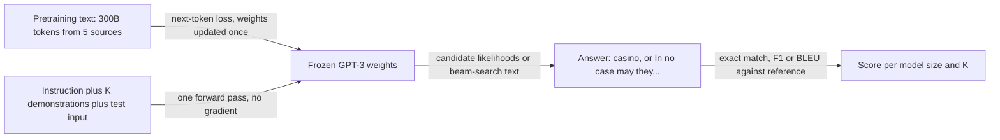
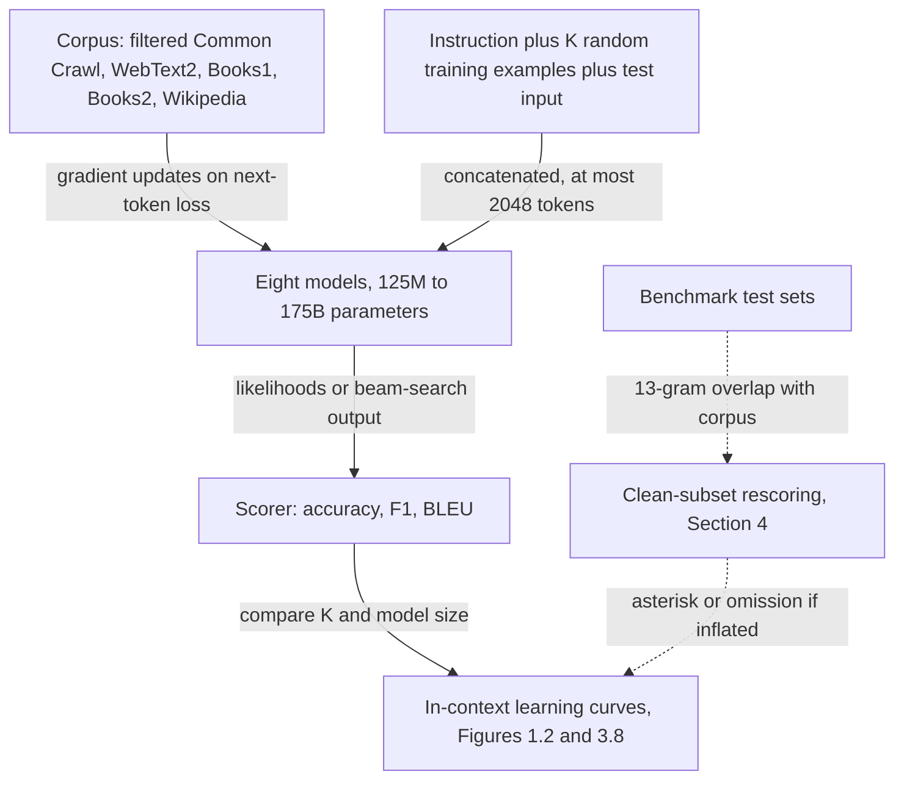

# Language Models are Few-Shot Learners

> **Paper:** Brown, Mann, Ryder, Subbiah and 27 co-authors (OpenAI), 2020 - [arXiv abstract](https://arxiv.org/abs/2005.14165) - [local PDF](../../papers/2005.14165.pdf)
>
> **Short name:** GPT-3 (Generative Pre-trained Transformer 3). Numbers follow the arXiv HTML rendering, which serves the latest version (the abstract page lists v1 to v4; v1 was submitted 28 May 2020); section, figure and table numbers are that rendering's. The paper was later presented at NeurIPS 2020 (this guide's knowledge, not stated in the arXiv text), so it is peer reviewed. Many figures (1.2, 1.3, 2.1, 3.2 to 3.12) are images whose data points are not in the text; this guide quotes only values found in tables or prose.

## Read this first

**The claim in one sentence.** If a language model is made large enough (175 billion parameters) and trained on a few hundred billion tokens, you can specify a new task inside its input text, with an instruction and up to a few dozen worked examples, and it will often do the task with no further training, though it stays behind fine-tuned systems on many benchmarks and near chance on a few.

**Who this is for.** Anyone who needs to know where "prompting" comes from, what a few-shot prompt is, and how much of the later assistant era the 2020 evidence supports.

**Afterwards you will be able to** write the zero-, one- and few-shot form of a prompt and say which text is scored; define in-context learning and say what is not learned; quote the eight model sizes, the data mixture and the headline results with their tables, including failures; and read the contamination analysis critically.

**Reading time.** About 50 minutes. **Have read first:** [Attention Is All You Need](./01-transformer.md) (GPT-3 is a stack of its decoder blocks) and [BERT](./02-bert.md) (the pretrain-then-fine-tune recipe this paper argues against). Next comes [Scaling Laws](./04-scaling-laws.md), the quantitative basis of the design, and later [Chinchilla](./05-chinchilla.md), which revised the token budget.

**The one thing most people get wrong.** "Few-shot learning" here involves no learning in the training sense: weights never change, and whatever the model picked up vanishes when the prompt ends. The second mistake is reading the paper as "GPT-3 beats fine-tuned models". Its tables show a few state-of-the-art results (LAMBADA, TriviaQA), many results below fine-tuned systems (SuperGLUE 71.8 against 89.0), and three-way inference tasks near chance. The durable finding is a trend: the benefit of examples in the prompt tends to grow with model size.

## The paper in one worked example

Two tasks from Appendix G ("Details of Task Phrasing") are traced through all three settings. Text is from the paper unless marked **constructed by this guide**; the paper gives templates, not every newline.

### Part A - one German sentence, three prompts (Figure G.36, Table 3.4)

The test item is from the WMT16 (Workshop on Machine Translation, 2016) German-English test set:

- **Source:** Keinesfalls dürfen diese für den kommerziellen Gebrauch verwendet werden.
- **Reference:** In no case may they be used for commercial purposes.

**Zero-shot (K = 0).** The note under Figure G.36 gives the template "Q: What is the {language} translation of {sentence} A: {translation}." Filled in, the model is asked to continue:

```
Q: What is the English translation of Keinesfalls dürfen diese für den kommerziellen Gebrauch verwendet werden. A:
```

**One-shot (K = 1).** The same note says one- and few-shot use a plain "source = target" layout. The demonstration is **constructed**; Section 2.4 says demonstrations are drawn at random from the training set:

```
Das Haus ist sehr klein. = The house is very small.
Keinesfalls dürfen diese für den kommerziellen Gebrauch verwendet werden. =
```

**Few-shot (K = 64 for translation, Table H.1).** Same layout, more lines. Three constructed demonstrations are shown; the real prompt holds 64, redrawn for every test sentence:

```
Das Haus ist sehr klein. = The house is very small.
Wir fahren morgen nach Berlin. = We are travelling to Berlin tomorrow.
Der Zug hatte eine Stunde Verspätung. = The train was an hour late.
Keinesfalls dürfen diese für den kommerziellen Gebrauch verwendet werden. =
```

**What is scored.** The model reads everything in one forward pass and generates a continuation by beam search (beam width 4, length penalty 0.6, Section 2.4). The continuation is compared with the reference by BLEU (Bilingual Evaluation Understudy: overlap of word sequences with the reference). The text does not say what ends generation; a newline is assumed.

**A toy score, constructed.** Suppose the model writes "In no case may they be used for commercial uses." Against the 10-word reference, 9 of 10 words match, 8 of 9 adjacent pairs, 7 of 8 triples, 6 of 7 four-word runs. BLEU is the geometric mean of those precisions times a length penalty (1 here): (0.9 x 0.889 x 0.875 x 0.857)^(1/4) = 0.88. Real BLEU is computed over the whole 2,999-sentence test set (Table C.1) and reported times 100.

**What the paper reports.** GPT-3 175B, German to English, BLEU with XLM's tokenization (Table 3.4): 27.2 zero-shot, 30.4 one-shot, 40.6 few-shot, against 40.2 for the best supervised system the authors found. A supervised system trains on millions of sentence pairs; the few-shot prompt contains 64.

### Part B - unscrambling "asinoc" (Figure G.19, Section 3.9.2, Table H.1)

The "Cycled Letters" task rotates a word's letters and asks for the original. Figure G.19 shows the prompt exactly:

```
Please unscramble the letters into a word, and write that word: asinoc =
```

The target is "casino" (first letter moved to the end). Section 3.9.2 gives another real pair: "lyinevitab" should give "inevitably". The model is not told how many letters moved, so it must search; the paper notes the task is not a deterministic function of the scrambled form.

A few-shot version (**constructed**, K = 3; the paper uses K = 100, Figure 3.11) would be:

```
lyinevitab = inevitably
lanetp = planet
terwa = water
asinoc =
```

The first pair is the paper's; the others are made up here. Scoring is exact match on the 10,000 most frequent words of 5 to 14 characters.

**The full row from Table H.1** (accuracy in percent; columns are the eight model sizes, from 125 million parameters up to 175 billion):

| Setting | 125M | 350M | 760M | 1.3B | 2.7B | 6.7B | 13B | 175B |
|---|---|---|---|---|---|---|---|---|
| Zero-shot (instruction only) | 0.62 | 0.71 | 2.85 | 0.00 | 0.63 | 1.35 | 2.58 | 3.66 |
| One-shot | 1.67 | 4.36 | 5.68 | 6.46 | 6.25 | 9.41 | 15.1 | 21.7 |
| Few-shot (K = 100) | 4.63 | 9.27 | 10.7 | 14.5 | 16.7 | 21.9 | 27.7 | 37.9 |

Notice three things, used later. The biggest model solves 3.66 of 100 words from the instruction alone but 37.9 of 100 with 100 demonstrations. Every row rises with size, yet the 1.3B zero-shot cell (0.00) sits below the 760M cell (2.85), so low-accuracy cells are noisy. And the main text quotes 38.6 for the same cell, which Tutorial 3's inconsistency table explains.



Only the first arrow changes weights. The prompt enters like any other text, so changing K costs no training but costs context length and compute at every call.

## Words you need

| Term | Plain definition | Example from the worked example |
|---|---|---|
| Language model (LM) | A system that assigns probabilities to the next piece of text | Given "asinoc =", it prefers "casino" over "casinos" |
| Token and byte-pair encoding (BPE) | Sub-word chunks the model reads; about 0.7 words per token (Section 3.9.2) | "asinoc" splits into unusual chunks, one reason letter tasks are hard |
| Context window (n_ctx) | Maximum tokens read at once: 2,048 for every size (Table 2.1) | Prompt, demonstrations and answer share 2,048 tokens |
| Task description (instruction) | Natural-language text saying what to do | "Please unscramble the letters into a word..." |
| Demonstration | One worked example (input and correct output) inside the prompt | "lyinevitab = inevitably" |
| Zero-, one-, few-shot (0S, 1S, FS) | Task specified with 0, 1 or K demonstrations; K is usually 10 to 100 (Section 2) | Part A shows K = 0, 1 and 3 (64 in the paper) |
| In-context learning | Using the prompt's instruction and demonstrations to do a task with no weight update; the "inner loop" of meta-learning (Figure 1.1) | The few-shot cycled-letters prompt |
| Fine-tuning (FT) | Updating weights on a labelled dataset for one task; not done to GPT-3 here | What BERT-style systems do per benchmark |
| Closed-book question answering | Answering from the weights alone, with no retrieved documents | TriviaQA, Natural Questions (Table 3.3) |
| Contamination (dirty, clean) | A test example is dirty if it shares an N-gram (a run of N words) with the training data, clean if not | Table C.1 counts both per benchmark |
| Exact match, F1, BLEU, perplexity | All-or-nothing string equality; word overlap with the gold answer; n-gram overlap; exp of mean negative log probability per token | Cycled letters uses exact match; translation uses BLEU |

## Tutorial 1 - Intuitive understanding

### What was broken before

By 2019 the standard recipe was: train a big model on raw text, then **fine-tune** it on thousands to hundreds of thousands of labelled examples for each task (Section 1; see [BERT](./02-bert.md)). The paper names three problems. Every new task needs its own labelled dataset, and for tasks like "critiquing a short story" none exists. A big model fine-tuned on a narrow dataset can latch onto accidental patterns, so nominally human-level scores can overstate real ability. And people do not need this: one sentence of instruction, or two examples, is enough for a person.

A concrete failure is the paper's own predecessor. GPT-2 used the same prompt-only idea and reached only 4 percent on Natural Questions and 55 F1 on CoQA (a conversational question-answering benchmark), over 35 points behind fine-tuned systems (Section 1). The idea existed; at 1.5 billion parameters it did not work well.

### The idea

**Analogy.** A capable temp worker has read an enormous library but never seen your forms. Fine-tuning is a week of training on your forms. Few-shot prompting is handing over three completed forms and a blank one. Zero-shot is only saying "fill in this form". The worker leaves with no new skill; tomorrow you must hand over the three forms again.

**Where it breaks.** A worker might really learn from the forms. The paper refuses to claim that for GPT-3: footnote 1 says the terms stay "agnostic" on whether the model learns tasks from scratch at inference time or only recognises patterns from training, and Section 5 calls this unresolved and likely task-dependent. The authors guess word-scrambling is closer to learned on the spot and translation "clearly must be learned during pretraining". Also, the model sees at most 2,048 tokens of forms at once.

**The paper's bet.** Scale. Earlier work ([Scaling Laws](./04-scaling-laws.md)) showed language-modelling loss improves smoothly with size. If skills are absorbed into weights during pretraining, the authors reason, the ability to use examples might also improve with size, so they build the largest dense model to test it: 175 billion parameters, 10 times any earlier non-sparse language model (Abstract).

### How it works, step by step

1. **Pretrain once.** Train a decoder-only Transformer ([Attention Is All You Need](./01-transformer.md)) on 300 billion tokens from a weighted mix of web pages, books and Wikipedia (Table 2.2). The only signal is "predict the next token"; nothing says "translate" or "unscramble".
2. **Write the prompt.** Concatenate an optional instruction, K demonstrations drawn at random from the task's training set, and the test input (Part A). K is as many as fit in 2,048 tokens, typically 10 to 100. Each test item gets a fresh draw, except SuperGLUE's WSC and MultiRC (Section 3.7).
3. **One forward pass.** Attention lets the last tokens look back at the demonstrations. No gradient, no weight change.
4. **Read out.** Multiple choice: compare the model's probability for each candidate ending, averaged per token (or normalised by the candidate's unconditional probability for ARC, OpenBookQA and RACE). Free-form: beam search. In Part B the answer is the string written after "asinoc =".
5. **Score and sweep.** Compute accuracy, F1 or BLEU for K = 0, 1 and "as many as fit", across all 8 sizes. Where a dev set exists, try a few K on dev and report the best on test (Section 2.4).



The solid path is the method. The dotted path checks that test questions were not memorised, which the authors needed because their removal step failed in part.

### What the results say

The paper often writes "%" for the gap between two percentages; this guide says "points". An 8-point gain over a 68-point baseline is about 12 percent relative.

**LAMBADA (Table 3.2).** The task is to predict the last word of a passage. Accuracy is 76.2 zero-shot, 72.5 one-shot, 86.4 few-shot, against a prior best of 68.0: few-shot is 18.4 points higher, so about 18 more final words in every 100 are exactly right. It is not a clean learning curve: one-shot is below zero-shot, and Figure 3.2's caption says zero-shot uses a different format (few-shot frames the task as a blank to fill so the model learns the answer is one word). Part of the gain is a formatting fix. HellaSwag (choose the sensible story ending) is flat: 78.9, 78.1, 79.3, against 85.6 fine-tuned and 95.6 for humans.

**TriviaQA and friends (Table 3.3).** TriviaQA accuracy is 64.3, 68.0, 71.2. RAG (Retrieval-Augmented Generation, fine-tuned and using retrieved documents; see [RAG](../02-building/06-rag.md)) scores 68.0, so GPT-3 matches it one-shot and passes it by 3.2 points few-shot with no retrieval. On Natural Questions it is 14.6, 23.0, 29.9 against RAG's 44.5; on WebQuestions 14.4, 25.3, 41.5 against 45.5. The big zero-to-few jumps there suggest, in the authors' words, that the question style is out-of-distribution.

**Translation (Table 3.4).** Averaged over the six directions (this guide's arithmetic), BLEU is 22.0 zero-shot, 29.6 one-shot, 33.8 few-shot: one example adds about 7.6, 63 more add about 4. Into English is far better than out of English (Romanian to English 39.5, English to Romanian 21.0); the authors suspect the English-heavy tokenizer. Only 7 percent of training words are non-English (Section 3.3), yet few-shot French to English (39.2) and German to English (40.6) beat the best supervised numbers the authors found (35.0, 40.2), which they doubt are true state of the art.

**SuperGLUE (Table 3.8, Figure 3.8).** SuperGLUE is a suite of eight language-understanding tasks. With 32 demonstrations per task the test score is 71.8, against 69.0 for fine-tuned BERT-Large (125 thousand training examples) and 89.0 for the best fine-tuned system. GPT-3 beats BERT-Large on four of eight tasks (COPA, WSC, MultiRC, ReCoRD). The K sweep shows fewer than eight examples per task suffice to pass BERT-Large's overall score.

**Arithmetic (Table 3.9).** Few-shot: 100.0 on two-digit addition, 98.9 two-digit subtraction, 80.4 three-digit addition, 25.5 four-digit, 9.3 five-digit, 29.2 two-digit multiplication. The 13B model gets 55.5 on two-digit addition (Table H.1), so the jump from 13B to 175B is the clearest skill-appears-at-scale case. A spot check found 17 of 2,000 three-digit addition and 2 of 2,000 subtraction problems in the training data, in the two string forms searched.

**Word tasks (Table 3.10).** Few-shot accuracy: random-insertion removal 67.2, cycled letters 37.9, easier anagrams 39.7, harder anagrams 15.1, reversal 0.44. Zero-shot, the same model scores 8.26, 3.66, 8.91, 2.28, 0.09. 

**SAT analogies and news.** SAT analogies: 65.2 percent few-shot against 57 percent for average applicants (the authors' citation) and 20 percent for guessing. In the news study, participants judged whether about 200-word articles were machine-written: 86 percent right for a deliberately bad control model, 52 percent (95 percent interval 49 to 54) for GPT-3 175B, where 50 is a coin flip; readers were right about 52 of 100 times (Table 3.11). About 500-word articles gave the same 52 (Table 3.12).

**Where it does badly.** WiC (same word sense in two sentences): 49.4 on test, chance. ANLI (Adversarial Natural Language Inference, three-way follows/contradicts/neither): 36.8, 34.0, 40.2 on rounds 1 to 3 against 33 chance (Table H.1). RACE-h (high-school reading): 46.8 against 90.0 fine-tuned. QuAC: 44.3 F1 against 74.4. DROP: 36.5 against 89.1. OpenBookQA: 65.4 against 87.2. The authors speculate a left-to-right model is weak at comparing two snippets (Section 5).

**Scale (Table H.1).** On the SuperGLUE dev average, few-shot minus zero-shot is 9.6 points at 125M, 12.5 at 13B, 15.0 at 175B (this guide's subtraction); the trend is up but not smooth (6.7B is below 2.7B). The claim that larger models use in-context information better holds for symbol removal (13B: 27.3, 175B: 67.2 few-shot) but not universally: on TriviaQA the few-minus-zero gap is 15.7 at 13B and 6.9 at 175B, because zero-shot is already strong.

### What this does not show

- That few-shot is competitive in general: SuperGLUE is 17.2 points under the best fine-tuned system.
- Prompting versus fine-tuning on the same network: the authors left fine-tuning GPT-3 to future work (Section 2).
- Why it improves: only size varies in a controlled way; there are no ablations of data mixture or architecture.
- Run-to-run noise: there are no error bars; Table C.1's redraw moves some scores 1 to 3 points.
- Whether context, instructions and memory could let smaller models match the large one: no instruction-tuned model was tested.

### Teach-back

1. What changes between zero-shot, one-shot and few-shot, and what stays fixed?
2. A friend says "GPT-3 learned to unscramble words from three examples". What do you say?
3. Why is the LAMBADA few-shot gain not a clean demonstration of in-context learning?
4. SuperGLUE: GPT-3 71.8, BERT-Large 69.0. Is GPT-3 the better system?

<details>
<summary>Answers 1 and 2</summary>

1. Only the number of demonstrations in the prompt (0, 1, or K up to what fits in 2,048 tokens). Weights, model, scorer and test set are fixed; zero-shot still carries a description in most tasks.
2. Nothing persists, since weights are unchanged. Behaviour within one prompt changed; whether that is learning or recognising a known task is open, as the authors say.

</details>

<details>
<summary>Answers 3 and 4</summary>

3. Zero-shot LAMBADA uses a different format from one- and few-shot, and one-shot (72.5) is worse than zero-shot (76.2). The gain mixes more examples with a better way of asking for one word.
4. Not clearly. GPT-3 used 32 prompt examples per task and no gradient updates; BERT-Large was fine-tuned on 125 thousand. GPT-3 wins four of eight tasks, sits at chance on WiC (49.4), and the best system scores 89.0. Dev and test scores also differ by up to about 6 points on small tasks.

</details>

## Tutorial 2 - Practitioner understanding

### The design in concrete terms

**The eight models (Table 2.1).** All use 2,048 context and 300 billion training tokens; batch size is in tokens.

| Name | Params | Layers | d_model | Heads | d_head | Batch | Learning rate |
|---|---|---|---|---|---|---|---|
| Small | 125M | 12 | 768 | 12 | 64 | 0.5M | 6.0e-4 |
| Medium | 350M | 24 | 1024 | 16 | 64 | 0.5M | 3.0e-4 |
| Large | 760M | 24 | 1536 | 16 | 96 | 0.5M | 2.5e-4 |
| XL | 1.3B | 24 | 2048 | 24 | 128 | 1M | 2.0e-4 |
| 2.7B | 2.7B | 32 | 2560 | 32 | 80 | 1M | 1.6e-4 |
| 6.7B | 6.7B | 32 | 4096 | 32 | 128 | 2M | 1.2e-4 |
| 13B | 13.0B | 40 | 5140 | 40 | 128 | 2M | 1.0e-4 |
| 175B | 175.0B | 96 | 12288 | 96 | 128 | 3.2M | 0.6e-4 |

d_model is layer width; the feed-forward layer is 4 times wider. Two rows do not multiply out: XL has 24 x 128 = 3,072 against d_model 2,048, and 13B has 40 x 128 = 5,120 against 5,140. A check (this guide's arithmetic: about 12 x layers x d_model squared plus 50,257 x d_model) gives 174.6B for the top row and 1.31B for XL at 2,048, so d_model is trustworthy and the XL head size and 13B width look like typos. The architecture is GPT-2's plus alternating dense and locally banded sparse attention layers (Section 2.1).

**Data (Table 2.2).** Sources are sampled by weight, not size:

| Source | Tokens | Weight | Epochs in 300B (printed) | Guide: tokens drawn |
|---|---|---|---|---|
| Common Crawl (filtered) | 410B | 60% | 0.44 | 180B |
| WebText2 | 19B | 22% | 2.9 | 66B |
| Books1 | 12B | 8% | 1.9 | 24B |
| Books2 | 55B | 8% | 0.43 | 24B |
| Wikipedia | 3B | 3% | 3.4 | 9B |

Weights sum to 101, and printed epochs for WebText2 (66/19 = 3.5), Books1 (2.0) and Wikipedia (3.0) do not exactly recompute, so the weights seem rounded. Curated sources are seen 2 to 3 times and Common Crawl less than once, "a small amount of overfitting in exchange for higher quality".

**Filtering (Section 2.2, Appendix A).** Raw input: 41 monthly Common Crawl shards (2016 to 2019), 45 TB compressed, 570 GB after filtering. A logistic-regression classifier scored documents against WebText, Wikipedia and books; a document was kept if a Pareto draw (shape 9) exceeded 1 minus its score, so a few poor ones survived. Fuzzy deduplication cut data by about 10 percent.

**Optimisation (Appendix B).** Adam (beta1 0.9, beta2 0.95), gradient clip 1.0, cosine learning-rate decay to 10 percent over 260 billion tokens, warm-up over 375 million tokens, weight decay 0.1, batch size ramped up early. Documents are packed into 2,048-token sequences with an end-of-text separator.

**Evaluation (Section 2.4).** Demonstrations come from the training set (dev set for LAMBADA and StoryCloze). Delimiters are one or two newlines. Binary tasks are renamed ("True"/"False"). Only the 175B few-shot model was submitted to test servers, and only for SuperGLUE, TriviaQA and PIQA; other numbers are dev-set results.

### A minimal version

A harness for zero-, one- and few-shot prompting of any text model. Two model methods are assumed: per-token log-probabilities and generation.

```python
import random

class LM:                                   # wrap any decoder-only model
    def logprobs(self, context, completion): ...   # -> list[float], one per token
    def generate(self, context, max_tokens=32): ...  # -> str, stops at first newline

def build_prompt(demos, query, instruction="", arrow=" ="):
    lines = [instruction] if instruction else []
    lines += [f"{x}{arrow} {y}" for x, y in demos]      # K demonstrations
    lines.append(f"{query}{arrow}")                      # open slot for the answer
    return "\n".join(lines)

def pick_mc(lm, ctx, choices):            # per-token mean log-likelihood (Section 2.4)
    def score(c):
        lp = lm.logprobs(ctx, " " + c)
        return sum(lp) / len(lp)
    return max(choices, key=score)

def run(lm, train, test, k, instruction="", mc=False, seed=0, budget=1500):
    rng, correct, too_long = random.Random(seed), 0, 0
    for item in test:                     # item: {"x": str, "y": str, "choices": [...]}
        demos = rng.sample(train, k) if k else []        # fresh draw per test item
        ctx = build_prompt(demos, item["x"], instruction)
        too_long += len(ctx.split()) > budget            # crude context-window flag
        pred = pick_mc(lm, ctx, item["choices"]) if mc else lm.generate(ctx).strip()
        correct += pred == item["y"]                     # exact match
    return correct / len(test), too_long

def sweep(lm, train, dev, ks=(0, 1, 4, 16, 32), **kw):   # choose K on dev only
    res = {k: run(lm, train, dev, k, **kw) for k in ks}
    return max(res, key=lambda k: res[k][0]), res

def dirty(test_texts, corpus_ngrams, n=13):              # contamination probe
    def grams(t):
        w = t.lower().split()
        return {" ".join(w[i:i + n]) for i in range(len(w) - n + 1)}
    return [bool(grams(t) & corpus_ngrams) for t in test_texts]   # True = dirty
```

Shapes: `train` and `test` are lists of dicts; for cycled letters an item is `{"x": "asinoc", "y": "casino"}`. `run` returns for example `(0.379, 0)`: 37.9 percent exact match, no prompt flagged too long. `sweep` returns the best K on dev; then call `run` once on test with that K, as the paper does.

### What it costs

**Training (the paper's accounting, Appendix D).** Forward costs 2 operations per parameter per token and backward twice that, so 6 x parameters x tokens, ignoring attention: 6 x 1.746e11 x 3e11 = 3.14e23 operations, listed as 3.64e3 petaflop/s-days (one is 8.64e19 operations). The paper gives no dollar figure or GPU count, only "V100" processors (Section 2.3). **Assumptions, constructed:** a V100 peak of about 125 teraflops, 30 percent sustained (3.75e13 operations per second). Then 3.14e23 / 3.75e13 = 8.4e9 GPU-seconds, about 2.3 million GPU-hours, about 10 days on 10,000 GPUs, and about $4.7 million at an assumed $2 per GPU-hour. Orders of magnitude only.

**Serving.** Weights are 175e9 x 2 bytes = 350 GB at 16-bit precision (assumption; the paper does not state inference precision), at least 11 GPUs of 32 GB before working memory. One generated token costs about 3.5e11 operations (2 per parameter).

**What few-shot adds.** Assume each demonstration is 50 tokens and the query plus instruction is 100 (**constructed**). Zero-shot is 100 tokens per item; K = 32 is 32 x 50 + 100 = 1,700, which is 17 times the tokens. K = 64 would be 3,300 and does not fit 2,048; the largest K is 38 with no room for an answer. A cached fixed prefix helps, but a fresh draw per item defeats caching.

**An unresolved gap.** Translation uses K = 64 (Table H.1) in a 2,048-token window, yet a pair like Figure G.36's plausibly needs 50 to 100 tokens per language, so 64 would not fit. The paper does not say how; this guide cannot reconcile it.

### How it fails

| Symptom | Likely cause | Mitigation | Grounding |
|---|---|---|---|
| Chance-level few-shot on comparison tasks | Left-to-right model comparing two snippets | Recast as a single-snippet question; test a tuned model | WiC 49.4; ANLI 34 to 40; Section 5 speculation |
| One example is worse than none | Format ambiguous until several examples fix it | Sweep K including 0, 1 and 8 or more | LAMBADA 72.5 one-shot vs 76.2 zero-shot |
| Accuracy collapses as operations grow | Skill brittle with problem size | Cap digits or call a calculator | 100.0 on 2-digit addition, 9.3 on 5-digit |
| Letter-level tasks fail | Tokens are word pieces | Spell letters out | Reversal 0.44; BPE note in Section 3.9.2 |
| Strong public score, weak own data | Test text was in training data | Overlap checks; private held-out set | Table C.1; PIQA and Winograd asterisks |
| Fluent but incoherent long output | No grounding, repetition | Retrieval plus checks; shorter outputs | Section 5 |
| Biased associations | Web-trained | Counterfactual prompt audit | 83 percent of 388 occupations male-leaning (Section 6.2.1) |
| Scores shift between runs | Demonstration draw varies | Several seeds, report spread | Tables C.1 vs H.1 differ 1 to 3 points |
| Silent truncation | Prompt plus answer exceeds window | Count tokens; drop demonstrations first | n_ctx = 2,048 |

### Evaluating your version

- **Metric.** Match the output type: exact match for short strings, length-normalised likelihood for multiple choice, F1 for spans.
- **Baselines.** Best zero-shot instruction; majority class; a fine-tuned small model if you have labels (the paper had no matched one).
- **Test set size.** At p = 0.7 and N = 200 the standard error is 3.2 points and that of an unpaired difference is 4.6, so a 5-point gain is barely one standard error; at N = 1,000 it is 2.1. Paired comparison on the same items is tighter.
- **Seeds.** Redraw demonstrations at least three times; the paper's own reruns move scores 1 to 3 points (BoolQ dev 77.5 in Table H.1, 76.0 in Table C.1).
- **Stop rule.** Stop raising K when the last increase gains less than one standard error on dev, or the prompt passes about 80 percent of the window. Choose K on dev, report once on test.
- **Contamination.** If test items could be on the web, run the overlap probe and report clean and full scores.

### Adopt, adapt or skip

**Adopt the interface idea.** For an assistant over private business documents, the lasting contribution is that instructions and a few worked examples in the prompt specify a task, and that K should be chosen on held-out data. Keep a small, versioned set of demonstrations per task and measure each.

**Adapt the evidence.** The paper has nothing on private documents, long context or small models. Closed-book knowledge is incomplete (Natural Questions 29.9 against RAG's 44.5), the case for putting document text in the prompt ([RAG](../02-building/06-rag.md)). Below about 13B parameters Table H.1 shows weak use of examples on arithmetic and unscrambling, so test whether few-shot gains carry to your open or smaller model. Whether better instructions and memory can make a small model reliable is the curriculum's question, and this paper cannot answer it: no instruction-tuned model was tested. Training in instruction following came later ([InstructGPT](../02-building/08-instructgpt.md)).

**Skip the model.** Its 2,048-token window and lack of instruction tuning are historical; read for the framing, the size sweep and the contamination method.

## Tutorial 3 - Researcher understanding

### Formal setup

Tokens x_1..x_T come from a vocabulary of about 50 thousand byte-pair tokens (GPT-2's, Section 2.1). The model defines p_theta(x_t | x_<t). **Outer loop (pretraining):** choose theta to minimise L = - E[ sum_t log p_theta(x_t | x_<t) ], then freeze it. **Inner loop (in-context learning):** for a task with pairs (x_i, y_i), form the context C = d, (x_1, y_1), ..., (x_K, y_K), x_q, where d is an optional description and K is such that |C| plus answer length is at most n_ctx = 2,048. Prediction is beam search for y given C, or over a candidate set Y the maximiser of a score. Section 2.4 gives two: the per-token mean s(y) = (1/|y|) sum_j log p_theta(y_j | C, y_<j), and for ARC, OpenBookQA and RACE the ratio p(y | C) / p(y | "Answer:"). Theta never changes; "adaptation" lives in the activations, which the paper likens to RL2-style meta-learning (Section 7).

**Toy instance, constructed.** Candidate A has four tokens at log-probability -0.5 each: sum -2.0, mean -0.5. Candidate B has one token at -1.5: sum -1.5, mean -1.5. Sum prefers B, per-token mean prefers A. For the ratio, let p(A | C) = 0.02, p(A | "Answer:") = 0.10, p(B | C) = 0.01, p(B | "Answer:") = 0.01: ratios 0.2 and 1.0, so B wins though A is likelier in context, because the ratio rewards what the context lifted above the baseline.

**Compute.** C is about 6 N D (Appendix D): 6 x 1.746e11 x 3e11 = 3.14e23. In the framing of [Scaling Laws](./04-scaling-laws.md), loss follows a power law in compute; Figure 3.1 says it continues two more orders of magnitude with "only small deviations" (constants not in the text).

### The claims, stated precisely

1. Cross-entropy loss for the 8 models plus 6 extra-small ones (down to 100 thousand parameters) follows a power law in compute (Figure 3.1).
2. Task performance generally rises smoothly with size in all three settings (Section 1), though Table H.1 has non-monotone cells.
3. The few-shot advantage over zero-shot often grows with size (Figures 1.2, 1.3, 3.8). The authors say this is "perhaps suggesting" larger models are better meta-learners: speculation, not a tested mechanism.
4. Few-shot GPT-3 is sometimes competitive with fine-tuned state of the art (SOTA; TriviaQA 71.2; LAMBADA 86.4; Penn Treebank perplexity 20.5 against 35.8, Table 3.1) and far below on others (Tables 3.7, 3.8).
5. Weak spots cluster in comparison and entailment tasks and some reading comprehension (Section 5).
6. Contamination had small measured effects on most benchmarks, with exceptions asterisked or dropped (Section 4); humans detect generated news at 52 percent (Table 3.11).

### Evidence, table by table

**Figure 3.1 with Table 2.1.** Identifies a smooth size-loss relation within this family and data; batch size and learning rate co-vary with size, so "size" is a bundle, and architecture and data-mix effects are not identified.

**Table 3.2.** Rows: SOTA and three settings. LAMBADA accuracy 76.2, 72.5, 86.4 against 68.0; perplexity 3.00, 3.35, 1.92 against 8.63. The Figure 3.2 format difference confounds shots with phrasing. Table C.1: 43 percent of LAMBADA is dirty, clean subset 86.0 against 86.4.

**Table 3.4.** Six directions, BLEU. The unsupervised rows see no paired sentences while GPT-3 sees 1 or 64, so the authors call them "not strictly comparable". Table C.1 flags 25 percent of German-English sentences dirty; clean scores 40.8 against 43.0, a 2.2 drop, above the text's "1-2 BLEU".

**Tables 3.9, 3.10, Figure 1.2.** Tasks chosen to be unlikely in training data, so gains from examples are more plausibly in-context. Identifies a size threshold for arithmetic between 13B and 175B (55.5 to 100.0). The instruction effect in Figure 1.2 is qualitative, since the points are not in the text.

**Tables 3.11, 3.12, Appendix E.** 25 titles from one news site, about 80 US participants per model, outputs chosen automatically to match human article length. Shows 52 percent for these readers and these articles; not for experts or classifiers (the authors cite work suggesting classifiers do better).

**Table C.1, Figure 4.2.** For 42 benchmark rows: dirty and clean counts, scores, relative difference. Identifies the effect of removing overlap if clean and dirty items are equally hard, which the authors flag as unproven. PIQA: 82.3 all, 79.3 clean (3 points, 71 percent clean). Anagrams 2: dirty 76.2, clean 37.4. DROP: clean 29.5 on 638 items. QuAC: clean 54.1 on 38 items. Reversed words: clean 0.3 against 0.4.

**Inconsistencies noticed inside the paper** (flagged where they appear; none silently fixed):

| Where | What does not match |
|---|---|
| Table 3.6 vs Section 3.5 and Table H.1 | PIQA zero-shot 80.5 in Table 3.6, 81.0 in the text and H.1; fine-tuned best 79.4 (Table 3.6) vs 77.1 (H.1) |
| Section 3.9.2 vs Table 3.10 | Text 66.9, 38.6, 40.2; table 67.2, 37.9, 39.7. Text values match Table C.1, a different draw of demonstrations |
| Section 3.9.2 | One-shot "dropping by half or more": the table drops are 32 to 43 percent for the four non-reversal tasks |
| Section 4 vs Table C.1 | Winograd flagged 45 percent in text; table has 164 of 273 dirty (60 percent). Effect "2.6%" vs 2.4 points in the table |
| Appendix C | DROP "94%" dirty in text; table clean share 7 percent implies about 93 |
| Table 2.1 | XL 24 x 128 = 3,072 vs d_model 2,048; 13B 40 x 128 = 5,120 vs 5,140 |
| Table 2.2 | Weights sum to 101; printed epochs for WebText2, Books1, Wikipedia do not recompute; text says 400B Common Crawl tokens, table 410B |
| Sections 2.4, Appendix E | "200B" for the 175B model |
| Section 3.9.4 vs captions | Control is "160M parameter" in text, "GPT-3 Small" (125M) in captions; Table 3.11 caption says "five" models but lists eight |
| Appendix E vs Tables E.1, E.2 | 718 recruited in "6 experiments"; Table E.1 lists 9 conditions with 713 recruited, E.2 adds 160 more; the 97 exclusions match E.1 only |
| Table H.1 | WiC zero-shot 0.00 at every size; MultiRC zero- and one-shot rows identical; BoolQ zero-shot 175B (60.5) below 2.7B (67.1); German to English one-shot 13B (33.0) beats 175B (30.4) |
| Units | "%" used for point gaps ("8% over previous SOTA" is 8.2 points; "almost 10 F1" is 10.3) |
| Figure 2.2 vs Table D.1 | "GPT-3 3B almost 10x" RoBERTa-Large; the 2.7B row is 7.5x |
| Table 3.4, Section 2.4 | K = 64 translation prompts in 2,048 tokens: not reconciled |

### Ablations and what they isolate

The paper has few ablations in the usual sense.

- **Model size (8 sizes, same data and tokens).** Isolates size, with batch and learning rate co-varying. The strongest comparison.
- **K.** Isolates in-prompt information for a fixed model (Figures 1.2, 3.8). Confounded where K = 0 uses a different format (LAMBADA; the translation template).
- **With and without a description (Figure 1.2).** Isolates the instruction; qualitatively it helps more at larger sizes. Points are not in the text.
- **Clean versus full test subsets (Table C.1).** Isolates removal of overlapping items, not memorisation from easier items.
- **Not ablated:** mixture weights, quality filter, sparse attention, token count, context length, prompt wording (WiC phrasings were tried, Section 3.7, with no table).

### Threats to validity specific to this paper

1. **Contamination was partly uncontrolled.** A bug left overlaps in; retraining was infeasible; benchmarks almost wholly in the training data (Wikipedia language-modelling sets, Children's Book Test) were dropped.
2. **Dev-set tuning.** K is tuned on dev, most reported numbers are dev numbers, and prompt phrasings were searched on WiC without a budget.
3. **No noise estimates.** Different draws shift scores up to about 3 points on small sets (WSC dev 76.9 in Table C.1, 75.0 in H.1, 104 items). Dev-to-test gaps are large: WiC 55.3 against 49.4, CB 82.1 against 75.6, WSC 75.0 against 80.1.
4. **Unmatched baselines.** Fine-tuned systems differ in model, data and compute.
5. **"Learning" untested.** Recognition of a known task fits the data as well; Section 5 offers speculation only.
6. **Tokenization.** BPE harms letter tasks and possibly English to Romanian (authors' guess).
7. **One pretraining run per size, and a narrow news study** (one site, 25 articles, US crowd workers).

### Open problems and follow-ups

The authors list bidirectional models at this scale, better objectives, human feedback or reinforcement learning, grounding, sample efficiency, distillation, and understanding "how few-shot learning actually works" (Section 5).

What came after, from other guides here (not from this paper): more tokens per parameter ([Chinchilla](./05-chinchilla.md)); instruction following learned from human feedback ([InstructGPT](../02-building/08-instructgpt.md)); writing intermediate steps ([Chain of Thought](../02-building/07-chain-of-thought.md)); retrieval for knowledge ([RAG](../02-building/06-rag.md)); cheap adaptation with few trainable weights ([LoRA](../02-building/09-lora.md)); broader evaluation ([MMLU](../03-evaluation-and-code/11-mmlu.md), [HELM](../03-evaluation-and-code/13-helm.md)).

### What would change my mind

- **Against "larger models are better meta-learners":** a replication where K = 0 and K >= 1 share formatting and the few-minus-zero gap fails to grow with size on most tasks.
- **For "learning" over recognition:** a task provably absent from pretraining (a freshly invented symbol mapping) where accuracy rises with K like a trained learner's.
- **Against the contamination conclusion:** a benchmark written after the training cutoff scoring systematically below its public counterpart.
- **Against the scale story:** a smaller model with instruction data reproducing the 175B in-context gains on the synthetic tasks.

## Reading map for the PDF

| Section or figure | What it contains | First pass | Guide section |
|---|---|---|---|
| 1, Figures 1.1 to 1.3 | Meta-learning framing, in-context learning, headline numbers | Read | Read this first; Tutorial 1 |
| 2, Figure 2.1 | Zero-, one-, few-shot, fine-tuning definitions | Read | Worked example; Words |
| 2.1 to 2.3, Tables 2.1, 2.2 | Sizes, data mix, training | Skim | Tutorial 2 (design); inconsistencies |
| 2.4 | How prompts and scores are built | Read | Tutorial 2; Tutorial 3 (formal setup) |
| 3.1 to 3.5 | Language modelling, QA, translation, Winograd, commonsense | Skim tables | Tutorial 1 (results) |
| 3.6 to 3.8 | Reading comprehension, SuperGLUE, NLI | Read SuperGLUE | Tutorial 1; How it fails |
| 3.9 | Arithmetic, scrambling, SAT, news, novel words | Read 3.9.1, 3.9.2, 3.9.4 | Worked example B; Tutorial 3 |
| 4, Appendix C | Contamination method, Table C.1 | Read | Tutorial 3 |
| 5 | Authors' limitations | Read | Tutorial 3 (open problems) |
| 6, 7, 8 | Misuse, bias, energy; related work; conclusion | Skim 6, skip rest | How it fails; Where this sits |
| Appendices A, B, D, E, F | Filtering, optimiser, compute, human study, poems | Skim A, B, D; skip E, F | Tutorial 2; Tutorial 3 |
| Appendix G | Exact prompt formats | Read two tasks | Worked example |
| Appendix H | Every number for every size and setting | Lookup | All results |

## Questions readers get stuck on

### Is the model really learning anything from the examples?

Not in the sense of changing parameters: nothing is stored, and a fresh prompt starts from the same weights. Within a prompt its outputs change usefully, so something task-specific is computed in its activations. The paper stays neutral on whether that is a new skill or recognition of a task met in training (footnote 1, Section 5). Treat "learning" as a label for observed behaviour.

### Why are most reported numbers from dev sets and not test sets?

Some benchmarks keep test labels private, and the model was too large to fit the test servers (Section 2.4). Only the 175B few-shot model was submitted, for SuperGLUE, TriviaQA and PIQA; everything else is development-set data, which the authors also used to pick K, so reported scores carry some selection effect.

### Why are some tasks scored by likelihood and others by generated text?

Choosing among given options (HellaSwag, ARC) is easy by asking which completion the model finds likeliest. Open answers (translation, unscrambling) need generation. The choice matters: likelihood scoring cannot answer outside the list, and per-token normalisation changes which option wins (Tutorial 3's toy instance).

### Is 300 billion tokens a lot for 175 billion parameters?

By later standards it is low: 1.7 tokens per parameter (300 / 175). The authors followed 2020 scaling-law advice to favour model size, so Common Crawl and Books2 were seen less than once (Table 2.2). Chinchilla later argued for more tokens on smaller models; this paper does not.

### If it beats fine-tuned models on some tasks, why not use it everywhere?

The wins are narrow. It passes a retrieval system on TriviaQA but trails it by 14.6 points on Natural Questions (29.9 against 44.5), SuperGLUE is 71.8 against 89.0, and WiC and ANLI are near chance. Serving needs hundreds of gigabytes of weights.

### How reliable is the contamination analysis?

More careful than 2020 practice, and also a patch for a failure: a filtering bug let overlaps stay. A 13-gram collision marks an example dirty and the clean subset is rescored; most shifts are small. The weakness, stated by the authors, is that clean and dirty subsets can differ in difficulty. It found real problems (PIQA, Winograd asterisked) and led to dropping Wikipedia-based language-modelling sets.

### Why does the text say 81.0 for PIQA zero-shot when Table 3.6 says 80.5?

It is one of several mismatches (Tutorial 3). Table H.1 also says 81.0, so Table 3.6 looks like the error. This guide prefers Table H.1 when sources disagree and says so.

### Where do Claude Code or ChatGPT-style assistants fit?

Their basic interface descends from this paper: instructions and examples as text. What GPT-3 lacks is everything added later: instruction tuning, long context, tools. The reasoning-and-acting loop of [ReAct](../02-building/10-react.md) is a prompting pattern built on the premise that the model's text is the control surface.

## Prerequisites you actually need

### Prerequisite 1 - Next-token probability and log-likelihood scoring

A language model gives each next token a probability; a completion's probability is the product of its token probabilities, so its log probability is the sum of token log probabilities. Averaging per token removes the advantage of short answers.

Tiny example: token probabilities 0.5, 0.25, 0.5 give ln 0.5 + ln 0.25 + ln 0.5 = -0.693 - 1.386 - 0.693 = -2.77, mean -0.92. A one-token answer at probability 0.2 has -1.61. Summed, the long answer loses (-2.77 against -1.61); per token it wins (-0.92 against -1.61).

Used in: Section 2.4 scoring; Tutorial 3. Reference: [Attention Is All You Need](./01-transformer.md).

### Prerequisite 2 - Tokens and the context window

Text is split into tokens and the model reads at most n_ctx of them. At about 0.7 words per token (Section 3.9.2), 2,048 tokens hold roughly 1,430 words.

Tiny example: a 12-word demonstration is about 12 / 0.7 = 17 tokens; with 40 tokens of instruction and query and 20 reserved for the answer, (2,048 - 40 - 20) / 17 = 117 demonstrations fit.

Used in: Section 2.4 (K from 10 to 100); the cost arithmetic. Reference: [BERT](./02-bert.md) for the same sub-word idea.

### Prerequisite 3 - The metrics the paper reports

Accuracy is the fraction exactly right. F1 is the harmonic mean of precision and recall over answer words. BLEU is a geometric mean of n-gram precisions with a brevity penalty. Perplexity is exp of the mean negative log probability per token.

Tiny example: gold "the Chicago Bears", prediction "Chicago Bears": precision 2/2 = 1, recall 2/3, F1 = 2 x 1 x 0.667 / 1.667 = 0.80. A model giving every token probability 0.5 has perplexity exp(0.693) = 2, so LAMBADA's 1.92 is about 1.9 equally likely options per final word.

Used in: Tables 3.1 to 3.10. Reference: the repository [glossary](../../references/glossary.md).

### Prerequisite 4 - Sampling error on a small test set

A proportion measured on N items has standard error sqrt(p(1-p)/N); a gap matters only if it is a couple of standard errors.

Tiny example: SuperGLUE's WSC dev set has 104 items; at 75 percent the standard error is sqrt(0.75 x 0.25 / 104) = 4.2 points, so the dev-to-test move from 75.0 to 80.1 is about one standard error.

Used in: Tables 3.8, C.1, H.1. Reference: any introduction to confidence intervals; [math bridge](../../references/math-bridge.md).

## Where this sits in the curriculum

**Before this guide:** [Attention Is All You Need](./01-transformer.md) supplies the block (GPT-3 uses the decoder side with causal attention); [BERT](./02-bert.md) supplies the fine-tuning baseline.

**Difference from the nearest papers.** Against BERT: BERT is bidirectional, small (110M and 340M), and fine-tuned per task; GPT-3 is left-to-right, three orders of magnitude larger and never fine-tuned; the authors conjecture a bidirectional model of its size might fine-tune better (Section 5). Against [Scaling Laws](./04-scaling-laws.md): that paper predicts loss trends; GPT-3 tests them at 175B and adds the claim that in-context ability scales too.

**What to read next and why.** [Scaling Laws](./04-scaling-laws.md) for the theory behind the size and token choices, then [Chinchilla](./05-chinchilla.md) for the correction that models of this era were undertrained. [InstructGPT](../02-building/08-instructgpt.md) shows how "describe the task in text" became reliable by training for it, and [ReAct](../02-building/10-react.md) shows prompting as the interface to tools, the agent stage's pattern: the model emits text, a thin runtime acts, observations return as text. This paper supplies the premise that text can specify behaviour; it supplies no tools, no memory beyond 2,048 tokens, and no recipe for making small models do it reliably.

## Checkpoint

1. State the difference between few-shot prompting and fine-tuning, and what is updated in each.
2. From Table 3.4, compute the one-shot and few-shot average BLEU over six directions and the gain between them. Does it match the text?
3. A prompt has 150 tokens of instruction and query, 45 tokens per demonstration, 30 tokens reserved for the answer, in a 2,048 window. Largest K?
4. Which setting gives 80.4 on three-digit addition (Table 3.9), and what is the 13B-to-175B jump on few-shot two-digit addition (Table H.1)?
5. Critique "contamination does not matter for GPT-3".
6. Table 3.6 says PIQA zero-shot is 80.5 and the text says 81.0. What do you do?

<details>
<summary>Answers 1 to 3</summary>

1. Few-shot puts K examples in the input and updates nothing (the effect lives in activations for one forward pass). Fine-tuning takes gradient steps on a labelled dataset and updates weights, which persist.
2. One-shot: 28.3 + 33.7 + 26.2 + 30.4 + 20.6 + 38.6 = 177.8, mean 29.6. Few-shot: 32.6 + 39.2 + 29.7 + 40.6 + 21.0 + 39.5 = 202.6, mean 33.8. The gain is about 4.1, matching "another 4 BLEU".
3. (2,048 - 150 - 30) / 45 = 41.5, so K = 41.

</details>

<details>
<summary>Answers 4 to 7</summary>

4. Few-shot. On two-digit addition the 13B model scores 55.5 and 175B scores 100.0, a 44.5-point gain.
5. For: Table C.1 shows mostly small differences between full and clean subsets, with no correlation between contamination level and difference (Figure 4.2); LAMBADA's clean subset is within 0.5. Against: a bug left overlaps in; clean subsets may differ in difficulty; PIQA and Winograd needed asterisks and some benchmarks were dropped. Fair statement: small measured effects for most, with exceptions.
6. Record it as a discrepancy and trust Table H.1, which agrees with the text (81.0) and is the source of most values; flag it in any write-up.
</details>
