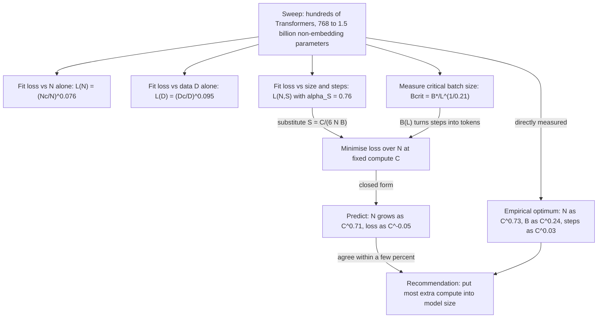
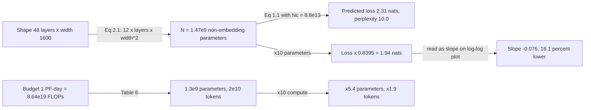

# Scaling Laws for Neural Language Models

> **Paper:** Kaplan, McCandlish, Henighan, Brown, Chess, Child, Gray, Radford, Wu and Amodei (Johns Hopkins University and OpenAI), 2020 - [arXiv abstract](https://arxiv.org/abs/2001.08361) - [local PDF](../../papers/2001.08361.pdf)
>
> **Short name:** the Kaplan scaling laws. Section, equation, figure and table numbers follow the arXiv HTML rendering of v1 (23 January 2020), the only rendering this guide could read. The paper is an arXiv preprint; this guide did not check for a peer-reviewed version. Numbers are from that text unless marked "this guide's arithmetic" (recomputed here) or "constructed" (made up for illustration).

## Read this first

**The claim in one sentence.** When a Transformer language model is trained on text, its test loss falls along smooth straight lines on a log-log plot as parameters, data or compute increase, and the fitted lines are accurate enough to say how to split a fixed compute budget between a bigger model and more training.

**Who this is for.** Anyone who must decide how big a model to train, buy or rent, and keeps hearing "scaling laws" without knowing what is fitted. It is also the foundation for [Chinchilla](./05-chinchilla.md), the next guide, which revises this paper's main recommendation.

**Afterwards you will be able to** read a power law off a log-log plot and do the arithmetic (what ten times more parameters buys, what halving the loss would cost); say what "non-embedding parameters" and "6ND compute" mean; reproduce the paper's allocation (model size grows as compute to the power 0.73, data as 0.27); list the paper's own caveats and the inconsistencies between its prose and tables; and say precisely which conclusion later work overturned.

**Reading time.** About 55 minutes. **Have read first:** [Transformer](./01-transformer.md) (what a layer and a parameter are) and [GPT-3](./03-gpt3.md) (the model family this work helped motivate). [BERT](./02-bert.md) is optional context.

**The one thing most people get wrong.** The paper is not a recipe saying "train X parameters on Y tokens". It is a set of curve fits to one model family (decoder-only Transformers) on one dataset (WebText2, text from web pages linked on Reddit) with one tokenizer, over a limited range. Some fitted constants are said to have "no fundamental meaning", and the allocation advice (spend nearly all extra compute on model size) was later revised. Read it as a measuring method and a historically influential first estimate.

## The paper in one worked example

The paper has no single example input, so this part is **constructed by this guide** from the paper's own equations and constants (Equations 1.1 to 1.4, Tables 5 and 6) and one real model shape. Every derived number is this guide's arithmetic and can be redone on a calculator.

### Part A - how big is the model, and what loss does the law predict?

Take the shape the Figure 5 caption says was used in the earlier GPT-2 work: 48 layers, residual-stream width 1600, written (n_layer, d_model) = (48, 1600).

1. **Non-embedding parameters.** Equation 2.1 gives N of about 12 x n_layer x d_model squared = 12 x 48 x 1600 x 1600 = 1,474,560,000, about 1.47 billion.
2. **Embedding parameters, left out of N.** With 50,257 byte-pair-encoding tokens (Section 2) the token table is 50,257 x 1600 = 80,411,200 numbers and the 1024-position table is 1,638,400. Together 82,049,600, which is 5.3 percent of the 1.557 billion total.
3. **Predicted loss.** Equation 1.1 is L(N) = (N_c / N)^alpha_N with alpha_N about 0.076 and N_c about 8.8 x 10^13. N_c / N = 8.8e13 / 1.4746e9 = 59,677; the natural log is 10.997; times 0.076 is 0.836; e to that is 2.31. The law predicts about **2.31 nats per token** for a 1.47-billion-parameter model trained to convergence on unlimited data. Perplexity, e to the loss, is 10.04: the model is as unsure as a fair choice among about ten tokens (Prerequisite 4). The paper does not print this prediction; it is this guide's evaluation of Equation 1.1.

### Part B - ten times more parameters

Make N ten times bigger, 14.7 billion, with enough data and training to converge. The loss is multiplied by 10^-0.076 = 0.8395, so 2.31 becomes about **1.94**, a 16.1 percent reduction; perplexity falls from 10.0 to 6.9. At 100 times more parameters the factor is 0.7047, a 29.5 percent reduction. To halve the loss you would need 2 to the power 1/0.076, about 9,139 times more parameters. The paper puts it in one line: "doubling the number of parameters yields a loss that is smaller by a factor 2^-alpha_N = 0.95" (Section 1.2).

### Part C - reading a straight line on a log-log plot

Equation 1.1 tabulated at four sizes:

| N (non-embedding parameters) | log10 N | L(N) in nats | log10 L(N) | change in log10 L per x10 in N |
|---|---|---|---|---|
| 1,000,000 | 6 | 4.016 | 0.6038 | |
| 10,000,000 | 7 | 3.371 | 0.5278 | -0.0760 |
| 100,000,000 | 8 | 2.830 | 0.4518 | -0.0760 |
| 1,000,000,000 | 9 | 2.376 | 0.3758 | -0.0760 |

Each row is ten times the one above, so log10 N rises by exactly 1 and log10 L falls by exactly 0.076. That constant drop per step is what a straight line on a log-log plot means; its slope is minus alpha_N. The loss column itself falls by 0.645 and then 0.454 per step, which is why it looks like a flattening curve on ordinary axes. The line is log10 L = 1.0598 - 0.076 x log10 N, where 1.0598 = 0.076 x log10(8.8e13).

### Part D - a compute budget, split the paper's way

Now fix the training budget. Equation 1.3 (alpha_C^min = 0.050, C_c^min = 3.1e8 PF-days) predicts L(1 PF-day) = (3.1e8)^0.050 = 2.66 nats, and 2.66 x 0.8913 = 2.37 for ten PF-days. One PF-day (petaflop-day) is 10^15 operations per second for 24 hours, 8.64 x 10^19 operations. Table 6 says how to spend it: N = 1.3e9 x C_min^0.73 parameters and D = 2e10 x C_min^0.27 tokens, one pass over the data. At 1 PF-day: 1.3 billion parameters, 20 billion tokens. At 10 PF-days: 1.3e9 x 5.37 = 6.98 billion parameters and 2e10 x 1.86 = 37.2 billion tokens. So **ten times the compute raised the model 5.4 times and the data 1.9 times**; the Figure 14 caption says "5x" and "2x".

Two consistency checks this guide ran. First, 3ND should be about C_min (because 6ND = 2 C_min at the critical batch size, Equation 6.7): 3 x 1.3e9 x 2e10 = 7.8e19 against 8.64e19, a 10 percent gap from Table 6's two-digit constants. Second, efficient training stops about 10 percent above converged loss (Equation B.5, alpha_N / alpha_S = 0.076 / 0.76). A converged 1.3-billion model has loss (8.8e13 / 1.3e9)^0.076 = 2.33; 10 percent above is 2.56, against 2.66 from the compute law, a 4 percent gap.



Notice that the recommendation is derived twice, by theory from the learning-curve fits and by direct measurement, and the paper's confidence rests on the two agreeing (Section 6.2).



Notice that the top chain asks what a bigger model gives, while the bottom chain asks how a fixed budget is divided; they use different exponents (0.076 versus 0.73 and 0.27). Later sections refer back to Parts A to D.

## Words you need

| Term | Plain definition | Example from the worked example |
|---|---|---|
| Cross-entropy loss (test loss, in nats) | Average of minus the natural-log probability the model gave the true next token, on held-out text. Lower is better. | 2.31 nats per token for the 1.47-billion model (Part A). |
| Power law | A relation y = (a / x)^alpha: multiplying x by a fixed factor multiplies y by a fixed factor, whatever x is. | x10 in N always gives x0.8395 in loss. |
| N, non-embedding parameters | Learned weights in the Transformer blocks, about 12 x layers x width squared, excluding the token and position lookup tables. | 1.47 billion, not 1.557 billion. |
| D, dataset size | Number of distinct training tokens (word pieces from byte-pair encoding, about 4.3 characters each here). | WebText2 has 2.29e10 tokens (Section 2.3). |
| C and the PF-day | Training compute in floating-point operations (FLOPs), estimated as C = 6 x N x B x S. One PF-day is 8.64e19 FLOPs. | 1 PF-day buys 1.3 billion parameters on 20 billion tokens (Part D). |
| Exponents alpha_N, alpha_D, alpha_C | Minus the slope of loss against N, D or C on a log-log plot: 0.076, 0.095, 0.050. | alpha_N = 0.076 means x10 params gives 16.1 percent lower loss. |
| C_min and S_min | Compute (or steps) a run would need if the batch size were ideal for the target loss; measured runs are corrected to these. | C_min is the compute axis in Part D. |
| Critical batch size B_crit | Batch size (in tokens) beyond which bigger batches stop saving time efficiently. It depends on the loss reached, not directly on model size. | About 2 million tokens at 1 PF-day (Table 6). |
| Compute-efficient training | Using the model size that gives the lowest loss for a fixed budget, and stopping well before convergence. | In Part D, stopping about 10 percent above converged loss. |
| Overfitting penalty | Relative extra test loss from finite data, L(N, D) / L(N, infinity) minus 1 (Equation 4.2). | 15 percent for N = 1.47e9 on 2.29e9 tokens (Tutorial 3). |
| Early stopping | Halting when test loss stops falling; used to measure the data-limited law. | Section 4 runs. |

## Tutorial 1 - Intuitive understanding

### What was broken before

The question "make the model bigger, feed it more text, or train it longer?" was answered by habit and scattered studies (Section 7 names Hestness and colleagues as the closest). The choices pull against each other: a bigger model on the same text can memorise it, more text with a small model wastes the text, and training longer past a point barely helps. Earlier work even disagreed: Section 7 says one study found data needs growing faster than model size ("super-linear"), while this paper finds slower ("sub-linear").

A concrete failure: you train a 100-million-parameter model, get loss 2.83, and ask whether a billion parameters is worth the bill. Without a law the honest answer is "try it". With Part C you get a prediction, 2.38, before spending anything.

### The idea

**Analogy.** A person learning chess: more games (data), a bigger brain (parameters) and more practice hours (compute) all help, each by a predictable percentage per doubling, each doubling worth a little less than the last. The paper measures those rates, then asks a budget question: with fixed practice hours, is it better to have a bigger brain and practise less, or a smaller one and practise longer?

**Where the analogy breaks.** Human skill follows no clean formula, while these rates were measured on one model family, one text collection and one tokenizer. A chess player can also gain qualitatively new abilities; the paper warns smooth loss can hide capability jumps ("more is different", Section 8) and measures no task. And the analogy suggests bigger always helps, whereas on fixed data a bigger model eventually overfits (Section 4).

### How it works, step by step

1. **Train a grid.** Models from 768 to 1.5 billion non-embedding parameters on datasets from 22 million to 23 billion tokens, mostly 1024-token contexts (Section 3). The main recipe: 250,000 steps of 512 sequences x 1024 tokens, 3,000 warm-up steps, then cosine learning-rate decay (Section 2.2).
2. **Measure test loss** on held-out WebText2 and a few other collections (Section 3.2.2).
3. **Isolate one bottleneck at a time.** Parameter law: each size trained to near convergence on all the data. Data law: one fixed model on data subsets, stopped early. Compute law: the best model at each compute level (Sections 3.2, 3.3).
4. **Fit lines on log-log plots.** Each isolated trend is a power law (Part C).
5. **Combine.** L(N, D) covers finite model and data; L(N, S) covers model size and steps (Equations 1.5, 1.6).
6. **Optimise a fixed budget.** Put C = 6NBS into the equations and find the best N; check against measurement (Section 6).
7. **State the rule.** Most extra compute goes to model size, a little to data, almost none to serial steps (Figure 3, Part D).

### What the results say

**Result 1: three straight lines (Section 1.2, Figure 1).** Loss falls as a power law in model size (alpha_N = 0.076), data (alpha_D = 0.095) and compute (alpha_C^min = 0.050), spanning "eight orders of magnitude in C_min, six orders of magnitude in N, and over two orders of magnitude in D". What is counted: nats of WebText2 test loss per token. Compared to: no baseline; these are trends. In practice a tenfold increase buys 16.1 percent lower loss for parameters, 19.6 percent for data (10^-0.095 = 0.8035) and 10.9 percent for optimal compute (0.8913). Compute matters most because a tenfold increase in compute is what a team actually pays for.

**Result 2: shape barely matters (Section 3.1, Figure 5).** At fixed N, depth, width or head count change loss "only a few percent"; a (6 layers, width 4288) model gets within 3 percent of the (48, 1600) model. The relevant question is how many parameters, not how deep.

**Result 3: excluding embeddings gives cleaner lines (Section 3.2, Figure 6).** Counting them makes depth look important; excluding them collapses models onto one line, except those under two layers or with extreme proportions. When someone quotes "a 7-billion-parameter model", the paper's law is about the count without the lookup tables.

**Result 4: big models overfit small data, predictably (Section 4).** The penalty depends on N^0.74 / D alone. The authors read it as: each 8 times in model size needs only about 5 times in data (8^0.74 = 4.7).

**Result 5: the compute recipe (Section 6, Figure 14, Table 6).** Model size grows as C^0.73, batch size C^0.24, serial steps C^0.03, data C^0.27. Training stops about 10 percent above the converged loss (Appendix B.2).

**Result 6: predicted savings (Appendix B.3).** Against training to within 2 percent of convergence, the recipe is predicted to reach the same loss with 2.7 times more parameters, 7.7 times fewer updates and 65 percent less compute. It is a prediction from fitted equations; the text this guide read reports no head-to-head run.

### What this does not show

- Not that lower loss means better answers on tasks. The authors call it "important to investigate" (Section 8) and test none.
- Not the right compute split at larger scale; Chinchilla revisited it (see Where this sits in the curriculum).
- Nothing on fine-tuning, retrieval, long contexts, instructions, prompts or memory.
- Not that the laws hold outside the tested range; Section 6.3 predicts they break far beyond it.
- No uncertainty estimates for the exponents appear in the text this guide read.

### Teach-back

**1. In Part B the loss falls from 2.31 to 1.94 for ten times the parameters. Big or small, and what would halve the loss?**

<details>
<summary>Answer</summary>
A 16.1 percent drop: noticeable, but modest for ten times the cost. Halving needs 2^(1/0.076), about 9,100 times more parameters. That figure is this guide's extrapolation far beyond any measured range.
</details>

**2. Why does the paper exclude embedding parameters?**

<details>
<summary>Answer</summary>
Counting them scatters models of different depth; excluding them gives one trend (Figure 6). For a 2-layer, width-128 model the tables are about 94 percent of all parameters (this guide's arithmetic), so counting them would overstate its modelling power. The authors infer the embedding matrix could be smaller without hurting performance.
</details>

**3. A colleague says "the paper proves models should see few tokens". What is wrong?**

<details>
<summary>Answer</summary>
It is a property of fitted equations in the tested regime with a mostly fixed 250,000-step schedule, and it was revised later. The paper itself marks extrapolation as uncertain (Section 6.3) and lists the missing theory as a caveat (Appendix C).
</details>

## Tutorial 2 - Practitioner understanding

### The design in concrete terms

**What was trained.** Decoder-only Transformers (as in [GPT-3](./03-gpt3.md)), vocabulary 50,257, context 1024. Hyper-parameters: n_layer, d_model, d_ff (feed-forward width, usually 4 x d_model), d_attn (usually d_model), n_heads. With standard ratios N is about 12 x n_layer x d_model squared (Equation 2.1).

**What was counted as compute.** A forward pass costs about 2N operations per token plus a context term 2 x n_layer x n_ctx x d_attn (Table 1, Equation 2.2); backward costs about twice forward, so training is about 6N per token and C is about 6NBS. The context term is dropped. For (48, 1600) it is 157 million against 2.95 billion for 2N, about 5 percent of forward cost. Appendix C warns the estimate is shaky once n_ctx exceeds about 12 x d_model, which matters for long-context models.

**Recipe (Section 2.2, Appendix D.6).** Adam, or Adafactor above 1 billion parameters for memory; 250,000 steps; batch 524,288 tokens (2^19); 3,000-step warm-up then cosine decay to zero; 10 percent dropout in the data-limited runs (Section 4.2). Learning rate followed LR(N) = 0.003239 - 0.0001395 x ln(N), which the paper says "breaks down for N > 10^10". Run-to-run loss variation is about 0.02 in Section 4.2 and about 0.05 in the Figure 22 caption; the paper does not reconcile the two.

**Fitted constants (Appendix A, Table 5; Tables 2 and 3 differ slightly).**

| Law | Exponent | Scale constant | Applies to |
|---|---|---|---|
| L(N) | alpha_N = 0.076 | N_c = 8.8e13 | converged, unlimited data |
| L(D) | alpha_D = 0.095 | D_c = 5.4e13 tokens | large model, early stopped |
| L(C), naive | alpha_C = 0.057 | C_c = 1.6e7 PF-days | fixed batch; not for prediction |
| L(C_min) | alpha_C^min = 0.050 | C_c^min = 3.1e8 PF-days | compute-efficient; use this |
| B_crit(L) | alpha_B = 0.21 | B* = 2.1e8 tokens | batch size versus loss |
| learning curve | alpha_S = 0.76 | S_c = 2.1e3 steps | steps at large batch |

Scale constants depend on tokenizer and corpus ("no fundamental meaning", Section 1.2). Use the exponents as priors and refit the constants on your own data.

**Allocation (Table 6, C_min in PF-days).** N_opt = 1.3e9 x C_min^0.73; B_crit = 2.0e6 x C_min^0.24 tokens; S_min = 5.4e3 x C_min^0.03 steps (a lower bound); D_opt = 2e10 x C_min^0.27 tokens (one epoch).

### A minimal version

The script fits a power law by a line in log space and applies Table 6. The data is **constructed by this guide**: points from Equation 1.1 times fixed factors near 1 to imitate noise. The comments show what this guide's run printed.

```python
import numpy as np

# Constructed: five (N, loss) points from L(N) = (8.8e13 / N)^0.076 with fixed "noise".
N = np.array([1e6, 1e7, 1e8, 1e9, 1e10])
noise = np.array([1.010, 0.990, 1.005, 0.995, 1.000])
L = (8.8e13 / N) ** 0.076 * noise

# 1. Fit log10 L = a + b * log10 N; slope b = -alpha_N.
b, a = np.polyfit(np.log10(N), np.log10(L), 1)
alpha_N = -b
Nc = 10 ** (a / alpha_N)
print(f"alpha_N={alpha_N:.4f}  Nc={Nc:.3e}")      # alpha_N=0.0766  Nc=7.839e+13

# 2. Hold-out: fit on the four smallest sizes, predict the largest.
b4, a4 = np.polyfit(np.log10(N[:4]), np.log10(L[:4]), 1)
pred = 10 ** (a4 + b4 * np.log10(N[4]))
print(f"pred={pred:.4f} obs={L[4]:.4f} err={100*(pred/L[4]-1):+.2f}%")   # error -0.75%

# 3. What does x10 buy?
print(f"x10 params -> loss x{10**-alpha_N:.3f}")                          # x0.838

# 4. Table 6 allocation (C in PF-days; 1 PF-day = 8.64e19 FLOPs).
def allocate(c):
    return 1.3e9 * c ** 0.73, 2.0e10 * c ** 0.27      # parameters, tokens (one epoch)

for c in [1, 10, 100]:
    n, d = allocate(c)
    print(f"C_min={c:>3}  N={n:.2e}  D={d:.2e}  3ND={3*n*d:.2e}  C_min FLOPs={c*8.64e19:.2e}")
# C_min=  1  N=1.30e+09  D=2.00e+10  3ND=7.80e+19  C_min FLOPs=8.64e+19
# C_min= 10  N=6.98e+09  D=3.72e+10  3ND=7.80e+20  C_min FLOPs=8.64e+20
# C_min=100  N=3.75e+10  D=6.93e+10  3ND=7.80e+21  C_min FLOPs=8.64e+21
```

Notice that five points over four decades pin the slope to within one percent even with one percent noise, and that the constant 10 percent gap in the last columns is Table 6's rounding, not a bug. Inputs: N (non-embedding parameter counts) and L (final test losses from converged runs on enough data), plus a budget c in PF-days. Outputs: exponent, scale constant, hold-out error, and (parameters, tokens) pairs.

### What it costs

Assumptions (this guide's, not the paper's): five pilot models with N = 1e6, 3e6, 1e7, 3e7, 1e8, each on 5 billion tokens; one accelerator sustaining 3e13 FLOPs per second.

- **Compute and time.** 6 x 5e9 x 1.44e8 = 4.32e18 FLOPs, 0.05 PF-days; at 3e13 per second that is 144,000 seconds, 40 hours on one device.
- **Why 5 billion tokens.** Equation 4.4 needs D of at least 5e3 x N^0.74, which is 4.2 billion for N = 1e8. With 1 billion tokens the largest pilot would be data-limited and fall off the line.
- **Scaling up.** Doubling N doubles the N term of 6ND, and Equation 4.4 asks for 2^0.74 = 1.67 times more data, so compute per model grows about 3.3 times per doubling of N.

For a team that will not train from scratch, the useful statement is Appendix B.4: models 0.6 to 2.2 times the optimal size cost only 20 percent more compute, and "using a smaller model is useful when accounting for the cost" of inference. This guide recomputed the 2.2 end (Equations B.16, B.17): 1.20 times the compute and 45 percent fewer steps.

### How it fails

| Symptom | Likely cause | Mitigation |
|---|---|---|
| Line bends at the largest model | Largest runs not trained to convergence; the paper excludes them (Appendix D.7) | Fit converged runs only, report dropped points, keep a hold-out |
| Smallest models off the line | One-layer models form a "lump" (Figure 13 caption); the paper drops them | Exclude models under two layers |
| Loss flat as N grows | Data-limited: D below 5e3 x N^0.74 (Equation 4.4) | Add data, regularise or stop early |
| Compute estimate off by a constant | 6ND omits context terms (Appendix C) | Count FLOPs per token directly for long contexts |
| Predicted best size differs from yours | Fixed schedule; learning rate tuned only at small scale (Appendix D.6) | Retune per budget |
| Divergence at large N | Learning-rate rule fails above 10^10 | Lower the rate; test a smaller sibling |
| Exponents differ from the paper | Different corpus, tokenizer, architecture | Refit; treat the paper's values as priors |
| Good loss, poor task results | Loss is not task quality (Section 8) | Evaluate on your tasks |

### Evaluating your version

- **Metric.** Held-out cross-entropy in nats per token on text never used for training or stopping. The paper stops on test loss itself (Section 4.2), a mild optimistic bias; keep a separate validation set.
- **Test set size.** The paper's is 6.6e8 tokens (Section 2.3). For a pilot, 10 to 50 million tokens (this guide's suggestion) gives noise well under the paper's 0.02 run-to-run figure.
- **Baseline.** Your fitted exponent against 0.076, and your measured best size against Table 6. A big mismatch is information about your data.
- **Stop rule.** Fit the four smallest of five sizes, predict the fifth. Trust the law for planning if error is under about 2 percent (0.02 to 0.05 of loss variation is 1 to 2 percent of a loss near 2.3); extrapolate at most one order of magnitude. If error exceeds 5 percent, look for a data-limited, undertrained or mistuned run before spending more.

### Adopt, adapt or skip

**Adapt, with limits.** For a team building an assistant over private business documents, the paper changes three beliefs and leaves three open.

*It informs:* (1) Model size is a smooth, priced dial; ten times the parameters buys about 16 percent lower pretraining loss, so one size down loses a predictable amount, which better instructions, context and memory may offset (this guide's inference; the paper tests none of these). (2) Smaller can be efficient for serving (Appendix B.4), supporting a start with open or smaller models and investment in context first. (3) Forecasting before training: if you do continued pre-training, the log-space fit is cheap insurance.

*It does not inform:* how to split tokens against parameters today (use the Chinchilla guide), whether context beats scale, or anything about fine-tuning and retrieval over private documents.

**Skip** Sections 4 to 6 unless you train models. **Do not** quote Table 6 to a vendor as current guidance.

For the curriculum's through-question (a thin runtime around a model that picks among a few good tools), this paper is background, not evidence. It sets a prior that raw scale improves loss slowly and predictably per tenfold cost, consistent with, but not showing, the maintainers' aim of getting performance through context, instructions and memory, including from open or smaller models.

## Tutorial 3 - Researcher understanding

### Formal setup

- L: cross-entropy test loss in nats per token, averaged over a 1024-token context.
- N: parameters excluding embeddings, about 12 x n_layer x d_model squared. D: dataset tokens. B: batch in tokens. S: parameter updates.
- C = 6NBS, compute. C_min: compute at a batch far below B_crit. S_min: steps at a batch far above B_crit.
- B_crit(L) = E_min / S_min (Equation 5.2), where E = BS is examples processed and (S / S_min - 1)(E / E_min - 1) = 1 (Equation 5.1, from McCandlish and colleagues).
- alpha_X: exponent in L(X) proportional to X^(-alpha_X).

The single-variable laws are in the Tutorial 2 table. The two-variable laws are L(N, D) = [(N_c / N)^(alpha_N / alpha_D) + D_c / D]^alpha_D (1.5; Table 2 values 0.076, 0.103, 6.4e13, 1.8e13), L(N, S_min) = (N_c / N)^alpha_N + (S_c / S_min)^alpha_S (1.6; Table 3 values 0.077, 0.76, 6.5e13, 2.1e3), and alpha_C^min = 1 / (1/alpha_S + 1/alpha_B + 1/alpha_N) (1.8).

**Numeric toy instance.** Take Table 2 and N = 1.4746e9. With unlimited data L(N, infinity) = (6.4e13 / N)^0.076 = 2.252. With all 2.29e10 tokens, L = [(6.4e13 / N)^(0.076/0.103) + 1.8e13 / 2.29e10]^0.103 = 2.313, a 2.7 percent penalty. With ten times less data (2.29e9) L = 2.595, a 15.3 percent penalty; with 100 times less, 3.204, 42.2 percent. All this guide's arithmetic. It agrees with the paper's remark that models above about 1 billion parameters "will encounter some mild overfitting": Equation 4.4 asks 3.0e10 tokens at this N, more than the dataset holds.

Equation 1.5's form rests on three principles (Section 4.1): rescaling with vocabulary changes, correct limits at infinite N or D, and an expansion in integer powers of 1/D. The authors call the third "significantly weaker" in support and say the fit quality is the real justification.

### The claims, stated precisely

1. **Power laws.** Converged loss on WebText2 is a power law in N (about 0.076), D (about 0.095) and C_min (about 0.050) (Section 1.2).
2. **Shape independence.** At fixed N, depth, width and head count matter weakly (Section 3.1).
3. **Overfitting.** The penalty depends on N^(alpha_N / alpha_D) / D alone, and D of at least 5e3 x N^0.74 keeps it within seed noise (Section 4.2).
4. **Learning curves.** After a transient, loss versus S_min follows Equation 5.6 with alpha_S = 0.76.
5. **Batch size.** B_crit depends on loss, not model size, roughly doubling per 13 percent loss drop (Figure 10 caption).
6. **Allocation.** N, B, S, D grow as C_min to 0.73, 0.24, 0.03, 0.27 (Section 6, Table 6).
7. **Transfer.** Loss on other text collections is a near-constant offset above WebText2 loss (Section 3.2.2).
8. **Conjecture (the authors speculate).** The crossing of the compute and data laws near C* of 10^4 PF-days, N* of 10^12, D* of 10^12 tokens and L* of 1.7 nats may mark where Transformers have extracted all reliable information from text (Section 6.3), with values uncertain by "an order or magnitude in either direction".

### Evidence, table by table

**Figure 1 and Equations 1.1 to 1.3.** Loss against N, D, C on log-log axes; exponents 0.076, 0.095, 0.050. Because the authors choose N and D, these are experimental dose-response curves within the grid, not observational correlations. They do not identify extrapolation, mechanism or other data. The L(D) trend uses one model only (36 layers, width 1280, Section 3.3), about 7.1e8 non-embedding parameters by this guide's arithmetic.

**Table 2 (Section 4.2).** Rows are alpha_N, alpha_D, N_c, D_c: 0.076, 0.103, 6.4e13, 1.8e13, from runs excluding the dataset cut 1024 times (about 2e7 tokens, 40 steps per epoch) where the fit is poor. **Inconsistency 1:** alpha_D is 0.095 in Equations 1.2, 3.2 and Table 5 but 0.103 in Table 2; the paper says the values "differ very slightly", yet it is an 8 percent difference. The headline N^0.74 comes from 0.076 / 0.103 = 0.738; with 0.095 it would be 0.80. Section 1.2 quotes 0.095 and 0.74 side by side.

**Table 3 (Section 5.2).** alpha_N 0.077, alpha_S 0.76, N_c 6.5e13, S_c 2.1e3. alpha_N is 0.077 here and 0.076 elsewhere, uncommented. The authors call the fits "imperfect" but "quite compelling", and note the law fails early in training.

**Figure 10 and Equation 5.3.** B_crit measured by batch scans (Figure 18) at two sizes. This guide verified the doubling: (1 / 0.87)^(1/0.21) = 1.94. **Inconsistency 2:** Section 1.1 says B_crit is "roughly 1-2 million tokens at convergence for the largest models", but Equation 5.3 gives 3.4 million at loss 2.38 (the law's value for N = 1e9), while Table 6's 2.0e6 matches loss 2.66 at 1 PF-day. These fit together only if "convergence for the largest models" means a loss of about 2.6 to 3.

**Figures 13, 14 and Table 6.** Figure 13 shows L(C_min); Figure 14 shows N, B, S against C_min with exponents 0.73, 0.24, 0.03 (summing to 1, as C = 6NBS requires). **Inconsistency 3:** Equation 6.4 gives alpha_C^min as 0.054, Appendix B.7 gives 0.052 for the same formula, and the fit is 0.050. This guide evaluates Equation 1.8 as 0.0520 (0.0525 with 0.077), so 0.054 does not recompute, and the N exponent 0.71 (0.054 / 0.076) would be 0.68. **Inconsistency 4:** the formula's step exponent alpha_C / alpha_S is 0.066 to 0.068, yet the paper says the measured 0.03 "closely matches"; it concedes the measurement "may even be consistent with an exponent of zero". **Inconsistency 5:** Equation 6.7 writes D = 4e10 x C_min^0.26 tokens while Table 6 and Section 1.1 write 2e10 x C_min^0.27. At 1 PF-day, 2 C_min / (6N) with Table 6's N is 2.2e10, so Table 6 is the consistent one and 6.7 is off by about 2.

**Equation 6.8 (crossing point).** This guide's check: L(C_min = 1e4) = 1.68 and Table 6's N at 1e4 PF-days is 1.08e12, both matching. But Table 6's D there is 2.4e11, four times below D*, and L(D) = 1.7 needs only 2e11 tokens. The authors allow an order of magnitude, so it is not a contradiction, but it shows how loose the point is.

**Figures 5 to 8.** Controlled comparisons. LSTMs match Transformers on early context tokens but not later ones (Figure 7); loss on other collections improves in parallel with WebText2 (Figure 8). They identify in-range behaviour, not why.

**Appendix B.** This guide recomputed B.3: parameter ratio 2.70, step ratio 0.133 (7.5 times fewer; the printed 7.7 comes from rounding 0.13), compute ratio 0.36 (printed 0.35, hence 65 percent less). For B.4 at 2.2 times optimal: 1.204 and 0.547. B.4 contains unresolved "Figure X" and "Figure Y" and equation pointers "A.1", "A.6", "A.9" that do not match the paper's numbering; this guide does not guess their targets.

**Smaller slips.** The abstract says "more than seven orders of magnitude", Section 1.1 "more than six". Section 3 gives data from 22 million to 23 billion tokens (three orders, this guide's count) while Section 1.2 says "over two". B* is 2e8 in Equation 1.4, 2.1e8 in Table 5. Section 3.3 writes "S = C / (6BS)", which is circular.

### Ablations and what they isolate

| Ablation | Varied | Held fixed | What it isolates |
|---|---|---|---|
| Shape (Figure 5) | layers, width, d_ff, heads at fixed N | data, schedule | proportions versus size; answer: weakly |
| Embeddings in N (Figure 6) | total versus non-embedding count | the runs | which count gives one trend |
| Context position (Figures 20, 21) | n_ctx 8 versus 1024 | model family | loss is a power law in position |
| Learning-rate schedule (Figure 22) | decay shape, 3M-parameter model | model | schedule "mostly irrelevant" given warm-up, enough total rate and decay near zero |
| LSTM, recurrent Transformer (3.2.1, Figure 17) | architecture | data | whether laws are Transformer-specific |
| Data cut 1024 times (Figure 16) | tiny data | N | where L(N, D) fails |

Tokenizer, dataset and optimiser were never ablated, so the paper cannot say how much of any constant belongs to them.

### Threats to validity specific to this paper

1. **One corpus, tokenizer, architecture family.** The authors "do not know which of our results depend on the structure of natural language data, and which are universal" (Section 8).
2. **Fitting after looking.** One-layer models and unconverged largest models are excluded (Appendix D.7); fits "change marginally" by the authors' account, and no confidence intervals appear.
3. **Early stopping on the test set** (Section 4.2) selects on the evaluation data.
4. **A mostly fixed schedule.** 250,000 steps of 524,288 tokens is 1.31e11 tokens, about 5.7 passes over 2.29e10 tokens (this guide's arithmetic). Compute-efficient points are therefore built by corrections (S_min, C_min) rather than by tuning each budget, and Appendix C says learning rates were not explored for short runs. This guide infers the allocation exponents are the most exposed to this choice. Later work reportedly attributes part of the Chinchilla discrepancy to such artefacts; this guide has not checked that against primary sources.
5. **Extrapolation.** Section 6.3's own contradiction; the Figure 15 caption calls the intersection "highly sensitive to the precise exponents".
6. **Loss is not capability.** No downstream metric is reported.
7. **Compute is a model.** 6NBS omits context terms and no wall-clock or utilisation is measured.
8. **Small scale.** The largest model is 1.5 billion non-embedding parameters, orders of magnitude below current frontier models.

### Open problems and follow-ups

- **Theory.** The authors lack "a solid theoretical understanding for any of our proposed scaling laws" (Appendix C) and suggest a noisy-quadratic account (Section 5.2).
- **Compute allocation.** [Chinchilla](./05-chinchilla.md) re-measured the data-versus-parameter trade-off. As this guide recalls it, to be checked there, it found parameters and tokens should grow roughly together, about 20 tokens per parameter.
- **Downstream tasks.** Whether loss predicts capability, or abilities appear in jumps.
- **Repeated, filtered or synthetic data.** The data law assumes mostly fresh text from one corpus.

### What would change my mind

- **On the exponents:** a clean replication on another corpus and tokenizer giving alpha_N far from 0.076 (say 0.05 or 0.12) over a comparable range.
- **On the allocation:** already challenged; the open question is how much came from schedule tuning versus fit method. Rerunning Table 6's procedure with each budget separately tuned would settle it.
- **On shape independence:** a wide shallow model at the same N losing more than about 5 percent to a deep one at large scale.
- **On the loss-first view:** a task benchmark that does not move smoothly with loss.

## Reading map for the PDF

| Section or figure | What it contains | First pass | Guide section that helps |
|---|---|---|---|
| Abstract, 1.1 | Seven headline findings | Read | Read this first |
| 1.2 | All equations 1.1 to 1.8 | Read twice | Worked example, Formal setup |
| Figure 1 | Loss versus N, D, C on log-log axes | Read | Part C |
| 1.3 | Notation: C = 6NBS, PF-day | Read | Prerequisites 3 and 4 |
| 2, 2.2, 2.3, Table 1 | FLOP counts, recipe, dataset | Skim | Prerequisite 3, Design |
| 3.1, Figure 5 | Shape independence | Skim | Result 2 |
| 3.2, Figure 6 | Non-embedding count | Read | FAQ on embeddings |
| 3.2.1, 3.2.2, Figures 7, 8 | LSTMs, transfer | Skim | Evidence |
| 3.3 | Data and compute trends | Read | Part D |
| 4, Table 2 | L(N, D) and overfitting | Read | Toy instance |
| 5.1, Figure 10 | Critical batch size | Read | Prerequisite 5 |
| 5.2, Table 3 | L(N, S) learning curves | Skim | Formal setup |
| 6, Figures 12 to 14 | Allocation | Read | Part D, Evidence |
| 6.3, Figure 15 | Contradiction and conjecture | Read with suspicion | Claim 8, Threats |
| 7, 8 | Related work, discussion | Skim 8 | What this does not show |
| Appendix A, Tables 4 to 6 | All fits | Read | Constants table |
| Appendix B | Frontier derivation | Skim | Evidence |
| Appendix C | Authors' caveats | Read | Threats |

## Questions readers get stuck on

#### What exactly are "non-embedding parameters", and why leave embeddings out?

Parameters are learned numbers. The embedding table turns each of the 50,257 token identifiers into a vector of length d_model, and a second table does the same for positions. The paper counts only the Transformer blocks (Equation 2.1) because with embeddings included, same-size models of different depth scatter (Figure 6). For a 2-layer, width-128 model the tables are about 94 percent of the total (this guide's arithmetic), so counting them would overstate what the model can compute.

#### What does a loss of 2.31 nats mean?

It is the average of minus the natural log of the probability given to the correct next token. Exponentiated, it is a perplexity of about 10: on average as uncertain as a fair ten-way choice. Tokens are word pieces of about 4.3 characters here (Section 2.3 footnote), so it is not word accuracy. The paper reports no accuracy, so it never says what ability a given loss corresponds to.

#### What is a PF-day, and why is compute 6 times N times D?

A petaflop-day is 10^15 operations per second for 86,400 seconds, 8.64e19 operations. The 6 is about 2 for the forward pass (a multiply and an add per parameter per token) plus about 4 for the backward pass, which costs about twice the forward (Section 2.1). Example: 1 billion parameters on 22.9 billion tokens is 1.37e20 FLOPs, about 1.6 PF-days.

#### Why are there three compute exponents (0.057, 0.050, 0.054)?

0.057 is the naive trend at a fixed batch size of 524,288 tokens (Table 5, alpha_C). 0.050 is the trend after correcting each run to the compute it would need at a very small batch (alpha_C^min), which the authors say to use for prediction. 0.054 is Equation 1.8 as printed in Equation 6.4, while Appendix B.7 prints 0.052 and this guide gets 0.052. The paper does not explain that gap, so use 0.050.

#### What is the critical batch size and why does it affect cost?

A batch is the group of sequences per update. Below B_crit, doubling the batch nearly halves the steps at about the same total compute; above it, doubling wastes compute. The paper finds it depends on the loss reached and roughly doubles per 13 percent loss drop, not on model size (Section 5.1). Training at B_crit takes about twice the minimum steps and twice the minimum examples. Hence C_min and S_min: the extremes of tiny and huge batches.

#### Why stop training before convergence?

With a fixed budget the best model is bigger than one you could train to convergence, so the efficient run ends about 10 percent above converged loss (Equation B.5). Training a smaller model to within 2 percent of convergence is predicted to cost 65 percent more compute (Appendix B.3), a prediction, not a measured comparison. The authors note practice still favours smaller models trained longer "because of hardware constraints" (Section 1.2).

#### Does the paper say bigger models are smarter on tasks?

No. It says bigger models have lower held-out cross-entropy on text. Section 8 warns that smooth loss can hide "seemingly qualitative changes in capability" and calls checking transfer to language tasks important. No benchmark is evaluated.

#### Why not just use Table 6 to decide how many tokens to train on?

Because later work contradicted it. Table 6 has data growing only as compute to the 0.27, so large models see relatively few tokens. [Chinchilla](./05-chinchilla.md) reports a different split. The tension shows inside this paper too: Section 6.3 shows the data law and compute law colliding at a larger scale, and the authors expect their predictions to break before then.

#### Can I extrapolate to a hundred-billion-parameter model?

Not safely. The largest fitted model is 1.5 billion non-embedding parameters (Section 3), so 100 billion is about 70 times beyond. The paper says the learning-rate rule fails above 10 billion and that it is "not especially confident" about B_crit far outside the explored range (Appendix C). Equation 1.1 would give about 1.67 at N = 1e11 (this guide's evaluation), but no measured point is nearby.

## Prerequisites you actually need

### Prerequisite 1 - Logarithms and power laws

A power law is y = (a / x)^alpha. Taking logs turns the power into a multiplication: log y = alpha x (log a - log x). Multiplying x by 10 adds 1 to log10 x and subtracts alpha from log10 y, so y is multiplied by 10^-alpha.

*Tiny example.* With alpha = 0.076, 10^-0.076 = 0.8395. From y = 2.31, ten times x gives 1.94, and another ten times gives 1.63 (0.8395 squared is 0.7047; 2.31 x 0.7047 = 1.63). The ratio is the same each time, the defining feature.

*Where the paper uses it.* Every law in Section 1.2, including 2^-0.076 = 0.95. *Reference:* [math-bridge](../../references/math-bridge.md).

### Prerequisite 2 - Reading a log-log plot and fitting a line in log space

On a log-log plot both axes are spaced by powers of ten, so equal distances mean equal ratios. A power law is a straight line whose slope is minus the exponent. To fit one, take logs of both quantities and run ordinary least squares.

*Tiny example (constructed).* Points (N, L) = (1e6, 4.0), (1e8, 2.8), (1e10, 2.0). In log10: (6, 0.602), (8, 0.447), (10, 0.301). Slope from first to last: (0.301 - 0.602) / 4 = -0.0753, so alpha is about 0.075. The line predicts 0.602 - 0.0753 x 2 = 0.451 for the middle point; measured 0.447, within 1 percent.

*Where the paper uses it.* Figure 1 and every fit in Sections 3 to 6; Figure 23 compares power-law and logarithmic fits. *Reference:* the statistics section of [math-bridge](../../references/math-bridge.md).

### Prerequisite 3 - Compute in FLOPs, the 6ND rule and the PF-day

A FLOP is one floating-point operation. Multiplying a vector by a weight matrix costs about 2 operations per weight per token (one multiply, one add), and the backward pass that computes gradients costs about twice that, so training costs about 6ND for N parameters and D tokens.

*Tiny example.* N = 1e9 and D = 2e10: 6 x 1e9 x 2e10 = 1.2e20 FLOPs, which is 1.39 PF-days. On a device sustaining 3e13 FLOPs per second (assumed), 1.2e20 / 3e13 = 4e6 seconds, about 46 days.

*Where the paper uses it.* Section 1.3, Section 2.1 (Table 1, Equation 2.2), Section 3.3, Appendix C. *Reference:* [Transformer](./01-transformer.md) for what a parameter and layer are.

### Prerequisite 4 - Cross-entropy loss, nats and perplexity

The model assigns a probability to each possible next token. The loss on one token is minus the natural log of the probability given to the true token; averaged over many tokens it is nats per token. Perplexity is e to that average.

*Tiny example.* If the true token got probability 0.1, its loss is -ln 0.1 = 2.30. A model spreading probability evenly over 10 tokens has loss 2.30 and perplexity 10. At 1.94 nats perplexity is e^1.94 = 6.96, like a fair 7-way choice.

*Where the paper uses it.* All plots; the definition of L in Section 1.3; the entropy discussion in Section 6.3 (L* of 1.7). *Reference:* the probability and information section of [math-bridge](../../references/math-bridge.md).

### Prerequisite 5 - Batch size, steps and tokens per update

A step updates the model once from a batch; B is in tokens here. Tokens seen = B x S. A bigger batch gives a less noisy gradient, so fewer steps are needed up to the critical batch size, beyond which extra examples are wasted.

*Tiny example.* B = 524,288 (512 x 1024) and S = 250,000 gives 1.31e11 tokens, 5.7 passes over 2.29e10 tokens. Equation 5.1, (S / S_min - 1)(E / E_min - 1) = 1, at S = 2 S_min requires E = 2 E_min because (2 - 1)(2 - 1) = 1. That is the critical-batch operating point.

*Where the paper uses it.* Section 5.1 (Equations 5.1 to 5.5), Figure 10, the B and S lines of Table 6. *Reference:* the optimisation part of [math-bridge](../../references/math-bridge.md).

## Where this sits in the curriculum

**Read before:** [Transformer](./01-transformer.md) for the architecture counted here and [GPT-3](./03-gpt3.md) for a model built in the shadow of this paper. [BERT](./02-bert.md) is a contrast: a bidirectional model whose loss is not the autoregressive loss measured here.

**How it differs from the nearest papers.** GPT-3 demonstrates task ability from prompts; this paper measures loss against scale and helps explain why a very large model was a reasonable bet. [Chinchilla](./05-chinchilla.md) re-measures the compute-optimal split and concludes parameters and tokens should grow together.

**What Chinchilla changed, stated precisely (as this guide recalls it; confirm in the next guide).** First, the split: Table 6 here has model size growing as compute to the 0.73 and data as 0.27, while Chinchilla reports roughly equal exponents near one half. Second, the consequence: by this paper's allocation, GPT-3's compute (about 3,646 PF-days: 6 x 175 billion parameters x 300 billion tokens, with those two figures recalled from the GPT-3 paper) should go to about 520 billion parameters on about 180 billion tokens (Table 6 at that compute, this guide's arithmetic), whereas a 20-tokens-per-parameter rule gives about 51 billion parameters on 1 trillion tokens. Third, the experimental set-up: this paper's runs mostly share one schedule and stop at 1.5 billion parameters, while Chinchilla trained a wider range with schedules matched to run length. Do not use Table 6 to size a real run.

**Read next.** [Chinchilla](./05-chinchilla.md). Then for the through-line toward agents: [LoRA](../02-building/09-lora.md) and [InstructGPT](../02-building/08-instructgpt.md) show how a pretrained model is adapted cheaply, where a fixed-budget team spends its effort, and [MMLU](../03-evaluation-and-code/11-mmlu.md) shows how tasks, not loss, are measured.

## Checkpoint

**1. Compute.** Using L(N) = (8.8e13 / N)^0.076, estimate the loss at N = 1e8 and N = 1e9 and the percentage drop.

<details>
<summary>Answer</summary>
N = 1e8: ratio 8.8e5, ln 13.688, times 0.076 is 1.040, e to that is 2.83. N = 1e9: ratio 8.8e4, ln 11.385, times 0.076 is 0.865, result 2.38 (2.376). The drop is 16.1 percent, which equals 1 - 10^-0.076, as for any tenfold step.
</details>

**2. Explain.** How does fitting L(N) differ from fitting L(C_min), and why does the paper trust L(C_min) for prediction?

<details>
<summary>Answer</summary>
L(N) uses converged models on unlimited data, isolating size. L(C_min) is the best loss at each compute level after correcting each run to the compute needed at a very small batch, tracking the cost of reaching a loss. The raw compute trend uses a fixed batch, so the authors call it naive and say C_min should be used (Section 1.2, footnote 2).
</details>

**3. Compute.** For 10 PF-days apply Table 6 and check 3ND against C_min.

<details>
<summary>Answer</summary>
N = 1.3e9 x 10^0.73 = 6.98e9; D = 2e10 x 10^0.27 = 3.72e10; 3ND = 7.8e20 against 8.64e20 for 10 PF-days, a 10 percent gap from rounding in Table 6. The factor 3 is 6ND = 2 C_min at the critical batch size.
</details>

**4. Critique.** The paper has alpha_D = 0.095 in Section 1.2 and 0.103 in Table 2. Which headline depends on which, and what do you do?

<details>
<summary>Answer</summary>
The N^0.74 rule (8 times the model, 5 times the data) follows from 0.076 / 0.103. With 0.095 the exponent is 0.80 and 8 times the model needs about 5.3 times the data. 0.095 is the data-only fit, 0.103 the joint fit. State which you used and treat the data-growth exponent as 0.74 to 0.80.
</details>

**5. Critique.** Give three reasons Table 6 should not be used as a current recipe.

<details>
<summary>Answer</summary>
(a) Later work on the same question revised it (next guide). (b) It rests on runs mostly using one 250,000-step schedule, a learning-rate rule fitted below 10 billion parameters, and models up to 1.5 billion. (c) One corpus and tokenizer, and imperfect internal consistency (N exponent 0.73 measured, 0.71 or 0.68 predicted depending on which equation). Together they make it a first estimate.
</details>

**6. Connect.** A team with a serving budget and a private document set asks what this paper tells them.

<details>
<summary>Answer</summary>
It supports seeing parameter count as a smooth, priced dial and smaller models as cheaper to serve (Appendix B.4). It says nothing about retrieval, prompts, instructions, memory or fine-tuning, or about task quality, since only pretraining loss is measured. Whether a smaller model plus better context matches a bigger one needs its own evaluation.
</details>
