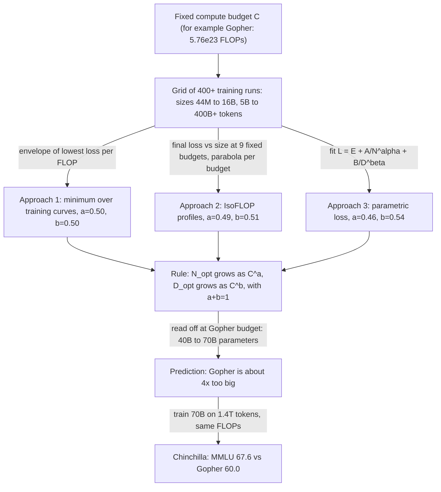
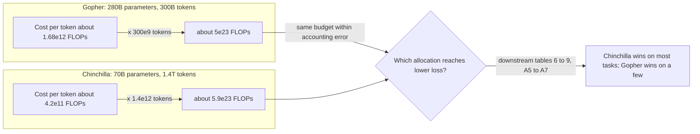

# Training Compute-Optimal Large Language Models

> **Paper:** Hoffmann, Borgeaud, Mensch, Buchatskaya, Cai, Rutherford, de Las Casas, Hendricks, Welbl, Clark, Hennigan, Noland, Millican, van den Driessche, Damoc, Guy, Osindero, Simonyan, Elsen, Rae, Vinyals and Sifre (DeepMind), 2022 - [arXiv abstract](https://arxiv.org/abs/2203.15556) - [local PDF](../../papers/2203.15556.pdf)
>
> **Short name:** Chinchilla (the 70-billion-parameter model the paper trains to test its prediction).
>
> **Version followed:** the arXiv HTML rendering of v1 (29 March 2022). Section, Table and Figure numbers below follow that rendering, including the appendix tables A1 to A9. The arXiv version is a preprint; the guide's author recalls a later peer-reviewed venue but did not check it, so treat every number as "the paper reports", not as independently replicated.

## Read this first

**The claim in one sentence.** For a fixed training budget, the best language model is much smaller and trained on far more text than the field was doing in 2021: model size and training tokens should grow in equal proportion, and the paper tests this by training a 70-billion-parameter model on 1.4 trillion tokens that beats a 280-billion-parameter model trained with the same compute.

**Who this is for.** Anyone who has seen parameter count used as a stand-in for quality, or has heard "twenty tokens per parameter" and wants to know what the paper does and does not say.

**Afterwards you will be able to** do the Gopher-versus-Chinchilla arithmetic; name the three estimation methods and their exponents; explain the disagreement with [Scaling Laws](./04-scaling-laws.md) and the reasons the authors give; read the recommendation table (Table 3); and separate what the paper shows from this guide's inferences about serving cost.

**Reading time.** About 45 minutes. **Have read first:** [Scaling Laws](./04-scaling-laws.md), [GPT-3](./03-gpt3.md) (the 175-billion-parameter, 300-billion-token template) and [The Transformer](./01-transformer.md). Terms are also in the [glossary](../../references/glossary.md) and the [math bridge](../../references/math-bridge.md).

**The one thing most people get wrong.** The paper contains no rule saying "use 20 tokens per parameter". It reports exponents (about 0.5 for model size and 0.5 for data), a table (Table 3) whose ratio sits near 20 to 22 for Approach 1, and one trained model at exactly 20.0. And "compute-optimal" means best loss for a fixed *training* budget, not best model to deploy; serving cost never enters the optimisation.

## The paper in one worked example

The example has three parts, all built from numbers the paper prints. Anything this guide computes itself is labelled "guide arithmetic".

### Part A - two models, one budget (Table 1, Table 4, Figure 2 caption, Appendix F)

| | Gopher | Chinchilla |
|---|---|---|
| Parameters N | 280 billion | 70 billion |
| Training tokens D | 300 billion | 1.4 trillion |
| Layers / heads / key-value size | 80 / 128 / 128 | 80 / 64 / 128 |
| Width (d_model) | 16,384 | 8,192 |
| Maximum learning rate | 4e-5 | 1e-4 |
| Batch size (tokens) | 3M, then 6M | 1.5M, then 3M |
| Optimiser | Adam | AdamW |

The paper says both models were trained "for the same number of FLOPs" (Section 4). FLOPs here means floating-point operations, a count of arithmetic steps; the paper states Gopher's budget as 5.76 x 10^23 (Figure 2 caption).

Guide arithmetic with the common shortcut that training costs about 6 FLOPs per parameter per token (the paper uses it for Approach 3, Section 3.3):

- Gopher: 6 x 280e9 x 300e9 = 5.04e23. Chinchilla: 6 x 70e9 x 1.4e12 = 5.88e23.
- Chinchilla's per-token cost is 6 x 70e9 = 4.2e11 FLOPs, a quarter of Gopher's 1.68e12. A quarter of the cost per token buys four times as many tokens for the same bill; the actual token ratio is 1.4e12 / 300e9 = 4.67, because the shortcut and the paper's exact FLOP count disagree by about 15 percent for Gopher.
- Tokens per parameter (guide arithmetic): Gopher 300e9 / 280e9 = 1.07. Chinchilla 1.4e12 / 70e9 = 20.0. Table 1 shows the other 2021 models at 0.5 to 1.7: LaMDA (Language Model for Dialogue Applications) 168e9 / 137e9 = 1.2; GPT-3 1.7; Jurassic-1 1.7; Megatron-Turing NLG (natural language generation) 270e9 / 530e9 = 0.51.

The paper's own exact FLOP count differs from 6ND: Appendix F, Table A4 gives ratios of 0.99 to 1.10 for models up to 6.8 billion parameters, and says a more accurate count puts Gopher at 6.3e23 rather than the 5.76e23 reported by the Gopher authors. So "same compute" holds to roughly 10 percent, not exactly.

### Part B - what the three methods predicted for that budget

Run the analysis of Section 3 and ask: at the Gopher budget of 5.76e23 FLOPs, what size should the model be?

- Approach 1 (Table 3): a 67-billion-parameter model on 1.5 trillion tokens uses 5.76e23 FLOPs, "1 Gopher unit". Guide arithmetic: 1.5e12 / 67e9 = 22.4 tokens per parameter.
- Approach 3 (Figure 4 caption): the optimal size at the Gopher budget is about 40 billion parameters.
- Section 4 summarises: "somewhere between 40 and 70 billion parameters". The authors then train 70 billion on 1.4 trillion tokens, "due to both dataset and computational efficiency considerations".

So Chinchilla is the upper end of the predicted range, and the test is a single pair of runs: one Gopher, one Chinchilla.

### Part C - one row of the result

On MMLU (Massive Multitask Language Understanding, exam-style questions across 57 subjects), Table A6 gives Chinchilla 91.2 and Gopher 83.9 on the subject high_school_gov_and_politics, and Chinchilla 32.0 versus Gopher 37.0 on college_mathematics. Averaged over the 57 subjects, Table 6 reports 67.6 versus 60.0 for 5-shot prompting (five solved examples in the prompt). That is 7.6 points, meaning that out of every 100 questions the smaller model answers about 7 or 8 more correctly than the larger one. The college_mathematics row shows the gain is not universal: this subject went down by 5 points.



Notice that the three approaches share the same data (the same grid of training runs) and differ only in how they extract an optimum from it, so their agreement is partly agreement about one data set, not three independent experiments.



Notice that the comparison holds the budget fixed and moves it between two knobs; it is not a comparison of a small model against a big one with the big one allowed to cost more.

## Words you need

| Term | Plain definition | Example from the worked example |
|---|---|---|
| Compute budget C | Total arithmetic spent on training, counted in FLOPs (floating-point operations). | Gopher's 5.76e23 FLOPs. |
| Parameters N | The learned numbers inside the model; the paper counts embedding matrices too (Appendix F). | 280 billion (Gopher) versus 70 billion (Chinchilla). |
| Training tokens D | Pieces of text (word fragments) the model reads during training, counting each pass over the data. | 300 billion versus 1.4 trillion. |
| Compute-optimal | The (N, D) pair with the lowest final loss among all pairs that cost the same FLOPs. | About 67B parameters on 1.5T tokens at the Gopher budget (Approach 1, Table 3). |
| Loss L(N, D) | The model's average next-token error on text it is not trained on (cross-entropy); lower is better. | The quantity all three approaches try to minimise (Equation 1). |
| Over-sized / undertrained | A model larger than the compute-optimal size for its budget, so it saw too little data for its size. | The paper calls Gopher "substantially over-sized" (Section 5). |
| IsoFLOP profile | A curve of final loss against model size, with every point trained for the same total FLOPs. | Figure 3 left: nine curves, budgets 6e18 to 3e21 FLOPs. |
| Exponents a and b | In N_opt proportional to C^a and D_opt proportional to C^b, the powers that say how fast each should grow as compute grows. | 0.50 / 0.50 (Approach 1); Kaplan et al. 0.73 / 0.27 (Table 2). |
| Tokens per parameter | D divided by N; a derived ratio, not a quantity the paper names. | 1.4e12 / 70e9 = 20.0 for Chinchilla. |
| Bits-per-byte (bpb) | Language-modelling score on The Pile that does not depend on the tokenizer; lower is better. | Pile subset github: 0.337 versus Gopher 0.377 (Table A5). |

## Tutorial 1 - Intuitive understanding

### What was broken before

By 2021 the working belief was that bigger is the lever: [Scaling Laws](./04-scaling-laws.md) had shown loss falling smoothly with size, and GPT-3 trained 175 billion parameters on about 300 billion tokens. Table 1 shows what followed (the last column is this guide's ratio):

| Model | Parameters | Training tokens | Tokens per parameter |
|---|---|---|---|
| LaMDA | 137 billion | 168 billion | 1.2 |
| GPT-3 | 175 billion | 300 billion | 1.7 |
| Jurassic-1 | 178 billion | 300 billion | 1.7 |
| Gopher | 280 billion | 300 billion | 1.1 |
| Megatron-Turing NLG | 530 billion | 270 billion | 0.5 |
| Chinchilla (this paper) | 70 billion | 1.4 trillion | 20.0 |

From GPT-3 to Megatron-Turing NLG the model grew about three times while data stayed near 300 billion tokens; the largest model read fewer tokens than it has parameters. The abstract's diagnosis: models are "significantly undertrained, a consequence of the recent focus on scaling language models whilst keeping the amount of training data constant". The cost of a wrong split is high because large models are typically trained once (Section 1).

### The idea

**Analogy.** A fixed training budget must pay both for an analyst's expertise (a bigger model) and for their time reading cases (training). In 2021 firms bought the most expensive analyst and gave them a few weeks of reading. The paper finds the same money buys better work from a mid-priced analyst who reads four to five times as many cases.

**Where it breaks.** A person's pay does not change how many cases they can read; in a network it does, because every token passes through every parameter, so cost is roughly proportional to N x D and "four times smaller" means "can read four times more for the same price". The analogy also hides that text is finite: the paper's recipes need trillions of tokens, and it warns that data collection becomes the bottleneck (Section 3.4).

### How it works, step by step

1. **Pick the question.** Given a budget C, choose N and D to minimise the final loss, subject to the cost of (N, D) being C (Equation 1). In the example: C = 5.76e23.
2. **Train many small and medium models.** Over 400 models from tens of millions up to 16 billion parameters, each for several different lengths of training (Section 1). Nothing at Gopher scale is trained for the fits.
3. **Match the learning-rate schedule to the planned length.** Each run decays its learning rate over the number of tokens it will actually see, because the paper finds this gives the best final loss (Appendix B). This is a quiet but central step, and it is the paper's main explanation for the disagreement with the earlier work.
4. **Extract the best size for each budget in three ways.** Approach 1 takes the lower envelope of the training curves; Approach 2 fits a parabola to final losses at nine fixed budgets; Approach 3 fits a formula to all final losses.
5. **Fit a straight line in log-log space.** Each approach turns its best-size points into a power law, giving exponents a and b (Table 2). All three land near one half.
6. **Extrapolate to the Gopher budget.** In the worked example this gives 40 to 70 billion parameters and 1.4 to 1.5 trillion tokens.
7. **Train it.** The paper trains 70 billion parameters for 1.4 trillion tokens on the same corpus with the same architecture family (Section 4.1) and evaluates on the benchmark set of Gopher.

### What the results say

Each bullet gives the number, what is counted, the comparison and the practical meaning. Unless stated, the source is Section 4.2 and its tables.

- **Exponents (Table 2).** N_opt grows as C^a with a = 0.50, 0.49, 0.46 (Approaches 1, 2, 3) and D_opt as C^b with b = 0.50, 0.51, 0.54. With ten times the compute, make the model about 3.2 times bigger and show it about 3.2 times more text. Kaplan et al.'s 0.73 / 0.27 would give about 5.4 times the size and 1.9 times the data (guide arithmetic).
- **MMLU (Table 6).** Chinchilla 67.6 percent, Gopher 60.0, GPT-3 43.9, average human rater 34.5, random 25.0, a June 2023 forecast by competitive forecasters 63.4. On exam-style questions a model a quarter the size gets about 7 or 8 more per 100 right and passes a forecast made for a year later. The abstract says 67.5 (see the inconsistency table in Tutorial 3).
- **Per task (Figure 6, Table A6).** Better on 51 of 57 MMLU subjects, equal on 2, worse on 4 (college_mathematics, econometrics, moral_scenarios, formal_logic); the guide's recount of Table A6 agrees.
- **BIG-bench (Beyond the Imitation Game benchmark, 62 tasks; Section 4.2.4, Table A7).** The text says 65.1 versus Gopher's 54.4, a gain of 10.7. Averaging Table A7 gives 64.5 and 54.4, a gain of about 10.1. Worse on four tasks (crash_blossom, dark_humor_detection, mathematical_induction, logical_args).
- **Reading comprehension (Table 7).** LAMBADA (predict a passage's last word) 77.4 versus Gopher 74.5, GPT-3 76.2, Megatron-Turing NLG 76.6. RACE (school reading exams) h/m few-shot 82.3 / 86.8 versus Gopher 71.6 / 75.1; GPT-3 and Megatron-Turing NLG used a different prompt there, so those columns are not comparable.
- **Common sense (Table 8).** Matches or beats Gopher and GPT-3 on HellaSwag, PIQA, Winogrande, SIQA and BoolQ; of the four tasks where Megatron-Turing NLG is reported it wins three and loses PIQA (81.8 versus 82.0). Supervised state of the art stays far higher on some (HellaSwag 93.9, Winogrande 91.3).
- **TruthfulQA (Section 4.2.5).** 43.6 percent zero-shot against Gopher's 29.5, up 14.1 points; the authors conclude that "better modelling of the pre-training data alone" can help, in contrast with the benchmark creators' findings. See [TruthfulQA](../03-evaluation-and-code/12-truthfulqa.md).
- **Closed-book question answering (Table 9).** No retrieved documents, so facts must sit in the parameters. Natural Questions 5-shot 31.5 versus Gopher 24.5; TriviaQA unfiltered 5-shot 73.2 versus 63.6. The paper does not test why.
- **Language modelling (Figure 5, Table A5).** Better than Gopher on every Pile subset; Wikitext103 perplexity 7.16 versus 7.75. The authors warn that four times more training data raises train-test overlap risk and so weight other tasks more (Section 4.2.1).
- **Toxicity (Section 4.2.7).** Mean score over 25,000 unprompted samples 0.087 versus Gopher's 0.081; 95th percentile 0.238 versus 0.230, which the authors read as no major difference.

### What this does not show

- That the exponents are exactly right: three methods on one grid of runs agree, and one prediction at one scale worked.
- That allocation alone caused the gain. Chinchilla also uses AdamW instead of Adam, a different tokenizer, data mix and weight precision (Section 4.1, Appendix G); small-model tests (Figures A6, A7) favour these changes, but no decomposition at 70 billion is given.
- Anything about serving: no latency, price or throughput is measured.
- That more data helps forever: all fits are single-pass, and multiple epochs are future work (Section 5).

### Teach-back

1. Gopher and Chinchilla cost about the same to train. Why can Chinchilla read about four times as many tokens?
<details><summary>Answer</summary>Training cost per token is roughly proportional to the number of parameters, and Chinchilla has a quarter of Gopher's. A quarter of the per-token price buys about four times the tokens for the same total; the exact ratio is 4.67 because of the accounting differences in the worked example.</details>

2. What do exponents of 0.50 and 0.50 mean in plain words?
<details><summary>Answer</summary>When compute is multiplied by some factor, make the model bigger by the square root of that factor and give it the square root more text. The two multiply back to the full factor, which is why the exponents always add to one.</details>

3. Name two reasons the Chinchilla-versus-Gopher comparison is not a pure test of "more tokens, fewer parameters".
<details><summary>Answer</summary>Any two of: AdamW instead of Adam; a tokenizer without NFKC normalisation; a different data mix (Table A1); only one run of each model, so no estimate of run-to-run noise (model card, Table A8).</details>

## Tutorial 2 - Practitioner understanding

### The design in concrete terms

**The three estimation procedures, with the paper's settings.**

| Item | Approach 1: envelope | Approach 2: IsoFLOP | Approach 3: parametric |
|---|---|---|---|
| Models | 70M to over 10B parameters | up to 16B | all final losses from 1 and 2 |
| Runs | each size at 4 cosine lengths spanning 16x | 9 budgets, 6e18 to 3e21 FLOPs | none new |
| Fitted | lower envelope read at 1,500 log-spaced budgets, then a power law | parabola per budget, then a power law | E, A, B, alpha, beta by Huber loss (delta 1e-3) with L-BFGS, then closed form |
| Details | smoothing window 10 steps; maximum LR 2e-4 (smallest) to 1.25e-4 (largest); LR decays 10x (Appendix D.1) | cosine length equals planned tokens | grid of initial values (Appendix D.2) |
| Exponents a / b | 0.50 / 0.50 | 0.49 / 0.51 | 0.46 / 0.54 |

Two quiet rules matter. **Match the learning-rate schedule to run length:** Appendix B finds a cosine cycle 25 percent too long already costs loss, a 10 times decay is slightly better than decay to zero, and a 5 times decay is clearly worse. **Use final losses** for Approaches 2 and 3, since mid-run points of a long schedule have not decayed their learning rate.

**Recommendation table (Table 3, Approach 1), with this guide's ratio column.**

| Parameters | FLOPs | Gopher units | Tokens | Tokens per parameter |
|---|---|---|---|---|
| 400 million | 1.92e19 | 1/29,968 | 8.0 billion | 20.0 |
| 1 billion | 1.21e20 | 1/4,761 | 20.2 billion | 20.2 |
| 10 billion | 1.23e22 | 1/46 | 205.1 billion | 20.5 |
| 67 billion | 5.76e23 | 1 | 1.5 trillion | 22.4 |
| 175 billion | 3.85e24 | 6.7 | 3.7 trillion | 21.1 |
| 280 billion | 9.90e24 | 17.2 | 5.9 trillion | 21.1 |
| 520 billion | 3.43e25 | 59.5 | 11.0 trillion | 21.2 |
| 1 trillion | 1.27e26 | 221.3 | 21.2 trillion | 21.2 |
| 10 trillion | 1.30e28 | 22,515.9 | 216.2 trillion | 21.6 |

**What this implies for "20 to 1".** In Approach 1 the ratio stays between 20.0 and 22.4 over a 25,000-fold range of size, because its exponents are almost exactly equal. The paper never states a ratio. Table A3 gives other ratios: Approach 2 rises from 19.2 (400 million parameters) to 29.2 (10 trillion); Approach 3 from 23.0 to 142.6 (guide arithmetic). Near the sizes the paper trained, the three approaches therefore say roughly 20 to 60 tokens per parameter, drifting with scale.

**Chinchilla's recipe (Section 4.1, Tables 4, A1, A8).** Gopher's architecture family at 80 layers, 64 heads, width 8,192; AdamW; a 32,000-entry SentencePiece vocabulary without NFKC normalisation (94.15 percent of tokens shared with Gopher's); bfloat16 compute with a float32 weight copy. Data mix (Gopher's in parentheses): MassiveWeb 45 percent (48), Books 30 (27), C4 10 (10), News 10 (10), GitHub 4 (3), Wikipedia 1 (2). In 1.4 trillion tokens MassiveWeb is seen 1.24 times and Wikipedia 3.40 times, so Chinchilla is not strictly single-pass although the scaling fits are.

### A minimal version

Goal: reproduce the logic of Approach 2 in miniature without any training. The "lab" below is constructed by this guide: it returns a loss from the paper's Equation 10 constants (E = 1.69, A = 406.4, B = 410.7, alpha = 0.34, beta = 0.28), so what you recover is a property of the method, not new evidence. In a real replication, `lab_loss` is replaced by an actual training run.

```python
import numpy as np

# Constructed lab: loss from the paper's Equation 10 constants (not measured runs).
def lab_loss(N, D, E=1.69, A=406.4, B=410.7, al=0.34, be=0.28):
    return E + A / N**al + B / D**be

def isoflop_optimum(C, sizes):
    """One IsoFLOP profile: fix C, vary N, set D = C / (6N), fit a parabola in log N."""
    D = C / (6 * sizes)
    loss = lab_loss(sizes, D)
    c2, c1, c0 = np.polyfit(np.log(sizes), loss, 2)
    n_opt = float(np.exp(-c1 / (2 * c2)))            # vertex of the parabola
    return n_opt, C / (6 * n_opt)                    # (N_opt, D_opt)

budgets = np.array([6e18, 3e19, 1e20, 6e20, 3e21])  # same range as the paper's 9 budgets
best = []
for C in budgets:
    sizes = np.geomspace(C ** 0.5 / 1e3, C ** 0.5 / 4, 14)   # 14 candidate model sizes
    best.append(isoflop_optimum(C, sizes))
N_opt, D_opt = map(np.array, zip(*best))

a, _ = np.polyfit(np.log(budgets), np.log(N_opt), 1)   # N_opt ~ C^a
b, _ = np.polyfit(np.log(budgets), np.log(D_opt), 1)   # D_opt ~ C^b
print("a=%.3f b=%.3f a+b=%.3f" % (a, b, a + b))
for C, n, d in zip(budgets, N_opt, D_opt):
    print("C=%.0e  N_opt=%.2fB  D_opt=%.1fB  tokens/param=%.0f" % (C, n / 1e9, d / 1e9, d / n))

def lifetime_flops(N, D, served_tokens):          # training 6ND plus serving 2N per token
    return 6 * N * D + 2 * N * served_tokens
```

Output of running it (shapes and values, guide-run):

```text
a=0.462 b=0.538 a+b=1.000
C=6e+18  N_opt=0.17B  D_opt=6.1B  tokens/param=37
C=3e+19  N_opt=0.35B  D_opt=14.4B  tokens/param=41
C=1e+20  N_opt=0.61B  D_opt=27.4B  tokens/param=45
C=6e+20  N_opt=1.39B  D_opt=71.9B  tokens/param=52
C=3e+21  N_opt=2.92B  D_opt=171.3B  tokens/param=59
```

Three things to notice. The exponents add to 1.000 because D is defined as C / (6N), so the two fits are not independent. The recovered tokens-per-parameter ratio is 37 to 59, not 20, and it rises with budget: with Equation 10's constants the optimum is far data-heavier than "20 to 1". And the exact closed-form exponent from those constants is beta / (alpha + beta) = 0.28 / 0.62 = 0.452, versus 0.462 from the parabola fit, so even in a noise-free lab the method has a small bias (the parabola is an approximation to an asymmetric curve).

### What it costs

All figures are guide arithmetic with stated assumptions.

**Training runs.** Assume one accelerator sustaining 1.25e14 FLOP/s (an assumed 40 percent of a 312 teraFLOP/s peak). The smallest IsoFLOP budget, 6e18 FLOPs, takes 48,000 seconds, about 13 hours; the largest, 3e21, about 278 days on one accelerator or 4.3 days on 64. Chinchilla itself is 6 x 70e9 x 1.4e12 = 5.9e23 FLOPs, about 98,000 times the smallest run. The paper names TPUv3 and TPUv4 chips with JAX and Haiku (Section 4.1) but gives no chip count or duration in the sections read.

**Serving (guide inference, not a paper result).** A generated token costs about 2N FLOPs (training's 6N has a backward pass; serving does not): 1.4e11 for 70 billion parameters, 5.6e11 for 280 billion. Weights at 2 bytes per parameter take 140 GB versus 560 GB, roughly a couple of 80 GB accelerators versus a large multi-device setup. The paper says only that a model 4 times smaller has a smaller memory footprint and lower inference cost (Section 4).

**Lifetime (guide inference).** Total FLOPs = 6ND + 2N x (tokens served). Serving equals training once the model has served 3D tokens (2NT = 6ND), 4.2 trillion for D = 1.4 trillion. Serving 1e12 tokens gives 7.3e23 for the 70B / 1.4T recipe against 1.06e24 for 280B / 300B (the `lifetime_flops` function). The paper's objective omits this term, so for heavy serving the cheapest model overall is smaller or longer-trained than its optimum.

### How it fails

| Symptom | Likely cause | Mitigation |
|---|---|---|
| Fitted exponents shift when the smallest runs are dropped | The frontier curves (Appendix E, Figure A5) | Refit on the largest third; keep most runs above about 500M parameters as the paper did |
| Best size sits at the edge of your IsoFLOP grid | Grid too narrow, so the parabola vertex is an extrapolation | Widen until loss rises on both sides (Section 3.2 requires a clear minimum) |
| "Best" size depends on when you measure | Mid-run losses of a long schedule overstate a shorter run's loss | Use final losses, schedule length equal to run length (Appendix B) |
| Approach 3 gives a much smaller optimum | Huber loss treats low-compute points as outliers; curvature (Section 3.4) | Report all three; treat Approach 3 as a lower bound on size |
| Works at 1e21 FLOPs, fails at 1e24 | Extrapolation over orders of magnitude (Section 3.4 warns) | Validate at an intermediate scale |
| Benchmark gains vanish on clean data | Training-test overlap grows with data volume (Section 4.2.1) | De-duplicate against evaluation sets |

### Evaluating your version

- **Metric.** Smoothed final loss at each (N, D), held-out loss, and the exponent a with a bootstrap interval; the paper resamples 80 percent of its data 100 times and reports 10th to 90th percentiles (Table 2).
- **Baseline.** Kaplan et al.'s exponents (0.73 / 0.27). The paper's own small test is at 1e21 FLOPs: 2.80 billion parameters (its prediction) against 4.74 billion (Kaplan's prediction was 4.68 billion), with the smaller model ending at lower loss (Appendix D.4, Figure A4; the text gives no loss values).
- **Test size.** At least four budgets over two orders of magnitude and six sizes per budget; the paper used 9 budgets and over 400 runs.
- **Stop rule (guide's suggestion).** Trust the fit only if the predicted optimum at your largest budget lies inside the sizes you trained, refitting without that budget moves a by less than about 0.03, and a confirmation run at the predicted size beats runs at 2 times and half that size at equal compute.

### Adopt, adapt or skip

**Skip pre-training your own model.** For a team building an assistant over private business documents, nothing here argues for pre-training: at 6ND even a small compute-optimal run costs more than retrieval, instruction or memory design will save.

**Adapt it as a reading heuristic for choosing a model.** Do not read parameter count as quality or price. A 70-billion-parameter model beat a 280-billion-parameter predecessor, so check how many tokens a model saw and compare candidates on your own tasks. This guide infers that the same logic favours smaller open models trained on far more data when serving cost dominates; that is not a paper result.

**Through-question link.** Whether a thin runtime around a model with a few tools is enough depends partly on how capable and cheap the base model is; Chinchilla speaks only to the cost side (guide inference). Context, instruction and memory design are picked up by [harness engineering](../06-agent-systems/29-harness-engineering.md) and [agentic context engineering](../06-agent-systems/31-agentic-context-engineering.md). For open or smaller models, the relevant lesson is that capability per parameter rose once data rose, which makes strong context-driven performance from smaller models plausible (guide inference).

## Tutorial 3 - Researcher understanding

### Formal setup

**Symbols.** N: parameters (embeddings included). D: training tokens seen. C: training FLOPs, about 6ND (the shortcut from Kaplan et al.). L(N, D): final pre-training loss, taken as the smoothed training loss and treated as an unbiased test-loss estimate because fewer tokens are used than the corpus holds (footnote 2). N_opt(C), D_opt(C): the minimisers of L under FLOPs(N, D) = C (Equation 1). a, b: exponents in N_opt proportional to C^a, D_opt to C^b. E, A, B, alpha, beta: constants of L-hat(N, D) = E + A / N^alpha + B / D^beta (Equation 2).

**Meaning of the three terms (Appendix D.2).** E is the entropy of natural text. A / N^alpha is the penalty for a size-N model that is perfectly trained. B / D^beta is the penalty for finitely many optimisation steps on D samples. The authors expect 1 / sqrt(N) and a 1 / sqrt(D) lower bound, and find both fitted exponents below one half (0.34 and 0.28).

**Closed form (Equation 4).** Substitute D = C / (6N) and minimise over N: N_opt = G (C/6)^a, D_opt = (C/6)^b / G, with G = (alpha A / (beta B))^(1 / (alpha + beta)), a = beta / (alpha + beta), b = alpha / (alpha + beta). Hence a + b = 1, and a = b exactly when alpha = beta.

**Toy instance (constructed by this guide).** Take alpha = beta = 0.5, A = B = 1: G = 1, a = b = 0.5, and at C = 6e18, N_opt = D_opt = 1e9. With A = 4B, G = 4: N_opt = 4e9 and D_opt = 2.5e8, since a heavier size penalty pushes towards more parameters and fewer tokens. The ratio D/N depends on the constants, not only on the exponents.

**With the paper's constants (guide arithmetic, not reported by the paper).** Equation 10 gives a = 0.28 / 0.62 = 0.452, b = 0.548, G = 1.34; at C = 5.76e23, N_opt = 32 billion and D_opt = 3.0 trillion (ratio 93). The same constants give loss 1.993 for Gopher's (280e9, 300e9) and 1.937 for Chinchilla's (70e9, 1.4e12), a gap of 0.056. They do not reproduce the paper's Approach 3 statements (see the inconsistency table), so the printed constants may be rounded or from another fit.

### The claims, stated precisely

1. **(Section 3.4, Table 2)** Under the stated protocol, compute-optimal N and D both scale as roughly C^0.5: a in [0.46, 0.50], b in [0.50, 0.54].
2. **(Section 1, Figure 1)** The compute-optimal model at the Gopher budget is about 4 times smaller than Gopher and trained on more tokens (the table gives 4.67 times).
3. **(Section 4.2)** That model outperforms the 280-billion-parameter one "on nearly every measured evaluation task" (Section 5).
4. **(Section 2, Appendix B, D.4)** The disagreement with Kaplan et al. stems from a fixed learning-rate schedule and token count across sizes, and from small models.
5. **(Appendix C)** C4 (0.50 / 0.50) and GitHub code (0.53 / 0.47) give similar results under single-pass training.

Not claimed: exact exponents beyond the tested range; a rule for the ratio; any result for multiple epochs, mixture-of-experts, fine-tuning or inference cost.

### Evidence, table by table

**Figure 2, Approach 1 (Section 3.1).** Rows are runs; axes FLOPs against smoothed loss. Headline a = 0.50 (10th to 90th percentile 0.488 to 0.502), b = 0.50 (0.501 to 0.512). Identifies the optimum along cosine-matched runs of four lengths per size. Associates only: the lengths span 16x and the chosen points lie in the last 15 percent of training (footnote 4), so the optimal D is partly set by where schedules end.

**Figure 3, Approach 2 (Section 3.2).** Nine budgets, model sizes at each with D = C / (6N). Headline: clear valleys, a = 0.49 (0.462 to 0.534), b = 0.51 (0.483 to 0.529). The cleanest design of the three, since each point is a finished, schedule-matched run. The text does not report valley widths.

**Figure 4, Equation 10, Approach 3 (Section 3.3, Appendix D.2).** All (N, D, loss) triples in; five constants out. Headline a = 0.46 with interval 0.454 to 0.455, b = 0.54 (0.542 to 0.543). The functional form is assumed, not tested, and the interval is far narrower than for Approaches 1 and 2, so it measures resampling noise within one form, not true uncertainty. The paper explains Approach 3's smaller optima by Huber down-weighting of low-FLOP points and a concave frontier (Section 3.4).

**Table 3 and Table A3.** Recommended sizes; ratios in Tutorial 2. For a 280-billion model Approach 1 asks for 5.9 trillion tokens, Approach 2 for 7.1 trillion and Approach 3 for 20.1 trillion.

**Tables 6 to 10 (Section 4.2).** Rows are benchmarks; columns are Chinchilla, Gopher, GPT-3, Megatron-Turing NLG and sometimes supervised or open-book state of the art. They show that this one model pair differs on these benchmarks; they do not say which of size, tokens, optimiser, tokenizer or mix causes it. Table 10 (Winogender, linking pronouns to occupations) shows uneven gains: +3.2 points for male pronouns against +8.3 female and +9.2 neutral; female "gotcha" examples (correct answer contradicts a stereotype) +10.0.

**Table A5 (Pile bits-per-byte).** Chinchilla beats Gopher on all 19 subsets; Jurassic-1 is better on dm_mathematics (1.037 versus 1.111) and ubuntu_irc (0.857 versus 1.026). Gains vary: gutenberg_pg_19 falls from 0.656 to 0.548 (about 16 percent), pile_cc from 0.691 to 0.667 (about 3.5 percent).

**Inconsistencies found in the paper (flagged, not fixed).**

| Where | What is inconsistent |
|---|---|
| Abstract versus Table 6 | Abstract: 67.5 and "greater than a 7% improvement"; Table 6 and Section 4.2.2: 67.6 and 7.6. Unweighted means of Table A6 are 67.64 and 60.61 (gain 7.0), while Table 6 lists Gopher at 60.0. |
| Section 4.2.4 versus Table A7 | Text: 65.1 and a 10.7 gain. Table A7 averages 64.5 for Chinchilla (Gopher's 54.4 matches). |
| Section 1 | "4 times more" data; Table 1 gives 4.67. Kaplan's "5.5x size, 1.8x tokens" for 10x compute versus 5.4 and 1.9 from 0.73 / 0.27. |
| Section 3.4 versus Tables 3, A3 | Text: 175B needs 4.41e24 FLOPs and over 4.2T tokens, 280B about 1e25 and 6.8T. Table 3: 3.85e24, 3.7T; 9.90e24, 5.9T. Table A3 (Approach 2): 4.54e24, 4.3T; 1.18e25, 7.1T. |
| Table A3, Approach 3 | 175B row has 1.26e24 FLOPs with 12.0T tokens; 6 x 175e9 x 12.0e12 = 1.26e25, so likely a typo. |
| Table 2 and Equation 10 | Approach 3's a = 0.46 lies outside its own interval (0.454, 0.455); Equation 10's exponents give 0.452. Equation 10's constants give about 32B at the Gopher budget, not Figure 4's 40B, and about 53B at 1.71e24 against Table A3's 67B. |
| Section 4.2.6 versus Table 9 | Text: Gopher 21 percent on Natural Questions 5-shot; Table 9: 24.5. |
| Names and sizes | Jurassic-1 is 178B in Table 1 and 170B in Table A5; Section 5 calls GPT-3 "170 billion" against 175 billion in Table 1. |
| Abstract | Says Chinchilla "uniformly" beats Jurassic-1; the only Jurassic-1 comparison is Pile bits-per-byte (Table A5), which Jurassic-1 wins on two subsets. Run range: abstract 5 to 500 billion tokens, Section 1 "over 400" billion; Table A9 starts at 44 million parameters, not 70 million. |

### Ablations and what they isolate

- **Cosine cycle length (Appendix B, Figure A1).** Six lengths from 1x to 5x the run; overshooting by more than 25 percent clearly hurts. This is the key ablation for the disagreement with Kaplan et al.
- **Frontier curvature (Appendix E, Figure A5).** Linear fits to the first, middle and last third of the envelope; slopes differ, hinting at smaller optima at large budgets.
- **Other datasets (Appendix C, Table A2).** C4 gives 0.50 / 0.50, GitHub 0.53 / 0.47 (IsoFLOP only, 4 profiles each).
- **Head-to-head at 1e21 FLOPs (Appendix D.4).** Isolates allocation at small scale with equal depth-to-width ratio, batch 0.5M tokens, learning rate 1.5e-4: 2.80B (Approach 1) against 4.74B (Kaplan); the smaller model wins (figure only).
- **Adam versus AdamW (Appendix G, Figures A6, A7).** At 417M, 680M and 1.4B parameters AdamW is better; an AdamW run overtakes Adam only about 80 percent through the cycle (Section 4.1 footnote).
- **FLOP counting (Appendix F, Table A4).** Exact count against 6ND: 0.99 to 1.10 for 73M to 6.8B models.

### Threats to validity specific to this paper

1. **One pair of large runs.** The authors have "only two comparable training runs at large scale" and nothing in between (Section 5); the model card says no repeats were trained (Table A8).
2. **Confounded comparison.** Optimiser, tokenizer, mix and weight precision changed with allocation (Section 4.1, Appendix G).
3. **Extrapolation.** Fits come from models up to 16B parameters, the test is at 70B, and Table 3 extends to 10 trillion; the authors flag "significant uncertainty" (Section 3.4). They also observe concavity that "suggests that we may still be overestimating the optimal size" (Section 5).
4. **Leakage.** Four times more text raises overlap with evaluation text; the authors say so (Section 4.2.1) but report no decontamination experiment.
5. **Narrow regime.** Single-pass training and three datasets (MassiveText, C4, GitHub).
6. **Prompt differences.** GPT-3 and Megatron-Turing NLG RACE numbers use another prompt format (Table 7 caption).
7. **Parameter counting.** Parameters include embeddings (Appendix F); whether the exponents change with non-embedding counts is untested here.

### Open problems and follow-ups

- **Reconciling with Kaplan et al.** The paper offers two reasons but no controlled re-run of the earlier data; see [Scaling Laws](./04-scaling-laws.md) for the earlier side. The guide recalls later reconciliation studies but did not verify them.
- **Inference-aware optimisation.** Add the serving term (Tutorial 2, "What it costs"); the paper does not.
- **Data quality and multiple epochs.** The authors speculate large datasets help only "when the data is high-quality" and leave multi-epoch training open (Section 5).
- **Replication of Approach 3.** The guide recalls, without verifying, reports that re-fitting Approach 3 from the published data gives different constants; the internal mismatches listed above are consistent with that worry.

### What would change my mind

- A controlled re-run at three intermediate scales, each at three allocations, with the optimum far from the fitted line.
- Retraining Gopher's recipe with AdamW, the new tokenizer and the new mix, with most of the 7.6-point MMLU gain surviving: allocation would then not be the main cause.
- A decontaminated MMLU and BIG-bench run in which the advantage shrinks a lot: leakage would be part of the story.

## Reading map for the PDF

| Section or figure | What it contains | First pass | Guide section |
|---|---|---|---|
| Abstract, Section 1, Table 1, Figure 1 | Claim, the 300-billion-token pattern, overlaid predictions | Read | Worked example, Tutorial 1 |
| Section 2 | Differences from Kaplan et al. | Read the Kaplan paragraphs | Tutorial 3, FAQ |
| Sections 3.1 to 3.3, Figures 2 to 4 | The three approaches | Read | Tutorial 2, Tutorial 3 setup |
| Section 3.4, Tables 2 and 3 | Exponents and recommended sizes | Read closely | Tutorial 2 table, FAQ on 20 to 1 |
| Section 4, Tables 4 to 10, Figures 5 to 7 | Recipe and benchmarks | Skim; read MMLU | Tutorial 1 results |
| Section 5 | Limitations | Read | Tutorial 3 threats |
| Appendices B, D.2, D.4 | Cosine length, parametric fit, Kaplan head-to-head | Read | Tutorial 3 |
| Appendices A, C, E to J | Data mix, datasets, curvature, FLOPs, full tables, model card | Skip first pass; use for checking | Tutorial 3 inconsistencies |

## Questions readers get stuck on

### What exactly is a "token", and why count tokens rather than words?
A token is a text piece from the tokenizer, here a SentencePiece vocabulary of 32,000 entries (Table A8), typically a word or part of one. Compute is spent per token, so tokens are the natural unit. The ratio "20 tokens per parameter" is therefore tied to this tokenizer and data (guide inference).

### What does "same compute" mean when Gopher and Chinchilla were trained by different runs?
Same total floating-point operations, counted by formula: about 6 x parameters x tokens, or the paper's exact count (Appendix F). The shortcut gives 5.04e23 for Gopher and 5.88e23 for Chinchilla, against the Gopher authors' 5.76e23. The authors treat them as equal; Appendix F reports at most about 10 percent difference between exact and shortcut counts for the models it checked.

### Is the rule really "20 tokens per parameter"?
Not as a statement in the paper. It has exponents near one half, Table 3 (Approach 1) with ratios from 20.0 to 22.4, and a trained model at exactly 20.0. Table A3 gives larger ratios for Approaches 2 and 3 at larger sizes (up to 29.2 and 142.6). The folklore rounds Approach 1 near the tested scales.

### Why do three approaches give 0.50, 0.49 and 0.46, and which should I believe?
They read the same set of runs three ways. Approaches 1 and 2 use the runs more directly and agree within their intervals; Approach 3 assumes a formula and, by the authors' account, down-weights small-compute points and is affected by curvature, giving smaller optima at large budgets. The paper picks no winner; Chinchilla sits at the upper end of the 40 to 70B range.

### Why does this paper disagree with the earlier scaling-law paper?
Kaplan et al. concluded parameters should grow much faster than data (0.73 versus 0.27, Table 2). This paper gives two reasons (Section 2): the earlier work used a fixed token count and learning-rate schedule for all models, so shorter runs had not decayed their learning rate and looked worse than properly scheduled ones; and the earlier fits used mostly very small models, while this paper sees curvature and includes models up to 16B. Support is the schedule ablation (Appendix B) and a 1e21-FLOP head-to-head (Appendix D.4); the earlier data are not re-fitted.

### Why not just train a bigger model for longer, with more compute?
You may; the claim concerns only a fixed budget. Table 3 shows what a bigger budget demands: a 1-trillion-parameter model is compute-optimal only near 1.27e26 FLOPs, over 220 times Gopher's, with 21 trillion tokens (Approach 1). The authors stress the data requirement as the practical limit (Section 3.4).

### Does Chinchilla being smaller really make it cheaper to run?
The paper says so (abstract, Section 4) but measures nothing: it argues from memory footprint and inference cost scaling with size. This guide's arithmetic (about 2N FLOPs per token, 2 bytes per parameter) gives a 4 times reduction in both, an inference from standard cost formulas, not a measured saving.

### Is the 70B Chinchilla "compute-optimal" if the paper's own Approach 3 says 40B?
The authors call 70B the larger end of a predicted 40 to 70B range, chosen for "dataset and computational efficiency considerations". It is near Approach 1's 67B and above Approach 3's 40B. No 40B model was trained, so "near-optimal under the paper's estimates" is the safe reading.

### Does this mean a small model trained on lots of text beats a bigger model on every task?
No. On MMLU Chinchilla loses on 4 of 57 subjects and ties on 2; on BIG-bench it loses on 4 of 62 tasks; on two Pile subsets Jurassic-1 is better. The paper does not analyse why mathematics and logic tasks are among the losses.

## Prerequisites you actually need

### Prerequisite 1 - Power laws and exponents

A power law y = k x^p is a straight line of slope p after taking logarithms, which is why the paper fits lines in log-log space. Multiplying x by 10 multiplies y by 10^p.

Tiny example: with p = 0.5, ten times the compute gives 10^0.5 = 3.16 times the size. With the earlier paper's 0.73 it is 5.37 times, leaving 10^0.27 = 1.86 times for data; 5.37 x 1.86 = 10. Used in Table 2, Figure 1, Equation 4. See the [math bridge](../../references/math-bridge.md).

### Prerequisite 2 - Training FLOPs are about 6 x N x D

Per token the forward pass costs about 2 FLOPs per parameter and the backward pass about twice that, so about 6 per parameter per token.

Tiny example: 1 billion parameters on 20 billion tokens costs 6 x 1e9 x 20e9 = 1.2e20, matching Table 3's 1.21e20 for the 1-billion row. Used in the Section 3.3 constraint, Table 3 and Appendix F (full count within 0.99 to 1.10 of this). See [Transformer](./01-transformer.md).

### Prerequisite 3 - IsoFLOP curves and fitting a minimum with a parabola

An IsoFLOP curve fixes the compute budget, varies the model size, and sets the tokens to whatever the budget allows. Near its minimum a curve is close to a parabola, so a parabola fitted to a few points locates the best size.

Tiny example (constructed by this guide): at one budget, losses of 2.30, 2.10 and 2.20 at sizes 1B, 2B and 4B. In log2 size (0, 1, 2) the fitted parabola has its minimum at 1 plus (2.30 - 2.20) / (2 x (2.30 - 2 x 2.10 + 2.20)) = 1 + 0.10/0.60 = 1.17, so the best size is about 2^1.17, roughly 2.25B, between the two lowest points.

Used in: Section 3.2, Figure 3, Approach 2.

### Prerequisite 4 - Cosine learning-rate schedule

A learning rate controls the step size of training. A cosine schedule starts at a maximum and falls smoothly, along half a cosine wave, to a fraction of it by the end of the cycle. The paper decays by 10 times. If the cycle is longer than the run, the learning rate has not fallen when training stops, and the model is stopped while still taking big, noisy steps.

Tiny example: a run planned for 100 steps with a 100-step cycle ends at one tenth of the maximum rate; with a 125-step cycle it ends at a higher rate, which the paper finds hurts the final loss (Appendix B, "beyond 25 percent").

Used in: Section 3.1 fn 4, Appendix B, Appendix D.1, the reason for disagreement in Section 2.

## Where this sits in the curriculum

**Read before:** [Scaling Laws](./04-scaling-laws.md) (this paper corrects it directly), [GPT-3](./03-gpt3.md) (the 175B / 300B recipe in Table 1) and the [Transformer](./01-transformer.md).

**Against its nearest neighbours.** [Scaling Laws](./04-scaling-laws.md) fits similar curves but keeps the token count fixed per model and concludes parameters should dominate; this paper matches the schedule to run length and concludes both should grow together. [GPT-3](./03-gpt3.md) applies the older logic (a very large model, modest tokens) and contributed few-shot evaluation, which this paper reuses. Its benchmarks are [MMLU](../03-evaluation-and-code/11-mmlu.md) and [TruthfulQA](../03-evaluation-and-code/12-truthfulqa.md); [HELM](../03-evaluation-and-code/13-helm.md) is a broader way to compare models.

**Read next.** [RAG](../02-building/06-rag.md) and [Chain-of-Thought](../02-building/07-chain-of-thought.md) begin the stage on getting more from a fixed model through context and prompting. For the agent through-question, the link here is cost and capability per parameter; the context-side work is in [Dive into Claude Code](../06-agent-systems/28-dive-into-claude-code.md) and [Context as a Tool](../06-agent-systems/30-context-as-a-tool.md).

## Checkpoint

1. **Explain.** Why can a 70-billion-parameter model beat a 280-billion-parameter one at the same training compute?
<details><summary>Answer</summary>Per-token cost scales with parameters, so the smaller model reads about four times more text for the same budget. At the Gopher budget the fits say loss is lower with fewer parameters and more tokens, and the benchmarks agree on most tasks. Gopher's 1.07 tokens per parameter left it undertrained.</details>

2. **Compute.** A team has 1.2e22 FLOPs. Using 6ND and about 20 tokens per parameter, what size and token count?
<details><summary>Answer</summary>6 x 20 x N^2 = 1.2e22 gives N = 1e10: 10 billion parameters on 2e11 tokens. Table 3 lists 1.23e22 FLOPs for 10 billion parameters and 205.1 billion tokens.</details>

3. **Compute.** Compute grows 100 times. By what factors do model size and data grow under Kaplan et al.'s exponents and under Approach 1?
<details><summary>Answer</summary>Kaplan: size 100^0.73 = 28.8, data 100^0.27 = 3.5. Approach 1: both 100^0.5 = 10. The product is 100 either way; the disagreement is how the factor is split.</details>

4. **Critique.** The abstract says "4x more data". What is the real ratio?
<details><summary>Answer</summary>1.4 trillion over 300 billion is 4.67. The 4 matches the parameter ratio (280 over 70), so it reads as shorthand; recompute headline ratios from the tables.</details>

5. **Critique.** Why is "20 tokens per parameter" an over-simplification?
<details><summary>Answer</summary>The paper reports exponents and tables, not a ratio. Approach 1 gives 20 to 22; Approaches 2 and 3 give higher, rising ratios (19 to 29 and 23 to 143 across 400M to 10T parameters), and the ratio depends on tokenizer, data and the fit.</details>

6. **Critique.** A colleague says "Chinchilla-optimal means the best model to deploy". What is wrong, and what does the paper say about inference?
<details><summary>Answer</summary>The optimisation minimises loss for fixed training FLOPs only. The paper mentions lower inference and fine-tuning cost as a bonus of a smaller model (Section 4) but neither optimises nor measures it. For heavy serving a smaller, longer-trained model may be better; that is guide inference.</details>
