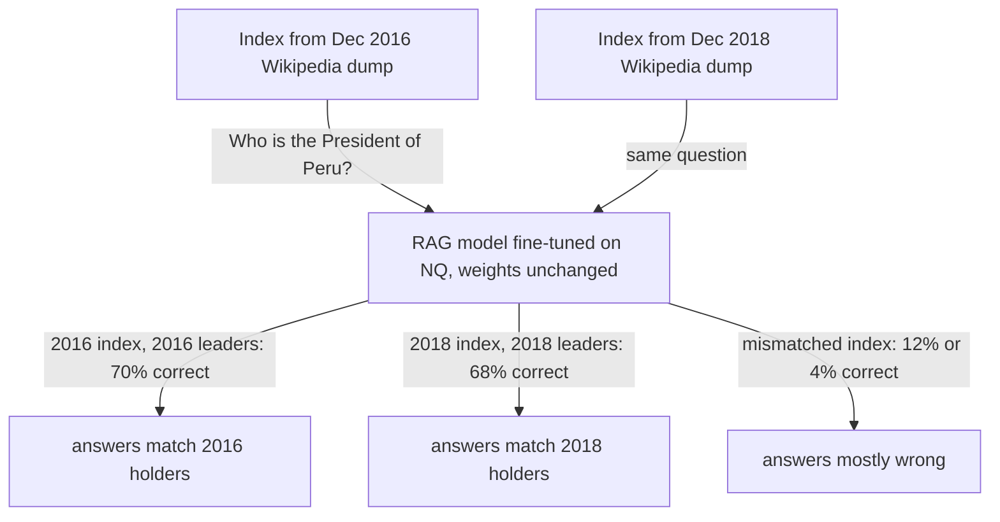

# Retrieval-Augmented Generation for Knowledge-Intensive NLP Tasks

> **Paper:** Lewis, Perez, Piktus, Petroni, Karpukhin, Goyal, Kuttler, Lewis, Yih, Rocktaschel, Riedel and Kiela (Facebook AI Research, University College London, New York University), 2020 (arXiv v4, 12 April 2021) - [arXiv abstract](https://arxiv.org/abs/2005.11401) - [local PDF](../../papers/2005.11401.pdf)
>
> **Short name:** RAG. Section, table and figure numbers follow the arXiv HTML rendering of v4. First posted May 2020; to this guide's knowledge it appeared at NeurIPS 2020 (peer reviewed), a fact the rendering does not state.

## Read this first

**The claim in one sentence.** If a pre-trained text generator is given a searchable index of Wikipedia, and the question encoder and generator are trained together so that retrieval is learned from final answers alone, the system answers factual questions better than a far larger model that has only its own weights, and its knowledge can be updated by swapping the index.

**Who this is for.** Anyone building an assistant that must answer from documents it was not trained on. You will learn the original recipe, which parts of it survive in current practice, and which claims about "RAG" this paper cannot support.

**Afterwards you will be able to** trace one question through the query encoder, the maximum inner product search and the generator; compute by hand what RAG-Sequence and RAG-Token do with the same three passages; say what each headline number counts; and separate this paper's design from prompt-stuffing a frozen model.

**Reading time.** About 60 minutes for the guide. **Have read first:** [the Transformer](../01-foundations/01-transformer.md), [BERT](../01-foundations/02-bert.md) (the retriever is two BERT encoders) and [GPT-3](../01-foundations/03-gpt3.md) (the "knowledge in the weights" baseline). Read next: [Chain-of-thought](./07-chain-of-thought.md) and [ReAct](./10-react.md), where retrieval becomes a step the model chooses.

**The one thing most people get wrong.** "RAG" now usually means: search a document store, paste the top results into the prompt of a frozen chat model, let it answer. This paper does something narrower. It fine-tunes a 400-million-parameter generator and half of the retriever end to end, treating the retrieved passage as a hidden variable that is summed out. It never tests a frozen model, a long prompt, a chat model, a re-ranker, citations or an agent deciding when to search. It is the origin of the name and the architecture, not evidence for the modern pattern.

## The paper in one worked example

The paper prints no trace of a question going through the system. It has two real ingredients: a per-document analysis of one generated clue (Figure 2) and an index-swap experiment built on the template "Who is the President of Peru?" (Section 4.5). This guide combines them. Everything labelled "constructed" (passage texts, scores, probabilities) is invented here for teaching and is not a measurement.

### Part A - what the paper shows for one input (Figure 2, Section 4.3)

Task: Jeopardy question generation. The input is only an answer entity, "Hemingway"; the model writes a clue. The authors retrieved 5 documents and used RAG-Token. The clue discussed in the paper:

> "The Sun Also Rises" is a novel by this author of "A Farewell to Arms"

The paper reports that when the model writes "Sun", the probability that document 2 is responsible is high (that document mentions The Sun Also Rises); when it writes "A Farewell to Arms", document 1 dominates. After the first token of each title the document probabilities flatten. Feeding the partial text `"The Sun` to the retrieval-free BART baseline, BART completes it as "The Sun Also Rises", so the authors conclude the title is stored in BART's weights and the document only steers which stored fact comes out. The plotted values are in the figure image; this guide uses only the text's description.

Table 3 gives real contrasts. For MS-MARCO input "define middle ear", BART wrote "The middle ear is the part of the ear between the middle ear and the nose" (marked wrong by the authors); RAG-Token wrote "The middle ear is the portion of the ear internal to the eardrum". For Jeopardy input "Washington", BART's clue ("largest number of counties") is marked wrong; RAG-Token wrote "It's the only U.S. state named for a U.S. president".

### Part B - one open-domain question through the pipeline (constructed)

Question: **"Who is the President of Peru?"** Model: the one fine-tuned on Natural Questions. Index: 21 million passages of 100 words (Section 3).

1. **Query encoding.** BERT_q (a BERT-base network) turns the question into one vector q(x) of 768 numbers (Appendix G writes 728; see the FAQ).
2. **Search.** The 21 million passage vectors d(z) were computed once by the frozen document encoder BERT_d and stored in a FAISS (Facebook AI Similarity Search) index with a Hierarchical Navigable Small World graph, which finds approximately the highest inner products without scanning everything. Constructed top 3 (the paper retrieves 5 to 50, Appendix A):

| Rank | Passage (constructed paraphrase) | Inner product d(z) . q(x) |
|---|---|---|
| z1 | "Vizcarra took office as president in March 2018 after the resignation of ..." | 2.0 |
| z2 | "Martin Vizcarra, formerly vice president, is the president of Peru ..." | 1.5 |
| z3 | "Pedro Pablo Kuczynski served as president from 2016 until his resignation ..." | 1.0 |

3. **Retriever probability.** The paper makes p(z|x) proportional to exp(inner product). Over the top 3: e^2.0 : e^1.5 : e^1.0 = 7.39 : 4.48 : 2.72, normalised to 0.506, 0.307, 0.186. The example below rounds to **0.5, 0.3, 0.2**.
4. **Generation.** Question and passage text are concatenated (Section 2.3) and BART-large runs once per passage. Constructed probabilities for the answer tokens "Martin" then "Vizcarra":

| Passage | Prior p(z\|x) | p("Martin") | p("Vizcarra" after "Martin") |
|---|---|---|---|
| z1 | 0.5 | 0.2 | 0.9 |
| z2 | 0.3 | 0.9 | 0.9 |
| z3 | 0.2 | 0.1 | 0.1 |

5. **RAG-Sequence** (product per passage, then weighted sum): 0.5 x 0.18 + 0.3 x 0.81 + 0.2 x 0.01 = 0.090 + 0.243 + 0.002 = **0.335**.
6. **RAG-Token** (weighted sum per token, then product): token 1 = 0.5 x 0.2 + 0.3 x 0.9 + 0.2 x 0.1 = 0.39; token 2 = 0.5 x 0.9 + 0.3 x 0.9 + 0.2 x 0.1 = 0.74; product **0.2886**.
7. **Where they differ.** Here z2 holds the whole answer, so RAG-Sequence is higher. Now let z1 know only the first token and z2 only the second (z1: 0.9 then 0.1; z2: 0.1 then 0.9; z3: 0.5 then 0.5). RAG-Sequence: 0.045 + 0.027 + 0.050 = **0.122**. RAG-Token: (0.45 + 0.03 + 0.10 = 0.58) x (0.05 + 0.27 + 0.10 = 0.42) = **0.2436**. This is the case the authors give for RAG-Token's win on Jeopardy, where a clue combines two facts.


Notice that no passage is chosen: all k are used, weighted, and that weighting is the only route by which answer error reaches the query encoder.



Notice that only the index differs between arms; the weights are identical. Later sections refer back to Part A (what a document adds to a token) and Part B (marginalisation, index swapping).

## Words you need

| Term | Plain definition | Example from the worked example |
|---|---|---|
| Parametric memory | Knowledge stored in trained weights; here the BART generator. | BART finishing "The Sun Also Rises" alone. |
| Non-parametric memory | Knowledge stored as raw text plus an index, editable without training. | The 21 million Wikipedia passages. |
| DPR (Dense Passage Retriever) | Two BERT encoders, one for questions and one for passages; relevance is their inner product. | BERT_d(z1) . BERT_q(question) = 2.0. |
| MIPS (Maximum Inner Product Search) | Finding the stored vectors with largest inner product with a query, approximately. | The FAISS search for the top-k. |
| Latent variable | A quantity the model uses that training data never labels; here, which passage supports the answer. | z1, z2, z3. |
| Marginalise | Sum a probability over every value of a latent variable, each weighted by its own probability. | 0.5 x 0.18 + 0.3 x 0.81 + 0.2 x 0.01. |
| RAG-Sequence | One passage supports the whole answer: weighted sum over passages of the answer's product of token probabilities. | 0.335 in Part B. |
| RAG-Token | Each token may use a different passage: product over tokens of a weighted sum over passages. | 0.2886 in Part B. |
| Exact Match (EM) | Percent of questions whose predicted string equals an annotated answer after normalisation. | The metric of Table 1. |
| Hot-swapping | Replacing the index at test time with no training. | The 2016 versus 2018 index. |
| Closed-book / open-book | Closed-book models answer from weights only (T5). Open-book models also read retrieved text. | T5-11B rows against DPR and RAG rows of Table 1. |

## Tutorial 1 - Intuitive understanding

### What was broken before

By 2020 a large pre-trained language model could answer many factual questions from facts stored in its weights. The authors list the costs: such a model cannot easily expand or revise its memory, cannot show where an answer came from, and sometimes states false things ("hallucinations"). Part A shows one in the paper's own table: BART defines the middle ear as lying between the middle ear and the nose.

Existing retrieval fixes were narrow. Extractive systems copied a span out of a retrieved passage, so they could not write a sentence and failed when no passage held the answer verbatim. REALM (Retrieval-Augmented Language Model pre-training) and ORQA (Open-Retrieval Question Answering) learned retrieval jointly with a reader, but only for extractive tasks. The goal here was one recipe for any text-in, text-out task.

### The idea

An open-book exam for a student who also revised. Before each answer the student pulls five books from a catalogue, reads the relevant pages beside the question, then writes from the pages plus memory. Over many practice exams the student improves at both phrasing the catalogue query and using the pages, though nobody says which book was right; only the final answer is graded.

Where the analogy breaks. The model reads all k passages in parallel and blends them by weights; it does not read one book at a time. It cannot deliberately decide that nothing is relevant (a "null document" option gave no gain, Appendix F). And only the query-writing half of the catalogue skill improves, since the passage encoder is frozen.

### How it works, step by step

1. **Build the library once.** Split the December 2018 Wikipedia dump into disjoint 100-word chunks (21 million), encode each with the frozen document encoder, index the vectors (Section 3).
2. **Encode the question** with the query encoder, initialised from a pre-trained DPR and fine-tuned in RAG training (Section 2.4).
3. **Find k passages.** In training k is 5 or 10; at test time it is tuned on development data (Section 3). Appendix A reports 15 for RAG-Token and 50 for RAG-Sequence on question answering, 10 for both on the generation tasks.
4. **Read each passage with the question**, once per passage (Part B step 4).
5. **Blend** with RAG-Sequence or RAG-Token (Part B steps 5 to 7).
6. **Learn.** Minimise the negative log of the blended probability of the correct answer. A passage that explains the answer better than its weight predicts has its weight raised through the query encoder. No passage labels exist (Section 2.4).
7. **Decode.** RAG-Token plugs its blended per-token distribution into ordinary beam search; RAG-Sequence needs its own procedure (Tutorial 3).

### What the results say

**Open-domain question answering (Table 1, test, Exact Match).** Natural Questions (NQ: real search queries answered from Wikipedia), TriviaQA (TQA: trivia questions), WebQuestions (WQ: questions about entities, answers from Freebase) and CuratedTrec (CT: questions from TREC tracks, answers given as regular expressions). TQA has two columns: standard test split / Wiki test split. The prose of Section 4.1 points to "Table 2" for these results; that pointer is wrong and this guide uses Table 1.

| Model | NQ | TQA | WQ | CT |
|---|---|---|---|---|
| T5-11B, closed book | 34.5 | - / 50.1 | 37.4 | - |
| T5-11B + SSM (salient span masking) | 36.6 | - / 60.5 | 44.7 | - |
| REALM | 40.4 | - / - | 40.7 | 46.8 |
| DPR | 41.5 | 57.9 / - | 41.1 | 50.6 |
| RAG-Token | 44.1 | 55.2 / 66.1 | 45.5 | 50.0 |
| RAG-Sequence | 44.5 | 56.8 / 68.0 | 45.2 | 52.2 |

44.5 on NQ means about 44.5 of every 100 of the 3,611 test questions (Table 7), roughly 1,607, matched an annotated answer. Against DPR (41.5), the gain of 3.0 points is about 108 more correct questions. Against closed-book T5-11B (34.5) it is 10.0 points with 626 million parameters instead of 11 billion (Appendix G). The closest-size T5 (T5-large, 770 million parameters) scores 28.9 on NQ (Appendix G), a gap of 15.6.

This is not "RAG wins everywhere". On the standard TriviaQA split DPR (57.9) beats both RAG models (55.2, 56.8); the claimed record is on the Wiki split, which the authors say is simpler to answer from Wikipedia (Appendix D). On CuratedTrec, RAG-Token (50.0) is below DPR (50.6), and with 635 test questions a 1.6-point gap is about 10 questions; this guide estimates one standard error on CT at about 2 points. Separately, when the correct answer is in no retrieved passage, RAG still answers correctly 11.8% of the time on NQ (Section 4.1), where an extractive model gets 0 by construction.

**Generation and classification (Table 2, test).** Jeopardy: Bleu-1 (word overlap with the reference) and Q-BLEU-1 (a Bleu variant favouring matching entities). MS-MARCO (Microsoft Machine Reading Comprehension) answer writing: Rouge-L (longest common subsequence overlap) and Bleu-1. FEVER (Fact Extraction and VERification): label accuracy, 3-way (supported, refuted, not enough info) and 2-way.

| Model | Jeopardy B-1 / QB-1 | MS-MARCO R-L / B-1 | FEVER-3 | FEVER-2 |
|---|---|---|---|---|
| Prior best (uses gold passages on MS-MARCO, gold evidence on FEVER-2) | - | 49.8 / 49.9 | 76.8 | 92.2 |
| BART, no retrieval | 15.1 / 19.7 | 38.2 / 41.6 | 64.0 | 81.1 |
| RAG-Token | 17.3 / 22.2 | 40.1 / 41.5 | 72.5 | 89.5 |
| RAG-Sequence | 14.7 / 21.4 | 40.8 / 44.2 | same | same |

For FEVER the two RAG variants are equivalent because the label is one token (Section 2.1). RAG-Sequence beats BART on MS-MARCO by 2.6 Bleu and 2.6 Rouge-L, which recompute (44.2 - 41.6, 40.8 - 38.2). On FEVER-3, RAG-Token is 8.5 points above BART (about 8 or 9 more claims in 100 labelled correctly) and 4.3 below pipelines trained with evidence supervision, which RAG never used. On FEVER-2 it is 2.7 below a system given gold evidence. The top retrieved article is a gold evidence article in 71% of cases and one is in the top 10 in 90% (Section 4.4), though retrieval was never supervised. On Jeopardy plain Bleu-1, RAG-Sequence (14.7) is below BART (15.1); the claim that both outperform BART holds for Q-BLEU-1 only.

**Human judgements (Table 4, Section 4.3).** Over 452 pairs of Jeopardy clues (BART against RAG-Token), BART was judged more factual in 7.1% (about 32 pairs) and RAG in 42.7% (about 193): where annotators had a preference, RAG won about six times as often. For specificity the split is 16.8% BART against 37.4% RAG.

**Diversity (Table 5).** The share of distinct three-word sequences on Jeopardy is 32.4% for BART, 46.8% for RAG-Token and 53.8% for RAG-Sequence, against 90.0% for human gold clues: RAG repeats itself less, with no special decoding.

**Updating knowledge (Section 4.5).** On 82 world leaders who changed between a December 2016 and December 2018 index, the NQ model was right 70% with the 2016 index (2016 leaders) and 68% with the 2018 index (2018 leaders), and 12% or 4% with mismatched indices. Of 82 leaders that is about 57 and 56 right when matched, and about 10 and 3 when not.

### What this does not show

- It does not show the model relies on the retrieved passage. Part A suggests that after the first word of each title the generator did not need the document. The paper calls the memory interpretable but never measures whether an answer is supported by a cited passage.
- It does not test a frozen model with retrieval in the prompt; every system was fine-tuned per task.
- It does not cover private or non-Wikipedia text, questions needing two dependent searches, or any date but December 2018.
- It cannot separate "retrieval helps" from "DPR was already trained on these questions": the retriever starts from a DPR checkpoint trained with retrieval supervision on NQ and TriviaQA (Section 4.1, which the authors note).
- It reports no per-question latency or cost beyond memory: about 100 GB of RAM for the index, 36 GB after compression (Appendix C).

### Teach-back

1. What does it mean that the retrieved passage is a "latent variable"?
2. In what sense was the retriever "never told which passages are relevant", and what caveat applies?
3. In Part B, which marginalisation gives the higher number, and what flips the answer?
4. What did the 2016/2018 index test show, and what do the 12% and 4% add?

<details>
<summary>Answers 1 and 2</summary>

1. The model depends on which passage supports the answer, but training data never label it. So the model sums over k candidate passages, each weighted by its retrieval probability, rather than choosing one.
2. Training pairs are only questions and answers (Section 2.4). The caveat is that the starting retriever, DPR, was trained with passage labels on NQ and TriviaQA.

</details>

<details>
<summary>Answers 3 and 4</summary>

3. RAG-Sequence is higher in the original table (0.335 against 0.2886) because one passage holds the whole answer. If different passages know different tokens, RAG-Token wins (0.2436 against 0.122).
4. It showed knowledge can be updated by replacing the index with no retraining (70% and 68% when matched). The 12% and 4% suggest, as this guide infers, that answers come from the retrieved text and not only from the weights.

</details>

## Tutorial 2 - Practitioner understanding

### The design in concrete terms

| Piece | What it is | Trained in RAG? |
|---|---|---|
| Query encoder BERT_q | BERT-base, 110M parameters | Yes, fine-tuned |
| Document encoder BERT_d | BERT-base, 110M parameters | No; frozen, index never rebuilt (Section 2.4) |
| Index | 21M vectors, FAISS with HNSW graph | No |
| Generator | BART-large, 400M parameters (Section 2.3) or 406M (Appendix G) | Yes, fine-tuned |
| Corpus | December 2018 Wikipedia, disjoint 100-word chunks | No |

Appendix G counts 626 million trainable parameters (110 + 110 + 406), yet says the document encoder is not trained; subtracting it gives about 516 million (this guide's arithmetic).

**Training (Sections 2.4, 3, Appendices C, D, I).** Loss: negative marginal log-likelihood of the target, Adam optimiser, mixed precision, 8 NVIDIA V100 32 GB GPUs, Fairseq library; the paper says training and inference can run on one GPU. The rendering this guide read gives no learning rate, batch size or epochs. Training sizes (Table 7): NQ 79,169; TriviaQA 78,786; WebQuestions 3,418; CuratedTrec 635; Jeopardy 97,392; MS-MARCO 153,726; FEVER-3 145,450. WebQuestions and CuratedTrec models start from the NQ model.

**Task formats.** Question answering: question to answer string, each annotated (question, answer) pair a separate training example (NQ, WQ). TriviaQA candidates are dropped if absent from the top 1,000 retrieved documents. CuratedTrec regex answers become strings by taking the string that matches most often among the top 1,000 documents (Appendix D). MS-MARCO uses only questions and answers, not the supplied gold passages. FEVER maps labels to single tokens; the model regenerates the claim and classifies from the final hidden state (Appendix E).

**Decoding (Appendix A).** QA: greedy, 15 passages (Token) or 50 (Sequence, Thorough Decoding). Generation: beam size 4, 10 passages, Fast Decoding for Sequence.

**Two things now called RAG.**

| Aspect | This paper | Common modern pattern (this guide's description) |
|---|---|---|
| Generator | Fine-tuned BART-large | Often a frozen chat model or a small open model |
| Passages enter | One per generator run, k runs | Several pasted into one prompt |
| Combination | Probability-weighted sum | The model's attention, implicitly |
| Retriever | Query encoder fine-tuned on answer loss | Usually off-the-shelf embeddings, not trained on the task |
| Chunking | Fixed 100-word chunks | Varied chunking, metadata, hybrid keyword plus vector search |
| Instructions | None | Prompt instructions, citation formats, refusals |
| Search decision | Always, always k passages | Sometimes the model decides ([ReAct](./10-react.md)) |

### A minimal version

A toy of the two marginalisation rules and a brute-force search. Shapes: `query_vec` is d floats; `doc_vecs` is n lists of d floats; `token_probs[j]` is the per-token probability list for passage j for one fixed candidate answer (a real system gets it from BART run once per passage). It was run once to reproduce the worked-example numbers.

```python
import math

def softmax(xs):
    m = max(xs)
    es = [math.exp(x - m) for x in xs]
    s = sum(es)
    return [e / s for e in es]

def dot(a, b):
    return sum(x * y for x, y in zip(a, b))

def top_k(query_vec, doc_vecs, k):
    """Brute-force stand-in for MIPS. Returns [(doc_id, score)] best first."""
    scored = [(i, dot(query_vec, d)) for i, d in enumerate(doc_vecs)]
    return sorted(scored, key=lambda t: -t[1])[:k]

def rag_sequence(prior, token_probs):
    # sum over z of p(z|x) * product over tokens of p(y_i | x, z, y_<i)
    return sum(p * math.prod(tp) for p, tp in zip(prior, token_probs))

def rag_token(prior, token_probs):
    # product over tokens of (sum over z of p(z|x) * p(y_i | x, z, y_<i))
    out = 1.0
    for i in range(len(token_probs[0])):
        out *= sum(p * tp[i] for p, tp in zip(prior, token_probs))
    return out

prior = softmax([2.0, 1.5, 1.0])                  # [0.506, 0.307, 0.186]
p = [0.5, 0.3, 0.2]                               # rounded prior used in the guide
peru = [[0.2, 0.9], [0.9, 0.9], [0.1, 0.1]]       # rows: passages, cols: tokens
print(rag_sequence(p, peru), rag_token(p, peru))  # 0.335  0.2886
split = [[0.9, 0.1], [0.1, 0.9], [0.5, 0.5]]
print(rag_sequence(p, split), rag_token(p, split))# 0.122  0.2436

L = [math.prod(t) for t in split]                 # gradient signal, see Tutorial 3
M = rag_sequence(p, split)
print([round(pi * Li / M - pi, 3) for pi, Li in zip(p, L)])  # [-0.131, -0.079, 0.21]
```

To make it real: add the encoder pair, an approximate-search library for `top_k`, a generator that scores a candidate given a passage, and a candidate generator (beam search per passage in the paper).

### What it costs

The paper reports memory and hardware, not seconds or money. Arithmetic with stated assumptions:

- **Index.** Appendix G: 21 million vectors, 15.3 billion values, i.e. 728 per vector, which this guide reads as a typo for 768 (21M x 768 = 16.1 billion). At 4 bytes per value (assumption) the vectors are about 61 GB; at 1 byte, 15.3 GB. The paper reports about 100 GB of CPU RAM, 36 GB after FAISS compression (Appendix C). That the gap from 61 to 100 GB is graph and overhead is this guide's guess.
- **A private store.** 10,000 documents of 2,500 words is 25 million words, or 250,000 chunks. At 768 values of 4 bytes: 250,000 x 768 x 4 = 768 MB, small enough that brute-force search is plausible (assumption, not measured).
- **Generation per question.** Assume 100 words is about 130 tokens and the question 15. RAG-Token with 15 passages reads about 15 x 145 = 2,200 tokens; RAG-Sequence with 50 reads about 7,250. Thorough Decoding adds forward passes for each candidate in the passages whose beam lacked it; the worst case with 50 distinct candidates is 50 x 49 = 2,450 extra passes (this guide's bound). Many passages yield the same short answer, so |Y| is usually smaller.
- **Freshness.** Updating costs encoding the changed passages with the same document encoder and no generator training; the paper reports no build time.

### How it fails

| Symptom | Likely cause | Mitigation | Source |
|---|---|---|---|
| Right answer exists but is not produced | Top-k misses the passage | Raise k (monotone for RAG-Sequence on NQ, peak near 10 for RAG-Token, Figure 3); improve retriever | Paper (Section 4.5) |
| Model behaves like the no-retrieval baseline | Retrieval collapse: same documents for every input, generator ignores them | Use tasks with real factual need; monitor retrieval diversity | Paper, story generation (Appendix H) |
| Correct answer scored wrong | Exact Match compares strings | Sample-graded human or model review | This guide infers |
| Stale or wrong facts | Old or incorrect index | Date and version the index; swap it | Paper (Section 4.5, Broader Impact) |
| Entity-heavy claims retrieved badly | Dense retriever weaker than word overlap here | Try BM25 or a hybrid; BM25 won FEVER on dev | Paper (Table 6) |
| Question needs information not in the index | Data absent from Wikipedia | Add sources; accept lower scores | Paper (Section 3.2) |
| Plausible invented detail | Generator fills gaps from weights | Require support from passages; human factuality check | Paper reports fewer hallucinations than BART, not none |

### Evaluating your version

- **Metric.** Exact Match for short answers, plus an answer-in-passage rate (does any top-k passage contain the answer?). The split tells you whether retrieval or generation is failing; the paper plots retrieval recall in Figure 3 (centre). For long answers, sample 100 outputs and have two people grade support.
- **Test size.** NQ's 3,611 questions give a standard error near 0.8 points at 44.5% (this guide's estimate). For your own documents, 200 questions from real users is a workable floor; at 200 a standard error is near 3.5 points, so differences below about 7 are noise.
- **Baselines.** The same generator with no retrieval; BM25; an untrained dense retriever; and the right-date against wrong-date index test as a sanity check.
- **Stop rule.** Stop adding retrieval complexity when a change moves both answer-in-passage and answer score by less than one standard error twice in a row. Scale from Table 6 (dev, NQ): freezing the retriever cost 2.8 to 5.7 points; BM25 cost 12 to 14.

### Adopt, adapt or skip

**Recommendation: adapt the idea, skip the training recipe.** For an assistant over private business documents the lasting contributions are an editable index instead of knowledge in weights (Section 4.5 is direct evidence), retrieval quality as a separately measurable lever (Table 6, Figure 3), and provenance being available.

Skip end-to-end fine-tuning: it needs thousands of question-answer pairs (NQ has 79,169), GPUs, and ties the system to one task. The paper cannot say whether it beats a good frozen retriever plus a modern model with instructions; that comparison was not possible in 2020. Table 6's "Frozen" rows freeze the retriever but still fine-tune the generator, so they are not that comparison.

On the curriculum's through-question, this paper gives modest support to "context and memory instead of a bigger model": 626 million parameters plus an index beat 11 billion parameters closed-book on NQ (Table 1). It gives none for smaller frozen models with prompts, and none for instructions. On whether a thin runtime where the model picks among a few tools is the right architecture, it sits at the opposite design point: retrieval is a fixed step run on every input, not a tool. See [ReAct](./10-react.md) for retrieval as an action and [context as a tool](../06-agent-systems/30-context-as-a-tool.md).

## Tutorial 3 - Researcher understanding

### Formal setup

x is the input, y the output with tokens y_1 ... y_N, z a passage (the latent variable). p_eta(z|x) is the retriever with parameters eta (the query encoder), p_theta(y_i | x, z, y_{1:i-1}) the generator with parameters theta (BART), top-k the k passages of highest p_eta.

- **Retriever (Section 2.2).** p_eta(z|x) is proportional to exp(d(z)^T q(x)), d(z) = BERT_d(z), q(x) = BERT_q(x). Only the top-k are kept, renormalised over those (this guide's reading of "top-K truncated").
- **RAG-Sequence (Section 2.1).** p(y|x) is approximately the sum over z in top-k of p_eta(z|x) times the product over i of p_theta(y_i | x, z, y_{1:i-1}).
- **RAG-Token.** p(y|x) is approximately the product over i of [ sum over z in top-k of p_eta(z|x) p_theta(y_i | x, z, y_{1:i-1}) ].
- **Objective (Section 2.4).** Minimise the sum over pairs of -log p(y_j | x_j).

**Toy instance.** Priors (0.5, 0.3, 0.2), "split" table of Part B step 7, per-passage sequence likelihoods L = (0.09, 0.09, 0.25). RAG-Sequence 0.122, loss -ln 0.122 = 2.10 nats. RAG-Token 0.2436, loss 1.41 nats. Same networks, different assumed structure of the latent variable.

**Where the retriever gets its gradient (derived by this guide; the paper says only that training is end to end).** With scores s_j, softmax weights p_j and M = sum of p_j L_j, the derivative of ln M with respect to s_i is r_i - p_i, where r_i = p_i L_i / M is the posterior that passage i produced the answer. Toy: M = 0.122, r = (0.369, 0.221, 0.410), so gradients are (-0.131, -0.079, +0.210), summing to zero as softmax requires. Passages that explain the answer better than their weight predicts are pushed up. Nothing requires that they do so through evidence; a passage can be rewarded for making the generator confident, which is consistent with the collapse in Appendix H.

**Decoding (Section 2.5).** RAG-Token's per-token blend is autoregressive, so beam search applies. RAG-Sequence's likelihood does not factor by token: one beam search per passage proposes candidates Y; Thorough Decoding scores each candidate under every passage (extra forward passes where it was not in that beam) and sums with weights p_eta(z|x); Fast Decoding treats missing candidates as probability about 0.

### The claims, stated precisely

1. RAG, fine-tuned with no retrieval labels, sets the best test results of the time on NQ, WQ and CT, and on TriviaQA's Wiki split (Table 1). The abstract says three tasks; Section 4.1 says four with the TriviaQA caveat.
2. Free generation beats extractive readers and re-rankers on extractive tasks (Section 4.1).
3. Humans judge RAG-Token clues more factual (42.7% against 7.1%) and more specific (37.4% against 16.8%) than BART (Table 4).
4. FEVER labels come within 4.3 (3-way) and 2.7 (2-way) points of systems using retrieval or gold-evidence supervision (Table 2).
5. Replacing the index updates behaviour with no retraining (Section 4.5).
6. Learned retrieval beats frozen and BM25 retrieval on everything except FEVER (Table 6).

### Evidence, table by table

**Table 1 (test).** Rows: T5 closed-book, REALM, DPR, RAG. Identifies that RAG beats the listed systems on these splits; only associates the contribution of each component, since baselines differ in parameters, pre-training and data. TriviaQA uses a public development split as test, following DPR (Appendix D). Test k and decoding were chosen on development data.

**Table 2 (test).** The BART baseline was trained by the authors, so BART against RAG is a same-generator comparison of retrieval against none. The prior-best row is not comparable on two columns because it uses gold passages or evidence. It does not isolate retrieval from joint training, since no row fine-tunes BART with a fixed, task-agnostic retriever.

**Table 4 (human evaluation, 452 pairs).** Annotators saw the entity and two clues in random order (Appendix B); two poor annotators were removed using gold checks. Inconsistencies: the prose says both models were factual in "a further 17%", while the table gives both-good 11.7% and both-poor 17.7%; and the specificity column sums to 93.0% (16.8 + 37.4 + 11.8 + 6.9 + 20.1) where factuality sums to 100.0%. The headline gap is too large for either to change the conclusion. Agreement between annotators is not reported in the rendering.

**Table 5 (diversity).** Associates RAG with more varied text, not with more correct text. BART's 32.4% partly reflects its repetition (Table 3 shows it repeating "Purgatorio").

**Table 6 (dev ablations).** NQ exact match, Token / Sequence: BM25 29.7 / 31.8; frozen 37.8 / 41.2; learned 43.5 / 44.0. WQ: 32.1 / 36.6; 37.1 / 41.8; 46.5 / 44.9. CT frozen against learned is 51.1 / 52.6 against 51.9 / 53.4, within noise for 134 development questions. FEVER-3: BM25 75.1, learned 74.5, frozen 72.9. Identifies the retriever's effect with the generator fixed; cannot separate the DPR starting point from what was learned. A mismatch: RAG-Token MS-MARCO dev scores (Rouge-L 56.2, Bleu-1 49.4) are about 16 and 8 points above test (40.1, 41.5, Table 2). The paper does not explain it; Table 7 notes the test set is a hidden subset, so this guide infers different data or protocol.

**Section 4.5 hot-swap.** 82 template questions, two indices. Identifies that the index drives which year's answer appears; does not show that numbers, policies or long documents update as cleanly, or how a partial update behaves.

**Figure 3.** Left: NQ exact match against k (monotone for RAG-Sequence, peak at 10 for RAG-Token). Centre: retrieval recall. Right: MS-MARCO Bleu-1 falls and Rouge-L rises with k for RAG-Token. This guide read only the text, not plotted values. Appendix A uses 15 documents for RAG-Token on QA although the text says it peaks at 10; the text does not reconcile this.

### Ablations and what they isolate

- **BM25 against learned dense retrieval.** On dev, learned retrieval gains 12 to 14 points on NQ, about 12 to 13 on TriviaQA and about 19 to 20 on CT. FEVER reverses it. The authors speculate that entity-centric claims suit word overlap; untested.
- **Frozen against learned.** NQ +5.7 (Token) and +2.8 (Sequence); WQ +9.4 and +3.1; Jeopardy Q-BLEU-1 +0.9 and +1.9.
- **Document encoder updating.** Not run; the authors say they did not find it necessary (Section 2.4), with no comparison shown.
- **Null document.** Three variants, no gain, no numbers (Appendix F). **Training k of 5 against 10:** no significant difference, numbers not shown.
- **Sequence against Token.** Token wins on Jeopardy; on NQ Sequence is 0.4 higher, inside noise.

### Threats to validity specific to this paper

- **Retriever leakage.** DPR was trained with retrieval labels on NQ and TriviaQA; the authors flag it (Section 4.1). WQ and CT are less affected and RAG still helps there.
- **Unmatched baselines.** T5 has no library at test time; the 100 GB index is memory that the 626M parameter count omits.
- **Splits.** TriviaQA uses a development split as test; the Wiki split scores much higher by the authors' own account (66.1 and 68.0), so do not compare it with the standard split.
- **Small test sets.** CT has 635 test and 134 development questions; WQ 2,033 test questions.
- **Human evaluation scope.** One task, one system pair, 452 pairs, annotators encouraged to search the internet.
- **Matched knowledge source.** December 2018 Wikipedia is also what the benchmarks and DPR were built around.
- **Hot-swap scope.** 82 questions about one kind of fact, one model.
- **Tuned settings differ** (greedy or beam; k of 10, 15 or 50), so Sequence against Token is partly a comparison of tuned k.

### Open problems and follow-ups

The authors propose jointly pre-training retriever and generator from scratch (Section 6) and RAG for retrieve-and-edit settings (Section 5). Untested in the paper: updating the document encoder; preventing retrieval collapse; a calibrated "nothing relevant" signal; measuring whether answers are supported by passages; multi-step retrieval where the second query depends on the first answer (the idea behind [ReAct](./10-react.md)); long, structured or private documents; and generators that are large, instruction-following and read many passages in one prompt, where most later work lies.

### What would change my mind

- A comparison of a frozen retriever with a fine-tuned generator against the learned retriever, at several training sizes, from a starting retriever never trained on the benchmark. A vanished 2.8 to 5.7 NQ gap would shrink "joint training" to "retrieval helps".
- A measurement of how often answers are supported by the top-weighted passage. Low support would weaken the interpretability claim.
- A hot-swap test on 1,000 changed facts including numbers and policies. A fall well below 68% would limit "just swap the index".
- Table 2 rerun with a much stronger no-retrieval generator. If the factuality gap closed, the benefit would belong to BART's small memory, not retrieval in general.

## Reading map for the PDF

| Section or figure | What it contains | First pass | Guide section |
|---|---|---|---|
| Abstract, Section 1, Figure 1 | Claim, two memories, architecture | Read | Read this first; Part B diagram |
| Section 2.1 | The two marginalisation formulas | Read, redo with Part B | Part B steps 5 to 7 |
| Sections 2.2, 2.3 | DPR retriever, BART generator | Read | Tutorial 2 design |
| Section 2.4 | Loss and what is trained | Read | Tutorial 3 gradient; FAQ |
| Section 2.5 | Decoding per variant | Skim | Prerequisite 3 |
| Section 3 (intro), 3.1 to 3.4 | Index, k, task set-ups | Read intro, skim rest | Tutorial 2 design and costs |
| Table 1, Section 4.1 | Open-domain QA test scores | Read | Tutorial 1 results |
| Table 2, Sections 4.2, 4.4 | Generation, FEVER | Read | Tutorial 1 results |
| Figure 2, Table 3, Section 4.3 | Hemingway example, human evaluation | Read | Part A |
| Tables 4, 5 | Human evaluation, diversity | Skim | Tutorial 3 (inconsistencies) |
| Section 4.5, Table 6, Figure 3 | Ablations, hot-swap, k | Read | Tutorial 3 evidence |
| Section 5 | Related work | Skip | Where this sits |
| Appendices A, C, G, I | Decoding, hardware, parameters, sizes | Skim | Tutorial 2 |
| Appendices D, E, F, H | Dataset handling, null document, collapse | Skim | Tutorial 2 failures |

## Questions readers get stuck on

### Which part holds the knowledge, the retriever or the generator?
Both memories do. The index holds facts as text; BART holds facts in its weights; the retriever stores no facts, only a notion of similarity. In Part A the retrieved document steered the first word of each title, and BART's own weights supplied the rest.

### Is the retriever trained if the document encoder is frozen?
Half of it. The query encoder is fine-tuned and the document encoder and index are fixed (Section 2.4). That avoids rebuilding the index during training, and means a new index must be built with the same document encoder. The paper does not say how the 2016 index was embedded; this guide infers the same encoder.

### What does "marginalise over latent documents" mean in plain terms?
Run the generator once per retrieved passage, then average the results weighted by the retriever's relevance probability. "Latent" means not labelled in the training data, not hidden from the model.

### Why two versions, RAG-Sequence and RAG-Token, and which matters?
Sequence commits to one passage per answer; Token lets each word draw on a different blend. Token won on Jeopardy, where a clue combines two facts. On NQ they are within 0.4 points (44.1 and 44.5).

### Is this the same RAG as pasting search results into a chat assistant?
No. This paper fine-tunes a specific generator with the query encoder and sums over passages mathematically instead of reading several in one prompt. The shared shape is retrieve-then-generate. The paper has no evidence on frozen chat models, long prompts or agents.

### Why not just use BM25 keyword search?
The authors did (Table 6). On NQ dev BM25 gave 29.7 or 31.8 against 43.5 or 44.0 for the learned retriever. On FEVER BM25 was best (75.1 against 74.5). A keyword plus dense hybrid is common now but untested here.

### How is RAG "state of the art" if DPR beats it on standard TriviaQA?
With caveats. The abstract says three tasks (NQ, WQ, CT); Section 4.1 says all four, "only on the T5-comparable split for TQA". DPR is higher on standard TQA (57.9 against 55.2 and 56.8), and RAG-Token (50.0) is just under DPR (50.6) on CT, though RAG-Sequence (52.2) is above. Read it as at or near the best of 2020 on these sets.

### Why can a right answer score wrong under Exact Match?
Exact Match compares the predicted string to annotated answers after normalising case, punctuation and articles, so correct but differently worded answers are lost. Generating answers instead of extracting them makes that penalty bigger, and RAG still wins (Section 4.1).

### Does 11.8% correct with no retrieved answer mean the model "knows" it?
It means a correct string came out although no top-k passage contained it, so the weights (or nearby passages) supplied it. The authors count it as an advantage over extractive models. It also means answers cannot be assumed to be quotes from a source.

### Which numbers in the paper do not agree with each other?
Section 4.1 points to Table 2 for Table 1's results. The prose after Table 4 says "a further 17%" where the table gives 11.7% both-good and 17.7% both-poor, and the specificity column sums to 93.0%. Appendix G writes 728-dimensional vectors, where BERT-base gives 768; 21M x 728 does equal 15.3 billion, so the arithmetic follows the typo. Appendix G's 626M "trainable" parameters includes an encoder the text says is not trained. Table 6's MS-MARCO dev scores are far above Table 2's test scores, unexplained. BART-large is 400M in Section 2.3 and 406M in Appendix G, probably rounding. Figure 3's RAG-Token peak at 10 documents sits beside 15 used in Appendix A.

### Does the retriever see the answer?
No. The answer enters only the loss. The training signal reaches the retriever because the blended probability of the correct answer depends on the retrieval weights (Tutorial 3).

## Prerequisites you actually need

### Prerequisite 1 - Dense retrieval and the inner product

Text becomes a vector; two texts are close if the sum of products of matching entries is large.
Worked example: q = (1, 0); d1 = (0.9, 0.1), d2 = (0.2, 0.8), d3 = (0.5, 0.5) score 0.9, 0.2, 0.5, so the top 2 are d1 and d3. With 21 million vectors exact comparison is slow, so MIPS is approximate.
Used in: Sections 2.2 and 3. See [BERT](../01-foundations/02-bert.md) and the [math bridge](../../references/math-bridge.md).

### Prerequisite 2 - Softmax and marginalisation

Softmax exponentiates scores and divides by the total. Marginalising sums a probability over each value of an unobserved variable, weighted by that value's probability.
Worked example: scores (2.0, 1.5, 1.0) give 0.506, 0.307, 0.186. With answer likelihoods (0.18, 0.81, 0.01) the marginal is 0.506 x 0.18 + 0.307 x 0.81 + 0.186 x 0.01 = 0.342; the rounded priors in Part B give 0.335.
Used in: Sections 2.1 and 2.4. See the [glossary](../../references/glossary.md).

### Prerequisite 3 - Autoregressive generation and beam search

A generator writes one token at a time, so a whole answer's probability is the product of per-token probabilities. Beam search keeps the b best partial answers at each step; greedy keeps one.
Worked example: tokens 0.9 then 0.1 give 0.09, while 0.9 then 0.9 gives 0.81, so the second is nine times as probable.
Why it matters: RAG-Token's blend is autoregressive, so beam search applies directly; RAG-Sequence's is a sum of products and is not, hence Thorough and Fast Decoding (Section 2.5). See [the Transformer](../01-foundations/01-transformer.md).

### Prerequisite 4 - The evaluation metrics

Exact Match: strings equal. Bleu-1: single-word overlap with a reference. Rouge-L: longest common subsequence. Q-BLEU-1: a Bleu variant weighting entities. Label accuracy: share of correct classes. Pairwise human evaluation: which of two outputs is better.
Worked example: reference "the pound", prediction "pound sterling": one of two predicted words matches, so unigram precision is 0.5. A 42.7% against 7.1% preference on 452 pairs is about 193 against 32 pairs.
Used in: Sections 3.1 to 3.4, Tables 1, 2, 4, 5. See [MMLU](../03-evaluation-and-code/11-mmlu.md) for how benchmarks score.

## Where this sits in the curriculum

**Before.** [The Transformer](../01-foundations/01-transformer.md) and [BERT](../01-foundations/02-bert.md) supply the encoders and generator; [GPT-3](../01-foundations/03-gpt3.md) supplies the knowledge-in-weights baseline this paper tries to improve on.

**Nearest neighbours.** Against GPT-3, RAG does not scale the model; it adds an editable memory to a smaller trained one. Against [ReAct](./10-react.md), RAG always retrieves once with a query learned by the model, trained by fine-tuning, while ReAct lets a prompted model decide when and what to look up over several turns. Against [Chain-of-thought](./07-chain-of-thought.md), which improves reasoning with no external knowledge, RAG improves recall of facts; ReAct combines both.

**Agent stage.** This guide finds no direct link to the multi-agent papers in [stage 04](../04-agents-and-protocols/20-multi-agent-survey.md), which concern roles and protocols between models. Genuine links come later: [Toolformer](../06-agent-systems/24-toolformer.md) (a model calling a search tool among several) and [agentic context engineering](../06-agent-systems/31-agentic-context-engineering.md) for deciding what text enters a model's context. For the through-question, retrieval is the commonest tool, and here it was not a choice.

**Next.** [Chain-of-thought](./07-chain-of-thought.md), then [ReAct](./10-react.md). [LoRA](./09-lora.md) is what you would use today to fine-tune a generator cheaply if you reproduced this recipe.

## Checkpoint

1. State which parts of the RAG model are trained and which are frozen, and why that matters for updating knowledge.
2. Compute RAG-Sequence and RAG-Token for priors (0.6, 0.3, 0.1) and token probabilities z1: (0.5, 0.5), z2: (0.2, 0.8), z3: (0.9, 0.1).
3. NQ: 44.5 for RAG-Sequence against 41.5 for DPR on 3,611 questions. About how many questions, and is it large relative to noise?
4. A colleague says this paper proves RAG with a frozen chat model beats fine-tuning. Give two reasons it does not.
5. BM25 beats the learned retriever on FEVER-3 yet loses by 12 to 14 points on NQ. What do the authors suggest, and was it tested?
6. Find the inconsistency between the prose after Table 4 and the table.
7. You have 200 internal questions, 61% answer-in-passage and 48% exact match. What next?

<details>
<summary>Answers 1 to 3</summary>

1. The query encoder and BART are fine-tuned; the document encoder, passages and index are not. The index can therefore be swapped with no retraining, but a new index must come from the same document encoder.
2. Sequence: 0.6 x 0.25 + 0.3 x 0.16 + 0.1 x 0.09 = 0.150 + 0.048 + 0.009 = 0.207. Token: token 1 = 0.30 + 0.06 + 0.09 = 0.45; token 2 = 0.30 + 0.24 + 0.01 = 0.55; product 0.2475. Token is higher because the passages disagree on which token is likely, so blending per token helps.
3. About 108 questions. At a standard error near 0.8 points per system (guide's estimate), a 3-point gap is about 2.6 combined standard errors, likely real but not paired, so approximate.

</details>

<details>
<summary>Answers 4 to 7</summary>

4. Every model in the paper is fine-tuned per task, so no frozen generator is tested, and the "Frozen" ablation freezes only the retriever. No modern chat model or instruction prompt appears either.
5. They suggest FEVER claims are entity-centric and suit word overlap (Section 4.5). Not tested.
6. The prose says both models were factual in "a further 17%"; the table has both-good 11.7% and both-poor 17.7%, and its specificity column sums to 93.0%.
7. 61% answer-in-passage caps what generation can reach: 48 / 61 is about 79% of retrievable questions answered correctly, so retrieval is the larger loss. Improve it first (hybrid search, chunking, a re-ranker) and track both numbers; with 200 questions only differences above about 7 points are reliable.

</details>
