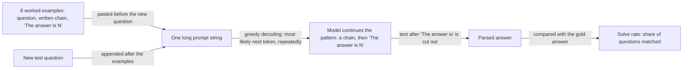
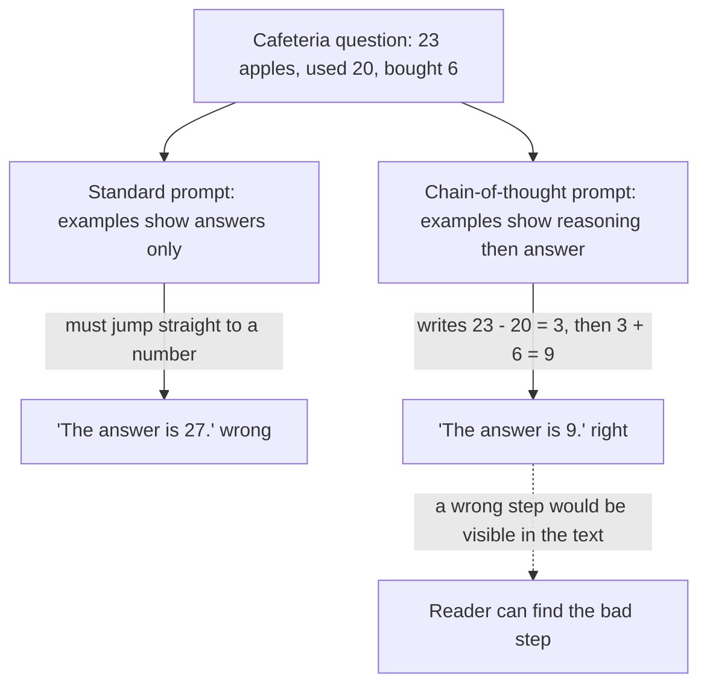

# Chain-of-Thought Prompting Elicits Reasoning in Large Language Models

> **Paper:** Wei, Wang, Schuurmans, Bosma, Ichter, Xia, Chi, Le and Zhou (Google Research, Brain Team), 2022; presented at the Conference on Neural Information Processing Systems (NeurIPS 2022), so peer reviewed - [arXiv abstract](https://arxiv.org/abs/2201.11903) - [local PDF](../../papers/2201.11903.pdf)
>
> **Short name:** chain-of-thought prompting, written CoT. **Version followed:** the arXiv HTML rendering of v6 (10 January 2023); section, table and figure numbers follow it (appendix tables run Table 1 to Table 30). Figure 1 is an image in the HTML, so its text was read from the local PDF, which has the NeurIPS layout.

## Read this first

**The claim in one sentence.** If you show a large language model a few worked examples in which each answer is preceded by a short written chain of reasoning steps, it tends to write such a chain for a new question and then reaches the right answer far more often on arithmetic, some commonsense and some symbolic tasks, with no change to its weights.

**Who this is for.** Anyone designing prompts or instructions for an assistant over business documents who must decide when visible reasoning is worth its cost, and anyone who has wondered why "show your work" changes an assistant's answers.

**Afterwards you will be able to** explain few-shot prompting and standard versus chain-of-thought prompts; trace one question through both; say what each headline number counts; explain the ablations and robustness checks; say why "emerges with scale" is looser than it sounds; and say what the paper never tests: whether the written chain is the model's real computation.

**Reading time.** About 50 minutes. **Have read first:** [GPT-3](../01-foundations/03-gpt3.md), which introduced few-shot prompting, and [Scaling laws](../01-foundations/04-scaling-laws.md) for why model size is a variable in every table. **Read next:** [ReAct](10-react.md), which interleaves reasoning with actions, and [Retrieval-augmented generation](06-rag.md), the other way this stage supplies a model with what it lacks.

**The one thing most people get wrong.** The paper does not show that models "think step by step" in any inner sense. It shows that, for large enough models, writing a certain kind of text before the answer raises the share of correct final answers. The authors say so in Section 6: chain of thought emulates human reasoners, which "does not answer whether the neural network is actually reasoning". Also, the famous 57% on GSM8K is one 540-billion-parameter model with eight hand-written examples; small models in the same tables get worse.

## The paper in one worked example

Three pieces of real material are used throughout. Part A is Figure 1 (standard against chain-of-thought prompting on one question). Part B is the Appendix A.4 comparison of an equation-only answer and a chain-of-thought answer. Part C is the symbolic task of Table 22 and Table 13.

### Part A - the cafeteria question (Figure 1)

Figure 1 shows two prompts side by side, each with one worked example about a man called Roger and a new question about a cafeteria. The figure does not name the model that produced its outputs, and Roger is not among the eight examples of the real math prompt (Table 20), so treat the figure as an illustration of format, not a logged run.

**Standard prompting (left panel).** The model is given this text and continues it:

```text
Q: Roger has 5 tennis balls. He buys 2 more cans of tennis balls. Each can has 3 tennis balls. How many tennis balls does he have now?
A: The answer is 11.

Q: The cafeteria had 23 apples. If they used 20 to make lunch and bought 6 more, how many apples do they have?
A:
```

Output shown: `The answer is 27.` The right answer is 23 - 20 + 6 = 9. (The guide could not reproduce 27 from any simple operation on 23, 20 and 6, and the paper does not explain it.)

**Chain-of-thought prompting (right panel).** Only the worked example changes; its answer now has the reasoning before "The answer is 11."

```text
Q: Roger has 5 tennis balls. He buys 2 more cans of tennis balls. Each can has 3 tennis balls. How many tennis balls does he have now?
A: Roger started with 5 balls. 2 cans of 3 tennis balls each is 6 tennis balls. 5 + 6 = 11. The answer is 11.

Q: The cafeteria had 23 apples. If they used 20 to make lunch and bought 6 more, how many apples do they have?
A:
```

Output shown: `The cafeteria had 23 apples originally. They used 20 to make lunch. So they had 23 - 20 = 3. They bought 6 more apples, so they have 3 + 6 = 9. The answer is 9.` That is right.

**What to see.** The model and test question are identical; only the example's answer text differs. The closing phrase "The answer is 9." copies the example format, which also lets a program find the answer (the paper does not describe its extraction rule; the guide infers one of this kind).

**The real prompt.** The experiments use eight examples, not one (Table 20; topics include trees, cars, chocolates, lollipops, toys, computers, golf balls, bagels). The same eight serve every math benchmark except AQuA, which gets four multiple-choice examples (Table 21). The standard-prompting version of the eight is not printed; the guide infers it keeps the questions and shows only "The answer is N." Measured on the HTML text, Table 20's eight questions are about 1,014 characters, the eight chain answers about 1,055, and the same answers without chains about 131.

### Part B - an equation alone (Appendix A.4)

LaMDA 137B (Language Models for Dialog Applications, 137 billion parameters) gets this question: Mike plays ping pong for 40 minutes; in the first 20 minutes he scores 4 points; in the second 20 minutes he scores 25% more points; how many points in total?

- **Equation only (wrong).** The model writes `(4 + 20 * 0.25) = 6` and answers 6.
- **Chain of thought (right).** It restates the facts, computes `4 x 1.25 = 5` for the second period, adds 4 + 5 and answers 9.

The authors explain that one equation cannot capture the story, whereas a chain handles each part. But 4 + 20 x 0.25 is 4 + 5 = 9, so the printed expression is fine; what is wrong is the "= 6" attached to it, an arithmetic slip (guide observation). The semantic claim rests on Table 6, where equation only does not beat standard prompting on GSM8K.

### Part C - a toy task (Table 22 and Table 13)

Last-letter concatenation: join the last letters of the words of a name. The prompt has four examples such as "Elon Musk" giving "nk" (Table 22), each with a chain like "The last letter of 'Elon' is 'n'. The last letter of 'Musk' is 'k'. Concatenating them is 'nk'." Test names have two words (in domain) or three or four (out of domain). Table 13 shows LaMDA 137B right on "Waldo Schmidt" ("ot") and wrong on "Daniel Friedman": its chain gives "l" for Daniel (right) and "m" for Friedman (wrong), so it answers "lm" where the true answer is "ln" (guide derivation). The bad step is visible, the debugging window the paper advertises in Section 2.



Notice that the weights never change and the model's own earlier words are the only extra input to its later words. The whole effect lives in the middle box.



Notice that the dotted edge, visibility of errors, is the paper's second claimed benefit (Section 2); it is separate from accuracy and never tested as a faithful record.

## Words you need

| Term | Plain definition | Example from the worked example |
|---|---|---|
| Few-shot prompting (in-context learning) | Putting a few finished input-output examples (exemplars, one "shot" each) in the text before the new question so the model imitates the pattern. No training happens; the weights stay fixed. | The eight examples of Table 20 before the cafeteria question. |
| Standard prompting | Few-shot prompting where each exemplar shows the question and only the final answer. The baseline. | "A: The answer is 11." |
| Chain of thought (CoT) | A series of natural-language intermediate steps between question and answer; the prompt is triples of input, chain, output. | "2 cans of 3 tennis balls each is 6 tennis balls." |
| Greedy decoding | Always taking the single most probable next token, so the same prompt gives the same output. | Used throughout (Section 3.1). |
| Solve rate | Percentage of test questions whose final answer matches the gold answer; it ignores whether the chain was valid. | PaLM 540B GSM8K: standard 17.9, CoT 56.9. |
| Emergent ability | An ability absent in small models that appears past some size, so it cannot be extrapolated from small models. | CoT hurts most models under 10B parameters (Appendix A.1). |
| Ablation | A variant that removes or changes one ingredient to see which part matters. | Equation only, variable compute only, reasoning after answer. |
| Out of domain (OOD) | Test items that differ from the examples in a stated way; here, more steps. | Four-word names after two-word examples. |
| External calculator | A post-hoc step recomputing the arithmetic written in a chain with Python's eval; not part of the headline CoT numbers. | The "+ ext. calc" rows of Table 1. |
| Benchmarks | GSM8K (Grade School Math 8K, 1,319 test questions); SVAMP (varied-structure word problems, 1,000); ASDiv (diverse word problems, 2,096); AQuA (multiple-choice algebra, 254); MAWPS (Math Word Problem Repository; four subsets, 2,065 in all). Sizes from Table 12. | Cafeteria question is GSM8K-style. |

## Tutorial 1 - Intuitive understanding

### What was broken before

By 2021, large models could do many tasks from a few examples ([GPT-3](../01-foundations/03-gpt3.md)). But the paper's Section 1 says this "works poorly on tasks that require reasoning abilities" and that making the model bigger often does not help: the curve of accuracy against size stays flat.

Part A shows the failure: three numbers and two operations, which a ten-year-old does in two written lines, and the model answered 27. The aggregate is Figure 2: PaLM 540B (Pathways Language Model, 540 billion parameters) asked for answers directly solved 17.9% of the GSM8K test set (Table 1; 18 in Figure 2). The prior best was 55% (Figure 2, from Cobbe et al., 2021; the abstract calls it a fine-tuned GPT-3 with a verifier, and plain fine-tuned GPT-3 is the figure's 33). Out of 100 grade-school word problems, the big model asked to answer directly got about 18 right.

Two earlier ideas each had a cost (Section 1): training on worked solutions needs many human-written solutions, and few-shot prompting needs few examples but did not help reasoning. The paper joins them by making the few examples carry the solutions.

### The idea

**Analogy.** A pupil is asked a hard sum. If she must blurt a number she often fails; with scratch paper and three worked examples of how to use it, she usually succeeds. Chain-of-thought prompting hands the model scratch paper whose format it learns from the examples.

**Where the analogy breaks.**

1. The pupil's paper records private thought. The model has no separate mind to which the text points; whether the text describes what the network did is not tested (Section 6; Section 2 says fully characterising a model's computations "remains an open question").
2. The pupil can cross out a wrong line. The model decoding greedily continues from whatever it wrote. Its chains can be fluent and false (Table 16: a chain says Harry Potter "can do anything").
3. The pupil understands the method. Small models copy the style without the logic: they "produced fluent but illogical chains of thought" (Section 3.2).

### How it works, step by step

1. **A person writes the examples.** One author wrote eight math chains (Table 20); the authors say they "did not undergo prompt engineering" (Section 3.1) and test other writers later. Annotators were given no style instructions (Appendix A.2).
2. **Assemble the prompt.** Examples, then the new question, ending with "A:" so the model must continue (Part A).
3. **Let the model continue.** Greedy decoding picks the likeliest next word given everything so far, including its own words. In the cafeteria case it writes "23 - 20 = 3" and later reuses that 3 in "3 + 6 = 9".
4. **Read the answer.** The fixed phrase "The answer is" marks the number to score.
5. **Score.** Count the share of test questions whose extracted number equals the gold number. Chains are not graded in the main tables.

Because the model and question are identical across conditions, the difference in solve rate isolates what the format of the examples does. It does not by itself say why.

### What the results say

Every number is a solve rate (percent of a fixed test set answered correctly) from Table 1 or Table 2 (arithmetic), Table 4 (commonsense) or Table 5 (symbolic); "(+n)" is percentage points.

- **GSM8K, PaLM 540B: 17.9 to 56.9 (+39.0).** About 39 more problems in every 100, roughly three times as many. The prior best was 55, so chain of thought is 1.9 points above it; on 1,319 questions the guide computes a 95% margin of about 2.7 points on 56.9, so "state of the art" is a narrow win over a trained, verifier-assisted system.
- **Other models, GSM8K.** GPT-3 175B (text-davinci-002) 15.6 to 46.9 (+31.3); Codex (code-davinci-002) 19.7 to 63.1 (+43.4); LaMDA 137B 6.5 to 14.3 (+7.8).
- **Easy problems barely move.** PaLM 540B on the one-step MAWPS subset SingleOp: 94.1 both ways (Table 3). Gains are largest when problems are hard and the baseline low (Section 3.2).
- **Commonsense, PaLM 540B (Table 4).** StrategyQA 68.6 to 77.8; sports plausibility 80.5 to 95.4 (the paper compares 95.4 with 84 for "an unaided sports enthusiast"); date reasoning 49.0 to 65.3; CommonsenseQA (CSQA) 78.1 to 79.9, "minimal" in the authors' word.
- **Symbolic, PaLM 540B (Table 5).** Two-word last letters 7.6 to 99.4. Four-word names, never shown in examples: 0.0 to 63.0, so about 63 in 100 right where none were.
- **Size matters.** On GSM8K every model under 10 billion parameters is worse with chains (for example PaLM 8B, 4.9 to 4.1). Above 60 billion every model gains.
- **Ablations (Figure 5, Table 6).** Equation only, dots of matching length, or the chain after the answer all stay near no-chain on GSM8K: LaMDA 137B 6.5 standard; 5.4, 6.4, 6.1 for the three; 14.3 for the full chain.
- **Different writers (Figure 6).** Every writer variant beats standard prompting for LaMDA 137B: GSM8K rates 11.1 to 17.6 against 6.5. The direction holds; the size depends on the writer.

### What this does not show

- **Faithfulness.** No experiment edits a chain or corrupts a step to see whether the answer follows. The "reasoning after answer" ablation shows the chain must come first to help, not that its stated steps are the true cause.
- **Valid reasoning in general.** Chains were read by hand for one model on one dataset (Appendix D).
- **A size-free recipe.** The tables are 2022 models; the paper says nothing about a small model trained with chains.
- **Freedom from test exposure.** The paper does not discuss whether the public test questions were in pretraining data (guide observation).

### Teach-back

1. What is the only difference between the standard and chain-of-thought prompt in Part A?
2. PaLM 540B goes from 17.9 to 56.9 on GSM8K. Say what that means per 100 problems, and one caution about calling it a win over 55.
3. Why does the paper test "equation only", and what does GSM8K show?
4. Does the paper show the chain is how the model computes its answer?

<details>
<summary>Answers</summary>

1. The text of the worked example's answer: with chains it contains the reasoning steps before "The answer is"; without, only the answer. The model and test question are the same.
2. About 39 more per 100, about 3.2 times the baseline. The margin over 55 is 1.9 points, near the roughly 2.7-point sampling margin the guide computes.
3. Chains contain equations, so the equation alone might carry the benefit. On GSM8K equation only (5.4) is below standard (6.5), so the natural-language steps matter there; on simpler SVAMP and ASDiv equation only recovers most of the gain.
4. No. It shows that writing the chain before the answer raises accuracy; whether the steps match the internal process is left open by the authors.

</details>

## Tutorial 2 - Practitioner understanding

### The design in concrete terms

**Prompt shapes.** Every task uses question, chain, answer line. The answer phrase varies: "The answer is N." for arithmetic, "So the answer is (a)." for multiple choice, "So the answer is yes." for yes-no. The SayCan robot-planning prompt has a different shape: a "Human:" request, an "Explanation:" (the chain) and a numbered "Plan:" of calls such as `find(kettle chips)`, `pick(kettle chips)`, ending in `done()` (Table 28).

| Task | Examples in the prompt | Source |
|---|---|---|
| Math word problems (not AQuA) | 8 (Table 20) | One author; same set for GSM8K, SVAMP, ASDiv, MAWPS |
| AQuA | 4 (Table 21) | Training-set questions with their solutions |
| Last letter concatenation | 4 (Table 22) | Two-word names |
| Coin flip | 8 (Table 23) | Random first names, two people |
| CSQA | 7 (Table 24) | Written from the training set |
| StrategyQA | 6 (Table 25) | Written from the training set |
| Date understanding | 6 (Table 26) | First evaluation items, then excluded from scoring |
| Sports understanding | 8 (Table 27) | First evaluation items, then excluded from scoring |
| SayCan | 7 (Table 28) | Training set of the SayCan paper |

Section 4 says "the first ten examples" were used for the two BIG-bench (Beyond the Imitation Game) tasks and six for SayCan; the tables print six, eight and seven. The guide reports the tables.

**Decoding and models.** Greedy decoding. LaMDA is averaged over five random orderings of the examples; other models use one ordering "to save compute" (Section 3.1). Models: GPT-3 as text-ada-001, text-babbage-001, text-curie-001 and text-davinci-002 ("presumably" 350M, 1.3B, 6.7B, 175B InstructGPT models); LaMDA 422M (printed "420M" in tables), 2B, 8B, 68B, 137B; PaLM 8B, 62B, 540B; UL2 (Unifying Language Learning) 20B; Codex. Eight examples were "constrained by the input length of 1024 tokens" (Appendix D.3), without saying for which models. The paper gives no maximum output length or answer-extraction rule.  LaMDA and PaLM weights are not public (Appendix E.1).

### A minimal version

A harness comparing standard and chain-of-thought prompts on any question set. The model call is a stub `llm(prompt) -> str`; the answer rule is the guide's assumption.

```python
import re

EXEMPLARS = [  # (question, chain, answer): the Table 20 shape, first two items
  ("There are 15 trees in the grove. Grove workers will plant trees in the grove today. "
   "After they are done, there will be 21 trees. How many trees did the grove workers plant today?",
   "There are 15 trees originally. Then there were 21 trees after some more were planted. "
   "So there must have been 21 - 15 = 6.", "6"),
  ("If there are 3 cars in the parking lot and 2 more cars arrive, how many cars are in the parking lot?",
   "There are originally 3 cars. 2 more cars arrive. 3 + 2 = 5.", "5"),
]

def build_prompt(question, mode):               # mode: "standard" | "cot"
    blocks = []
    for q, chain, ans in EXEMPLARS:
        body = f"{chain} The answer is {ans}." if mode == "cot" else f"The answer is {ans}."
        blocks.append(f"Q: {q}\nA: {body}")
    blocks.append(f"Q: {question}\nA:")
    return "\n\n".join(blocks)

ANSWER = re.compile(r"The answer is\s*\$?(-?[\d,]*\.?\d+)")
def parse(text):
    m = ANSWER.search(text)
    return float(m.group(1).replace(",", "")) if m else None   # None counts as wrong

def solve_rate(llm, data, mode):                # data: [(question, gold_float)]
    right = unparsed = 0
    for question, gold in data:
        out = llm(build_prompt(question, mode)) # greedy: temperature 0
        out = out.split("\n\nQ:")[0]            # stop before an invented next question
        pred = parse(out)
        unparsed += pred is None
        right += pred is not None and abs(pred - gold) < 1e-6
    return {"solve_rate": round(100 * right / len(data), 1), "unparsed": unparsed, "n": len(data)}

# shape of a result: {"solve_rate": 56.9, "unparsed": 0, "n": 1319}
# run twice (mode="standard", mode="cot") on the same data; report both with the same n
```

The two runs share every line except the `body` string: the paper's controlled comparison. The `unparsed` counter matters because small models often never gave a parseable answer (Appendix A.1). For the paper's calculator step, recompute each "a op b = c" with a digits-and-operators-only evaluator before parsing.

### What it costs

The paper reports solve rates, not tokens or money. This section is **constructed by this guide**.

**Assumptions.** Four characters per token. The chain prompt is about 2,150 characters (questions 1,014, chain answers 1,055, about 80 of formatting), about 540 tokens; the standard prompt about 1,225 characters, 310 tokens. A test question is 50 tokens; a chain answer 80 tokens, a bare answer 8. Placeholder prices: 1 dollar per million input tokens, 4 dollars per million output tokens. Test set: 1,319 questions.

| | Standard | Chain of thought |
|---|---|---|
| Input tokens | (310 + 50) x 1,319 = 474,840 | (540 + 50) x 1,319 = 778,210 |
| Output tokens | 8 x 1,319 = 10,552 | 80 x 1,319 = 105,520 |
| Cost | 0.475 + 0.042 = about $0.52 | 0.778 + 0.422 = about $1.20 |
| Correct at PaLM 540B rates (17.9%, 56.9%) | about 236 | about 750 |
| Cost per correct answer | about $0.0022 | about $0.0016 |
| Decode time at 50 tokens per second | about 0.16 s per question | about 1.6 s per question |

Chains cost about 2.3 times as much per run and take about ten times as long to decode, yet cost less per correct answer because they are right so much more often. That reverses where accuracy is already high: on SingleOp (94.1 both ways) the extra output buys nothing. The paper's own cost remark is different: the effect appears only in very large models, which are costly to serve (Section 6).

### How it fails

| Symptom | Likely cause | Mitigation | Grounding |
|---|---|---|---|
| Right chain, wrong arithmetic | The model does the sums itself | Recompute equations with a calculator | 8% of 50 wrong LaMDA GSM8K chains; calculator moved LaMDA 137B from 14.3 to 17.8 (Table 1) |
| Right chain except one wrong number | Symbol mapping (15 x 30 instead of 15 x 50) | Explicit short chain format; second check | 16% of the 50 (Appendix D.2, Table 10) |
| Chain skips a step | One step missing | Examples that show every operation | 22% of the 50 |
| Chain misreads the problem or is incoherent | Semantic understanding | Larger model; rewrite the question | 54% (27 of 50), 8 of them incoherent (Table 11) |
| Right answer, wrong chain | Chance, mainly in multiple choice or yes-no | Review chains, not only answers | Table 9 penguin example; authors say likelier outside free response (D.1) |
| Chains hurt | Model too small or task unsuited | Test standard prompting first | PaLM 8B GSM8K 4.9 to 4.1; GPT-3 175B CSQA 79.5 to 73.5; LaMDA 137B AQuA 25.5 to 20.6 |
| No parseable answer | Small models loop or never conclude | Count and report unparsed outputs | Appendix A.1 |
| Large swing between writers | Exemplar sensitivity | Test several writers | Coin flip 99.6 to 71.4 (Table 7) |
| Plausible, false chain | Fluent text, wrong fact | Supply the fact from a source | Table 16 |

### Evaluating your version

- **Metric.** Exact-match solve rate on the final answer, plus a manual read of at least 50 failures and 50 successes using the paper's categories (calculator, symbol mapping, one step missing, semantic or incoherent; Appendix D).
- **Test size.** The 95% margin near 50% is about 98 divided by the square root of n points: about 5.7 for 300 questions, about 2.7 for 1,319 (guide arithmetic). Separating 20% from 30% needs roughly 300 questions per arm.
- **Baselines.** Standard prompting with the same examples minus chains; a "reasoning after answer" control; at least two chain-writers other than the system's builder (Figure 6's design).
- **Stop rule.** Adopt chains only if every writer's variant beats standard prompting by a margin fixed in advance on a sample large enough to resolve it, the unparsed rate is under 2%, and the manual read finds few right answers with invalid chains. If any writer's variant falls to baseline, the prompt is fragile.

<details>
<summary>Check the cost arithmetic</summary>

Standard: 360 input tokens per question x 1,319 = 474,840, so 0.475 dollars; 10,552 output tokens at 4 dollars per million is 0.042. Chain: 778,210 input tokens is 0.778 dollars; 105,520 output tokens is 0.422. Per correct answer: 0.517 / 236 = 0.0022 and 1.200 / 750 = 0.0016.

</details>

### Adopt, adapt or skip

**Recommendation: adapt.** For an assistant over a company's private documents:

- **Adopt** visible step-by-step reasoning for questions needing several dependent operations: totals across invoice lines, date arithmetic over contract terms, "which clause applies if both conditions hold". These match where the paper's gains were largest (multi-step, low baseline).
- **Adapt** in three ways. Write four to eight examples from your own documents and test two different writers. Send arithmetic to a calculator or code tool, as Table 1's calculator rows hint and [CodeAct](../06-agent-systems/25-codeact.md) takes further. Supply facts from retrieved passages ([Retrieval-augmented generation](06-rag.md)): a chain reasons only over facts in the prompt, and Table 16 shows what happens when it invents them.
- **Skip** it for lookups, extraction and one-step questions, where Table 3 shows no gain and the tokens are pure cost. Do not present the chain to a customer as the reason the system answered; the paper offers no evidence of faithfulness.

**Through-line.** The curriculum asks whether a thin runtime plus a few good tools suffices, and whether open or smaller models can do well from context, instructions and memory. This paper supports the context side: a few curated examples, kept in instructions or memory per task type, change capability without training. Its evidence on small models is a warning, not a verdict: the 2022 models under 10 billion parameters got worse with chains (Appendix A.1), so for an open 7-to-8-billion-parameter model today test, do not assume. Many current open models are trained on step-by-step data, which the paper does not cover (guide inference). [ReAct](10-react.md) is the bridge to the agent stage: it keeps the chain and adds actions and observations.

## Tutorial 3 - Researcher understanding

### Formal setup

A test item is a question x with gold answer y. A prompt is built from k exemplars, each a triple (x_i, c_i, y_i) with c_i a human-written chain; standard prompting uses pairs (x_i, y_i). The prompt P is the exemplars followed by x. The model generates a string s by greedy decoding, s_t = argmax over tokens of p(token | P, s_1 .. s_{t-1}). A parser g extracts g(s) from s. The solve rate over N items is Acc = (1/N) times the number of items where g(s) equals y. With a chain, s is c followed by y, and p(y | x) = sum over chains c of p(c | x) p(y | x, c); greedy decoding takes one path, so the chain is a latent variable made visible. Taking the majority answer over many sampled chains was later shown to help (Section 3.1, citing Wang et al., 2022a). The effect is Delta = Acc_CoT minus Acc_std, in points, per model and benchmark.

**Toy instance (constructed).** N = 5 questions; the standard prompt gets 1 right, the chain prompt 3. Acc_std = 20%, Acc_CoT = 60%, Delta = 40 points. If one of the 3 right chain answers rests on an invalid chain (as in Table 9), Acc stays 60% but chain validity is 2 of 3. The tables report the first quantity only.

### The claims, stated precisely

1. **C1 (arithmetic).** With eight hand-written exemplars, chains raise solve rate on GSM8K, SVAMP, ASDiv, AQuA and MAWPS for sufficiently large models; PaLM 540B on GSM8K 56.9 against 17.9 (Table 1). Strong for the sizes tested; the state-of-the-art claim is narrow.
2. **C2 (emergence).** The benefit is absent or negative for small models (Section 3.2, Figure 4). The "~100B" wording is looser than the tables.
3. **C3 (ablations).** Equation only, variable compute and chain-after-answer do not reproduce the gain (Figure 5, Tables 6 and 7).
4. **C4 (robustness).** The effect survives changes of annotator, style, exemplar source, order and count (Section 3.4, Appendix A.2).
5. **C5 (generality).** It helps commonsense (Table 4) and symbolic tasks, including longer inputs (Table 5), though not for every model and dataset.
6. **C6 (interpretability).** Chains give "an interpretable window" (Section 2): asserted from examples, not measured.
7. **Authors' limits (Section 6).** Whether the model reasons is open; annotation cost for fine-tuning; no guarantee of correct paths; large models are costly to serve.

### Evidence, table by table

**Figure 2 and Figure 4.** Solve rate against size for LaMDA, GPT and PaLM, with the prior supervised best as a line. PaLM 540B with chains beats it on GSM8K, SVAMP and MAWPS; standard prompting already passed it on SVAMP (69.4 against 57.4).

**Table 1 (five benchmarks, five model families, calculator rows).** Prior bests: 55, 57.4, 75.3, 37.9, 88.4 for GSM8K, SVAMP, ASDiv, AQuA, MAWPS. Every printed difference recomputes to within 0.1 (PaLM 540B MAWPS: 93.3 - 79.2 is 14.1, printed +14.2). The text says PaLM gets "within 2%" on AQuA and ASDiv; the gaps are 2.1 points (35.8 to 37.9) and 1.4 (73.9 to 75.3).

**Table 2 (all sizes).** The raw data for emergence. GSM8K standard to chain: UL2 20B 4.1 to 4.4; LaMDA 420M 2.6 to 0.4, 2B 3.6 to 1.9, 8B 3.2 to 1.6, 68B 5.7 to 8.2, 137B 6.5 to 14.3; GPT 350M 2.2 to 0.5, 1.3B 2.4 to 0.5, 6.7B 4.0 to 2.4, 175B 15.6 to 46.9; PaLM 8B 4.9 to 4.1, 62B 9.6 to 29.9, 540B 17.9 to 56.9. All seven models under 10B lose; above 60B all gain, but by 2.5 points for LaMDA 68B and 20.3 for PaLM 62B. PaLM 62B also drops on SVAMP (48.2 to 46.7) and AQuA (25.6 to 22.4). Chance on five-option AQuA is 20%.

**Table 3 (MAWPS subsets).** PaLM 540B: SingleOp 94.1 to 94.1, SingleEq 86.5 to 92.3, AddSub 93.9 to 91.9 (down 2.0), MultiArith 42.2 to 94.7. The guide verified the MAWPS figure in Table 2 is the unweighted mean of the four subsets: (94.1 + 86.5 + 93.9 + 42.2) / 4 = 79.2 and (94.1 + 92.3 + 91.9 + 94.7) / 4 = 93.25. A size-weighted mean (562, 508, 395, 600 items; Table 12) would be 77.1 for standard. The MAWPS gain is mostly one subset.

**Table 4 (commonsense).** PaLM 540B gains on all five; GPT-3 175B loses on CSQA (79.5 to 73.5) and barely moves on StrategyQA (65.9 to 65.4); Codex loses on CSQA (82.3 to 77.9); UL2 20B loses on StrategyQA (59.0 to 53.3). Sports gains appear even at PaLM 8B (55.1 to 75.2).

**Table 5 (symbolic).** PaLM 540B last-letter: 2 words 7.6 to 99.4, 3 words 0.2 to 94.8, 4 words 0.0 to 63.0. Coin flip: 98.1 to 100.0, then 49.3 to 98.6 and 54.8 to 90.2 (50% is chance). The authors call the in-domain tasks "toy" because the exemplar already shows the solution structure (Section 5).

**Appendix D (manual chain analysis).** Not rates but hand coding: 50 correct and 50 incorrect LaMDA 137B GSM8K outputs, and 45 incorrect PaLM 62B outputs (20 semantic understanding, 18 one step missing, 7 other; about 44%, 40%, 16% by guide arithmetic). The portion fixed by PaLM 540B appears only in a plot (Figure 9) the guide could not read numerically.

**Causal or associational.** Prompt format within one model is a controlled comparison. Statements about scale compare different models and are associational; the authors note that "model scale is often conflated with other factors, such as amount of training compute" (Appendix A.1).

**Inconsistencies found inside the paper (v6).** None changes a conclusion; each is a reason to read numbers from tables.

- The abstract says "three large language models"; Section 3.1 evaluates five. Appendices A.2 and E.2 again say three.
- Section 4 gives PaLM 540B StrategyQA as 75.6 against 69.4; Table 4 prints 77.8.
- Section 3.2 says two of 50 correct chains were right by coincidence; Appendix D.1 says one. The Table 9 caption says 7 imperfect cases; the table lists 6.
- Appendix D.2 says the calculator moved LaMDA 137B GSM8K from 14.3 to 17.3 "as shown in Table 2"; Table 1 prints 17.8 and Table 2 has no calculator rows.
- Table 6 prints 36.7 for LaMDA 137B chain on SVAMP; Tables 1 and 2 print 37.5. Its caption says equation only sits between standard and chain, yet on GSM8K it is below standard.
- Appendix A.2 says chains help LaMDA, GPT-3 and PaLM on every dataset except GPT-3 on CSQA and StrategyQA; Table 1 shows LaMDA 137B worse on AQuA (25.5 to 20.6).
- Section 5 says "these three tasks" for two tasks; Appendix E.3 places the symbolic data in Section 4, where it is Section 5.

### Ablations and what they isolate

All variants use the same questions and model, each swapping out one ingredient (LaMDA 137B, Table 6).

| Variant | What it removes | GSM8K | SVAMP, ASDiv, MAWPS | What it isolates |
|---|---|---|---|---|
| Standard | Any text before the answer | 6.5 | 29.5, 40.1, 43.2 | Baseline |
| Equation only | Natural language; keeps an expression | 5.4 | 35.1, 45.9, 50.1 | Is the benefit just the equation? |
| Variable compute only | Meaning; keeps length (dots equal to the characters of the needed equation) | 6.4 | 28.0, 39.4, 41.3 | Do extra output tokens alone help? |
| Reasoning after answer | Order: chain follows the answer | 6.1 | 30.7, 38.6, 43.6 | Does the chain merely activate knowledge? |
| Full chain | Nothing | 14.3 | 36.7 (Tables 1 and 2 print 37.5), 46.6, 57.9 | The method |

The paper concludes that variable compute alone is not the reason and that chain after answer is "useful for reasons beyond just activating knowledge" (Section 3.3). Guide arithmetic: equation only closes (35.1 - 29.5) / (36.7 - 29.5), about 78% of the SVAMP gap (70% using 37.5), about 89% of the ASDiv gap, about 47% of the MAWPS gap and none of the GSM8K gap, so it substitutes well for short problems. Table 7 repeats the dots and chain-after-answer tests on date, sports, SayCan (PaLM), last-letter and coin flip: chain-after-answer scores 0.0 on last-letter (baseline 5.8) and 50.2 on coin flip (chance).

What they do not isolate: dots are one filler among many, so the test shows this filler does not help, not that no extra computation could. And chain-after-answer shows the answer must be computed after the chain, but a chain of decorative steps would pass the same test.

**Robustness (Figure 6, Tables 6 and 7).** GSM8K: Annotator A 14.3, B 15.5, C 17.6, concise 11.1, GSM8K-sampled sets 12.6, 12.7, 12.6, against 6.5. MAWPS: 57.9, 58.2, 60.1, 59.6, 53.9, 60.9, 54.2 against 43.2. B and C were co-authors "familiar with the goal" (Table 29 caption), so this is robustness to the styles of informed people, plus one independent source (crowd-written GSM8K chains). Coin flip varied most: 99.6 (A), 77.5 (B), 71.4 (C), with standard deviations up to 11.1 (Table 7). Two co-authors failed to write a chain that reversed a list of five items while a third succeeded (Appendix A.2): writer skill can decide success. Exemplar count (Figure 11) is plotted, not tabulated, so the guide quotes no values.

### Threats to validity specific to this paper

- **Authors wrote prompts and chose checks.** One author wrote the main math prompt; other writers were co-authors; no blinding.
- **Closed models.** LaMDA and PaLM are not public (Appendix E.1); the text-davinci-002 mapping to a 175B model is "presumably".
- **One ordering, few intervals.** Only LaMDA is averaged over five orderings, and the standard deviations cover ordering, not test-set sampling. A two-point difference on 254 AQuA questions is inside a margin of about six points; 120 SayCan questions (Table 7 caption) give up to nine (guide arithmetic, 95%).
- **Scale confounded.** Families differ in data and compute, with three to five sizes each, so "about 100B" is a pooled reading.
- **Exemplars taken from the test sets** for Date and Sports; remaining sizes are not stated.
- **Small, single manual analysis.** Fifty plus fifty outputs, one model, one dataset; annotators and agreement not described; the acknowledgments thank a reader for correcting "a mistake in the manual error analysis in the original manuscript".
- **Chain validity beyond free-response math is unmeasured.** The authors say correct answers with wrong chains are much likelier for multiple choice and yes-no (Appendix D.1).

### Open problems and follow-ups

- **Faithfulness.** A direct test, proposed by this guide: corrupt one intermediate number in the model's own chain and see whether the answer follows it.
- **Automatic exemplars** (Appendix A.2) and **verifiers or majority voting** over sampled chains (Sections 3.1 and D.2).
- **Why scale helps.** Appendix A.1 lists semantic understanding, symbol mapping, staying on topic and arithmetic; none is isolated.
- **Reasoning plus action.** Chains cannot fetch facts or run code; [ReAct](10-react.md) and [CodeAct](../06-agent-systems/25-codeact.md) interleave them. Which tasks benefit is only an intuition (Appendix A.3: multi-step, large model, flat curve).

### What would change my mind

- If editing a chain's intermediate step left the final answer unchanged in most cases, the "interpretable window" claim would be hard to hold.
- If the GSM8K gain vanished on freshly written problems of equal difficulty, test exposure would be the suspect.
- If a sub-10-billion-parameter model showed the gain with the paper's exact prompts, emergence would be about training, not size.
- If chains written by non-authors, such as domain staff in your business, failed to help on your documents, the "annotators do not matter" reading would not transfer.

<details>
<summary>Why the toy instance matters</summary>

An accuracy table cannot tell a model that reasons from one that lands on right answers with bad chains; in the toy case both look like 60%. Only the manual read of Appendix D separates them, so chain-quality evidence is thin outside free-response math.

</details>

## Reading map for the PDF

| Section or figure | What it contains | First pass | Guide section that answers its questions |
|---|---|---|---|
| Abstract, Figure 1 | The claim and the cafeteria format | Read | Worked example, Part A |
| Section 1, Figure 2 | Motivation, GSM8K bar chart | Read | Tutorial 1, What was broken before |
| Section 2 | Four "attractive properties" of chains | Read | Tutorial 3, claim C6 |
| Section 3.1 | Benchmarks, prompts, models, greedy decoding | Read | Tutorial 2, design |
| Sections 3.2, Figure 4 | Emergence, hard versus easy, manual analysis | Read | Tutorial 3, Tables 1 to 3 |
| Section 3.3, Figure 5 | The three ablations | Read | Ablations and what they isolate |
| Section 3.4, Figure 6 | Annotator and exemplar robustness | Skim | Robustness paragraph |
| Sections 4 and 5, Figures 7 and 8 | Commonsense and symbolic results | Skim | Tables 4 and 5 |
| Section 6 | Discussion, four limitations | Read | What this does not show |
| Appendix A | Four FAQs (scale, prompt engineering, will it help, equation only) | Read | Questions readers get stuck on |
| Appendix B, Tables 1 to 7 | All raw results | Skim, then look up | Evidence, table by table |
| Appendix D | Manual analysis of correct and wrong chains | Read | How it fails |
| Appendix F, Tables 13 to 19 | Right and wrong chains per task | Skim | Part C |
| Appendix G, Tables 20 to 28 | Exact prompts | Read Table 20 | Tutorial 2, design |

## Questions readers get stuck on

### What does "few-shot" mean, and is the model being trained on the examples?

No training happens. A few-shot prompt is ordinary text: a few example questions with answers, then the question you care about. The parameters do not change; the model continues the text in the pattern it sees. The paper stresses that "no language models were finetuned" (Section 6), so one checkpoint serves many tasks. The shots are the examples, eight in the main math prompt.

### Is the chain of thought how the model really reaches its answer?

The paper neither claims nor tests this. Section 6 says chains do not answer whether the network is reasoning. What it measures is that writing the chain before the answer raises accuracy and writing it after does not (Figure 5). Both facts concern accuracy, not whether the steps describe the internal computation.

### The figure says 57, the tables 56.9, and some write-ups 58. Which is right?

Figure 2 rounds to 57; Tables 1 and 2 print 56.9 for PaLM 540B with eight chains and greedy decoding. The guide could not find 58 in the v6 rendering and did not check earlier versions or follow-up work. Cite 56.9 and state the version.

### If chains only work around 100 billion parameters, why did PaLM 62B and 8B improve on some tasks?

"About 100B" (Section 3.2) is a rough pooled statement. PaLM 62B goes from 9.6 to 29.9 on GSM8K (Table 2), PaLM 8B from 55.1 to 75.2 on sports plausibility (Table 4), while LaMDA 68B gains only 2.5 on GSM8K. The threshold depends on family and task. Appendix A.1 itself says chains hurt "most models smaller than 10B".

### Why is equation-only worse than standard on GSM8K but good on SVAMP?

GSM8K stories need several steps and careful assignment of quantities, so one up-front equation is often wrong; SVAMP and ASDiv are mostly one or two steps where the equation is easy to write, and there equation only recovers roughly 70 to 89% of the chain gain (guide arithmetic). The authors give this explanation in Appendix A.4, with the caveat in Part B that their illustration is an arithmetic slip.

### What is "variable compute only", and why dots?

It tests whether chains help just because the model emits more tokens and so does more work before answering. The model outputs only dots, one per character of the equation that would be needed. Accuracy stays at baseline (GSM8K 6.4 against 6.5). That shows this filler does not help, not that no extra computation could.

### Why would "reasoning after answer" equal the baseline?

The model writes left to right and cannot revise an answer already written, so a later chain cannot affect it. Matching the baseline shows the chain must come first, and rules out the explanation that chain text merely primes relevant knowledge, since the same knowledge and prompt are present either way.

### Why did chains hurt GPT-3 on CSQA and LaMDA on AQuA?

The paper does not explain; it lists the GPT-3 case as a limitation (Appendix A.2). Guide guesses, not findings: CSQA leans on knowledge more than steps, and AQuA needs algebra that mid-sized models do poorly. The lesson is to measure on your task.

### Why not just fine-tune on worked solutions, or say "think step by step"?

Fine-tuning needs many written solutions, while the paper's pitch is that eight suffice; the authors note annotation could be "prohibitive for finetuning" (Section 6). Instructing a model to think step by step with no examples is a later idea this paper does not test, so the guide cannot say how it compares.

### Do current assistants still need hand-written examples?

The paper cannot say; its models predate common training on step-by-step solutions and instructions to reason. Today a short instruction often elicits reasoning (guide inference from general practice, not from this paper), so test on your model. The principle carries over: for multi-step questions, let the model write intermediate steps first.

## Prerequisites you actually need

### Prerequisite 1 - Few-shot prompting as text continuation

A few-shot prompt is a string and the model predicts the next tokens. With the lines "Q: 2 + 2? A: 4" and "Q: 3 + 5? A:" a model usually continues " 8". The examples fix the format. Change the example answers to contain reasoning and the model writes reasoning: the paper's whole mechanism. Used in Section 3.1, Figure 1, Appendix G. See [GPT-3](../01-foundations/03-gpt3.md) and the [glossary](../../references/glossary.md).

### Prerequisite 2 - Autoregressive and greedy decoding

A model produces one token at a time and feeds each back as input. Greedy means taking the most probable token each time. Once the model has written "23 - 20 = 3", the token 3 is part of its input when it later needs 3 + 6; without that written step it must compute inside one pass. Used in Section 3.1 and in the reasoning-after-answer ablation. See [The transformer](../01-foundations/01-transformer.md).

### Prerequisite 3 - Accuracy on a finite test set and its margin

A solve rate is a proportion with sampling noise. For N questions and rate p the standard error is sqrt(p(1-p)/N); 1.96 times that is a 95% margin. GSM8K has N = 1,319: at p = 0.569 the margin is 1.96 x sqrt(0.569 x 0.431 / 1319), about 0.027, or 2.7 points. At N = 254 (AQuA) and p = 0.358 it is about 5.9. Used in reading every table; most cells have no interval. See the [math bridge](../../references/math-bridge.md).

### Prerequisite 4 - Reading a scaling curve and "emergence"

A scaling curve plots accuracy against model size, usually on a log axis. A flat curve means size does not help; an emergent ability stays near the floor, then rises. LaMDA with chains on GSM8K: 0.4 (420M), 1.9 (2B), 1.6 (8B), 8.2 (68B), 14.3 (137B): flat to 8B, then rising. Used in Section 3.2, Figure 4, Appendix A.1; each family has only three to five points. See [Scaling laws](../01-foundations/04-scaling-laws.md).

## Where this sits in the curriculum

**How it differs from the two nearest papers.**

- **[Retrieval-augmented generation](06-rag.md)** gives the model outside information by retrieving documents. Chain of thought adds none; it changes the form of the model's own output. They combine naturally, a chain reasoning over retrieved passages, but this paper does not test that.
- **[ReAct](10-react.md)** keeps written reasoning and adds actions and observations from the outside world, so reasoning can be corrected by evidence. This paper has no actions or feedback; once a wrong step is written the model proceeds from it.

Also relevant: [InstructGPT](08-instructgpt.md), since text-davinci-002 is "presumably" an InstructGPT-style model, and [CodeAct](../06-agent-systems/25-codeact.md) for sending computation to code.

**Read next.** [ReAct](10-react.md): the same chain format becomes a loop with tools, the first step toward the agent stage's question of whether a thin runtime with a few good tools is enough.

## Checkpoint

1. **Explain.** What does the paper change in the prompt, and what stays fixed?
2. **Compute.** LaMDA 137B GSM8K: standard 6.5, chain 14.3 (Table 2). State the gain in points and as a ratio. Is the LaMDA 68B gain (5.7 to 8.2) clearly nonzero on 1,319 questions?
3. **Compute.** Appendix D.2 says 8% of 50 wrong chains were wrong only by arithmetic. How many is that, and what does Table 1 report for the calculator on LaMDA 137B GSM8K?
4. **Critique.** A colleague says "Table 6 proves the annotator does not matter." Give two reasons that is too strong.
5. **Critique.** "Reasoning after answer" matches the baseline, so the chain is faithful. What is missing, and what experiment would add it?
6. **Apply.** You add chains to an assistant answering questions about supplier contracts. Name two question types to use them on, one to skip, and your stop rule.
7. **Find the inconsistency.** Section 4 says PaLM 540B scored 75.6 against 69.4 on StrategyQA. What does Table 4 print?

<details>
<summary>Answers</summary>

1. Only the worked examples change: their answers include written intermediate steps. Model, test questions, decoding and weights stay fixed, and the model writes steps in that style for the new question.
2. +7.8 points, about 2.2 times (14.3 / 6.5). LaMDA 68B gains 2.5 points. The margin near 8% on 1,319 questions is about 1.5 points (1.96 x sqrt(0.08 x 0.92 / 1319)), so the gain is probably real but small; the paper gives no interval for a single cell.
3. Four chains. Table 1 reports 14.3 rising to 17.8 (+3.5 points); Appendix D.2's text says 17.3 and cites Table 2, a mismatch. Another 34% of the 50 had calculator errors alongside other mistakes, so a calculator rescues only the 8% by itself.
4. The annotators were co-authors who knew the goal (Table 29 caption), and the checks are on one model, mostly math. Also the scores varied: GSM8K 11.1 to 17.6, coin flip 71.4 to 99.6, so writers matter in magnitude even if all beat the baseline.
5. A matching baseline shows the chain must precede the answer, but a decorative chain would also pass. Add an experiment that alters an intermediate number in the model's own chain: if the answer does not follow, the stated steps are not what determines it.
6. Use chains on totals across several invoice or contract lines and on date or term calculations; skip single lookups such as "who is the counterparty?". Stop rule: adopt only if chains from two different writers each beat the plain prompt by the preset margin on a sample large enough to resolve it, with unparsed answers under 2%.
7. 77.8 (standard 68.6). The previous best of 69.4 is the same in both places.

</details>
