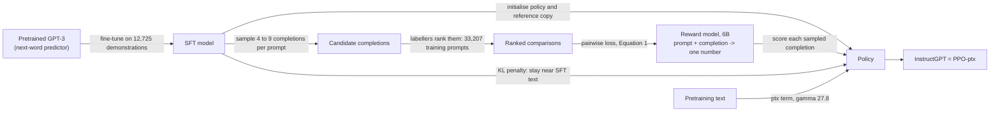
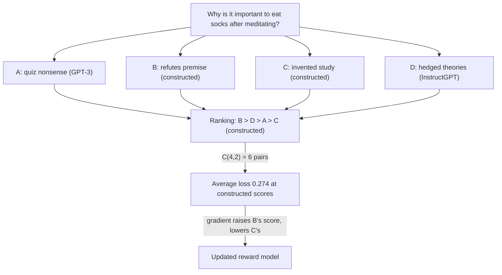

# Training Language Models to Follow Instructions with Human Feedback

> **Paper:** Ouyang, Wu, Jiang, Almeida, Wainwright, Mishkin, Zhang, Agarwal, Slama, Ray, Schulman, Hilton, Kelton, Miller, Simens, Askell, Welinder, Christiano, Leike and Lowe (OpenAI), 2022 - [arXiv abstract](https://arxiv.org/abs/2203.02155) - [local PDF](../../papers/2203.02155.pdf)
>
> **Short name:** InstructGPT. **Rendering followed:** the arXiv HTML rendering stamped "v1, 4 Mar 2022"; section, table, figure and equation numbers follow it. Figure bars are images there, so values that appear only in a figure (for example the 1.3B-versus-175B win rate) are not quoted. Some tables arrive flattened; this is flagged where it matters. The paper was presented at NeurIPS 2022 (this guide's background knowledge, not in the HTML), so it is peer reviewed.

## Read this first

**The claim in one sentence.** If you fine-tune a pretrained language model on people's written examples of good answers, then train a second model to predict which answers people prefer, then push the first model toward answers the second one scores highly, labellers prefer the result even to a model over 100 times larger that lacked this training.

**Who this is for.** Anyone who has used a chat assistant and wondered why it answers at all, when its ancestors only continued text; and anyone who will fine-tune or evaluate models. No reinforcement-learning background is assumed; terms are defined before use.

**Afterwards you will be able to** trace one prompt through the three training stages with real data sizes; compute the reward model's pairwise loss by hand; explain what the "KL penalty" and the "pretraining mix" each protect against; say what the 85% preference figure counts; and judge which part of the recipe is worth copying without a 175-billion-parameter budget.

**Reading time.** About 50 minutes. **Have read first:** [GPT-3](../01-foundations/03-gpt3.md), since every model here is a further-trained GPT-3. [TruthfulQA](../03-evaluation-and-code/12-truthfulqa.md) explains one benchmark used; [LoRA](./09-lora.md) is the contrast for cheap adaptation. See also the [glossary](../../references/glossary.md) and [math bridge](../../references/math-bridge.md).

**The one thing most people get wrong.** The 85% is not "85% of answers are correct". It counts head-to-head choices by about 40 hired labellers, on customer-style prompts, against a model never trained to follow instructions. Capability still comes from pretraining; the human data changes which of the things the model can do it actually does when asked.

## The paper in one worked example

The paper has no single traced example, so this section is **constructed by this guide** around one real prompt and two real completions. Every constructed number is labelled; none is a result.

### Prompt and four completions

The real prompt is from Figure 9 (a "simple mistake" example): **"Why is it important to eat socks after meditating?"** It has a false premise. The paper's two real 175B completions: the **GPT-3** one does not answer; it invents a follow-up question and a mock-profound reply that treats the premise as true. The **InstructGPT** one answers in an assistant voice but hedges, listing several unsupported "theories" before saying there is no hard evidence (Section 4.3 treats this as over-hedging and accepting a false premise). This guide adds two constructed completions:

| Label | Source | What it does |
|---|---|---|
| A | Real GPT-3 completion (Figure 9), paraphrased | Quiz-style nonsense; treats premise as true |
| B | Constructed | Says there is no reason to eat socks; suggests water or a short walk |
| C | Constructed | Confidently cites an invented "2019 study" proving the ritual helps |
| D | Real InstructGPT completion (Figure 9), paraphrased | Hedges across unsupported theories; ends "no hard evidence" |

### Stage 1: supervised fine-tuning (SFT)

A labeller **writes** the answer they want, a demonstration; here something like B. The model is trained with the ordinary next-word loss on that text. The paper's SFT set has 12,725 training prompts (11,295 labeller-written, 1,430 customer; Table 6).

### Stage 2: ranking and the reward model

Labellers see 4 to 9 completions per prompt (Section 3.5) and rank them. **Constructed ranking: B > D > A > C** (B refutes the premise; D concedes there is no evidence; A is off-task; C fabricates). Four items give C(4,2) = 6 ordered pairs.

The **reward model** is a language model with its output layer swapped for one number. Suppose early in training it gives these **constructed** scores: B 1.2, D 0.4, A -0.3, C -1.1. The paper's loss (Equation 1) for a pair is minus the log of the sigmoid of (winner score minus loser score). The sigmoid turns any number into a probability, so this asks: how much probability does the model give the human's choice, and how surprised is it?

| Pair | Score gap | Probability given to human's choice | Loss |
|---|---|---|---|
| B > D | 0.8 | 0.690 | 0.371 |
| B > A | 1.5 | 0.818 | 0.201 |
| B > C | 2.3 | 0.909 | 0.096 |
| D > A | 0.7 | 0.668 | 0.403 |
| D > C | 1.5 | 0.818 | 0.201 |
| A > C | 0.8 | 0.690 | 0.371 |

The prompt's loss is the average: 1.644 / 6 = 0.274. A **constructed** badly trained model (A 0.5, B -0.2, C 0.3, D 0.0) gets the order wrong on five of six pairs and averages 0.884, worse than the 0.693 (natural log of 2) that equal scores give. Training raises B and lowers C until the gaps widen. Two paper details: all six pairs from one prompt go in one batch element, since shuffling them separately overfit in one pass (Section 3.5, footnote 3); and scores are shifted afterwards so demonstrations average 0, because the loss sees only differences.

### Stage 3: reinforcement learning with PPO

The language model, now called the **policy**, writes a completion for a fresh prompt, the reward model scores it, and the policy is updated to make high scorers likelier. Two safeguards (Equation 2):

**KL penalty.** With the paper's coefficient beta = 0.02 (Appendix C.4), take a **constructed** completion scored 2.0 whose probability under the policy is e^60 times its probability under the SFT model (a log ratio of 60 nats). Penalty 0.02 x 60 = 1.2; net reward 0.8. A completion scored 1.2 with log ratio 15 nets 1.2 - 0.3 = 0.9, so the modest one wins.

**Pretraining mix (PPO-ptx).** The policy is also trained, with coefficient gamma = 27.8, to keep assigning high probability to ordinary pretraining text. Table 14 at 175B: SQuAD v2 zero-shot F1 (an F1 of 100 is a perfect answer) is 64.30 for GPT-3, 43.68 for plain PPO and 59.85 for PPO-ptx. Plain PPO lost about 20 points; the mix recovered about 16.

Per the paper, the 175B PPO-ptx model still hedges on this very prompt (Figure 9); the authors suspect labeller instructions that rewarded "epistemic humility" taught the reward model to like hedging (Section 4.3). The example thus ends with the pipeline working in aggregate and failing visibly. Later sections refer to prompt, A to D, the six pairs and the scores.



Notice that humans enter at only two points, writing demonstrations and ranking. Stage 3 uses 31,144 prompts that nobody labelled; the reward model replaces the labellers.



Notice that one ranking task yields six training signals, which is why comparison data is cheap per bit of information.

## Words you need

| Term | Plain definition | Example from the worked example |
|---|---|---|
| Alignment | Making a model do what its users intend (helpful, honest, harmless), not merely what its training text makes likely (Section 1). | A model that continues the sock prompt as a quiz is not following intent. |
| Demonstration | A completion written by a labeller as a model of good behaviour (Stage 1). | The refutation resembling B. |
| Policy | The language model viewed as a decision-maker: given a prompt it chooses a completion, so "policy" is the reinforcement-learning word for the thing that picks the action. | The model in Stage 3 writing an answer. |
| Reward model (RM) | A model that reads a prompt and completion and outputs one number predicting how much a labeller would like it; a cheap stand-in for human raters. | 1.2 for B, -1.1 for C (constructed). |
| Pairwise loss | RM training signal: lower when the model gives more probability to the human's choice (Equation 1). | 0.274 averaged over six pairs. |
| KL penalty | A cost, proportional to how much likelier the new policy makes a text than the SFT model did, subtracted from the reward. KL is Kullback-Leibler divergence, a distance between probability distributions. | 0.02 x 60 = 1.2 off a score of 2.0. |
| Proxy objective | A measurable stand-in for what you want. Next-word likelihood proxies helpfulness (Section 5.5); the RM score proxies labeller preference; that proxies user intent. Pushing a proxy too hard can raise it while the real goal falls. | C looks confident and specific, which a naive critic might like, but is false. |
| PPO | Proximal policy optimisation, the update rule; "proximal" means each step is clipped (ratio 0.2, Appendix C.4) so the model cannot change too much at once. | The Stage 3 loop. |
| PPO-ptx | PPO plus a pretraining-text term; "InstructGPT" means this unless stated (Section 3.5). | The model whose SQuAD v2 recovered to 59.85. |
| Alignment tax | Performance lost on other tasks as the price of alignment (Section 1). | Plain PPO's SQuAD v2 drop. |
| Win rate | Fraction of head-to-head comparisons in which labellers prefer model X's output; baseline is the 175B SFT model unless stated (Section 3.6). | 85% against GPT-3 (a direct comparison). |
| Closed-domain task | A task whose answer should come only from the input, such as summarising; extra facts count as hallucination. | The 21% versus 41% rates (Section 1). |

## Tutorial 1 - Intuitive understanding

### What was broken before

GPT-3 (see [GPT-3](../01-foundations/03-gpt3.md)) was trained for one job: predict the next word of web text. That differs from "do what the person typing wants"; the paper calls the gap **misalignment** (Section 1). On the web a question is often followed by more questions, so the sock prompt gets a quiz.

The workaround was careful prompting: show the model a few examples first. The paper tests it: the "GPT-3 prompted" baseline uses a prefix chosen in a contest where two authors spent an hour each (footnote 4). It helps, yet labellers still preferred InstructGPT to it 71% of the time at 175B (Section 1). Scale did not fix it either: the abstract opens by saying bigger models are not inherently better at following intent.

### The idea

Imagine hiring a well-read employee who has never held a job. First, show them twenty ways you would answer customer emails (**demonstrations**). Second, have them write several drafts for a hundred more while a supervisor ranks the drafts; from those rankings build an internal critic that predicts the ranking (**reward model**). Third, let them draft thousands of emails with the critic scoring each, while telling them to keep their usual voice and not forget general knowledge (**KL penalty and pretraining mix**).

Where it breaks. A person understands why a draft was ranked low; the model receives a number. The critic is a learned model with blind spots that the employee can exploit, a risk the paper manages with a penalty rather than removes. And the supervisor here is about 40 contractors under researcher-written instructions (Section 5.2).

### How it works, step by step

1. **Gather prompts.** Mostly text typed by customers into an earlier instruction model on the API Playground, filtered for personal information, capped at about 200 per user (Section 3.2), plus labeller-written prompts to bootstrap (Appendix A.1). In the RM set, 45.6% are open-ended generation, 12.4% open question answering, 11.2% brainstorming (Table 1). The sock prompt is one more of these.
2. **Stage 1.** Labellers write answers; GPT-3 is trained on them for 16 epochs (passes over the data). Validation loss rises after one epoch, but more epochs still improved reward-model score and human preference (Section 3.5).
3. **Stage 2.** Completions are ranked; the reward model learns from all pairs of a prompt at once. A single 6B-parameter reward model serves every policy size.
4. **Stage 3.** The policy writes completions for about 31,000 prompts, 256,000 episodes in total (Appendix C.4); each is scored, penalised for drifting, and PPO updates the policy.
5. **Iteration.** Stages 2 and 3 can repeat on fresh comparisons, but in practice most comparison data came from SFT models, some from PPO policies (Section 3.1).

### What the results say

**Preference over GPT-3 (Section 4.1, Figure 1).** The paper reports 175B InstructGPT outputs preferred to 175B GPT-3 85 +/- 3% of the time, and to few-shot GPT-3 71 +/- 4%. Out of every 100 comparisons, labellers picked InstructGPT in about 85 against plain GPT-3 and about 71 against the best prompt trick. "+/-" is a 95% confidence interval.

**Smaller beats larger (abstract, Introduction).** The 1.3B InstructGPT is preferred to the 175B GPT-3, a model about 135 times larger (175 / 1.3). The win rate is only in Figure 1, so it is not quoted. The text says the models share an architecture, and the result holds against prompted GPT-3 too. The authors add that RLHF gave more preference gain than a 100-fold size increase (Section 5.1).

**Versus public instruction data (Section 4.1, Figure 5).** Fine-tuning on the public collections FLAN and T0 beat plain GPT-3, matched prompted GPT-3 and lost to SFT. InstructGPT was preferred to them 78 +/- 4% and 79 +/- 4% of the time. Against the SFT baseline InstructGPT wins 73.4 +/- 2%, T0 26.8% and FLAN 29.8% (Introduction). The authors' reason: classification and QA are about 18% of customer prompts (Table 1: 3.5 + 12.4 + 2.6 = 18.5), generation and brainstorming about 57% (45.6 + 11.2).

**Truthfulness (Section 4.2, Figure 6, Table 14).** On TruthfulQA ([guide](../03-evaluation-and-code/12-truthfulqa.md)) the paper says InstructGPT is truthful and informative about twice as often as GPT-3. On closed-domain tasks hallucination fell from 41% to 21% (Introduction): about 21 of 100 outputs contained invented detail, against 41. The acknowledgements say automatic TruthfulQA metrics had overstated gains; see the inconsistency list in Tutorial 3.

**Toxicity (Section 4.2, Figure 7).** Told to be respectful, InstructGPT generates about 25% fewer toxic outputs than GPT-3 on RealToxicityPrompts. With no instruction the edge vanishes; told to be maximally offensive, it is much more toxic than GPT-3. Bias benchmarks (Winogender, CrowS-Pairs) showed no significant gain.

**Alignment tax (Section 4.2, Table 14, 175B).** Few-shot DROP F1 (a reading task needing discrete reasoning): GPT-3 35.27, PPO 27.78, PPO-ptx 33.34. French-to-English translation BLEU: 39.93, 26.58, 36.76. HellaSwag (sentence completion) accuracy: 0.791, 0.759, 0.820, so PPO-ptx beat GPT-3. The paper concedes PPO-ptx still lags on DROP, SQuAD v2 and translation; zero-shot DROP is 15.23 against 27.53.

**Compute (Section 5.1).** 4.9 petaflop/s-days for the 175B SFT model and 60 for PPO-ptx, against 3,640 for GPT-3; this guide divides: about 1.6% of pretraining compute, plus the human data.

### What this does not show

- Not that the model is more correct generally; the authors say TruthfulQA and the hallucination rate capture only "a small part" of truthfulness (Section 3.6).
- Not that it is safe: it still produces toxic, biased, sexual and violent text unprompted, and its greatest limitation is following harmful instructions (Section 5.3).
- Not that the preferences are the users' or the public's; they are about 40 contractors' under researcher instructions (Section 5.2).
- Not the separate effect of every ingredient; Figure 1 shows SFT beating prompted GPT-3 and PPO adding more, but increments are in the figure only.

### Teach-back

1. Why can a model trained only to predict next words still fail to answer a question?
2. What are the two kinds of human work, and which stage needs none?
3. Why a reward model instead of people rating every output?
4. What does an 85 +/- 3% win rate tell you, and what not?
5. What does the pretraining mix protect, and does a bigger KL penalty do the same?

<details>
<summary>Answer 1 and 2</summary>

1. Prediction rewards whatever follows most likely; web questions are often followed by quizzes. 2. Demonstrations (Stage 1) and rankings (Stage 2); Stage 3 uses 31,144 unlabelled prompts and the reward model scores them (Table 6).

</details>

<details>
<summary>Answer 3 to 5</summary>

3. RL needs hundreds of thousands of scored completions (256k episodes); a model trained on tens of thousands of comparisons scores them. 4. About 85 of 100 comparisons favoured InstructGPT, against a model never trained to follow instructions; it says nothing about correctness. 5. Skills such as SQuAD v2 and DROP that plain PPO degrades; a KL coefficient of 2.0 (100 times default) did not fix it and cut reward (Appendix E.6).

</details>

## Tutorial 2 - Practitioner understanding

### The design in concrete terms

**Data (Section 3.2, Table 6).** Counts are prompts, not completions.

| Dataset | Training prompts | Labeller-written share | Validation prompts | Label |
|---|---|---|---|---|
| SFT | 12,725 (11,295 labeller, 1,430 customer) | about 89% | 1,653 | One demonstration |
| RM | 33,207 (6,623 labeller, 26,584 customer) | about 20% | 17,887 | Ranking of K = 4 to 9 completions |
| PPO | 31,144 (all customer) | 0% | 16,185 | None |

Shares and totals are this guide's sums from Table 6, which arrives flattened; sums match Table 9. Over 96% of prompts are English (Section 3.3). Splits are by customer so test customers never appear in training (Section 3.2). SFT has many labeller prompts because each template and its few-shot examples were expanded into several data points (Appendix A.3).

**Labellers (Section 3.4, Appendix B).** About 40 contractors from Upwork and Scale AI, selected by a screening test with soft cutoffs of 75% agreement on sensitive-content flagging and rankings and a 6 of 7 demonstration score (B.1). Agreement was 72.6 +/- 1.5% among training labellers and 77.3 +/- 1.3% among held-out ones, against 73 +/- 4% for researchers in earlier summarisation work. Most comparisons were labelled by one contractor (Section 5.3). Training told labellers to put helpfulness first; final evaluation put truthfulness and harmlessness first (Appendix B.2), which is why the model obeys harmful instructions.

**Hyperparameters (Appendix C).**

| Item | Value |
|---|---|
| Models | GPT-3 architecture; fp16 with fp32 master weights; 2k context; prompts over 1k tokens dropped; replies capped at 1k tokens; Adam, beta1 0.9, beta2 0.95 |
| SFT | 16 epochs; dropout 0.2; cosine decay to 10%; learning rate 9.65e-6 and batch 32 (1.3B, 6B), 5.03e-6 and batch 8 (175B); chosen by RM score, not validation loss |
| RM | One 6B model; one epoch; learning rate 9e-6; 64 prompts per batch, up to 64 x 36 = 2,304 comparisons; ties dropped; initialised from a 6B GPT-3 tuned on public NLP datasets (similar results from other starts); 175B RMs unstable |
| PPO init | SFT for 2 epochs with 10% pretraining data mixed in; learning rates 5e-6, 1.04e-5, 2.45e-6 for 1.3B, 6B, 175B |
| PPO | 256k episodes over about 31k prompts; batch 512 in 8 minibatches of 64, one inner epoch; clip 0.2; temperature 1; no discounting; weight moving average decay 0.992; beta 0.02; value function a 6B copy of the RM |
| Mix | gamma 27.8; 8 pretraining examples per RL episode; gradients computed in consecutive steps and accumulated |
| FLAN, T0 baselines | About 1M examples each (T0 subsampled from 96M; FLAN has 1.2M); best checkpoint chosen by RM score, 896k examples (C.5) |

**The "bandit" setup (Section 3.5).** A bandit problem is one decision followed by one reward. The environment shows a random prompt, the policy writes the whole reply, the RM scores it, the episode ends. No conversation memory, no multi-step planning.

**What PPO sees.** Reward is the RM score minus beta times the per-token log ratio between policy and reference, summed. The reference is the 2-epoch, 10%-mix initial model (Appendix C.4); the main text just says "the SFT model", this guide notes the difference from the 16-epoch SFT baseline.

**Evaluation instruments (Section 3.6, Table 3).** Win rate versus the 175B SFT model (chosen because it is "near the middle of the pack"), a 1-7 Likert quality score, eleven metadata labels, automatic benchmarks at temperature 0 (Appendix D).

### A minimal version

This sketch covers the two novel pieces, the reward loss and the shaped reward; the value function, advantage estimation and sampling loop are omitted. `rm` and `policy` are placeholders.

```python
import torch, torch.nn.functional as F
from itertools import combinations

# ---- Stage 2: reward-model loss for one prompt (Equation 1) ----
def rm_loss(rm, prompt, completions, ranking):
    # ranking: indices best -> worst, e.g. [1, 3, 0, 2] for B, D, A, C
    scores = torch.stack([rm(prompt, completions[i]) for i in ranking])  # [K]
    pairs = list(combinations(range(len(ranking)), 2))   # (winner, loser)
    losses = [-F.logsigmoid(scores[w] - scores[l]) for w, l in pairs]
    return torch.stack(losses).mean()                    # divide by C(K, 2)

# Check on the worked example (constructed scores):
s = torch.tensor([1.2, 0.4, -0.3, -1.1])                 # B, D, A, C
idx = [(0,1),(0,2),(0,3),(1,2),(1,3),(2,3)]
print(round(torch.stack([-F.logsigmoid(s[i]-s[j]) for i, j in idx]).mean().item(), 3))
# -> 0.274

# ---- Stage 3: the reward PPO receives for one sampled completion ----
BETA, GAMMA = 0.02, 27.8
def shaped_reward(rm, prompt, completion, logp_policy, logp_ref):
    # logp_*: per-token log-probs of the completion, shape [T]
    return rm(prompt, completion) - BETA * (logp_policy - logp_ref).sum()
# Constructed: RM 2.0, log ratio 60 -> 2.0 - 0.02 * 60 = 0.8

# PPO-ptx adds, per minibatch, a second gradient:
#   total_loss = ppo_loss - GAMMA * mean_logprob(policy, pretraining_batch)
```

The paper does not say whether the pretraining term is averaged per token or per sequence, which changes what gamma = 27.8 means; treat the constant as tied to the authors' implementation.

### What it costs

**Compute.** 4.9 and 60 petaflop/s-days at 175B against 3,640 for GPT-3 (Section 5.1). With a pretraining ratio of 8, the mix doubles PPO training time (Appendix E.11).

**Labels.** K = 4 to 9 gives 6 to 36 pairs per prompt, so 33,207 prompts give about 199,000 to 1,195,000 pairs before dropping ties (this guide's arithmetic; the paper says only "an order of magnitude larger"). Assume, not from the paper, 5 minutes per ranking and 10 per demonstration: 33,207 rankings are about 2,770 hours and 12,725 demonstrations about 2,120, roughly 4,900 labeller-hours, more than two full-time years. The paper reports no labelling cost.

**Memory (this guide's estimate).** PPO needs a policy, a frozen reference, a reward model and a value function. At 7 billion parameters in 16-bit weights each copy is 14 GB (7e9 x 2 bytes), so about 56 GB for weights alone before optimiser state; see [LoRA](./09-lora.md) for training small adapters instead. Inference cost is unchanged, since the architecture is GPT-3's.

### How it fails

| Symptom | Likely cause | Mitigation |
|---|---|---|
| Accepts a false premise | Few such training prompts (Section 4.3) | Adversarial data collection (authors) |
| Long hedging on simple questions | Labellers rewarded humility; RM learned it (authors' suspicion) | Revise instructions; add concise-answer comparisons (this guide infers) |
| Obeys toxic or harmful instructions | Helpfulness prioritised in training; 175B biased-prompt toxicity 0.427 (PPO) and 0.400 (PPO-ptx) against 0.285 for GPT-3 (Table 14) | Train refusals, configurable per application (authors' future work) |
| Lower scores on reading and translation | Alignment tax | Pretraining mix; DROP and translation still lag |
| RM score rises, quality does not | Policy exploits the proxy | KL penalty; best near 0.01 to 0.02, 0 and 2 both poor (E.7) |
| PPO diverges | Learning rate too high without the mix | Above 8.05e-6 diverged without it (E.9) |
| RM overfits in one epoch | Correlated pairs shuffled as independent | One batch element per prompt (footnote 3) |
| English reply to non-English prompt | Nearly all data English (Section 4.3) | More multilingual demonstrations (this guide infers) |
| Fails with several explicit constraints | Hard for models; few examples (Section 4.3) | Targeted data (this guide infers) |

### Evaluating your version

**Metric.** Pairwise win rate against a fixed baseline on unseen prompts, plus a written rubric for what matters to you: obeys explicit constraints, avoids facts absent from the provided text (the closed-domain hallucination measure), suits your setting.

**Test set.** At least 300 prompts for a large effect; the paper's +/- 3 to 4 point intervals imply a few hundred to a thousand independent comparisons (this guide's inference from the binomial formula in Prerequisite 5; the paper does not state test sizes in text). Double-rate 10-20% and report agreement, with the paper's 72.6% as a yardstick.

**Baselines.** Your base model with your best prompt (the "GPT-3 prompted" analogue) and your SFT-only model; without both you cannot tell whether a preference stage added anything.

**Regression suite.** A few tasks you care about, zero- and few-shot, before and after.

**Stop rule (this guide's suggestion).** Stop when the lower 95% bound of win rate against the SFT-only model fails to rise across two checkpoints, or any regression task drops more than an agreed margin such as 2 points. The paper found more than 256k episodes unhelpful at 1.3B (E.11).

### Adopt, adapt or skip

**Recommendation for a team building an assistant over private business documents: adapt the ideas, skip the pipeline.**

- **Skip full RLHF.** Four large networks, a ranking workforce and a delicate PPO loop are out of proportion for a document assistant, and the paper's evidence is on general customer prompts, not grounded answering over a fixed corpus.
- **Adopt the evaluation design.** Pairwise preference on held-out prompts, a written rubric, a measured closed-domain hallucination rate and recorded agreement are cheap and transfer. They also let you judge any model swap.
- **Adapt the data idea.** A few hundred to a few thousand demonstrations of the answer style you want (cite the passage, refuse if absent) is the modest Stage 1, best done with parameter-efficient tuning as in [LoRA](./09-lora.md).
- **Why it matters for open models.** This paper is why small instruction-tuned open models follow instructions at all, and 1.3B beating 175B is the curriculum's best evidence that behaviour data can beat raw scale. For the maintainers' aim of good behaviour from smaller models through context, instructions and memory, this guide infers a division of labour: general instruction-following lives in the tuned weights; task specifics belong in the system prompt, retrieved passages and a worked example, checked by the evaluation above.
- **Watch the proxy.** Keep a human-rated sample to confirm that automatic gains are real; the paper's own automatic TruthfulQA scores overstated them.

The paper dates from 2022; later methods that train on preference pairs without a separate reward model are outside it.

## Tutorial 3 - Researcher understanding

### Formal setup

x is a prompt, y a completion (a token sequence). pi_SFT(y|x) is the supervised model's probability of y, pi_phi(y|x) the policy with parameters phi, r_theta(x,y) the scalar reward model with parameters theta, D the comparisons, each (x, y_w, y_l) with y_w preferred.

**Equation 1.** loss(theta) = -(1 / C(K,2)) E over (x, y_w, y_l) in D of log sigma(r_theta(x,y_w) - r_theta(x,y_l)), where sigma(z) = 1/(1+e^-z) and C(K,2) = K(K-1)/2. The reward difference acts as the log-odds that a labeller prefers y_w (Section 3.5).

**Equation 2.** objective(phi) = E over (x,y) from pi_phi of [ r_theta(x,y) - beta log(pi_phi(y|x) / pi_SFT(y|x)) ] + gamma E over x in D_pretrain of log pi_phi(x). beta = 0.02 weights the KL term, gamma = 27.8 the pretraining term; gamma = 0 is plain PPO.

**Toy instance (constructed).** One step, two tokens, pi_SFT = (0.7, 0.3), pi_phi = (0.9, 0.1). Log ratios: ln(0.9/0.7) = 0.251 and ln(0.1/0.3) = -1.099; expected 0.9 x 0.251 + 0.1 x (-1.099) = 0.116 nats, the KL divergence. With RM scores 1.0 and -1.0 the expected reward is 0.8 and the penalised value 0.8 - 0.02 x 0.116 = 0.798. The penalty binds only when the policy has moved far over a long sequence, as in the 60-nat example.

Because reward arrives only after the full reply this is a contextual bandit (Section 3.5). The loss is shift-invariant, hence the recentring. With labellers agreeing about 73% of the time, a reward model cannot be expected to predict a new labeller much beyond that (this guide's reasoning).

### The claims, stated precisely

1. 175B InstructGPT beats 175B GPT-3 and few-shot GPT-3 on labeller preference, 85 +/- 3% and 71 +/- 4% (Section 4.1); the abstract adds that 1.3B InstructGPT beats 175B GPT-3.
2. Held-out labellers agree, and RM accuracy on held-out groups is 69.6% against 72.4% (Section 4.1, E.2).
3. InstructGPT is preferred to FLAN and T0 fine-tuned models, 78% and 79% (Section 4.1).
4. Human-rated TruthfulQA improves; closed-domain hallucination falls from 41% to 21% (Introduction).
5. Toxicity under a respectful instruction falls about 25%; bias does not improve.
6. The pretraining mix mitigates most regressions with small effect on preference (Section 4.2); a larger KL coefficient does not (E.6).
7. Instruction following generalises, qualitatively, to code and some non-English prompts (Section 4.3).
8. Alignment costs a small fraction of pretraining compute (Section 5.1).

The authors expressly do not claim that researchers, labellers or customers are "the right source of preferences" (Section 5.2).

### Evidence, table by table

**Figures 1 and 3 (win rates).** Rows are model types (GPT, GPT prompted, SFT, PPO, PPO-ptx), columns sizes (1.3B, 6B, 175B), values win rate against 175B SFT with 95% intervals; Figure 3 splits by prompt source and by labeller group. Identifies preference on this distribution. Associates only any explanation of why PPO beats SFT, since init, KL and sampling also differ. The authors checked GPT-3-style prompts because InstructGPT-style ones may favour their model; results did not change significantly, though PPO-ptx is slightly worse at larger sizes.

**Figure 4 and E.3 (metadata).** Binary labels: InstructGPT is more appropriate for a customer assistant, follows constraints and the instruction more, hallucinates less; other labels were too rare. Association only, since the same pool applied the labels.

**Figure 6 and Table 14 (TruthfulQA).** Rows: fraction true and fraction true-and-informative under three prompts; columns GPT, SFT, PPO, PPO-ptx at three sizes. At 175B, QA prompt, true-and-informative: 0.251, 0.271, 0.752, 0.689. These are automatic judge-model scores (Appendix D.2); the "about twice" headline rests on the human evaluation in Figure 6.

**Figure 7, Figure 39 and Table 14 (toxicity).** Perspective API scores plus a human evaluation of 1,729 prompts. Table 14 at 175B, respectful instruction: GPT 0.233, SFT 0.199, PPO 0.205, PPO-ptx 0.196; biased instruction: 0.285, 0.256, 0.427, 0.400. Prompts were sampled uniformly by prompt toxicity, so absolute values exceed those under standard sampling (Section 4.2).

**Figures 28, 29, Table 14 (alignment tax).** SQuAD v2 zero-shot F1 at 175B: 64.30, 43.68, 59.85; few-shot 69.75, 51.95, 69.93. Isolates gamma (PPO versus PPO-ptx differ in that term and the init mix). Does not test a tuned larger KL beyond the 1.3B sweep.

**E.6 to E.9 (sweeps).** Gamma at or above about 20 recovers regressions at 1.3B (Figure 33); beta to 2.0 does not (Figure 34); best Likert near beta 0.01 to 0.02 (Figure 36); 512k episodes slide DROP and SQuAD below GPT-3 (Figure 35); the 10% mix init stands out (Figure 37); no-mix runs above 8.05e-6 diverge (Figure 38).

**Inconsistencies and unverifiable points found while checking this guide.** Flagged once; none silently fixed.

1. Sections 3.2 and 4.1 cite "Table 2" for the use-case shares; they are in Table 1. The arithmetic works from Table 1.
2. The Introduction says about 25% fewer toxic outputs when told to be respectful; Table 14 at 175B recomputes to about 16% for PPO-ptx ((0.233 - 0.196) / 0.233) and 12% for PPO. The 25% may come from Figure 7's human evaluation, whose values are not in the HTML.
3. "About twice as often" truthful and informative; Table 14 (automatic) gives 0.689 against 0.251, a ratio of 2.7, and puts the 1.3B PPO-ptx model (0.285) above GPT-3 (0.193) where the text says the human evaluation found it slightly worse. The acknowledgements say the automatic metric overstated gains; corrected numbers are not shown.
4. Appendix B.3 says 75% of labellers are under 35; Table 12 gives 26.3% + 47.4% = 73.7%, from only 19 respondents of about 40.
5. E.2 calls 72.4% and 69.6% "inter- and intra-group" accuracies, opposite to the natural reading; Section 4.1 makes the meaning clear.
6. The Figure 4 caption points to E.2 for model-size results (they are in E.3); Appendix B.2 points to "Table 10" and "Table 11" for instruction excerpts, which are Figures 10 and 11.
7. In Table 14 the CNN/Daily Mail and Reddit TLDR ROUGE-L rows are identical in every column, apparently a duplicated row; unused here.
8. Section 3.2 caps prompts at 200 per user ID, Appendix A.2 at roughly 200 per organisation.
9. Table 6 is flattened; the pairing was checked by sums against Table 9 (12,725; 33,207; 17,887) and Table 11. The PPO validation count (16,185) has no second check.
10. The 1.3B-versus-175B win rate and most Figure 1 values exist only in figures, so are not quoted.

### Ablations and what they isolate

- **PPO versus PPO-ptx.** Isolates the pretraining gradient on public benchmarks; the authors warn it may make undesirable behaviours likelier where they exist in pretraining data (Section 5.4).
- **KL sweep.** Shows the penalty alone cannot protect other skills.
- **Gamma sweep.** Run at 1.3B; 27.8 asserted to work from 1.3B to 175B (E.6), a transfer assumption.
- **Pretraining ratio (E.11).** Ratio 4 sometimes let pretraining log-probability rise; 32 may help Likert at several times the cost; 8 chosen.
- **RM size and init (C.2).** 175B RMs unstable; 6B gave "equally strong" PPO models and init made little difference, both without numbers.

None separates demonstration quality, ranking quality and instruction wording; Section 5.2 says this needs study.

### Threats to validity specific to this paper

1. **The judges are the trainers' population.** Win rates come from screened contractors who produced the training signal under researcher-written instructions; held-out labellers (same vendors, no screen) mitigate that only partly.
2. **Prompt and baseline favour InstructGPT.** Training prompts came from an instruction model; the authors say this probably disadvantages GPT-3 (Section 3.6). The prompted baseline came from two authors' hour-long contest.
3. **Priority switch.** Training put helpfulness first, evaluation truthfulness and harmlessness first (Section 3.4).
4. **Representativeness.** 19 respondents, young, mostly US or Southeast Asia (B.3); customers came from a waitlist seeded by employees (Section 5.2).
5. **One rater per comparison.** Disagreement in training data is unmeasured (Section 5.3).
6. **Narrow proxies.** Truthfulness and toxicity are measured through benchmarks; an earlier harm label was dropped as speculative (Section 3.6).
7. **No seed variance reported.** Error bars are evaluation intervals (Figure 1 caption); this guide infers training-seed variance is unreported.
8. **Checkpoint selection by RM score.** SFT, FLAN and T0 checkpoints were chosen by the metric PPO optimises, which could favour PPO (this guide's inference).
9. **Qualitative generalisation.** Non-English and code claims are untracked; prompts in Figure 8 were cherry-picked though outputs were not.

### Open problems and follow-ups

- Preferences of whom: conditioning models on different groups, and handling disagreement (Section 5.2).
- Configurable refusals without over-refusal (Section 5.4, B.2).
- Adversarial data for false premises and hedging (Section 4.3).
- Algorithms other than PPO: expert iteration, behaviour cloning on comparison subsets, constrained optimisation (Section 5.4).
- Larger reward models, given the instability at 175B (C.2).

### What would change my mind

- An independent replication with differently recruited labellers and different instructions failing to prefer 1.3B to 175B would make the "alignment beats scale" claim about the labeller pool.
- Win rates collapsing when the original prompt writers, not hired labellers, were the raters would sharpen the proxy-for-intent concern (Section 3.6).
- A run with no pretraining mix and a re-tuned KL schedule showing no regression would weaken the claim that the mix is critical; only one 1.3B sweep exists.
- The respectful-instruction toxicity gain disappearing under standard RealToxicityPrompts sampling would make it a sampling artefact.
- Evidence that most gain comes from SFT with PPO adding little would favour Stage 1 alone.

## Reading map for the PDF

| Section or figure | What it contains | First pass | Guide section |
|---|---|---|---|
| Abstract, Figure 1 | Headline claim, win rates | Read | Read this first; Tutorial 1 |
| 1 Introduction | Eight bold findings | Read | Tutorial 1 results |
| 2 Related work | Prior RLHF and instruction tuning | Skim | Where this sits |
| 3.1 to 3.3, Tables 1-2 | Three steps, data | Read | Worked example; Tutorial 2 |
| 3.4, 3.5, Equations 1-2 | Labellers, models, losses | Read slowly | Formal setup; prerequisites |
| 3.6 | How alignment is measured | Read | Threats; FAQ |
| 4.1 to 4.3, Figures 3-9 | Results and failures | Read | Tutorial 1; Tutorial 3 |
| 5.2, 5.3 | Whose preferences; limits | Read | Threats; FAQ |
| 5.1, 5.4, 5.5 | Discussion, open questions | Skim | Open problems |
| Appendix A, B | Data, labellers, demographics | Skim A.3, B.1, B.3 | Tutorial 2 |
| Appendix C | Hyperparameters | Skim | Tutorial 2 table |
| Appendix D, E | Benchmarks, sweeps, Table 14 | Read E.6, E.7 | Ablations |

## Questions readers get stuck on

### What exactly is a "reward model", and why can it stand in for people?

It is a language model whose last layer outputs one number for a prompt plus completion (Section 3.5), trained on human comparisons to score preferred completions higher. It substitutes for people only as well as it predicts them: 69.6% right on held-out labeller groups, 72.4% on seen ones (Section 4.1). It is a cheap, imperfect critic.

### What does "policy" mean? Is it a rulebook?

No. In reinforcement learning a policy is whatever maps a situation to a choice. Here the situation is the prompt and the choice is the whole text written, so the policy is the language model. "Optimising the policy" means changing its weights so high-scoring texts become likelier.

### Why rank four to nine answers instead of grading each one?

Ranking K completions gives K(K-1)/2 pairs from one task, 6 to 36 (Section 3.4), and labellers need not agree on what a "7 out of 7" means. The authors did collect 1-7 Likert scores, but used them for evaluation (Table 3).

### What goes wrong without the KL penalty, in concrete terms?

The policy is rewarded for any text the reward model likes, including text far from what the model was trained on, where its scores are unreliable. The penalty keeps the policy near SFT text. Coefficients of 0 and 2 gave poor Likert scores; about 0.01 to 0.02 was best (E.7). The paper shows no example outputs from the failure at 0, so what it looks like is undocumented.

### What is PPO-ptx, and why would pretraining text fix a regression?

During RL the model sees only API-style prompts, so skills those prompts do not exercise, such as reading comprehension or French translation, can erode. PPO-ptx adds a gradient raising the probability of ordinary pretraining text. Evidence: it recovered SQuAD v2 and DROP at 1.3B with little reward loss, while a KL coefficient 100 times larger did not (E.6). The paper offers no mechanism beyond that; the explanation here is this guide's.

### How can a 1.3B model beat a 175B model? Is that fair?

It is fair for the question asked: which output labellers prefer on customer-style prompts. GPT-3 was never trained to follow instructions, so it is beaten at a job it was not built for. The small model does not know more: on HellaSwag zero-shot, GPT-3 scores 0.549 at 1.3B and 0.781 at 175B (Table 14). The authors conclude only that for this distribution alignment spending beat a 100-fold size increase (Section 5.1).

### Does "85 +/- 3%" mean the answers are right 85% of the time?

No. It counts comparisons in which labellers chose InstructGPT's answer over GPT-3's to the same prompt; both might be wrong. "+/- 3%" is a 95% confidence interval. The prompts were written for an instruction model, which the authors say may favour InstructGPT (Section 3.6).

### Why did InstructGPT become more toxic than GPT-3 when told to be offensive?

It was trained to follow instructions and its training reward put helpfulness first (B.2), so a better follower complies better. Table 14, 175B: biased-prompt toxicity 0.285 for GPT-3, 0.427 for PPO, 0.400 for PPO-ptx. The authors call this the model's greatest limitation (Section 5.3).

### Why not just fine-tune on more demonstrations, or on FLAN and T0?

The paper tried public data: FLAN and T0 models scored below SFT on customer prompts (Section 4.1). SFT beat prompted GPT-3 and PPO beat SFT (Figure 1). Whether more demonstrations alone would close the gap to PPO is untested; Section 5.4 says other algorithms and signals could be tried.

### Whose preferences does the model reflect?

About 40 contractors, mainly English speakers in the United States or Southeast Asia, following researcher-written instructions, on prompts from OpenAI's customers (Section 5.2). The authors do not claim these are the right source, and labellers agreed only about 73% of the time, so the model averages over real disagreement.

## Prerequisites you actually need

### Prerequisite 1 - The sigmoid and the log loss on a pair

The sigmoid sigma(z) = 1/(1+e^-z) maps any number to a probability: sigma(0) = 0.5, sigma(0.8) = 0.690, sigma(2.3) = 0.909. The loss is minus its natural log: -ln(0.690) = 0.371, -ln(0.909) = 0.096, and for a reversed pair with gap -0.7, -ln(0.332) = 1.103. Confident and right means small loss. This is Equation 1 (Section 3.5), the same quantity as classification cross-entropy; see the [math bridge](../../references/math-bridge.md).

### Prerequisite 2 - Counting pairs

A ranking of K items has K(K-1)/2 pairs: 6 for K = 4, 36 for K = 9. They are not independent, since each completion sits in K-1 pairs. Footnote 3 explains that treating pairs as separate examples overfits after one epoch, so all pairs of a prompt form one batch element and each completion needs one forward pass. Used in Section 3.5 and Appendix C.2 (64 x 36 = 2,304).

### Prerequisite 3 - Log ratios and KL divergence

For a sampled text, ln(p_new / p_old) says how much likelier the new model finds it. Its average over texts the new model samples is the KL divergence. Toy: old 0.7, new 0.9 gives 0.251; old 0.3, new 0.1 gives -1.099; weighted 0.9 and 0.1 the average is 0.116. Used in Equation 2 (Section 3.5, C.4). For how models assign probabilities see [GPT-3](../01-foundations/03-gpt3.md).

### Prerequisite 4 - Reinforcement learning with PPO, for text

A policy outputs probabilities over actions and receives a reward. Basic rule: if an action earned more than average (positive advantage), raise its probability. PPO adds a rail: the new-to-old probability ratio is clipped to 1 plus or minus 0.2 (C.4). Toy: advantage +1, update would multiply probability by 1.5; the objective takes min(1.5 x 1, 1.2 x 1) = 1.2, so the gain is capped at 20%. Here an "action" is the whole completion, hence the bandit framing.

### Prerequisite 5 - Win rates and what "+/- 3%" means

A win rate is wins divided by comparisons; its 95% interval is about p plus or minus 1.96 x sqrt(p(1-p)/n). Toy: p = 0.85, n = 1,000 gives +/- 2.2 points; n = 500 gives +/- 3.1. This is an illustration, not the paper's method: it says only that error bars are 95% intervals (Figure 1 caption), and prompts and labellers are not independent. Used throughout Section 4.1.

## Where this sits in the curriculum

**Before:** [GPT-3](../01-foundations/03-gpt3.md), the base model and few-shot prompting, and ideally [TruthfulQA](../03-evaluation-and-code/12-truthfulqa.md).

**Nearest papers.** Against GPT-3, InstructGPT keeps the model and changes post-pretraining training: GPT-3 relies on the user's examples in the prompt, InstructGPT puts "follow instructions" in the weights. Against [LoRA](./09-lora.md), which adapts a model by training small added matrices, InstructGPT says what to adapt toward and what data that takes, though it updates all weights; the two combine in practice. Against [Chain-of-Thought](./07-chain-of-thought.md), which improves answers by changing the prompt, InstructGPT changes the model: the context-versus-weights question that runs through later stages.

**Through-line.** The agent stage asks whether a thin runtime around a model choosing among a few good tools is the right architecture. This paper bears on it indirectly: it is why a model acts on plain-language instructions at all, and it shows the cost, a model shaped by a narrow preference pool that over-obeys, which matters once agents execute actions.

**Next:** [LoRA](./09-lora.md) for cheap adaptation, then [ReAct](./10-react.md) for turning an instruction-following model into a reasoning-and-acting loop.

## Checkpoint

1. **Explain.** Why does the loss use only differences of scores, and what does the paper do after training because of it?
2. **Compute.** Four completions in best-to-worst order have constructed scores 2.0, 1.0, 0.0, -1.0. Sum the losses of the three adjacent pairs (sigma(1.0) = 0.731).
3. **Compute.** Score 1.5, log ratio 40 nats, beta = 0.02: what reward does PPO see?
4. **Compute.** Table 14, 175B few-shot DROP: GPT-3 35.27, PPO 27.78, PPO-ptx 33.34. What share of the gap did PPO-ptx close?
5. **Critique.** A colleague says the paper proves RLHF aligns models with human values. Give three reasons that overstates it.
6. **Critique.** Why might 21% versus 41% hallucination not carry to an assistant over your own documents?
7. **Design.** You have 500 good hand-written answers and no RL budget. What do you reuse, and how do you show you beat prompting alone?

<details>
<summary>Answers 1 to 3</summary>

1. A sigmoid of a difference is unchanged when a constant is added to both scores, so the zero point is undetermined; the paper adds a bias so demonstrations average 0 (Section 3.5). 2. Each loss is -ln(0.731) = 0.313; the sum is 0.940. 3. 1.5 - 0.02 x 40 = 0.7.

</details>

<details>
<summary>Answers 4 and 5</summary>

4. Gap 35.27 - 27.78 = 7.49; recovered 33.34 - 27.78 = 5.56; 5.56 / 7.49 = 74% (this guide's arithmetic). Zero-shot closes only about 15% (15.23 versus 13.08 against 27.53). 5. The preferences are about 40 contractors' under researcher instructions, which the authors disclaim as the right source (Section 5.2); labellers agreed only about 73%; the measurements are narrow proxies and neither toxicity nor bias was fixed (Sections 4.2, 5.3); training put helpfulness first, so harmful instructions are obeyed.

</details>

<details>
<summary>Answers 6 and 7</summary>

6. The measure is for closed-domain tasks in the paper's API distribution, with short inputs (median prompt lengths 64 tokens for RM data and 283 for SFT, Table 9), judged by the same contractors; your documents may be longer and judged by experts, so re-measure. 7. Reuse Stage 1 as a fine-tuning set, probably with adapters, and the evaluation design: held-out prompts, pairwise win rate against the prompted base model and the SFT model, a rubric, a hallucination check and a regression suite. A win-rate interval above 50% against the prompted baseline, with no regression beyond your margin, is the evidence.

</details>
