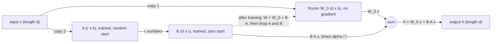
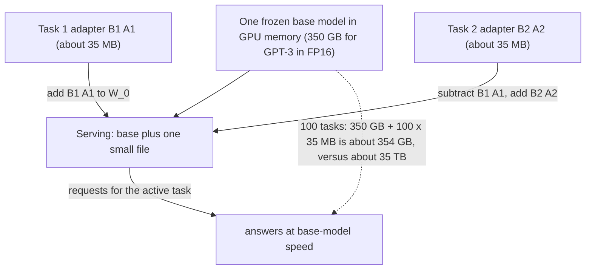

# LoRA: Low-Rank Adaptation of Large Language Models

> **Paper:** Hu, Shen, Wallis, Allen-Zhu, Li, Wang, Wang and Chen (Microsoft Corporation), 2021 (arXiv v2, 16 October 2021) - [arXiv abstract](https://arxiv.org/abs/2106.09685) - [local PDF](../../papers/2106.09685.pdf)
>
> **Short name:** LoRA. Section, table and figure numbers follow the arXiv HTML rendering of v2 (Tables 1-18, Figures 1-8, Appendices A-H). The arXiv text does not name a venue; this guide's own knowledge is that the paper appeared at ICLR (International Conference on Learning Representations) 2022, so it is peer reviewed, but nothing below depends on that.

## Read this first

**The claim in one sentence.** Instead of changing every number inside a huge model to teach it a task, freeze the model and learn a pair of thin matrices per weight matrix whose product is added to the frozen weights; on GPT-3 (Generative Pre-trained Transformer 3) 175B this stores about ten thousand times fewer numbers per task, matches full fine-tuning on the paper's benchmarks, and can be folded into the original weights afterwards so inference is no slower.

**Who this is for.** Anyone deciding how to make a model do a specific job: change its weights (fine-tuning, LoRA), bolt on small extra layers (adapters), or change only what it reads (prompts, retrieved context, memory). It is the first guide in this stage where the tool is a training method, which makes it the place to ask when training is worth it at all.

**Afterwards you will be able to** count the trainable numbers for a real GPT-3 matrix at ranks 1, 4 and 8; trace a forward pass and the merge step with actual numbers; say which of the paper's differences are real and which sit inside the noise; and judge when a team that cannot retrain should use context instead.

**Reading time.** About 50 minutes; Tutorial 1 alone is about 20. **Have read first:** [the Transformer](../01-foundations/01-transformer.md) (the query, key, value and output matrices LoRA modifies) and [InstructGPT](./08-instructgpt.md) (full fine-tuning at scale, the cost LoRA attacks). Useful: [GPT-3](../01-foundations/03-gpt3.md). The later track goes the other way, changing context and not weights: [Agentic Context Engineering](../06-agent-systems/31-agentic-context-engineering.md). Maths help: [glossary](../../references/glossary.md), [math bridge](../../references/math-bridge.md).

**The one thing most people get wrong.** LoRA is not a way to give a model instructions or context. It changes the model: a different set of numbers ends up in the weights, so you must own, run and version a model you can train. Someone who can only send text to a hosted model cannot use it. Also, "10,000 times fewer" is a checkpoint-size figure for one GPT-3 setting (query and value matrices, rank 4), not a promise for every model, nor a statement about training memory.

## The paper in one worked example

The paper has no single prompt-and-answer example, so this guide builds one from the paper's numbers and labels what is constructed. Part A uses real shapes and counts; Part B is a toy small enough to check by hand (constructed by this guide); Part C is the merge.

### Part A - one real weight matrix, with shapes and counts

GPT-3 175B has 96 layers and a model width d_model of 12,288 (Introduction: "as high as 12,288"; Section 7.1: "96 layers"). Each layer's self-attention has four square matrices, query (W_q), key (W_k), value (W_v) and output (W_o); Section 4.2 treats W_q, W_k, W_v each as one d_model x d_model matrix.

- **One frozen matrix W_0:** 12,288 x 12,288 = **150,994,944** numbers (guide's arithmetic).
- **LoRA's update** is B A (Section 4.1): B is d x r = 12,288 x r, A is r x k = r x 12,288. B A has the full 12,288 x 12,288 shape but rank at most r.
- **Trainable numbers per matrix** = r x (12,288 + 12,288) = r x 24,576 (guide's arithmetic).

| Rank r | Shape of B | Shape of A | Trainable numbers | Full update trains | Ratio | Share of one matrix |
|---|---|---|---|---|---|---|
| 1 | 12,288 x 1 | 1 x 12,288 | 24,576 | 150,994,944 | 6,144 times fewer | 0.0163 percent |
| 4 | 12,288 x 4 | 4 x 12,288 | 98,304 | 150,994,944 | 1,536 times fewer | 0.0651 percent |
| 8 | 12,288 x 8 | 8 x 12,288 | 196,608 | 150,994,944 | 768 times fewer | 0.130 percent |

Now the whole model with the paper's default of adapting only W_q and W_v (Section 4.2: "in most experiments"), 2 x 96 = 192 matrices:

| Rank r | LoRA numbers in the model | Paper reports | FP16 size (2 bytes each) | Share of 175 billion |
|---|---|---|---|---|
| 1 | 192 x 24,576 = 4,718,592 | 4.7M (Tables 4, 15) | about 9.4 MB | 0.0027 percent |
| 4 | 192 x 98,304 = 18,874,368 | "18M" (Section 7.1); 18.8M (Table 15) | about 37.7 MB | 0.0108 percent |
| 8 | 192 x 196,608 = 37,748,736 | 37.7M (Tables 4, 15) | about 75.5 MB | 0.0216 percent |

The paper says that at r = 4 on W_q and W_v "the checkpoint size is reduced by roughly 10,000 times (from 350GB to 35MB)" (Section 4.2) and that trainable parameters can be "as small as 0.01%" of the model (Section 2). Guide's check: 0.0108 percent fits; 350 GB over 35 MB is exactly 10,000, but 18.87 million numbers at two bytes is 37.7 MB, so "35MB" is rounded and the true ratio is about 9,300. Right order of magnitude; do not quote it to three digits.

### Part B - a toy forward pass (constructed by this guide)

Shrink to d = k = 3, r = 1, with alpha / r = 1 (the scaling constant of Section 4.1). All numbers are invented.

- W_0 = [[1, 0, 2], [0, 1, 1], [3, 1, 0]]; input x = [1, 2, 3]. B = [[1], [0], [2]] (3 x 1) and A = [[1, -1, 0]] (1 x 3), shown after some training (at the start B is all zeros, Section 4.1, so the model begins unchanged).
- **Frozen path:** W_0 x = [1 + 0 + 6, 0 + 2 + 3, 3 + 2 + 0] = [7, 5, 5].
- **Low-rank path:** A x = 1 - 2 + 0 = -1 (one number, since r = 1); B (A x) = [-1, 0, -2].
- **Sum (Equation 3):** h = W_0 x + B A x = **[6, 5, 3]**.
- **Count:** a full update trains 3 x 3 = 9 numbers, the pair 3 + 3 = 6. The pair grows as 2 x d and the matrix as d x d, so the saving is small here and huge at d = 12,288.

### Part C - the merge

Multiply once: B A = [[1, -1, 0], [0, 0, 0], [2, -2, 0]]. Then W = W_0 + B A = [[2, -1, 2], [0, 1, 1], [5, -1, 0]], and W x = [2 - 2 + 6, 0 + 2 + 3, 5 - 2 + 0] = **[6, 5, 3]**, identical to Part B. Serve W and the extra path is gone (Section 4.1, "No Additional Inference Latency"). To change task, subtract B A and add B' A'.



Notice that both paths read the same input and are added at the end, only an r-number vector crosses the narrow gap, and the dotted edge is the deployment step of Part C.



Notice the limit the paper admits (Section 4.2): after merging, a batch serves one task; mixing tasks in one batch needs the unmerged path.

## Words you need

| Term | Plain definition | Example from the worked example |
|---|---|---|
| Fine-tuning | Continuing training on a task's examples, changing every weight; yields a full model copy per task. | Changing all 150,994,944 numbers of one W_q, and every other matrix too. |
| Frozen weights (W_0) | Pre-trained numbers held fixed: no gradient, no change. | The 3 x 3 W_0 of Part B. |
| Low-rank update (B A) | A change written as a tall thin matrix times a short wide one, so it has at most r independent directions. | 12,288 x r times r x 12,288. |
| Rank (r) | For a matrix, the count of independent rows or columns; in LoRA, the chosen narrow size. | r = 1, 4, 8 in Part A. |
| Scaling factor (alpha / r) | Constant multiplying the LoRA path so changing r needs less retuning (Section 4.1). | 1 in the toy; 8 / 8 for RoBERTa base, 32 / 4 for GPT-2 (Appendix D). |
| Adapter | A small extra layer inserted in series; every pass must run through it. | Table 1: adapters add 2 to 30 percent latency. |
| Prefix / prompt tuning | Learning extra "virtual token" vectors placed before the input or at each layer; they use up sequence length. | PreEmbed and PreLayer in Tables 3, 4, 15. |
| Merge | Computing W = W_0 + B A once and serving W. | Part C. |
| Optimizer state | Extra running numbers the training algorithm (Adam) keeps for each trained parameter. | LoRA skips these for the frozen 175 billion (Section 1). |
| Intrinsic rank | The hypothesis that the needed change occupies few directions. | Table 6: rank 1 is competitive. |
| Subspace similarity (phi) | A [0, 1] score of how much one set of directions lies within another (Equation 4). | Figure 3. |

## Tutorial 1 - Intuitive understanding

### What was broken before

A pre-trained model is a stack of tables of numbers. Making it good at one job, such as turning a plain-English question into a database query, is done by fine-tuning: keep training on examples, changing every number. For GPT-3 175B each job then yields a new 175-billion-number copy, about 350 GB at two bytes each (Section 4.2); the paper calls deploying many such instances "prohibitively expensive" (Abstract). Training needs more memory still: LoRA lowers GPT-3 175B training memory from 1.2 TB to 350 GB (Section 4.2).

Three alternatives existed, each with a flaw the paper names:

- **Fine-tune only some parts.** The paper's GPT-2 baseline that retrains just the last two layers (FT-Top2) scored BLEU 68.1 on the E2E restaurant task against 68.2 for full fine-tuning and 70.4 for LoRA (Table 3), and on unseen WebNLG categories BLEU 18.9 against 27.7 for full fine-tuning (Table 14).
- **Adapters** (small layers inserted inside each block). They are small to store but sit in series with the original computation. Table 1, GPT-2 medium, batch size 1, sequence length 128: 19.8 ms per forward pass without, 25.8 ms with Houlsby-style adapters, 30.3 percent slower. For an assistant answering one user at a time, that is about a third more waiting.
- **Prefix and prompt tuning.** Leave the model alone and learn virtual words placed before the input. They eat into the room for the real input (Section 3), and they are touchy: on GPT-3, more virtual tokens made accuracy fall (WikiSQL 63.1 percent at 256 prefix tokens, 55.9 at 512; Table 15).

None of these is the same as giving the model more text at question time (few-shot prompting). Appendix A shows its limit on GPT-3: six in-context examples scored 40.6 percent on MNLI-m (Multi-Genre Natural Language Inference, matched; chance is 33.3 percent) where a fine-tuned copy scored 89.5 (Table 8): about 49 more right in every 100 pairs. That is 2020-era GPT-3; see the caveat under "What this does not show".

### The idea

**Analogy.** A printed encyclopedia is bought once. For a new reader a publisher could reprint all of it (fine-tuning), splice a new chapter between every pair of chapters (adapters), or tape a note to the cover (prompt tuning). LoRA is a thin transparent overlay per page, wide and tall but only a few lines thick; laid on the page it changes how some entries read, and once you are sure, you print the overlay onto the page so nothing extra is left to flip. Readers share one encyclopedia and swap overlay sets.

**Where it breaks.** An overlay only alters what it covers; LoRA's update is a sum that interacts with everything computed downstream. And the thinness is a bet: the paper hypothesises the change a task needs is "low rank" (Section 4.1). It worked on their tasks, and the authors say a task in a language different from pre-training might need far more (Section 7.2).

**Rank in numbers.** [[1, 2], [2, 4]] has rank 1: row two is twice row one. It equals the column [1, 2] times the row [1, 2]. At 2 x 2 that saves nothing, but for 12,288 x 12,288 a rank-1 pair stores 24,576 numbers in place of 150,994,944. LoRA forces the update to have only r independent ingredients.

### How it works, step by step

1. **Choose matrices and a rank.** Default: W_q and W_v in every layer, r from 1 to 8 (Section 4.2, Table 6). For GPT-3 that is the shapes in Part A.
2. **Freeze W_0, start B at zero, A random Gaussian** (Section 4.1). B A = 0, so day one equals the pre-trained model.
3. **Train only A and B.** Input goes down both paths of the first diagram and the outputs add (Part B: [7, 5, 5] + [-1, 0, -2] = [6, 5, 3]). Gradients and optimizer state exist only for A and B, which is where the memory saving comes from.
4. **Scale by alpha / r.** The paper says it sets alpha to the first r it tried and does not tune it (Section 4.1; Tutorial 3 notes the tables disagree).
5. **Merge for deployment** (Part C), keeping B and A in a small file to swap tasks.

### What the results say

What the paper reports, with what each number counts and what it means.

**Size and speed (Sections 1, 4.2).** For GPT-3 175B: 10,000 times fewer trainable parameters than Adam fine-tuning, "3 times" less GPU memory (Abstract), training memory 1.2 TB to 350 GB (3.4 times, guide's division), and a "25% speedup" in training. Footnote 5 gives 32.5 tokens per second per V100 GPU for full fine-tuning and 43.1 for LoRA, which is 33 percent more tokens per second, or 24.6 percent less time per token. So "25%" is the time saved, not the throughput gain (guide's inference).

**Language understanding (Table 2, GLUE, the General Language Understanding Evaluation: eight sentence tasks, scores out of 100).** "Avg." is the mean of the eight scores (guide re-computed them; all match). RoBERTa base (a refined BERT, 125M parameters): full fine-tuning 86.4, LoRA (0.3M trainable) 87.2. That is about 400 times fewer numbers and 0.8 average points higher, but most of the gap is the small RTE task (86.6 against 78.7), where the LoRA run began from an MNLI-trained checkpoint (see Tutorial 3). RoBERTa large (355M): 88.9 against 89.0 with 0.8M trainable, a tie given per-task noise of 0.2 to 2.5. DeBERTa XXL (1.5B): 91.1 against 91.3 with 4.7M, also a tie.

**Generation (Table 3, E2E).** Restaurant record to sentence; BLEU (Bilingual Evaluation Understudy, word overlap with human references) is the headline. GPT-2 medium: full fine-tuning BLEU 68.2 with 354.92M trainable parameters; LoRA 70.4 with 0.35M, noise 0.1. About two more BLEU points from a method that trains roughly a thousand times fewer numbers. GPT-2 large: 70.4 against 68.5.

**GPT-3 (Table 4).** WikiSQL (question about a table to SQL, logical-form accuracy), MNLI-m (accuracy), SAMSum (chat summaries, ROUGE: word and phrase overlap with the human summary).

| Method | Trainable | WikiSQL | MNLI-m | SAMSum ROUGE-1 / 2 / L |
|---|---|---|---|---|
| Full fine-tuning | 175,255.8M | 73.8 | 89.5 | 52.0 / 28.0 / 44.5 |
| LoRA (r = 1 on W_q and W_v, or r = 2 on W_v) | 4.7M | 73.4 | 91.7 | 53.8 / 29.8 / 45.9 |
| LoRA (larger) | 37.7M | 74.0 | 91.6 | 53.4 / 29.2 / 45.1 |
| Adapter-H | 40.1M | 73.2 | 91.5 | 53.2 / 29.0 / 45.1 |

Quoted noise (Table 4 caption): 0.5 on WikiSQL, 0.1 on MNLI-m, 0.2 on ROUGE-1. So on WikiSQL every row is within noise of 73.8: LoRA matches, it does not beat. On MNLI-m, 91.7 against 89.5 is 22 more correct per 1,000 pairs and about 20 times the noise: real. On SAMSum, +1.8 ROUGE-1 is about nine times the noise.

**Which matrices, which rank (Tables 5 and 6).** At a fixed 18 million parameters, W_q alone (r = 8) scored 70.4 on WikiSQL and W_q with W_v (r = 4 each) 73.7. W_q with W_v scored 73.4 at r = 1 and 73.8 at r = 8.

### What this does not show

- **Not that LoRA always equals fine-tuning.** Models tested: 125M to 1.5B encoders, GPT-2, GPT-3, on benchmarks with thousands of examples. A new language is the authors' own named exception (Section 7.2).
- **Not that LoRA beats prompting on modern assistants.** The prompt baseline is one GPT-3 benchmark with six examples; nothing tests instruction-tuned models ([InstructGPT](./08-instructgpt.md) and later) or retrieval at answer time.
- **Not that training is cheap.** The 350 GB of GPT-3 weights must still sit in memory.
- **Not knowledge injection.** Every task is a skill or format. The paper never teaches LoRA new facts and tests recall; assuming it works would be going beyond the evidence.
- **Not mixed-task serving.** Merged weights serve one task per batch.

### Teach-back

1. Why can a 12,288 x 12,288 update be described by 24,576 numbers at rank 1?
2. Why start B at zero?
3. The speedup is "25 percent" yet tokens per second differ by 33 percent. Why are both right?
4. On WikiSQL, why is "matches" the honest word, not "beats"?
5. A colleague wants LoRA on a hosted model reached only through an API. What is wrong?

<details>
<summary>Answer 1</summary>
The update is a 12,288 x 1 column times a 1 x 12,288 row; each entry of the big matrix is one column number times one row number, so 24,576 stored numbers generate 150,994,944 entries, all lying along one direction.
</details>

<details>
<summary>Answer 2</summary>
It makes B A exactly zero at the start, so training departs from the known-good pre-trained model (Section 4.1). With both random, the first pass would add noise at every layer.
</details>

<details>
<summary>Answers 3 to 5</summary>
3. 43.1 / 32.5 is plus 32.6 percent throughput; the same work takes 32.5 / 43.1 = 75.4 percent of the time, 24.6 percent saved. The paper does not say which it means. 4. LoRA's 73.4 and 74.0 are 0.4 and 0.2 points from 73.8, inside the quoted 0.5 noise. 5. LoRA needs the weights to freeze and to add matrices into; a text-only API offers neither. The equivalent there is the provider's own fine-tuning service, if any, or better prompts and context.
</details>

## Tutorial 2 - Practitioner understanding

### The design in concrete terms

**What is trained.** For each chosen W_0 (d x k): B (d x r, zero start) and A (r x k, Gaussian start). Forward pass h = W_0 x + (alpha / r) B A x. Biases, LayerNorm and the MLP (multi-layer perceptron) blocks stay frozen: "We limit our study to only adapting the attention weights" (Section 4.2). Trainable count = 2 x L x d_model x r with L the number of adapted matrices (Section 5.1).

**Which matrices (Table 5, fixed 18M budget, GPT-3).**

| Adapted | Rank | WikiSQL (noise 0.5) | MultiNLI (noise 0.1) |
|---|---|---|---|
| W_q | 8 | 70.4 | 91.0 |
| W_k | 8 | 70.0 | 90.8 |
| W_v | 8 | 73.0 | 91.0 |
| W_o | 8 | 73.2 | 91.3 |
| W_q, W_k | 4 | 71.4 | 91.3 |
| W_q, W_v | 4 | 73.7 | 91.3 |
| W_q, W_k, W_v, W_o | 2 | 73.7 | 91.7 |

Spreading a fixed budget over more matrices beats concentrating it. The text calls W_q plus W_v best, yet all four at rank 2 ties it on WikiSQL and leads on MultiNLI by 0.4 (four times the noise). The table supports "all four attention matrices at low rank" at least as well as the stated default.

**Hyper-parameters the paper gives (Appendix D).**

| Model | r | alpha | Learning rate | Batch | Epochs | Other |
|---|---|---|---|---|---|---|
| RoBERTa base (Table 9) | 8 | 8 | 4e-4 to 5e-4 | 16 or 32 | 25 to 80 | AdamW, warmup 0.06, linear decay |
| RoBERTa large (Table 9) | 8 | 16 | 2e-4 to 4e-4 | 4 or 8 | 10 to 30 | max length 128 or 512 |
| DeBERTa XXL (Table 10) | 8 | 8 | 6e-5 to 2e-4 | 4 to 32 | 5 to 30 | warmup 0.1 |
| GPT-2 (Table 11) | 4 | 32 | 2e-4 | 8 | 5 | warmup 500 steps, beam 10 |
| GPT-3 (Table 12, D.4) | 1 to 8 | not stated | 2e-4 | 128 | 2 | weight decay 0.1; full fine-tuning used 5e-6 |

Two notes. The LoRA learning rate is far above full fine-tuning's (2e-4 against 5e-6, 40 times) because only a few fresh numbers move. And alpha is described as untuned, "the first r we try", yet GPT-2 uses alpha 32 with r = 4 (scale 8) and RoBERTa large 16 with r = 8 (scale 2); see the list of inconsistencies in Tutorial 3.

**Shipping unit.** Pairs (A_i, B_i) named by matrix, plus r and alpha. Constructed by this guide: a 32-layer, d_model = 4,096 open model at r = 8 on W_q and W_v has 2 x 32 x 8 x 8,192 = 4,194,304 numbers, about 8.4 MB.

### A minimal version

A PyTorch-like sketch (constructed by this guide, not the authors' released code, whose repository is named in the abstract). PyTorch stores a linear weight as (d_out, d_in), which equals the paper's d x k.

```python
import torch, torch.nn as nn

class LoRALinear(nn.Module):
    def __init__(self, base: nn.Linear, r=8, alpha=8.0):
        super().__init__()
        self.base, self.scale, self.merged = base, alpha / r, False
        for p in base.parameters():
            p.requires_grad = False                          # W_0 frozen
        d_out, d_in = base.weight.shape                      # (d, k)
        self.A = nn.Parameter(torch.randn(r, d_in) * 0.01)   # (r, k), random start
        self.B = nn.Parameter(torch.zeros(d_out, r))         # (d, r), zero start

    def forward(self, x):                                    # x: (batch, d_in)
        out = self.base(x)                                   # W_0 x -> (batch, d_out)
        if not self.merged:
            out = out + self.scale * (x @ self.A.T) @ self.B.T   # + B A x
        return out

    @torch.no_grad()
    def merge(self):                                         # W = W_0 + scale * B A
        if not self.merged:
            self.base.weight += self.scale * (self.B @ self.A); self.merged = True

    @torch.no_grad()
    def unmerge(self):
        if self.merged:
            self.base.weight -= self.scale * (self.B @ self.A); self.merged = False

def add_lora(model, targets=("q_proj", "v_proj"), r=8, alpha=8.0):
    for _, mod in list(model.named_modules()):
        for name, child in list(mod.named_children()):
            if name in targets and isinstance(child, nn.Linear):
                setattr(mod, name, LoRALinear(child, r, alpha))
    return model

model = add_lora(model)                                      # any Transformer
trainable = [p for p in model.parameters() if p.requires_grad]
opt = torch.optim.AdamW(trainable, lr=2e-4)                  # state only for A and B
# train as usual; save {name: (A, B)} per LoRALinear.
# deploy: for m in model.modules(): isinstance(m, LoRALinear) and m.merge()
```

The paper says A is "random Gaussian" without giving the spread; 0.01 is this guide's choice. Before shipping, compare outputs before and after `merge()` on a few inputs; differences should be rounding-level (about 1e-5 in 32-bit, larger in half precision).

### What it costs

Everything not marked "paper" is this guide's estimate.

- **Training memory, small open model (constructed).** A 7-billion-parameter model has 14 GB of 16-bit weights. Full fine-tuning with Adam commonly needs about 16 bytes per trained parameter (weight, gradient, two 32-bit averages): about 112 GB. LoRA at r = 8 trains 4.2 million numbers: about 67 MB of gradient and state, plus the 14 GB of weights. Activations (intermediate results kept for the backward pass) are not removed and may dominate. So about 112 GB falls to about 15 GB plus activations: large, but nothing like 10,000 times.
- **Paper's GPT-3 numbers.** 350 GB equals 175 billion x 2 bytes, so the LoRA figure appears to be the weights alone; the paper gives no breakdown (guide's observation).
- **Storage.** 100 GPT-3 tasks: about 354 GB against about 35 TB (Section 4.2, footnote 4). For the 7B toy: 100 adapters is about 840 MB.
- **Latency.** Merged: zero extra. Unmerged: about 2 x r x (d + k) multiply-adds per token per matrix, here 131,072 against 16.8 million for the frozen 4,096 x 4,096 multiply (0.8 percent of the arithmetic). But thin sequential steps use GPUs poorly (Table 1's lesson for adapters), so expect more than 0.8 percent of time (guide's inference).

### How it fails

| Symptom | Likely cause | Mitigation |
|---|---|---|
| Below full fine-tuning on a very different task | Rank too small; the paper's own caveat is a new language (Section 7.2) | Raise r, adapt all four attention matrices, compare with a full fine-tune on a subset |
| Output same as the base model | B stayed near zero: learning rate too low or too few steps | Use a LoRA-scale rate (2e-4, Table 12); log the norm of B A |
| Loss diverges | alpha / r or learning rate too large; the paper says alpha acts like a learning rate (Section 4.1) | Lower either; keep alpha / r fixed when changing r |
| Dev gain vanishes in use | Best epoch chosen on the same data (Appendix D) | Hold out a test split never used for any choice |
| Mixed tasks in one batch | Merged form serves one task (Section 4.2) | Keep adapters unmerged and route per request |
| Adapter breaks after the base is updated | B A was learned against the old W_0 (guide's inference; untested in the paper) | Pair each adapter with its exact base checkpoint |
| Model reproduces training text | Fine-tuning can memorise; not studied | Treat adapter files as holding the training data for access control |
| Tiny data overfits | Long schedules on few examples | Table 16: 100 MNLI examples gave 63.8 percent (LoRA) against 60.2 (full), far below the 91.7 reached with 392,000 |

### Evaluating your version

- **Metric:** the task's own rule: exact match or schema validity for structured output, accuracy for labels; ROUGE only for summaries, plus a human read.
- **Baselines, in order:** base model with a good prompt; base model with prompt plus retrieved examples; LoRA at r = 1 or 2 and r = 8; if feasible on a subset, full fine-tuning. Without the first two you do not know that training added anything.
- **Test size.** Accuracy of 80 percent on 400 items has standard error sqrt(0.8 x 0.2 / 400) = 2 points, so gaps under about 4 points are not real; at 1,600 items the error is 1 point. Use at least 400 items, and 1,000 or more to separate methods one point apart.
- **Stop rule.** Fix the validation metric beforehand; stop after several evaluations without improvement; evaluate the final adapter once on the held-out set. Keep LoRA only if it beats the best context-only baseline by more than two standard errors and passes the merged-versus-unmerged check.

### Adopt, adapt or skip

**Recommendation for a team building an assistant over private business documents: skip LoRA at first, adapt it later for one narrow job, and do not use it to inject documents.**

1. **Different problem.** Such an assistant mostly fails because the right passage is not in front of the model: a job for retrieval and context ([RAG](./06-rag.md), [Agentic Context Engineering](../06-agent-systems/31-agentic-context-engineering.md)). LoRA changes behaviour, not visibility, and the paper never tests fact recall. Documents also change weekly; an adapter is frozen at training time and cannot cite a source.
2. **Where it earns its keep:** a stable, repeated, format-heavy job: documents to a fixed record layout, tickets to a fixed label list, a house style. That matches the paper's tasks (text to SQL, chat to summary, labels). If a small open model still fails at it with clear instructions and good examples in context, an r = 8 adapter on a few thousand verified examples is the cheapest next step, and the base stays shared across jobs.
3. **Open and smaller models are the sweet spot.** One base, several swappable adapters, no per-job copy. With a hosted model you cannot do this unless the provider offers fine-tuning.
4. **Costs the paper does not price:** verified training data, an evaluation harness, adapter-to-base version control, retraining when the base changes. A prompt change takes minutes and is reversible.
5. **Order:** instructions and examples; retrieval; memory for recurring facts; then, if one narrow job still fails, collect examples and try LoRA. For the curriculum's through-question (is a thin runtime around a model that picks among a few good tools enough?), LoRA bears on the "model" half: it is the lever when behaviour, not inputs, is the bottleneck. This guide's judgment is that it is a later, targeted step.

## Tutorial 3 - Researcher understanding

### Formal setup

**Notation.** x: a context token sequence; y: a target sequence; Z = {(x_i, y_i)}, i = 1..N: a task's data (Section 2). P_Phi(y | x): the pre-trained autoregressive model with parameters Phi. Full fine-tuning (Equation 1) maximises the sum over (x, y) in Z and positions t of log P_Phi(y_t | x, y_{<t}) from Phi_0, learning a delta of the size of Phi_0. LoRA (Equation 2) writes the delta as Delta Phi(Theta) with |Theta| far smaller. Per layer: W_0 is d x k (frozen); Delta W = B A, B in R^(d x r), A in R^(r x k), r much smaller than min(d, k); h = W_0 x + Delta W x (Equation 3), with the LoRA term scaled by alpha / r. In GPT-3, d = k = 12,288 and the feed-forward width is 4 x d_model.

**Subspace similarity (Equation 4, Appendix G).** phi(A_{r=8}, A_{r=64}, i, j) = ||(U_8^i)-transpose times U_64^j||_F squared, divided by min(i, j), where U^i holds the top i right-singular vectors. Toy (constructed): u = [1, 0], v = [0.8, 0.6]; inner product 0.8, squared 0.64, min(1, 1) = 1, so phi = 0.64. If v = [0, 1], phi = 0; if v = u, phi = 1.

**Amplification factor (Appendix H.4).** ||Delta W||_F divided by ||U-transpose W V-transpose||_F, with U and V the singular vectors of Delta W: how large the update is compared with W's own content in the same directions.

### The claims, stated precisely

1. **Size and memory (Abstract, Section 4.2).** Against GPT-3 175B with Adam: up to 10,000 times fewer trainable parameters, about 3 times less GPU memory, checkpoint 350 GB to about 35 MB (r = 4, W_q and W_v). One model, one setting.
2. **Quality.** "On-par or better" than fine-tuning on RoBERTa, DeBERTa, GPT-2, GPT-3, on GLUE, E2E, WebNLG, DART, WikiSQL, MNLI-m, SAMSum (Tables 2, 3, 4, 13, 14).
3. **No added inference latency** when merged (Section 4.1); adapters add it (Table 1, Figure 5). 4. **25 percent faster training** on GPT-3 (footnote 5).
5. **Low intrinsic rank** (Sections 4.1, 7): Table 6, Figure 3, Table 7.
6. **Generalises fine-tuning** (Section 4.1): all matrices plus biases with r equal to the full rank "roughly" recovers full expressiveness. An argument, not a measurement: the largest rank tested is 64 (Table 15), far below 12,288.
7. **Better scaling than prefix methods**: LoRA's quality stabilises with parameter count while prefix methods fall (Table 15 caption, Figure 2).

### Evidence, table by table

**Dataset key (Appendix C).** GLUE tasks: MNLI; SST-2 (Stanford Sentiment Treebank, binary sentiment); MRPC (Microsoft Research Paraphrase Corpus); CoLA (Corpus of Linguistic Acceptability, Matthews correlation); QNLI (Question-answering Natural Language Inference); QQP (Quora Question Pairs); RTE (Recognizing Textual Entailment); STS-B (Semantic Textual Similarity Benchmark, Pearson correlation). WikiSQL: 56,355 train, 8,421 validation. SAMSum: 14,732 train, 819 test. E2E: about 42,000 train, 4,600 validation, 4,600 test.

**Table 1 (latency).** Rows: fine-tune/LoRA, Adapter-L, Adapter-H; columns: (batch, length) = (32, 512), (16, 256), (1, 128) with 0.5M, 11M, 11M adapter parameters. Times in ms: 1449.4 against 1482.0 and 1492.2 (+2.2, +3.0 percent); 338.0 against 354.8 and 366.3 (+5.0, +8.4); 19.8 against 23.9 and 25.8 (+20.7, +30.3). Identifies the added sequential computation on one GPU (NVIDIA Quadro RTX8000, 100 trials, GPT-2 medium); says nothing about quality. At batch 1 the baseline's standard deviation is 2.7 ms, so Adapter-L's 4.1 ms gap is only about 1.5 times the noise. Three factors change together across columns; Figure 5's grid separates them (up to over 30 percent).

**Table 2 (GLUE).** Averages: RoBERTa base: FT 86.4, BitFit 85.2, Adapter-D 84.4 and 85.4, LoRA 87.2. RoBERTa large: FT 88.9, LoRA 89.0; dagger runs: Adapter-P 88.4 and 87.9, Adapter-H 87.8 and 86.4, LoRA 88.6. DeBERTa XXL: FT 91.1, LoRA 91.3. Caveats: asterisk rows are copied from earlier papers; main LoRA rows start MRPC, RTE and STS-B from the MNLI checkpoint (Appendix D.1) while dagger rows start from the plain pre-trained model: RoBERTa large RTE is 87.4 against 85.2 and the average 89.0 against 88.6, an upper bound on what initialisation is worth (the dagger setup also changes batch size and length); results are medians over 5 seeds with the best epoch per run (Appendix D.1), so scores are selected on the dev data; gaps of 0.1 to 0.3 are inside task noise.

**Table 3 (E2E).** Columns BLEU, NIST, METEOR (Metric for Evaluation of Translation with Explicit ORdering), ROUGE-L, CIDEr (Consensus-based Image Description Evaluation). GPT-2 medium: FT 68.2, 8.62, 46.2, 71.0, 2.47; LoRA 70.4, 8.85, 46.8, 71.8, 2.53. Large: FT 68.5, 8.78, 46.0, 69.9, 2.45; LoRA 70.4, 8.89, 46.8, 72.0, 2.47. Several baselines are copied from Li and Liang (2021) while LoRA was tuned (Appendix D.3), so the comparison favours LoRA somewhat. Tables 13 (DART) and 14 (WebNLG) show ties or small gains, with FT-Top2 weak.

**Table 4 and Figure 2 (GPT-3).** One noise figure per task, not per row, because of cost (Section 5.5), so close calls cannot be certified. LoRA at 4.7M against 37.7M shows no benefit from more parameters. Figure 2: prefix methods rise then fall, adapters plateau, LoRA stays flat and high.

**Tables 5 and 6.** Table 6, WikiSQL: W_q alone 68.8, 69.6, 70.5, 70.4, 70.0 at r = 1, 2, 4, 8, 64; W_q with W_v 73.4, 73.3, 73.7, 73.8, 73.5; all four 74.1, 73.7, 74.0, 74.0, 73.9. Identifies: for those matrices rank is not the lever (a 0.4 spread, inside the 0.5 noise); W_q alone does gain from rank (+1.7 from r = 1 to 4).

**Table 7 and Figures 3, 4, 8.** Layer 48 of 96. Norm of W_q projected onto the top-r directions of Delta W_q, of W_q itself, or of a random matrix: at r = 4, 0.32, 21.67, 0.02 (||W_q||_F = 61.95, ||Delta W_q||_F = 6.91); at r = 64, 1.90, 37.71, 0.33 (||Delta W_q||_F = 3.57). Paper's reading: Delta W relates to W more than chance; it does not repeat W's top directions; amplification is huge (6.91 / 0.32 = 21.6 by this guide, about 2 at r = 64: 3.57 / 1.90 = 1.88). This is an association in one layer, one matrix and a few tasks, not evidence of cause. Figure 3: the top direction at r = 8 overlaps the one at r = 64 (phi above 0.5), others do not; Figure 4: two seeds at r = 64 share some directions, two random matrices none.

**Tables 8, 15, 16, 18.** Table 8: few-shot against fine-tuned, MNLI-m 40.6 / 89.5, RTE 69.0 / 85.4. Table 15: 30-row GPT-3 sweep; LoRA flat, prefix methods non-monotonic, LoRA plus prefix-embedding 75.0 to 76.2 on WikiSQL. Table 16: MNLI with 100, 1k, 10k, 392k examples: LoRA 63.8, 85.6, 89.2, 91.7; full fine-tune 60.2, 85.8, 88.9, 89.5; PrefixEmbed 37.6 (chance 33.3) to 88.6. Table 18: GPT-2 medium E2E, r from 1 to 1,024: BLEU 70.38 at r = 4, about 69 beyond; validation loss reaches 1.16 at r = 16.

### Ablations and what they isolate

- **Matrix type at fixed budget (Table 5):** where to spend parameters; confounded because rank differs across rows to hold the budget.
- **Rank (Tables 6, 15, 18):** isolates rank; Table 18's caption says hyper-parameters were tuned at r = 4.
- **Prefix methods versus LoRA across parameter counts (Table 15, Figure 2):** token count is prefix methods' knob and also shrinks input space, so "more parameters" and "less room" move together.
- **Low data (Table 16)** and **combination with prefix (Appendix E).**

### Threats to validity specific to this paper

- **Selection on evaluation data.** Best epoch per run on validation sets (Appendix D.1 to D.4), for the tuned method, against partly copied baselines.
- **Baseline reuse.** Asterisk rows differ in unknown ways; the paper's dagger rows exist because of this.
- **One noise figure for GPT-3** (Section 5.5).
- **Memory claim not itemised** (1.2 TB to 350 GB).
- **Rank analysis is one layer** (48 of 96, with others in Figures 6 and 7) and two matrices; Section 7.2 itself says small r will not suit every task.
- **Era.** 2021 models only: no instruction-tuned, long-context, quantised or mixture-of-experts models.

**Inconsistencies and unverifiable points found (none silently corrected above).**

1. *Checkpoint size.* "35MB" (Section 4.2) and "roughly 35MB if stored in FP16" for 18M parameters (Section 7.1). 18,874,368 numbers are 37.7 MB; Table 15 prints 18.8M (truncated). True ratio about 9,300, not 10,000.
2. *Speedup wording.* "25%" matches time saved (24.6 percent), not throughput (+32.6 percent).
3. *alpha.* Section 4.1 says alpha is set to the first r tried and not tuned, but Tables 9 to 11 use alpha 8 with r = 8, 16 with r = 8 (RoBERTa large), 32 with r = 4 (GPT-2).
4. *Table 5 text.* "W_q and W_v ... best performance overall", yet all four at rank 2 ties it on WikiSQL (73.7) and beats it on MultiNLI (91.7 against 91.3).
5. *Table 4 versus Table 15.* The 37.7M row of Table 4 (74.0, 91.6) matches neither 37.7M row of Table 15 (r = 8 on W_q, W_v: 73.8, 91.6; r = 4 on all four: 74.0, 91.7), so it looks like a mix. The caption says LoRA beats fine-tuning, but the 4.7M row's WikiSQL (73.4) is 0.4 below 73.8.
6. *Table 6 versus Table 15.* W_q with W_v at r = 64 on WikiSQL: 73.5 against 73.6.
7. *Counts this guide cannot reproduce.* Formula of Section 5.1 gives 393,216 for GPT-2 medium (reported 0.35M), 737,280 for GPT-2 large (0.77M) and 2,359,296 for DeBERTa XXL (4.7M), assuming 24 layers and d = 1,024; 36 and 1,280; 48 and 1,536. Those architecture figures are this guide's recollection, not in the paper, so the cause may be architecture details (speculation). RoBERTa (294,912 and 786,432) and all GPT-3 counts reproduce.
8. *Typos.* W_c for W_o in Section 7.2; "Infernece" in Table 1; Appendix D.4 points to "Section D.4" from itself.
9. *Amplification.* 6.91 / 0.32 = 21.6, text says 21.5 and Appendix H.4 "as large as 20".
10. *Table 2 average.* RoBERTa large LoRA's scores average 89.05, printed 89.0; other averages recompute exactly.
11. *Table 18 caption.* Validation loss "peaks at r = 16": it is 1.16 from r = 16 through 512, a plateau.

### Open problems and follow-ups

The authors list (Section 8): combining LoRA with other efficient methods; how pre-trained features become task features; principled choice of matrices; whether W itself is rank-deficient. Appendix H.2 leaves open how optimal rank scales with model size.

### What would change my mind

- A replication tuning full fine-tuning as hard as LoRA and winning by more than the noise on the GPT-3 tasks would weaken "on par or better".
- Rank-1 collapse on a task shifted in domain but not language would narrow the intrinsic-rank claim.
- An itemised memory budget at a stated sequence length would show how far the "3 times" claim carries to real training.
- Adapters and merged LoRA at equal accuracy and production batch sizes would show the true latency gap.

## Reading map for the PDF

| Section or figure | What it contains | First pass | Guide section that answers it |
|---|---|---|---|
| Abstract, Section 1, Figure 1 | Claim, diagram of A and B, advantages | Read | Worked example |
| Section 2 | Objective, Equations 1 and 2 | Skim | Tutorial 3, Formal setup |
| Section 3, Table 1 | Why adapters add latency, prefix tuning is hard | Read | Tutorial 1, What was broken before |
| Section 4.1 | The update, initialisation, scaling, merge | Read closely | Parts B, C; minimal version |
| Section 4.2 | Matrices, memory and storage, limits | Read | Tutorial 2, What it costs |
| Section 5, Tables 2-4, Figure 2 | Baselines and results | Skim tables, read text | Tutorial 1 results; Tutorial 3 |
| Section 6 | Related work | Skip | Open problems |
| Section 7, Tables 5-7, Figures 3-4 | Which matrices, rank, what the update looks like | Read 7.1, 7.2; skim 7.3 | Tutorial 2 design; Tutorial 3 |
| Appendices A, B | Few-shot against fine-tuned; adapter latency grid | Read A; skim B | Tutorial 1; Tutorial 3 |
| Appendices C, D | Datasets, hyper-parameters | Skim | Tutorial 2 table |
| Appendices E-H | Prefix combination, extra runs, similarity maths, rank sweeps | Skip at first | Tutorial 3 |

## Questions readers get stuck on

### What does "low rank" actually mean, and why should an update be low rank?

Rank counts independent directions: [[1, 2], [2, 4]] has rank 1 because row two is double row one. LoRA forces the weight change to have rank at most r. Why that should suffice is the paper's hypothesis (Section 4.1), borrowed from "intrinsic dimension" research; Table 6 supports it on GPT-3, and Figures 3 and 4 give a picture in terms of shared singular directions.

### Why two matrices, A and B, and not one small one?

A single small matrix cannot change a 12,288 x 12,288 weight: shapes would not fit. A maps 12,288 inputs down to r numbers; B maps those back up to 12,288 outputs. The product has full shape but rank at most r, and storage is 2 x 12,288 x r instead of 12,288 squared.

### Why start B at zero and A at random?

If both were zero, neither could receive a gradient, since each one's gradient is proportional to the other. If both were random, the model would start perturbed. Random A with zero B gives a zero start and a nonzero gradient for B on the first step (Section 4.1). The mirror choice is not discussed in the paper.

### Does the 10,000 times figure mean I can train a 175B model on a laptop?

No. It is the saved checkpoint (350 GB to 35 MB at r = 4 on W_q and W_v). Training memory falls about 3 times, from 1.2 TB to 350 GB, still cluster-sized. Tutorial 2's 7-billion case shows the frozen weights dominating.

### How is LoRA different from fine-tuning just the last few layers?

FT-Top2 trains whole matrices in the last two layers (24 to 25 million parameters on GPT-2 medium, Tables 3 and 13). LoRA touches every layer through thin updates (0.35 million). It did better on generation: E2E BLEU 70.4 against 68.1, and unseen WebNLG categories 46.7 against 18.9 (Table 14).

### If adapters are tiny too, why is LoRA faster?

Adapters are in series: data flows through the original layer and then the adapter, and tiny sequential steps keep a GPU poorly occupied. Table 1 shows +20.7 to +30.3 percent at batch size 1. LoRA's side path vanishes on merging. The paper also notes the gap shrinks at large batch and long sequence (Appendix B).

### Does merging change the model's answers?

Mathematically no (Part C). In floating point there can be tiny differences, more in half precision or when merging into a quantised base, which the paper does not test. Run the before-and-after output comparison from Tutorial 2.

### Why only the query and value matrices?

"For simplicity and parameter-efficiency" (Section 4.2), then Table 5 tests alternatives. W_q with W_v at r = 4 tied all four at r = 2 on WikiSQL (73.7) and trailed on MultiNLI (91.3 against 91.7). So the evidence supports W_q plus W_v and equally all four at lower rank.

### Is LoRA the same as prompt tuning or giving the model more context?

No. Prompt and prefix tuning learn extra vectors fed in with the input and keep weights fixed; giving context writes text into the prompt and nothing is learned. LoRA changes the weights through B A, so its effect needs no prompt tokens and lives in the model you ship. That is why the paper counts savings in storage and training memory, and why only people who can train can use it.

### Does "better than fine-tuning" mean LoRA is more accurate in general?

No. On GPT-3 WikiSQL it is within 0.4 of fine-tuning, inside the 0.5 noise; on RoBERTa large GLUE the gap is 0.1. Clear wins are MNLI-m (91.7 against 89.5), SAMSum and E2E. The abstract's "on-par or better" is the careful reading.

### How do I choose r and alpha?

r is the narrow size of A and B; alpha scales the path by alpha / r. Appendix D uses r = 8 for the encoders, 4 for GPT-2 and 1 to 8 for GPT-3. Start with all four attention matrices or W_q and W_v at r = 8, alpha = r (scale 1), tune the learning rate first, and only then rank.

## Prerequisites you actually need

### Prerequisite 1 - Matrix shapes and multiplication

A d x k matrix times a length-k vector gives a length-d vector; inside shapes must match, so (d x r) times (r x k) is d x k. Tiny example: a 3 x 1 column [1, 0, 2] times a 1 x 3 row [1, -1, 0] gives a 3 x 3 matrix whose first row is [1, -1, 0] and third [2, -2, 0], the B A of Part C. Used in Section 4.1 and every parameter count. See the [math bridge](../../references/math-bridge.md).

### Prerequisite 2 - Matrix rank

The number of independent rows. [[1, 2], [2, 4]] has rank 1; [[1, 2], [2, 5]] has rank 2 (determinant 1 x 5 - 2 x 2 = 1, not zero). A product of d x r and r x k matrices never exceeds rank r. Used in Section 4.1 and Section 7.2. See the [glossary](../../references/glossary.md).

### Prerequisite 3 - What the optimizer must remember

Adam keeps two running averages per trained number, so each trained number costs several times its own size in memory. Tiny example: training 1 million numbers with weight, gradient and two averages at 4 bytes each is 16 MB; training only 10,000 costs 160 KB for gradients and averages, while the frozen weights still cost 4 MB. Used in Section 1 and Section 4.2. See [InstructGPT](./08-instructgpt.md) for a full fine-tune at scale.

### Prerequisite 4 - Attention's four matrices

Each attention layer uses a query matrix and key matrix (to score which tokens attend to which), a value matrix (what gets passed on) and an output matrix (mixing heads back). Tiny example: at width 4, each is 4 x 4 = 16 numbers, 64 per layer. Used in Sections 4.2 and 7.1. See the [Transformer guide](../01-foundations/01-transformer.md).

### Prerequisite 5 - Similarity between directions

For unit-length arrows the dot product is the cosine of the angle between them. [1, 0] and [0.8, 0.6] have dot product 0.8 (about 37 degrees), squared 0.64: the paper's phi for one direction each. For several directions, Equation 4 squares and averages the overlaps. Needed only for Section 7.2 and 7.3.

## Where this sits in the curriculum

**Read before:** [the Transformer](../01-foundations/01-transformer.md) for the matrices LoRA edits, [GPT-3](../01-foundations/03-gpt3.md) for the model that makes fine-tuning costly and few-shot prompting possible, and [InstructGPT](./08-instructgpt.md), whose full-model training is what LoRA makes cheaper to store and swap (guide's inference: InstructGPT does not use LoRA; they are different rungs on one ladder from prompts to weights).

**Nearest papers.** InstructGPT changes behaviour by training all weights on human-feedback signals; LoRA is indifferent to the training signal and cheapens the update. [Chain-of-thought](./07-chain-of-thought.md) changes behaviour without touching weights, by changing what the model reads. [RAG](./06-rag.md) changes the input by fetching documents, the complement of LoRA for knowledge.

**For the agent stage.** The curriculum's working assumption is that capability should come from context, instructions and memory ([Agentic Context Engineering](../06-agent-systems/31-agentic-context-engineering.md)). LoRA is the exception: when the model's own behaviour is the bottleneck and context cannot fix it, a swappable adapter on a small open model is the cheapest way to change weights. [CodeAct](../06-agent-systems/25-codeact.md) is an example where a model was tuned for agent behaviour.

**Read next.** [ReAct](./10-react.md): a model acting in a loop with prompts alone, the no-training counterpart.

## Checkpoint

1. **Compute.** For a 4,096 x 4,096 matrix at rank 8, how many numbers do A and B contain, and what is the ratio to the full matrix?
2. **Compute.** W_0 = [[2, 0], [0, 1]], B = [[1], [1]], A = [[1, 0]], x = [3, 4]. Find W_0 x + B A x, then the merged W and W x.
3. **Explain.** Why does merged LoRA add no latency while adapters do?
4. **Compute.** From 32.5 and 43.1 tokens per second, give the throughput gain and the time saved.
5. **Critique.** The paper says W_q and W_v is best in Table 5. Does the table agree? What default would you pick?
6. **Critique.** Table 2: LoRA 87.2 against fine-tuning 86.4 on RoBERTa base. Give two reasons not to read this as a clean win.
7. **Decide.** 500 policy documents change weekly and answers must be grounded in them. Use LoRA?

<details>
<summary>Answers</summary>

1. A: 8 x 4,096 = 32,768; B: 32,768; total 65,536. Full: 16,777,216. Ratio 256 times fewer.
2. B A = [[1, 0], [1, 0]]; A x = 3; B A x = [3, 3]; W_0 x = [6, 4]; sum [9, 7]. Merged W = [[3, 0], [1, 1]]; W x = [9, 3 + 4] = [9, 7]. They agree.
3. W = W_0 + B A has W_0's shape, so inference is the original forward pass. Adapters are extra serial layers run on every pass, and small size does not help at small batch (Table 1: +20.7 to +30.3 percent at batch 1).
4. Gain 43.1 / 32.5 - 1 = 32.6 percent; time saved 1 - 32.5 / 43.1 = 24.6 percent. The paper's "25%" matches the latter.
5. Table 5 ties W_q with W_v (73.7, 91.3) with all four at rank 2 (73.7, 91.7). Default: all four attention matrices at r = 2 to 4, verified on your own data.
6. RTE alone contributes 7.9 points (86.6 against 78.7) and that LoRA run began from an MNLI-trained checkpoint (Appendix D.1); and best-epoch selection on dev data plus copied fine-tuning numbers.
7. Not first. The need is grounded answers from changing documents: retrieval and context. LoRA would freeze last week's facts into weights and cannot cite sources. Consider it only for a narrow stable behaviour (a fixed format or tone) after prompts and examples fail, and test it against the context-only baseline on held-out data.

</details>
