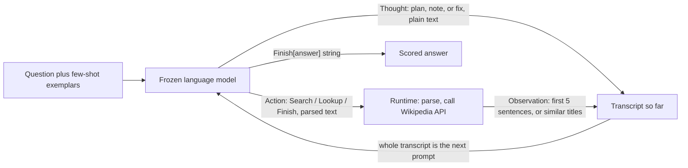
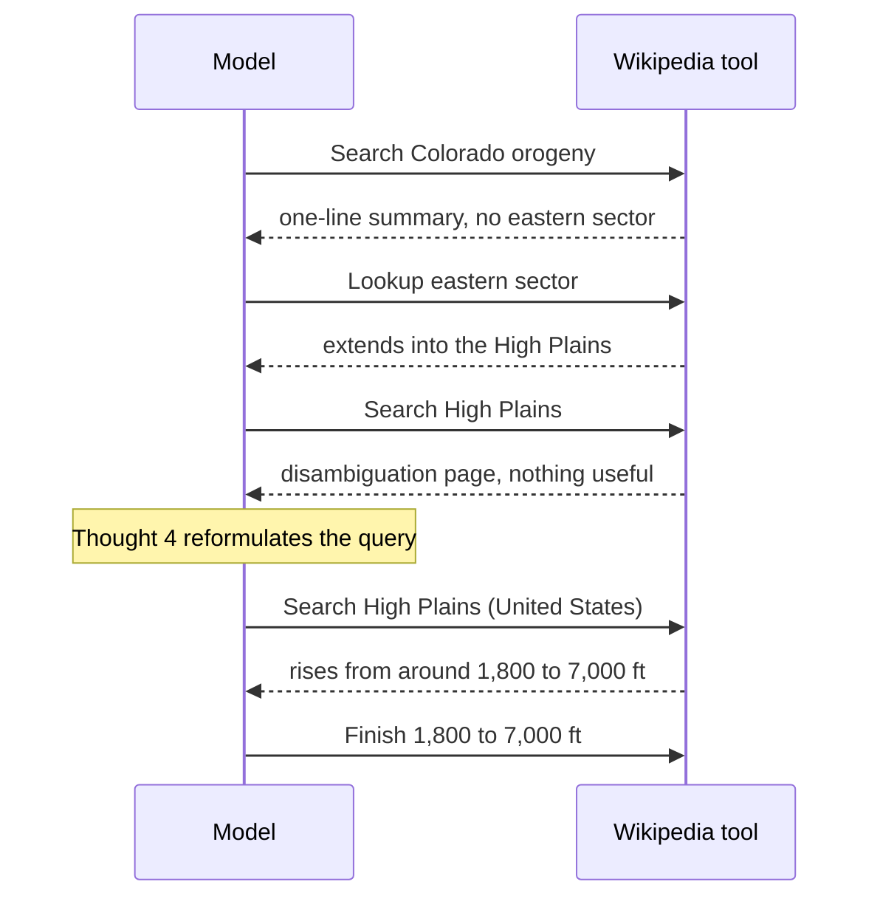

# ReAct: Synergizing Reasoning and Acting in Language Models

> Shunyu Yao, Jeffrey Zhao, Dian Yu, Nan Du, Izhak Shafran, Karthik Narasimhan, Yuan Cao. First posted October 2022; presented at the International Conference on Learning Representations (ICLR) 2023.
> arXiv abstract: [https://arxiv.org/abs/2210.03629](https://arxiv.org/abs/2210.03629) | Local PDF: [2210.03629.pdf](../../papers/2210.03629.pdf)

## Read this first

**The claim in one sentence.** If you show a large language model a few hand-written examples in which it alternates between writing a short thought, issuing one tool command, and reading the tool's reply, then on question answering, fact checking, a text game and a shopping site it makes fewer made-up statements and completes more tasks than if it only thinks or only acts.

**Who this is for.** Product people, engineers and researchers who need to know exactly what the evidence is. Tutorial 1 assumes no computer science; Tutorial 2 assumes you can read short Python; Tutorial 3 assumes you know what a benchmark and a baseline are.

**What you will be able to do afterwards.** Write the ReAct format, trace a run by hand, build the loop in about 50 lines, explain every number in the paper's results and error-analysis tables, and say what ReAct did and did not establish about today's assistants.

**Reading time.** About 45 minutes; about 15 for the worked example plus Tutorial 1.

**Read first.** [Chain-of-thought prompting](./07-chain-of-thought.md) (the "think step by step" technique ReAct extends) and, optionally, [Retrieval-augmented generation](./06-rag.md) (the fixed look-up-then-answer pattern that ReAct turns into a loop).

**The one thing most people get wrong.** ReAct is a prompt format, not a model or a training method. In the main experiments a frozen model sees one to six examples, and ordinary program text parses its output, runs the chosen command and pastes the reply back. It also did not win everywhere: on HotpotQA, plain chain-of-thought scored higher than ReAct (29.4 versus 27.4 exact match, Table 1). The real finding is that the two fail in opposite ways, so the best systems combine them.

**Through-question.** The agent-systems track asks whether a thin runtime around a model that chooses among a few high-quality tools is the right architecture for assistants such as Claude Code or ChatGPT. ReAct is the root of that lineage; Tutorial 2 ends with a verdict. Follow-ons: [Toolformer](../06-agent-systems/24-toolformer.md), [CodeAct](../06-agent-systems/25-codeact.md), [SWE-agent](../06-agent-systems/26-swe-agent.md), [Dive into Claude Code](../06-agent-systems/28-dive-into-claude-code.md).

## The paper in one worked example

The example is the first HotpotQA exemplar in the paper's own prompt (Appendix C.1). HotpotQA is a question-answering dataset in which every question needs facts from two or more Wikipedia pages. The question:

> "What is the elevation range for the area that the eastern sector of the Colorado orogeny extends into?"

(An orogeny is a mountain-building episode.) The expected answer is "1,800 to 7,000 ft". Nobody can answer this from memory with confidence, because it chains three facts: what the Colorado orogeny is, which area its eastern sector reaches, and how high that area is. The model is given only a three-command Wikipedia tool (`Search`, `Lookup`, `Finish`, defined in Section 3.1).

**A caveat.** This trajectory is a human-written exemplar inside the prompt, not model output; it shows the format the model must imitate. The paper's model-generated runs are in Figure 1 (an Apple Remote question), Appendix D.1 (FEVER) and Appendix D.2 (ALFWorld). Figure 1 is an image that could not be rendered while writing this guide, so its lines are not reproduced; open it in the PDF.

### Step by step, the ReAct format on this question

| Line | Written by | Text (quoted or close paraphrase, Appendix C.1) | What the line is for |
|---|---|---|---|
| Thought 1 | model | "I need to search Colorado orogeny, find the area that the eastern sector ... extends into, then find the elevation range of the area." | Writes a plan with three sub-goals |
| Action 1 | model | `Search[Colorado orogeny]` | Asks the tool for the page named "Colorado orogeny" |
| Observation 1 | tool | "The Colorado orogeny was an episode of mountain building (an orogeny) in Colorado and surrounding areas." | The first 5 sentences of the page; here only one is shown. It does not mention an eastern sector |
| Thought 2 | model | "It does not mention the eastern sector. So I need to look up eastern sector." | Notices what is missing in the reply and chooses the next command |
| Action 2 | model | `Lookup[eastern sector]` | Like Ctrl+F: returns the next sentence containing the string |
| Observation 2 | tool | "(Result 1 / 1) The eastern sector extends into the High Plains and is called the Central Plains orogeny." | Supplies fact two: the area is the High Plains |
| Thought 3 | model | "... extends into the High Plains. So I need to search High Plains and find its elevation range." | Records the new fact and restates the remaining goal |
| Action 3 | model | `Search[High Plains]` | Looks up the area |
| Observation 3 | tool | "High Plains refers to one of two distinct land regions" | A disambiguation page: the reply is useless for the question |
| Thought 4 | model | "I need to instead search High Plains (United States)." | Recovers from the dead end by reformulating the query |
| Action 4 | model | `Search[High Plains (United States)]` | A more specific page title |
| Observation 4 | tool | "... rise in elevation from around 1,800 to 7,000 ft (550 to 2,130 m)." | Supplies fact three |
| Thought 5 | model | "High Plains rise in elevation from around 1,800 to 7,000 ft, so the answer is 1,800 to 7,000 ft." | Extracts the answer from the observation |
| Action 5 | model | `Finish[1,800 to 7,000 ft]` | Ends the episode; this string is scored |

Five thoughts, five actions, four observations (the `Finish` action produces none). The thoughts do not change anything in the outside world; they only add text to the running transcript so that the next step can use it.

### The same question in the paper's other two formats

The paper builds its baselines by deleting parts of this exemplar (Section 3.2). The same Colorado question therefore exists in three prompt forms:

| Format | What the exemplar contains | The Colorado exemplar, in short |
|---|---|---|
| Chain-of-thought (reason only) | One paragraph, no tool, no observations | "Let's think step by step. The eastern sector of Colorado orogeny extends into the High Plains. High Plains rise in elevation from around 1,800 to 7,000 ft, so the answer is 1,800 to 7,000 ft." |
| Act only | Search, Lookup, Search, Search, Finish with observations but no thoughts | Five actions: `Search[Colorado orogeny]`, `Lookup[eastern sector]`, `Search[High Plains]`, `Search[High Plains (United States)]`, `Finish[1,800 to 7,000 ft]` |
| ReAct | The table above | Thought, action and observation interleaved |

Notice that the chain-of-thought exemplar already contains the facts "extends into the High Plains" and "rise ... from around 1,800 to 7,000 ft": its writer had read Wikipedia first. A model must produce such sentences from memory, and can produce fluent false ones. That is the failure ReAct targets.

### A model-generated contrast on a fact-checking claim

FEVER (Fact Extraction and VERification) gives a claim and asks for SUPPORTS, REFUTES or NOT ENOUGH INFO. Appendix D.1 shows model-generated trajectories on randomly selected development claims. Example 3208, claim "Reign Over Me is an American film made in 2010", ground truth REFUTES:

| Method | What the model did (Appendix D.1) | Result |
|---|---|---|
| CoT | From memory: "is Reign Over Me an American film? Yes ... was it made in 2010? Yes, it was." | SUPPORTS, wrong |
| Act | `Search[Reign Over Me]`, then straight to `Finish[SUPPORTS]` | SUPPORTS, wrong |
| ReAct | Searched, then noted the observation says American film made in 2007, "so it is not made in 2010" | REFUTES, correct |

Across the four FEVER examples printed there, ReAct was right on three and wrong on one (Soyuz: it answered NOT ENOUGH INFO, truth REFUTES); Act and CoT were each right on two. Four examples illustrate; Table 1 is the evidence.



What to notice: the model never touches Wikipedia, it only writes text; the runtime in the middle is ordinary code; and the transcript is the only memory, so a thought is the only place the model can record a conclusion for its later self.



What to notice: four tool calls, one wasted. The disambiguation page is the moment a no-thought agent can stall and a thought-writing agent can say "I need to instead search High Plains (United States)"; Table 2 counts how often such dead ends were fatal (23% of ReAct's failures).

## Words you need

| Term | Plain definition | Example from the worked example |
|---|---|---|
| Large language model (LLM) | A program that continues text, learned from huge amounts of writing; the paper uses PaLM (Pathways Language Model, 540 billion parameters) and checks with GPT-3 | The model that writes Thought 1 through Action 5 |
| Few-shot prompt / in-context example | A prompt that starts with a handful of finished worked examples, so the model imitates their format without any retraining | The six HotpotQA exemplars, of which Colorado orogeny is the first |
| Thought (reasoning trace) | A free-text line the model writes that changes nothing outside; it only adds text to the transcript | "It does not mention the eastern sector. So I need to look up eastern sector." |
| Action | A command from a small fixed list that the runtime will execute | `Lookup[eastern sector]` |
| Observation | The text the environment returns after an action | "(Result 1 / 1) The eastern sector extends into the High Plains..." |
| Trajectory | The whole transcript of one task: thoughts, actions and observations in order | The fourteen lines in the table above |
| Chain-of-thought (CoT) | Prompting the model to write reasoning before the answer, with no tool use | The Colorado paragraph beginning "Let's think step by step" |
| Self-consistency (CoT-SC) | Sample many chain-of-thought answers and take the most common one; the paper uses 21 samples at temperature 0.7 | 21 independent paragraphs, majority answer wins |
| Exact match (EM) | An answer scores 1 only if its text equals the reference after light normalisation, else 0 | "1,800 to 7,000 ft" scores 1; "about 1,800-7,000 feet" probably scores 0 |
| Hallucination | A fluent statement of a fact or step that is not supported by any source | CoT asserting Reign Over Me was made in 2010 (FEVER example below) |

## Tutorial 1 - Intuitive understanding

### What was broken before

Before ReAct, two lines of work ran separately (abstract, Section 1). One taught models to **reason** (chain-of-thought); the other taught them to **act** (choosing commands in games, robot kitchens or browsers). Each had a visible failure.

Reasoning without acting is a closed-book exam: every fact comes from memory. The authors call chain-of-thought "a static black box", not grounded in the outside world and unable to update its knowledge, with two consequences: fact hallucination and error propagation, where one invented fact poisons every later step. The FEVER example above shows it: the model confidently asserts the film was made in 2010.

Acting without reasoning is a shopper with no list. In the ALFWorld game, the act-only agent of Appendix D.2.2 found the knife, tried to clean it before walking to the sink, got "Nothing happens", and repeated the same commands in a loop. With no written state, it could not notice it was stuck.

### The idea

**Analogy.** A person cooking from an unfamiliar recipe talks to themselves between steps ("now everything is cut, so heat the water"; "no salt, so use soy sauce", the paper's own kitchen example). The muttering tracks progress and repairs the plan while the hands fetch ingredients. ReAct has the model mutter in writing between tool calls.

**Where the analogy breaks.** A cook's inner speech is private and free; the model's is printed text that costs money, is re-read at every later step, and can be wrong. A hallucinated thought in ALFWorld (Figure 5a, step 17) sent an agent down the wrong path, and a human rescued the run by editing two thoughts. A person also knows when they are guessing; the model's thought sounds equally confident whether quoting an observation or inventing.

Mechanically: add "write a thought" to what the model can do, but make thoughts inert so the world never reacts to them; the transcript then carries both the world's replies and the model's notes.

### How it works, step by step

1. **Build the prompt.** Put one to six human-written trajectories like the Colorado table first (6 for HotpotQA, 3 for FEVER; ALFWorld two of three annotated per task type; WebShop one), then the new question.
2. **Let the model write one step.** It writes "Thought 1: ..." and "Action 1: Search[...]". A stop rule cuts generation before the model writes its own "Observation" line, because the model must not invent the world's reply.
3. **Parse the action.** The runtime reads the command name and the text in square brackets. `Search[Colorado orogeny]` becomes: call the search function with the string "Colorado orogeny".
4. **Run it and paste the reply.** The Wikipedia tool returns up to five sentences, or, if the page does not exist, up to five similar titles. The runtime appends "Observation 1: ..." to the transcript.
5. **Repeat.** The whole transcript, exemplars included, goes back to the model for Thought 2 and Action 2.
6. **Stop.** When the model writes `Finish[answer]`, the answer is scored. If it has not finished within 7 steps (HotpotQA) or 5 (FEVER), the paper treats the run as failed and may fall back to another method (next section).

In ALFWorld and WebShop the model decides when to think, so thoughts appear sparsely (Section 2); a thought sits in an action slot (`think: ...`) and the environment replies "OK."

### What the results say

Every number below is from the paper; "points" means percentage points. The model is PaLM-540B unless stated.

**HotpotQA and FEVER (Table 1, prompting).** HotpotQA is scored by exact match (EM): of every 100 questions, how many got an answer whose text equals the reference. FEVER is scored by accuracy: of every 100 claims, how many got the right label out of three.

| Method | HotpotQA EM | FEVER accuracy |
|---|---|---|
| Standard (no thoughts, no actions) | 28.7 | 57.1 |
| CoT | 29.4 | 56.3 |
| CoT-SC (21 samples) | 33.4 | 60.4 |
| Act | 25.7 | 58.9 |
| ReAct | 27.4 | 60.9 |
| CoT-SC then ReAct (back off to ReAct when the vote is weak) | 34.2 | 64.6 |
| ReAct then CoT-SC (back off to CoT-SC when ReAct does not finish) | 35.1 | 62.0 |
| Supervised state of the art, trained on full data | 67.5 | 89.5 |

In plain terms: ReAct beats Act by 1.7 points on HotpotQA (27.4 against 25.7: about two more exact answers per 100 questions) and by 2.0 on FEVER, so removing the thoughts hurt. But ReAct is 2.0 points below CoT on HotpotQA and 4.6 above it on FEVER (60.9 against 56.3). The best prompting results are hybrids: ReAct then CoT-SC reaches 35.1 on HotpotQA, 1.7 above CoT-SC alone (about 17 more exact answers per 1,000), and CoT-SC then ReAct reaches 64.6 on FEVER, 4.2 above CoT-SC alone (about 42 more correct labels per 1,000). Every prompting method is far from the supervised systems, as the paper notes.

**Why the hybrid matters.** CoT-SC is good when the model "knows" the answer (samples agree); ReAct is better when it must look. One method's confidence signal decides when to call the other, and the paper reports (Section 3.3, Figure 2) that the hybrids match 21-sample CoT-SC with 3 to 5 samples (curve values are in an image; only the text claim is verified).

**Why ReAct can look worse yet be preferable (Table 2).** The authors labelled 200 trajectories (50 correct and 50 incorrect each for ReAct and CoT). Among correct ones, 94% of ReAct's had correct reasoning and facts against 86% for CoT; the rest were right over a hallucinated chain (6% and 14%). Among incorrect ones, hallucination was 56% of CoT's failures against 0% of ReAct's. ReAct's failures were reasoning errors (47%, including repeating earlier steps) and empty or useless search (23%). Label ambiguity, right answer but not matching the reference, was 29% of ReAct failures and 28% of CoT's. ReAct swaps invented facts for a different problem: search can come back empty and the loop can stall.

**ALFWorld (Table 3) and WebShop (Table 4).** ALFWorld is a text game in which an agent in a simulated house completes goals such as "put a clean lettuce in diningtable" (134 unseen test games, six task types). The paper reports success of 71% for ReAct's best of six prompt sets, 45% for the best Act prompt set and 37% for BUTLER, an imitation-learning agent trained on about 100,000 expert trajectories per task type. The abstract's 34 points is 71 minus 37: out of every 100 games, about 34 more were finished. WebShop asks an agent to buy a product matching a written request (1.18 million products, 500 test instructions); success rate (SR) is the share of episodes in which the product meets every requirement. ReAct scores 40.0 SR against 30.1 for Act, 29.1 for imitation learning and 59.6 for a human expert: of every 100 requests, about 40 fully satisfied. Tutorial 3 examines how these were selected.

### What this does not show

- It does not show that tool use beats memory in general. On HotpotQA, ReAct alone scored lower than CoT.
- It does not show a trained agent. The headline results are prompting only; one small fine-tuning experiment is separate.
- It does not show the loop scales to big tool sets. The Wikipedia tool has three commands.
- It does not show reliability: single greedy runs, no confidence intervals, and a 540-billion-parameter model most readers cannot run.
- It does not prove that thoughts help by being "reasoning". Deleting thoughts also shortens the exemplars and removes a place to store state.

### Teach-back

1. **In your own words: why is a thought "inert", and why does that matter for the design?**
<details><summary>Answer</summary>A thought is text the runtime does not execute, so no observation follows. It lets the model write plans and conclusions into the transcript without side effects, at the price of extra tokens (Section 2: it "does not affect the external environment").</details>

2. **ReAct scored 27.4 and CoT 29.4 on HotpotQA. Why does the paper still say ReAct is more trustworthy?**
<details><summary>Answer</summary>Table 2: CoT's failures are 56% hallucination against 0% for ReAct, and 14% of CoT's correct answers rested on hallucinated reasoning against 6% for ReAct. ReAct loses points to reasoning errors (47%) and unhelpful search (23%). Higher exact match is not the same as more reliable reasoning.</details>


## Tutorial 2 - Practitioner understanding

### The design in concrete terms

**The loop's parts.** A prompt string, a model call with a stop sequence, a parser, a tool table, a transcript and a step cap: the entire runtime in the paper's main experiments.

**Wikipedia tool (Section 3.1).** `search[entity]` returns the first 5 sentences of the page with that exact title, or up to 5 similar titles. `lookup[string]` returns the next sentence of the current page containing the string (Ctrl+F). `finish[answer]` ends the episode. The authors call it "significantly weaker" than state-of-the-art retrievers, on purpose, to force retrieval through explicit reasoning.

**Prompts per task (Sections 3.2, 4).** HotpotQA: 6 randomly chosen training questions with hand-written trajectories, a thought before every action. FEVER: 3, same style. ALFWorld: 3 annotated trajectories per task type, six prompts per type from ordered pairs of two, thoughts sparse and chosen by the model. WebShop: one-shot (Table 6). The authors write that more HotpotQA examples did not help (footnote 2). Thoughts in the exemplars decompose the question, extract facts from observations, do commonsense or arithmetic ("1844 < 1989"), reformulate searches, and state the final answer (Section 3.2).

**Decoding and fallbacks.** Greedy for ReAct, Act and CoT (Table 3 note); CoT-SC takes 21 samples at temperature 0.7. The 7-step and 5-step caps exist because only 0.84% and 1.33% of correct trajectories used the last step (footnote 3).

**Fine-tuning experiment (Section 3.3, Appendix B.1).** 3,000 correct ReAct trajectories, produced by the prompted model, fine-tuned PaLM-8B and PaLM-62B (batch size 64; ReAct and Act 4,000 steps; Standard and CoT 2,000 steps on 8B, 1,000 on 62B). Fine-tuned ReAct became the best of the four formats; 8B fine-tuned ReAct beat every 62B prompting method, and 62B fine-tuned ReAct beat every 540B prompting method (Figure 3 text). With prompting alone on 8B and 62B, ReAct was the worst of the four.

### What ReAct established and what it left open

This ledger is the guide's reading of the evidence for the track's through-question.

| Claim | Status |
|---|---|
| A model can interleave free-text reasoning with tool commands in one transcript, with no training, from a handful of examples | Established (Tables 1 to 4) for PaLM-540B; GPT-3 text-davinci-002 repeats the pattern (Table 5) |
| Reasoning and acting fail differently, so combining with a confidence router helps | Established on two benchmarks, with modest gains (Table 1) |
| The format works with a provider-native tool-calling API | Not tested; the paper predates such APIs, actions are plain parsed text |
| Training a model for the loop beats prompting it | Suggested on one benchmark by a small fine-tuning run (Figure 3) |
| Many tools, long outputs, safety under real side effects | Not tested; context length was already a limit (Section 6), and the agent touched only Wikipedia and a simulated shop (Ethics statement) |
| Thin runtime plus few high-quality tools is the right architecture | Supported in outline, not tested as a comparison (see the verdict below) |

### A minimal version

This sketch assumes a function `llm(prompt, stop)` that returns text up to a stop string, and a `wiki` object with `search` and `lookup`. Shapes are shown in comments.

```python
import re

EXEMPLARS = open("react_exemplars.txt").read()   # 6 trajectories in Thought/Action/Observation format
MAX_STEPS = 7                                    # HotpotQA cap in Section 3.2
ACTION = re.compile(r"Action (\d+): (Search|Lookup|Finish)\[(.*)\]\s*$", re.S)

def react(question, llm, wiki, cot_sc_fallback):
    transcript = f"{EXEMPLARS}\n\nQuestion: {question}\n"
    for step in range(1, MAX_STEPS + 1):
        # Cut generation before the model can invent the Observation line.
        out = llm(transcript + f"Thought {step}:", stop=[f"\nObservation {step}:"])
        thought, _, action_line = out.partition(f"\nAction {step}:")
        transcript += f"Thought {step}:{thought}\nAction {step}:{action_line}\n"

        m = ACTION.search(f"Action {step}:{action_line}")
        if not m:                                # unparseable: tell the model
            obs = "Invalid action. Use Search[x], Lookup[x] or Finish[x]."
        else:
            kind, arg = m.group(2), m.group(3).strip()
            if kind == "Finish":
                return {"answer": arg, "steps": step, "transcript": transcript}
            obs = wiki.search(arg) if kind == "Search" else wiki.lookup(arg)
            # obs shape: str, at most 5 sentences, or "Could not find [x]. Similar: [...]"
        transcript += f"Observation {step}: {obs}\n"

    # Step cap hit: back off to self-consistency (the paper's ReAct -> CoT-SC rule).
    return {"answer": cot_sc_fallback(question), "steps": MAX_STEPS, "transcript": transcript}
```

Three details decide whether it works: the stop sequence (otherwise the model writes a fake observation); an observation that says what went wrong for a malformed action (otherwise the loop crashes or repeats); and a repeat guard, since the paper reports a ReAct-specific pattern of repeating earlier steps and suspects greedy decoding (footnote 6). The guard, detecting an identical action and injecting "you already tried this", is the guide's suggestion, not the paper's.

### What it costs

The paper reports no token, latency or money figures. The arithmetic below is the guide's, under stated assumptions; replace each assumption with your own measurement.

Assumptions: exemplars plus instructions 2,000 tokens; each step adds about 150 tokens (40 for thought and action, 100 for the observation) and the model writes about 40 per step; 5 steps; 1.5 s per model call and 0.3 s per Wikipedia call; illustrative prices of 3 dollars per million input tokens and 15 per million output tokens.

| Method | Calls | Input tokens | Output tokens | Latency | Money |
|---|---|---|---|---|---|
| CoT, one sample (exemplars about 1,200 tokens) | 1 | 1,200 | 80 | about 2 s | about 0.005 dollars |
| ReAct, 5 steps | 5 | 5 x 2,000 + 150 x (0+1+2+3+4) = 11,500 | 5 x 40 = 200 | 5 x (1.5 + 0.3) = 9 s | about 0.038 dollars |
| CoT-SC, 21 samples | 21 | 21 x 1,200 = 25,200 | 21 x 80 = 1,680 | about 2 s if parallel | about 0.101 dollars |


ReAct's cost is dominated by re-reading the exemplar prefix at every step (10,000 of 11,500 input tokens), which prefix caching largely removes; it is slower because steps are sequential, whereas CoT-SC's samples can run in parallel.

### How it fails

| Symptom | Likely cause | Mitigation | Grounding in the paper |
|---|---|---|---|
| Final answer sounds right but contradicts the observations | Thought that goes beyond the observation | Require the answer to quote a supporting observation; spot-check | 6% of ReAct's correct HotpotQA answers still had hallucinated reasoning (Table 2) |
| Run repeats the same thought and action | Greedy decoding plus an unhelpful observation | Detect repeats; vary the query; cap steps | Counted inside the 47% "reasoning error" of failures (Table 2); footnote 6 |
| Search returns "Could not find" or an irrelevant page, and the run never recovers | Weak tool, exact-title search | Invest in the tool: fuzzy match, ranked results, longer snippets | 23% of ReAct failures were uninformative search (Table 2) |
| Thought is wrong and everything after follows it | Hallucinated thought | Expose thoughts to a human or a checker; allow thought editing | Figure 5 and Appendix A.3: editing two thoughts rescued a failed run |

### Evaluating your version

- **Metric.** Exact match or human-judged correctness, plus per trajectory: steps used, share of claims supported by an observation, share of searches returning nothing useful.
- **Test set.** At least 200 questions from the documents your users will ask about. The guide's arithmetic: near 30% accuracy the 95% margin of error is about plus or minus 6.4 points at 200 questions and 4.0 at 500, larger than the paper's HotpotQA gaps (27.4 against 29.4), which come with no intervals or repeated runs. Compare paired on the same questions and read the ones that flip.
- **Baselines.** The same questions through (a) no tools; (b) one retrieval then answer (the [RAG](./06-rag.md) pattern); (c) your loop; (d) your loop without thoughts. If (c) does not beat (b), you do not need a loop.
- **Stop rule.** Fixed in advance: at most three rounds of prompt and tool changes; stop when two rounds in a row gain less than the margin of error, or when over 20% of failures are search failures (the tool is then the bottleneck).

### Adopt, adapt or skip

For a team building an assistant over a company's private documents, the recommendation is **adapt**. Adopt the loop and the transcript discipline: thoughts before actions, observations pasted back, a hard step cap, answers that cite their observation. Do not adopt the paper's specifics: a three-command exact-title search is a deliberate handicap, not a design to copy. Replace it with a good document search tool whose output is short, ranked and cited, and expose two or three tools rather than dozens.

Concretely: build the loop in a day, compare it with single-shot retrieval on 200 real questions, and keep it only if it wins by more than the margin of error. Prefer a provider's native tool-calling interface if one exists (background knowledge; the paper predates it). Log every thought; Figure 5 is the best argument for visible reasoning.

**Verdict on the track's through-question.** The paper supports the shape of the answer but not the full claim. Supportive: a bare loop around a frozen model with three actions solved a real share of multi-hop questions, and the largest controllable failure the authors found is the tool (23% empty or useless search), which is the "few high-quality tools" half of the thesis. Not established: that the loop is sufficient. The strongest prompting systems added control logic (a step cap and a vote-based switch), fine-tuning beat prompting on small models, and nothing was tested at a coding assistant's tool or context scale. The guide's judgement: ReAct shows a thin runtime can work and leaves the "right architecture" question to later guides: native tool-calling ([Toolformer](../06-agent-systems/24-toolformer.md)), executable actions ([CodeAct](../06-agent-systems/25-codeact.md)), purpose-built interfaces ([SWE-agent](../06-agent-systems/26-swe-agent.md)) and a deployed system ([Dive into Claude Code](../06-agent-systems/28-dive-into-claude-code.md)).

## Tutorial 3 - Researcher understanding

### Formal setup

Section 2 models an agent in an environment. At time step t the agent receives an observation o_t from the set O, takes an action a_t from the set A, following a policy pi(a_t | c_t), where the context c_t = (o_1, a_1, ..., o_(t-1), a_(t-1), o_t) is everything seen and done so far. ReAct enlarges the action set to A-hat = A union L, where L is the space of language. An action a-hat_t in L is a thought: it produces no observation, and the context simply becomes c_(t+1) = (c_t, a-hat_t).

Here pi is a frozen language model conditioned on the few-shot prompt, so no parameters change.

**Numeric toy instance.** In the Colorado example, A has three action types. At t = 3 the context holds the question, thought 1, action 1, observation 1, thought 2, action 2 and observation 2. The policy samples a thought in L (the "extends into the High Plains" sentence), appended with no observation, then a command in A, `Search[High Plains]`, which yields observation 3. The difficulty the paper names is that mapping c_t directly to a_t "is highly implicit and requires extensive computation"; a thought splits one hard mapping into two easier ones.

**CoT-SC vote rule, with numbers.** Let n = 21 samples. The majority answer must collect at least n/2 = 10.5 votes, that is 11, for CoT-SC to be trusted. If the answers split 9 for "Emory University", 7 for "Vanderbilt" and 5 for "Duke", the top count (9) is below 10.5, so the system backs off to ReAct (the CoT-SC then ReAct rule, Section 3.2).

### The claims, stated precisely

1. **C1.** With PaLM-540B and few-shot prompting, ReAct beats Act on HotpotQA EM (27.4 against 25.7), FEVER accuracy (60.9 against 58.9), ALFWorld success (71 against 45, best prompt sets) and WebShop SR (40.0 against 30.1) (Tables 1, 3, 4).
2. **C2.** ReAct beats CoT on FEVER (60.9 against 56.3) and trails it on HotpotQA (27.4 against 29.4) (Table 1).
3. **C3.** The best prompting results come from ReAct plus CoT-SC (35.1 and 64.6, Table 1), matching 21-sample CoT-SC with 3 to 5 samples (Section 3.3, Figure 2).
4. **C4.** CoT's dominant HotpotQA failure is hallucination (56%); ReAct's is reasoning error (47%) then uninformative search (23%) (Table 2, 200 hand-labelled trajectories).
5. **C5.** On ALFWorld best-of-six ReAct beats BUTLER by 34 points and the Inner-Monologue-style ReAct-IM by 18 (71 against 53); on WebShop it beats the previous best SR by about 10 points (abstract, Section 4).
6. **C6.** After fine-tuning on 3,000 self-generated successful trajectories, ReAct is the best of four formats on HotpotQA for PaLM-8B and PaLM-62B (Figure 3).
7. **C7 (interpretive).** Reasoning traces make runs interpretable and editable, shown by one human-edit example (Figure 5, Appendix A.3).

### Evidence, table by table

**Table 1 (HotpotQA exact match, FEVER accuracy; PaLM-540B).** Eight methods by two datasets (Tutorial 1). It identifies a controlled ablation by deletion (Standard, CoT and Act are built from the same exemplars), though exemplar length changes with the removed part. It only associates the hybrids' gain, since the router's two constants (step cap, vote threshold) were set on the same benchmarks. The evaluation-set size for Table 1 is not stated in the text read here; the GPT-3 comparison uses 500 validation questions (Table 5).

**Table 2 (error analysis, HotpotQA).** Rows are success and failure types; columns are percentages among 50 sampled correct and 50 sampled incorrect trajectories per method. It identifies a mechanism consistent with the headline pattern; it only associates beyond that, since one labeller group and no agreement figure are reported. Arithmetic note: the ReAct failure column sums to 99%, and 47% and 23% are not whole fractions of 50, so the failure denominator is unstated; the success rows (94% and 6%) fit 47 and 3 of 50.

**Table 3 (ALFWorld success rates by task type).** Columns: Pick, Clean, Heat, Cool, Look, Pick 2, All. Rows: Act (best of 6) 45, ReAct (average of 6) 57, ReAct (best of 6) 71, ReAct-IM (average) 48, ReAct-IM (best) 53, BUTLERg (best of 8) 22, BUTLER (best of 8) 37. It identifies ReAct versus Act versus IM under identical annotated trajectories. A careful reader also sees that the headline compares best-of-six with best-of-six or best-of-eight picks; that ReAct's average prompt loses to Act's best prompt on four of six task types (Pick 65 against 88, Clean 39 against 42, Look 55 against 72, Pick 2 24 against 41); and that BUTLER scores 100 on Cool against ReAct's best of 86. The paper reports a consistent edge over Act across six paired trials (relative gain 33% to 90%, average 62%); this guide back-calculates an Act average near 35 from ReAct's 57, since Act's average is not tabulated. The text says the worst ReAct trial (48%) beats both baselines' best, but the table has no 48 for ReAct (it is ReAct-IM's average), so that sentence is unverified. Section 4 prose calls this table "Table 4"; it is Table 3.

**Table 4 (WebShop).** Act 62.3 score and 30.1 SR; ReAct 66.6 and 40.0; IL 59.9 and 29.1; IL+RL 62.4 and 28.7; Human expert 82.1 and 59.6 (IL rows from Yao et al., 2022). It identifies ReAct versus Act with the same one-shot trajectory: +9.9 SR from thoughts. The abstract's "10%" is an absolute gain of about 10 points (9.9 over Act, 10.9 over IL, the best earlier method). Humans explore and reformulate queries far more, the paper notes.

**Table 5 (GPT-3 versus PaLM).** HotpotQA EM 29.4 (PaLM-540B) against 30.8 (GPT-3, text-davinci-002, 500 validation questions); ALFWorld 70.9 against 78.4 on all 134 games. Discrepancy: Table 1 gives ReAct 27.4 on HotpotQA but Table 5 gives 29.4 for the same model; the paper does not explain it (different subset or typo; the guide cannot tell).

**Figures 2 and 3** are images; the guide relies on the paper's text for them.

### Ablations and what they isolate

Act versus ReAct (Tables 1, 3, 4) isolates thought text, not whether the benefit is reasoning or extra state and length. CoT versus ReAct (Tables 1, 2) isolates external information, but no CoT baseline with retrieved text prepended exists. ReAct-IM versus ReAct (Table 3, Appendix B.2) isolates progress tracking, next-goal choice and commonsense location guesses, without ranking them. Hybrid routing isolates error complementarity, not tuning cost.

### Threats to validity specific to this paper

- **Best-of-k reporting.** The ALFWorld headline takes the best of six prompt sets (ReAct, Act) and of eight (BUTLER) on the same 134 games used for scoring, which inflates it; the average row (57) tempers this.
- **One closed model.** Main results use PaLM-540B, not openly accessible; GPT-3 replicates the direction with different numbers.
- **Prompt contamination.** HotpotQA, FEVER and Wikipedia are probably in both models' pre-training data, so "search" may be partly ceremonial; not tested.
- **Dataset labels.** Label ambiguity is 29% and 28% of failures (Table 2) and Figure 4 shows an outdated label, so exact match underestimates both methods by an unknown amount.
- **Authored exemplars, tiny action spaces, single runs.** The authors wrote the thoughts; CoT exemplars derive from ReAct's; nothing measures tool-selection difficulty; Table 1 has no variance.

### Open problems and follow-ups

Scale to many tools and long observations (Section 6 flags context length). Training for the loop rather than prompting, as in [Toolformer](../06-agent-systems/24-toolformer.md). Executable instead of bracketed actions, as in [CodeAct](../06-agent-systems/25-codeact.md). Interface design, which [SWE-agent](../06-agent-systems/26-swe-agent.md) argues matters greatly for software tasks. Better decoding for the repeat loop (footnote 6). Automatic detection of a hallucinated thought (Figure 5).

### What would change my mind

The guide judges the central claim (interleaving beats either alone, with complementary error profiles) well supported on knowledge tasks. It would weaken if: a CoT baseline with retrieved page text simply prepended (one call, no loop) matched ReAct, showing the benefit is retrieval; Table 3 re-run with prompts chosen on held-out games erased the edge over Act; a contamination audit showed most correct trajectories were answerable without the observations; or a weaker open model with the same exemplars showed no gain over Act. It would strengthen if an independent labelling on another dataset reproduced the Table 2 error mix, and the hybrid's gain survived choosing its two constants on a separate development split.

## Reading map for the PDF

| Section or figure | What it contains | First pass | Guide section that answers the questions it raises |
|---|---|---|---|
| Abstract and Section 1, Figure 1 | The claim; four prompting styles on one HotpotQA question (an Apple Remote question) and one ALFWorld game | Read; study Figure 1 carefully, it is the paper's picture of the idea | Worked example; Tutorial 1 |
| Section 2 | The formal setup; thoughts as actions in language | Read | Tutorial 3, Formal setup |
| Table 1, Figure 2 | HotpotQA and FEVER prompting results; samples versus accuracy | Read | Tutorial 1 results; Tutorial 3 evidence |
| Table 2, Section 3.3 text | Hand-labelled success and failure modes | Read twice | Tutorial 1 results; Tutorial 2, How it fails |
| Section 4 and Tables 3, 4 | ALFWorld and WebShop setups and results; ReAct-IM | Read | Tutorial 3, Evidence |
| Appendix C and D | All prompts (HotpotQA, FEVER, WebShop, ALFWorld) and example trajectories | Read C.1 (the worked example) and D.2 (ReAct, Act and ReAct-IM on one game) | Worked example; Tutorials 1 and 2 |

## Questions readers get stuck on

### Is the model trained to do this?

Not in the main experiments. PaLM-540B is frozen and the only "training" is a prompt of one to six examples (Section 2). The separate training experiment (Section 3.3) fine-tunes PaLM-8B and PaLM-62B on 3,000 trajectories that the prompted model produced and that ended correctly. Behaviour in the main tables is imitation of the exemplars, which is why prompted ReAct is weak on small models.

### What stops the model from writing the observation itself?

A stop sequence. The runtime cuts the model's output before the "Observation" line. The paper does not spell this out, but without it the model would write plausible Wikipedia text from memory and the grounding would be lost. Treat the stop rule as a boundary, not a convenience.

### Why does ReAct lose to CoT on HotpotQA (27.4 versus 29.4)?

Section 3.3 gives the reasons: interleaving makes ReAct less flexible in forming reasoning steps, it sometimes repeats earlier steps, and 23% of its failures are searches that returned nothing useful (Table 2). CoT writes a smooth chain from memory, which works for well-known facts. A two-point gap is also within the margin you would expect on a few hundred questions (the guide's arithmetic; the paper gives no interval).

### If CoT hallucinates 56% of its failures, why is CoT not much worse?

Hallucination was counted among failures only. In Table 2, 86% of CoT's correct answers had correct reasoning and facts, so where the model's memory is good, memory works. The danger is that a fluent wrong chain looks like a fluent right one, and 14% of CoT's correct answers rested on one.

### What exactly is "CoT-SC", and why combine it with ReAct instead of just using more samples?

CoT-SC samples many chains and votes (21 samples, temperature 0.7). Voting helps only when the right answer is the most frequent one, that is, when the model has the knowledge. When the votes split, the model probably does not know, and more samples will not add facts; looking things up can. The paper's Figure 2 conclusion is that the hybrids match 21-sample CoT-SC using 3 to 5 samples.

### Is "34% better on ALFWorld" a relative or absolute number?

Absolute, in percentage points: 71% for ReAct's best prompt set against 37% for BUTLER's best run; relative, it would be 34 over 37, about 92%. Both are best-of-k picks, and BUTLER trained on far more data (about 10 to the power 5 expert trajectories per task type) than ReAct's two prompt examples.

### Is this the same thing as function calling or tool use in modern chat products?

No, but it is the pattern those products industrialised. ReAct's actions are plain text in a bracket grammar, parsed by the authors' code, chosen by a model never trained for it. Modern products give the model a structured tool-calling interface and usually train for it. The paper neither tests nor claims that; the later guides in the track examine it.

### Why not simply retrieve the Wikipedia page once and prepend it, as in retrieval-augmented generation?

Because in multi-hop questions you do not know the second page until you have read the first: the Colorado example needs the orogeny page to learn the area is the High Plains. A single retrieval from the question alone may miss that hop. The paper runs no retrieve-then-read baseline, so how much of ReAct's benefit is plain retrieval is not isolated (see [RAG](./06-rag.md)).

## Prerequisites you actually need

### Prerequisite 1 - A few-shot prompt and a stop sequence

A language model continues whatever text it is given. A few-shot prompt is a block of finished examples followed by an unfinished one; the model imitates the pattern. A stop sequence is a string at which you tell the system to stop generating.

Tiny example: the prompt ends "Question: Which came first, A or B?\nThought 1:". Left alone, the model continues "I need to search A ...\nAction 1: Search[A]\nObservation 1: ..." and invents the observation; with the stop sequence "\nObservation 1:" you receive only the thought and action. See [Chain-of-thought prompting](./07-chain-of-thought.md) for few-shot prompting in general.

### Prerequisite 2 - An action grammar and a parser

A grammar here is just a promise about the shape of the model's command, such as `Name[argument]`. A parser is the few lines of code that turn text into a function call.

Tiny example: `Lookup[eastern sector]` matches `(Search|Lookup|Finish)\[(.*)\]`; group 1 is the command, group 2 the argument, and the runtime calls lookup("eastern sector"). A line such as "I will look it up" has no action; a good runtime answers with an observation naming the allowed commands (Section 3.1).

### Prerequisite 3 - A policy, a context and a trajectory

A policy is "what do I do next, given everything I have seen". The context is everything seen so far; a trajectory is the full record of one task.

Tiny example: after Observation 2 in the Colorado run, the context is the question plus Thoughts 1-2, Actions 1-2 and Observations 1-2; the policy is the model reading that text and writing Thought 3 (Section 2 writes pi(a_t | c_t)). ReAct's twist is that some outputs, thoughts, trigger no tool but still extend the context.

### Prerequisite 4 - Exact match, accuracy, success rate, and why a baseline is needed

Exact match: a prediction scores 1 only if its normalised text equals the reference string. Normalisation conventions (lower-casing, dropping punctuation and articles) come from the HotpotQA scorer and are not restated in the paper. Accuracy: correct labels divided by all claims. Success rate: completed episodes divided by all episodes. A baseline is the number you compare against: without one, 27.4 means nothing.

Tiny example: 500 questions, 137 answered with exactly the reference text, gives EM = 137/500 = 27.4%. Whether that is good depends on the baselines: Act 25.7, CoT 29.4, a supervised system 67.5 (Table 1). Used in Tables 1 to 4.

## Where this sits in the curriculum

**Read before.** [Chain-of-thought prompting](./07-chain-of-thought.md) for the reasoning half of the idea, and [RAG](./06-rag.md) for the retrieval half. ReAct is what you get when you stop treating them as separate stages.

**Versus the two nearest papers.** Against chain-of-thought, ReAct adds an outside source of truth and a loop, at the price of more calls and new failures (empty search, loops). Against retrieval-augmented generation, ReAct picks its next query after reading the last result, which makes multi-hop questions possible; the paper concedes that RAG's retrievers are stronger than its three-command tool (Section 3.1).

**What to read next, and why.**

- [Toolformer](../06-agent-systems/24-toolformer.md): the model is trained to decide when to call tools (answers "no training").
- [CodeAct](../06-agent-systems/25-codeact.md): the action is executable code (answers "tiny action space").
- [SWE-agent](../06-agent-systems/26-swe-agent.md): how much a purpose-built interface matters on a hard task; pair it with [SWE-bench](../03-evaluation-and-code/16-swe-bench.md), its benchmark.
- [Dive into Claude Code](../06-agent-systems/28-dive-into-claude-code.md): a deployed descendant, the place to judge the track's through-question.

## Checkpoint

1. **Explain.** Write the first three lines (Thought, Action, Observation) of a ReAct run for "Which magazine was started first, Arthur's Magazine or First for Women?" and say what the stop sequence cuts off.
<details><summary>Answer</summary>Appendix C.1: Thought 1 "I need to search Arthur's Magazine and First for Women, and find which was started first." Action 1 `Search[Arthur's Magazine]`. Observation 1 is the page text, "Arthur's Magazine (1844-1846) was an American literary periodical ...". Generation is cut before "Observation 1:", so the tool supplies that line.</details>

2. **Compute.** HotpotQA EM for ReAct is 27.4 and for CoT-SC 33.4. On 1,000 questions, how many more exact answers does CoT-SC give, and how many more does ReAct-then-CoT-SC (35.1) give than ReAct alone?
<details><summary>Answer</summary>CoT-SC: 33.4 - 27.4 = 6.0 points, about 60 more per 1,000. ReAct-then-CoT-SC: 35.1 - 27.4 = 7.7 points, about 77 more per 1,000.</details>

3. **Compute.** In Table 3, ReAct's best prompt set scores 71 and BUTLER 37. Give the absolute and relative gains, and say which the abstract reports.
<details><summary>Answer</summary>Absolute: 34 points. Relative: 34 / 37, about 92%. The abstract's "34%" is the absolute figure (an absolute success rate of 34%).</details>

4. **Critique.** A colleague says "Table 3 proves thoughts help in ALFWorld." List two things in the table or text that qualify that.
<details><summary>Answer</summary>First, headline numbers are best-of-six (ReAct, Act) and best-of-eight (BUTLER) picks scored on the test games, so selection inflates them; ReAct's average is 57. Second, ReAct's average prompt set loses to Act's best prompt set on four of six task types (Pick, Clean, Look, Pick 2), and Act's per-prompt average is not reported.</details>

5. **Explain.** What does Table 2 say about why ReAct and CoT-SC are combined?
<details><summary>Answer</summary>Their dominant failures differ: CoT hallucinates (56% of failures against 0% for ReAct) while ReAct fails through reasoning errors (47%) and uninformative search (23%). With largely different errors, one method's confidence signal (a weak vote, a failure to finish) is a good trigger for the other.</details>

6. **Through-question.** In two sentences, what did ReAct establish about thin runtimes with few tools, and what did it leave open?
<details><summary>Answer</summary>It established that a frozen model plus a parser, a three-command tool and a transcript can ground answers and complete household and shopping tasks better than reasoning-only or acting-only prompting. It left open tool selection among many tools, structured tool-calling interfaces, trained policies, long contexts and real-world side effects, and its best prompting systems already needed extra control logic beyond the bare loop.</details>
