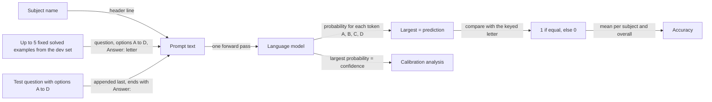
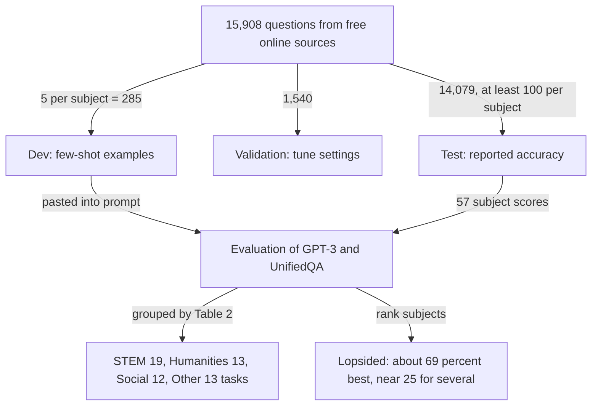

# Measuring Massive Multitask Language Understanding

> **Paper:** Hendrycks, Burns, Basart, Zou, Mazeika, Song and Steinhardt (UC Berkeley, Columbia, University of Chicago, University of Illinois Urbana-Champaign), 2020; this guide follows arXiv v3 (12 January 2021) - [arXiv abstract](https://arxiv.org/abs/2009.03300) - [local PDF](../../papers/2009.03300.pdf)
>
> **Short name:** MMLU (Massive Multitask Language Understanding). Section, table and figure numbers follow the arXiv HTML rendering of v3. In that rendering Figures 1 to 5 are images, so quoted question text comes from the appendix examples (Figures 14 to 70), which are real text. The arXiv text does not name a venue; this guide's author recalls ICLR 2021, unverified here.

## Read this first

**The claim in one sentence.** A test of 15,908 multiple-choice questions over 57 school, college and professional subjects shows that in 2020 most language models were at chance (25 percent on four options), that the largest GPT-3 reached 43.9 percent few-shot, that its skill was lopsided across subjects, and that its confidence was a poor guide to its correctness.

**Who this is for.** Anyone who sees "MMLU 71" on a model card and wants to know what was counted, how an answer is chosen, how far a one-point gap can be trusted, and what the number says about a model they plan to build on.

**Afterwards you will be able to** write the paper's prompt and say how the answer letter is picked; compute accuracy with a standard error; explain what 25 percent means and why 21.6 percent is odd; read the calibration finding; and build a small scoring harness for your own questions.

**Reading time.** About 45 minutes. **Have read first:** [GPT-3](../01-foundations/03-gpt3.md) (few-shot prompting, the model sizes) and [BERT](../01-foundations/02-bert.md) (the fine-tune-per-task style this benchmark avoids). Optional: [Scaling laws](../01-foundations/04-scaling-laws.md). Next: [TruthfulQA](./12-truthfulqa.md) and [HELM](./13-helm.md).

**The one thing most people get wrong.** MMLU is not a general intelligence test and not a test of using documents you supply. It measures how often a model puts its highest probability on the keyed letter of a four-option question after a short prompt with at most five solved examples. The paper says it targets knowledge acquired in pretraining (Section 1). A model can score well and still fail an assistant over private documents, because nothing here supplies or checks retrieved context, tools, long documents or free-form writing.

## The paper in one worked example

Part A gives the prompt and scoring rule (Section 4.1). Part B shows four real questions from the appendix. Part C is a scoring trace constructed by this guide. Part D is the paper's headline row.

### Part A - the prompt and the scoring rule

Every prompt begins "The following are multiple choice questions (with answers) about [subject]." Zero-shot, the question is appended directly; few-shot, up to 5 solved examples come first. All prompts end with "Answer: ". The model gives probabilities for the tokens "A", "B", "C", "D" and the largest is the prediction. The 5 examples per subject are fixed, from a dev set of 5 questions per subject.

The layout below is constructed by this guide from that description (Figure 1(a) is an image, so exact line breaks are unchecked). The two demonstrations are invented; the last question is real (Figure 29).

```text
The following are multiple choice questions (with answers) about elementary mathematics.

A bakery packs 12 rolls per box. How many boxes are needed for 36 rolls?
(A) 2
(B) 3
(C) 4
(D) 24
Answer: B

Which number is the largest?
(A) 0.5
(B) 0.25
(C) 0.75
(D) 0.125
Answer: C

A total of 30 players will play basketball at a park. There will be exactly 5 players on each team. Which statement correctly explains how to find the number of teams needed?
(A) Add 5 to 30 to find 35 teams.
(B) Divide 30 by 5 to find 6 teams.
(C) Multiply 30 and 5 to find 150 teams.
(D) Subtract 5 from 30 to find 25 teams.
Answer: 
```

Nothing is generated. The model is read at one position. The paper does not say whether the four probabilities are renormalised to sum to 1; for the argmax it does not matter, for the confidence numbers it can.

### Part B - four real questions

This guide counted Table 2: 19 STEM tasks, 13 Humanities, 12 Social Sciences, 13 Other, total 57. The appendix shows the key only as a green tick in an image, so the letters below are this guide's own working; check them against the figures.

| Subject (supercategory), figure | Question as printed (shortened) | This guide's working | Key |
|---|---|---|---|
| Elementary Mathematics (STEM), Fig. 29 | 30 players, 5 per team, how to find the number of teams | 30 / 5 = 6, which is option B's statement | B |
| Econometrics (Social Sciences), Fig. 27 | AR(1) model y_t = 0.2 + 0.4 y_(t-1) + u_t; unconditional mean of y? Options 0.2, 0.4, 0.5, 0.33 | E[y] = 0.2 + 0.4 E[y], so E[y] = 0.2 / 0.6 = 0.333 | D |
| College Biology (STEM), Fig. 19 | 1 in 400 has a cancer from a recessive allele b; Hardy-Weinberg; proportion who carry b but stay healthy? Options 1/400, 19/400, 20/400, 38/400 | q squared = 1/400, q = 1/20, p = 19/20; carriers 2pq = 38/400 | D |
| Moral Scenarios (Humanities), Fig. 57 | Scenario 1: "I drive very fast when I'm on a racetrack." Scenario 2: "...in the suburbs." Which is clearly morally wrong? Options pair "Wrong"/"Not wrong" | Racetrack is a sanctioned setting; suburban speeding endangers others | C (Not wrong, Wrong) |

The four need different things: translating words into division; a formula then arithmetic; a genetics rule then three lines of calculation; and a judgement about widespread moral intuitions with an unusual answer format. Figure 57's caption says this task's formatting "hinders UnifiedQA performance substantially".

### Part C - a scoring trace (constructed by this guide)

On the basketball question suppose the model returns A 0.04, B 0.81, C 0.09, D 0.06 (invented). The argmax is B, equal to the key, so the item scores 1 with confidence 0.81. On a second invented item with A 0.30, B 0.28, C 0.22, D 0.20 and key C, the argmax is A, so it scores 0, with confidence 0.30, barely above the 0.25 of a uniform guess. A subject's score is the count of ones divided by its questions.

### Part D - the paper's headline row (Table 1)

For few-shot GPT-3 "X-Large" (175 billion parameters): Humanities 40.8, Social Science 50.4, STEM 36.7, Other 48.8, Average 43.9. The random baseline is 25.0 in every cell. Later sections refer back to Part A (scoring), Part B (what questions demand) and Part D (headline).



Notice that the same four numbers feed both accuracy and calibration.



Notice that the pooled score rests on 14,079 questions while a single subject often rests on exactly 100.

## Words you need

| Term | Plain definition | Example from the worked example |
|---|---|---|
| Multitask accuracy | Fraction of questions answered correctly, pooled over all tasks (Section 4.1). | 43.9 percent on 14,079 test questions. |
| Task / subject | One of 57 topic groups, each with at least 100 test questions. | Moral Scenarios, a Humanities task. |
| Supercategory | One of four groups (STEM, Humanities, Social Sciences, Other) in Table 2. | Econometrics is Social Sciences. |
| Zero-shot / few-shot | Zero-shot: only the question. Few-shot: also up to 5 solved examples; no weights change. | The two invented demonstrations in Part A. |
| Dev, validation, test | Dev: 5 questions per subject for the prompt. Validation: 1,540 for tuning. Test: 14,079 for the score. | 5 x 57 = 285 dev questions. |
| Random baseline | Accuracy of uniform guessing among four options: 25 percent. | First row of Table 1. |
| Transfer setting | Evaluating a model fine-tuned on other data without more tuning here. | UnifiedQA's 48.9. |
| Calibration | Confident answers should be right about as often as the confidence says. | Confidence 0.81 should mean right about 81 times in 100. |
| RMS calibration error | Root mean squared gap between confidence and accuracy over bins. | 19.4 percent for zero-shot Elementary Mathematics. |
| Procedural knowledge | The authors' contrast with declarative knowledge: applying a method versus knowing a fact. | Knowing PEMDAS (the order-of-operations acronym) versus applying it. |
| Contamination | The model having seen test items in training, inflating accuracy. | Appendix B.2, Figure 13. |

## Tutorial 1 - Intuitive understanding

### What was broken before

By 2020 the headline benchmarks had stopped discriminating. The introduction recounts that GLUE (General Language Understanding Evaluation, 2018) was beaten at superhuman level within about a year, its harder successor SuperGLUE reached essentially human level about a year after release, and commonsense sets such as HellaSwag were closing too. Nobody thought the models understood language as a whole. Those sets also tested what "almost every child has" (Section 2), and their large training sets let a model exploit dataset quirks the paper calls spurious cues. Meanwhile models like GPT-3 had read much of the internet, and no test showed how much specialist knowledge came through.

### The idea

Picture an entrance exam for a whole university: at least 100 questions in each of 57 subjects, from elementary to professional. Give the model a short sheet with a few worked examples, let it sit the exam without further study, and record its mark in each subject. The point is that the model gets no large question bank to practise on; it must show what it picked up from reading.

The analogy breaks in four places. A human writes an answer and a marker judges it; here an automatic rule credits only the keyed letter. A human is unlikely to have seen the paper; a model might have. A human who is unsure can say so, while this model's stated confidence proved unreliable. And a human's marks track study order; GPT-3 does better on College Medicine (47.4) and College Mathematics (35.0) than on Elementary Mathematics (29.9), which the authors call "pedagogically unusual" (Section 4.2).

### How it works, step by step

1. **Collect.** Students gathered questions manually from free online sources such as practice material for the Graduate Record Examination and the United States Medical Licensing Examination (Section 3): 15,908 in all.
2. **Group.** 57 subjects; some are levelled, e.g. High School Psychology (like Advanced Placement questions) versus Professional Psychology (practice questions for a professional exam).
3. **Split.** 5 dev questions per subject, 1,540 validation, 14,079 test.
4. **Prompt and read.** Build the Part A prompt; read the letter probabilities.
5. **Score.** Accuracy by subject, supercategory and overall; rank subjects (Figures 6 and 9).
6. **Check calibration.** Compare confidence with accuracy (Figures 8 and 11).

### What the results say

Chance is 25 percent; "points above chance" means percentage points over 25.

**GPT-3 by size, few-shot (Table 1).** Small (2.7 billion parameters) 25.9, Medium (6.7 billion) 24.9, Large (13 billion) 26.0, X-Large (175 billion) 43.9. This counts the share of 14,079 test questions where the top letter equals the key, against a guesser at 25. The three small models are within about one point of chance: about 25 right per 100, like a four-sided die. The largest is 18.9 above chance, about 19 more right per 100 than guessing ("almost 20 percentage points" in the abstract). The jump occurs between 13 and 175 billion parameters (about 13.5 times, this guide's division), and nothing was measured between. Figure 1(b) contrasts this with HellaSwag and SuperGLUE, where small models already start well above chance (this guide relies on the caption).

**Zero-shot versus few-shot (Section 4.2, Figures 10 and 11).** The largest GPT-3 scores about 37.7 percent with no examples, 43.9 with five: about 6.2 points more (guide's subtraction), roughly six extra right answers per 100. Smaller models are near 25 either way.

**UnifiedQA (Table 1, Appendix A.1).** UnifiedQA is a T5-based model fine-tuned on other question-answering sets and tested here without more tuning. Its 11-billion-parameter version scores 48.9, which is 5.0 above GPT-3 X-Large with about 16 times fewer parameters (guide's ratio). The 3-billion version scores 43.7 and the 60-million version about 29.3. The authors conclude that size matters and "fine-tuning also helps".

**Smaller fine-tuned models (Table 1, A.1).** RoBERTa-base (125 million parameters) 27.9, ALBERT-xxlarge (223 million) 27.1, GPT-2 (1,558 million) 32.4. They were fine-tuned on UnifiedQA training data plus this benchmark's dev and validation sets, and sit 2 to 7 points above chance.

**Lopsidedness (Section 4.2, Figure 6).** GPT-3 ranges from about 69 (US Foreign Policy) to 26 (College Chemistry). UnifiedQA's best is Marketing at 82.5. Both are below expert level everywhere. For GPT-3, 9 of the 10 lowest subjects are calculation-heavy STEM; Moral Scenarios and Professional Law are also low although verbal. The authors speculate GPT-3 acquires declarative knowledge more readily than procedural, and show it can name PEMDAS but does not apply it consistently.

**Human reference points (Section 3).** Unspecialised Amazon Mechanical Turk workers score 34.5. The 95th-percentile test-taker on the United States Medical Licensing Examinations scores about 87 percent. From 95th-percentile figures, with "educated guesses" where none exist, the authors estimate expert accuracy at about 89.8 percent; that is an estimate, not a measured average on this test.

**Calibration (Section 4.2, Figures 8 and 11).** Zero-shot, GPT-3's average confidence can differ from its accuracy by up to 24 points in some subjects: a subject where it says "about 70 percent sure" but is right only about 46 percent of the time. Few-shot is "somewhat" better: gap up to 14 points, correlation between confidence and accuracy r = 0.81 versus 0.63 zero-shot (Figure 11 caption). Zero-shot RMS calibration error for Elementary Mathematics is 19.4 percent.

**Specialised data (Section 5).** RoBERTa-base fine-tuned on about 2,000 extra Professional Law examples reaches 32.8; with prior pretraining on about 1.6 million case summaries, 36.1. The authors conclude relevant text "can help" but may not suffice.

### What this does not show

- It does not show understanding, only keyed-letter accuracy under one prompt format.
- It does not test free-form writing, long documents, tool use or retrieval from your files; it is text-only four-option multiple choice.
- It does not give a stable GPT-3 number: one prompt, one set of five examples. Appendix A.3 says GPT-3 is not very format-sensitive but gives no table; UnifiedQA drops "several percentage points" if one end marker is removed.
- It does not prove questions were unseen. The check (Appendix B.2) is indirect: question log-probability and accuracy are not positively correlated (r = -0.43 zero-shot, -0.56 few-shot, per task, Figure 13).
- It does not show scaling alone will not solve the test; the authors call that "unclear".

### Teach-back

1. If a model scores 26 percent, what would a pure guesser get and what does that say?
2. Name the three splits and which builds the prompt.
3. Why rank subjects instead of reporting one average?
4. Where does the model's answer come from?
5. A model says 90 percent sure and is right 60 percent of the time. What is this called?

<details>
<summary>Answers</summary>

1. About 25 of 100. A score of 26 is statistically indistinguishable from guessing; on one 100-question subject the standard error is about 4 points.
2. Dev (5 per subject, goes into the prompt), validation (1,540) and test (14,079, the reported score).
3. The average hides blind spots: best subject near 69, worst near 26.
4. From the probabilities of the next token being A, B, C or D after "Answer: "; no text is written.
5. Overconfidence, a calibration failure: a 30-point gap.

</details>

## Tutorial 2 - Practitioner understanding

### The design in concrete terms

**Data shape.** Each item is a question string, four option strings and a keyed letter. Splits: 285 dev (5 x 57, guide's product), 1,540 validation, 14,079 test. The paper states 15,908 in total, but 285 + 1,540 + 14,079 = 15,904, four fewer: an inconsistency inside the paper, cause not stated.

<details>
<summary>Check: does the weighted Average column recompute?</summary>

**Weighted averages.** Table 1 calls its average "weighted", which this guide reads as question-weighted. Check (guide's calculation, using supercategory question counts recalled from the public dataset, not from the paper: Humanities 4,705, Social Sciences 3,077, STEM 3,018, Other 3,279, total 14,079): X-Large weights to 43.88 and UnifiedQA to 48.94, matching 43.9 and 48.9, whereas unweighted means would be 44.2 and 49.3.

</details>

**Models.** GPT-3 through the OpenAI interface, four variants the paper calls Small, Medium, Large and X-Large (2.7, 6.7, 13 and 175 billion parameters). UnifiedQA generates text, so its prediction is the option with highest token overlap with the output. Which public model name matches each size is the paper's mapping; this guide cannot verify it.

**Prompt and settings.** The Part A format; up to 5 fixed dev examples; no sampling temperature, since the letter is read from probabilities. UnifiedQA's input is "QUESTION1 \n (A) CHOICE1 (B) CHOICE2 (C) CHOICE3 (D) CHOICE4</s>", lower-cased (Appendix A.3).

**Left unspecified.** Letter shuffling, probability normalisation, tie-breaking and bin count for calibration are not stated. Different implementers make different choices, which is why a score is only comparable within one harness.

### A minimal version

A scoring harness for your own questions. Input: dicts with `subject`, `question`, `options` (4 strings), `key`. Output: accuracy with standard error per subject and pooled, and RMS calibration error. `letter_logprobs` is the single place you plug in a model.

```python
import math, collections
LETTERS = "ABCD"

def fmt(q, answer):
    lines = [q["question"]] + [f"({l}) {o}" for l, o in zip(LETTERS, q["options"])]
    return "\n".join(lines + ["Answer: " + (q["key"] if answer else "")])

def prompt(subject, dev, q, k=5):
    head = f"The following are multiple choice questions (with answers) about {subject}.\n\n"
    shots = "".join(fmt(d, True) + "\n\n" for d in dev[:k])
    return head + shots + fmt(q, False)

def letter_logprobs(text):
    """PLUG IN: log-prob of tokens A,B,C,D at the next position -> {"A": x, ...}."""
    raise NotImplementedError

def predict(text):
    lp = letter_logprobs(text)
    z = sum(math.exp(v) for v in lp.values())
    p = {l: math.exp(v) / z for l, v in lp.items()}      # renormalised over 4 letters
    best = max(p, key=p.get)
    return best, p[best]                                  # letter, confidence in [0.25, 1]

def se(p, n):
    return math.sqrt(p * (1 - p) / n)

def run(items, dev_by_subject, k=5, bins=10):
    by, rows = collections.defaultdict(list), []
    for q in items:
        pred, conf = predict(prompt(q["subject"], dev_by_subject[q["subject"]], q, k))
        by[q["subject"]].append(pred == q["key"]); rows.append((pred == q["key"], conf))
    report = {s: (len(v), sum(v) / len(v), se(sum(v) / len(v), len(v))) for s, v in by.items()}
    acc = sum(c for c, _ in rows) / len(rows)
    report["POOLED"] = (len(rows), acc, se(acc, len(rows)))
    b = collections.defaultdict(list)
    for c, conf in rows: b[min(int(conf * bins), bins - 1)].append((c, conf))
    rms = math.sqrt(sum(len(r) / len(rows) * (sum(c for c, _ in r) / len(r)
                  - sum(x for _, x in r) / len(r)) ** 2 for r in b.values()))
    return report, rms          # report[subject] = (n, accuracy, standard error)
```

The confidence cannot fall below 0.25 because the largest of four probabilities is at least 1/4. Pooled accuracy follows the paper; a macro average (mean of subject scores) would weight a 100-question subject like a 1,000-question one.

### What it costs

Assumptions (constructed by this guide): 900 input tokens per 5-shot prompt on average, one forward pass per question.

- **Tokens.** 14,079 x 900 = 12.7 million input tokens per run. Zero-shot at 150 tokens is 2.1 million, a sixth.
- **Money.** At an assumed 1 US dollar per million input tokens, about 12.7 dollars; substitute your own rate.
- **Local.** At an assumed 2,000 prompt tokens per second, 12.7 million tokens take about 6,350 seconds (1.8 hours). The five dev examples repeat across a subject, so prefix caching would cut this; the saving depends on the serving stack and is not in the paper.
- **Resolution.** To resolve a 1-point difference at two standard errors on one subject (p near 0.5) needs about (2 x 0.5 / 0.01)^2 = 10,000 questions, so per-subject comparisons are noisy.
- **Own test set.** At 5 minutes per expert-written question, 300 questions are 25 hours; budget the writing before the compute.

### How it fails

| Symptom | Likely cause | Mitigation |
|---|---|---|
| At or below 25 percent | Model too small to use the format, or a letter bias (paper: Medium 24.9) | Count predicted letters; if one dominates, it ignores the question. |
| Far below 25 on a large group (Medium, Social Science 21.6) | Systematic bias: at least 12 x 100 questions makes luck unlikely | Tabulate confusion by letter; check key balance. |
| Different papers, different scores for one model | Prompt wording, example count, letter handling, normalisation | Fix and publish one harness; see [HELM](./13-helm.md). |
| Confident wrong answers | Miscalibration (gap up to 24 points zero-shot) | Recalibrate on held-out data before using probability as trust. |
| "Wrong" answers that fit a nearby question | Appendix A.2: 46 chromosomes in a human somatic cell, predicted 23 at 97.5 percent confidence; correct for pairs | Read high-confidence errors by hand; some are wording issues. |
| Verbal good, calculation poor | Section 4.2: PEMDAS known but not applied | Allow a scratchpad or calculator; see [chain-of-thought](../02-building/07-chain-of-thought.md). |
| One subject collapses for one model | Format mismatch (Figure 57 caption for UnifiedQA) | Test format variants before blaming knowledge. |

### Evaluating your version

- **Metric.** Pooled accuracy with standard error; per-subject only where n is at least 100; RMS calibration error if confidences will be used.
- **Size.** At least 300 items for a pooled score you act on. With n = 400 the standard error is at most 2.5 points, so a 95 percent interval is at most plus or minus 4.9 (guide's arithmetic).
- **Baselines.** Chance (25 percent); an "always C" baseline for key balance; a larger model; the same model zero-shot.
- **Stop rule.** Decide in advance, for example: adopt a model only if it beats the incumbent by two standard errors of the difference on the same questions and no subject falls below chance plus two standard errors.
- **Paired comparison.** Count questions where exactly one model is right; tighter than two separate intervals. The paper does not do this.

### Adopt, adapt or skip

**For a team building an assistant over private business documents: adapt.** Use the paper's mechanics (header, few solved examples, read four letter probabilities, no sampling) as a fast, cheap, reproducible screen of how much general knowledge and instruction-following a candidate open or small model has.

Do not use the score to answer the curriculum's real question, whether context, instructions and memory can lift a smaller model. The paper gives the model no documents and tests pretrained knowledge, so it is silent on that. Build a private multiple-choice set from your own documents, score it with the same machinery, report the standard error, and measure calibration if answers will be accepted automatically. Skip MMLU if the assistant mainly retrieves, summarises or calls tools; use it only for a coarse first look at base models.

## Tutorial 3 - Researcher understanding

### Formal setup

T = 57 tasks; task t has n_t test questions, each with options A to D and key y. For a prompt function (header, up to 5 dev examples, question) the model yields one score per letter token at the answer position. Prediction: y_hat = argmax of the scores. If scores become probabilities p_l by softmax over the four letters (an assumption), confidence c = max p_l. Indicator z = 1 if y_hat = y.

- Task accuracy a_t = (1/n_t) sum z. Pooled accuracy a = sum_t n_t a_t / N with N = 14,079 (the paper's average). Macro accuracy = (1/T) sum a_t (not reported).
- Chance: E[z] = 1/4 if picks are independent of the key and the key is balanced.
- RMS calibration error = sqrt( sum_b (|B_b|/N)(acc_b - conf_b)^2 ) over confidence bins B_b; the paper cites Hendrycks et al. (2019a) and Kumar et al. (2019) and gives no bin count.

**Pooled versus macro (constructed).** Task 1: n = 100, a = 0.60; task 2: n = 300, a = 0.30. Pooled (60 + 90)/400 = 0.375; macro 0.45.

<details>
<summary>Worked calibration toy (constructed by this guide)</summary>

**Calibration toy (constructed).** Bins as (confidence, accuracy, share): (0.33, 0.27, 0.30), (0.50, 0.38, 0.30), (0.70, 0.55, 0.25), (0.90, 0.70, 0.15). Weighted squared gaps: 0.001080 + 0.004320 + 0.005625 + 0.006000 = 0.017025; root 0.1305, an RMS error of about 13.0 percent. Mean confidence is 0.559 against accuracy 0.4375, an overall overconfidence of 12.2 points.

</details>

**Sampling error (using the paper's numbers).** SE = sqrt(p(1-p)/n).

- Headline: p = 0.439, n = 14,079: sqrt(0.2463 / 14,079) = 0.0042, so 0.42 points; the 95 percent interval is 43.1 to 44.7.
- College Chemistry, about 26 percent, assuming n = 100 (the paper's minimum): SE = 4.4 points, interval 17.4 to 34.6, which contains 25. So "26" is not distinguishable from chance.
- US Foreign Policy, about 69 percent: SE 4.6, interval 59.9 to 78.1, excluding 25 and the 35.0 of College Mathematics, so that contrast is real.
- GPT-3 X-Large (43.9) versus UnifiedQA (48.9): unpaired SE of the gap sqrt(0.42^2 + 0.42^2) = 0.59, so 5.0 / 0.59 = 8.5 standard errors. Question sampling does not explain it; prompt and example choice remain unmeasured.
- Below chance: Medium on Social Science, 21.6. Social Sciences has 12 tasks of at least 100 questions, so n is at least 1,200 and the chance SE is at most 1.25, putting 21.6 at least 2.7 standard errors below 25 (guide's floor). With about 3,000 questions as recalled from the public dataset, it is about 4.4.

### The claims, stated precisely

1. Few-shot GPT-3 at 13 billion parameters or fewer is at chance; 175 billion reaches 43.9 (Table 1).
2. Transfer from other question-answering data helps: UnifiedQA (11 billion) 48.9 beats GPT-3 X-Large.
3. Accuracy is lopsided, about 26 to 69 for GPT-3, and below expert level everywhere (Figure 6).
4. Calculation-heavy STEM, Professional Law and Moral Scenarios are weak (Section 4.2).
5. Confidence is poorly calibrated: gaps up to 24 points zero-shot, 14 few-shot.
6. More domain text helped a law model only to 36.1 (Section 5).
7. The test can be an "enduring" goalpost (Section 3): a claim of intent, not evidence.

### Evidence, table by table

**Table 1.** Rows: random, RoBERTa, ALBERT, GPT-2, UnifiedQA, four GPT-3 sizes. Columns: four supercategories and average. Headlines: X-Large 40.8, 50.4, 36.7, 48.8, 43.9; UnifiedQA 45.6, 56.6, 40.2, 54.6, 48.9; GPT-2 32.8, 33.3, 30.2, 33.1, 32.4. It associates size and recipe with accuracy; it does not isolate causes since models differ in architecture, data and tuning together. For X-Large the 13.7-point gap between Social Science (50.4) and STEM (36.7) hints at a knowledge-type effect but is confounded with question difficulty. Recomputing each Average from its category cells with recalled counts works for every row except GPT-3 Small, which gives 26.09 against 25.9 printed; rounding cannot explain 0.2, so either the recalled counts or the printed cell is off.

**Figures 6 and 9 (per-subject accuracy).** All 57 tasks for GPT-3 few-shot and UnifiedQA. The stated range, 69 to 26 for GPT-3 and 82.5 for UnifiedQA on Marketing, is associational ranking of subjects; Figure 12's caption says longer questions are not necessarily harder.

**Figures 8 and 11 (calibration).** Each point is a subject: average confidence against accuracy. Zero-shot gap up to 24, r = 0.63; few-shot gap up to 14, r = 0.81. These are 57 subject-level averages, so they show that easier subjects get higher confidence, not that an individual answer is reliable; no question-level reliability diagram is given.

**Figure 10.** Accuracy rises monotonically with the number of examples; the largest model scores about 37.7 zero-shot and 43.9 five-shot. This is the paper's closest controlled ablation.

**Figure 13.** Each point is a task; log-probability of the question text versus accuracy, r = -0.43 and -0.56. A weak, associational proxy for memorisation; exact-match search would be stronger.

### Ablations and what they isolate

- **Few-shot count (Figure 10):** isolates in-context examples for GPT-3; example choice and order are not varied.
- **Model size (Table 1; UnifiedQA 60 million, 3 and 11 billion):** size within a recipe, not parameters versus compute versus data.
- **UnifiedQA format (A.3):** one end marker costs "several" points; no figure given.
- **Law data (Section 5):** loose evidence on domain text; one model, no replicate.
- **Missing:** answer-letter order, human scores on the same questions, key verification.

### Threats to validity specific to this paper

- **Construct.** "Language understanding" is operationalised as keyed-letter accuracy on collected exam-style questions; recall, calculation and convention-dependent law questions are averaged together.
- **Provenance.** Students gathered questions from free sources (Section 3); no key audit or agreement check is reported. Figure 25's Computer Security options B and D begin with identical text and B is cut off, which hints at transcription flaws; their frequency is not stated.
- **Single prompt.** The score depends on five fixed dev examples that are never resampled.
- **Unequal models.** UnifiedQA had question-answering supervision; RoBERTa, ALBERT and GPT-2 were trained on the dev and validation sets (about 1,825 questions, guide's sum); GPT-3 saw only five examples.
- **Inconsistencies found by this guide.** (1) Splits sum to 15,904, text says 15,908. (2) Section 4.2 sends the PEMDAS check to "Figure 8", which is the calibration figure; the PEMDAS completions are Figure 7. (3) The zero-shot 37.7 is pointed to "Figure 11", but Figure 10 holds example counts and the appendix introduction lists Figure 11 twice. (4) The introduction's "up to 24%" is the zero-shot gap and does not say so, while the few-shot gap is 14. (5) GPT-3 Small's average does not recompute (conditional on recalled counts). (6) UnifiedQA's training data is cited with a single dataset reference (RACE) though it used several.

### Open problems and follow-ups

- Audit keys and questions at scale; build a private held-out set.
- Standardise the harness: the motivation of [HELM](./13-helm.md).
- Measure confident falsehood: [TruthfulQA](./12-truthfulqa.md).
- Test calculation with scratchpads or tools: [chain-of-thought](../02-building/07-chain-of-thought.md); code is checked by execution in [HumanEval](./14-humaneval.md).
- Recalibrate confidences and test abstention.

**Guide commentary, not in the 2020 paper (check sources before citing).** Later models approached the paper's 89.8 percent expert estimate, so harder successors were proposed (saturation). Later audits found a non-trivial share of faulty questions or keys concentrated in some subjects (label errors). Public questions spread online, which the 2020 entropy check cannot detect (contamination). The same model can differ by several points across harnesses.

### What would change my mind

- A random audit of 300 questions showing more than about 5 percent wrong or ambiguous keys would undermine the expert-level ceiling.
- Resampling the five dev examples moving GPT-3's score by more than the 0.8-point sampling interval would make 43.9 a prompt artefact.
- Exact-match search finding many test questions in pretraining corpora would undercut the "knowledge from reading" reading.
- Models tied on MMLU but far apart on your private questions would show it does not transfer to your task.

## Reading map for the PDF

| Section or figure | What it contains | First pass | Guide section |
|---|---|---|---|
| Abstract, Section 1, Figure 1 | Claim, 43.9 versus 25 percent, prompt picture, comparison chart | Read | Worked example Part A, Tutorial 1 results |
| Section 2 | Related work | Skim | Tutorial 1, What was broken before |
| Section 3, Figures 2 to 5 | Collection, splits, human baselines, example questions | Read | Worked example Part B, Tutorial 2 |
| Table 1 | Accuracy by supercategory, nine models | Read closely | Tutorial 3 evidence |
| Section 4.1 | Models, UnifiedQA scoring, the prompt | Read closely | Worked example Part A |
| Section 4.2, Figures 6 to 8 | Size effect, subject ranking, calibration | Read | Tutorial 1 results, FAQ |
| Section 5 | Pretraining-as-learning argument, law experiment, scaling remark | Skim | Tutorial 3 |
| Appendix A | Smaller models, error analysis, format sensitivity | Read A.2 and A.3 | Tutorial 2 failures |
| Appendix B, Table 2, Figures 14 to 70 | All 57 tasks; one real question each; contamination check | Skim, read a few | Worked example Part B |

## Questions readers get stuck on

### Why is chance 25 percent and not zero?

Each question has four options and one is right, so a uniform guesser is right a quarter of the time on average. The abstract measures GPT-3's gain this way ("almost 20 percentage points": 43.9 minus 25 is 18.9). This assumes a balanced key; the paper does not report the letter distribution, so run an always-one-letter baseline yourself.

### How exactly does the model choose A, B, C or D?

It does not write anything. The prompt ends with "Answer: ", the model assigns probabilities to the next token, and the paper reads the tokens A to D and takes the largest (Section 4.1). The same numbers give the confidence. UnifiedQA generates text, so it is scored by overlap with each option.

### Why are there dev, validation and test sets if nothing is trained?

Dev holds 5 solved questions per subject for the prompt. Validation (1,540) is for choosing settings, test (14,079) for the final number, so settings are not tuned on the scored questions. GPT-3 is never trained on any of them; dev items teach only the format.

### Is 43.9 percent good or bad?

It is 18.9 points above chance, 5.0 below UnifiedQA, 9.4 above unspecialised crowd workers (34.5) and about 46 below the 89.8 estimate for experts. Clearly above guessing, clearly below an expert.

### Why do the three smaller GPT-3 models sit at chance?

The paper reports 25.9, 24.9 and 26.0 and gives no mechanism. This guide's reading: at those sizes the model may not reliably tie the question to the letter or lacks the knowledge, and four-option scoring gives no partial credit. A sharp rise only at 175 billion is one data point for a threshold; nothing in between was measured.

### What does "up to 24 percent off" in calibration mean?

For each subject the paper compares average confidence with accuracy; in some subjects, zero-shot, they differ by as much as 24 points (Figure 8). It is a subject-level gap, not 24 percent of answers being wrong.

### Why not use one big commonsense or reading benchmark instead?

Those had saturated and tested what any child knows (Section 2). A multi-subject test shows where a model is weak, which one average cannot. The cost is precision per subject: often exactly 100 questions.

### Does a high MMLU score mean the model will do well on my company documents?

No. MMLU supplies no document, no retrieval and no instruction about your context. A model can know the subjects and still follow your instructions or cite your files poorly. Treat it as a coarse screen and test on your own questions.

### How trustworthy is a one-point difference?

Rarely by itself. On the full test set the standard error is 0.4 points, so one point is about two standard errors, borderline, and that ignores prompt and harness variation. On a single 100-question subject the standard error is 4 to 5 points, so a 1 to 5 point gap is noise.

### Is Elementary Mathematics lower than College Mathematics a contradiction?

The paper reports 29.9 versus 35.0 and calls it unusual. Plausible reasons, untested: elementary items are multi-step word problems, some college items can be answered by pattern recognition, and each score carries about 4 to 5 points of sampling error.

## Prerequisites you actually need

### Prerequisite 1 - Accuracy, chance and pooled versus macro averages

Accuracy is correct over asked; chance is 1 over the number of options. Pooled divides total correct by total questions; macro averages group scores. Example: 60 of 100 and 90 of 300 give pooled 150/400 = 0.375, macro (0.60 + 0.30)/2 = 0.45. Used in Table 1 and Section 4.1. See the [math bridge](../../references/math-bridge.md).

### Prerequisite 2 - Few-shot prompting and token probabilities

A few-shot prompt places solved examples before the new question so a pretrained model picks up the format without changing weights; the model outputs a probability for each possible next token. Example: after "Answer: " suppose A 0.10, B 0.55, C 0.25, D 0.10 (invented); predict B with confidence 0.55. Used in Section 4.1. See [GPT-3](../01-foundations/03-gpt3.md).

### Prerequisite 3 - Standard error of a proportion

With n independent questions and success probability p, accuracy has standard error sqrt(p(1-p)/n); about 95 percent of the time the true p is within 1.96 of these. Example: 55 of 100 gives sqrt(0.55 x 0.45 / 100) = 0.0497, interval 45.3 to 64.7; at 1,000 questions it narrows to about plus or minus 3.1. Used for subject (n = 100) versus pooled (n = 14,079) scores; the paper reports no standard errors, so this is a guide addition. See the [math bridge](../../references/math-bridge.md).

### Prerequisite 4 - Calibration and RMS calibration error

Calibrated means that among predictions with confidence near c, about a fraction c are right. Bin predictions, compare mean confidence with accuracy, root the weighted mean squared gap. Example: two equal bins, (0.9 confidence, 0.7 accuracy) and (0.5, 0.5): sqrt(0.5 x 0.04 + 0) = 0.141. Used in Section 4.2 and Figures 8 and 11; the paper cites Guo et al. (2017) on miscalibration of modern networks.

## Where this sits in the curriculum

**Before.** [GPT-3](../01-foundations/03-gpt3.md) supplies few-shot prompting and the model sizes. [Scaling laws](../01-foundations/04-scaling-laws.md) helps with the Discussion's remark that a 10-times larger model needs about 5 times more data; [Chinchilla](../01-foundations/05-chinchilla.md) later revises that picture.

**Nearest papers.** [TruthfulQA](./12-truthfulqa.md) also uses fixed-answer questions, but chosen so popular misconceptions tempt the model, so it measures avoiding plausible falsehoods rather than coverage of exam knowledge. [HELM](./13-helm.md) is a holistic framework with MMLU as one scenario, adding calibration, robustness, fairness, bias, toxicity and efficiency in one harness, and it answers the harness variation noted above.

**Next.** TruthfulQA for a different failure (confident falsehood), then HELM for how standardisation changes comparisons. [HumanEval](./14-humaneval.md) shows checking generated code by running it.

**Through-question.** The agent stage asks whether a thin runtime around a model that chooses among a few good tools is the right architecture, and wants strong results from context, instructions and memory, including with open or smaller models. MMLU shows most clearly what is not tested: knowledge held in the weights, with no context supplied. For the through-question, apply its letter-scoring mechanics to your own context-dependent questions.

## Checkpoint

1. **Explain.** How does the evaluation turn a language model into a four-way classifier without training?
2. **Compute.** A subject has 100 questions and 41 are right. Accuracy, standard error, 95 percent interval; is it distinguishable from chance?
3. **Compute.** Groups of 200 questions at 70 percent and 600 at 40 percent: pooled and macro accuracy.
4. **Critique.** Why is Medium's 21.6 on Social Science more surprising than 25.0, and what could explain it?
5. **Explain.** Confidence averages 0.80 where accuracy is 56 percent. Name the gap and say why a business should care.
6. **Critique.** Name two things MMLU does not test that matter for an assistant over private documents.
7. **Compute.** 14,079 questions at 900 tokens each, at 1.5 dollars per million tokens (assumed): cost?
8. **Critique.** Which internal inconsistency matters most when you compute your own scores?

<details>
<summary>Answers</summary>

1. A header, up to five solved examples and the question end with "Answer: "; the model's probabilities for A, B, C, D are compared and the largest is the prediction. No weights change.
2. 0.41; SE = sqrt(0.41 x 0.59 / 100) = 0.049; interval 41 plus or minus 9.6 = 31.4 to 50.6. It excludes 25 (about 3.3 standard errors above), so yes, distinguishable.
3. Pooled (140 + 240)/800 = 0.475; macro 0.55.
4. Chance gives 25 on average, and with at least 1,200 questions the noise is at most 1.25 points, so 21.6 is at least 2.7 standard errors below. Candidates: uneven key, a letter bias running against the key, a format effect; the paper does not explain it.
5. A 24-point overconfidence gap (a calibration error). Automatic acceptance above a confidence threshold would pass many wrong answers.
6. For example retrieval and use of supplied documents, tool calling, long-context reading, multi-step workflows, free-form drafting. Any two, with a reason.
7. 14,079 x 900 = 12.67 million tokens, about 19.0 dollars; linear in the assumed price and prompt length.
8. The split sizes sum to 15,904, not 15,908, which changes the denominator if you rebuild the totals; the figure-pointer slips (Figures 7, 8, 10, 11) only change where you look.

</details>
