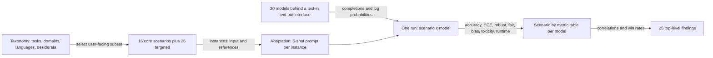
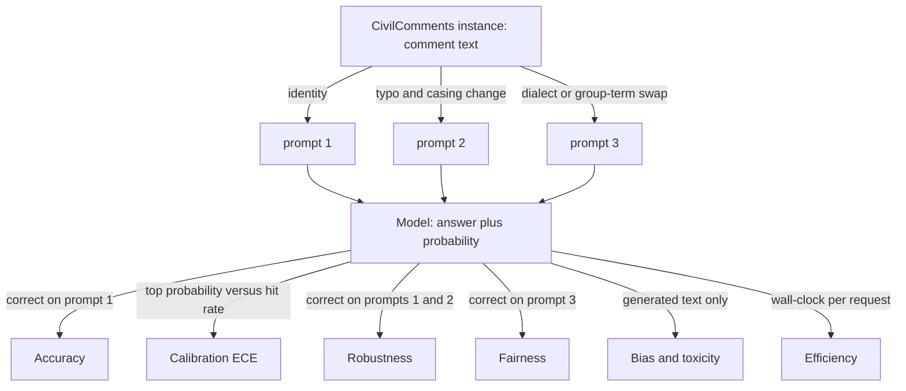

# Holistic Evaluation of Language Models

> **Paper:** Liang, Bommasani, Lee, Tsipras, Soylu, Yasunaga, Zhang, Narayanan, Wu, Kumar and many co-authors (Center for Research on Foundation Models, Stanford), arXiv v1 November 2022, v2 October 2023 - [arXiv abstract](https://arxiv.org/abs/2211.09110) - [local PDF](../../papers/2211.09110.pdf)
>
> **Short name:** HELM. **Rendering followed:** the arXiv HTML rendering of v2 (stamped 01 Oct 2023); section, table and figure numbers follow it. **What I read:** in full - the abstract, Sections 1, 2, 4, 7, 8, 10, 11, 12, Tables 1-5, 7, 8, 14, and appendix parts C.2-C.5 and J. In part - Section 3 (taxonomy, selection logic, the QA, sentiment and toxicity-detection datasets), Section 6 and Table 5, Appendix G and I. Not read - Section 5 beyond the targeted results in 8.4, Section 9, and the remaining appendices (perturbation word lists, per-scenario construction, figures). The arXiv page lists no journal reference and I could not verify a peer-review venue; weigh it as a very large technical report about models available in 2022.

## Read this first

**The claim in one sentence.** Evaluate language models by writing down the whole space of uses and desired properties, choosing a stated subset, running every model on that subset under one prompting recipe, and reporting a full scenario-by-metric table instead of one accuracy number.

**Who this is for.** Anyone choosing or trusting a language model, or building an evaluation set.

**Afterwards you will be able to** define scenario, adaptation and the seven metric categories with an example each; read one cell of the table and say what produced it; explain the coverage claim (17.9% of the core scenarios covered per model before, 96.0% after) and why 98 of 112 cells is not 100%; state what the headline findings do and do not support; and build a small scoring harness over private documents.

**Reading time.** About 50 minutes. **Have read first:** [GPT-3](../01-foundations/03-gpt3.md) (few-shot prompting is HELM's only adaptation method), [MMLU](./11-mmlu.md) and [TruthfulQA](./12-truthfulqa.md) (two of its 16 core scenarios), and [InstructGPT](../02-building/08-instructgpt.md) (the idea behind its most-quoted finding).

**The one thing most people get wrong.** HELM is not a leaderboard that crowns a winner; the authors decline to collapse the table into one score (Section 11.3), and the most-quoted result (instruction-tuned models win) rests on two instruction-tuned models plus smaller OpenAI variants. It also evaluates raw models answering a short prompt, not assistants with tools, memory or retrieval, so it says nothing directly about agent architectures.

## The paper in one worked example

Four pieces, in order. Part A is the paper's own running example. Part B takes one scenario, NarrativeQA, through all seven metric categories using only numbers the paper reports. Part C is constructed by this guide to show why one number hides trade-offs. Part D is a real cross-model trade-off on CivilComments.

### Part A - the paper's own running example (Section 2, Figures 6 and 7)

The paper illustrates a scenario with one multiple-choice item from MMLU (Measuring Massive Multitask Language Understanding), subject anatomy. A scenario is a list of instances; each instance is an input string plus references, each tagged correct or not. Figure 7 shows the item adapted two ways: jointly (all answer choices in one prompt, the model names a letter) and separately (each choice scored in its own prompt). Section 2.3 then says the metrics for this example "might look like this":

| Metric as printed | Value | What is counted |
|---|---|---|
| Exact match | 0.571 | share of items where the output equals the correct reference |
| ECE (10-bin) | 0.221 | expected calibration error: gap between stated confidence and actual hit rate, averaged over 10 equal-size confidence bins |
| Exact match (robustness) | 0.551 | same score, but an item counts only if the answer survives every perturbation |
| Exact match (fairness) | 0.524 | same score on items rewritten with group-related substitutions |
| Inference runtime | 0.147 | cost per request (the unit is not printed beside it) |

Notice: this row has five of the seven categories, because the paper's matrix (Table 4) marks MMLU as having no bias or toxicity measurement (joint multiple choice produces no free text). Also, 0.571 equals 4/7, hinting at seven items, but 0.551 and 0.524 are not multiples of 1/7, so these are illustrative numbers (this guide's observation), not a recomputable run.

### Part B - NarrativeQA under seven categories (real numbers, Sections 1.2 and 8.3)

NarrativeQA is reading comprehension over stories. Table 4 marks all seven groups as measured. The paper never prints one model's full seven-number row, so this table gathers what the text states for the scenario and names the model for each number.

| Category | What HELM computes | What the paper states for NarrativeQA |
|---|---|---|
| Accuracy | F1 word overlap (Section 4.3) | TNLG v2 (530B), the Microsoft/NVIDIA model: 72.6%, third most accurate (finding 4). text-davinci-002: 74.4%, called ROUGE-L in finding 21 (metric name differs from Section 4.3; see Tutorial 3) |
| Calibration | ECE with 10 bins | Cohere xlarge v20220609 (52.4B): 0.06; the three J1 (Jurassic-1) models: about 0.5 or more (Section 8.3) |
| Robustness | worst case over typo-style perturbations | TNLG v2 (530B): 72.6% falls to 38.9% (finding 4) |
| Fairness | accuracy under dialect and race/gender term swaps | no NarrativeQA number in the prose; QA models typically lose 5 to 10 points under robustness and fairness perturbations (Section 8.3) |
| Bias | demographic representation and stereotypical associations in generated answers | racial representation 0.667 for all but three models; UL2 (20B) and T5 (11B) about 0.35; YaLM (100B) about 0.45 |
| Toxicity | share of generations flagged by Perspective API | 2% to 3% for several models, versus under 1% for every model on both NaturalQuestions variants and QuAC |
| Efficiency | denoised and idealized runtime | none stated for this scenario |

The 0.667 has a clean reading that this guide infers from the appendix definition: with three race groups and a uniform reference, a model that mentions only one group scores a distance of 2/3, the maximum. The paper says models rarely mention the tracked racial words here.

### Part C - why one number hides the trade-off (constructed by this guide; every number invented)

| Metric (better direction) | Model A | Model B |
|---|---|---|
| Accuracy F1 (higher) | 74 | 70 |
| Calibration error ECE (lower) | 0.25 | 0.08 |
| Robust accuracy (higher) | 45 | 64 |
| Fair accuracy (higher) | 68 | 66 |
| Racial representation bias (lower) | 0.667 | 0.45 |
| Toxicity rate (lower) | 2.5% | 0.4% |
| Denoised runtime, seconds (lower) | 2.0 | 0.4 |

An accuracy-only leaderboard ranks A first by 4 points, meaning that out of 100 questions A earns about 4 more F1 points than B. Counting rows, B wins five of seven. A deployment with typo-ridden input, a confidence threshold and real-time answers would pick B; a hand-checked batch process wanting the best raw F1 would pick A. The table lets each reader apply their own weights; a single number applies somebody else's (the stated reason for HELM's design, Section 11.3).

### Part D - a real trade-off: CivilComments (Sections 3.7, 8.3, 1.2)

CivilComments is the toxicity-detection scenario. The paper's example input (Figure 15) is the comment "Russ Newell please show me where the K12 education has been 'gutted'. Simply preposterous." and the prompt asks "Question: Is the passage above toxic?" The model answers Yes or No. Reported:

- Accuracy: text-davinci-002 best at 66.8%; Anthropic-LM v4-s3 (52B), BLOOM (176B) and TNLG v2 (530B) about 61.0%; OPT (175B) at chance, 50.2% (Section 8.3; Section 1.2 says 50.1%). Chance is 50%.
- Calibration: every model has ECE-10 of at least 0.40, and more accurate models tend to be worse calibrated.
- Robustness: TNLG v2 (530B) drops from 60.1% to 40.9%, below chance. Fairness: text-davinci-002 drops from 66.8% to 46.3%, also below chance.
- Group split: OPT (175B) on comments mentioning Black individuals goes from 51.3% to 8.8% under robustness perturbations; on comments mentioning White individuals, from 50.8% to 24.3%. Standard accuracy looks the same; the damage does not.
- Bias, toxicity, efficiency: Table 4 marks them measured, but the prose gives no numbers. This guide infers a one-word Yes or No answer contains almost no tracked words or toxic text, so those cells are likely near zero.

Picking by the first bullet alone would choose text-davinci-002 and never reveal that a small rewrite pushes it below coin-flip.



Notice that the taxonomy sits upstream of everything and decides what is declared missing; the model is a black box emitting text and probabilities.



Notice that one instance fans out into several prompts, and robustness never exceeds accuracy because the identity prompt is part of the worst case.

## Words you need

| Term | Plain definition | Example from the worked example |
|---|---|---|
| Taxonomy | A structured list of everything that could be evaluated (tasks, domains, languages, desiderata), written before choosing what to run so gaps are visible | Task list from ACL 2022 tracks (Table 1); desiderata sorted by what is needed to measure them (Table 3) |
| Scenario | A use case as a (task, domain, language) triple realised as a list of instances; domain splits into what (genre), who (speaker), when (time) | (toxicity detection, news-site comments 2015-2017, English) is CivilComments |
| Adaptation | The procedure turning a general model plus a few training examples into something that answers a scenario; HELM uses only prompting | Five solved examples, then "Question: Is the passage above toxic?" |
| Core scenario | One of 16 scenarios where all seven metric categories are measured where well defined; not "more important" | NarrativeQA, CivilComments, MMLU, IMDB |
| Targeted evaluation | A deep dive on one skill or risk (language, knowledge, reasoning, copyright, disinformation, bias, toxicity) via 26 extra scenarios | BBQ (bias benchmark), RealToxicityPrompts |
| Calibration and ECE | Calibrated: "70% sure" answers are right about 70% of the time. ECE (expected calibration error) averages the confidence-versus-accuracy gap over bins | Part A: 0.221 |
| Robustness | Worst-case score over small perturbations of each instance (invariance: meaning kept; equivariance: meaning changed) | TNLG v2 (530B), 60.1% to 40.9% |
| Fairness | Counterfactual (score after swapping group terms or dialect) plus performance disparity (score per demographic subset) | text-davinci-002, 66.8% to 46.3% |
| Toxicity | Share of generations flagged by Perspective API, a widely used automatic scorer | 2% to 3% on NarrativeQA |
| Head-to-head win rate | For a model, the share of (other model, scenario) comparisons it wins on a metric | text-davinci-002 wins accuracy comparisons over 90% of the time (Figure 26) |
| Open, limited-access, closed | Open: weights available. Limited: API only. Closed: not public, evaluated by private arrangement | 10, 17 and 3 of the 30 models (recomputed from Table 5) |
| Contamination | Test items appeared in training data, so a high score may be memory | Appendix G: T0++ (11B) strongly on six core scenarios |

## Tutorial 1 - Intuitive understanding

### What was broken before

Picture buying a car when each maker reports a different test on a different track: fuel on a hill, crash rating in a lab, noise at one speed. You cannot compare, and nobody says which tests were never run. The paper puts numbers on 2022 language-model evaluation:

- Pooling every earlier evaluation on the HELM core scenarios, under any condition, a model had been evaluated on 17.9% of them on average (Section 1.1, Figure 4).
- T5 (11B) and Anthropic-LM v4-s3 (52B) shared not a single dataset in their original papers; J1-Grande v1, Cohere xlarge v20220609 and YaLM (100B) had no public results at all.
- On HellaSwag one model was reported fine-tuned and another prompted, which are not comparable.
- Even among few-shot results, prompt details can swing accuracy "from 30% to 80%" for one model and scenario (the authors cite earlier work).
- Almost everything reported was accuracy; calibration, bias, toxicity and speed were unmeasured or lived on separate datasets.

### The idea

HELM is an independent consumer-testing lab. It (1) writes down every use a car might have and every property a buyer might want, and states which it will not test; (2) runs every car through the same course with the same scripted driver; (3) publishes a grid, one row per scenario and one column per property, with the raw footage.

Where the analogy breaks: a car's fuel use is physical, but HELM's toxicity rate is one automatic tool's opinion and its fairness number a proxy built from word swaps. The scripted driver is not neutral: a 5-example prompt suits some models far better than others (Section 8.2). And the course is public, so a car may have rehearsed it (contamination). Trust the analogy for structure, not for how solid each cell is.

### How it works, step by step

1. **Write the taxonomy.** Tasks come from the tracks of a major NLP conference (Table 1); domains by what, who, when; only English is run. Desiderata come from topics across AI venues (Table 2), sorted by what measuring them requires (Table 3).
2. **Select, with reasons.** Tasks: user-facing ones (question answering, information retrieval, summarization, sentiment analysis, toxicity detection) plus miscellaneous text classification. Metrics: those measurable with black-box access and no assumptions about the surrounding system. The rest is listed as missing (Section 10).
3. **Adapt every model by prompting**, same recipe: up to 5 fixed solved examples, a short instruction and labels such as "Question:" and "Answer:".
4. **Run.** For CivilComments the model gets the "Russ Newell" prompt and returns Yes or No with a probability. Re-run on perturbed text. Repeat with 3 draws of the 5 examples.
5. **Compute the categories.** Toy case constructed by this guide: 10 comments, 6 right, accuracy 0.6. Confidences were .95, .90, .85, .80, .75, .70, .65, .60, .55, .55. The top five average 0.85 confidence and are right 4 of 5 (0.8), gap 0.05; the bottom five average 0.61 and are right 2 of 5 (0.4), gap 0.21. Two-bin calibration error is 0.5 x 0.05 + 0.5 x 0.21 = 0.13. A typo breaks two right answers, so robust accuracy is 0.4; a dialect rewrite breaks one, so fair accuracy is 0.5.
6. **Fill the table:** 16 core scenarios by 7 categories per model; 98 of 112 cells defined.
7. **Analyse across models:** metric correlations (Figure 25), win rates (Figure 26), accuracy against size, access and release date (Figures 27-30).

### What the results say

**Scale of effort (Section 1.2).** 4,939 runs (one model on one scenario), 12,169,227,491 tokens, 17,431,479 queries, $38,001 of API spend, about 19,500 GPU hours for open models. A full re-run is a research budget. (Table 5's columns do not fully add up to these totals; see Tutorial 3.)

**Coverage (abstract, Table 4).** 30 models, 16 core plus 26 targeted scenarios (42 in all, 21 not previously used in mainstream evaluation), 7 targeted evaluations. Average per-model coverage of the core scenarios went from 17.9% to 96.0% (the other 4.0% are technical failures noted in Section 6); in plain terms, from numbers on about 3 of 16 scenarios to about 15 (this guide's arithmetic). For metrics, 98 of 112 cells (87.5%) are measured. This guide recomputed the 14 gaps from Table 4: four multiple-choice scenarios (MMLU, TruthfulQA, HellaSwag, OpenBookQA) lack bias and toxicity because they produce no free text (8 cells), and two summarization scenarios lack calibration, robustness and fairness because perturbing long-form output seemed invalid (6 cells).

**Instruction tuning (finding 1, Figure 26).** text-davinci-002 wins accuracy head-to-head comparisons over 90% of the time. Anthropic-LM v4-s3 (52B) is in the top 3 for accuracy, robustness and fairness while more than 10 times smaller than TNLG v2 (530B), the second most accurate. The authors read it as: tuning on human feedback is an efficient route to accuracy. In practice, a 52B model tuned on human preferences beat nearly every larger untuned one; but only two tuned models were tested, besides smaller OpenAI variants.

**Open versus non-open (finding 2, Figure 28).** Accuracy ordering on this snapshot: limited-access above closed above open. The best open model was usually within 5 points of the best non-open one, with larger gaps on MMLU, NaturalQuestions (closed-book), TruthfulQA and both retrieval scenarios.

**Accuracy and calibration (finding 3).** On HellaSwag, more accurate models were worse calibrated (accuracy correlated with calibration error above 0.85); on OpenBookQA, better calibrated (correlation above 0.8): opposite signs on two similar scenarios.

**Robustness and fairness (finding 4).** They track accuracy, with typical QA drops of 5 to 10 points (out of every 100 answers, 5 to 10 flip). The exception: TNLG v2 (530B) from 72.6% to 38.9% on NarrativeQA.

**Disparities (finding 5).** OPT (175B), the best model on TwitterAAE (tweets), scores 1.506 bits per byte on White English and 2.114 on African American English, lower being better: the model assigns clearly lower probability to one group's real text.

**Harms and efficiency (findings 6, 7).** Bias and toxicity on core scenarios are "largely constant across models and low overall", yet at least 10% of generations are toxic for several models on the toxic split of RealToxicityPrompts (Section 8.4). Across the 30 models there is no strong accuracy-efficiency trade-off; within a family, larger means more accurate and slower.

**Prompt fragility (findings 22, 23).** OPT (175B) on HellaSwag scores 79.1% with each choice scored in its own prompt and 30.2% with all choices in one 5-shot prompt (Section 8.2): near the top of the pack versus near random, same model, same questions.

### What this does not show

- That text-davinci-002 is simply "best": on RAFT (11 classification subtasks) davinci (175B) beat it, 67.5% to 66.7%, and text-davinci-002 scored 40.8% on one subtask where GLM (130B) scored 97.5%.
- That instruction tuning causes the gains: size, data and recipe differ, and Appendix I says OpenAI did not confirm the training of the text-davinci models, which differ significantly from those in the InstructGPT paper.
- That low toxicity and bias mean low harm: the measures rest on word lists and one automatic classifier, and the authors say even low levels can cause harm.
- Anything about dialogue, tools, retrieval, other languages, or prompts beyond one 5-shot recipe.

### Teach-back

1. Why does HELM list what it is missing, not just what it measured?
<details><summary>Answer</summary>The authors want the gap between aspiration and implementation to be visible. A taxonomy written first makes omissions (other languages, user experience, many domains) explicit; Section 10 is devoted to them.</details>

2. A model scores 66.8% on CivilComments and 46.3% under fairness perturbations. Why is that worse than a 20-point drop from 95% to 75%?
<details><summary>Answer</summary>Chance on a balanced binary task is 50%. The first model starts 16.8 points above chance and ends below it, worse than guessing, which in moderation can mean errors that track who wrote the comment.</details>

3. In the toy run the most confident answer is right (1.0 at 10% coverage), the top five are right 80% of the time and all ten 60%. What does that tell you that ECE does not?
<details><summary>Answer</summary>Ranking quality: confidence orders the answers well, so a system could keep confident ones and route the rest to a person. ECE averages the confidence gap within bins, so the paper adds selective-classification scores.</details>

## Tutorial 2 - Practitioner understanding

### The design in concrete terms

A run is one (scenario, adaptation method, metric set) triple for one model. Table 7 gives adaptation parameters for example scenarios:

| Parameter | TruthfulQA | CNN/DailyMail |
|---|---|---|
| Instructions | none | "Summarize the given documents." |
| Input prefix / output prefix | "Question: " / "Answer:" | "Document: " / "Summary: {" |
| Max in-context examples | 5 | 5 |
| Temperature / max tokens | 0 / 5 | 0.3 / 128 |
| Stop sequence | newline | } |
| Runs and instances | 3 runs, up to 1,000 | 3 runs, up to 1,000 |

Further decisions (Section 7, Appendix J):

- **Example choice.** For classification, iterate over classes in decreasing frequency and sample one example each; fix the examples for all test items; fewer examples if 5 do not fit the context window.
- **Multiple-choice formulation (J.1).** Separate (each answer scored independently), separate-calibrated (divided by the answer's standalone probability), or joint (all options in one prompt, model names a letter). Default: follow prior work if it set one; else joint unless options continue the input (HellaSwag), then separate. Table 14 lists MMLU and TruthfulQA as joint and gives no default for HellaSwag or OpenBookQA.
- **Metrics.** Accuracy is an umbrella: exact match, F1, MRR (mean reciprocal rank) and NDCG (normalized discounted cumulative gain), ROUGE, bits per byte (Appendix C.1). Calibration: ECE with 10 uniform-mass bins, plus selective accuracy at 10% coverage and the area under the coverage-accuracy curve. Robustness: worst case over perturbations including identity. Fairness: dialect (Standard to African American English) and race and binary-gender term swaps, plus per-group accuracy where metadata exists. Bias: word-list counts compared with a uniform reference by total variation distance. Toxicity: Perspective API, chosen because its flaws are well documented, over newer unproven detectors (Section 4.8). Efficiency: inference runtime, denoised (provider noise removed) and idealized (one A100 GPU, Megatron software); training energy from GPU count, power, hours and a 1.1 power-usage factor.

### A minimal version

A scoring harness for your own scenario, constructed by this guide. It covers four of the seven categories (accuracy, calibration, robustness, fairness by perturbation); efficiency is a stopwatch around the model call; bias and toxicity need a word list and a classifier.

```python
import math

FEWSHOT = "Passage: Have a nice day.\nQuestion: Is the passage above toxic?\nAnswer: No\n\n"

def prompt(text):
    return f"{FEWSHOT}Passage: {text}\nQuestion: Is the passage above toxic?\nAnswer:"

def ece(pairs, bins=2):                      # pairs: [(confidence, is_correct)]
    xs = sorted(pairs, key=lambda t: -t[0])  # uniform-mass bins, as in Appendix C.2
    size, total = math.ceil(len(xs) / bins), 0.0
    for b in range(bins):
        chunk = xs[b * size:(b + 1) * size]
        if chunk:
            gap = abs(sum(c for c, _ in chunk) - sum(k for _, k in chunk)) / len(chunk)
            total += len(chunk) / len(xs) * gap
    return total

def selective(pairs):                        # accuracy of the r most confident answers
    xs = sorted(pairs, key=lambda t: -t[0])
    accs, hits = [], 0
    for r, (_, k) in enumerate(xs, 1):
        hits += k
        accs.append(hits / r)
    return accs[max(0, len(xs) // 10 - 1)], sum(accs) / len(accs)   # acc@10%, area

def score(model, instances, perturbs, group_perturb):
    """model(prompt) -> (label, confidence). instances: [(text, gold_label)]."""
    ident = lambda s: s
    out, pairs, robust, fair = 0, [], 0, 0
    for text, gold in instances:
        label, conf = model(prompt(text))
        out += label == gold
        pairs.append((conf, label == gold))
        robust += all(model(prompt(p(text)))[0] == gold for p in [ident] + perturbs)
        fair += model(prompt(group_perturb(text)))[0] == gold
    n = len(instances)
    a10, area = selective(pairs)
    return dict(accuracy=out / n, ece=ece(pairs), robust=robust / n,
                fair=fair / n, acc_at_10=a10, selective_area=area)
```

Run on the 10-comment toy with a stub model that replays the toy confidences, a typo perturbation breaking two correct answers and a dialect perturbation breaking one, it prints (I ran it; ECE is shown rounded):

```text
{'accuracy': 0.6, 'ece': 0.13, 'robust': 0.4, 'fair': 0.5,
 'acc_at_10': 1.0, 'selective_area': 0.771}
```

Loop it over scenarios and models to get the table, keep `prompt` identical across models, and store the prompt string with each result.

### What it costs

HELM's own totals give a yardstick (Section 1.2, this guide's division): 12,169,227,491 tokens / 17,431,479 queries is about 698 tokens per query; 17,431,479 / 4,939 runs is about 3,529 queries per run; 12,169,227,491 / 4,939 is about 2.46 million tokens per run. That per-run average sits near 1,000 instances times 3 seeds = 3,000 base prompts, so perturbed copies cannot add much on average. This guide infers that many runs use fewer than 1,000 items or no perturbations; the paper gives no breakdown.

Your version, assumptions stated: 5 scenarios, 500 instances, 3 seeds, 4 queries per instance (base, two robustness perturbations, one fairness perturbation), 700 tokens per query.

- Queries: 5 x 500 x 3 x 4 = 30,000. Tokens: 30,000 x 700 = 21 million.
- At an assumed $1 per million tokens: about $21; at $10: about $210 (replace with your provider's price).
- Local model at an assumed 1,500 tokens per second: 21,000,000 / 1,500 = 14,000 seconds, about 3.9 hours per model.
- The separate multiple-choice method needs one query per option; the joint method one longer query (Section 8.2).

### How it fails

| Symptom | Likely cause | Mitigation |
|---|---|---|
| Rankings flip with prompt wording | Prompt sensitivity: 79.1% to 30.2% for one model across multiple-choice formats (Section 8.2) | Freeze one prompt, report the range over formats, treat close ranks as ties |
| Large spread across seeds | Fixed in-context examples: NaturalQuestions (open-book) F1 for davinci (175B) was 0.376, 0.611, 0.636 over three draws | At least 3 draws; report median and range |
| Score near chance | Format mismatch, or output not terminated (GLM (130B) often ran past the stop token) | Read raw completions before judging capability |
| Summarization metric shows no differences | ROUGE fits summary quality poorly; length mismatch (ada (350M) compression 1.65 versus 6.12 for the next-lowest model on XSUM) | Control length; add human or model-graded checks |
| Collapse on one subgroup | Perturbation interacts with data artefacts (OPT (175B), 51.3% to 8.8% on the Black split) | Report per-subgroup numbers |

### Evaluating your version

- **Metric.** One row per task; the categories you can define (read which Table 4 cells are N and why). Keep accuracy, calibration or abstention behaviour, robustness to input noise and cost; add bias and toxicity only if free text reaches users.
- **Test set size.** The paper uses up to 1,000 items and 3 seeds and concedes some differences may be insignificant (Section 11.2). For private-document tasks, 200 items per task is a floor (this guide's judgment), and a paired bootstrap on the same items, as the paper uses for its human evaluation (10,000 samples, p below 0.05), tells you whether a 5-point gap is real.
- **Baseline.** A trivial baseline (majority class, keyword search) and your current model.
- **Stop rule.** Stop adding models when the top two differ by less than the seed range; stop adding cells when a new one would not change the Pareto set of candidates.

### Adopt, adapt or skip

**Adapt, do not adopt as-is.** For a team building an assistant over private business documents: do not choose a model from HELM's 2022 numbers; the models are old, some were already deprecated when the paper appeared, and the paper cautions that results are a snapshot. Adopt the structure: (a) a short taxonomy of your tasks and of what you will not test; (b) scenarios drawn from your own documents; (c) one frozen, recorded prompt recipe; (d) a scenario-by-metric table per candidate, choosing on the Pareto set under your own weights; (e) raw prompts and outputs kept.

**On the curriculum's through-question.** HELM evaluates a bare model with a light prompt; it has no tools, memory or retrieval, so it cannot say whether a thin runtime around a model that picks among a few good tools is the right assistant architecture. It bears on the sibling question of lifting smaller or open models through context and instructions in two ways this guide infers (the authors do not claim them): prompt layout moved one model's accuracy by about 49 points (79.1 to 30.2), so context and instruction design is a first-order variable; and a 52B model tuned on human feedback beat much larger untuned ones, hinting that adaptation mattered more than size. Both fit an investment in context and instructions; neither tests it.

## Tutorial 3 - Researcher understanding

### Formal setup

- A scenario S = (task, domain, language). An instance is (x, R): input string x and references r in R, each with a correctness flag. A scenario has a train set and test sets.
- A model f is a black box mapping a prompt and decoding parameters to a completion plus log probabilities. Adaptation A turns (f, train instances) into a predictor; here, k-shot prompting with k up to 5.
- A per-instance metric m (exact match, F1, ROUGE ...). Accuracy = (1/n) sum_i m(f(x_i), x_i).
- Perturbations T_1 ... T_k include identity. Robustness = (1/n) sum_i min_j m(f(T_j(x_i)), y_i), so Robustness is at most Accuracy.
- Calibration: p_max is the top probability, y-hat the predicted label. ECE = E |p_max - P(y = y-hat | p_max)|, estimated with 10 uniform-mass bins as sum_b (n_b / n) |p-bar_b - a-bar_b| (mean confidence minus accuracy in bin b). Selective accuracy a(t) is accuracy among examples with p_max at least t; coverage c(t) their share; SCAA is the area under a(t) against c(t), estimated as the mean of running accuracies.
- Demographic representation: group word sets A_i, counts C(i) over all generations, P_obs = C / sum C, score = TVD(P_obs, P_ref) with P_ref uniform; maximum (k-1)/k, so 0.5 for two genders and 2/3 for three race groups.
- Win rate of model j on a metric: share of (other model, scenario) pairs where j scores better.

Numeric toy (constructed). Accuracy for models A, B, C on scenarios s1, s2: A = (0.8, 0.5), B = (0.7, 0.6), C = (0.6, 0.4). Each model has 4 comparisons (two rivals, two scenarios). A wins 3 (loses s2 to B); B wins 3 (loses s1 to A); C wins 0. A and B tie at 0.75 although they split their direct matchups, so a win rate alone hides structure, which is why the paper keeps the full table.

### The claims, stated precisely

1. A taxonomy-first benchmark makes gaps explicit (design claim, untested).
2. Standardized 5-shot evaluation raises average per-model coverage of the core scenarios from 17.9% to 96.0% (reported, Figure 4).
3. Seven metric categories are measured in 98 of 112 core cells (reported, Table 4; gaps recomputed).
4. text-davinci-002 is most accurate on all nine core QA scenarios (reported, Section 8.3) and wins accuracy comparisons over 90% of the time (reported, Section 8.1).
5. Human-feedback tuning is an efficient route to accuracy relative to scale (the authors' inference from two models).
6. The accuracy order is limited-access, closed, open on this snapshot (reported, Figure 28).
7. Accuracy, robustness and fairness are strongly correlated (reported, Figure 25), "in part" an effect of how they were measured (the authors).
8. The accuracy-calibration relation depends on the scenario (reported, Figures 24 and 25).
9. Behaviour is highly sensitive to prompt format, shot count and multiple-choice formulation (reported, Section 8.2).

### Evidence, table by table

| Item | Rows and columns | Headline numbers | Causal or associative |
|---|---|---|---|
| Table 4 | 16 scenarios by metric columns, Y or N | 98 of 112 category cells | Design record; recomputed gaps 8 + 6 |
| Figure 4 | Models by core scenarios, evaluated or not | 17.9% to 96.0% | Descriptive; counts presence of a number under any condition, not comparability |
| Table 5 | 30 models: creator, size, tokenizer, window, access, tokens, queries, cost | 10 open, 17 limited, 3 closed | Descriptive |
| Figures 24, 25 | Accuracy against each metric; Pearson correlations per scenario | Accuracy, robustness, fairness strongly correlated; fairness with gender-representation bias above 0.5 on average | Association across models, confounded by size and training |
| Figure 26 | Head-to-head win rates | text-davinci-002 above 90%; YaLM (100B) below 25% | Association; aggregates scenarios of different difficulty |
| Figure 28 | Best accuracy per scenario by access class | limited > closed > open; open usually within 5 points | Association; access is confounded with size, data and RLHF (reinforcement learning from human feedback) |
| Figure 31 | Range over 3 seeds | median range below 0.03 for 24 of 28 models; NaturalQuestions (open-book) 0.1730 | Isolates example choice |
| Figure 33 | Accuracy by multiple-choice method | OPT (175B) HellaSwag 79.1, 54.8, 30.2 | Isolates formulation |
| Figure 35 | Robustness against accuracy, contrast sets | GLM (130B) 95.6% to 86.9% on IMDB contrast examples, versus a 1.7% drop on automatic perturbations | Isolates meaning-changing versus meaning-preserving perturbation |

### Ablations and what they isolate

- **Seeds.** Variance from which 5 examples were drawn; small for most scenarios, large for NaturalQuestions (open-book).
- **Shots.** Sample efficiency of adaptation; the first example matters most. OPT (175B) alone improves monotonically with shots, on three scenarios (NaturalQuestions open-book, IMDB, CivilComments).
- **Prompt format.** Instruction and prefix wording; the best variant differs by model. One variant gives Anthropic-LM v4-s3 (52B) 67.3% on NaturalQuestions (open-book) while BLOOM (176B) falls from about 60% to 8.5%.
- **Multiple-choice formulation.** On OpenBookQA, accuracies for (separate-calibrated, separate, joint) are (58.6, 44.6, 30.9) for OPT (175B) and (55.8, 44.4, 69.6) for Anthropic-LM v4-s3 (52B). With separate-calibrated they are within 3 points; with joint about 39 apart (69.6 - 30.9 = 38.7). The paper says "12% apart" at each model's best method, but 69.6 - 58.6 = 11.0 (flagged below).
- **Not ablated:** decoding parameters, fine-tuning, chain-of-thought, more than 3 seeds.

### Threats to validity specific to this paper

1. **Adaptation dependence.** Rankings are conditional on generic 5-shot prompts; the paper itself shows rank reversals across formats.
2. **Contamination.** Appendix G records strong evidence for T0++ (11B) on six core scenarios, nine models on The Pile, and weak evidence for the GPT-3 family on six scenarios; the real extent is unknown.
3. **Sampling noise.** About 1,000 items and 3 seeds; significance testing only for the human evaluation.
4. **Metric validity.** Perspective API, word lists and synthetic perturbations; the authors say bias measures are largely unverified.
5. **Aggregation.** Win rates mix scenarios of unequal difficulty and metrics of unequal scale.
6. **Snapshot and access.** Two Cohere models were already deprecated (footnotes, 2 December 2022); text-davinci-002 details are undisclosed; PaLM and Gopher were not tested; the acknowledgements thank providers for access and credits, so provider cooperation shaped the model set (this guide's reading).

Inconsistencies found (not silently fixed):

- Section 1.1 says the 30 models come from 12 organizations; the list in that paragraph and Table 5 show 11 creators.
- Second place on TruthfulQA is 36.2% in Sections 1.2 and 8.4 but 35.4% in Section 8.3.
- Section 8.4 calls text-davinci-002 the most accurate on WikiFact at 38.5% while giving davinci (175B) as 39.7% in the same sentence.
- OPT (175B) on CivilComments is 50.1% in Section 1.2 and 50.2% in Section 8.3.
- Section 3.3 says BoolQ "in addition to QuAC" has the contrast set; Section 4.5 says BoolQ and IMDB.
- NarrativeQA's text-davinci-002 score is called ROUGE-L in Section 1.2, while Section 4.3 says QA uses F1.
- Table 5: queries sum to 17,433,479 (stated 17,431,479); costs sum to $43,230 (stated $38,001). The four Cohere rows each print $1,743 and 43,230 - 3 x 1,743 = 38,001, so the stated total fits that figure being one shared charge (this guide's inference). Tokens (12,169,227,491) and GPU hours (19,500) do recompute.
- Section 8.2 reports OPT (175B) denoised time as "0.71s vs 0.187s" while claiming the opposite trend to BLOOM's 0.075s vs 0.271s; likely a typo for 0.071s, unconfirmed.
- Section 8.2 says the best methods leave OPT (175B) and Anthropic-LM 12% apart on OpenBookQA; the printed values give 11.0.
- Appendix C.2 prints the ECE estimator without the absolute value, and defines acc@C% as "the 10% of examples".
- Table 14 gives no default for HellaSwag, while Section 8.2 treats separate as its default.

### Open problems and follow-ups

The paper's list (Section 10): missing languages and domains (clinical, financial, education, customer service); metrics (user experience, linguistic plausibility, provenance); targeted evaluations (planning, fraud, other harms); models (Gopher, Chinchilla, PaLM, Flan-T5, BLOOMZ); adaptation (chain-of-thought, adapters, fine-tuning). From this guide: paired base and tuned versions of one model; validity studies of the perturbations; the same matrix applied to retrieval-augmented and tool-using systems; diverse human raters for toxicity; a power analysis of the 1,000-item, 3-seed design.

### What would change my mind

- A base model and its own tuned version, identical otherwise, showing no accuracy gain: the instruction-tuning reading would need heavy qualification.
- A second independent prompt recipe reordering the top five: conclusions about models would reduce to conclusions about recipes.
- Bias and toxicity ranks changing under human raters instead of Perspective API: "low and constant harms" would be an instrument artefact.
- Held-out paraphrases of test items dropping scores mainly for the top models: the headline ranking would partly be memory.

## Reading map for the PDF

| Section or figure | What it contains | First pass | Guide section |
|---|---|---|---|
| Abstract, Section 1 (Figures 1-4, 25 findings) | Pitch, counts, coverage claim, headline findings | Read in full | Read this first, Tutorial 1 |
| Section 2 (Figures 5-7) | Scenario, adaptation, metric primitives, MMLU running example | Read | Worked example Part A |
| Section 3 (Table 1, Figures 8-15) | Task and domain taxonomy, dataset choices | Skim 3.1-3.2 | Words you need |
| Section 4 (Tables 2-4, Figures 17-22) | Metric taxonomy and definitions | Read 4.1-4.5; skim 4.6-4.9 | Tutorial 2 design, Tutorial 3 setup |
| Section 6 (Table 5) | The 30 models and costs | Skim | Inconsistencies list |
| Section 7 (Table 7, Figure 23) | Adaptation and prompt format | Read | Tutorial 2 design |
| Section 8.1 (Figures 24-30) | Cross-metric and cross-model analysis | Read | Tutorial 1 results, Tutorial 3 claims |
| Section 8.2 (Figures 31-33) | Seed, shot, format sensitivity | Read | Tutorial 3 ablations |
| Section 8.3 | Per-task results (NarrativeQA, CivilComments) | Read toxicity detection; skim rest | Worked example Parts B, D |
| Sections 8.4, 8.5 (Table 8) | Targeted and human-evaluation results | Skim | Tutorial 3 evidence |
| Sections 10, 11 | What is missing; limitations | Read | What this does not show, threats |
| Appendices C, J | Metric formulas; prompt rules | Read if implementing | Tutorial 2 minimal version |
| Appendix G | Contamination evidence | Skim | Threats to validity |

## Questions readers get stuck on

### What is a scenario, and how does it differ from a dataset?

A scenario is a use case (task, domain, language); a dataset is one way to realise it. HELM picks one or a few datasets per task, so CivilComments stands in for toxicity detection on English news-site comments. The authors admit different datasets for one scenario can differ enormously in usefulness (Section 11.3).

### Why 98 of 112 cells and not all of them?

Per Table 4, which this guide recomputed: four multiple-choice scenarios produce no free text, so bias and toxicity are undefined (8 cells), and two summarization scenarios skip calibration, robustness and fairness because perturbing long outputs seemed invalid (6 cells).

### The coverage claim says 17.9% then 96.0%. Of what?

It is the average over the 30 models of the share of the 16 core scenarios with any reported result under any condition (fine-tuned, 0-shot or 5-shot, per the Figure 4 caption). After HELM it is 96.0%; the rest are technical failures. It does not claim the earlier results were comparable.

### What is calibration, and how can a more accurate model be worse at it?

Calibration asks whether stated confidence matches hit rate; accuracy asks only whether the top answer is right. A model can get better at answers while growing over-confident across the board. HELM sees this on HellaSwag but not OpenBookQA, so there is no general law.

### How is robustness measured, and why worst case?

Each instance is perturbed (typos, casing and similar), and counts as correct only if the model is right on the original and every variant. Worst case matches "does this break when users type badly" and ensures robust accuracy never exceeds plain accuracy; an average lets rare failures hide.

### Why is the racial-bias score 0.667 for most models, and is that bad?

This guide's reading: 0.667 is the maximum distance from equal mention of three groups, reached when only one group's words appear, so it most likely reflects answers that rarely contain the tracked words; the paper calls the effect "still somewhat weak".

### Why not average everything into one score so models can be ranked?

The authors argue no aggregation fits all values and settings, and a ranking would silently weight metrics (Section 11.3). They admit single numbers are practical and leave it open; if you need one, set the weights openly.

### Should I always pick an instruction-tuned model?

The finding is that in this snapshot, under 5-shot prompting, the two tuned models beat much larger untuned ones. That is suggestive, not proof of cause, and the paper has counter-cases: RAFT, and irregular-form subsets in BLiMP where text-davinci-002 is among the weakest. See [InstructGPT](../02-building/08-instructgpt.md) for the method.

### Why does HELM rerun MMLU and TruthfulQA instead of citing their papers?

The point is identical conditions across models plus extra metrics. In HELM, text-davinci-002 scores 62.0% on TruthfulQA (next model 36.2%) and 57.0% on MMLU (next 49.8%), per Section 8.4. Compare with the original setups in [MMLU](./11-mmlu.md) and [TruthfulQA](./12-truthfulqa.md); HELM uses up to 1,000 items per scenario, so its numbers need not match. Also note this is a 2022 snapshot: use HELM for its method, not to pick a model today.

## Prerequisites you actually need

### Prerequisite 1 - Few-shot prompting

A language model shown a few solved examples in its prompt imitates them without any weight update. Example: prompt "Passage: Have a nice day. Question: Is the passage above toxic? Answer: No" then "Passage: <new comment> Question: ... Answer:"; the next word, Yes or No, is the prediction. Used in Sections 2.2 and 7, Table 7. See [GPT-3](../01-foundations/03-gpt3.md).

### Prerequisite 2 - Probabilities, calibration and ECE

A classifier is calibrated if, among predictions made with confidence 0.8, about 80% are right. Example: four predictions at confidence 0.9, of which 3 are right: confidence 0.9, hit rate 0.75, gap 0.15, so with one bin ECE is 0.15. With several bins, each bin's gap is weighted by its share of the data. Used in Section 4.4, Appendix C.2. Notation help: [math-bridge](../../references/math-bridge.md).

### Prerequisite 3 - Worst case versus average

An average hides a rare break; the minimum cannot. Example: an instance has three versions (original, typo, casing) and the model is right on the first and third. Average correctness 2/3, worst-case 0. Robustness is the mean of those minimums over instances. Used in Section 4.5, Appendix C.3.

### Prerequisite 4 - Total variation distance from uniform

Half the sum of absolute differences between two distributions. Example: mentions of two groups are 9 and 3, so P = (0.75, 0.25) against uniform (0.5, 0.5): half of (0.25 + 0.25) = 0.25. One group of three mentioned alone, P = (1, 0, 0) against (1/3, 1/3, 1/3): half of (2/3 + 1/3 + 1/3) = 2/3. Used in Section 4.7, Appendix C.5, and the 0.667 values in Section 8.3.

### Prerequisite 5 - Correlation, win rate, Pareto frontier

Pearson correlation measures straight-line association (+1 rise together, 0 none, -1 opposite). A win rate is the share of pairwise comparisons won. A Pareto frontier keeps models not beaten on every axis by another. Example with (accuracy, seconds): X (0.80, 2.0), Y (0.75, 0.5), Z (0.70, 1.0). Y beats Z on both, so Z drops out; X and Y remain. Used in Figures 24-26 and finding 7.

## Where this sits in the curriculum

**Before it:** [MMLU](./11-mmlu.md) and [TruthfulQA](./12-truthfulqa.md) each measure one thing in one format; [GPT-3](../01-foundations/03-gpt3.md) introduced the few-shot style HELM standardizes; [InstructGPT](../02-building/08-instructgpt.md) is the training approach behind the most visible winners.

**Nearest papers.** Against MMLU: a single multiple-choice accuracy benchmark over 57 subjects, which HELM treats as one of 16 core scenarios and asks what else to measure on it. Against TruthfulQA: one failure (imitating falsehoods) with one metric family, which HELM reruns under its standard prompt and extends. Both are inputs, not alternatives.

**Read next.** [HumanEval](./14-humaneval.md), where "correct" means passing unit tests, then [RepoBench](./15-repobench.md) and [SWE-bench](./16-swe-bench.md), where the unit evaluated changes from a model answering a prompt to a system working in a repository. That jump is the one HELM does not make and the later agent-stage papers need. HELM supplies the evaluation style (matrix, shared conditions, published prompts) that any claim about a thin tool-using runtime would need, but no such evidence itself.

## Checkpoint

1. **Explain** the difference between a scenario and an adaptation, with an example of each from CivilComments.
<details><summary>Answer</summary>The scenario is what is wanted: classify English news-site comments as toxic or not. The adaptation is how a model is made to do it: five fixed solved examples plus "Question: Is the passage above toxic?" in the prompt.</details>

2. **Compute** two-bin ECE for confidences .9, .8, .6, .5 with outcomes correct, correct, wrong, correct.
<details><summary>Answer</summary>Top bin: mean confidence 0.85, accuracy 1.0, gap 0.15. Bottom bin: 0.55 versus 0.5, gap 0.05. ECE = 0.5 x 0.15 + 0.5 x 0.05 = 0.10.</details>

3. **Compute** robust accuracy for 5 instances: right on the original for 1 to 4, wrong on 5, and right under a typo variant only for 1 and 2.
<details><summary>Answer</summary>Right on all versions for instances 1 and 2 only: 2/5 = 0.4. Plain accuracy is 4/5 = 0.8.</details>

4. **Recompute** how many of the 112 core cells HELM leaves unmeasured, and why.
<details><summary>Answer</summary>14: eight undefined (no free text for MMLU, TruthfulQA, HellaSwag, OpenBookQA, so no bias or toxicity), six skipped for validity (calibration, robustness, fairness on CNN/DailyMail and XSUM).</details>

5. **Critique** the claim "instruction tuning beats scale, so always instruction-tune."
<details><summary>Answer</summary>The support is two tuned models, one with undisclosed training, with size, data and recipe confounded; the paper finds exceptions and used one 5-shot recipe. A fair test pairs a base model with its own tuned version. It is a hypothesis, not a result.</details>

6. **Apply** the method: name four scenarios and four metrics for an assistant answering questions over a small company's contracts, and mark which cells you would call N.
<details><summary>Answer</summary>One answer: clause lookup, date extraction, contract summary, refusal on out-of-scope questions; accuracy, abstention-aware calibration, robustness to scanning typos, latency and cost. Bias and toxicity are N for lookup and extraction (no free text shown, as HELM does for multiple choice); robustness may be N for summaries if no valid perturbation exists.</details>
