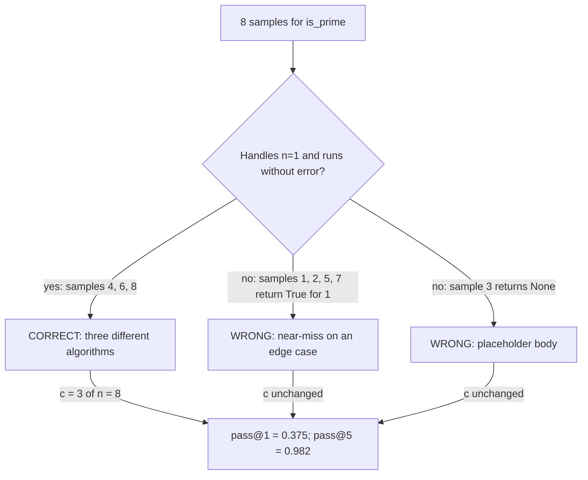

# Evaluating Large Language Models Trained on Code

> **Paper:** Chen, Tworek, Jun, Yuan, Ponde de Oliveira Pinto, Kaplan and many co-authors (mostly OpenAI, San Francisco), 2021 - [arXiv abstract](https://arxiv.org/abs/2107.03374) - [local PDF](../../papers/2107.03374.pdf)
>
> **Short names:** Codex (the model family) and HumanEval (the benchmark). Numbers and section, table and figure numbers follow the arXiv HTML rendering of v2 (revised 14 July 2021). This is a 2021 arXiv preprint; this guide did not find a peer-reviewed venue for it, although it uses a conference-style template. Several figures (2, 5, 7, 12, 15) carry values only as images, so those values are described qualitatively here.

## Read this first

**The claim in one sentence.** A GPT-style language model fine-tuned on public GitHub Python code can write a correct function from a docstring for roughly 29% of 164 hand-written problems on the first try and for about 72% if it is allowed 100 tries and any one try passing the tests counts, and the right way to score such a model is to run its code against unit tests, not to compare its text with a reference answer.

**Who this is for.** Anyone who has seen "pass@1" or "HumanEval" quoted in a model announcement, and anyone designing a test for an assistant that writes code, queries or formulas, because the paper's lasting contribution is the evaluation method.

**Afterwards you will be able to** recompute pass@k from raw counts by hand; say what a unit test is and why the paper prefers it to text similarity; explain why the best sampling temperature depends on k; read the paper's results table without confusing a one-try score with a many-tries score; and list what the benchmark cannot tell you.

**Reading time.** About 50 minutes for this guide. **Have read first:** [GPT-3](../01-foundations/03-gpt3.md) (Codex starts from it), [Scaling laws](../01-foundations/04-scaling-laws.md) (the loss-versus-size curve in Figure 4 is the same kind of curve). Helpful: [InstructGPT](../02-building/08-instructgpt.md), whose human-feedback training is the remedy Appendix E.4 points toward.

**The one thing most people get wrong.** They read "28.8%" as "the model is right 28.8% of the time at coding". It is the chance that a single sampled answer to one of 164 short, self-contained, standalone-function puzzles passes its tests. It is a number about a very specific game: one function, one docstring, no existing codebase, no files, no libraries to install, and (for the headline gap to 72%) many tries with a free automatic checker. [RepoBench](./15-repobench.md) and [SWE-bench](./16-swe-bench.md) exist because that game is narrower than real software work.

## The paper in one worked example

This guide traces one real problem from the paper's Appendix B. It is a HumanEval problem, `is_prime`, shown with eight real samples from Codex-12B (the 12-billion-parameter model) drawn at temperature 0.8. The paper labels each sample CORRECT or WRONG. Every later section refers back to this example.

### Part A - the problem the model sees

The prompt is a function signature plus a docstring (the triple-quoted explanation under the signature). The model must write the body:

```python
def is_prime(n):
    """Return true if a given number is prime, and false otherwise.
    >>> is_prime(6)
    False
    >>> is_prime(101)
    True
    >>> is_prime(11)
    True
    >>> is_prime(13441)
    True
    >>> is_prime(61)
    True
    >>> is_prime(4)
    False
    >>> is_prime(1)
    False
    """
```

The paper says each HumanEval problem also has hidden unit tests, 7.7 on average (Section 2.2). The tests for this problem are not printed in the paper. **Constructed by this guide:** as a stand-in I used the seven examples in the docstring as the tests. The paper's labels and my local run agree on all eight samples, so the stand-in shows the mechanism. The released repository stores tests as a function `check(candidate)` of `assert` lines; that format is from this guide's memory, not from the paper.

### Part B - eight real samples and what happened to them

| Sample | What the code does (paraphrased) | Paper's label | Why (checked by running it against the seven docstring examples) |
|---|---|---|---|
| 1 | Loop `i` from 2 to n-1, return False if `n % i == 0`, else True | WRONG | `is_prime(1)`: the loop is empty, so it returns True; the docstring says False |
| 2 | Identical text to sample 1 | WRONG | Same failure on input 1 |
| 3 | A comment "implement this function" then `pass` | WRONG | Returns None for every input |
| 4 | Handle n<2, n==2, even n, then test odd divisors up to the square root with `any(...)` | CORRECT | Passes all seven |
| 5 | A helper that tests divisors from 2 to int(sqrt(n)+1), wrapped in an if/else | WRONG | For n=1 the range is empty, helper returns True, so wrong on input 1 |
| 6 | Set `prime = True`, return False if n==1, loop 2..n-1 and flip `prime` on a divisor | CORRECT | Passes all seven (slow for big n, but correct) |
| 7 | Identical text to sample 1 | WRONG | Same failure on input 1 |
| 8 | Shortcuts for 2, 3, small and even numbers, then step through candidates 5, 7, 11, 13... in strides of 6 | CORRECT | Passes all seven |

Three correct, five wrong. Notice that four of the five wrong samples (1, 2, 5, 7) fail on one single input, the edge case `n = 1`. They are close to right and still count as zero. That is what "functional correctness" means: the test does not give partial credit for being nearly right.

### Part C - from these eight samples to pass@1 and pass@5

Here n = 8 samples were drawn and c = 3 passed. The paper's estimator (equation 1, Section 2.1) for one problem is 1 - C(n-c, k) / C(n, k), where C(a, b) ("a choose b") counts the ways to pick b items from a.

- **pass@1** with k = 1: C(5,1) = 5 and C(8,1) = 8, so 1 - 5/8 = 3/8 = **0.375**. In words, if you pick one of the eight samples at random, 3 times out of 8 it passes.
- **pass@5** with k = 5: C(5,5) = 1 and C(8,5) = 56, so 1 - 1/56 = 55/56 = **0.9821**. In words, the only way five randomly chosen samples can all fail is if they are exactly the five wrong ones, which is one of 56 equally likely five-sample subsets.
- **pass@8** is 1 - C(5,8)/C(8,8). C(5,8) is zero because you cannot pick 8 from 5, so pass@8 = 1.0. This is the special case in the paper's numpy code: if n - c < k, return 1.0.

I ran the paper's Figure 3 script on these counts and got 0.375, 0.9821 and 1.0, matching the hand calculation. Using n = 10 and c = 3 instead (**constructed by this guide**, for a round-number second check): pass@1 = 1 - 7/10 = 0.3, and pass@5 = 1 - C(7,5)/C(10,5) = 1 - 21/252 = 1 - 1/12 = 0.9167.

The shortcut the paper warns against is 1 - (1 - p)^k with p = c/n. For n = 8, c = 3, k = 5 it gives 1 - 0.625^5 = 0.905, compared with 0.982 from the real formula. Appendix A explains why the shortcut is biased when averaged over many problems.

### Part D - the whole benchmark is this, repeated

Appendix B shows eight randomly chosen HumanEval problems with eight samples each. By this guide's tally of the paper's labels, the numbers of correct samples are 1 (`words_string`), 3 (`is_prime`), 1 (`add_elements`), 0 (`vowels_count`), 0 (`multiply`), 3 (`even_odd_palindrome`), 3 (`longest`) and 0 (`x_or_y`). Average pass@1 over these eight problems is 11/64 = 0.172; average pass@5 is 0.525 (0.625 for c=1, 0.982 for c=3, 0 for c=0); and pass@8 is 5/8 = 0.625 because five problems have at least one correct sample. The 17% is below the paper's 28.8% because eight problems is a tiny sample and because temperature 0.8 is worse for pass@1 than the best setting of 0.2 (Section 3.3).

```mermaid
flowchart LR
    P["Prompt: signature + docstring of is_prime"] -->|"sample n=8, temperature 0.8, top-p 0.95, stop at next top-level def or print"| S["8 candidate bodies"]
    S -->|"each body appended to the prompt and run"| T["Sandbox runs the unit tests"]
    T -->|"pass or fail per sample"| C["count c = 3 correct"]
    C -->|"1 - C(n-c,k) / C(n,k)"| K["pass@1 = 0.375 and pass@5 = 0.982 for this problem"]
    K -->|"average over all 164 problems"| H["Benchmark score, e.g. 28.8% pass@1 for Codex-12B"]
```



Notice that the model never sees the tests; they only decide labels afterwards.



Notice that the three correct samples are three different programs, which is why text matching fails: there is no single "right text".

## Words you need

| Term | Plain definition | Example from the worked example |
|---|---|---|
| Docstring | The explanation in triple quotes under a function signature, which the model reads as its instructions. | The "Return true if a given number is prime..." text with seven `>>>` examples. |
| Unit test | A small program that calls a function with chosen inputs and checks the outputs, passing only if every check matches. | `is_prime(1)` must give False; samples 1, 2, 5 and 7 fail it. |
| Functional correctness | A program is correct if it passes the tests, whatever its text looks like. | Samples 4, 6 and 8 are three different texts, all correct. |
| BLEU (bilingual evaluation understudy) | A score from machine translation that counts overlapping word sequences between a candidate and a reference text. | Sample 1 (wrong) overlaps a correct sample much more than another correct sample does; see Prerequisite 5. |
| n, c, k | n = samples drawn per problem; c = how many of them pass; k = how many tries you are "allowed" in the metric. | n = 8, c = 3, k = 1 or 5. |
| pass@k | The probability that at least one of k samples passes the tests, averaged over problems. | 0.375 for k=1 and 0.982 for k=5 on `is_prime`. |
| Temperature (T) | A dial for randomness when sampling: near 0 the model almost always picks its top choice; at 1 it samples from its raw probabilities. | The eight samples used T = 0.8, which is why they differ. |
| Codex | GPT models of 12 million to 12 billion parameters fine-tuned on 159 GB of Python from GitHub. | The "Codex-12B" that wrote the eight samples. |
| Codex-S | Codex further fine-tuned on correct standalone functions with tests (Section 4). | Raises Codex-12B's pass@1 from 28.8% to 37.7%. |

## Tutorial 1 - Intuitive understanding

### What was broken before

Before this paper, code-writing models were mostly graded the way translation systems are graded: compare the model's text with a reference answer and count similar word sequences. Two things are wrong with that for code. First, many different programs do the same job (the three correct `is_prime` samples above share almost no text). Second, a program that looks nearly identical to a correct one can be broken: samples 1 and 6 differ mainly by an `n == 1` check, and one is right while the other is wrong.

The second gap was data: GitHub holds public solutions to many contest problems, so the authors hand-wrote new ones (Section 2.2).

### The idea

**Analogy.** Think of marking a plumbing apprentice. You could compare their drawing of the pipe layout with the master's drawing (text similarity), or you could turn the water on and see whether anything leaks (functional correctness). Many different layouts hold water, and one wrong joint ruins a layout that looks perfect.

Now add retries: if the apprentice builds ten layouts and you need only one that holds, success becomes likely even when each layout is a coin-flip. That is pass@k.

**Where the analogy breaks.** Water pressure tests are exhaustive; unit tests are not. A program can pass 7.7 tests on average and still be wrong on an input nobody tried (Section 8 cites work where genetic-programming "fixes" passed weak test suites by deleting the failing feature). Also, "keep sampling until a test passes" needs tests, and a deployed autocomplete tool has none.

### How it works, step by step

1. **Collect training code.** In May 2020 the authors gathered Python from 54 million public GitHub repositories: 179 GB of unique files, 159 GB after filtering out likely auto-generated files and files with odd line lengths (Section 3.1).
2. **Fine-tune a GPT model on it.** Models of up to 12 billion parameters were trained for 100 billion tokens (Section 3.2). Starting from the text model did not improve the final score but reached it faster.
3. **Build the test.** Write 164 problems by hand, each with a signature, docstring, reference body and tests, and run model output only inside a sandbox (Sections 2.2 and 2.3).
4. **Sample, run, count.** For each problem draw many completions (200 for the main tables), stopping each at the next top-level definition, run the tests, count c and plug n, c, k into the estimator.
5. **Improve the model for this task.** Fine-tune further on up to about 50,000 curated functions (before filtering), producing Codex-S (Section 4).
6. **Pick a winner without tests.** Rank 100 samples by confidence (mean log-probability) or by "back-translation" score from a docstring-writing model, Codex-D (Sections 3.3 and 5).
7. **Check the damage.** Test chained instructions, document failure modes, and write a hazard analysis (Sections 6 and 7).

### What the results say

All numbers are from the paper's Table 1 unless stated otherwise. Percentages are the average over 164 problems, so each point is about 1.6 problems.

- **One try (pass@1).** Codex-12B solves 28.81% (about 47 of 164 problems). GPT-J, an open 6-billion-parameter model trained on a text mix with 8% code, solves 11.62%. The abstract and introduction say 11.4%; the table says 11.62%. Codex-12B is therefore about 17 points better: out of every 100 problems, roughly 17 more are solved on the first attempt. GPT-3 models of comparable size score "near 0%" (Section 3.4; the exact values appear only in Figure 1 as a plot). TabNine, a commercial autocomplete product (largest free model), solves 2.58%.
- **A hundred tries (pass@100).** Codex-12B reaches 72.31% (about 119 problems), GPT-J 27.74%, TabNine 7.59%. The abstract says "70.2%". This guide could not find 70.2 anywhere in the tables; see the inconsistency list in the FAQ.
- **Supervised fine-tuning.** Codex-S-12B reaches 37.7% pass@1 (introduction and Figure 1), about 9 points above Codex-12B. Across model sizes the average gain is 6.5 points at pass@1 and 15.1 points at pass@100 (Section 4.5).
- **Picking without tests.** With 100 samples at temperature 0.8, an oracle that knows the tests gets 77.5% (Figure 1, Codex-S). Choosing the sample with the highest mean log-probability gets 44.5%. Confidence ranking recovers only a modest slice of the gap between 37.7% and 77.5%. Choosing by total (summed) log-probability can do slightly worse than choosing at random (Section 3.3).

With 164 problems, a rate near 29% has a standard error of about 3.5 points (this guide's calculation, sqrt(0.288 x 0.712 / 164)), ignoring the extra noise from sampling. A 2-point gap between two models on this benchmark is within noise; a 17-point gap is not.

### What this does not show

- **It does not show the model "understands" programming.** Section 6 reports the opposite signal: a strong student after an introductory course would solve a larger fraction of problems than Codex-12B, even though the model saw hundreds of millions of lines of code.
- **It does not show real-software ability.** The tasks are single functions with no existing code. See [RepoBench](./15-repobench.md) for completing code inside a repository and [SWE-bench](./16-swe-bench.md) for fixing real issues.
- **It does not show safe or maintainable code.** Passing 7.7 tests says nothing about security, readability or licensing; Section 7 treats those separately.
- **The 72% figure is not a deployment number.** Pass@100 assumes a free automatic oracle and 100 generations per problem.
- **The paper says nothing about languages other than Python.**

### Teach-back

**1. Why are samples 4 and 6 both CORRECT when their text is so different?**

<details><summary>Answer</summary>
The paper's metric is whether the code passes the tests. Sample 4 uses odd-divisor checks up to the square root and sample 6 uses a flag and a full loop; both give the right output on every test input, so both count.
</details>

**2. A problem has n = 6 samples, of which c = 2 pass. What are pass@1 and pass@3?**

<details><summary>Answer</summary>
pass@1 = 1 - C(4,1)/C(6,1) = 1 - 4/6 = 0.333. pass@3 = 1 - C(4,3)/C(6,3) = 1 - 4/20 = 0.8.
</details>

**3. Why does a hotter sampling temperature help pass@100 but hurt pass@1?**

<details><summary>Answer</summary>
One try wants the single most likely program (low temperature). A hundred tries waste duplicates, and the metric rewards only at least one success, so diversity wins. For the 679M model the paper finds 0.2 best at k = 1 and 0.8 at k = 100.
</details>

## Tutorial 2 - Practitioner understanding

### The design in concrete terms

**Benchmark data.** HumanEval has 164 problems, each with a function signature, docstring, reference body and an average of 7.7 unit tests (Section 2.2). The repository is `github.com/openai/human-eval`. The record fields (`task_id`, `prompt`, `entry_point`, `canonical_solution`, `test`) are from this guide's memory of the repository, not the paper.

**Prompt assembly.** The prompt is a header, the signature and the docstring (Figure 2 and Section 3.2). The paper describes no added instruction or few-shot examples for HumanEval.

**Sampling settings the paper states.** Nucleus sampling with top-p 0.95 everywhere (Section 3.2). Stop sequences: `\nclass`, `\ndef`, `\n#`, `\nif`, `\nprint`. n = 200 samples per problem and k up to 100 for the main numbers (Section 2.1). Temperature chosen per k: 0.2 for pass@1 and 0.8 for pass@100 for Codex (Section 3.3); T = 0 for pass@1 and T = 1 for pass@100 for Codex-S (Section 4.5).

**Training hyper-parameters stated.** Same learning rate as the matching GPT model, a 175-step linear warmup and cosine decay, 100 billion training tokens, Adam with beta1 = 0.9, beta2 = 0.95, epsilon = 1e-8, weight decay 0.1 (Section 3.2). Whitespace runs got extra tokens, which cut the number of tokens needed for code by about 30%. Codex-S used a learning rate one tenth as large, masked the loss on prompt tokens, and trained until validation loss plateaued, under 10 billion tokens (Section 4.4).

**Supervised data for Codex-S (Section 4).** About 10,000 contest and interview-site problems (tests from statement examples plus extra tests recovered by submitting incorrect solutions) and about 40,000 functions traced with `sys.setprofile` while their projects' own continuous-integration tests ran. Codex-12B then drew 100 samples per problem and any problem with no passing sample was dropped as ambiguous or too hard (Section 4.3). This filter is worth copying and worth being careful about; see Threats to validity. The sandbox (Section 2.3) is the gVisor container runtime plus eBPF firewall rules that block network traffic other than experiment control.

### A minimal version

This is a scoring harness, the benchmark's actual engine. It takes problems in the HumanEval record shape, a `generate` function you supply, and returns pass@k. It is **not a sandbox**: run it only in a throwaway container or VM with no network and no secrets, because it executes whatever the model writes. The two lines that define `pass_at_k` are the paper's Figure 3.

```python
import json, subprocess, sys, tempfile
import numpy as np
from concurrent.futures import ThreadPoolExecutor

STOP = ["\nclass", "\ndef", "\n#", "\nif", "\nprint"]   # Section 3.2

def pass_at_k(n, c, k):                                 # Figure 3
    if n - c < k:
        return 1.0
    return 1.0 - np.prod(1.0 - k / np.arange(n - c + 1, n + 1))

def truncate(text):
    cuts = [text.find(s) for s in STOP if s in text]
    return text[:min(cuts)] if cuts else text

def passes(problem, completion, timeout=3.0):
    program = (problem["prompt"] + truncate(completion) + "\n\n" + problem["test"]
               + f"\n\ncheck({problem['entry_point']})\n")
    with tempfile.NamedTemporaryFile("w", suffix=".py", delete=False) as f:
        f.write(program)
    try:   # NOT a sandbox
        r = subprocess.run([sys.executable, "-I", f.name], capture_output=True, timeout=timeout)
        return r.returncode == 0
    except subprocess.TimeoutExpired:
        return False

def evaluate(problems, generate, n=20, ks=(1, 5), temperature=0.2, workers=8):
    """problems: dicts with task_id, prompt, test, entry_point.
    generate(prompt, n, temperature) -> list of n completion strings."""
    per_problem = {}
    with ThreadPoolExecutor(workers) as pool:
        for p in problems:
            outs = generate(p["prompt"], n, temperature)
            ok = list(pool.map(lambda c: passes(p, c), outs))
            per_problem[p["task_id"]] = (len(outs), sum(ok))
    return {f"pass@{k}": float(np.mean([pass_at_k(nn, c, k) for nn, c in per_problem.values()]))
            for k in ks if k <= n}, per_problem
```

Input shape: one JSON object per problem, `{"task_id": ..., "prompt": "def is_prime(n):\n    \"\"\"...\"\"\"\n", "entry_point": "is_prime", "test": "def check(candidate):\n    assert candidate(6) == False\n    ..."}`. Output shape: `({"pass@1": 0.30, "pass@5": 0.9167}, {"demo/is_prime": (10, 3)})`. I ran this with a fake generator returning 3 correct and 7 incorrect bodies for one problem and got exactly 0.30 and 0.9167, matching the hand calculation in the worked example.

To adapt it to your own assistant, replace `prompt` with whatever context the assistant sees, replace `check` with your own assertions, and keep the rest.

### What it costs

Assumptions (all **constructed by this guide**, change them for your setup): 164 problems, n = 200 samples each, 150 prompt tokens and 100 completion tokens per sample, a price of 1.00 currency units per million tokens for both input and output, and 0.2 seconds per test execution.

- **Samples:** 164 x 200 = 32,800 generations.
- **Tokens:** 32,800 x 250 = 8.2 million, so about 8.2 units of money at the assumed price. With n = 20, it is 0.82.
- **Test time:** 32,800 x 0.2 s = 6,560 s, about 1.8 hours on one core, or about 14 minutes on 8 workers.

Training costs from the paper: 100 billion tokens for Codex, under 10 billion for Codex-S, and "hundreds of petaflop/s-days" for both the GPT-3-12B pre-training and the Codex fine-tuning (Section 7.6). For a builder the test-time cost matters more: pass@100 means 100 model calls per task.

### How it fails

| Symptom | Likely cause | Mitigation | Grounding |
|---|---|---|---|
| Sample is almost right, fails one input (n = 1, empty list) | Edge cases implied but not stated; model copies a common pattern | Put edge-case examples in the docstring; run tests that probe boundaries | `is_prime` samples 1, 2, 5, 7 |
| Placeholder or empty body (`pass`, `return`) | Sampling at high temperature, or an under-specified prompt | Lower temperature for single-shot use; filter obviously empty bodies before running | `is_prime` sample 3; `add_elements` sample 6 |
| Misread rule ("y counts as a vowel only at the end") | Spec has a special case the model treats as noise | Test the special case directly; use stronger models or examples | `vowels_count`: all eight samples wrong (Appendix B) |
| Longer docstring, lower pass rate | Errors compound across chained operations | Split the task into steps and verify each step | Section 6, Figure 11: factor of 2-3 per added instruction |
| Score too high on a public benchmark | Training data contamination | Use private or fresh tasks | Section 2.2 motivation (this guide infers the later risk) |

### Evaluating your version

- **Metric.** Report pass@1 at the best low temperature (the paper's best was 0.2) and, if sampling is part of your product, pass@k at the temperature that is best for that k. State n, k and T every time; a pass@1 and a pass@100 are different measurements.
- **Test set size.** At p near 0.3 the standard error is sqrt(0.3 x 0.7 / N). For a standard error of 1 point you need N of about 2,100 problems; with N = 164 expect about 3.6 points. If you can, compare two systems on the same problems with a paired comparison (per-problem differences) which is more sensitive than comparing two averages.
- **Baseline.** Include an empty-body function and the strongest model you can afford, so you can see the range.
- **Stop rule.** Stop collecting samples per problem when pass@k changes by less than the benchmark's standard error between n = 100 and n = 200; stop tuning temperature once the best value is at the same setting for two adjacent values of k. Tune temperature on a separate set, not on the tasks you report.
- **Guard against cheating tests.** Spot-check twenty passing samples by hand; weak tests let deletions and hard-coded answers pass.

### Adopt, adapt or skip

**Adopt** the evaluation idea, whenever your assistant's output can be checked by running something: a formula that must recompute a known total, a query that must return a known row count, a document extraction that must match a labelled field. Define the check first, then sample, then count. It costs almost nothing.

**Adapt** pass@k. For an assistant over private business documents, the closest equivalent is "extract or compute, then run an automatic checker, retry on failure". If you have a cheap checker, sampling several candidates from a smaller open model and keeping the one that passes can close part of the gap to a larger model; the paper's own gap (28.8% to 72.3% for the same 12-billion-parameter model) is evidence for that direction, though it is from code, in 2021, with strong tests. If you have no checker, the paper's ranking result is the caution: confidence-based picking reached only 44.5% against the 77.5% oracle score.

**Skip** HumanEval itself as proof that an assistant can work with your documents or your code base. The tasks are 164 puzzle-sized functions in one language, and the scores of recent models on it are near ceiling, so it no longer separates strong models (this guide's observation from outside the paper). Skip Codex itself, a 2021 model.

For the curriculum's through-question (whether a thin runtime around a model that picks a few good tools is the right architecture), this paper contributes one ingredient: the verifier. A thin runtime that can run a test, read the result and try again is exactly the loop in [ReAct](../02-building/10-react.md) and later [CodeAct](../06-agent-systems/25-codeact.md); the paper shows quantitatively why the retry loop pays off when a trustworthy checker exists. On the goal of getting more from smaller models through context and instructions, the docstring is the entire context here, and Appendix E (bugs in the context make answers worse) says context quality matters.

## Tutorial 3 - Researcher understanding

### Formal setup

Let there be N problems indexed by i (N = 164). Each problem has a prompt x_i and a test suite T_i that maps any candidate program y to pass (1) or fail (0). A model with parameters theta defines a distribution p(y | x_i) over programs, and a sampling procedure (temperature T, top-p 0.95, stop sequences) turns it into draws y_{i,1}, ..., y_{i,n}. Define the per-problem success probability s_i = P(T_i(y) = 1) for one draw. If the k draws were independent, the chance that at least one passes is 1 - (1 - s_i)^k.

Draw n samples, let c_i be the number that pass, and use the paper's estimator for problem i:

pass@k_i = 1 - C(n - c_i, k) / C(n, k), and pass@k = (1/N) x sum over i of pass@k_i.

The symbols: C(a, b) is the binomial coefficient ("a choose b"); n is at least k; c_i is between 0 and n. The paper writes the benchmark average as an expectation over problems (equation 1).

**Numeric toy instance (constructed).** Three problems each with n = 10 samples: c = 3, c = 0, c = 10. Per-problem pass@1 = 0.3, 0, 1, so the benchmark pass@1 = 1.3/3 = 0.4333. Per-problem pass@5 = 0.9167, 0, 1, so pass@5 = 1.9167/3 = 0.6389. I computed both with the Figure 3 script. Notice that benchmark pass@5 is not 1 - (1 - 0.4333)^5 = 0.9416; averaging per problem is the point.

**Why it is unbiased (Appendix A).** If c ~ Binomial(n, s), then the expected value of C(n - c, k) / C(n, k) is the probability that k draws without replacement from the n are all failures, and that equals (1 - s)^k. So the estimator's expectation is 1 - (1 - s)^k exactly. The shortcut 1 - (1 - c/n)^k is a nonlinear function of c/n, so its expectation falls below 1 - (1 - s)^k (Jensen's inequality, this guide's gloss); Appendix A and Figure 13 show the shortfall persists even when n is more than 5k.

### The claims, stated precisely

1. On HumanEval, Codex-12B has pass@1 = 28.81% and pass@100 = 72.31% (Table 1), against 11.62% and 27.74% for GPT-J-6B and 2.58% and 7.59% for TabNine; comparable GPT models are near 0% (Section 3.4, Figure 1).
2. Held-out code loss follows a power law in non-embedding parameters (Figure 4), as (N / 5.92e7)^(-0.13) with units not stated in the text; pass@1 and pass@100 rise smoothly with size (Figure 6).
3. The best temperature rises with k (Figure 5); for the 679M model it is 0.2 at k = 1 and 0.8 at k = 100.
4. Codex-S improves pass@1 by 6.5 points and pass@100 by 15.1 points on average (Section 4.5); Codex-S-12B reaches 37.7% pass@1 and 77.5% with 100 samples and an oracle (Figure 1).
5. Mean log-probability beats random choice; summed log-probability can be slightly worse than random; back-translation beats random but loses to mean log-probability (Figure 7).
6. BLEU distributions for correct and wrong samples overlap (Figure 8).
7. Pass rate on synthetic operation chains falls roughly exponentially with chain length (Figure 11).
8. Buggy prompt context lowers output quality, more so for larger models (Figures 12, 14); the authors call this misalignment and speculate it may persist or worsen with scale.

Claims 1-7 are measurements. Claim 8 adds the authors' operational definition of "capable" and "intent misaligned" (Appendix E.2). Section 7 is judgement, apart from the cryptographic probe.

### Evidence, table by table

**Table 1 (Section 3.4).** Rows: GPT-Neo 125M, 1.3B, 2.7B; GPT-J 6B; TabNine; Codex 12M to 12B. Columns: pass@1, pass@10, pass@100. Codex-12B 28.81 / 46.81 / 72.31; Codex-2.5B 21.36 / 35.42 / 59.5; Codex-300M 13.17 / 20.37 / 36.27; Codex-12M 2.00 / 3.62 / 8.58; GPT-Neo-2.7B 6.41 / 11.27 / 21.37; GPT-J 11.62 / 15.74 / 27.74; TabNine 2.58 / 4.35 / 7.59. Notice that the pass@100 minus pass@1 gap grows from 6.6 points (12M) to 43.5 points (12B): bigger models have both a better top guess and more latent solutions to find by sampling. Identifies: a comparison under one measurement, with temperature tuned per model (best of 0.2, 0.4, 0.8 for GPT-Neo; of 0.2, 0.8 for GPT-J). Associates only: tokenizers, data and compute differ, so "Codex beats GPT-J" describes the whole recipe, not one ingredient. GPT-3 has no row.

**Table 2 (Section 3.5, APPS).** Rows: GPT-Neo-2.7B fine-tuned on APPS (numbers quoted from the APPS paper) and 1-shot Codex-12B at raw pass@1, 5, 100, 1000 and filtered pass@1, 5; columns: Introductory, Interview, Competition. APPS (5,000 test problems) reads standard input and prints output, so the paper appends one example to the docstring as a format hint. Codex-12B raw pass@1 is 4.14%, 0.14% and 0.02%; raw pass@1000 is 25.02%, 3.70% and 3.23%; filtered pass@1 (keep only samples passing the 3 statement examples) is 22.78%, 2.64% and 3.04%. Notice that filtering by the statement's own examples (22.78%) gets close to 1,000 raw samples (25.02%) on introductory problems. The paper used T = 0.6 for every k and a 3-second timeout. Associates only: Codex was not fine-tuned on APPS, so this is a transfer result.

**Table 3 (Section 5).** Codex-S-12B 32.2% / 59.5% (pass@1 / pass@10) against Codex-D-12B 20.3% / 46.5%, with Codex-D hand graded on 10 samples for each of 164 problems at temperature 0.8. It identifies nothing about why docstrings are harder; the authors have no strong hypothesis for which direction should score higher.

**Figures 5 and 6 (temperature).** Pass@k against k for several temperatures and the upper envelope. This manipulates T directly on one model, so it is the best-supported causal result in the paper. Values are image-only.

**Figure 7 (ranking).** Selection rules for Codex-12B at T = 0.8: random choice as the baseline (this guide's reading), mean log-probability, back-translation, and the oracle. Section 4.5 adds that log-prob ranking beats random by 11.6 points on average for Codex-S, over 2 points more than for Codex.

**Figures 12 and 14 (alignment).** Three buggy or correct solutions, from 30 problems (the first 30 alphabetically by function name), are prepended to each task. Appendix E.5 says T = 0.2 and 158 problems. Buggy context lowers the pass rate, the gap grows with size, and an instruction to write correct code helps "a little". The manipulated variable is the context, so the effect is causal, but the reason is not identified.

**Figure 15 (insecure crypto).** About 30,000 samples over 5 prompts; clearly insecure means an RSA key under 2,048 bits or AES in ECB mode. The paper reports significant fractions and no robust trend over one order of magnitude of size; percentages are image-only.

### Ablations and what they isolate

- **GPT initialisation versus scratch (Section 3.2).** No final gain, faster convergence; no numbers given.
- **Codex versus Codex-S (Section 4).** Isolates a shift of the fine-tuning distribution toward the task format, but confounds format match, extra data, solution quality and style overlap with HumanEval.
- **Temperature sweep (Figures 5, 9).** Isolates diversity from model quality. Codex-S prefers higher T for k above 1, which the authors speculate reflects a narrower learned distribution.
- **Mean versus sum log-probability versus back-translation (Figure 7).** Same model and samples, different ranking rule. That summing penalises long programs is this guide's inference.
- **Biased versus unbiased estimator (Appendix A, Figure 13).** Same samples, different estimator.
- **Missing:** data-amount ablations, tokenizer ablation, and a second independently written problem set.

### Threats to validity specific to this paper

1. **Test-set tuning.** Temperatures were swept on HumanEval itself and reused for reported scores; GPT-Neo and GPT-J got only two or three temperatures. This favours Codex by an unknown amount.
2. **Contamination for later users.** Hand-writing addresses pre-2021 leakage, but the dataset is public, so later models trained on web data may have seen it (this guide's inference).
3. **Selection of Codex-S problems (Section 4.3).** Problems were kept only if Codex-12B solved them at least once in 100 samples, so the Codex-to-Codex-S gain may partly reflect self-distillation.
4. **Small test suites.** 7.7 tests per problem on average and no reported audit; Section 8 itself cites cases where weak tests were gamed.
5. **Hand grading.** Codex-D was graded by the authors against a partly subjective criterion, with no reported agreement rate.
6. **One language, one style, easy problems.** The authors compare the difficulty to easy interview questions.
7. **Thin misalignment evidence.** 30 hand-made buggy solutions; the paper concedes a robustness explanation cannot be fully excluded.
8. **Judgement-based hazard analysis.** Appendix H calls the economic analysis "highly preliminary".

### Open problems and follow-ups

- **Selection without tests.** Mean log-probability reaches 44.5% where the oracle reaches 77.5%. Learned verifiers and execution-based reranking are natural follow-ups (not tested here).
- **Larger tasks.** See [RepoBench](./15-repobench.md), [SWE-bench](./16-swe-bench.md) and [SWE-agent](../06-agent-systems/26-swe-agent.md).
- **Alignment of code models.** The remedies named in Appendix E (data curation, quality labels, human-feedback training) are developed in [InstructGPT](../02-building/08-instructgpt.md).
- **Over-reliance.** The authors call for empirical work on keeping users vigilant (Section 7.1).

### What would change my mind

- If a second, independently written set of 164 problems gave Codex-12B a pass@1 more than about 7 points (two standard errors) away from 28.8%, I would stop treating HumanEval as representative of the model's single-function ability.
- If a test-quality audit showed that a large share of samples labelled correct fail a stronger test suite, the 72% figure would lose its meaning.
- If the buggy-context gap vanished when the buggy examples came from a different author, the misalignment story would reduce to a prompt-format effect.

## Reading map for the PDF

| Section or figure | What it contains | First pass | Guide section that answers the questions it raises |
|---|---|---|---|
| Abstract and Section 1, Figure 1 | Headline numbers, Codex-S, ranking and oracle numbers | Read | Tutorial 1 results; FAQ on numbers that disagree |
| Section 2.1 and Figure 3 | pass@k estimator and numpy code | Read slowly | Worked example Part C; Prerequisite 3 |
| Section 2.2 | HumanEval: 164 problems, 7.7 tests | Read | Words you need; Threats to validity |
| Section 3.3, Figures 4-8 | Loss law, temperature, ranking, BLEU | Read | Tutorial 3 evidence; Prerequisites 2, 4, 5 |
| Section 3.4, Table 1 | Comparisons with GPT-Neo, GPT-J, TabNine | Read | Tutorial 1 results; Tutorial 3 Table 1 |
| Section 4, Figures 9-10 | Codex-S data and results | Read | Tutorial 2 design; Tutorial 3 claims |
| Section 6, Figure 11, Appendix C | Limitations and synthetic chains | Read | How it fails; Figure 11 note |
| Section 7 (7.1-7.8) | Hazards and broader impacts | Read 7.1, 7.2, 7.5; skim rest | FAQ on hazards; Threats |
| Appendix A | Proof of unbiasedness | Skim, then read once | Tutorial 3 formal setup |
| Appendix B | 8 problems with 8 samples each | Read the is_prime one | The worked example |
| Appendix G | Security: misuse, insecure code | Read G.3 | How it fails |

## Questions readers get stuck on

#### What exactly is a "unit test", and how is it different from checking the answer?

A unit test is a tiny program that calls the function under test with chosen inputs and compares the return values with expected ones, failing on any mismatch. "Checking the answer" in older work meant comparing the model's code text with a reference. Tests run the code and judge behaviour, so any correct implementation passes however it is written. HumanEval problems average 7.7 tests (Section 2.2).

#### Why does the paper reject BLEU, and what does it use instead?

BLEU counts overlapping word sequences with a reference. Section 2.1 gives two arguments: match-based metrics cannot cope with the large space of programs that are functionally equivalent to the reference, and earlier work found BLEU misses code semantics. Figure 8 shows the BLEU distributions for correct and wrong samples overlap, and a wrong sample is guaranteed to disagree with the reference on some input. The paper uses functional correctness instead. Prerequisite 5 shows a constructed case where a wrong program overlaps a correct one more than another correct program does.

#### What does pass@k measure, and why is pass@1 not just "the share of correct samples"?

Pass@k is the probability that at least one of k samples passes, averaged over problems. For k = 1 it is, per problem, c/n, so averaged over problems it is the expected share of correct samples when you take one at random. For larger k the estimator computes the exact chance that k samples drawn without replacement from your n are not all failures. The Figure 3 script evaluates it as a product to avoid enormous binomial numbers.

#### Why not just compute 1 - (1 - pass@1)^k?

It is biased low. With n = 8, c = 3, k = 5 it gives 0.905 where the unbiased formula gives 0.982. Appendix A shows the shortfall persists even when n exceeds 5k, so runs with fewer samples would look worse than runs with more.

#### Several headline numbers disagree across the paper. Which should I trust?

Trust the tables, and note these inconsistencies, which this guide flags and does not repair. (1) GPT-J is 11.4% in the abstract and introduction, 11.6% in Section 3.4 and 11.62% in Table 1. (2) The abstract says 70.2% with 100 samples; Table 1 has Codex-12B at 72.31% pass@100, Figure 1 has 77.5% for Codex-S with an oracle, and 70.2 appears nowhere else. (3) Figure 1's caption says all samples use T = 0.8, while Section 4.5 says Codex-S uses T = 0 for pass@1, and Table 3's 32.2% for Codex-S-12B is therefore, by this guide's inference, the T = 0.8 value. (4) Appendix E.5 uses 158 HumanEval problems, not 164. (5) Section 5 says "1640 problems" for Codex-D grading, which is 10 samples for each of 164 problems. (6) Section 3.4 gives GPT-Neo pass@100 as 21.3%, Table 1 gives 21.37%. (7) GPT-3's 0% appears only in Figure 1.

#### Why is the best temperature different for pass@1 and pass@100?

At T near 0 the model repeats its most likely program: ideal for one try, wasteful for a hundred because duplicates add nothing. A higher T yields diverse programs, so the chance that some one is right rises. For the 679M model the best T is 0.2 at k = 1 and 0.8 at k = 100 (Section 3.3); Codex-S prefers 0 and 1 (Section 4.5).

#### Does a high HumanEval score mean the model can work on my code base?

No. Each problem is a standalone function with no other files, no imports to resolve and no existing tests to keep green. Real changes touch several files and are judged by a project's own tests, which is why [RepoBench](./15-repobench.md) (repository-level completion) and [SWE-bench](./16-swe-bench.md) (real issues) exist. The paper itself says coding "involves much more than synthesizing code from docstrings" (Section 8).

#### Is it safe to run the code a model writes?

Not by default. The authors built a sandbox (Section 2.3) because scraped and generated code can modify a host, read secrets or send data out. The harness above has no isolation, so use a disposable container with no network or credentials.

#### What did the paper say about the risks of code-writing models?

Section 7 is a hazard analysis, which is judgement and not experiment, apart from one crypto probe. Over-reliance: code that looks right but is not, especially for novices. Misalignment: the model continues its prompt's style, so subtle bugs in the context give worse code, and the gap grows with size (Figure 12). Bias: stereotyped structures and harmful comments. Economics: gains limited because engineers do more than write code; import rates can favour some libraries (6 of 100 completions imported TensorFlow, 3 PyTorch). Security: insecure cryptographic settings are common; Codex did not materially lower the barrier to malware, except possibly polymorphic malware. Legal: exact matches to training data were under 0.1% in one study. Mitigations: documentation, review rules, output filters, monitoring, rate limits.

## Prerequisites you actually need

### Prerequisite 1 - Unit tests and functional correctness

A test is code that calls your function and compares results. A function is "functionally correct" for the benchmark when all tests pass. Tiny example: tests for `is_prime` with inputs (6, 101, 1) and expected (False, True, False). A function that always returns True fails on 6 and 1, and a function that uses `n > 1 and all(n % d for d in range(2, n))` passes all three. Used in the paper at Section 2.1 and in every score. For more on benchmark design see the repository's [benchmark field guide](../../references/repository-benchmark-field-guide.md).

### Prerequisite 2 - Sampling, temperature and top-p

A language model gives each possible next token a probability. Temperature T rescales the log-probabilities before sampling: dividing by a small T sharpens the distribution, and by T = 1 leaves it unchanged. Tiny example: next-token probabilities 0.6, 0.3, 0.1. Raising each to the power 1/T and normalising with T = 0.5 gives 0.36, 0.09, 0.01 which rescale to 0.783, 0.196, 0.022 (sharper); with T = 1 they stay 0.6, 0.3, 0.1. Top-p 0.95 keeps the smallest set of tokens covering 95% of the probability, here all three (0.6 + 0.3 = 0.9 is under 0.95), so top-p removes nothing in this example. Used in Sections 3.2-3.3 and Figure 5. See [GPT-3](../01-foundations/03-gpt3.md) and the [math bridge](../../references/math-bridge.md).

### Prerequisite 3 - Binomial coefficients and "at least one success"

C(a, b) = a! / (b! (a-b)!) counts the ways to choose b of a items. Tiny example: C(5,2) = 10, C(8,5) = 56. If c of n samples are correct, the chance that k samples chosen without replacement all fail is C(n-c, k) / C(n, k); one minus it is pass@k. With n = 8, c = 3, k = 5: 1 - 1/56 = 0.982. Used in equation 1 and Appendix A. See the [math bridge](../../references/math-bridge.md).

### Prerequisite 4 - Log-probability, summed and averaged

A model assigns each token a probability; the log of that is negative, and the sum over a sample's tokens is the sample's log-probability. Longer samples have more negative sums, which is why the paper's mean-versus-sum difference matters. Constructed example: sample A has four tokens each with probability 0.9, and sample B has two tokens each with probability 0.85. Natural-log sums: A = 4 x (-0.105) = -0.421, B = 2 x (-0.163) = -0.325, so the sum prefers B. Per-token means: A = -0.105, B = -0.163, so the mean prefers A, the more confident sample. Used in Section 3.3 and Figure 7. See [scaling laws](../01-foundations/04-scaling-laws.md) for loss as average log-probability.

### Prerequisite 5 - BLEU as n-gram overlap

BLEU counts how many short word sequences (n-grams) of the candidate also appear in the reference, then combines the counts for n = 1 to 4 with a length penalty. Constructed illustration of the idea (this is plain n-gram precision, not full BLEU): take the correct `is_prime` sample 6 as the reference. The wrong sample 1 has 22 tokens and all of its single tokens appear in sample 6 (unigram precision 1.00) and 95% of its two-token sequences do. The correct sample 4 has 57 tokens, with only 51% unigram precision and 25% bigram precision. By overlap, the wrong program looks nearly perfect and the correct different program looks poor. Used in Section 2.1, Section 3.3, Figure 8. See the repository [glossary](../../references/glossary.md) for evaluation terms.

## Where this sits in the curriculum

**Read before:** [GPT-3](../01-foundations/03-gpt3.md) for the base model and few-shot idea, and [Scaling laws](../01-foundations/04-scaling-laws.md) for loss-versus-size. **Nearest neighbours in this stage:** [MMLU](./11-mmlu.md) measures broad knowledge through multiple-choice answers that are scored by exact match, while this paper scores generated programs by executing them. [HELM](./13-helm.md) argues for many metrics across many scenarios, while this paper commits to one executable metric on one narrow task and goes deep.

**Next:** [RepoBench](./15-repobench.md), which moves from single functions to completing code with repository context, then [SWE-bench](./16-swe-bench.md), where the test suite of a real project decides whether a model resolved a real issue. Those two papers answer the main limit of this one. After that, [CodeAct](../06-agent-systems/25-codeact.md) turns code from something a model writes for a reader into the action itself, with execution output fed back, and [SWE-agent](../06-agent-systems/26-swe-agent.md) wraps a model with an interface for repository work. Both inherit this paper's habit of letting an executable check decide.

## Checkpoint

1. **Compute.** A problem has n = 20 samples and c = 4 pass. Give pass@1 and pass@2.

<details><summary>Answer</summary>
pass@1 = 4/20 = 0.20. pass@2 = 1 - C(16,2)/C(20,2) = 1 - 120/190 = 0.3684. The shortcut 1 - 0.8^2 = 0.36 is slightly lower, as Appendix A predicts.
</details>

2. **Critique.** A vendor claims "80% on HumanEval". List four questions.

<details><summary>Answer</summary>
Pass@1 or pass@k, and which k? What temperature, and was it tuned on HumanEval? How many samples n? Could the model have seen the problems, and do the tests catch plausible wrong code? Also, what does a single-function score say about your tasks?
</details>

3. **Compute.** Codex-12B has 28.81% and GPT-J 11.62% pass@1. How many more of the 164 problems does Codex-12B solve on one try, and is a 2-point gap meaningful?

<details><summary>Answer</summary>
The gap is 17.19 points, about 28 problems. With a standard error near 3.5 points per score, a 2-point gap is within noise and a 17-point gap is not.
</details>

4. **Explain.** What does Figure 7 imply about picking which suggestion to show?

<details><summary>Answer</summary>
Without tests, the best heuristic tried (mean log-probability) reaches 44.5% for Codex-S-12B at 100 samples, against 37.7% for one sample and 77.5% for the oracle. Confidence helps a little; large gains need an executable check or a human.
</details>

5. **Critique.** Give two reasons the Codex-S gain (28.8% to 37.7%) might be partly inflated.

<details><summary>Answer</summary>
Training problems were filtered to those Codex-12B could already solve (Section 4.3) and come from contest-style sources resembling HumanEval; temperature was also tuned on the scoring problems. These are this guide's inferred risks, not measured by the paper.
</details>
