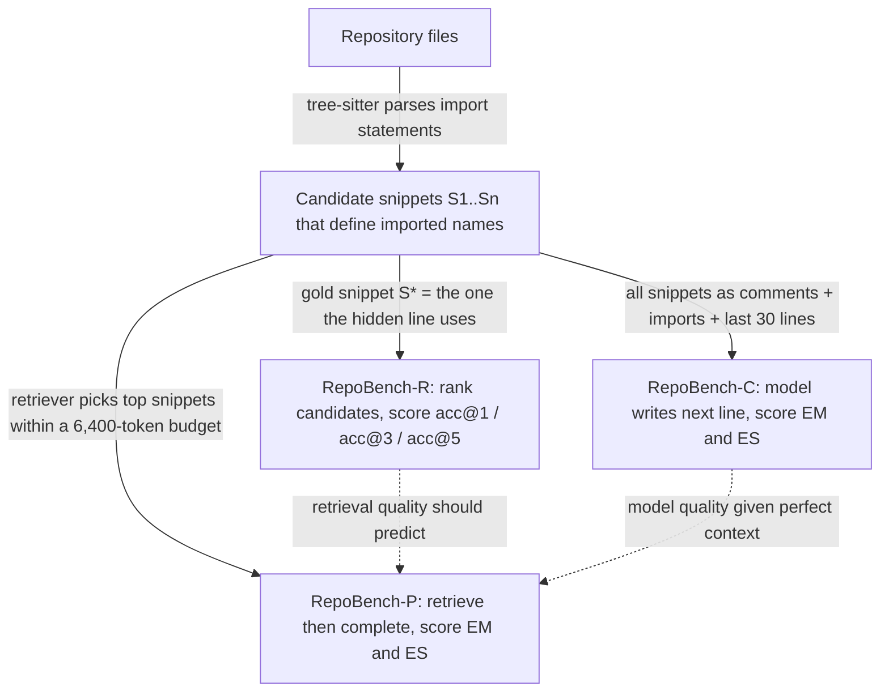
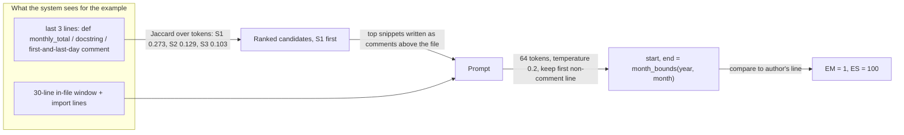

# RepoBench: Benchmarking Repository-Level Code Auto-Completion Systems

> **Paper:** Liu, Xu and McAuley (University of California, San Diego), 2023 - [arXiv abstract](https://arxiv.org/abs/2306.03091) - [local PDF](../../papers/2306.03091.pdf)
>
> **Short name:** RepoBench. Followed the arXiv HTML rendering of **v2 (4 October 2023)**; section, table and figure numbers below follow that rendering. The rendering does not name a venue; this guide's author recalls an ICLR 2024 acceptance but did not verify it here, so treat peer-review status as unconfirmed. The test models are 2022-2023 models (Codex, CodeGen, StarCoder); the paper does not evaluate Code Llama or any later model.

## Read this first

**The claim in one sentence.** Code completion benchmarks that look at one file at a time miss what real programmers face, so the authors built RepoBench: three linked tasks (find the right code in other files, finish the next line given that code, and do both in sequence) over Python and Java repositories, and they report baseline scores showing that fetching the right cross-file code helps, but by a small and model-dependent margin.

**Who this is for.** Anyone choosing how to feed repository context to a code model. The benchmark sits between function-level tests ([HumanEval](./14-humaneval.md)) and real-issue tests ([SWE-bench](./16-swe-bench.md)).

**Afterwards you will be able to** read one RepoBench instance field by field; compute exact match, edit similarity and retrieval accuracy by hand; explain why the retrieval gains are real but modest; and spot where the paper's tables disagree with its prose or each other.

**Reading time.** About 50 minutes. **Have read first:** [GPT-3](../01-foundations/03-gpt3.md) (next-token prediction and context windows), [RAG](../02-building/06-rag.md) (retrieve-then-generate, which RepoBench-P is a code version of), and [HumanEval](./14-humaneval.md) (the function-level, test-based style that RepoBench deliberately is not). [BERT](../01-foundations/02-bert.md) helps for the retrieval encoders. [SWE-bench](./16-swe-bench.md) is the natural next read.

**The one thing most people get wrong.** RepoBench is not a test of whether generated code runs. Every task is "predict the next single line", scored by string comparison against the line the original author wrote. A model can write a perfectly working but different line and score zero exact match. That is a deliberate trade for a cheap, large, automatic benchmark (about 60,000 completion prompts per language), and it means RepoBench measures context use, not problem solving.

## The paper in one worked example

The paper's Figure 1 shows a prompt built from a real example, but the figure is an image and its text is not in the HTML rendering, so this guide cannot quote it. The example below is therefore **constructed by this guide**. Its structure follows the paper's description (Section 3.3, Figure 1 caption and Appendix A): cross-file snippets written as comments, then import statements, then the preceding in-file lines, capped at 30 lines. Every number in the example is labelled as constructed and was computed with a short script, not taken from the paper.

### The tiny repository (constructed)

A shop-reporting project has these files. We hide one line of `shop/reports.py` and ask a system to supply it.

```python
# shop/reports.py (the file being completed)
import datetime
from shop.models import Order, Customer
from shop.pricing import apply_discount
from shop.utils.dates import month_bounds
from shop.utils.money import format_inr
from shop.config import REPORT_DIR

def monthly_total(orders, customer, year, month):
    """Sum the discounted order values for one customer in one calendar month."""
    # first day and last day of the month, inclusive
    start, end = month_bounds(year, month)      # <-- hidden target line
    ...
```

The hidden line is the **first** line in the file that uses something imported from another file. That makes this a **cross-file-first (XF-F)** instance: nothing earlier in the file has shown the model how `month_bounds` is called (paper, Section 3.3 "Task Settings").

### RepoBench-R: which snippet should be retrieved?

The paper parses import statements with tree-sitter (a parsing library that turns source code into a syntax tree), and treats every snippet that defines an imported thing as a **candidate** (Section 3.1/3.2, Section 3.3). One candidate is the **gold snippet**, the one the hidden line actually depends on. Here are six candidates (one per imported name; the paper does not spell out whether two names from one file make one snippet or two, so that granularity is this guide's choice):

| Candidate | Source | What it defines |
|---|---|---|
| S1 (gold) | shop/utils/dates.py | `month_bounds(year, month)` returning first and last day |
| S2 | shop/pricing.py | `apply_discount(subtotal, tier)` |
| S3 | shop/models.py | class `Order` |
| S4 | shop/models.py | class `Customer` |
| S5 | shop/utils/money.py | `format_inr(amount)` |
| S6 | shop/config.py | the constant `REPORT_DIR` |

Six candidates puts this in the **easy** subset (5 to 9 candidates; Section 3.3). The retriever sees only the last three in-file lines before the target (the paper's baseline keeps m = 3 lines, Section 4.1): the `def` line, the docstring and the comment. It scores each candidate with a similarity function f and ranks them.

**Lexical retrieval with Jaccard similarity, computed by hand.** Jaccard similarity is the size of the shared word set divided by the size of the combined word set. This guide lowercased and split on non-alphanumeric characters (the paper says only that computation is at token level). The query has 22 distinct tokens. Results (constructed):

| Candidate | Shared tokens | Union size | Jaccard |
|---|---|---|---|
| S1 month_bounds | calendar, day, def, first, last, month, of, the, year (9) | 33 | 9/33 = 0.273 |
| S2 apply_discount | customer, def, for, the (4) | 31 | 0.129 |
| S3 Order | customer, def, order (3) | 29 | 0.103 |
| S4 Customer | customer, def (2) | 28 | 0.071 |
| S5 format_inr | def (1) | 36 | 0.028 |
| S6 REPORT_DIR | none (0) | 26 | 0.000 |

The gold snippet is ranked first, so for this instance **acc@1 = 1** and **acc@3 = 1** (acc@k asks whether the gold snippet is among the top k). It won because the comment ("first day and last day of the month") shares words with the docstring; `def` and `the` also counted, though they carry no meaning. A random ranker over six candidates gets acc@1 = 1/6 = 16.7% and acc@3 = 50% on average; the paper's random baseline (mean 6.7 Python candidates) is 15.68 and 47.01 (Table 2).

### RepoBench-C: complete the line given a fixed context

For the completion task the context is fixed by the benchmark, not chosen by the system. The prompt contains all the parsed snippets as comments, then the in-file context (path, imports, preceding lines). Rendered in this guide's version of the Figure 1 layout:

```python
# Path: shop/utils/dates.py
# def month_bounds(year, month):
#     """Return (first_day, last_day) of the calendar month as dates."""
#     first_day = datetime.date(year, month, 1)
#     ...
# Path: shop/pricing.py
# def apply_discount(subtotal, tier): ...
# (S3 to S6 in the same commented style)
# Path: shop/reports.py
import datetime
from shop.models import Order, Customer
...
def monthly_total(orders, customer, year, month):
    """Sum the discounted order values for one customer in one calendar month."""
    # first day and last day of the month, inclusive
```

The model continues from there. The paper generates 64 tokens at temperature 0.2 and keeps the first non-comment line (Appendix C). The **reference** (the line the author wrote) is `    start, end = month_bounds(year, month)`.

**Scoring four hypothetical model outputs (constructed).** Exact match (EM) is 1 only when the predicted line equals the reference. Edit similarity (ES) is here computed as 1 minus the character-level Levenshtein distance (minimum single-character insertions, deletions and substitutions) divided by the longer line's length, times 100. The paper cites prior work for ES but does not print the formula, so other implementations will give slightly different numbers.

| Predicted line | EM | Edit distance | ES (this guide's formula) |
|---|---|---|---|
| `    start, end = month_bounds(year, month)` | 1 | 0 | 100.0 |
| `    first, last = month_bounds(year, month)` | 0 | 8 | 81.4 |
| `    start, end = month_range(year, month)` | 0 | 5 | 88.1 |
| `    start = datetime.date(year, month, 1)` | 0 | 20 | 52.4 |

The second line is fine Python that calls the right function and gets EM 0. The fourth line does something different and still earns ES 52.4, which is why the paper's ES values sit in the 60s and 70s while EM is in the 10s and 20s (Table 3).

### RepoBench-P: retrieve, then complete, under a budget

In the pipeline task the system is not handed the snippets. It gets the in-file context and the whole pool of candidates (at least 10 candidates, and a long repository: at least 12,000 tokens for Python, 24,000 for Java; Section 3.3). With Codex (the OpenAI code model `code-davinci-002`) the paper reserves 1,600 tokens for in-file context (60 lines max) and fills the rest of a 6,400-token prompt with retrieved snippets (Section 4.3). **A constructed scale-up:** suppose the repository has 31 candidates totalling 52,000 tokens and the in-file context uses 130 tokens. That leaves 6,400 - 130 = 6,270 tokens for retrieved code, about 12% of the pool. If S1 is ranked first it is kept; if ranked 40th it never enters the prompt. In the UniXcoder-H2L ("high to low") variant the best snippet goes first in the comment block, far from the target line; in L2H ("low to high") it goes last, closest to the target (Section 4.3).



Notice that R and C isolate the two halves that P recombines; the dotted edges are design intent, not a result, and Table 4 shows the link is weaker than hoped.



Notice that retrieval sees three lines while the completion model sees thirty.

Later sections refer back to the hidden line, the six candidates, the four predictions and the 6,270-token budget.

## Words you need

| Term | Plain definition | Example from the worked example |
|---|---|---|
| Auto-completion (code completion) | Predicting the code a programmer is about to type; here, the single next line | Predicting `start, end = month_bounds(year, month)` |
| In-file context | The imports and preceding lines of the file being edited, capped at 30 lines in RepoBench | The `def`, docstring and comment lines plus six imports |
| Cross-file context | Code from other files in the same repository that the current file depends on | The `month_bounds` definition in `shop/utils/dates.py` |
| Candidate snippet and gold snippet | A candidate is any snippet that defines something imported; the gold is the one the hidden line uses | S1 is gold; S2 to S6 are distractors |
| Retrieval | Choosing from many candidates the few worth putting in the prompt; scored by acc@k | Ranking S1 above S2 to S6 |
| acc@k (Accuracy at k) | Fraction of instances where the gold snippet is among the top k ranked candidates | acc@1 = 1 and acc@3 = 1 for our instance |
| Exact Match (EM) | 1 if the predicted line equals the reference, else 0, averaged over instances | Only the first prediction scores EM = 1 |
| Edit Similarity (ES) | One minus normalised character edit distance between predicted and reference line, times 100 | 81.4 for `first, last = ...` |
| XF-F, XF-R, IF | Cross-File-First (first cross-file line in the file), Cross-File-Random (a later one), In-File (line using no cross-file module) | Our hidden line is XF-F |
| RepoBench-R, -C, -P | Retrieval, Code completion, Pipeline tasks | Ranking, line completion, and the 6,400-token budget stage |
| Jaccard similarity | Shared tokens divided by combined distinct tokens, a lexical (word-overlap) score | 9/33 = 0.273 for S1 |
| UniXcoder / CodeBERT | Neural code encoders (UniXcoder: unified cross-modal pre-training; CodeBERT: Bidirectional Encoder Representations from Transformers for code) compared by cosine similarity | Semantic retrievers in Table 2 |

## Tutorial 1 - Intuitive understanding

### What was broken before

Earlier code-completion benchmarks such as CodeXGLUE's PY150 and the GitHub Java Corpus gave a model one file and asked it to continue (Section 1, Section 2). A real programmer rarely works that way. The line `start, end = month_bounds(year, month)` is only guessable if you know that a helper called `month_bounds` exists, what it takes, and that it returns two values. In one-file benchmarks that fact is either absent or happens to be visible nearby.

RepoEval, a repository-level benchmark covering 16 Python repositories, was included in StarCoder's training data, the authors note (Section 2), which makes it a weak test for that model.

### The idea

**An analogy.** Test a new employee on finishing half-written sentences in a company's reports. A fair test supplies the company glossary. RepoBench runs three tests: pick the right glossary entry from a pile (R), finish the sentence once handed it (C), and do both when handed the whole filing cabinet and allowed to carry only a few pages (P).

**Where the analogy breaks.** An employee understands the report's purpose; the benchmark checks only that the sentence matches the original author's. And the "glossary" is whatever the imports point to, found by a parser; a human might also consult a test file or README, which never count as gold here.

### How it works, step by step

1. **Collect repositories.** Training material comes from the `github-code` dataset (code up to 16 March 2022); the test set is a fresh crawl of non-forked Python and Java repositories created after 9 February 2023 and before 3 August 2023, to reduce training-data overlap (Section 3.1).
2. **Find the cross-file dependencies.** tree-sitter reads import statements, so the benchmark knows which snippets define imported names and which lines use them (Section 3.2). In the example, six imports yield six candidates.
3. **Choose which line to hide.** XF-F hides the first cross-file line in a file, XF-R a random later one, IF a line using no cross-file module (Section 3.3).
4. **Run one of three tasks.** R ranks candidates (acc@k); C completes from a fixed prompt (EM and ES); P picks its own context under a token budget, then completes.
5. **Report by setting.** Results are split into XF-F, XF-R and IF, plus an "All" average weighted by instance counts (Tables 3 and 4); XF-F has the most instances (12,000 of 24,000 in the 2k completion set).

### What the results say

**Retrieval (Table 2).** Each number is the percentage of instances where the gold snippet appears in the top k. The comparison is between random ranking, lexical ranking (Jaccard, edit similarity), and semantic ranking (CodeBERT, UniXcoder), always using the last three in-file lines as the query.

- On the hard Python XF-F subset (10 or more candidates, mean 17.8), the paper reports acc@1 of 6.44 for random, 10.01 for Jaccard, 7.68 for edit similarity, 6.56 for CodeBERT and 17.70 for UniXcoder. In plain terms: out of every 100 such instances, a random ranker puts the right snippet first about 6 times, Jaccard about 10, and UniXcoder about 18. UniXcoder is nearly three times as good as chance at rank 1, yet still wrong more than 80 times in 100.
- CodeBERT is barely above random: 6.56 against 6.44 on hard Python XF-F. This guide infers that off-the-shelf embeddings of a few lines miss the match that matters; the paper does not discuss it.
- Python scores exceed Java scores. The authors suggest simpler syntax (Section 4.1). A confound: hard Java averages 25.5 candidates against 17.8 for Python (Table 1), and even random does worse with more candidates (hard XF-F acc@1: 5.59 Java, 6.44 Python).

**Completion (Table 3).** Each number is EM or ES, as a percentage of lines, averaged over instances of a setting, on the 2k-token subset (prompts up to 1,925 tokens). Compared: CodeGen (open models in four sizes), StarCoder (15.5 billion parameters), and Codex.

- Python "All" EM rises with CodeGen size: 20.71 (350 million parameters), 27.35 (2.7 billion), 31.67 (6.1 billion), 33.41 (16.1 billion). Going from the smallest to the largest model gets about 13 more lines exactly right per 100.
- On Python 2k, Codex (All EM 31.31), StarCoder (31.67) and CodeGen-16.1B (33.41) are within about two points, which the authors call "almost indistinguishable". On Java 2k Codex leads: 43.14 (printed; see the inconsistency note under Table 3 in Tutorial 3) against StarCoderBase 37.35 and CodeGen-Multi 16.1B 30.45.
- XF-F is hardest for every model: Codex Python XF-F EM is 26.67 against 39.40 on XF-R, about 13 more right lines per 100 once the module has been used.

**Pipeline (Table 4, Codex only).** The comparison is the same model and prompt budget, varying only which cross-file snippets are placed in the prompt.

- No cross-file context at all ("Baseline", full 6,400 tokens of in-file code): Python All EM 33.15. UniXcoder-L2H: 37.11. That is 3.96 points, meaning about 4 more exactly correct lines per 100 completions. On the hard XF-F setting the gap is larger: 26.75 to 32.12, about 5 per 100.
- On Java the gap shrinks: All EM 40.40 baseline to 41.83 with UniXcoder-L2H, about 1.4 per 100.
- Random snippets still improve over the baseline (Python 34.15 vs 33.15, Java 40.77 vs 40.40). The paper calls this "significantly" better, but the gaps are 1.0 and 0.4 points from a single run with no significance test (Section 4.3).

### What this does not show

- Whether generated code runs, passes tests or fixes a bug; the unit of scoring is one line compared as text.
- That retrieved context helps in general. Table 4 is one model (Codex), and Appendix E shows StarCoder often does best with no retrieval.
- Multi-line completion, editing, natural-language instructions or tool loops; see [SWE-bench](./16-swe-bench.md) for patches checked by tests.

### Teach-back

**1. In the worked example, why is the hidden line a harder instance than one that appears later in the file?**
<details><summary>Answer</summary>It is XF-F: the first cross-file line, so no earlier line shows how `month_bounds` is called. In the paper's Table 3, Codex Python EM is 26.67 for XF-F and 39.40 for XF-R.</details>

**2. A retriever ranks the gold snippet third of six. What are acc@1 and acc@3 for that instance?**
<details><summary>Answer</summary>acc@1 = 0 and acc@3 = 1; averaged over many instances these give the percentages in Table 2.</details>

**3. A model writes `first, last = month_bounds(year, month)` where the author wrote `start, end = ...`. What do EM and ES say?**
<details><summary>Answer</summary>EM is 0 because the strings differ; ES stays high (81.4 with this guide's formula). The code is functionally equivalent, so EM underrates it.</details>

**4. Why does RepoBench-P reserve only 1,600 tokens for in-file context?**
<details><summary>Answer</summary>The 6,400-token budget is meant to be mostly filled by competing cross-file candidates (Section 4.3); unused in-file tokens also go to snippets.</details>

**5. The paper says random snippets help. What is the evidence and what should make you cautious?**
<details><summary>Answer</summary>Table 4: Python All EM 34.15 versus 33.15 baseline, Java 40.77 versus 40.40. It is one run with a temperature of 0.2, the paper itself calls it indicative, and the Java difference is under half a point.</details>

## Tutorial 2 - Practitioner understanding

### The design in concrete terms

**Data (Sections 3.1 to 3.2, Table 1).**

| Item | Python | Java |
|---|---|---|
| Training repositories (github-code, 32 to 128 files each) | 10,345 | 14,956 |
| Test repositories (crawled 9 Feb to 3 Aug 2023, any size) | 1,075 | 594 |
| RepoBench-R test (easy / hard, XF-F + XF-R) | 18,000 each | 18,000 each |
| RepoBench-C test, 2k / 8k | 24,000 / 36,000 | 24,000 / 36,000 |
| RepoBench-P test | 21,918 (10,867 + 4,652 + 6,399) | 21,254 (10,599 + 4,459 + 6,196) |
| Mean candidates, hard R / P | 17.8 / 24 | 25.5 / 26 |
| Mean tokens, C-2k / C-8k / P | 1,035 / 3,967 / 44,028 | 1,093 / 4,179 / 139,406 |

The C total of 60,000 per language matches Appendix D's "120,000 examples ... 60,000 each". The paper does not define the "Mean Tokens" column for P; this guide reads it as the size of the whole candidate pool plus the in-file context, which is why it dwarfs the 6,400-token prompt.

**Prompt layout (Figure 1, Appendix A).** Adopted: cross-file context as comments, then all import statements, then the preceding 30 lines (XFC+IS+IFC-Short). In Table 5 for Python, adding import statements to a 30-line window lifts XF-F EM from 7.30 to 22.28; adding cross-file snippets lifts it to 28.38. This guide's reading: much of the gain on cross-file lines comes from keeping imports visible, because a 30-line window often cuts them off.

**Retrieval method (Section 4.1).** Query = last 3 in-file lines. Lexical: Jaccard and edit similarity over tokens. Semantic: `codebert-base` and `unixcoder-base` with cosine similarity. Appendix B (Tables 6 to 9) varies the number of kept lines from 3 to 120; accuracy generally falls as more lines are kept, best usually at 3 or 5 (one counterexample: Jaccard on Python hard XF-R acc@1 peaks at 10 lines, 17.35).

**Generation and fine-tuning (Appendix C).** Temperature 0.2, 64 new tokens, first non-comment line kept. All models except Codex and the fine-tuned ones ran through CTranslate2 (a fast inference library) with quantised weights, which the authors say may differ from the originals. CodeGen-350M and 2.7B were fine-tuned on 8,000 XF-F, 4,000 XF-R and 4,000 IF examples, learning rate 1e-5, batch size 32, at most 3 epochs.

**Pipeline budget (Section 4.3).** 6,400 tokens total; 1,600 reserved for in-file context with a 60-line crop; unused in-file tokens refilled by retrieved snippets. Variants: Gold-Only (just the gold snippet; empty for IF), Gold-Filled-Head and -Tail (gold plus random snippets, gold first or last), UniXcoder-H2L and L2H, Random, and Baseline (6,400 tokens of in-file code only).

### A minimal version

A small scoring harness you can run on your own repository: build instances, rank candidates, score predictions. Inputs and outputs are shown in comments. About 40 lines.

```python
import re

def tokens(text):                      # "def f(x): return x" -> {"def","f","x","return"}
    return set(re.findall(r"[a-z0-9]+", text.lower()))

def jaccard(a, b):                     # (str, str) -> float in [0, 1]
    ta, tb = tokens(a), tokens(b)
    return len(ta & tb) / len(ta | tb) if ta | tb else 0.0

def rank_candidates(query_lines, candidates, m=3):
    """candidates: {name: snippet_text}. Returns names best-first."""
    query = "\n".join(query_lines[-m:])            # RepoBench keeps the last m=3 lines
    return sorted(candidates, key=lambda n: jaccard(query, candidates[n]), reverse=True)

def acc_at_k(ranked_lists, gold_names, k):
    hits = [g in r[:k] for r, g in zip(ranked_lists, gold_names)]
    return 100 * sum(hits) / len(hits)

def levenshtein(a, b):
    row = list(range(len(b) + 1))
    for i, x in enumerate(a, 1):
        prev, row[0] = row[:], i
        for j, y in enumerate(b, 1):
            row[j] = min(prev[j] + 1, row[j-1] + 1, prev[j-1] + (x != y))
    return row[-1]

def edit_similarity(pred, ref):        # one common definition; the paper does not print its own
    longest = max(len(pred), len(ref)) or 1
    return 100 * (1 - levenshtein(pred, ref) / longest)

def first_code_line(generation):       # Appendix C: keep the first non-comment line
    return next((l for l in generation.splitlines() if l.strip() and not l.strip().startswith('#')), '')

def weighted_all(per_setting, weights):            # reproduces the paper's "All" column
    return sum(per_setting[s] * weights[s] for s in weights) / sum(weights.values())

# Example: weights for Python C-2k from Table 1 (XF-F 12000, XF-R 5000, IF 7000)
print(weighted_all({"XF-F": 15.14, "XF-R": 27.72, "IF": 25.24},
                   {"XF-F": 12000, "XF-R": 5000, "IF": 7000}))   # 20.71 (Table 3, CodeGen-350M)
```

Notes: swap a real tokenizer into the budget logic if you build the P-style prompt; the paper's rule is "reserve 1,600 tokens for in-file code, give unused tokens to snippets". To build the benchmark's own candidates, list imports with tree-sitter or Python's `ast` and map each to its defining snippet.

### What it costs

All figures are this guide's arithmetic from Table 1 means, with stated assumptions; the paper reports no compute cost.

- **Completion prompts, full RepoBench-C.** Python: 24,000 x 1,035 + 36,000 x 3,967 = 24.84 million + 142.81 million, about 167.7 million input tokens. Java: 24,000 x 1,093 + 36,000 x 4,179 = about 176.7 million. Total about 344 million input tokens, plus at most 120,000 x 64 = 7.7 million generated.
- **Money and time.** At an assumed $1 per million input tokens (illustrative, not a real price) one pass is about $344. At an assumed 5,000 prompt tokens per second on one GPU, 344 million tokens take about 69,000 seconds, roughly 19 hours.
- **Pipeline.** RepoBench-P prompts are up to 6,400 tokens: 21,918 x 6,400 = 140 million (Python) and 21,254 x 6,400 = 136 million (Java). If "Mean Tokens" counts the candidate pool, a neural retriever reading it afresh per instance would process about 965 million (Python) and 2.96 billion (Java) tokens, so cache embeddings per repository.

### How it fails

| Symptom | Likely cause | Mitigation |
|---|---|---|
| Model completes the wrong helper name | Gold snippet not retrieved (UniXcoder acc@1 17.70 on hard Python XF-F) | Raise k; always keep import lines (Table 5); add a symbol index |
| Added context lowers the score | Model does not use long prompts well (StarCoder, Appendix E: Python XF-F Baseline 32.19 vs 31.40 for UniXcoder-L2H; Java XF-F and XF-R likewise) | Test with and without context for your model |
| High ES, low EM | Right style, wrong names or arguments (CodeGen-350M XF-F EM 15.14, ES 60.18) | Report both; read a sample of mismatches; test by execution |
| Score drops on long prompts | Length effects (Appendix D, Figure 2), confounded with difficulty | Bucket results by prompt length |
| Fine-tuned small model worse on IF lines | Cross-file tuning costs in-file skill (CodeGen-2.7B Python IF EM 31.27 to 28.94) | Keep a held-out IF set |
| Benchmark looks inflated later | Test repositories may now be in newer training data (this guide's inference) | Refresh with repositories newer than the model's cutoff |

### Evaluating your version

- **Metric.** Retrieval: acc@1 and acc@3 against the snippet your own tooling treats as the dependency. Completion: EM and ES per setting, plus a manual check of mismatches (would a reviewer accept the line).
- **Test set size.** The standard error of a proportion near 0.3 is sqrt(0.3 x 0.7 / N): about 4.6 points at N = 100, 1.4 at N = 1,000 and 0.46 at N = 10,000. The paper's single-run gaps of 0.4 to 1.0 points need roughly N = 10,000 or more to separate from noise.
- **Baseline.** Always run "no cross-file context" at the same total prompt budget (the paper's Baseline row) and "random snippets" (the paper's Random row). A retriever has to beat random filler, not just nothing.
- **Stop rule.** Stop tuning when a retrieval change moves All EM by less than one standard error across two repeated runs, or beats random filler by less than that. Keep a final set of repositories created after your model's training cutoff.

### Adopt, adapt or skip

**Recommendation for a team building an assistant over private business documents and code: adapt, do not adopt wholesale.**

- **Adapt the idea of splitting retrieval from generation.** Measure whether the right item was retrieved separately from whether the model used it. Over your own documents: label a gold source for 200 to 500 questions, score acc@1 and acc@3, then score answers with and without retrieval at the same prompt budget.
- **Adapt the finding about imports.** In Table 5 the biggest jump on cross-file lines came from keeping import statements visible. In a document assistant the analogue is keeping linking structure (headers, cross-references, file names) in the prompt; this guide infers the analogy, the paper tests only code.
- **Skip the benchmark as a go/no-go measure for an agent.** It scores single lines against an author's text and does not run anything. For an assistant that edits files and calls tools, use [SWE-bench](./16-swe-bench.md)-style tests with execution, or your own task tests.
- **Bearing on the through-question** (a thin runtime around a model that picks a few good tools, with strength coming from context, instructions and memory, including smaller or open models): RepoBench gives modest evidence that context assembly matters even for open models: CodeGen-16.1B matches Codex on Python 2k (All EM 33.41 vs 31.31). The Java gap and the StarCoder anomaly show the benefit is model-dependent, and the retrieval is a fixed pipeline, so it cannot say whether a model that runs `grep` itself would do better.

## Tutorial 3 - Researcher understanding

### Formal setup

Notation (each symbol defined once):

- R: a repository; F: the file being completed; t: the index of the hidden line.
- C_in: the in-file context, the import statements plus up to the 30 preceding lines (60 in P).
- S_1 ... S_n: candidate snippets, those defining names imported by F; n >= 5 in R, n >= 10 in P.
- S*: the gold snippet, the candidate used by line t.
- f(a, b): a similarity score; C[-m:]: the last m lines of C_in (m = 3).
- Retrieval (Section 4.1): the top-k set is argmax-k over i of f(C[-m:], S_i). Accuracy@k = (1/N) sum over instances of 1[S* in top-k].
- Completion (Eq. 1): P(Y) = product over i of P(y_i | y_<i, C_x, C_in), where C_x is the concatenated cross-file context, Y the predicted tokens, y_i the i-th token.
- Pipeline (Eq. 2): the same, with C_x replaced by the retrieved S_1 ... S_k.
- EM = (1/N) sum of 1[pred = ref]; ES = (1/N) sum of 100 x (1 - d(pred, ref)/max(|pred|, |ref|)) under this guide's reading, with d the character edit distance.
- "All" = sum over settings of (instances in setting x score in setting) / total instances.

**Toy instance (constructed).** With Jaccard scores (0.273, 0.129, 0.103, 0.071, 0.028, 0.000) the top-3 set is {S1, S2, S3}, so acc@3 = 1. For "All", (12,000 x 15.14 + 5,000 x 27.72 + 7,000 x 25.24) / 24,000 = 496,960 / 24,000 = 20.71, the paper's Table 3 entry for CodeGen-350M on Python.

### The claims, stated precisely

1. **Existence claim.** A benchmark with three tasks (R, C, P), two languages, three line settings, and two context-length levels for C can be built from import-resolved cross-file dependencies (Section 3). This is a construction claim, not a tested one.
2. **Retrieval ordering.** Among the tested retrievers, UniXcoder is best, Jaccard beats edit similarity, and Python is easier than Java (Section 4.1, Table 2).
3. **Model comparison.** On C-2k, Codex, CodeGen and StarCoder are close on Python and Codex leads on Java; on C-8k, Codex leads StarCoder with a larger gap, especially on Java (Section 4.2, Table 3).
4. **Context helps.** Adding cross-file context improves Codex even if random, better retrieval helps more, and placement matters (Section 4.3, Table 4). The authors infer that retrieval of related code helps even lines that use no cross-file module.

### Evidence, table by table

| Table or figure | What it contains | Headline numbers | Causal or associative |
|---|---|---|---|
| Table 1 | Counts of instances | C: 24,000 (2k) and 36,000 (8k) per language; P: 21,918 Python, 21,254 Java | Descriptive |
| Table 2 | acc@k for random, Jaccard, edit, CodeBERT, UniXcoder; easy and hard; XF-F and XF-R | Python hard XF-F acc@1: 6.44, 10.01, 7.68, 6.56, 17.70; Java hard XF-F acc@1: 5.59, 7.15, 5.80, 6.07, 10.79 | Causal about the retriever (all else fixed: same data and query) |
| Table 3 | EM and ES by model, language, setting, in 2k (first block) and 8k (second block) | Python 2k All EM: CodeGen-350M 20.71, -16.1B 33.41, StarCoder 31.67, Codex 31.31; Java 2k All EM: StarCoderBase 37.35, Codex 43.14; Python 8k All EM: StarCoder 26.84, Codex 32.13; Java 8k: 28.41, 40.52 | Associative across models: model size, training data, quantisation and inference library differ together |
| Table 4 | Codex on RepoBench-P under seven context strategies | Python All EM: Baseline 33.15, Random 34.15, Gold-Only 35.79, UniXcoder-H2L 36.61, -L2H 37.11; Java: 40.40, 40.77, 41.62, 41.70, 41.83 | Causal about context strategy for Codex only; single run, no variance |
| Table 5 | Six prompt layouts, Codex, 5,000 training-set examples per setting | Python XF-F EM: IFC-Short 7.30, IS+IFC-Short 22.28, XFC+IS+IFC-Short 28.38 | Causal for layout choice (same data), but on training split |
| Tables 6-9 | acc@k versus kept lines | UniXcoder Python hard XF-F acc@1: 19.86 at 3 lines, 7.12 at 120 | Causal for query length |
| Table 10 | StarCoder (StarCoderBase for Java) under the same seven strategies | Python All EM: Baseline 37.74, Gold-Only 38.24, UniXcoder-L2H 37.05; Java: Baseline 27.92 beats all | Causal for StarCoder; contradicts Codex trends |
| Figure 2 | ES and EM versus prompt length, StarCoder and Codex | Not readable in text; the authors describe a medium-length dip for StarCoder on Python and declines with length for both on Java | Associative: length is confounded with difficulty (authors' own warning) |

**Reading Table 4 closely.** The "Gold" rows are not an upper bound: Python Gold-Only (35.79) is below UniXcoder-L2H (37.11). In the Python IF column, UniXcoder-L2H (43.07) is 2.28 above Baseline (40.79) though IF lines use no cross-file module; the authors read this as related code helping generally.

**Reading Table 3 closely.** The first block is the 2k set and the second block the 8k set; the table has a single caption and the 2k/8k labels are not printed in the rendering, so this guide inferred the split from the models listed (CodeGen sizes and fine-tuning were run only on the 2k set, Section 4.2) and from the weights that recompute "All" (12,000:5,000:7,000 versus 18,000:7,500:10,500). **Inconsistencies found.** (1) Recomputing Codex Java 2k "All" EM from its three settings gives 42.56 (ES 80.10), but the table prints 43.14 (ES 80.22); every other "All" cell checked in Tables 3, 4 and 10 recomputes to within rounding. (2) Section 4.2 names CodeGen sizes 350M, 2B, 6B and 16B, the table 350M, 2.7B, 6.1B and 16.1B. (3) Section 4.2 describes CodeGen-NL, which is never evaluated.

### Ablations and what they isolate

- **Prompt layout (Table 5).** Isolates the value of imports and cross-file snippets for Codex. Python XF-F: IS+IFC-Short 22.28 versus IFC-Short 7.30; XFC+IS+IFC-Short 28.38. On XF-R, IFC-Long (43.44) about equals XFC+IS+IFC-Short (43.30). It does not isolate which snippet matters, since all snippets are always included.
- **Kept lines (Tables 6 to 9).** Longer queries mostly hurt: UniXcoder Python hard XF-F acc@1 falls from 19.86 (3 lines) to 7.12 (120). CodeBERT stays near random at every length (about 6.5 to 7.2).
- **Context strategy (Tables 4 and 10).** Isolates the retriever's contribution, with Baseline and Random as controls; Random is a single run.
- **Fine-tuning (Table 3, +FT rows).** Python 350M XF-F EM 15.14 to 16.19 (+1.05); Java 350M 12.89 to 16.12 (+3.23); Java 2.7B 20.77 to 20.64 (-0.13). Confound: per Appendix C, base CodeGen ran through quantised CTranslate2 while fine-tuned models did not (this guide's reading), so part of any difference may be the inference path.

### Threats to validity specific to this paper

- **Gold by import resolution.** Another file could be the better guide, and Table 4 shows gold alone is not best.
- **String-match scoring and single lines.** EM penalises correct variants; ES gives half credit to a wrong line (52.4 in the constructed example). No execution; one line is a small part of a real change.
- **Contamination.** Test repositories date from February to August 2023, following The Stack's cutoff; later models may have seen them, and copies of repositories may leak despite excluding forks (this guide's inference).
- **Inference differences and reproducibility.** Quantised CTranslate2 models versus the Codex API, which was deprecated in March 2023 yet queried until September 2023.
- **No variance estimates.** Temperature 0.2, one run per cell; only the retrieval Random baseline is averaged (100 runs). Many Table 4 gaps are 0.1 to 1 point.
- **Variant pairings.** Python uses CodeGen-Mono and StarCoder; Java uses CodeGen-Multi and StarCoderBase (Section 4.2), so the language comparison also changes the model variant.

### Open problems and follow-ups

- Replace string match with execution, pairing completions with tests.
- Close the gap between retrieval accuracy and downstream gain: Table 2 shows UniXcoder at nearly three times random on acc@1, but Table 4 shows only 1 to 4 points of EM.
- Test the authors' two untested speculations about StarCoder (Appendix E).
- Evaluate agentic retrieval, where the model issues its own search commands, rather than fixed policies.

### What would change my mind

- A repeated-run Table 4 with confidence intervals in which the Random-versus-Baseline gap vanishes would weaken "any context helps".
- A study where EM and ES correlate poorly with test pass rate on the same instances would undercut RepoBench as a proxy for usefulness; a strong correlation would raise it.
- A modern long-context model scoring the same with and without retrieval on RepoBench-P would suggest the pipeline task no longer measures what the authors intended.

## Reading map for the PDF

| Section or figure | What it contains | First pass | Guide section that answers its questions |
|---|---|---|---|
| Abstract, Section 1 | Motivation, three tasks, contributions | Read | Read this first |
| Section 2 | Related work: models and datasets | Skim | Tutorial 1, What was broken before |
| Section 3.1 to 3.2 | Data sources, cutoffs, repository counts, tree-sitter parsing | Read | Tutorial 2, The design in concrete terms |
| Figure 1 | Prompt construction (image) | Read | Worked example |
| Section 3.3 and Table 1 | Settings XF-F/XF-R/IF, three tasks, counts | Read | Words you need; Tutorial 2 |
| Section 4.1, Table 2 | Retrieval formula, baselines, acc@k | Read | Tutorial 1, results; Tutorial 3 |
| Section 4.2, Table 3 | Models, fine-tuning, EM and ES | Read | Tutorial 3, Evidence |
| Section 4.3, Table 4 | Pipeline, context strategies, Codex | Read | Tutorial 3, Reading Table 4 closely |
| Section 5 | Conclusion | Skim | Tutorial 3, claims |
| Appendix A, Table 5 | Prompt layout ablation | Read | Tutorial 2; Tutorial 3, Ablations |
| Appendix B, Tables 6 to 9 | Kept-lines ablation | Skim | Tutorial 3, Ablations |
| Appendix C | Temperature, tokens, hardware, fine-tuning setup | Read | Tutorial 2, design; threats |
| Appendix D, Figure 2 | StarCoder versus Codex by prompt length | Skim | FAQ on length |
| Appendix E, Table 10 | StarCoder as pipeline base | Read | FAQ on StarCoder; Tutorial 2, How it fails |

## Questions readers get stuck on

### What exactly is "auto-completion" here, and is it the same as an AI writing a whole function?

No. It means predicting the single next line of code from the code before it and the repository around it (Section 3.3), like the grey suggestion in an editor. In [HumanEval](./14-humaneval.md) the output is a whole function checked by unit tests.

### How does the benchmark know which file is the "right" cross-file context?

It parses import statements with tree-sitter and takes the snippets that define the imported names (Section 3.2); the gold is the candidate the hidden line uses. This misses dependencies that are not imported, such as a convention in a sibling file.

### Why do EM and ES differ so much, and which should I trust?

EM needs an identical line; ES gives credit for similar characters. CodeGen-350M on Python XF-F has EM 15.14 but ES 60.18 (Table 3). Use EM for "was it the author's line" and ES as a softer signal that still rewards wrong lines, as the constructed example shows. Neither says whether the code works.

### Why are the random-retrieval numbers so high?

With about 6.7 candidates, chance of the gold being in the top 3 is about 3/6.7 = 45%, which is why random scores 47.01 on easy acc@3 (Table 2). Read a retriever against the random row: UniXcoder's 59.69 in the same cell is 12.7 points above chance, not "60% good".

### Why is XF-F so much harder than XF-R?

In XF-R the module has already appeared earlier in the file, so the model can copy how it was used. XF-F hides the first use, so the name and arguments must come from the retrieved snippets. Example: CodeGen-16.1B Python XF-F EM 28.86 against 38.48 for XF-R (Table 3).

### Why does random cross-file code help, and should I believe it?

The paper suggests it may help the model draw on a broader repository (Section 4.3), which is speculation. The gain is 1 point in one run; an alternative, this guide's inference, is that comment-formatted code makes the output more repository-like. Without repeated runs it may be noise.

### Why does StarCoder do best with no retrieval in Appendix E?

Table 10 shows StarCoder's Baseline matches or beats most strategies, especially on Java. The authors speculate about poor generalisation to repository-level prompts and sensitivity to length; neither was tested. Context helps only if your model can use it, so measure with and without.

### Where are Code Llama and newer models, and are the numbers still meaningful?

This version evaluates Codex (`code-davinci-002`), CodeGen and StarCoder only. Absolute numbers describe 2022-2023 models; what survives is the design and the relative findings, so re-run for your own model.

### Why can't I just give the model the whole repository?

Mean candidate pools are about 44,000 tokens for Python and 139,000 for Java (Table 1) against a 6,400-token prompt (Section 4.3). Appendix D suggests accuracy can fall as prompts lengthen, though the paper does not test long-context models.

### How is RepoBench different from SWE-bench?

RepoBench checks one line against the author's text with no execution. [SWE-bench](./16-swe-bench.md) asks a system to resolve a real GitHub issue by editing the repository and runs tests. RepoBench is cheaper and larger but speaks only to context use.

## Prerequisites you actually need

### Prerequisite 1 - Next-token probability and conditioning

A language model gives each next token a probability given everything before it; a line's probability is the product of its token probabilities. Eq. 1 and Eq. 2 (Sections 4.2, 4.3) are this, with cross-file snippets added to the conditioning. Example: token probabilities 0.5, 0.8, 0.9 give 0.5 x 0.8 x 0.9 = 0.36. See [GPT-3](../01-foundations/03-gpt3.md) and [math-bridge](../../references/math-bridge.md).

### Prerequisite 2 - Top-k accuracy and chance level

acc@k is the fraction of cases where the answer is in the top k guesses. Example: gold at rank 2 in one case and rank 5 in another gives acc@1 = 0, acc@3 = 1/2 = 50%. Chance for random ranking is k/n. Used in Section 4.1 and Table 2. See [RAG](../02-building/06-rag.md).

### Prerequisite 3 - Exact match and edit distance

Edit distance is the fewest single-character inserts, deletes and substitutions turning one string into another; 1 minus that over the longer length is a similarity. Example: "month_bounds" and "month_range" differ by 5 edits over 12 characters, so 1 - 5/12 = 0.583 (in the full line of the worked example the same 5 edits give 88.1 because the line is longer). Used in Section 3.3 and Tables 3, 4, 5, 10.

### Prerequisite 4 - Lexical versus semantic similarity

Lexical similarity compares shared words (Jaccard: shared over total distinct tokens). Semantic similarity turns each text into a vector with a neural encoder and compares directions by cosine (dot product over the product of lengths). Example: (1, 0) and (1, 1) have cosine 1 / 1.414 = 0.707. Used in Table 2. See [BERT](../01-foundations/02-bert.md) and [RAG](../02-building/06-rag.md); the [glossary](../../references/glossary.md) covers other terms.

### Prerequisite 5 - Weighted averages

An "All" score over groups of different sizes is the size-weighted average. Example: 15.14, 27.72, 25.24 with sizes 12,000, 5,000, 7,000 give 20.71, while the unweighted mean is 22.70. Used in the "All" columns of Tables 3, 4 and 10 (weights from Table 1); Table 5 uses a simple average of three settings, so its "All" is not comparable.

## Where this sits in the curriculum

**Read before:** [GPT-3](../01-foundations/03-gpt3.md), [RAG](../02-building/06-rag.md) and [HumanEval](./14-humaneval.md).

**How it differs from the two nearest papers.** [HumanEval](./14-humaneval.md) gives a function description and runs unit tests, so it scores correctness; RepoBench gives repository context and compares one line to the original text, so it measures context use. [SWE-bench](./16-swe-bench.md) starts from a real issue and checks the whole patch with tests; RepoBench is a cheap proxy for one ingredient, finding and using the right surrounding code.

**What to read next and why.** [SWE-bench](./16-swe-bench.md) is next, for tasks where retrieval is only the first step and the verdict is a test run. After that, [SWE-agent](../06-agent-systems/26-swe-agent.md) and [Dive into Claude Code](../06-agent-systems/28-dive-into-claude-code.md) show, by title, how an agent fetches repository context with tools instead of a fixed import-based pipeline, which is the open question RepoBench leaves; [Context as a Tool](../06-agent-systems/30-context-as-a-tool.md) is relevant to the same question. The measurement habit to carry forward: score retrieval and use of context separately.

## Checkpoint

1. **Explain** the difference between RepoBench-R, -C and -P in one sentence each.
<details><summary>Answer</summary>R ranks candidate snippets and scores acc@k against a gold snippet. C gives a fixed prompt (cross-file snippets plus in-file context) and scores the predicted next line by EM and ES. P gives the whole candidate pool and a token budget, so the system must retrieve and then complete, scored like C.</details>

2. **Compute** acc@1 and acc@3 for three instances where the gold snippet is ranked 1st, 4th and 2nd.
<details><summary>Answer</summary>acc@1 = 1/3 = 33.3% (only the first). acc@3 = 2/3 = 66.7% (ranks 1 and 2 qualify, rank 4 does not).</details>

3. **Compute** the "All" EM for XF-F 30.17, XF-R 39.46 and IF 48.14 with weights 12,000, 5,000 and 7,000 (StarCoderBase, Java, 2k, Table 3), and say whether it matches the table.
<details><summary>Answer</summary>(12,000 x 30.17 + 5,000 x 39.46 + 7,000 x 48.14) / 24,000 = (362,040 + 197,300 + 336,980) / 24,000 = 896,320 / 24,000 = 37.35, which matches Table 3. The same recomputation for Codex Java 2k gives 42.56, not the printed 43.14.</details>

4. **Critique** the statement "retrieval gives large gains in code completion".
<details><summary>Answer</summary>The paper reports Python All EM of 33.15 (no cross-file context) versus 37.11 (UniXcoder-L2H) and Java 40.40 versus 41.83, with Codex and one run. The gains are 1 to 4 points, model-specific (StarCoder does not benefit; Table 10) and unaccompanied by variance estimates. "Modest and model-dependent" is the supportable wording.</details>

5. **Explain** why Table 4's Gold-Only row is not an upper bound.
<details><summary>Answer</summary>Python Gold-Only All EM is 35.79 while UniXcoder-L2H, which fills the prompt with many ranked snippets, reaches 37.11; the caption says gold rows do not embody oracle capabilities. This guide infers that extra relevant snippets help and that Gold-Only has a smaller in-file allowance (1,600 versus 6,400 tokens).</details>

6. **Critique** using RepoBench scores to choose an assistant that must fix real bugs.
<details><summary>Answer</summary>RepoBench has no execution, no multi-line or multi-file edits and no natural-language issue; a high score says a model uses context well for single lines, not that it can patch a bug. Use SWE-bench-style execution tests for that decision.</details>

7. **Spot** an inconsistency: Section 4.2's prose gives CodeGen sizes 350M, 2B, 6B, 16B; Table 3 lists 350M, 2.7B, 6.1B, 16.1B. Name two others.
<details><summary>Answer</summary>Trust the table sizes. Others: Codex Java 2k All EM is printed as 43.14 but recomputes to 42.56 from its rows and Table 1 weights; Section 4.3's strategy list skips item (4); Appendix C writes "A3090" GPUs.</details>
