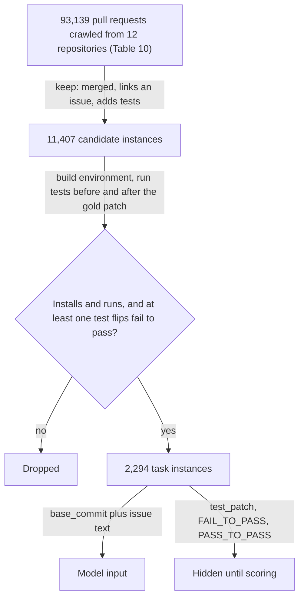
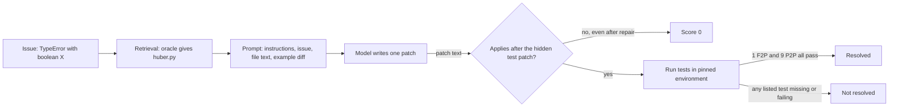

# SWE-bench: Can Language Models Resolve Real-World GitHub Issues?

> **Paper:** Jimenez, Yang, Wettig, Yao, Pei, Press and Narasimhan (Princeton University and Princeton Language and Intelligence, one author at the University of Chicago), first posted October 2023 - [arXiv abstract](https://arxiv.org/abs/2310.06770) - [local PDF](../../papers/2310.06770.pdf)
>
> **Short name:** SWE-bench (Software Engineering benchmark). Numbers and pointers follow the arXiv HTML rendering of **v3 (11 November 2024)**; section, table and figure numbers are that version's. v3 adds SWE-bench Lite and a Claude 3 Opus row that earlier versions lack, so older copies have different tables. This guide recalls an ICLR 2024 appearance (the rendering states no venue). Appendix A.7 (Lite characterisation) is cut off in the rendering read here, so Lite claims rest on Section 2.4 and Table 5 only.

## Read this first

**The claim in one sentence.** If you turn 2,294 real, merged fixes from 12 popular Python projects into tasks where a model must write a patch from an issue report, judged by the project's own tests, the best models of late 2023 solved about 2 in 100 (Claude 2: 1.96 percent with a standard retrieval step, 4.8 percent when handed the right files).

**Who this is for.** Anyone who reads coding-assistant leaderboards, builds an agent that edits files, or must design an execution-checked evaluation of their own. You need only accept that a "patch" is a list of line edits and a "test" is a small program that says pass or fail.

**Afterwards you will be able to** trace one real task from issue to verdict; say what "resolved" means; explain why the rate is low and why more context made it worse; recompute key percentages as task counts; and sketch a scoring harness.

**Reading time.** About 50 minutes. **Have read first:** [HumanEval](./14-humaneval.md) (the short self-contained problems SWE-bench reacts to) and [RepoBench](./15-repobench.md) (repository-level completion scored without running project tests). Helpful: [RAG](../02-building/06-rag.md). [SWE-agent](../06-agent-systems/26-swe-agent.md) is the follow-on that uses this benchmark.

**The one thing most people get wrong.** The low number does not measure how well models "code". It is the rate for one deliberately weak recipe: show the model an issue plus a few retrieved files and let it write one patch in one shot, with greedy decoding, no running of code, no exploring. The authors say so (Section 7: "the simplest and most straight-forward approaches"). The benchmark outlived the baseline, and that is what mattered.

## The paper in one worked example

The paper prints full task instances in Appendix F. This guide follows **scikit-learn__scikit-learn-13328** (Table 25), a case Claude 2 resolved, so every stage is visible, then contrasts two it did not. The identifier is the repository name with `/` replaced by `__`, then the pull request number (Table 9). Table 25's link lines are mislabelled: the "Issue" line points to a `pull/13314` address and the "PR" line to `issues/13328`. By the Table 9 convention 13328 is the pull request and 13314 the issue; GitHub redirects between them, so this is cosmetic.

### Part A - one instance, start to finish

**The issue.** "TypeError when supplying a boolean X to HuberRegressor fit". `HuberRegressor` is a robust regression model in scikit-learn, a widely used machine-learning library. Fitting on floats works; fitting on `X > 0` (True/False values) raises a `TypeError`; fitting on the same values cast to float works. The reporter expects booleans to be converted "as it is done by, say `LinearRegression`".

**The codebase.** Not stored as text. Each instance holds a repository name and a **base commit**, the snapshot the original fix was applied on top of (Table 9, Appendix A.2). Checking that commit out of the project's mirror recreates the code before the fix.

**The gold patch** (the maintainers' merged change). One file, `sklearn/linear_model/huber.py`, one hunk: the call `check_X_y(X, y, copy=False, accept_sparse=['csr'], y_numeric=True)` gains `dtype=[np.float64, np.float32]`. One line removed, two added.

**The hidden tests** (Table 25):

| Set | Contents |
|---|---|
| FAIL_TO_PASS (1 test) | `sklearn/linear_model/tests/test_huber.py::test_huber_bool` |
| PASS_TO_PASS (9 tests, 5 shown) | `test_huber_max_iter`, `test_huber_gradient`, `test_huber_sample_weights`, `test_huber_sparse`, `test_huber_scaling_invariant`, four omitted |

`test_huber_bool` fails on the base commit and passes with the maintainers' patch. The nine others pass both before and after, guarding against a fix that breaks something. The model sees none of them.

**What the model is shown (Appendix D.3).** The sentence "You will be provided with a partial code base and an issue statement explaining a problem to resolve", the issue in `<issue>` tags, the README and retrieved files in `<code>` tags (each between `[start of path]` and `[end of path]` markers), an unrelated example patch showing the diff format, and the request for "a single patch file that I can apply directly to this repository using git apply". Here (Claude 2, "oracle" retrieval, explained later) the retrieved file is exactly the one the maintainers edited, `huber.py`.

**What Claude 2 wrote (Table 25, paraphrased).** Not the maintainers' fix. It added a method `_validate_data(self, X, y=None)` returning `X.astype(np.float64)` if `X.dtype == np.bool`, else `X`, and inserted `X = self._validate_data(X)` inside `fit` after the parameter checks. A hunk that removes and re-adds an apparently identical `check_X_y(` line is probably lost indentation in the rendering.

**How the verdict is reached (Appendix A.4).**

1. Reset to the base commit, activate the stored environment for that release version (pinned Python and dependencies), run the install command.
2. Apply the hidden **test patch**, which adds `test_huber_bool`.
3. Apply the model's patch. If it fails, try an automatic repair (drop unneeded context lines, recompute hunk headers). If it still fails, the score is 0.
4. Run the test command on the test files; parse the log into per-test pass/fail with a repository-specific parser.
5. Require all 1 F2P and 9 P2P tests to be present and passing; a missing test counts as failed.

All ten pass, so the instance is **resolved**. The discussion in Table 25 still calls the fix less clean than the maintainers' (a new helper instead of a one-argument change, "stylistic and organizational inconsistencies"). Passing tests and being mergeable differ, a theme of Sections 5 and 7. This guide also notes, as inference, that `np.bool` is a deprecated NumPy alias that was later removed, so the patch likely works only because the pinned environment is old.

### Part B - two instances that were not resolved

**sphinx-doc__sphinx-8713 (Figure 6, SWE-Llama).** Sphinx's Napoleon extension mishandles the "Other Parameters" docstring section when `napoleon_use_param` is `True`. The oracle prompt was 1,558 lines (20,882 tokens). The model edited the right function, `_parse_other_parameters_section` near line 684, but made it behave as if the setting were always `True` instead of checking it first, as the gold patch does. `test_parameters_with_class_reference`, run with the setting off, "catches the model's error immediately".

**astropy__astropy-14365 (Table 27, Claude 2).** The QDP table reader insists on upper-case commands such as `READ SERR 1 2`. Claude 2 lower-cased the command regular expression; the maintainers added `re.IGNORECASE` where the line pattern is compiled and made the `NO` check case-insensitive. The model's change broke upper-case input: Table 27 says it fails the new test and "also fails existing tests enforcing prior behavior".



Notice how much is deleted: about 2.5 percent of crawled pull requests survive (2,294 of 93,139, this guide's division).



Notice three gates in sequence (applies, runs, all listed tests pass) and that the model never sees a test result before it commits.

## Words you need

| Term | Plain definition | Example from the worked example |
|---|---|---|
| Issue | A written report on a project's tracker: bug, request, question. | "TypeError when supplying a boolean X to HuberRegressor fit". |
| Pull request (PR) | A proposed code change; "merged" means maintainers accepted it. | Pull request 13328. |
| Base commit | The exact saved snapshot of the code the pull request was applied on. | scikit-learn just before the fix. |
| Patch / diff | Text listing line changes per file: `-` lines removed, `+` lines added, with line-number headers. | The gold patch: one `-` line, two `+` lines in `huber.py`. |
| Gold patch / test patch | The maintainers' change split into non-test files (gold) and test files (test patch). The gold patch is never shown to the model. | Gold adds `dtype=[...]`; the test patch adds `test_huber_bool`. |
| Unit test | A small program that calls code and reports pass or fail. | `test_huber_bool`. |
| FAIL_TO_PASS (F2P) | Tests failing before the gold patch and passing after; they encode "fixed". | `test_huber_bool` (1 test). |
| PASS_TO_PASS (P2P) | Tests passing before and after; they encode "nothing else broke". | Nine tests incl. `test_huber_sparse`. |
| Resolved | Patch applies and every F2P and P2P test passes. | All ten pass. |
| % Apply | Share of instances where the patch applied and ran, fixed or not. | Table 5: Claude 2 43.07 percent. |
| BM25 | A word-matching relevance score; the top-scoring files that fit a token limit go into the prompt. | A retriever that must guess `huber.py` from "HuberRegressor". |
| Oracle retrieval | Analysis setting that "retrieves" exactly the files the gold patch edited. | `huber.py` only. |
| Oracle-collapsed | Oracle files with everything but the gold patch's edited lines (plus or minus 15) collapsed away. | Table 6. |
| SWE-Llama | The authors' fine-tunes of CodeLlama (7 and 13 billion parameters) that write patches. | Rows "7b" and "13b". |
| SWE-bench Lite | A 300-instance subset chosen to be more self-contained (Section 2.4). | Table 5, right columns. |
| Context window | The most text, in tokens, a model reads at once. | 16,385 for ChatGPT-3.5; 100,000 for Claude 2 (Table 4). |

## Tutorial 1 - Intuitive understanding

### What was broken before

Coding was typically tested with short exercises: write a function from a few lines of description, check with a few tests ([HumanEval](./14-humaneval.md)). Real work differs: someone reports misbehaviour, and an engineer must find which of thousands of files is responsible, understand its neighbours, change it, and not break anything else. The paper says existing coding benchmarks "mostly involve self-contained problems that can be solved in a few lines of code" and that popular benchmarks were saturating. In the example, the issue is short, but the answer is a one-argument change inside a long function of a library with thousands of files; nothing says "edit `check_X_y`". [RepoBench](./15-repobench.md) added repository context but scores completion of a line from other files, not a fix that must satisfy a test suite.

### The idea

**Analogy.** A job test for plumbers built from 2,294 real callouts at 12 well-run companies. The candidate arrives at the house exactly as it was before the repair, receives the customer's complaint, and does the work. Then a checklist written by the original plumber is run: the symptom is gone (F2P) and every other tap still works (P2P). The candidate sees neither checklist nor the original method.

**Where it breaks.** A plumber can look around and try things; the models here get a printout of a few files and write the fix blind. The checklist is narrower than a real inspection: a repair can pass everything and still be ugly, like the scikit-learn patch. And the "complaint" is whatever people wrote; sometimes a diagnosis, sometimes a screenshot the model cannot read.

### How it works, step by step

1. **Collect.** Table 10 reports 93,139 pull requests from 12 repositories (Section 2.1 says "about 90,000"). Appendix A.1 says the starting list was the top 100 downloaded packages and does not explain how 100 became 12.
2. **Filter by attributes.** Keep merged pull requests that link an issue and change test files: 11,407 remain (Table 10). Example: pull request 13328 links issue 13314 and adds `test_huber_bool`.
3. **Filter by execution.** Run tests with only the test patch (log before), then also with the gold patch (log after). Drop the instance on any install or run failure, if no test flips fail to pass, or if the "before" log shows `ImportError` or `AttributeError` (the tests probably name something the issue never gave). 2,294 survive. Appendix A.3 says validation "generally removes half"; Table 10 implies about four in five overall, and this guide cannot tell which stage the sentence covers.
4. **Pick context.** Codebases average 3,010 non-test files and 438 thousand lines (Table 1), so code must be selected: BM25 word matching, or oracle.
5. **One patch per task**, greedy decoding (Appendix D.2).
6. **Judge by running tests** (Appendix A.4) and report the percentage resolved plus the percentage that applied.

### What the results say

Numbers are the paper's unless marked "this guide". "Percent resolved" means: of 100 task instances, how many end with all F2P and P2P tests passing.

**Headline (Table 5, BM25, all 2,294):**

| Model | Resolved | Applied | Tasks resolved (this guide's arithmetic) |
|---|---|---|---|
| Claude 3 Opus | 3.79 | 46.56 | about 87 |
| Claude 2 | 1.97 | 43.07 | about 45 |
| GPT-4-turbo | 1.31 | 26.90 | about 30 |
| SWE-Llama 7b | 0.70 | 51.74 | about 16 |
| SWE-Llama 13b | 0.70 | 53.62 | about 16 |
| ChatGPT-3.5 | 0.17 | 26.33 | about 4 |

Out of every 100 tasks, Claude 2 solved about 2 and ChatGPT-3.5 fewer than 1; the newer Claude 3 Opus about 4. About half of Claude 2's and SWE-Llama's patches apply, but fewer than one in ten applied patches fix the problem (this guide: 1.97/43.07 is 4.6 percent for Claude 2). **Inconsistency:** the abstract and Table 2 give Claude 2 as 1.96, Table 5 gives 1.97 (45 tasks is exactly 1.96), and the abstract still calls Claude 2 the best model though Table 5 in the same version shows Claude 3 Opus at 3.79.

**Retrieval is part of the failure (Tables 2 and 18).** Claude 2 rises from 1.96 (BM25, 13,000 tokens) to 4.80 percent (oracle, about 110 tasks, matching Table 23), about 2.4 times as many solved. SWE-Llama 13b goes from 0.70 to 3.97 (about 91 tasks). Even so, 95 of 100 tasks still fail with perfect file selection.

**More context made things worse (Tables 2 and 3).** Claude 2 at 13,000, 27,000 and 50,000 tokens scored 1.96, 1.87 and 1.22, while the share of instances where BM25 retrieved any oracle file rose from 34.77 to 51.27 to 58.38 percent. The prompt held the right file more often, yet fewer tasks were solved. The authors' reading, an interpretation: models "become distracted by additional context" and are "simply ineffective at localizing problematic code".

**Trimming helps (Table 6).** Keeping only the gold patch's lines plus or minus 15 lifted Claude 2 from 4.8 to 5.93 and Claude 3 Opus to 9.39. For Claude 2 that is about 26 more tasks (this guide). The text says GPT-4 rose "from 1.3% to 3.4%", but 1.3 is the GPT-4-turbo BM25 figure of Table 5; GPT-4's oracle figure in Table 18 is 1.74, on a 25 percent subset. Not like for like.

**Diffs beat whole files (Section 5).** Asking Claude 2 to rewrite whole files gave 2.2 percent against 4.8 for patches (oracle); on the shorter half of inputs 3.9 against 7.8.

**Models write small edits (Table 8).** On applied patches Claude 2 averaged 19.6 total patch lines against 44.1 for the maintainers' patches on the same instances.

**Not obviously memorisation (Table 7).** Claude 2 resolved 4.87 percent of oracle-setting tasks from before 2023 and 4.23 percent from after; Table 21 shows no consistent yearly trend.

### What this does not show

- That models cannot fix real bugs: only that one-shot patching without execution mostly fails.
- A human ceiling: no human attempt is measured, and some instances may be unsolvable as written.
- That a passing patch is good: Table 25 and Section 5.1 describe passing patches that ignore the codebase's own helpers.
- A stable ranking among low scorers: a few tasks separate rows, especially on the 300-instance Lite set.
- Generality: Python only, 12 projects, Django alone 850 of 2,294 (about 37 percent, this guide's division of Table 10).

### Teach-back

**1. What must be true for an instance to count as resolved?**

<details>
<summary>Answer</summary>

The patch applies (after the hidden test patch is in), the tests run, and every F2P and P2P test is found and passes. Fixing the reported symptom is not enough if an older listed test now fails; a missing test counts as failed (Appendix A.4).
</details>

**2. Why both F2P and P2P tests?**

<details>
<summary>Answer</summary>

F2P shows the issue is fixed; P2P shows nothing else broke. Without P2P, deleting a feature could "fix" many bugs. In the astropy case only the old upper-case tests expose the model's change.
</details>

**3. Claude 2 scores 1.96 percent with BM25 and 4.8 with oracle files. What does the gap tell you?**

<details>
<summary>Answer</summary>

Locating the code is a real bottleneck (about 45 versus 110 tasks), but not the only one: 95 of 100 tasks still fail with perfect file selection.
</details>

## Tutorial 2 - Practitioner understanding

### The design in concrete terms

**Instance schema (Table 9).** `instance_id`, `repo`, `base_commit`, `created_at`, `version` (release, used to choose an environment), `problem_statement`, `hints_text` (unused in the experiments), `issue_numbers`, `pull_number`, `patch` (gold), `test_patch`, `FAIL_TO_PASS`, `PASS_TO_PASS`, `env_install_commit`. The codebase is rebuilt from a mirror of the repository, so later history rewrites cannot break instances (Appendix A.2).

**Problem statement.** Titles and first comments of every closed issue (found via keywords such as "fixes" before a `#` number), plus comments written before the pull request's first commit, to limit leaking the solution.

**Environments.** One conda environment per release version per repository, hand-built from the latest instance of that version. Per-instance environments were most reliable but too laborious; per-repository ones were too coarse for old versions (Appendix A.3).

**Retrieval.** BM25 takes as many top files as fit under 13,000, 27,000 or 50,000 tokens, with each file's path prepended so filenames in the issue match (Appendix D.1). Each model is reported at its best limit that fits. Context windows (Table 4): ChatGPT-3.5 (`gpt-3.5-turbo-16k-0613`) 16,385 tokens, fits 58.1 percent of instances; GPT-4 (`gpt-4-32k-0613`) 32,768, 84.1 percent; Claude 2 100,000, 96.4 percent; SWE-Llama 100,000 or more, 94.8 percent or more. Token counts differ by tokenizer (Llama text is about 42 percent longer than GPT-4 text).

**Decoding.** One greedy sample per instance, as in Pass@1 evaluation (Appendix D.2).

**SWE-Llama (Section 3, Appendix B.1).** Data: 19,000 issue and pull-request pairs from 37 other repositories (no test requirement), cut to about 10,000 after dropping sequences over 30,000 tokens. LoRA rank 16, alpha 16, dropout 0.05 on query, key, value and output projections; learning rate 6e-4; batch 32; at most 4 epochs; best checkpoint on 100 held-out instances. Compute: 20 hours on 4 A100 GPUs for 7B (80 GPU-hours, this guide) and 47 hours on 8 for 13B (376). Training context was the oracle files, which matters for the BM25 results.

**Scoring detail.** The test patch goes in before the model's, so a model cannot pass by editing tests. The repair step quietly rescues malformed diffs: Table 14 shows 302 of 988 applied Claude 2 BM25 patches (30.57 percent) needed it.

### A minimal version

A small scoring harness in the spirit of Appendix A.4, not the official one. Input: an instance dict with Table 9 fields (F2P and P2P as lists), an install command, the model's patch text. Output: e.g. `{"applied": True, "outcome": "Resolved"}`, using the six classes of Table 22.

```python
import re, subprocess, tempfile, pathlib

def sh(cmd, cwd, timeout=1800):
    p = subprocess.run(cmd, cwd=cwd, shell=True, capture_output=True,
                       text=True, timeout=timeout)
    return p.returncode, p.stdout + p.stderr

def parse_pytest(log):                       # pytest -rA: "PASSED path::name"
    st = {}
    for line in log.splitlines():
        m = re.match(r"^(PASSED|FAILED|ERROR)\s+(\S+)", line)
        if m:
            st[m.group(2)] = "pass" if m.group(1) == "PASSED" else "fail"
    return st

def classify(f_ok, f_all, p_ok, p_all):      # Table 22
    if f_ok == f_all and p_ok == p_all: return "Resolved"
    if f_ok == f_all:                   return "Breaking Resolved"
    if p_ok == p_all: return "No-Op" if f_ok == 0 else "Partially Resolved"
    return "Regression" if f_ok == 0 else "Work in Progress"

def score(inst, model_patch, repo_dir, install_cmd, test_files):
    sh(f"git checkout -f {inst['base_commit']} && git clean -fdx", repo_dir)
    sh(install_cmd, repo_dir)                # pinned env for inst['version']
    d = pathlib.Path(tempfile.mkdtemp())
    (d / "t.patch").write_text(inst["test_patch"])
    (d / "m.patch").write_text(model_patch)
    assert sh(f"git apply {d}/t.patch", repo_dir)[0] == 0
    rc, _ = sh(f"git apply {d}/m.patch", repo_dir)
    if rc != 0:                              # crude stand-in for the repair step
        rc, _ = sh(f"git apply --recount {d}/m.patch", repo_dir)
    if rc != 0:
        return {"applied": False, "outcome": "Not applied"}
    _, log = sh(f"python -m pytest -rA -q {' '.join(test_files)}", repo_dir)
    st = parse_pytest(log)                   # missing test counts as failed
    f, p = inst["FAIL_TO_PASS"], inst["PASS_TO_PASS"]
    f_ok = sum(st.get(t) == "pass" for t in f)
    p_ok = sum(st.get(t) == "pass" for t in p)
    return {"applied": True, "outcome": classify(f_ok, len(f), p_ok, len(p))}

def resolve_rate(results):
    return 100 * sum(r["outcome"] == "Resolved" for r in results) / len(results)
```

Two sanity runs make it trustworthy: the gold patch must score Resolved on every instance (otherwise your environment is wrong), and an empty patch must never score Resolved. The official benchmark uses repository-specific log parsers and cached ground-truth test results (Appendix A.3), so it need not re-run the gold patch.

### What it costs

The paper gives no dollar figures; it says GPT-4 ran on a random 25 percent subset (574 instances) "due to budget constraints". Everything below is this guide's arithmetic with stated assumptions.

- **Prediction.** If every prompt hits the 13,000-token limit: 2,294 x 13,000 = 29.8 million input tokens, about 89 dollars at an assumed 3 dollars per million; at 50,000 tokens, 114.7 million, about 344 dollars. Output: assume 600 tokens per patch (Table 24 shows 27 to 79 lines on average) at an assumed 15 dollars per million, about 21 dollars. A full one-shot run is roughly 100 to 400 dollars at these prices, cheap beside an agent making dozens of calls per task.
- **Scoring.** At an assumed 2 minutes per instance for environment and tests, 4,588 minutes, about 76 hours on one machine or about 5 hours on 16 workers. Test counts have a heavy tail (mean 120.8, maximum 9,459, Table 1).

### How it fails

Table 23 classifies applied oracle-setting patches. Claude 2: of 1,078 applied, 110 Resolved (10.2 percent), 26 Breaking Resolved, 15 Partially Resolved, 20 Work in Progress, 471 No-Op (43.7 percent), 436 Regression (40.4 percent); percentages are this guide's divisions.

| Symptom | Likely cause (source) | Mitigation |
|---|---|---|
| Patch does not apply (over half of outputs, Table 5, Table 14) | Models rarely see diffs; line numbers drift in long outputs (Section 5) | Let the model edit files through a tool; validate before running |
| Applies but changes nothing relevant (No-Op) | Wrong location or code path (Appendix C.5) | Reproduce the issue; run the failing test |
| Applies but breaks old behaviour (Regression) | Ignores other callers; "limited view of the codebase" (Appendix C.5) | Show callers; run the existing suite |
| Right function, wrong logic (Figure 6) | Misreads the condition the issue implies | Check against a reproducing test |
| Fix in the wrong layer (Table 27) | Edits the nearest matching text, not the root cause | Retrieve all uses of the changed name |
| Primitive code instead of existing helpers (Table 25) | Models "do not leverage existing third-party libraries or the rest of the codebase" | Include nearby utilities; review style |
| Issue needs an image (Table 29) | Text-only input; images in 32 percent of matplotlib, 10 percent of seaborn, 2 percent of all instances (Section 5) | Exclude or use a vision model |
| BM25 hurts fine-tuned models (Table 5) | Trained to edit every file shown; the authors suspect this | Train and test on the same context distribution |
| Longer context lowers success (Table 2) | Distraction, poor localisation | Retrieve less; collapse unrelated code (Table 6) |

### Evaluating your version

**Metric.** Percent resolved, alongside percent applied, since they diagnose different failures.

**Noise (this guide's arithmetic).** On 2,294 instances, a true 2 percent rate has standard error sqrt(0.02 x 0.98 / 2294) = 0.29 points (95 percent interval about plus or minus 0.57). On the 300-instance Lite set at 3 percent it is 0.98 points (about plus or minus 1.9). Lite scores of 3.00 and 2.67 in Table 5 (Claude 2, GPT-4-turbo) are 9 and 8 tasks: one task apart, indistinguishable. Telling 2 from 3 percent with independent runs needs about 1,900 instances per system.

**Baselines.** The empty patch (must score zero), the gold patch (must score 100), a BM25 prompt with a small model, and the oracle setting for your model. BM25-to-oracle is retrieval headroom; oracle-to-100 is reasoning and editing headroom.

**Stop rule.** Claim an improvement only if the paired gain exceeds twice its standard error over at least 1,000 instances and shows up in several repositories (Table 19 spans 0 to about 18 percent by repository). Read about 20 patches by hand per change (Section 7: tests alone cannot "guarantee reliable performance").

### Adopt, adapt or skip

**Recommendation for a team building an assistant over private business documents: adapt the design, skip the dataset, unless the assistant edits code.**

- **Skip the dataset.** It measures Python repair in 12 public libraries, not answering from contracts or policies.
- **Adapt the recipe.** A task is a frozen input snapshot plus hidden checks, split into "must now pass" and "must still pass". For documents: a frozen document set, a request, a script checking the output against known facts, and a regression set of earlier requests whose answers must not change, with the environment (parser and model versions) pinned.
- **Adapt the oracle ablation.** Run once with the right source documents supplied and once with your retriever; the gap separates retrieval from reasoning (here 1.96 versus 4.80 for Claude 2).
- **Take the context result seriously.** More retrieved text lowered the rate (Table 2) and trimming raised it (Table 6). If you want good results from smaller or open models through context, instructions and memory, put the effort into selecting and compressing context, not filling the window. The nearest bearing on the curriculum's through-question is Table 23: over 80 percent of applied failures are No-Op or Regression, the failures a thin runtime with a few well-built tools (search, read file, run tests) is meant to catch. The paper only suggests this ("the potential value of providing feedback via an execution environment"); [SWE-agent](../06-agent-systems/26-swe-agent.md) tests it.
- **Open models.** SWE-Llama 13b reached 3.97 percent with oracle files (83 percent of Claude 2's 4.80) from about 10,000 training instances, but fell to 0.70 with BM25: tuning is brittle to a changed prompt.

## Tutorial 3 - Researcher understanding

### Formal setup

An instance is (C, P, T, delta): C the codebase at the base commit, P the problem statement, T the tests added by the test patch, delta the gold patch (Appendix A.1). A model f maps (C, P) to a patch delta-hat. Let apply(delta-hat, C + T) hold if the patch applies (after repair) and the test command runs. Let status(t) in {pass, fail} be the parsed result, missing tests counting as fail. F2P is the set failing under C + T and passing under C + T + delta; P2P passes under both. The resolved indicator is

R = 1 if apply(delta-hat, C + T) and status(t) = pass for all t in F2P union P2P; otherwise R = 0.

The score is 100 x (1/N) x the sum of R over instances (N = 2,294; N = 300 for Lite). "Oracle" is a context choice that uses delta (its edited files), information a model would not have.

**Toy instance (constructed by this guide).** Five instances with (F2P, P2P) sizes (1, 9), (2, 40), (1, 3), (5, 100), (1, 0). Results: first passes all ten, R = 1; second passes both F2P but fails one P2P, R = 0 (Breaking Resolved); third does not apply, R = 0; fourth passes all 100 P2P but 0 of 5 F2P (No-Op), R = 0; fifth passes its one F2P, R = 1. Score = 100 x 2/5 = 40.0; applied rate 4/5 = 80 percent.

### The claims, stated precisely

1. A three-stage pipeline turns about 93 thousand pull requests from 12 repositories into 2,294 instances, each with at least one F2P test (Section 2.1, Table 10).
2. Under BM25, single greedy sample, best-of-limits, no execution feedback, models of the time resolve at most 1.96 percent (Claude 2; abstract, Table 2); v3 adds 3.79 (Claude 3 Opus, Table 5).
3. Oracle retrieval raises Claude 2 to 4.8 percent (Table 18) and trimming to 5.93 (Table 6); longer BM25 contexts reduce performance despite higher oracle recall (Tables 2, 3).
4. No consistent relation between resolve rate and issue date, which the authors read as evidence against mostly recalling fixes (Tables 7, 21).
5. LoRA fine-tuning of CodeLlama-Python on about 10,000 tasks gives models "in some settings" competitive with Claude 2: 3.97 versus 4.80 with oracle files, 0.70 versus 1.96 with BM25.
6. Model patches are shorter, simpler and more often single-file than gold patches (Tables 8, 24).

Claim 3 is a controlled comparison on fixed instances. Claims 2 and 6 are descriptive. Claim 4 is an association with a coarse proxy. Claim 5 compares different training and prompt conditions across model families.

### Evidence, table by table

**Table 1 and Table 11 (statistics).** Rows: attributes of issue, codebase, gold patch and tests; columns: mean and maximum, or per repository. Means: issue 195.1 words; 3,010 files and 438K lines; gold patch 32.8 lines, 1.7 files, 3 functions; F2P 9.1 (max 1,633); total tests 120.8 (max 9,459). Medians are much smaller (Appendix A.5: 140 words, about 15 lines, one F2P, 51 P2P). Descriptive only. This guide's check: weighting Table 11's per-repository means by Table 10's counts reproduces F2P (9.1) and total tests (120.8) but gives about 1.64 files and 35.2 lines edited, against Table 1's 1.7 and 32.8; unexplained (I read flattened cells, but the other two matches suggest the columns are right).

**Table 10 (funnel).** 93,139, then 11,407, then 2,294, by repository (django 850, sympy 386, scikit-learn 229, sphinx 187, matplotlib 184, pytest 119, xarray 110, astropy 95, pylint 57, requests 44, seaborn 22, flask 11); sums recompute. Identifies composition: overall rates are largely Django and sympy rates.

**Tables 2 and 3 (context limit and BM25 recall).** Limits 13k, 27k, 50k. Claude 2: 1.96, 1.87, 1.22; SWE-Llama 7b: 0.70, 0.31, 0.00; 13b: 0.70, 0.48, 0.00. Recall of oracle files: average 29.58, 44.41, 51.06; "All" 26.09, 39.83, 45.90; "Any" 34.77, 51.27, 58.38. On fixed instances, longer prompts raise recall and lower success; length is confounded with the other files that arrive with it.

**Tables 14, 18, 20 (oracle and subsets).** Oracle resolved/applied: Claude 2 4.80/62.82, ChatGPT-3.5 0.52/21.80, GPT-4 1.74/34.00 (25 percent subset), SWE-Llama 7b 3.01/65.52, 13b 3.97/66.78. Table 20 puts all models on the 574-instance subset (GPT-4 BM25 27k: 0.00 resolved, 14.82 applied) to show it is "not significantly skewed". Table 14: Claude 2 oracle, 2,138 generations, 1,441 applied (62.82 percent, matches Table 18), 360 repaired.

**Table 6 (collapsed).** Resolved/applied: Claude 3 Opus 9.39/48.00, Claude 2 5.93/68.18, GPT-4 3.40/48.65, ChatGPT-3.5 1.09/40.93. The GPT-4 collapsed run covers the full set, its oracle run 25 percent (Table 14 caption). An upper-bound analysis, since it reveals the gold edit location.

**Tables 7 and 21 (temporal).** Oracle, before and after 2023: Claude 2 4.87 and 4.23, ChatGPT-3.5 0.49 and 0.77, GPT-4 1.96 and 0.0, SWE-Llama 7b 2.95 and 3.46, 13b 3.98 and 3.85. Cannot rule out memorised fixes or style.

**Tables 8 and 24 (patch size).** Table 8 conditions on applied patches, Table 24 on all. Claude 2: 19.6 total lines (Table 8), 27.2 (Table 24), against 44.1 and 61.6 for gold on the same instances. SWE-Llama patches in Table 24 exceed gold (68.9 versus 61.5 for 13b). **Inconsistency:** Table 8's "All Gold" total of 74.5 lines differs from Table 1's 32.8, but added 22.3 plus removed 10.5 equals 32.8, so "Total Lines" evidently counts context and headers (this guide's inference). The text's "74.5 versus 30.1" therefore compares full patch text, and 30.1 is ChatGPT-3.5's figure, the largest model row.

**Tables 22 and 23 (outcome classes).** Rows sum correctly (Claude 2: 110 + 26 + 15 + 20 + 471 + 436 = 1,078; the other models also recompute). **Inconsistencies:** Table 23's "Applied" counts (Claude 2 1,078; SWE-Llama 7b 1,257; 13b 1,196) differ from Table 14's oracle applied counts (1,441; 1,503; 1,532), though the resolved counts match Table 18. The text says 60 to 70 percent of failing applied patches are No-Ops; the table gives about 51 to 66 percent (No-Op over No-Op plus Regression: Claude 2 52, ChatGPT-3.5 66, GPT-4 51, 7b 63, 13b 63; this guide).

**Table 19 and Figure 4 (per repository).** Claude 2: requests 15.91 percent (7 of 44), django 6.15, sympy 1.94, seaborn and flask 0.00; cells hold few instances, so fine spread is noise. Section 5: Claude 2 solves only 42 percent of what SWE-Llama 13b solves (110 and 91 solves), so about 38 tasks overlap (this guide).

### Ablations and what they isolate

- **BM25 versus oracle versus collapsed.** Isolates localisation and irrelevant text for a fixed model; optimistic because oracle uses the answer's location.
- **Context limit.** Isolates prompt length, confounded with which files are included.
- **Patch versus whole file.** Isolates output representation (4.8 versus 2.2; 7.8 versus 3.9 on the shorter half, controlling input length).
- **Not ablated:** multiple samples, execution feedback, issue-text variants.

### Threats to validity specific to this paper

1. **Tests as sole judge.** F2P tests were written for the maintainers' design; a valid alternative (another function name or error type) may fail, a trivial change may pass. The `ImportError` and `AttributeError` filter removes only the worst naming cases. Bias direction is unknown.
2. **Contamination.** Public, widely mirrored repositories; coarse date split.
3. **Concentration.** Django is 37 percent; mature well-tested libraries are unlike most private codebases.
4. **Selection on the test set.** Each model is reported at its best context limit.
5. **Unequal conditions.** GPT-4 on a 25 percent subset in some settings, the full set in another; ChatGPT-3.5 could not see 42 percent of inputs; the appendices use GPT-4 (gpt-4-32k) while Table 5 uses GPT-4-turbo.
6. **One greedy sample** at 2 percent base rates; no run-to-run variance.

### Open problems and follow-ups

The authors list other languages and domains, agents and tool-augmented models, and evaluation beyond unit tests (Section 7). Appendix C.7 shows, on psf__requests-4356, a correct model patch that raised the cyclomatic complexity (count of independent execution paths) of `HTTPAdapter` from 3 to 5, against smaller rises in the gold patch; one example, not a result.

**Commentary on later developments (not in this paper; from general knowledge, verify before citing).**

- **SWE-bench Lite** is already in v3 (Section 2.4): 300 instances from 11 of the 12 repositories, "more self-contained", focused on functional bug fixes.
- **SWE-bench Verified** was released later by others as a roughly 500-instance subset whose descriptions and tests were human-reviewed, answering the under-specification and test-validity worries above. It is not part of this paper.
- **Agent scaffolds** raised headline numbers far above the 2 percent baseline by letting models search, open files, edit and run tests in a loop. [SWE-agent](../06-agent-systems/26-swe-agent.md) is the first such system in this curriculum. Ask of any later number: which subset, which retrieval, how many attempts, what test visibility.

### What would change my mind

- Fresh instances created after each model's cutoff giving far lower rates than 2 to 5 percent would make contamination matter more than Table 7 suggests.
- A human audit finding that a third of a 100-instance random sample had F2P tests rejecting valid fixes would make absolute numbers too pessimistic and rankings less informative.

## Reading map for the PDF

| Section or figure | What it contains | First pass | Guide section that answers its questions |
|---|---|---|---|
| Abstract, Section 1, Figure 1 | Claim, 1.96 percent, overview | Read | Read this first |
| Section 2.1, Figure 2 | Three-stage pipeline | Read | Worked example, first diagram |
| Section 2.2 | Task and resolved metric | Read | Worked example Part A |
| Section 2.3, Table 1, Figure 3 | Features, statistics, repository mix | Skim | Tutorial 3 evidence |
| Section 2.4 | SWE-bench Lite | Skim | Tutorial 2 noise arithmetic |
| Section 3, Appendix B | SWE-Llama training | Skim | Tutorial 2 design |
| Section 4, Tables 2 to 4 | BM25, oracle, context limits | Read | Tutorial 1 results |
| Section 5, Tables 5 to 8, Figures 4, 5 | Results and analyses | Read | Tutorial 1 results |
| Section 5.1, Figure 6 | A failed SWE-Llama case | Read | Worked example Part B |
| Appendix A.1 to A.4, Table 9 | Construction, schema, scoring steps | Read A.4, skim rest | Tutorial 2 harness |
| Appendix C | Oracle, per repository, temporal, outcome classes | Skim C.1, C.5 | Tutorial 3 evidence |
| Appendix D.3 | Prompt template | Read | Worked example |
| Appendix F, Tables 25 to 34 | Ten case studies | Read 25, 27; skim rest | Worked example |

## Questions readers get stuck on

### Does the model get to see the tests?

No. The test patch is applied only at scoring. The model sees the issue and retrieved files, so a test may call a name the issue never states. The authors drop instances whose pre-fix logs show `ImportError` or `AttributeError`, which removes the most obvious cases; the paper does not measure how much under-specification remains.

### What is the difference between "resolved" and "apply"?

"Apply" counts patches accepted by the patch tool (after repair) that ran; "resolved" counts those after which every F2P and P2P test passes. For Claude 2 in Table 5, 43.07 percent applied and 1.97 resolved, so about 4.6 of 100 applied patches fixed the problem (this guide's ratio). A valid-looking diff is much easier than a correct one.

### Why is the score so low when models do well on HumanEval?

The tasks differ in kind. A HumanEval problem is self-contained; here the model must find the edit location in a codebase averaging 438 thousand lines, write a diff that applies, and not break an average of about 111 other tests (this guide: 120.8 minus 9.1, Table 1). The paper makes the comparison qualitatively and does not run these models on HumanEval, so any numeric comparison is outside it. See [HumanEval](./14-humaneval.md).

### What is oracle retrieval, and is it cheating?

A diagnostic, not a method. It supplies the files the human fix touched, which a real system would not know. The authors call it "less realistic" and not necessarily comprehensive. It separates "could not find the code" from "could not write the fix": 1.96 versus 4.80 percent for Claude 2.

### Why does more context lower the score when BM25 finds the right file more often?

Recall of any oracle file rises from 34.77 to 58.38 percent across limits (Table 3), but Claude 2 falls from 1.96 to 1.22 percent (Table 2). The authors suggest extra code distracts the model, citing work on long-context sensitivity. Table 6 is consistent: collapsing irrelevant code helps the same model. It remains an interpretation.

### Why does SWE-Llama collapse under BM25 when it does well with oracle files?

It was fine-tuned on oracle-file prompts where every shown file needs an edit; under BM25 many shown files need none, and the authors suspect it edits the wrong ones. SWE-Llama 13b resolves 3.97 percent with oracle files (Table 18) and 0.70 with BM25 (Table 5). It is a stated suspicion, not a tested cause.

### Could the models just have memorised the fixes?

Possibly in part; the test is coarse. Claude 2 resolved 4.87 percent of pre-2023 tasks and 4.23 of later ones, with no consistent yearly trend (Table 21). A model that memorised a repository's style but not a specific fix would still pass this check, so it is suggestive only; the real protection is that new instances can be collected after any cutoff.

### Is 2,294 tasks really 2,294 independent samples?

Not quite. Django is 850 instances (about 37 percent), and instances in one repository share code, environment and style. Repository rates differ from 0 to about 18 percent (Table 19), and some repositories contribute only 11 to 44 instances. The standard errors in Tutorial 2 assume independence, so they are somewhat optimistic.

### Why does the abstract name Claude 2 as best if Table 5 shows 3.79 for Claude 3 Opus?

Version drift: v3 added Claude 3 Opus and Lite to Table 5 but left the abstract, and Table 5 prints 1.97 where the abstract and Table 2 print 1.96. Quote the table, not the abstract.

## Prerequisites you actually need

### Prerequisite 1 - Reading a unified diff

A hunk header `@@ -a,b +c,d @@` means "old text starts at line a for b lines; new text starts at line c for d lines". Lines starting with a space are unchanged context, `-` removed, `+` added. Constructed example:

```
@@ -3,3 +3,4 @@
 def g(x):
-    return x
+    y = x + 1
+    return y
```

Old range 3 lines, new range 4; edited lines = 1 removed + 2 added = 3. The paper's "lines edited" is added plus removed (Table 8: 22.3 + 10.5 = 32.8). Used in Section 2.2, Appendix A.2, A.4 and D.3. A patch fails to apply when its old text or numbers do not match the file.

### Prerequisite 2 - Unit tests and the four status transitions

A test runs code and passes unless an error or failed check occurs. Run it before and after a change and you get fail-to-pass, pass-to-pass, pass-to-fail or fail-to-fail. Constructed: tests A, B, C; before the fix A fails and B, C pass; after, A passes, B passes, C fails. A is fail-to-pass, B pass-to-pass, C pass-to-fail. A good fix produces only the first two kinds; the others are ignored (Appendix A.5). Used in Section 2.1, Appendix A.3, A.4, Table 22. See the [glossary](../../references/glossary.md).

### Prerequisite 3 - BM25 word-matching retrieval

BM25 sums, over query words t, IDF(t) x tf x (k1 + 1) / (tf + k1 x length factor), where IDF rewards rare words and the second factor saturates with repetition. Constructed with common defaults (k1 = 1.5; the paper does not state its settings): 100 files, "huber" in 2 of them, IDF = ln(1 + (100 - 2 + 0.5)/(2 + 0.5)) = ln(40.4) = 3.70. An average-length file with "huber" 3 times: 3 x 2.5 / (3 + 1.5) = 1.67, score 1.67 x 3.70 = 6.17; once: 1 x 2.5 / 2.5 = 1.00, score 3.70. BM25 matches words only: if the issue never says "huber", `huber.py` is not found. Used in Section 4.1, Appendix D.1. See [RAG](../02-building/06-rag.md).

### Prerequisite 4 - A rate from n trials and its uncertainty

If the true rate is p and n instances are independent, the observed rate has standard error sqrt(p(1 - p)/n). With p = 0.02, n = 2,294: sqrt(0.0196/2294) = 0.0029, or 0.29 points; the 95 percent interval is about 1.96 times that. With p = 0.03, n = 300: 0.98 points. Differences of a task or two on Lite are therefore not informative. Used when reading Table 5, Table 7 and Table 19. See [math-bridge](../../references/math-bridge.md).

## Where this sits in the curriculum

**Before this.** [HumanEval](./14-humaneval.md) (short function-writing) and [RepoBench](./15-repobench.md) (repository-level context without running project tests); [RAG](../02-building/06-rag.md) and [LoRA](../02-building/09-lora.md) for two components used here.

**How it differs from the two nearest papers.** HumanEval gives a signature and docstring and checks bodies with short tests; nothing is retrieved. RepoBench places the model inside a repository as SWE-bench does but predicts the next line from other files and scores similarity, so it measures cross-file context use without demanding a verified fix. SWE-bench runs the project's own tests on a multi-file change written from a natural-language report.

**Next.** [SWE-agent](../06-agent-systems/26-swe-agent.md) answers the obvious follow-up: what changes if the model can explore and run tests in a loop. For the through-question (a thin runtime with a few well-built tools), this paper supplies the baseline and the No-Op and Regression categories tool use should reduce. [CodeAct](../06-agent-systems/25-codeact.md) lists SWE-bench among tasks motivating executable actions. [Context as a tool](../06-agent-systems/30-context-as-a-tool.md) and [Agentic context engineering](../06-agent-systems/31-agentic-context-engineering.md) pick up the factor this paper shows is decisive: what goes into the prompt.

## Checkpoint

1. **Explain** what happens if a model's patch makes the F2P test pass but fails one P2P test.

<details>
<summary>Answer</summary>

It is not resolved, since Appendix A.4 requires all of both lists. In Table 22 this is "Breaking Resolved" (all F2P pass, not all P2P).
</details>

2. **Compute** how many tasks 1.96 and 4.80 percent represent out of 2,294, and the ratio.

<details>
<summary>Answer</summary>

About 45 (45/2,294 = 1.962 percent) and about 110 (4.795 percent); the ratio is about 2.4, so roughly two and a half times as many tasks are solved given the human-edited files.
</details>

3. **Compute** the 95 percent half-width at 3 percent on Lite (300) and say whether 3.00 versus 2.67 differs.

<details>
<summary>Answer</summary>

Standard error sqrt(0.03 x 0.97/300) = 0.0098; half-width 1.96 x 0.0098 = about 1.9 points. 3.00 and 2.67 are 9 and 8 tasks, one apart, so indistinguishable.
</details>

4. **Critique** "SWE-bench shows models can only solve 2 percent of real software tasks."

<details>
<summary>Answer</summary>

Overstated. 1.96 percent is one older model with BM25, one greedy sample, no execution; the same model gets 4.8 percent with oracle files, Table 5 shows 3.79 for Claude 3 Opus, the authors call it a baseline, tests are an imperfect judge, and Python library maintenance is not all of software engineering.
</details>

5. **Explain** why higher oracle recall at 50,000 tokens coexists with a lower resolve rate, and name an experiment that supports the authors' reading.

<details>
<summary>Answer</summary>

The longer prompt includes the right file more often (58.38 percent "any", Table 3) but also much unrelated code, and models localise poorly. Table 6 supports it: collapsing all but the lines near the gold edit lifted Claude 2 from 4.80 to 5.93 percent. Neither separates distraction from other length effects.
</details>

6. **Critique** "GPT-4 rose from 1.3 percent to 3.4 percent" in Section 5.

<details>
<summary>Answer</summary>

1.3 is the GPT-4-turbo BM25 figure of Table 5 (1.31); 3.4 is GPT-4 oracle-collapsed on the full set (Table 6); GPT-4's oracle figure in Table 18 is 1.74 on a 25 percent subset. Models, retrieval settings and subsets differ.
</details>

7. **Compute** the share of applied Claude 2 patches in Table 23 that were No-Ops, and say where effort should go.

<details>
<summary>Answer</summary>

471/1,078 = 43.7 percent. With 436 Regressions (40.4 percent), over 80 percent either changed nothing relevant or broke something. That points to localising code, reproducing the issue and running the existing tests, which execution feedback and search tools provide.
</details>
