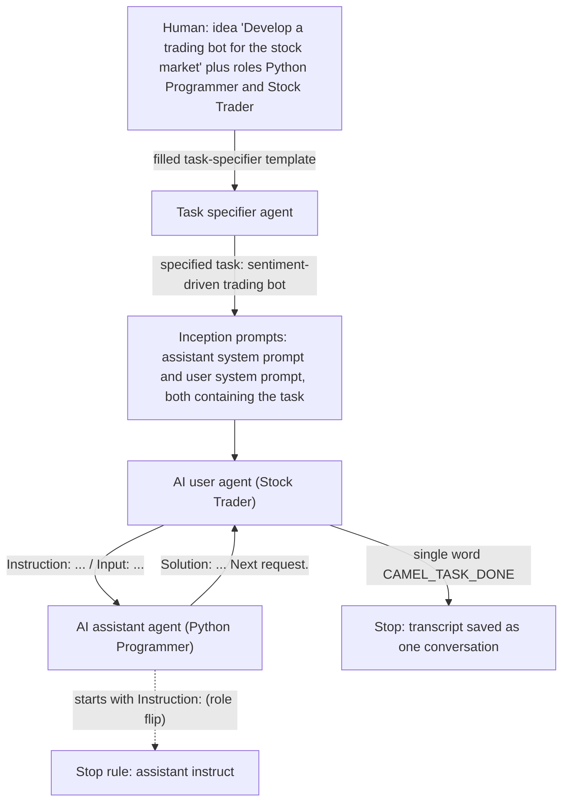
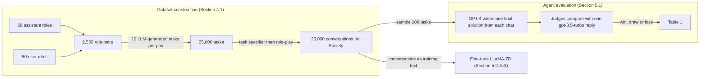

# CAMEL: Communicative Agents for "Mind" Exploration of Large Language Model Society

> **Paper:** Li, Hammoud, Itani, Khizbullin and Ghanem (King Abdullah University of Science and Technology, KAUST), 2023 - [arXiv abstract](https://arxiv.org/abs/2303.17760) - [local PDF](../../papers/2303.17760.pdf)
>
> **Version followed:** the arXiv HTML rendering of v2 (dated 2 November 2023). Section, figure and table numbers below follow that rendering; the first version appeared in March 2023. The rendering does not name a venue; this guide's own background knowledge is that the work appeared at NeurIPS 2023, which is not something it could verify from the text. Treat the evaluation as an author-run study on a closed API model, checked by no outside group.

## Read this first

**The claim in one sentence.** If two copies of a chat model are each given a short "role card" (one is the instruction-giver, one is the solver) and a strict message format, they can talk to each other for dozens of turns and produce a worked solution from a one-line human idea, and the resulting conversations are a cheap source of training data.

**Who this is for.** Anyone who has seen "multi-agent" demos and wants to know what an early, widely cited one did, what its numbers measure, and what is still useful. It opens the agents-and-protocols stage; [AutoGen](./18-autogen.md), [MetaGPT](./19-metagpt.md) and [the multi-agent survey](./20-multi-agent-survey.md) build on or react to it.

**Afterwards you will be able to** trace one full role-playing run from idea to termination; write the three prompts (task specifier, assistant, user) for a new task; name the four failure modes the authors saw and the prompt line or stop rule aimed at each; compute what a run costs; and explain, with the right caveats, why "CAMEL wins 76.3 percent" is a statement about a pipeline compared with a single reply, not about two agents versus one agent at equal effort.

**Reading time.** About 50 minutes. The paper's main text is short and its appendices long, so use the reading map.

**Have read first.** [ReAct](../02-building/10-react.md) (one model acting in a loop with tools, the foil for this paper), [InstructGPT](../02-building/08-instructgpt.md) (why chat models follow instructions at all), [chain of thought](../02-building/07-chain-of-thought.md) (the baseline in Appendix S), and [HumanEval](../03-evaluation-and-code/14-humaneval.md) (the code benchmark in Table 3). Terms are also collected in the repository [glossary](../../references/glossary.md).

**The one thing most people get wrong.** The paper is often summarised as "agents with personalities collaborate and become smarter." What it shows is narrower: a prompt recipe keeps two models in a stable instruction-and-solution rhythm, and a long chain of small solutions, stitched together by a stronger model, reads as more complete than one quick reply. There is no tool use, no test execution, no memory beyond the transcript, and no check that the answer is correct.

## The paper in one worked example

The paper's showpiece (Figure 1, full transcript in Appendix A) is used throughout. A human wants a stock-trading bot. Everything below is the paper's material unless marked as this guide's inference or construction.

### Step 0 - the human input

The human supplies two things: an idea and a pair of roles. The idea is the single line "Develop a trading bot for the stock market". The roles are the assistant role "Python Programmer" and the user role "Stock Trader". Appendix P says the roles were chosen by hand.

### Step 1 - the task specifier turns the idea into a task

A third model call, the **task specifier**, receives the Figure 2 template with the placeholders filled: roughly "Here is a task that a Python Programmer will help a Stock Trader to complete: Develop a trading bot for the stock market. Please make it more specific. Be creative and imaginative. Please reply with the specified task in N words or less. Do not add anything else." (The word limit is a placeholder in the paper; the value used here is not given.) The specified task recorded in Appendix A is a bot with a sentiment-analysis tool that monitors social-media comments about one stock and executes trades based on the sentiment. A human with no trading knowledge now holds a task naming a data source, a signal and an action, and nobody has checked that the design is sensible.

### Step 2 - the two system prompts (inception prompting)

Both agents receive the specified task inside a **system prompt**, a block of standing instructions placed before the conversation (explained in the glossary below and in Prerequisite 1). The paper's Figure 2 template, abridged and filled in for this example (the filling is constructed by this guide; the sentences are the paper's):

- **Assistant (Python Programmer):** "Never forget you are a Python Programmer and I am a Stock Trader. Never flip roles! Never instruct me!" Then the task, then rules: I will give you one instruction at a time; decline honestly if you cannot do it for physical, moral, legal or capability reasons; always start with "Solution:"; always end the solution with "Next request."
- **User (Stock Trader):** the mirror image: "You will always instruct me." Reply in exactly one of two shapes, "Instruction: ... / Input: <something>" or "Instruction: ... / Input: None". Give one instruction at a time; do not ask questions; keep going until you think the task is complete; then reply with the single word `<CAMEL_TASK_DONE>`, and never say it unless my responses have solved your task.

After this, no human adds text; the two models prompt each other, hence **inception** prompting.

### Step 3 - the conversation (Appendix A, abridged)

The user agent always speaks first, and the assistant answers. The first three exchanges are, in the paper's words shortened:

| Turn | User agent message | Assistant agent message |
|---|---|---|
| 1 | Instruction: Install the necessary Python libraries for sentiment analysis and stock trading. Input: None | Solution: lists tweepy, textblob, pandas, numpy, yfinance, gives five `pip install` lines, ends "Next request." |
| 2 | Instruction: Import the necessary libraries in Python. Input: None | Solution: five `import` lines, "Next request." |
| 3 | Instruction: Set up authentication credentials for accessing the Twitter API. Input: the four credential names | Solution: explains how to obtain the four credentials and gives placeholder code (`YOUR_CONSUMER_KEY` and so on), "Next request." |

The remaining instructions (paraphrased): sentiment of one tweet; average sentiment of a list; latest price; historical prices; tweet search; a trade rule from sentiment, price and money; trade cost with a fee; submitting an order through a brokerage API (the assistant picks Alpaca); latest tweet; price plus sentiment; and a loop that checks sentiment, trades and sleeps 60 seconds. That is 14 instructions. Then the user agent sends only `<CAMEL_TASK_DONE>`. By this guide's count the log holds 14 x 2 = 28 messages, plus the closing token and the assistant's polite reply, about 30 in total, under the 40-message cap.

### Step 4 - what stopped it, and what the code is worth

The run ended through the **end-of-task token**, one of five stop rules (Section 4.1). The log still shows an assistant reply after the token, although the text says the chat ends when the token arrives (a small mismatch, probably logging).

Reading the code as a reviewer would (this guide's inference; the code was not run): the ninth solution defines `execute_trade(sentiment_result, current_price, available_money)`, returning a pair such as `('sell', None)`. The eleventh defines a second `execute_trade` taking seven arguments (a brokerage order). In one Python file the later definition replaces the earlier, so the final loop's three-argument call would fail, and its sell branch multiplies `num_shares`, which is `None`, by the price. The chat "completed" and the user agent declared success while the code would not run as written. This is the most important fact in the example: **the stop signal measures the user model's opinion, not a test.**

### Step 5 - the four failure modes, shown (Appendix G)

| Name | What the paper's example shows | Which rule targets it |
|---|---|---|
| Role flipping | The assistant answers with "Instruction: I have received the access ..." and the user then replies as if it were the solver | "Never flip roles! Never instruct me!"; stop rule "Assistant Instruct" |
| Assistant repeats instruction | The user gives an instruction about an actors' exercise; the assistant replies "Sure, here's an exercise..." and then restates the same Instruction and Input lines | None named; the paper only reports it |
| Flake reply | "I will write a script ..." with no script (Appendix G) | "Always start with Solution:" and the "specific" wording |
| Infinite loop | Both agents say thank you and goodbye over and over; at one point the assistant says "It seems like we are stuck in a loop" and the loop continues | End-of-task token; 40-message cap |

### Step 6 - the evaluation of this kind of run (Section 5.1)

For 100 tasks sampled from AI Society, each conversation is summarised by GPT-4 (Generative Pre-trained Transformer 4) into one final solution and set beside one reply from gpt-3.5-turbo. Judges (453 human votes; GPT-4 scoring 1 to 10) pick the better. In the Appendix H sample (a film post-production tool) the CAMEL solution has five numbered steps with video-processing code; the single reply is a six-step outline without code. Later sections refer back to the trading bot (mechanism, failures) or Appendix H (what judges saw).



Notice that the human appears once, at the top, and that every arrow inside the loop carries text in a fixed format, which is what makes the stop rules checkable by simple string tests.



Notice the evaluation is applied to a sample of generated data, so the same pipeline is both the thing being studied and the source of the tasks it is judged on.

## Words you need

| Term | Plain definition | Example from the worked example |
|---|---|---|
| System prompt (system message) | Standing instructions given to a chat model before the conversation, which it treats as the frame for every later turn | The assistant's card beginning "Never forget you are a Python Programmer" |
| Inception prompting | Writing the setup prompts once (task specifier, assistant, user) so the agents then prompt each other with no further human text | Steps 1 and 2; after them nobody types anything |
| Role-playing (the framework) | One AI user and one AI assistant, each told its role, cooperating through alternating messages on a task | Stock Trader instructs, Python Programmer answers |
| Task specifier | A model call that turns a vague idea into a concrete task statement | "Develop a trading bot for the stock market" becomes the sentiment-driven bot |
| AI user / AI assistant | The instruction-giver (planner) and the solver (executor). Neither is a human; both are copies of a chat model | Stock Trader and Python Programmer |
| End-of-task token | The literal string `<CAMEL_TASK_DONE>`, which the user agent sends alone when it believes the task is solved | Sent after the 14th solution |
| Role flipping | The assistant starts giving instructions, or the roles swap | Appendix G, Google Docs example |
| Flake reply | An assistant message that promises work ("I will ...") but contains none | "I will write a script ..." |
| Single-shot solution | One reply from a model to the task statement, with no conversation | The gpt-3.5-turbo baseline in Table 1 |
| Emergence of knowledge (the paper's usage) | An improvement on a domain's test questions after fine-tuning on that domain's data, judged by GPT-4 | Table 2: adding the Code data raises code answers |
| pass@k | Share of benchmark problems for which at least one of k sampled programs passes the tests | CAMEL-7B has 14.0 percent at k = 1 (Table 3) |

Abbreviations: LLM (large language model), API (application programming interface), GPT (Generative Pre-trained Transformer), LLaMA (Large Language Model Meta AI, an open-weights model family).

## Tutorial 1 - Intuitive understanding

### What was broken before

A chat model answers one message at a time. For a big job ("build me a trading bot") a person has to break the work into steps, ask for each one, read each reply and decide what to ask next. The paper's introduction says this needs domain knowledge and patience, and gives the example of someone with no trading expertise who cannot write good prompts for a trading application.

The obvious fix is to let a second model play the person. The authors report that naive attempts fail in the four ways shown in Step 5. A pair of models left to chat is not an agent system; it is a conversation that drifts.

### The idea

Think of a client and a contractor who have never met. Before the meeting each gets a sealed card. The client's card says: you are a stock trader; you speak only in work orders of the form Instruction and Input; one order at a time; when satisfied say one magic word. The contractor's card says: you are a programmer; answer each order with a solution that starts with "Solution:" and ends "Next request."; never give orders. A stage manager first rewrites the human's vague idea into a precise brief that both cards carry.

Where the analogy breaks. A real client has a real need and can check the work. The AI client cannot run the code; "satisfied" means the model chose to emit the magic word. When a real contractor says "I cannot access your calendar" the client can fix it; the paper's Appendix N shows the AI pair getting confused. And both "people" are the same model with different cards, so they share blind spots.

### How it works, step by step

1. **A human writes an idea and picks two roles** (trading bot; Python Programmer and Stock Trader). In the large-scale runs a model generates even these (Section 4.1).
2. **The task specifier makes the idea concrete**: the sentiment-driven bot brief.
3. **Two cards are written.** The user card fixes the message shape, the assistant card the reply shape. Shapes make the chat parsable and the logged pairs usable as training data.
4. **The loop runs.** The user asks for one small thing; the assistant delivers it; repeat (14 rounds in the trading example).
5. **Stop rules cut it off.** The ideal stop is the magic word; four others are safety nets (listed in Tutorial 2).
6. **The transcript becomes a product.** It is used as a training conversation, or GPT-4 extracts one final solution from it.

### What the results say

**Table 1: how often CAMEL's solution is preferred to one gpt-3.5-turbo reply.** Each cell is the share of comparisons won. Human evaluation (AI Society only, 453 votes): CAMEL 76.3 percent, gpt-3.5-turbo 10.4 percent, draw 13.3 percent. GPT-4 judge on AI Society (100 tasks): 73.0, 23.0, 4.0. GPT-4 judge on Code (100 tasks): 76.0, 24.0, 0.0. In practice, "76.3 percent" means that out of every 100 votes, about 76 favoured the CAMEL write-up, about 10 the single reply, and about 13 saw no difference. The net margin is about 66 points for humans. The GPT-4 judge agrees in direction and roughly in size (the authors call the two "highly aligned").

**Appendix S, Table 8: against zero-shot chain of thought** (asking the same model to "think step by step" in one reply). GPT-4 judge: CAMEL 68.0, chain of thought 28.0, draw 4.0. The thinking prompt narrows the gap only a little (the task sample may differ from Table 1).

**Table 3: HumanEval.** LLaMA-7B fine-tuned on all four generated datasets ("CAMEL-7B") reaches pass@1 of 14.0 percent against 10.5 for LLaMA-7B and 11.0 for Vicuna-7B. HumanEval has 164 problems (a fact from the benchmark, not this paper), so 14.0 percent is about 23 solved against about 17, roughly six more problems on the first try. At pass@100: 57.9 versus 36.5 and 42.9. gpt-3.5-turbo scores 69.4 and 94.0, far above CAMEL-7B.

**Table 2: "emergence of knowledge".** Four stages add datasets one at a time to LLaMA-7B. After each stage GPT-4 compares the new model with the previous one on 20 AI-Society, 20 code, 20 math and 60 science questions. Adding Math: on the 20 math questions the new model wins 16, loses 3, 1 draw. Adding Science: on the 60 science questions the new model wins 49, loses 2, 9 draws. Tutorial 3 decodes and criticises the whole table.

### What this does not show

- It does not show that two agents beat one agent. The comparison is a many-call pipeline plus a GPT-4 write-up against one call to a weaker model.
- It does not show the final solutions are correct. No code was run in the evaluation; the human study excluded code as harder to judge without running it.
- It does not show the method works with weaker or open models: every agent run uses gpt-3.5-turbo.
- It does not show that most conversations end well. The authors report in Appendix J that "Assistant Instruct" (a role flip) is the main termination reason for AI Society, which means many chats end by failure.

### Teach-back

1. What does the human supply, and what is generated?

<details>
<summary>Answer</summary>
The human supplies an idea and two roles. The task statement, every instruction and every solution are model generated (in the dataset runs even ideas and roles are).
</details>

2. Name three of the five stop rules and say which is the "good" ending.

<details>
<summary>Answer</summary>
End-of-task token (the good one), three silent user rounds, assistant instructs, token limit, 40 messages.
</details>

3. A friend says "CAMEL won 76 percent, so agents beat single models." What would you ask?

<details>
<summary>Answer</summary>
Did the baseline get the same number of calls and the same GPT-4 write-up step (it did not: one gpt-3.5-turbo call), and who judged, with what bias toward length and detail?
</details>

4. Why does the user card allow exactly two message shapes?

<details>
<summary>Answer</summary>
So replies can be parsed by string tests (role flips, silence) and each instruction and answer forms a clean training pair.
</details>

## Tutorial 2 - Practitioner understanding

### The design in concrete terms

**Three prompts** (Figure 2 for AI Society; Figure 4, Appendix C, for Code). The Code versions add a programming language and the person's field, require the solution to contain code in that language, forbid questions and flake solutions, and ask for "declarative sentences and simple present tense".

**Message formats.** User: `Instruction: <text>` then `Input: <text or None>`. Assistant: `Solution: <text>` ending with `Next request.` The state is the list of past pairs (Equations 1 to 4, Tutorial 3).

**Stop rules (Section 4.1).** (1) User gives no instruction for 3 rounds. (2) The assistant gives an instruction. (3) The end-of-task token. (4) Token limit of either agent. (5) Maximum 40 messages. The authors say the cap is rarely why a chat ends (Appendix J, Figure 8) and that it guards budget: without it, post-task pleasantries could mean "thousands of API calls and hundreds of USD".

**Data generation (Section 4.1, Figure 3, Appendix D to F).** AI Society: a model lists 50 assistant roles and 50 user roles (Figure 6), then 10 tasks per pair: 50 x 50 x 10 = 25,000 conversations. Code: 20 programming languages and 50 domains (Figure 6) are generated; the number of tasks per pair is not stated in the rendering this guide followed, so the Code dataset size cannot be confirmed here. Math: 25 topics x 25 subtopics x 80 problems = 50,000 problem-solution pairs, generated and solved by GPT-4 (Appendix F, Table 4). Science: the same recipe with 32 problems per pair gives 20,000 each for physics, biology and chemistry, 60,000 in total. Important: the Math and Science sets are single-model generate-and-solve data ("You are a Physicist, solve the following question"), not two-agent conversations.

**Fine-tuning (Appendix K.2, Table 5).** LLaMA-7B, 3 epochs, learning rate 2e-5, weight decay 0, warmup ratio 0.04, cosine schedule, batch 4 per GPU with 8 accumulation steps, bf16, 4 A100-80GB GPUs (K.3). Effective batch 4 x 8 x 4 = 128 sequences, assuming plain data parallelism (this guide's arithmetic).

**Extras.** A **task planner** (Appendix M) writes a numbered subtask list shared with both agents (five subtasks in the legal-software sample). A **critic-in-the-loop** (Appendix O) picks among candidate messages, a tree-search flavour. An **embodied agent** (Appendix N) writes Python to call tools (the demo draws images through a Hugging Face tool agent); this demo is the paper's only contact with tool use.

### A minimal version

The sketch below (constructed by this guide, abridged prompts, no network code) shows the loop and the five stop rules. `llm(system, messages)` is any chat-completion function you supply; `messages` is a list of `{"role": "user" | "assistant", "content": str}`.

```python
DONE, MAX_MESSAGES, MAX_SILENT = "<CAMEL_TASK_DONE>", 40, 3

def cards(a_role, u_role, task):
    base = "Never forget you are a {me} and I am a {you}. Never flip roles! Here is the task: " + task + ". Never forget our task!\n"
    a = base.format(me=a_role, you=u_role) + (
        "Never instruct me! One instruction at a time.\n"
        "Always start with 'Solution:' and always end with 'Next request.'")
    u = base.format(me=u_role, you=a_role) + (
        "You will always instruct me, ONLY as 'Instruction: ...' then 'Input: ...' (or 'Input: None').\n"
        f"One instruction at a time; do not ask questions. When finished reply only {DONE}.")
    return a, u

def view(log, me):   # own lines are 'assistant', the other agent's are 'user'
    return [{"role": "assistant" if who == me else "user", "content": txt} for who, txt in log]

def role_play(idea, a_role, u_role, llm, words=50):
    task = llm("", [{"role": "user", "content":
        f"Here is a task that {a_role} will help {u_role} to complete: {idea}. Please make it more "
        f"specific. Be creative and imaginative. Reply with the task in {words} words or less."}])
    sys_a, sys_u = cards(a_role, u_role, task)
    log, silent = [("assistant", "Now start to instruct me.")], 0   # kick-off line: this guide's choice
    while len(log) < MAX_MESSAGES:
        try:
            u = llm(sys_u, view(log, "user")); log.append(("user", u))
            if DONE in u: return task, log, "end_of_task_token"
            silent = 0 if u.lstrip().startswith("Instruction:") else silent + 1
            if silent >= MAX_SILENT: return task, log, "user_no_instruct"
            s = llm(sys_a, view(log, "assistant")); log.append(("assistant", s))
        except Exception:                       # context overflow or API error
            return task, log, "token_limit_or_error"
        if s.lstrip().startswith("Instruction:"): return task, log, "assistant_instruct"
    return task, log, "max_messages"
# returns: task (str), log (list of (speaker, text)), reason (str)
```

Shapes: `task` is one paragraph; `log` alternates user and assistant strings; `reason` is one of five labels plus an error label. Store `reason` with every conversation, because filtering by how a chat ended is the cheapest quality control the paper's evidence supports.

### What it costs

Assumptions, all constructed by this guide and not in the paper: each message averages 250 tokens, each system prompt is 350 tokens, and every call resends the whole transcript (how chat APIs work, and the reason the paper says cost grows quadratically with length).

- A 30-message run (like the trading example): message k reads k - 1 earlier messages, so 0 + 1 + ... + 29 = 435 message-reads x 250 = 108,750 input tokens, plus 30 x 350 = 10,500 for system prompts, about 119,000; output 30 x 250 = 7,500. Total about 127,000 tokens.
- At the 40-message cap: 780 message-reads x 250 = 195,000, plus 14,000, about 209,000 input tokens.
- One single-shot reply (about 100 tokens in, 1,000 out) is 1,100 tokens, so the 30-message run uses about 115 times as many. The GPT-4 extraction call adds about 7,500 tokens in.
- At an illustrative US$2 per million tokens (assumption), one run is about 25 cents and the 25,000-conversation AI Society set about 3.2 billion tokens, about US$6,300. Calls are sequential: 30 x 4 seconds is about 2 minutes, so the use is batch data generation, not interactive help.

The cost lever is run length, and it is quadratic, so the cap matters more than the per-token price.

### How it fails

| Symptom | Likely cause | Mitigation |
|---|---|---|
| Assistant begins "Instruction:" (role flip) | Assistant asks or directs; the paper says asking questions also contributes | "Never instruct me" line; ban questions; stop rule "assistant instruct"; filter such chats |
| Assistant restates the instruction | Format rule lets it echo input | Check for the instruction text inside the reply; regenerate |
| "I will ..." with no content | Model promises instead of doing | Require "Solution:" plus concrete content; reject replies starting "I will"; Appendix J says Prompt V2 and the task-planner variant raise flake counts |
| Endless thanks and goodbye | Both agents are polite; token never sent | End-of-task token, silent-round rule, message cap |
| Stalls on missing facts (calendar, files) | No access to real information, so "as an AI language model I do not have access" (Appendix N) | Give tools, inject facts, or make the task self-contained |
| Declared done but the code breaks | User model judges its own transcript; no execution (worked example Step 4) | Run tests or a linter after the loop; make the stop rule depend on them |
| Harmful task completed (Appendix B: "Hacker" and "AGI") | Role framing led the assistant to comply despite the decline-honestly line | Filter tasks; moderate messages; do not rely on the role card |

### Evaluating your version

- **Primary metric.** Pairwise preference against a baseline with equal budget: for the same task, give the baseline the same number of model calls (for example plan, answer, critique, revise, then the same extraction step). If the paper's recipe only beats a one-call baseline, you have learned that more calls help.
- **Operational metrics.** Termination-reason distribution (most runs should end by the token), flake, role-flip and echo rates, and for code the share of programs passing your own test.
- **Test set.** At least 100 tasks from your domain (the paper used 100). At a 70 percent win rate the 95 percent interval is about plus or minus 9 points with 100 comparisons and plus or minus 5 with 300 (Prerequisite 3).
- **Judging.** Randomise answer order, use two judge models, and control for length; the authors note (Appendix K.1) that human judges may prefer longer answers.
- **Stop rule (this guide's judgement, not the paper's).** Stop when the lower end of the win-rate interval against the equal-budget baseline stays under 55 percent over two prompt revisions, or when role flips plus flakes exceed 20 percent of runs.

### Adopt, adapt or skip

For a team building an assistant over private business documents: **skip** the two-agent chat as the production loop, **adapt** four pieces, and **adopt** one habit.

- *Skip as runtime.* The pair has no retrieval, tools or verification, costs about 100 times a single call, and its answers cannot be traced to a document. One model choosing among a few well-built tools, as in [ReAct](../02-building/10-react.md), reaches multi-step work without a second model playing client. The paper does not test that comparison.
- *Adapt: the task specifier.* Turn a vague request into a concrete brief, then show it to the human for approval before work starts. The paper's version has no human check and, as shown, can invent requirements.
- *Adapt: structured turns, an explicit done signal and hard caps.* They cost nothing and make any loop monitorable.
- *Adapt: synthetic conversations as training data.* Role-play data from a strong model can tune a small open model (Table 3, with caveats). Check licences first (Appendix K.4: non-commercial data and base model).
- *Adopt: write role and format rules into the system prompt.* Table 9 suggests the protocol and alignment lines carry real weight, relevant to steering smaller or open models through instructions rather than a bigger model.

On the curriculum's through-question (is a thin runtime around one model with a few good tools the right architecture?): the paper never compares with a single tool-using agent, so it neither supports nor refutes it. Its multi-call gains are plausibly a decomposition effect that one agent with a loop could also get (this guide's inference).

## Tutorial 3 - Researcher understanding

### Formal setup

Let F1 and F2 be two autoregressive language models (they may be the same model). Let P_T, P_A, P_U be the task-specifier, assistant and user system prompts. The assistant agent is A = F1 conditioned on P_A and the user agent is U = F2 conditioned on P_U (Section 3.1). I_t is the instruction at step t, S_t the solution. The history is M_t = {(I_0, S_0), ..., (I_t, S_t)} (Equation 1). The updates are:

- I_{t+1} = U(M_t) (Equation 2): the user maps history to the next instruction.
- S_{t+1} = A(M_t, I_{t+1}) (Equation 3): the assistant sees the history and the new instruction.
- M_{t+1} = M_t union {(I_{t+1}, S_{t+1})} (Equation 4).

**Toy instance (constructed).** After two rounds M_1 = {(I_0, S_0), (I_1, S_1)} = {("install libraries", "pip lines"), ("import libraries", "import lines")}. The user reads M_1 and emits I_2 = "set up Twitter credentials". The assistant reads M_1 plus I_2 and emits S_2. M_2 now has three pairs. A stop rule is a predicate over M_t and the latest message; the loop ends when any of the five fires.

Two notes. The equations do not define I_0 (the prompt line "Now you must start to instruct me" plays that role). And Section 3.1 says the assistant role and user role are assigned "to the user agent and the assistant agent correspondingly", swapping the names; the next paragraph assigns them correctly, so this is a wording slip.

### The claims, stated precisely

1. **C1 (feasibility).** With the Figure 2 prompts and the stop rules, two gpt-3.5-turbo agents produce instruction-and-solution conversations from a one-line idea with little human input. Evidence: traces (Appendix A, B), termination statistics shown only as bar charts (Figure 8).
2. **C2 (quality).** The extracted CAMEL solution is preferred to a single gpt-3.5-turbo reply (Table 1) and to zero-shot chain of thought (Table 8).
3. **C3 (prompt design).** Removing protocol and alignment lines lowers quality (Table 9) and changes termination and flake behaviour (Figures 9, 10).
4. **C4 (data value).** Fine-tuning LLaMA-7B on the generated sets raises judged quality domain by domain (Table 2) and HumanEval scores (Table 3).
5. **C5 (risk).** The same machinery can be pointed at harmful goals (Appendix B).

### Evidence, table by table

**Table 1 (Section 5.1).** Rows: AI Society human, AI Society GPT-4, Code GPT-4. Columns: draw, gpt-3.5-turbo wins, CAMEL wins. Numbers: 13.3 / 10.4 / 76.3; 4.0 / 23.0 / 73.0; 0.0 / 24.0 / 76.0. Identification: it associates "pipeline output" with preference. Sources of difference bundled together: more model calls, GPT-4 as the final writer, longer and more detailed text, and the conversation's decomposition. It cannot isolate role-playing. Arithmetic check: each row sums to 100. The human percentages cannot be reproduced exactly from 453 votes: the closest integer counts (60, 47 and 346) give 13.2, 10.4 and 76.4, and the reported 13.3 / 76.3 would fit denominators such as 452 instead. A 0.1-point difference, harmless but unexplained. The number of raters and their recruitment are not stated.

**Table 2 (Section 5.2).** Each block compares Model 1 (an earlier checkpoint) with Model 2 (the next one). Columns after the checkmarks: draws, Model 1 wins, Model 2 wins. The column order is read from a flattened rendering and cross-checked: every row sums to 20 questions (60 for science), and the text's remark that the AI-Society-versus-LLaMA math row has draws matches the "9". In the format draws / Model 1 wins / Model 2 wins:

| Step (Model 1 to Model 2) | AI Society (20) | Code (20) | Math (20) | Science (60) |
|---|---|---|---|---|
| LLaMA-7B to + AI Society | 0 / 6 / 14 | 0 / 0 / 20 | 9 / 5 / 6 | 0 / 13 / 47 |
| + AI Society to + Code | 4 / 8 / 8 | 1 / 9 / 10 | 5 / 8 / 7 | 1 / 19 / 40 |
| + Code to + Math | 5 / 6 / 9 | 1 / 9 / 10 | 1 / 3 / 16 | 3 / 8 / 49 |
| + Math to + Science | 3 / 1 / 16 | 1 / 8 / 11 | 10 / 5 / 5 | 9 / 2 / 49 |
| LLaMA-7B to all four | 0 / 0 / 20 | 0 / 0 / 20 | 0 / 0 / 20 | 0 / 0 / 60 |

What the table shows. The first and last rows say fine-tuned models beat plain LLaMA-7B everywhere, expected for a base model not trained to answer chat questions (this guide's reading; the Appendix I sample shows a base reply that stops after one clause). The per-step rows are mixed. Adding Code changes code answers by 10 wins to 9 losses, essentially no signal, while the text says each added dataset improves its domain. Adding Math gives a clear math gain (16 to 3). Adding Science gives 49 to 2 on science, but Science wins are also high (40 and 49 of 60) at the two earlier steps before any science data existed, so the judge may reward something general (longer, more structured answers) rather than domain knowledge. Adding Science does not improve math (5 against 5). The Code rows in steps two and three are identical (1 / 9 / 10), a coincidence or a copying slip; this guide cannot tell which.

**Table 3 (Section 5.3).** Rows: gpt-3.5-turbo, LLaMA-7B, Vicuna-7B, CAMEL-7B. Columns: HumanEval and HumanEval+ pass@1 and pass@100. CAMEL-7B 14.0 / 57.9 on HumanEval and 12.2 / 50.0 on HumanEval+ against Vicuna-7B 11.0 / 42.9 and 9.9 / 34.7. LLaMA-7B has no HumanEval+ entry. This is an execution-based measure and the strongest evidence in the paper. It supports "this training mix gives a small code gain over comparable 7B models" but not which dataset caused it: no row is trained on Code alone or on equal-size data from another source. Contamination is not discussed.

**Table 6 (Appendix Q).** FlanT5 fine-tuned on AI Society wins 19 of 20 against plain FlanT5; against LLaMA-7B tuned on the same data it wins 10, loses 8, draws 2. The text says it "can outperform" LLaMA; 10 versus 8 of 20 is unresolvable.

**Table 7 (Appendix R).** Four standard benchmarks (including TruthfulQA, the Truthful Question Answering benchmark) through a public harness. Averages recompute (CAMEL 13B: (55.6 + 79.3 + 49.7 + 47.4) / 4 = 58.0). Problems: the delta column is against the LLaMA-13B row for every model, including 33B and 65B; the text cites Vicuna-13B and LLaMA-33B comparisons whose rows are missing; and CAMEL* 33B (64.0) is just below LLaMA 65B (64.2). The largest single gain is TruthfulQA, 39.5 to 47.4 at 13B.

**Table 8 and Table 9.** Table 8 (GPT-4 judge): 68.0 CAMEL, 28.0 zero-shot chain of thought, 4.0 draw. Table 9: original inception prompt 75.0 percent wins, ablated 25.0, draws 0.0.

### Ablations and what they isolate

- **Table 9 (Appendix T).** The ablated prompts (Figure 20) drop the one-instruction rule, the Instruction/Input format, the decline rule and the Solution/Next request format, keeping role cards, task and done token. It isolates a bundle ("protocol and alignment text"). The sample ablated output talks about collaborating with "the physical therapist" although the assistant is the physical therapist, so role clarity broke too, not only format.
- **Appendix J, Figures 9 and 10.** Prompt V2 (no Solution/Next request format) and the original prompt plus a task planner both raise the share of chats ending by end-of-task token and lower role flips, but both increase flake messages relative to the original prompt. The bars are in figures; no counts appear in the text, so this guide cannot restate magnitudes.
- **Not ablated:** the two-agent structure itself, the message cap, the task specifier, GPT-4 extraction, and equal-size dataset mixtures.

### Threats to validity specific to this paper

1. **Unequal compute and a stronger final writer.** The baseline is one call to the weaker model; the CAMEL answer is tens of calls plus a GPT-4 rewrite whose extraction prompt tells it to keep all explanations and code (Appendix H).
2. **Length and detail bias in judges.** The GPT-4 prompt scores helpfulness, relevance, accuracy and "level of details"; the authors concede human judges may like longer answers (Appendix K.1). The Appendix H samples show a long answer with code against a short outline.
3. **No correctness check.** Code was judged by GPT-4 reading, not execution, and the worked example's final script has an evident bug.
4. **Small, thinly reported human study.** 453 votes, AI Society only. The binomial interval is about plus or minus 4 points (Prerequisite 3), but votes on the same 100 tasks are not independent.
5. **Selection of conversations.** The paper does not say whether the 100 evaluated tasks were filtered by termination reason, though a role flip is the main AI Society ending.
6. **Knowledge-emergence confounds.** Each stage adds data, so gains may reflect more fine-tuning; Math and Science are not role-play data; the questions come from the model family that generated the training text; the base model is not instruction tuned. "Emergence" is used in the ordinary sense, not the scaling-law sense.
7. **One model family and a closed loop.** gpt-3.5-turbo agents, GPT-4 for extraction, data and judging, LLaMA students. Models generate tasks, conversations and judgments, so shared biases go undetected.
8. **Licensing.** Outputs of a commercial API and a non-commercial base model constrain reuse (Appendix K.4).

### Open problems and follow-ups

The authors list more than two agents, competing agents and expert evaluation at scale (Appendix K.1). Untested: equal-budget single-agent baselines; code execution in the loop; retrieval instead of imagined facts; test-grounded stop rules; filtering by termination reason; open models as agents. [AutoGen](./18-autogen.md), [MetaGPT](./19-metagpt.md) and [the survey](./20-multi-agent-survey.md) take up the tool and structure questions left here.

### What would change my mind

- An equal-call baseline (plan, solve, critique, then the same GPT-4 extraction) that ties CAMEL would show the benefit is decomposition, not role-playing.
- A length-controlled judge or domain-expert grading that reverses the Table 1 margin would weaken C2.
- A control that fine-tunes on equal-size non-CAMEL conversations matching Table 3 would weaken C4.
- Evidence that most evaluated conversations ended by end-of-task token, with passing tests, would strengthen C1 considerably.
- A Table 9 variant that keeps the format lines and drops only the decline rule would show which lines carry the weight; the current ablation cannot say.

## Reading map for the PDF

| Section or figure | What it contains | First pass | Answered in this guide |
|---|---|---|---|
| Abstract, Section 1 | Claims, four challenges, contributions | Read | Read this first |
| Section 2 | Related work | Skim | Where this sits |
| Section 3.1, Figure 1, Equations 1 to 4 | The role-playing loop | Read | Worked example; Tutorial 3 setup |
| Section 3.2, Figure 2 | The three inception prompts | Read twice | Worked example Step 2; Prerequisite 1 |
| Section 4, 4.1, Figure 3 | Dataset recipe, challenges, stop rules | Read | Tutorial 2 design; How it fails |
| Section 5.1, Table 1 | Win rates against gpt-3.5-turbo | Read | Tutorial 1 results; Tutorial 3 |
| Section 5.2, Table 2 | Knowledge emergence | Read with the decoding here | Tutorial 3 Table 2 |
| Section 5.3, Table 3 | HumanEval and HumanEval+ | Read | Tutorial 3 Table 3 |
| Appendix A, B | Full trading-bot run; harmful run | Read A, skim B | Worked example; How it fails |
| Appendix C to F, L, U | Code prompts, metadata, recipes, examples, related work | Skim or skip | Tutorial 2 design |
| Appendix G | The four failures shown | Read | Worked example Step 5 |
| Appendix H | Judge prompts, two sample comparisons | Read | Tutorial 3 threats |
| Appendix J | Termination reasons, prompt ablations | Skim | Tutorial 3 ablations |
| Appendix K | Limits, training settings, licences | Read K.1, K.2, K.4 | Tutorial 2 |
| Appendix M to P | Task planner, embodied agent, critic, role selection | Skim | Tutorial 2 extras |
| Appendix Q to T | FlanT5, harness scores, chain of thought, prompt ablation | Skim | Tutorial 3 Tables 6 to 9 |

## Questions readers get stuck on

#### What exactly is a "system prompt", and why is it not just the first message?

It is text in a special slot that chat models are trained to treat as standing instructions about identity and behaviour. In this paper it carries the role, the task, the allowed message shapes and the stop word for the whole chat. The same words as a first user message would work less reliably and would sit in the visible history. See Prerequisite 1.

#### How does the AI user know the task is done, and can it be wrong? Is a human involved?

It only reads the transcript and judges, so yes, it can be wrong; nothing executes or checks the work. A human authors the idea and roles (in the large datasets not even that) and appears nowhere after; a critic could be human (Appendix O) but the headline results do not use one. The trading-bot run ended on the token while the assembled code would, on this guide's reading, fail. Treat the token as the model's opinion.

#### What is the difference between a flake reply and "assistant repeats instruction"?

A flake reply promises without delivering ("I will write a script..."). Repetition echoes the user's Instruction and Input lines and adds nothing. They need different detectors: a prefix check for flakes, a text-overlap check for echoes.

#### Does "CAMEL wins 76.3 percent" mean it is 76 percent better?

No. It means that in 76.3 percent of 453 anonymous side-by-side votes the CAMEL write-up was preferred; 10.4 percent preferred the single reply and 13.3 percent saw no difference. It says nothing about how much better or about correctness, and the two sides differ in effort.

#### Why is the baseline one gpt-3.5-turbo reply, and is that fair?

It answers "is the pipeline better than just asking?" (yes) but not "is role-playing better than other ways to spend many calls?", which needs an equal-call baseline. The strongest one tried is zero-shot chain of thought (Table 8), still one call. Human and GPT-4 judges agree, but both may simply like longer, structured text; the authors flag evaluator bias (Appendix K.1).

#### What does "emergence of knowledge" mean in Table 2? Is it scaling-law emergence?

No. It means GPT-4 prefers the newly fine-tuned model's answers on a domain's questions. Nothing appears suddenly at a scale threshold. Some steps are strong (math, 16 wins to 3), one is flat (code, 10 to 9), and science wins are high even before science data is added.

#### Why not just ask one model to play both roles in one prompt?

You could, and for a human-readable answer it is far cheaper; the paper does not test it. Two agents are justified by data generation (alternating instruction and solution pairs) and by separate system prompts per role. For plain question answering, the natural comparison is a single model that plans, acts and checks, as in ReAct.

#### Why do the conversations get expensive so fast?

Every turn re-sends the whole history, so total reading grows with the square of the length: a 40-message chat has 780 message-reads against 190 for 20 messages (Prerequisite 2). Hence the 40-message cap.

## Prerequisites you actually need

### Prerequisite 1 - Chat messages, roles and the system prompt

A chat model receives messages tagged system (standing instructions), user or assistant, and writes the next assistant message. Tiny example: `[{"role":"system","content":"You are a Python Programmer. Always start with Solution:"},{"role":"user","content":"Instruction: Import the libraries. Input: None"}]` returns text beginning "Solution:". In CAMEL each agent has its own system message and sees the other agent's text as "user" messages. Used in: Section 3.1 (P_A, P_U), Figure 2. Reference: [InstructGPT](../02-building/08-instructgpt.md) and the [glossary](../../references/glossary.md).

### Prerequisite 2 - Context windows and quadratic cost

A model re-reads its whole prompt on every call, up to a token limit. In a chat of n messages of m tokens, call k reads (k - 1) x m tokens, so total reading is m x n(n - 1) / 2. Tiny example: n = 10, m = 100 gives 4,500 tokens; n = 20 gives 19,000, about 4.2 times more for twice the length. Used in: the stop rules in Section 4.1 and Appendix J. Reference: [Transformer](../01-foundations/01-transformer.md).

### Prerequisite 3 - Win rates and sampling error

A win rate is wins over comparisons. With share p and n comparisons the standard error is sqrt(p(1 - p) / n); a rough 95 percent interval is p plus or minus 1.96 times that. Tiny example: p = 0.73, n = 100 gives 0.044, so plus or minus 8.7 points (64 to 82); p = 0.763, n = 453 gives plus or minus 3.9 points. This assumes independent comparisons, which repeated votes on one task are not. Used in: Tables 1, 8, 9. Reference: the [math bridge](../../references/math-bridge.md).

### Prerequisite 4 - Judging with a language model

A judge model reads a question and two answers and scores each. The Appendix H judge prompt asks for helpfulness, relevance, accuracy and level of detail, 1 to 10. Tiny example (Appendix I): on a body-temperature question the judge scored the base answer 8 and the fine-tuned answer 10, praising completeness. Known biases: favouring longer answers and a particular position; mitigate by swapping order and controlling length. Used in: Tables 1, 2, 8, 9. Reference: [HELM](../03-evaluation-and-code/13-helm.md).

### Prerequisite 5 - Supervised fine-tuning and pass@k

Supervised fine-tuning continues training a model on prompt and answer pairs. pass@k is the share of problems where at least one of k samples passes the tests. Tiny example: with a 0.14 pass chance per sample and independent tries, 100 tries give 1 - 0.86^100, essentially 1; the reported pass@100 of 57.9 percent therefore means difficulty varies hugely, with many problems near zero. Used in: Sections 5.2 and 5.3, Tables 3 and 5. Reference: [HumanEval](../03-evaluation-and-code/14-humaneval.md) and [LoRA](../02-building/09-lora.md).

## Where this sits in the curriculum

**Nearest papers.** [ReAct](../02-building/10-react.md) puts one model in a think-act-observe loop with tools; CAMEL has two tool-less models talking, so its extra "reasoning" is conversational and nothing checks it against the world. [AutoGen](./18-autogen.md) generalises the idea into a programmable framework with many agent types, human proxies and tool execution, which addresses the unchecked-stop and tool gaps seen here. [MetaGPT](./19-metagpt.md) replaces free chat between two role-players with a fixed software-company process whose agents exchange structured documents, aiming at the drift and flake problems that CAMEL handles only through prompt wording.

**Read next:** [AutoGen](./18-autogen.md), then [MetaGPT](./19-metagpt.md), then [the multi-agent survey](./20-multi-agent-survey.md). For the stage's through-question, hold on to this contrast: CAMEL multiplies model calls and uses instructions to keep them disciplined, whereas the tool-using single-agent line enlarges what one model can see and do. This paper is evidence that carefully written instructions stabilise a chat model's behaviour and that generated conversations can train a small open model a little; it is not evidence about which agent architecture is best.

## Checkpoint

1. **Explain.** List the three prompts of inception prompting and what each contains.
2. **Compute.** A run has 24 messages averaging 200 tokens. How many message-reads occur, and how many input tokens, ignoring system prompts?
3. **Compute.** Table 1, GPT-4 on Code: 76 wins in 100 tasks. Give the approximate 95 percent interval.
4. **Critique.** A colleague says Table 2 proves the Code dataset teaches coding. Respond using rows of the table.
5. **Critique.** Name two differences besides role-playing between the CAMEL and baseline solutions in Table 1.
6. **Spot the inconsistency.** Give one place where a table or figure pointer does not match its surrounding text.

<details>
<summary>Answers</summary>

1. Task specifier (idea, roles, word limit, "make it more specific"); assistant system prompt (role, task, one instruction at a time, decline honestly, "Solution:" and "Next request."); user system prompt (role, task, only the two Instruction/Input shapes, no questions, emit the done token when solved).
2. 0 + 1 + ... + 23 = 276 message-reads, 55,200 input tokens.
3. sqrt(0.76 x 0.24 / 100) = 0.0427, so about 76 plus or minus 8.4, roughly 68 to 84 percent, assuming independent tasks.
4. The "+ AI Society to + Code" step shows Code questions at 10 wins, 9 losses, 1 draw, a negligible edge, while Code answers already improved 20 to 0 after adding only AI Society data. Improvements look general, not attributable to Code.
5. CAMEL text comes from many calls plus a GPT-4 rewrite told to keep all detail and code, and it is longer and more detailed; the baseline is one gpt-3.5-turbo call.
6. Section 4.1 points to "Figure 5" for the AI Society prompts, which are Figure 3 (Figure 5 is the Code set). Also Appendix R's text cites Vicuna-13B and LLaMA-33B rows absent from Table 7.

</details>
