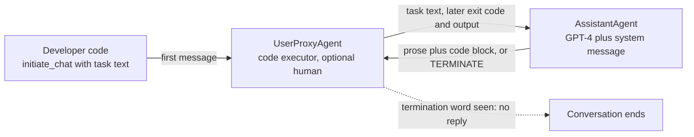
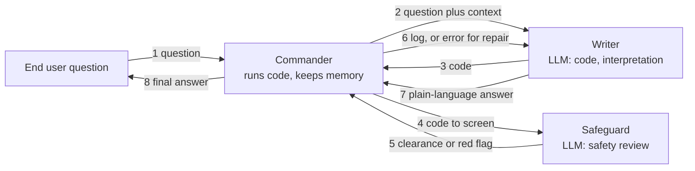
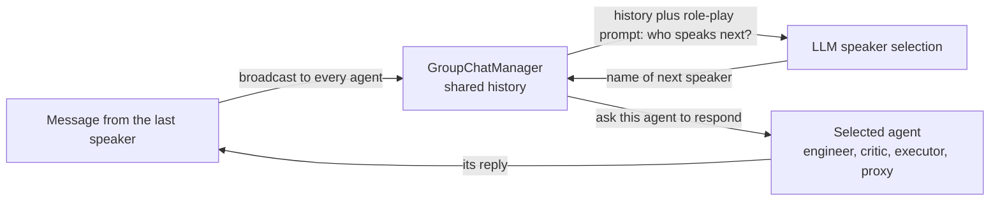

# AutoGen: Enabling Next-Gen LLM Applications via Multi-Agent Conversation

> **Paper:** Wu, Bansal, Zhang, Wu, Li, Zhu, Jiang, Zhang, Zhang, Liu, Awadallah, White, Burger and Wang (Microsoft Research, Pennsylvania State University, University of Washington, Xidian University), 2023 - [arXiv abstract](https://arxiv.org/abs/2308.08155) - [local PDF](../../papers/2308.08155.pdf)
>
> **Version followed:** arXiv v2 (3 October 2023), read through its HTML rendering; section, figure and table numbers follow it. It is an arXiv preprint and the version read carries no venue line. The Figure 4 bar values are not in the running text, so they were read from the figure's own vector files after rendering them to pictures.

## Read this first

**The claim in one sentence.** Many LLM applications can be built by giving every role (model-backed assistant, code runner, human, checker) the same chat interface, so an application becomes "who messages whom, and what happens when a message arrives"; the authors show six applications built this way with measured gains against other systems.

**Who this is for.** Anyone choosing between "one model with tools" and "several cooperating agents" for an assistant. It is the framework paper of the multi-agent stage: an abstraction and a library more than a new method.

**Afterwards you will be able to** trace a two-agent conversation message by message; define conversable agent, auto-reply, conversation programming, group chat manager and human-in-the-loop with an example each; say what each of the six applications was compared against and what was held constant; and decide which parts to borrow for an assistant over private business documents.

**Reading time.** About 50 minutes. **Have read first:** [ReAct](../02-building/10-react.md) (the reason-act-observe loop that the two-agent chat packages) and [CAMEL](./17-camel.md) (role-playing agents without code execution). Code as the action is the thread of [CodeAct](../06-agent-systems/25-codeact.md). Next: [MetaGPT](./19-metagpt.md) and the [multi-agent survey](./20-multi-agent-survey.md).

**The one thing most people get wrong.** The headline wins are not evidence that "more agents are better". The largest gains come from a two-agent loop in which one agent writes code and the other runs it and reports errors, and the paper never compares that against one model holding the same code tool. Where it does compare one agent with several (OptiGuide, A4), the second agent is a second model call with a safety-review prompt, so the gain may come from the extra review pass rather than from conversation.

## The paper in one worked example

Three parts, all from the paper: a two-agent math conversation traced message by message (Appendix E Table 9, Figure 2), what other systems did on the same problem (Tables 8, 10 to 14), and a four-role business workflow (A4, Tables 13 and 15).

### Part A - one math problem, two agents (Table 9)

**The problem** (a level-5 problem from the MATH dataset, Table 2a): "Completely simplify and rationalize the denominator" for sqrt(160)/sqrt(252) times sqrt(245)/sqrt(108). To rationalize is to rewrite so no square root stays in the denominator.

**The agents.** A `UserProxyAgent` (code execution, optionally a human) and an `AssistantAgent` (GPT-4 plus the long default system message of Figure 5). The paper does not print the script for this run. That no human was asked is this guide's inference: Scenario 2 differs by setting `human_input_mode='ALWAYS'` (Appendix D), implying Scenario 1 did not.

| # | Who acts | What happens (Table 9) | Function that fired (this guide's reading of Section 2.2) |
|---|---|---|---|
| 0 | Developer | Starts the chat with the problem text ("Init chat") | initiate_chat sends the first message |
| 1 | Assistant | Prose, then Python: import `sqrt`, `Rational` from sympy, build the fraction, `.simplify()`, `print` | receive, generate_reply (LLM), send |
| 2 | User proxy | "Auto Reply": `exitcode: 0 (execution succeeded)`, `Code output: 5*sqrt(42)/27` | receive, generate_reply (code execution), send; no human asked |
| 3 | Assistant | `TERMINATE` | receive, generate_reply (LLM), send |
| 4 | User proxy | Sees the termination word, sends nothing; the chat ends | termination condition holds, so no auto-reply |

Notice three things. Nobody tells the proxy to run code: "if the message has a code block and no human input is requested, execute it" is a default reply behaviour (Figure 2). The loop's logic lives partly in natural language: the system message says print results, re-output full code after an error, and say TERMINATE when done. And the table shows only `TERMINATE` as the last message, so whether the assistant wrote more is not visible. This guide recomputed 5*sqrt(42)/27 as 1.2001371663718259, matching the decimal other systems printed.

Figure 2 uses another task, "Plot a chart of META and TESLA stock price change YTD" (year to date), with an error in the middle: the proxy runs the code and replies "Error: package yfinance is not installed", and the assistant answers "Sorry! Please first pip install yfinance and then execute". The figure's custom reply function, `reply_func_A2B`, asks a human first and executes code only if the human gives no input.



Notice there is no scheduler: each arrow is a reply the receiving agent generates itself, and the loop ends because a word trips a check.

### Part B - other systems on the same problem (Appendix E)

| System | What it did (Tables 8, 10, 11, 12, 14, 16 to 18) | Outcome |
|---|---|---|
| ChatGPT with Wolfram Alpha plugin | Wolfram returned 5*sqrt(42)/27 and 5*sqrt(14/3)/9; the model picked the second | Table 2a: 1 of 3 correct |
| LangChain ReAct with Python | Used `math.sqrt`, printed 1.200137166371826 | Decimal, not exact form; 0 of 3 |
| AutoGPT | Code never printed; aborted after two empty runs | 0 of 3 |
| Multi-Agent Debate | Both sides ended at 7*sqrt(1050)/189 | Labelled wrong; see note |
| ChatGPT with Code Interpreter | `math.sqrt`, returned 1.200 | Trace shown is a failure; Table 2a: 2 of 3 |
| BabyAGI, CAMEL, MetaGPT | BabyAGI answered 20*sqrt(6)/9 then spawned ten unrelated tasks; CAMEL wrote scaffolding forever; MetaGPT wrote a product document | Not scored |

**Inconsistency found.** Table 12 calls the debate answer wrong, but this guide's arithmetic gives 7*sqrt(1050)/189 = 1.2001371663718259, the correct value, merely not fully simplified (sqrt(1050) = 5*sqrt(42)). Whether that counts as wrong depends on an answer-matching rule the paper never states. The same holds for the plugin's 5*sqrt(14/3)/9.

### Part C - four roles answering a business question (A4, Figure 11)

The user asks: "What if the roasting cost is increased by 5% because of the potential salary increase?" The Commander (executes code, holds chat memory) forwards it to the Writer (LLM: writes the optimization code and later explains the output). The Commander sends the code to the Safeguard (LLM: reviews for unsafe or leaking code); if cleared it executes the code, returns the log to the Writer, and gives the user the final text. AutoGen's answer: new optimal cost 2526.5 against 2470.0, up 56.5 (Table 15). ChatGPT with Code Interpreter reached 2526.5 too (Table 13) but the user had to download code, run it locally because the solver (Gurobi) was missing from its sandbox, paste output back, and pass two failed safety checks.



Notice that the Commander is the hub; Writer and Safeguard never speak to each other. That shape is the developer's choice, not the framework's.

## Words you need

| Term | Plain definition | Example from the worked example |
|---|---|---|
| Conversable agent | An object that sends and receives messages, keeps a history, and has reply behaviours backed by an LLM, a tool, a human, or a mix (Section 2.1) | The proxy and assistant in Table 9 |
| AssistantAgent, UserProxyAgent | Ready-made subclasses of ConversableAgent: an LLM-backed assistant, and a proxy that runs code or asks a human | Part A's two agents |
| generate_reply | The function an agent runs on an incoming message to compute its answer | Turn 1 calls GPT-4; turn 2 runs code |
| Auto-reply | Default rule: on receiving a message call generate_reply and send the result back unless a termination condition holds | Turn 2 happens unprompted |
| Conversation programming | Building an application by defining agents and then specifying, in code and natural language, what each does on a message (computation) and who speaks next (control flow) | "Fix the error and output the code again" is natural-language control flow |
| human_input_mode | Setting for when a human is asked; the paper uses `ALWAYS` and `NEVER` | Scenario 2 of A1 |
| Human-in-the-loop | A person can read the chat and inject or approve messages mid-task | Three hints on the plane-bisector problem |
| GroupChatManager | Built-in agent that repeats: select the next speaker, ask it to respond, broadcast the reply to all others (A5) | Four agents: user proxy, engineer, critic, code executor |
| Grounding agent | An agent that injects facts or checks from outside the model's guess | ALFWorld rule "You must find and take the object before you can examine it" |
| Safeguard | An LLM agent that reviews code before it runs | Part C step 4 |
| UPDATE CONTEXT | Reply that makes the retrieval proxy fetch the next-best chunks (A2) | Fired on about 19.4 percent of Natural Questions queries |
| Control plane | A separate module that steers conversation flow; the paper says AutoGen needs none | No scheduler in Part A |

## Tutorial 1 - Intuitive understanding

### What was broken before

Anyone wanting two or more model roles to cooperate wrote a one-off script. Appendix A (Table 1, the authors' own survey) says Multi-Agent Debate used fixed-order arguments with no tools or humans, BabyAGI had a predetermined order, CAMEL had no native code execution, and LangChain agents and AutoGPT were single-agent. Table 11 shows the failure: AutoGPT wrote code that never printed its answer, got empty output twice, and was aborted. Table 17 shows CAMEL's role-players exchanging instructions about importing libraries and never reaching the answer.

### The idea

**Analogy.** A small office on one email system. The analyst drafts when asked, the clerk runs the numbers and mails back the result, the reviewer vets drafts. No manager schedules them; each reply triggers the next person's habit, and it stops when someone writes "done". AutoGen is the email system plus a library of standard employees.

**Where it breaks.** Real employees notice circles. AutoGen agents do not unless someone wrote the check: the authors saw repeated-error loops in ReAct and in their own two-agent ALFWorld system (A3), and in two-agent GPT-3.5-turbo chats 9 of 12 tasks ended in a termination failure (Table 6). And an "agent" here is a model call with a prompt, so two agents may be one model in two costumes.

### How it works, step by step

1. **Pick capabilities per agent:** LLM, code execution, human input, or a custom function (Section 2.1). In Part A the assistant is LLM-only, the proxy code-only.
2. **Start a chat:** one agent sends the first message. This is the only imperative call in Part A.
3. **Auto-reply:** every received message triggers generate_reply and the answer goes back (Section 2.2).
4. **Steer in natural language.** Figure 5's system message encodes policy; the authors tag its sentences as role play, control flow, output confinement, automation and grounding.
5. **Steer in code:** a cap on automatic replies, a termination test, the human-input setting, or a registered reply function.
6. **Go dynamic:** a custom reply function can hold the current chat and open another, or the model can propose a function call that messages another agent. In A1 Scenario 3 the assistant calls `ask_for_expert` when it cannot satisfy the student; a second chat runs between the expert's proxy and the expert's assistant, and the expert's final message returns as the answer.
7. **Group chat.** A GroupChatManager chooses a speaker, collects the reply, broadcasts it. Constructed example on the paper's A5 task ("How much money would I earn if I bought 200 $AAPL stocks at the lowest price in the last 30 days and sold them at the highest price?"): engineer writes a script, code executor reports an error, engineer fixes it, critic checks the arithmetic.



Notice that selection is itself an LLM call over the shared history, so the manager spends tokens every turn without adding task content.

**Human-in-the-loop, with an example.** In A1 Scenario 2, a problem no system solved alone (the plane bisecting the angle between two given planes and passing through (-5,-1,-5)) was solved after three scripted hints: set up the equal-distance equation, split the absolute value into two cases, use the point to pick the case. With `ALWAYS` the proxy asks a person before each automatic reply; typing nothing lets the default run.

### What the results say

"Success ratio" is the fraction of items answered correctly; "points" are percentage points. Detail and caveats are in Tutorial 3.

**A1 math (Figure 4a).** GPT-4 for all systems. On 120 random level-5 MATH problems: AutoGen 52.5, ChatGPT with Code Interpreter 48.33, with Wolfram plugin 45.0, plain GPT-4 30.0, Multi-Agent Debate 26.67, LangChain ReAct 23.33. That is 63, 58, 54, 36, 32 and 28 problems (this guide's arithmetic). The lead over the best baseline is 5 problems; over plain GPT-4 it is 22.5 points, about 22 more solved per 100 hard problems. On all 5,000 test problems, AutoGen 69.48 versus GPT-4 55.18: about 14 more solved per 100.

**A2 retrieval (Figure 4b).** Natural Questions, GPT-3.5-turbo. F1 (answer-word overlap, Prerequisite 3): AutoGen 25.88, without interactive retrieval 22.79, DPR (Dense Passage Retrieval, a number from a prior paper) 15.12. Recall: 66.65, 62.59, 58.56. Interactive retrieval adds 3.09 F1 points.

**A3 ALFWorld (Table 3, Figure 4c).** A text-only household simulator, 134 unseen tasks. Average over three attempts: 3-agent AutoGen 69, 2-agent 54, ReAct 54; best of three: 77, 63, 66. The grounding agent adds 15 points: about 15 more tasks finished per 100.

**A4 OptiGuide (Figure 4d).** 100 tasks, half unsafe. F1 for flagging unsafe code: GPT-4 multi-agent 96, single 88; GPT-3.5-turbo multi 83, single 48. With GPT-3.5-turbo the single agent missed 34 of 50 unsafe tasks (recall 32 percent) and the two-role system missed 14 (recall 72; this guide's arithmetic). Also: core code from over 430 lines to 100, and a 10-question user study at 4 minutes 35 seconds versus about 1.5 minutes, 8 of 10 correct for both.

**A5 group chat (Tables 5, 6).** 12 tasks; GPT-4 successes 9 (two-agent), 11 (role-play group chat), 8 (task-style); GPT-3.5-turbo 8, 9, 7. One task is 8.3 points.

**A6 chess.** No numbers; a qualitative ablation (Figure 16) says games were disrupted without the board agent.

### What this does not show

- That several agents beat one agent with the same tools: no single-agent twin with the code tool and system message exists.
- Anything about open or small models; every quantitative run uses OpenAI models.
- Cost: only LLM-call counts (A5) and user-effort ratios (A4) appear; no tokens, dollars or latency.
- That group chat helps: 12 tasks cannot tell 9 from 11.
- Robustness: runs are single or triple, with no intervals.

### Teach-back

1. In Part A, what makes the proxy run code, and who decided?
<details><summary>Answer</summary>The assistant's message containing a Python block. No one decides per message: executing code found in an incoming message, when no human input is requested, is the proxy's default reply behaviour (Figure 2).</details>

2. What ends Part A's conversation, and what happens without it?
<details><summary>Answer</summary>The assistant's TERMINATE trips the termination check. Without a check or a cap on automatic replies, the auto-reply rule would keep passing messages back and forth.</details>

3. When does the grounding agent speak in ALFWorld?
<details><summary>Answer</summary>At the start of the task and whenever the assistant emits the same action three times in a row (Appendix D, A3). It injects fixed commonsense rules; it does not reason.</details>

4. Why is the 5-problem gap over Code Interpreter weak evidence?
<details><summary>Answer</summary>One problem is 0.83 points and the sampling noise at about 50 percent on 120 problems is roughly plus or minus 9 points (Prerequisite 2); the paper reports one run.</details>

## Tutorial 2 - Practitioner understanding

### The design in concrete terms

**Agents.** `ConversableAgent` is the top class (LLM, humans, tools by default); `AssistantAgent` presets an LLM backend and the Figure 5 system message (library version 0.1.1); `UserProxyAgent` presets human input and code or function execution. Figure 2 shows the knobs: `human_input_mode` ("NEVER" or "ALWAYS"), `code_execution_config` (False disables execution), the system message, and for group chats a member list. The released library has more parameters than the paper describes; this guide relies only on the paper.

**Interfaces.** `send`, `receive` and `generate_reply` are unified across agents; `register_reply` adds a custom reply function, and when none is registered a default list (LLM, code or function execution, human) applies (Figure 2).

**Message formats.** Chat messages (role plus content) kept per partner. In ALFWorld the model's free-text action is mapped to a valid environment action by BLEU (text-overlap score) because formats are strict (A3). In chess a board agent has an LLM parse a chatty message into a UCI move (standard chess notation), pushes it to the board, and returns an error if illegal so the player must resend (A6).

**The default assistant prompt (Figure 5)** tells the model to suggest code for the user to run; explain the plan first; mark script types; never ask the user to edit code or paste output; use `print`; give full code, not diffs; fix errors and re-output; if stuck, "analyze the problem, revisit your assumption" and try another approach; verify answers with evidence; end with TERMINATE. Appendix C says GPT-4 follows it better than GPT-3.5-turbo.

| Application | Agents | Setting stated in the paper |
|---|---|---|
| A1 math | assistant, proxy | GPT-4; sympy pre-installed; 120 level-5 problems (20 in each of 6 subjects) and 5,000 test problems |
| A2 retrieval | retrieval proxy (Chroma store, all-MiniLM-L6-v2 embeddings), assistant | GPT-3.5-turbo; 5,332 contexts, 6,775 queries; chunk size not given |
| A3 ALFWorld | assistant, executor, optional grounding agent | Two-shot prompts from the ReAct repository; grounding at start and on 3 identical actions |
| A4 OptiGuide | Commander, Writer, Safeguard | 100 tasks, 50 safe and 50 unsafe by construction |
| A5 group chat | manager plus proxy, engineer, critic, executor | 12 hand-written tasks |

### A minimal version

A plain-Python sketch of the core loop, not the library: auto-reply, a human-input mode, a code-running proxy, an auto-reply cap and a termination word. `llm` is a stub for any chat model. Running model-written code is dangerous; `subprocess` with a timeout is not a sandbox, so use a container for real work.

```python
import re, subprocess, sys

def llm(messages):                       # stub: [{"role","content"}] -> str
    raise NotImplementedError("wire to any chat model")

class Agent:
    def __init__(self, name, system="", use_llm=False, run_code=False,
                 human_input_mode="NEVER", max_auto_reply=6):
        self.name, self.system = name, system
        self.use_llm, self.run_code = use_llm, run_code
        self.mode, self.max_auto = human_input_mode, max_auto_reply
        self.hist, self.n_auto, self.custom = [], 0, []

    def register_reply(self, fn): self.custom.append(fn)

    def initiate_chat(self, other, message):
        self.hist.append({"role": "assistant", "content": message})
        other.receive(message, self)

    def receive(self, msg, sender):
        self.hist.append({"role": "user", "content": msg})
        if "TERMINATE" in msg or self.n_auto >= self.max_auto:
            return                               # stop conditions
        reply = self.generate_reply(msg)
        if reply is None: return                 # silence ends the chat
        self.n_auto += 1
        self.hist.append({"role": "assistant", "content": reply})
        sender.receive(reply, self)              # auto-reply

    def generate_reply(self, msg):
        for fn in self.custom:
            out = fn(self, msg)
            if out is not None: return out
        if self.mode == "ALWAYS":                # human-in-the-loop
            typed = input(f"[{self.name}] reply (blank to skip): ")
            if typed: return typed
        if self.run_code:
            blocks = re.findall(r"`{3}python\n(.*?)`{3}", msg, re.S)
            if blocks: return run_python(blocks[-1])
        if self.use_llm:
            return llm([{"role": "system", "content": self.system}] + self.hist)

def run_python(code, timeout=60):
    p = subprocess.run([sys.executable, "-c", code], capture_output=True,
                       text=True, timeout=timeout)
    ok = "succeeded" if p.returncode == 0 else "failed"
    return f"exitcode: {p.returncode} (execution {ok})\nCode output:\n{p.stdout}{p.stderr}"

SYSTEM = "Suggest python in a code block; print results; fix errors; say TERMINATE when done."
assistant = Agent("assistant", system=SYSTEM, use_llm=True)
proxy = Agent("proxy", run_code=True)
proxy.initiate_chat(assistant, "Plot META and TESLA price change YTD.")
```

Shapes: `receive(str, Agent)` returns nothing and the chat advances by recursion; `generate_reply` returns a string or `None`. The code reply copies Table 9's "exitcode ... Code output" layout. A group chat adds one object whose `generate_reply` calls `llm` with a selection prompt, picks a name, asks that agent, and broadcasts. A low `max_auto` is the cheapest loop guard.

### What it costs

The paper reports no tokens, dollars or latency per task. Everything below is constructed by this guide under stated assumptions.

**Assumptions.** System message 450 tokens (Figure 5 is about 1,900 characters at roughly 4 characters per token); task 60; each assistant message 350; each proxy reply 120; every call re-sends the whole history; placeholder prices of 3 dollars per million input and 15 per million output tokens (use your provider's).

| Rounds | Input tokens | Output tokens | Cost under assumed prices |
|---|---|---|---|
| 3 | 510 + 980 + 1,450 = 2,940 | 1,050 | about 0.025 dollars |
| 10 | 5,100 + 470 x 45 = 26,250 | 3,500 | about 0.131 dollars |

Going from 3 to 10 rounds multiplies input by 8.9, not 3.3, because every call carries all earlier messages; the auto-reply cap is therefore a budget control.

**Group chat overhead.** With 4 agents and 6 turns, assume a 150-token selection prompt plus a history of 100 tokens of task and 300 per turn. Selection calls take 6 x 150 + 6 x 100 + 300 x 15 = 6,000 input tokens; the 6 speaker calls (300-token role prompt) take 6 x 400 + 300 x 15 = 6,900. Selection is about 47 percent of input. Whether Table 6's "LLM calls" include selection calls is not stated, so those counts cannot be converted to cost. **Latency:** most of OptiGuide's 1.5 minutes per question was waiting for GPT-4 (Appendix D).

### How it fails

| Symptom | Likely cause | Mitigation | Grounding in the paper |
|---|---|---|---|
| Code runs, result never shown | No `print`; empty output goes unnoticed | Prompt to print; report empty output as an error | AutoGPT, Tables 2 and 11 |
| Repeats one action or apologises | Missing commonsense rule; no loop detector | Grounding agent on 3 identical actions | A3, Figure 10 |
| Chat never ends | Termination word not produced | Auto-reply cap; manager | Table 6: 9 of 12 termination failures, two-agent GPT-3.5-turbo |
| Invalid chess move | Model asserts legality | Checker agent returns an error, forces resend | A6, Figure 16 |
| Unsafe code reaches the executor | Writer also judges itself | Separate reviewer role and prompt | Figure 4d: single GPT-3.5-turbo recall 32 |
| Retrieved text lacks the answer | Top chunks miss it | Reply UPDATE CONTEXT, fetch next chunks | A2: about 19.4 percent retried |
| System solves the wrong task | A specialised framework takes over | Use a generic base | MetaGPT on math, Table 18 |

### Evaluating your version

- **Metric:** task success plus calls and tokens per task, reported together.
- **Test set size:** at least 200 tasks. At 120 tasks the 95 percent interval is about plus or minus 9 points (Prerequisite 2), so only gaps over roughly 10 points mean something; with 50 unsafe cases, each miss moves recall 2 points.
- **Baselines, same model, temperature, retry budget and token cap:** (1) one call, no tools; (2) one agent with one code tool and the same system message; (3) your multi-agent design. The paper runs (1) versus (3) but never (2).
- **Repeats:** three runs; report mean and best-of-three separately, as Table 3 does.
- **Stop rule (this guide's suggestion):** ship multi-agent only if it beats (2) by more than the interval width and uses no more than about 2 times (2)'s tokens per solved task.

### Adopt, adapt or skip

**Adapt; do not adopt wholesale.** For a team building an assistant over private business documents:

1. **Separate the executor from the writer.** The model proposes; a constrained runner executes and returns exit codes and errors. This is the best-supported piece (A1, A4) and the same loop as [ReAct](../02-building/10-react.md) and [CodeAct](../06-agent-systems/25-codeact.md).
2. **Add a reviewer pass before side effects**, checking what an answer cites and what data an action touches. A4 supports a second review, not conversation as such.
3. **Inject rules at trigger points.** The grounding agent is context placed in the prompt when a loop detector fires: a context-and-instructions technique, needing no frontier model, though the paper never tests an open or small model.
4. **Develop with a human in the loop**, then relax (Appendix B.1).

**Skip** group chat and dynamic speaker selection until you have separable specialist roles and a failing baseline. The evidence is 12 tasks, and the manager adds a model call per turn. A thin runtime where one model picks among a few well-built tools reaches many of the same ends with fewer moving parts; this paper does not decide the question because it never builds the single-agent comparator.

## Tutorial 3 - Researcher understanding

### Formal setup

The paper has no equations; this is the guide's formalization of Section 2.

- Agents a in A, each with a history H_a (messages sent and received) and an ordered list of reply functions F_a = (f_1, ..., f_k), each mapping (H_a, m) to a message or to none. Built-ins are LLM inference, code or function execution, and human input.
- generate_reply(a, m) returns the first non-none f_i(H_a, m). The search order is a library detail the paper omits, so it is an assumption.
- Auto-reply: on receiving m from b, agent a appends m to H_a; unless term(m) holds or its count n_a has reached a cap N_a, it sends r = generate_reply(a, m) to b. The chat m_0, m_1, ... halts when term holds, a cap is hit, or the reply is none.
- Group chat (A5): shared history H, roster R, selection policy pi(H, R) returning the next speaker, whose reply is appended to H and broadcast. In the paper pi is an LLM call with a role-play prompt.
- Evaluation: p-hat = k/n with a 95 percent half-width of 1.96 x sqrt(p-hat (1 - p-hat)/n).

**Toy instance.** Part A: agents {proxy, assistant}, term(m) = "TERMINATE appears in m". The assistant sends m_1 (code), the proxy's code function returns m_2 (exit code 0 plus output), the assistant's LLM function returns m_3 = "TERMINATE", the proxy's term holds and it sends nothing: two LLM calls, one execution. For a benchmark, n = 120 and k = 63 give p-hat = 0.525 and half-width 0.0893, so about 43.6 to 61.4 percent.

### The claims, stated precisely

| # | Claim | Where | Status |
|---|---|---|---|
| C1 | One interface (send, receive, generate_reply) expresses two-agent, group, nested and function-call-driven chats with no control plane | Section 2 | Design claim; six applications are existence proofs, not a comparison with other designs |
| C2 | The built-in pair solves more MATH problems than five alternatives | Figure 4a | One run, GPT-4 for all (ChatGPT via product) |
| C3 | Interactive retrieval adds about 3 F1 points | Figure 4b | Clean prompt-level ablation |
| C4 | A grounding agent adds 15 points on ALFWorld | Figure 4c, Table 3 | Facts derived from observed failures |
| C5 | Splitting writing and review raises unsafe-code detection | Figure 4d | 100 authored tasks; isolates a second review pass |
| C6 | Role-play speaker selection beats task-style | Tables 5, 6 | 12 tasks; partly contradicted by the paper's own call counts |
| C7 | Less development effort: 430 to 100 lines, 3 to 5 times fewer user prompts | A4, Table 4 | Authors reimplementing their own earlier system |

### Evidence, table by table

**Figure 4a, Table 2 (A1).** Success ratio on 120 level-5 problems: AutoGen 52.5, Code Interpreter 48.33, plugin 45.0, GPT-4 30.0, debate 26.67, LangChain ReAct 23.33; on 5,000 problems only AutoGen 69.48 and GPT-4 55.18 (debate and LangChain were skipped because they trailed GPT-4 on the small set, per footnote 4). Table 2 adds 2 problems times 3 trials: AutoGen 3/3 and 2/3, Code Interpreter 2/3 and 0/3, plugin 1/3 and 1/3, AutoGPT, LangChain and debate 0/3 on both. Identified: GPT-4 with the assistant-proxy loop beats GPT-4 alone (22.5 and 14.3 points). Only associated: the lead over ChatGPT products, whose model version, prompts and tools the authors did not control; the 5-problem margin lies inside noise.

**Figure 4b, Appendix D (A2).** F1 25.88, 22.79, 15.12 and recall 66.65, 62.59, 58.56 for AutoGen, AutoGen without interactive retrieval, and DPR with GPT-3.5 (taken from Adlakha et al. 2023). A re-run of the no-interaction variant on 500 questions gave F1 23.40 and recall 62.60, "aligning closely" with 22.79 and 62.59; the 0.61-point F1 difference is a feel for the noise. Identified: interactive retrieval's effect (same model, retriever and data; only the reply to missing context differs). Not identified: any edge over DPR, which the appendix itself credits to the retriever (MiniLM vector search). The AutoGen paper does not define its F1 and recall; this guide assumes the Adlakha et al. token-level versions, unverified.

**Table 3, Figure 4c (A3).** Success percent over 134 tasks by type (Pick, Clean, Heat, Cool, Look, Pick 2) and overall. Averages: ReAct 54, 2-agent 54, 3-agent 69; best of three 66, 63, 77. This guide recomputed the "All" column using the per-type counts of ALFWorld's unseen set from the ReAct paper (24, 31, 23, 21, 18, 17; not in this paper): 53.9, 53.8, 68.6, 65.9, 63.3, 76.8, all within rounding. Identified: adding the grounding agent lifts every type on average (largest on Look, 50 to 78, and Pick 2, 19 to 41). Only associated: the ReAct comparison, since footnote 6 says ReAct ran its official code on text-davinci-003, which cannot use GPT-3.5-turbo, so model and prompt format changed along with structure. The appendix never names ALFChat's model; the main text lists GPT-3.5-turbo. Oddity: 3-agent Pick 2 is 41 on both average and best of three, requiring identical successes across attempts.

**Figure 4d, Table 4 (A4).** F1 96, 88, 83, 48 and recall 98, 78, 72, 32 for multi-GPT-4, single-GPT-4, multi-GPT-3.5, single-GPT-3.5. Identified: with the same model and tasks, a separate reviewer beats one agent writing and judging. Not held constant: call count and prompts. Recomputing precision from F1 and recall gives 0.94, 0.98 and 0.96 for three bars but 1.009 for single-GPT-4, which is impossible: at recall 0.78 the largest possible F1 is 0.876, not the printed 88.00. Rounding or a different F1 definition may explain it; the paper is silent. Table 4's saving ratio (netflow 3.14, facility 3.14, tsp 4.88, coffee 3.38, diet 3.03 times) is said to preserve "the same coding performance" without showing it, and numerator and denominator are not defined; this guide reads it as prompts typed with ChatGPT plus Code Interpreter divided by prompts typed with AutoGen, unverified.

**Tables 5, 6 (A5).** GPT-3.5-turbo successes 8, 9, 7 and (calls, termination failures) (9.9, 9), (5.3, 0), (4, 0) for two-agent, role-play and task-style; GPT-4 successes 9, 11, 8 and (6.8, 3), (4.5, 0), (4, 0). The robust pattern is that termination failures vanish with a manager; this guide infers that reading. The text says role-play gives fewer calls, but task-style used fewer (4 against 5.3 and 4.5).

**Figure 18, Table 7 (A7, appendix only).** MiniWobChat reached 52.8 percent on 49 tasks (10 instances each) against RCI (a self-critiquing prompt method) at 56.4, implied by "3.6 percent lower". AutoGen did not win here.

**Table 1 (Appendix A).** An authors' checklist of rivals "as of the time of writing"; no tests. The claim in B.2 that CAMEL "cannot effectively solve problems in most cases" because it cannot run code rests on one trace (Table 17).

### Ablations and what they isolate

| Ablation | Changes | Fixed | Isolates | Leaves open |
|---|---|---|---|---|
| Interactive retrieval vs "I don't know" (A2) | Reply to missing context | Model, retriever, data | Retry-with-more-context, +3.09 F1 | Would a larger top-k match it? |
| 2-agent vs 3-agent (A3) | Grounding agent | Executor, tasks, prompts | Injected commonsense on trigger | Same text in the system prompt untried |
| Single vs multi (A4) | Separate reviewer | Model, 100 tasks | A separate review pass | Calls differ; self-review step untried |
| Role-play vs task-style selection (A5) | Selector prompt | Roster, 12 tasks | Selector prompt style | 1 to 3 tasks of noise |
| Human hints (A1 Scenario 2) | Scripted hints | One problem | AutoGen 3/3, Code Interpreter 2/3, plugin 2/3, AutoGPT 0/3 | One problem |

### Threats to validity specific to this paper

1. **No same-tool single-agent comparator.** The 22.5-point gain over plain GPT-4 mixes "code with feedback" and "two agents"; [CodeAct](../06-agent-systems/25-codeact.md) isolates the first.
2. **Baselines not tuned like the proposal.** The authors designed AutoGen's prompts and ran others "out of the box" or from official code with defaults; product baselines were driven by hand through a web client whose versions drift.
3. **Tiny, singly-run samples.** 120 problems, 12 tasks, 10 questions, 6 trials; no intervals, seeds or significance tests; sampling temperature not stated.
4. **Possible tuning on the test tasks.** Grounding facts came from "scrutinizing the failed attempts" (A3); the paper does not say whether those were the 134 evaluation tasks.
5. **Unstated metrics.** MATH answer matching, NQ F1 and recall, and "success" for ChatGPT trials are undefined.
6. **Self-authored sets.** The OptiGuide safety set and group-chat tasks were written by the authors.
7. **Self-comparison of effort.** 430 to 100 lines compares a reimplementation with the authors' earlier code, and depends on what counts as "core workflow".
8. **Single provider.** Only OpenAI models; Appendix C says GPT-4 follows instructions better than GPT-3.5-turbo; open models, central to the curriculum's question, are untested.

**Internal inconsistencies recorded.** (a) A5 text says role-play needs fewer calls; Table 6 disagrees. (b) A3 text names GPT-3.5-turbo; footnote 6 says ReAct ran text-davinci-003. (c) Table 13 is captioned "Application A3" but is the A4 example; typos "AFLChat" (Table 3) and "AuotGen" (Figure 4b legend). (d) Appendix D says "5x reduction in interaction"; Table 4 shows 3.03 to 4.88 times and the main text says 3 to 5. (e) Table 12 calls an equal-valued answer wrong. (f) Figure 4d's single-GPT-4 F1 and recall cannot both hold. (g) Scenario 2 ends "Final answer is ." in the HTML, likely a rendering gap. (h) Six applications are promised; a seventh (A7) is in the appendix only. (i) "15%" in the ALFWorld text means 15 points.

### Open problems and follow-ups

The authors list (Appendix B.2) the best workflow per task and its cost, highly capable agents, and scale, safety and human agency, including "incomprehensible, unintelligible chatter". This guide adds three. First, the missing control: the assistant-proxy loop against one agent with the same tools. Second, the missing cost axis: tokens per solved task. Third, small and open models: does a rule-injecting grounding agent or a reviewer narrow the gap to larger models? A4 hints that structure helps weaker models more (+35 F1 for GPT-3.5-turbo against +8 for GPT-4), but that is one task and one provider.

### What would change my mind

- A single GPT-4 agent with the same code tool and system message matching AutoGen on all 5,000 MATH problems: the gain would be code feedback, not agents.
- An A4 rerun where the single agent makes a second self-review call with equal prompt effort and closes the gap: the gain would be review depth.
- A group-chat study on 100 or more tasks with intervals.
- Evidence that grounding facts were chosen on evaluation tasks: A3 would be an overestimate.
- The same pattern with an open model of 7 to 14 billion parameters: structure, not model size, would be doing the work.

## Reading map for the PDF

| Section or figure | What it contains | First pass | Guide section |
|---|---|---|---|
| Abstract, Section 1, Figure 1 | Claim, three arguments, two concepts | Read | Read this first |
| Section 2.1, Figure 2 top | Conversable agents, built-in classes | Read | Words, Tutorial 2 design |
| Section 2.2, Figure 2 middle and bottom | Computation vs control flow, auto-reply | Read closely | Worked example, formal setup |
| Section 3, Figure 3 | Six application sketches | Skim | Tutorial 1 steps |
| Figure 4, A1 to A4 | Headline numbers | Read, then Appendix D | Evidence tables |
| A5, A6, Section 4, Ethics | Group chat, chess, discussion, risks | Skim | Adopt, adapt or skip |
| Appendix A, Table 1 | Related work | Skim | Evidence (Table 1 note) |
| Appendix B, C | Usage guidance, future work, Figure 5 prompt | Read B.1 and Figure 5 | Tutorial 2 |
| Appendix D | Setups and the numbers behind Figure 4 | Read | Evidence tables |
| Appendix E, Tables 8 to 19 | Raw traces | Skim Tables 9 and 11 | Worked example |

## Questions readers get stuck on

### What is a "conversable agent", and how is it different from just calling a model?

A conversable agent bundles a message history, send and receive, and one or more reply behaviours (call an LLM, run code, ask a human, run your own Python). A bare model call has no bookkeeping and nothing that triggers the next call. The point is that giving every role this shape lets you swap a human for a model or a model for a tool without changing the application around it.

### Does "multi-agent" mean multiple different models?

No. Mostly the same model (GPT-4 or GPT-3.5-turbo) powers every LLM-backed agent, differing by system message, tools and position in the chat, and the user proxy often has no model in the loop at all. That is why the missing single-agent comparison matters so much.

### What stops the agents from chatting forever?

Three controls named in the paper: a termination word the assistant is told to emit, a cap on automatic replies set in code, and a custom reply function that can return nothing. Table 6 shows the failure without a manager: 9 termination failures in 12 two-agent GPT-3.5-turbo tasks. 

### Is "conversation programming" a new programming language?

No, it is a way of organising an application: ordinary Python where you can specify behaviour (limits, execution, custom replies) and natural-language instructions where you want the model to infer it (when to fix an error, when to stop), with transitions between them, for example through function calls. That it beats a hand-coded state machine is a design claim, backed quantitatively only by the 430-to-100-line comparison.

### Who decides who speaks next?

In a two-agent chat nobody: replies return to the sender. In a custom chat, a reply function can message a third agent. In a group chat the GroupChatManager asks an LLM, with a role-play prompt over the shared history, and broadcasts the chosen speaker's answer, costing one extra model call per turn.

### How big is AutoGen's win on MATH, really?

Against plain GPT-4 it is large: 22.5 points on 120 level-5 problems (52.5 versus 30.0) and 14.3 on 5,000 (69.48 versus 55.18). Against the strongest other system it is 5 problems out of 120, inside the noise of one run. Giving GPT-4 a code executor and a retry loop helps; the paper does not show that the agent framing, rather than code execution, is the cause.

### Is the 15 percent ALFWorld gain relative or absolute, and against what?

Absolute: 69 versus 54 percent success on 134 tasks, averaged over three attempts, for the 3-agent system against both the 2-agent system and ReAct (both 54). The ReAct baseline ran text-davinci-003 (footnote 6), so the 2-agent versus ReAct tie is also a tie between different models.

### What does `human_input_mode` do, and when should I use ALWAYS?

It decides whether a person is asked before an agent replies. With `ALWAYS` the person can type a hint (three hints solved A1's problem that no system solved alone), approve, or type nothing and let the default reply run. The paper advises developing with ALWAYS to find corner cases and tune prompts, then moving to `NEVER`.

### Why not give one model a code tool and skip the second agent?

A fair "why not just", and the paper does not test it. The proxy is in effect a tool and the assistant a model with a tool loop, which is what [ReAct](../02-building/10-react.md) and [CodeAct](../06-agent-systems/25-codeact.md) describe. The extra value claimed for separate agents is modularity (swap the executor, add a safeguard) and, in A4, a second review pass; whether that justifies an abstraction for your task is an empirical question.

### How does this differ from CAMEL and MetaGPT?

[CAMEL](./17-camel.md) runs two role-playing chat agents with an inception prompt and, per Appendix A, no native code execution and a static pattern. [MetaGPT](./19-metagpt.md) is a specialised multi-agent system for software development with fixed role procedures. AutoGen presents itself as general infrastructure that could host either; its Tables 17 and 18 show them failing on a math problem they were not built for, which is not a fair test of them.

## Prerequisites you actually need

### Prerequisite 1 - Chat history and stateless model calls

A chat model remembers nothing between calls, so each call must resend the system message and all earlier turns; cost grows with history. Worked example (constructed): system 450 tokens, task 60, each round adds 470. Calls see 510, 980 and 1,450 tokens, 2,940 in total, not 3 x 510 = 1,530. **Used in:** every LLM agent, the manager's selection call (A5) and the cost section. **Pointer:** [ReAct](../02-building/10-react.md); [glossary](../../references/glossary.md).

### Prerequisite 2 - Sampling noise on a small test set

A success rate on n items is uncertain. At about 50 percent and n = 120 the 95 percent half-width is 1.96 x sqrt(0.5 x 0.5/120) = 0.0895, about 9 points; at n = 12 it is 0.283, about 28 points. Worked example: 63 of 120 is 52.5 percent and 58 of 120 is 48.33 percent; the 4.17-point gap is under half the half-width. **Used in:** Figure 4a, Tables 5 and 6, the user study. **Pointer:** [math bridge](../../references/math-bridge.md).

### Prerequisite 3 - Precision, recall and F1

Precision is the share of flagged items that are truly positive; recall is the share of true positives flagged; F1 = 2PR/(P + R). Worked example (constructed): a reviewer flags 6 tasks as unsafe, 4 truly unsafe, of 5 unsafe in all: P = 0.667, R = 0.8, F1 = 0.727. Token-level variant: gold "john adams", answer "it was john adams in 1797" share 2 tokens, so P = 2/6, R = 2/2, F1 = 0.5 (constructed; the paper does not define its variant). **Used in:** Figures 4b and 4d. **Pointer:** [HELM](../03-evaluation-and-code/13-helm.md) for metric taxonomies.

### Prerequisite 4 - Code execution as feedback

A program run returns an exit code (0 means success) and whatever it printed to standard output and error. An agent that reads these can repair itself: `print(1/0)` returns exit code 1 and "ZeroDivisionError", which a model can fix by adding a guard. Code with no `print` exits 0 with empty output, how AutoGPT stalled (Table 11). **Used in:** the proxy in A1, A2, A4, A5; Figure 2's yfinance repair. **Pointer:** [CodeAct](../06-agent-systems/25-codeact.md).

### Prerequisite 5 - Average versus best-of-k

With k attempts per task, "average" is mean success over all attempts and "best of k" counts a task solved if any attempt succeeded. Worked example (constructed): outcomes A = 1,1,1; B = 0,1,0; C = 0,0,0 give average 4/9 = 44.4 percent and best of 3 = 2/3 = 66.7 percent. **Used in:** Table 3, where ReAct's best-of-3 (66) beats the 2-agent system's (63) though averages tie. Best-of-k flatters high-variance systems and is not comparable with a single-shot number.

## Where this sits in the curriculum

**Have read:** [ReAct](../02-building/10-react.md) and [CAMEL](./17-camel.md); [RAG](../02-building/06-rag.md) helps for A2.

**Nearest two papers.** Compared with CAMEL, AutoGen adds code and tool execution, human input and non-fixed patterns, and argues (Appendix B.2) that role play alone is insufficient. Compared with [MetaGPT](./19-metagpt.md), it is a general library, not a pre-wired software-company process; MetaGPT is one of its Table 1 comparisons.

**Read next.** [MetaGPT](./19-metagpt.md) for structured roles; the [multi-agent survey](./20-multi-agent-survey.md) for the landscape; [CodeAct](../06-agent-systems/25-codeact.md) for a cleaner test of code as the action. For the stage's through-question (is a thin runtime around one model with a few good tools enough?), this paper reads as the case for the other side, yet its largest gains come from code-execution feedback, which a thin runtime also has.

## Checkpoint

1. Why does the proxy in Part A reply "exitcode: 0" and not words?
<details><summary>Answer</summary>Its default reply behaviour, with no human input requested and a code block in the message, is to execute the code and return status and output; no model generates that reply.</details>

2. Compute the 95 percent half-width for 52.5 percent on 120 problems. Is AutoGen's 4.17-point lead over Code Interpreter meaningful?
<details><summary>Answer</summary>1.96 x sqrt(0.525 x 0.475/120) = 0.0893, about 8.9 points. The gap is under half of that, so it is indistinguishable from noise here.</details>

3. In Table 3, how can the 2-agent best-of-3 (63) trail ReAct's (66) while averages tie at 54?
<details><summary>Answer</summary>Best-of-3 rewards variance across attempts: ReAct's average-to-best spread is 12 points, the 2-agent system's 9.</details>

4. Why does Table 6 contradict the claim that role-play selection needs fewer calls?
<details><summary>Answer</summary>Task-style averaged 4 calls for both models, against 5.3 and 4.5 for role-play. Role-play had more successes (9 and 11 versus 7 and 8), so the defensible claim is "more successes".</details>

5. Design a control that separates "two agents" from "two model calls" in OptiGuide.
<details><summary>Answer</summary>Add one agent that writes code and then makes a second call to itself with the safeguard prompt, no conversation between roles, holding model, tasks and total calls equal. If it matches the multi-agent result, review depth is the cause.</details>

6. Critique: "The grounding agent shows multi-agent systems have better commonsense."
<details><summary>Answer</summary>It supplies fixed author-written rules on a trigger (start, or three repeated actions); developers transfer knowledge, the agent does not reason. The same text in a system prompt was not tried, and the rules may have been tuned on the test tasks.</details>

7. Which two numbers in Figure 4d cannot both be right?
<details><summary>Answer</summary>Single-agent GPT-4's F1 of 88 and recall of 78: at recall 0.78 precision cannot exceed 1, so F1 cannot exceed 2 x 0.78/1.78 = 0.876. Rounding or a different F1 definition may explain it.</details>
